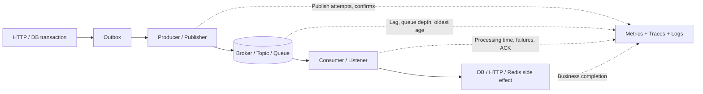
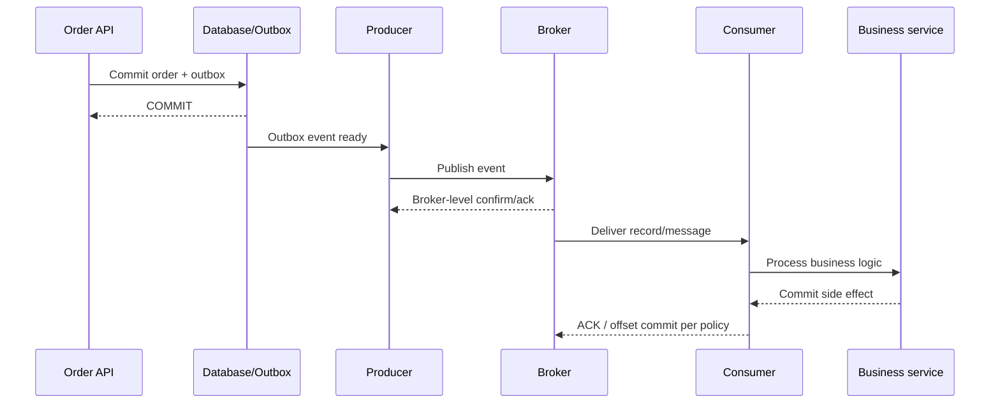
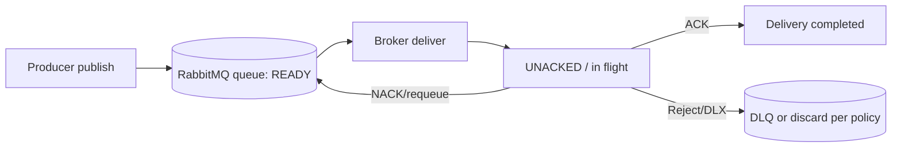
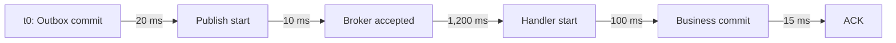
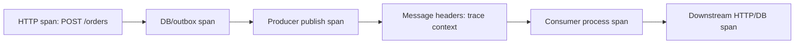
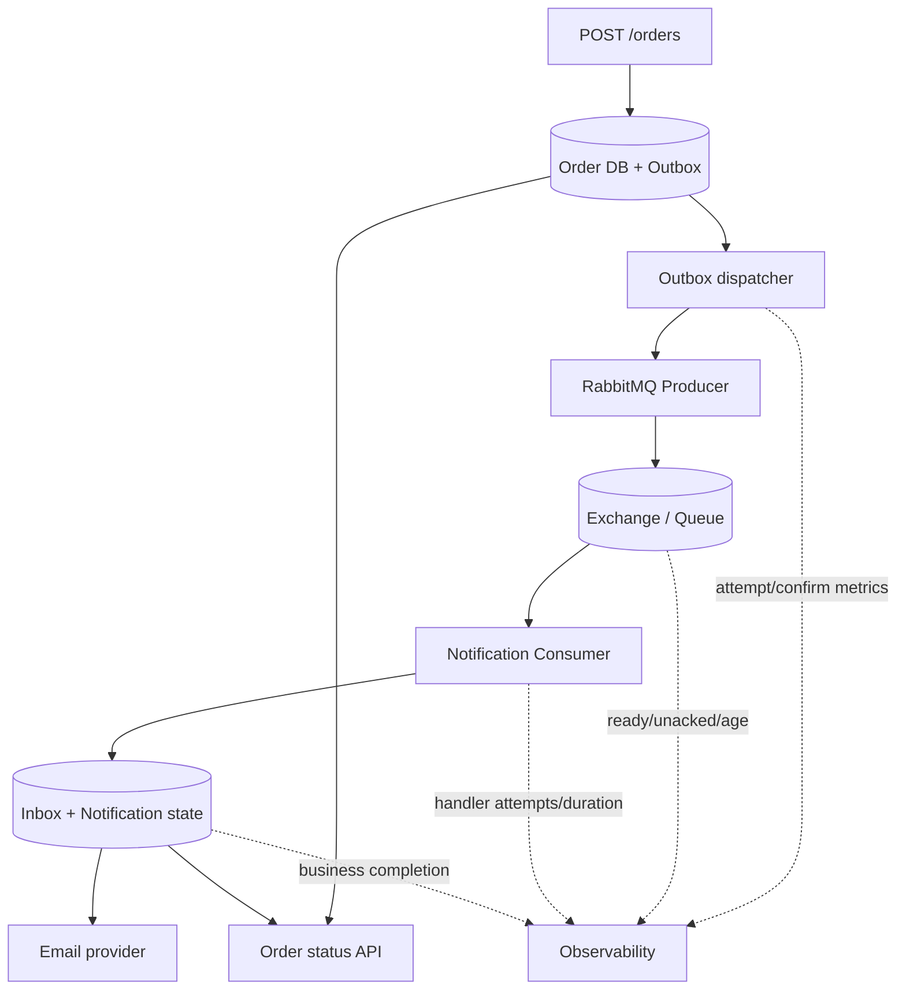

# Producer, Consumer, Lag, Queues, and Processing Time

## 1. Integration Observability Means Observing Work Across Multiple Boundaries

In the **SPRING_BOOT_INTEGRATION** module, Spring Boot does more than answer HTTP requests: it calls downstream APIs, accesses databases and Redis, publishes events through brokers, receives messages in Spring Integration, and runs asynchronous jobs. When an order has been created yet the email never arrives, the critical question is not simply **"is RabbitMQ/Kafka running?"**, but rather:

- Did the producer actually emit the event and did the broker confirm receipt of the publish?
- Was the event routed to the right queue/topic/partition?
- Has the consumer received the message, is it processing, failing, or waiting for redelivery?
- Is backlog/lag growing because the producer is faster than the consumer, because consumers stopped, or because a downstream database/API is slow?
- How much of total latency comes from **queue wait time** vs. **actual processing time**?
- Does message ACK/offset commit mean business work is complete?
- When a message is reprocessed, do metrics count **attempts** or **unique business operations**?

A complete view must link **producer → broker/queue → consumer → business side effect** and measure at each boundary. For critical systems, durable business operation state (order, report job, outbox/inbox) is also needed to reconcile final outcomes.



This lesson focuses on **"Producer, consumer, lag, queues, and processing time"** in the **Integration Observability** chapter. Examples primarily use **Spring Boot 3.x**, Spring AMQP/RabbitMQ, Spring for Apache Kafka, Spring Integration, and **Micrometer/Actuator**. Built-in metric names vary by library, version, and monitoring backend; custom metrics in this lesson use distinct names so they are not confused with framework defaults.

## 2. Define Milestones Before Building Dashboards

An event can pass through multiple steps:



Milestones to distinguish:

| Milestone | Meaning | How to measure/observe |
| --- | --- | --- |
| `t_created` | Business event created, e.g., OrderCreated | Outbox/event metadata |
| `t_publish_start` | Producer starts a publish attempt | Timer at adapter |
| `t_broker_accepted` | Broker confirms publish per transport mechanism | Publisher confirm/callback or producer acknowledgment |
| `t_delivered` | Broker delivers record/message to consumer | Listener/container or client instrumentation |
| `t_handler_start` | Business handler starts work | Timer at handler |
| `t_business_commit` | Business state committed | Database/service instrumentation |
| `t_ack_or_commit` | Consumer ACKs message or commits offset | Broker/client/consumer instrumentation |
| `t_completed` | Logical business operation reaches defined terminal state | Business database/job status |

**Do not collapse these milestones into a single "success".** A successful producer publish does not mean the queue has been consumed; consumer receipt does not mean the business transaction committed; ACK/offset commit does not automatically prove downstream HTTP/email side effects finished.

### 2.1. Three Crucial Latency Types

- **Publish latency:** time from starting a publish attempt to the defined signal (e.g., broker confirm). Do not lump outbox wait time into `RabbitTemplate` latency if the goal is to measure the broker itself.
- **Queueing/wait latency:** time a message is ready to be consumed before the handler starts. With Kafka, clearly define the record timestamp and processing start time.
- **Processing latency:** handler execution time, or time from handler start to **business commit**, depending on SLI. These two milestones can differ when async callbacks exist.
- **End-to-end completion latency:** from logical operation receipt/creation to true business state completion; includes outbox wait, publish, queue, retries, and side effects.

A dashboard showing only **handler duration = 50 ms** can look healthy while messages sit **20 minutes** in a queue. Measure both individual layers and end-to-end to spot bottlenecks.

## 3. Measuring Producers: Invocations, Publish Results, and Broker Acknowledgments

Producers are commonly written with `RabbitTemplate`, `KafkaTemplate`, JMS templates, or Spring Integration outbound adapters. At minimum, distinguish:

1. **Logical events created:** new events created in business/outbox, counted once per event ID.
2. **Publish attempts:** send attempts by the producer, including retries.
3. **Publish invocation errors:** exceptions thrown while encoding/submitting/sending.
4. **Broker acknowledgments/confirms:** broker reporting publish acceptance or rejection via its mechanism.
5. **Unroutable/returned messages:** broker accepted the publish yet found no matching queue when returns are enabled.
6. **Publish retries/exhaustion:** extra attempts and events that fail within the retry budget.
7. **Outbox backlog:** events committed in DB that have not yet been successfully published per defined criteria.

### 3.1. Table for Avoiding Conflated Signals

| Signal | What it proves | What it does NOT prove |
| --- | --- | --- |
| `RabbitTemplate.convertAndSend` returns | Call finished without throwing a synchronous exception | Broker persisted, routed, or consumer processed |
| RabbitMQ publisher confirm ACK | Broker confirmed publish via confirm mechanism | Consumer processed successfully |
| RabbitMQ returned message | Under mandatory/returns, publish could not route as expected | Another consumer might handle a different publish |
| Kafka producer callback succeeds | Record acknowledged by broker per producer `acks`/configuration | Consumer group processed, business DB committed |
| Outbox row `PENDING` | Event durably recorded in DB if transaction committed | Already published or will process immediately |
| HTTP 202 from API | API claims job accepted per contract | Worker finished |

**Publish attempts can exceed logical events** during network timeouts, broker failovers, or producer retries. Measure both and avoid counting every attempt as a new order.

### 3.2. Counting Producer Success Wrongly

Wrong:

```java
rabbitTemplate.convertAndSend(exchange, routingKey, event);
meterRegistry.counter("orders.published.success").increment();
```

At best, that counter expresses that **the method threw no synchronous error**; naming it `published.success` misleads operators into believing the broker confirmed and the event reached a queue. Better to name the metric after the **actually observed stage**, such as `integration.publish.invocations`, and measure broker confirmation separately via callback/future.

### 3.3. Errors That Can Happen Before the Broker

- JSON serialization failure: invalid event payload/schema.
- Invalid secret/TLS/DNS: connection cannot be established.
- Exhausted channel/connection pool: blocked or timed out.
- Producer rate-limited/backpressured at adapter.
- Broker accepted yet ACK/confirm arrives late or is lost.
- Wrong routing key/exchange/binding preventing delivery to the intended queue.

Classify these errors; raising retries will not cure permanent JSON schema bugs or invalid credentials.

## 4. RabbitMQ Producer: Confirms, Returns, Rate, and Latency

Illustrative Spring Boot configuration for publisher confirms and returns:

```yaml
spring:
  rabbitmq:
    publisher-confirm-type: correlated
    publisher-returns: true
    template:
      mandatory: true
```

- **Confirm ACK/NACK** tracks whether the broker accepted the publish.
- **Returns** help detect publishes routed to no queue under matching `mandatory` conditions.
- A publish can be confirmed ACK while also being returned because the exchange processed the publish yet could not route it.
- If the producer loses a confirm after the broker accepted the message, a retry can send a **duplicate**. Consumers must be idempotent.

Example callback configured **once at the telemetry owner**:

```java
package example.integration.observability;

import io.micrometer.core.instrument.MeterRegistry;
import org.springframework.amqp.rabbit.core.RabbitTemplate;
import org.springframework.stereotype.Component;

@Component
public class RabbitPublisherSignals {

    public RabbitPublisherSignals(
            RabbitTemplate template,
            MeterRegistry meters) {

        template.setConfirmCallback((correlation, ack, cause) -> {
            meters.counter(
                "integration.publish.confirmations",
                "broker", "rabbitmq",
                "result", ack ? "ack" : "nack"
            ).increment();

            // correlation.getId() can be used to look up the outbox event
            // in logs/traces; do not use it as a metric tag.
        });

        template.setReturnsCallback(returned -> {
            meters.counter(
                "integration.publish.returns",
                "broker", "rabbitmq",
                "reason", "unroutable"
            ).increment();
        });
    }
}
```

This code only records **broker signals**. It does not implement outbox transitions, publisher thread-safety, confirm timeouts, or DB update error handling. `RabbitTemplate` has shared callbacks; if another component in the project calls `setConfirmCallback`/`setReturnsCallback`, coordinate rather than silently overwriting. In versions supporting `CorrelationData#getFuture()`, per-publish confirm tracking can be structured around futures.

### 4.1. How Far Should Producer Latency Be Measured?

A timer around `convertAndSend(...)` measures **method entry to method return**, whereas broker confirms usually arrive asynchronously. To measure **publish-to-confirm**, store the start time by publish correlation ID and stop the timer when the confirm/future arrives, cleaning up on timeouts or process restarts.

Do not attach `eventId` to the metric timer. Correlation data can help find the event in logs/traces while keeping metric tags low-cardinality such as `broker=rabbitmq`, `operation=order_created`, `result=ack/nack/timeout`.

### 4.2. Broker Blocked Scenarios

RabbitMQ can trigger memory/disk alarms and block or throttle producers. Watch **publish-to-confirm latency**, blocked connection counts, queue ingress, and broker disk/memory. Adding more producer instances can intensify pressure on the broker. Apply rate limiting, outbox backlog monitoring, retry budgets, and capacity alerts.

## 5. Kafka Producer: Retries, `acks`, and Client Wait Time

With Spring Kafka, `KafkaTemplate.send(...)` typically returns a `CompletableFuture<SendResult<K,V>>` in compatible API lines. A successfully completed future signals the producer received a response per Kafka producer configuration; it is **not** consumer completion.

Example:

```java
package example.integration.observability;

import io.micrometer.core.instrument.MeterRegistry;
import java.util.concurrent.CompletableFuture;
import org.apache.kafka.clients.producer.ProducerRecord;
import org.springframework.kafka.core.KafkaTemplate;
import org.springframework.stereotype.Component;

@Component
public class OrderKafkaPublisher {

    private final KafkaTemplate<String, String> kafka;
    private final MeterRegistry meters;

    public OrderKafkaPublisher(
            KafkaTemplate<String, String> kafka,
            MeterRegistry meters) {
        this.kafka = kafka;
        this.meters = meters;
    }

    public CompletableFuture<Void> publish(
            String eventId, String json) {

        ProducerRecord<String, String> record =
            new ProducerRecord<>(
                "orders.events",
                eventId,
                json
            );

        meters.counter(
            "integration.publish.invocations",
            "broker", "kafka",
            "operation", "order_created"
        ).increment();

        return kafka.send(record)
            .handle((result, error) -> {
                meters.counter(
                    "integration.publish.outcomes",
                    "broker", "kafka",
                    "result", error == null ? "ack" : "error"
                ).increment();

                if (error != null) {
                    throw new java.util.concurrent.CompletionException(
                        error
                    );
                }
                return null;
            });
    }
}
```

The example assumes the Kafka producer and serializer are configured for `String` keys/values; `json` is JSON validated/serialized per contract. `eventId` is used as the key to aid partitioning/deduplication, which **does not guarantee Kafka automatically eliminates all duplicates at the consumer**.

### 5.1. Kafka Client Metrics Do Not Equal Business Metrics

Kafka producer/JMX/Micrometer metrics can expose signals such as:

- record send rate, record error rate, and retry rate;
- request latency, batch size, buffer pool wait;
- record queue time in the client before sending;
- records/batches acknowledged by brokers per `acks`.

Actual meter names, tags, and exposure depend on Spring Boot/Kafka client versions and instrumentation. **Never author alerts for a metric name that has not been observed on the live monitoring endpoint.**

### 5.2. Producer `acks` Differ from SLA Durability

`acks=all` and an idempotent producer can raise durability at the Kafka layer depending on broker/topic configuration. Even so, failure windows remain between **database commit – Kafka publish – consumer side effect**. For critical business events, transactional outbox and consumer inbox/reconciliation remain essential tools.

If a callback fails after a timeout, distinguish "broker definitely rejected" from "unknown whether it was written". Retries must keep business `eventId` stable.

## 6. Observing Consumers: Received, Processing, Commit/Ack, and Final Outcome

A consumer is more than the count of "messages read". A listener can:

- Receive a message before starting business logic.
- Fail JSON decoding **before the handler is invoked**.
- Call downstream HTTP and wait on a timeout.
- Commit the database successfully, then crash before broker ACK.
- ACK/commit offset while the actual job remains `PENDING` in another system.
- Receive the same event ID again and skip it via inbox/deduplication.
- Exhaust retries and route the message to a DLQ.

Therefore, measure **at least two layers**:

1. **Transport attempts:** deliveries/polls, listener invocations, acks/commits, retries, redeliveries.
2. **Business outcomes:** unique events processed successfully, duplicates skipped, permanently failed, retry pending, and completion latency.

| Signal | Meaning | Possible misconception |
| --- | --- | --- |
| Messages delivered | Broker delivered message to consumer | Not yet processed |
| Listener invocations | Handler started running | Could be the Nth attempt of the same message |
| Business commits | Durable business state change recorded | Broker ACK not yet guaranteed |
| Broker ACK / committed offset | Consumer advanced delivery state | Does not prove all external side effects finished |
| Redelivery/retry | Message executed again | Not necessarily a new logical event |
| DLQ count | Message isolated per policy | Does not prove operators resolved it |
| Inbox duplicates | Received an already-processed event | May indicate protection working properly |

### 6.1. Place Timers Before or After JSON Conversion?

A timer **inside a `@RabbitListener` method** misses broker delivery time, adapter conversion, and failures occurring before method entry. For latency across the entire listener container, use appropriately configured container/observation instrumentation.

Similarly, a timer around `@KafkaListener` measures the business handler, not automatically polling, deserialization, rebalances, fetch waits, or offset commits.

**Name metrics after their true measurement scope**: `consumer.handler.duration` differs from `consumer.end_to_end.duration`.

## 7. Kafka Consumer Lag: Formula, Interpretation, and Limits

**Kafka consumer lag** is commonly understood as the number of records in a consumer group **not yet marked processed via committed offsets**, calculated per partition.

Common formula:

\[
\text{lag}_{g,p} =
\max(0,\; \text{endOffset}_{p} - \text{committedOffset}_{g,p})
\]

Where:

- `g`: consumer group;
- `p`: partition;
- `endOffset`: end offset per the measurement API used (typically the offset of the next record at the visible end of the log, not an event ID);
- `committedOffset`: the **next offset to read** saved by the group;
- `lag`: number of records remaining past the committed point under this calculation.

Example:

```text
Topic: orders.events, partition 2
End offset              = 1,250
Committed group offset  = 1,200
Group/partition lag     =    50 records
```

If a topic has three partitions, total group lag is usually the sum across partitions **when all are observed consistently**. A single heavily lagging partition can be masked when looking only at the total.

### 7.1. Committed-Offset Lag Differs from Poll-Position Lag

A Kafka consumer has both a `position` (the next offset the consumer will fetch) and a `committed offset` (saved progress for the group). The two values **are not always equal**.

For example, a consumer may have polled 100 records into memory, advancing `position` quickly; while the business handler is still working and offsets remain uncommitted, committed-offset lag stays high. Some Kafka client metrics (such as `records-lag-max`) reflect consumer-side lag by client rules, **not necessarily matching** an exporter calculating from committed offsets.

When reading dashboards, know whether the metric comes from:

- Broker/consumer-group offset exporter;
- Kafka consumer client/JMX;
- Spring Kafka listener/observation;
- A monitoring platform computing from partitions/offsets.

Do not merge these numbers into one SLI without confirming how each is computed.

### 7.2. Zero Lag Can Be False Reassurance

Cases include:

1. No new data is arriving on the topic while a business job remains `FAILED`.
2. The consumer committed offsets **before** the transaction/business side effect finished.
3. Messages were filtered/dropped by policy without producing the expected outcome.
4. The consumer is keeping up because the producer source/outbox is stalled and not pushing new events to Kafka.
5. The consumer group does not exist or has not committed offsets; monitoring must treat that state as **unknown** rather than defaulting to 0.

**Kafka lag measures log consumption progress, not business completeness.** For critical events, pair with inbox/outbox and business-outcome metrics to reconcile.

### 7.3. Record Lag Differs from Time Lag

`lag = 1,000` can mean a few seconds in a group processing 10,000 records/s, or hours if processing 1 record/s. To measure user-perceived delay, add:

- **Age of the oldest unprocessed record**, using timestamps/processing checkpoints with clear semantics;
- **Time behind head**, measured by when data was created/appended to the log;
- **End-to-end completion age** from business event to final business status.

Kafka record timestamps can be `CreateTime` or `LogAppendTime` depending on topic/broker settings; producer and consumer clocks can skew. Do not treat an arbitrary timestamp subtraction as exact queueing latency.

## 8. RabbitMQ: Ready, Unacked, and Queues Differ from Kafka Lag

RabbitMQ queues typically expose:

- **Ready messages:** messages sitting in the queue ready to be delivered to consumers.
- **Unacknowledged messages:** messages delivered yet awaiting ACK/NACK per broker state.
- **Total messages:** in common displays, close to `ready + unacked`; depending on API/queue type and snapshot timing, observable differences may occur.
- **Publish/deliver/ack/redeliver rates:** rates at each stage.
- **Consumers/connection/channel state:** active consumers and whether the broker faces resource limits.



RabbitMQ **does not use consumer-group committed offsets like Kafka**, so there is no direct equivalent of "record lag". Express RabbitMQ backlog using `ready`, `unacked`, message age, and processing rate.

### 8.1. `ready = 0` Does Not Guarantee Health

Suppose:

```text
ready             = 0
unacked           = 500
consumer count    = 5
ack rate          = 0 messages/s
oldest inflight   = 10 minutes
```

The broker delivered all messages, yet consumers may be hung on HTTP/DB calls or prefetch may be too large. Looking only at `ready=0` hides the problem. Monitor `unacked`, handler duration, timeouts, acknowledgments, and consumer concurrency/prefetch together.

### 8.2. What Does High Ready with Low Unacked Mean?

Possible causes:

- No consumers or consumers failed to subscribe.
- Too few consumers relative to producer rate.
- Broker paused delivery due to connection/channel/flow control.
- Abnormal traffic on queue bindings/routing.
- Listener crashes, requeue loops, or slow downstream dependencies.

Do not blindly raise prefetch/concurrency when the database is overloaded. Increasing `unacked` holds more messages in consumer memory without increasing business commits.

### 8.3. Message Age Is Not Always Available Out of the Box

Many monitoring setups expose `messages_ready` and `messages_unacknowledged` yet **do not immediately provide head-of-queue message age based on true business event time**. To measure age, you can:

- Carry `occurredAt`/`enqueuedAt` in the event contract;
- Measure inside the consumer when processing starts;
- Persist event/job status in the database and query oldest pending age;
- Use supported queue telemetry/plugins and verify their semantics.

Do not build a Prometheus alert `oldest_message_age` from a nonexistent metric or across uncalibrated host clocks.

## 9. JMS/Artemis and Spring Integration: Backlog Must Match the Transport

JMS has `JMSMessageID`, `JMSCorrelationID`, and its own acknowledgment/transaction semantics. Artemis/ActiveMQ expose queue depth, delivering count, consumer count, scheduled messages, and DLQs through broker management.

Do not copy Kafka's `end offset - committed offset` formula onto JMS queues. When building dashboards for JMS:

- Count broker enqueued/dequeued/acknowledged messages;
- Monitor queued/delivering/expired/DLQ counts;
- Measure application handler/transaction processing time;
- Track transaction rollbacks/redeliveries and broker failovers;
- Attach stable business message IDs when deduplication is needed.

For **Spring Integration** in-process:

| Channel | What to measure? | Observation risks |
| --- | --- | --- |
| `DirectChannel` | Send/handler duration, exceptions on caller | Synchronous call, no queue backlog |
| `ExecutorChannel` | Task acceptance, executor active/queue/rejections, worker errors | `send()` returning true does not prove handler completed |
| `QueueChannel` | Channel queue depth, receive wait, poller rate | In-memory queue does not survive restarts by itself |
| `PublishSubscribeChannel` | Fan-out/subscriber latency, error handling | One logical message can trigger multiple handler attempts |
| JDBC/AMQP/Kafka adapters | Adapter I/O, broker/client metrics, error channel | Handler metrics and broker metrics may measure different stages |

Spring Integration supports management, metrics, and observations for many endpoints/channels depending on configuration. On your running version, verify **component instrumentation is actually enabled** and emits concrete meters/observations rather than assuming every created channel emits everything automatically.

## 10. Breaking Down Latency: Publish, Queue Wait, Processing, and End-to-End

Illustrative timeline for an `OrderCreated` event:

| Timestamp | Action |
| --- | --- |
| 09:00:00.000 | Order DB commit and outbox event `evt-1024` ready |
| 09:00:00.020 | Publisher begins sending |
| 09:00:00.030 | Broker accepts/confirms |
| 09:00:01.230 | Consumer starts handler |
| 09:00:01.330 | Business DB commit |
| 09:00:01.345 | ACK/offset commit completes |

Assuming synchronized component clocks and milestones matching the intended stages:

- **Outbox-to-publish-start:** 20 ms.
- **Publish-to-confirm:** 10 ms.
- **Broker-accept-to-handler-start:** 1,200 ms.
- **Handler-start-to-business-commit:** 100 ms.
- **Commit-to-ack:** 15 ms.
- **Outbox-to-ack:** 1,345 ms.



Seeing **handler = 100 ms** alone could waste effort optimizing the database; most of the latency is **queue wait = 1,200 ms**.

### 10.1. Using Clocks Properly

Within the **same JVM**, measure durations with `Timer`/monotonic clocks supported by instrumentation rather than subtracting two system-clock timestamps. Across **two different machines**, subtracting a producer timestamp from a consumer timestamp depends on NTP/clock skew and timestamp semantics.

When measuring cross-process durations:

1. Clearly define event `occurredAt` and "enqueued/accepted" milestones.
2. Monitor clock skew.
3. Document acceptable error margins on the metric.
4. Prevent negative durations caused by clock skew from corrupting statistics.
5. For very tight SLOs, consider recording state milestones in one authoritative store or using traces with verified semantics.

### 10.2. Queueing Delay Can Span Multiple Queues

In a workflow with an outbox and broker:

```text
DB outbox PENDING
   ↓ waiting for dispatcher
Producer client buffer
   ↓ waiting for send/ACK
Broker queue / topic
   ↓ waiting for consumer
Consumer poll/prefetch buffer
   ↓ waiting for worker
Handler
   ↓ waiting for HTTP/DB/Redis
Business commit
```

Do not call the sum of all those queues "RabbitMQ queue wait" if data only shows the event was created long before the consumer started. Label metrics specifically enough to drive fixes at the right layer.

## 11. Processing Capacity: Arrival Rate, Service Rate, and Backlog Growth

A practical formula for continuous streams:

\[
\Delta B \approx (\lambda - \mu)\times \Delta t
\]

Where:

- `B`: remaining backlog of work;
- `λ`: producer arrival rate (events/s);
- `μ`: consumer **completion rate** (events/s), ideally business completion rather than mere delivery;
- `Δt`: observation interval.

For example, the producer sends 900 events/s while the consumer completes 600 events/s. Over 10 minutes, assuming steady rates and no throttling/dropping:

\[
\Delta B \approx (900-600)\times 600=180{,}000
\]

Backlog grows by roughly **180,000 events**, even while both producer and consumer report "UP".

### 11.1. Estimating Queue Drain Time

If the producer stops and the consumer steadily completes 600 events/s, a 180,000-event backlog takes roughly:

\[
T_{\text{drain}}\approx \frac{180{,}000}{600}=300\text{ s}=5\text{ minutes}
\]

If the producer keeps sending 400 events/s, the **net drain rate** drops to 200 events/s, so draining takes around 900 seconds (15 minutes), ignoring retries, bursts, and capacity changes.

This figure is a **conditional estimate**, not a guaranteed real-time duration. Kafka partitions, DB locks, poison messages, retry delays, and ordering constraints can all cause throughput to fluctuate.

### 11.2. Little's Law: Do Not Apply Unconditionally

In a relatively stable system with arrival/completion rate `λ` and average time an item spends in the system `W`:

\[
L=\lambda W
\]

`L` is the average number of items within the measured scope; `W` is the average time from entry to exit over the **same scope**. The formula requires steady state/flow conservation and consistent measurements. Do not apply it directly while backlog is surging, retry amplification is occurring, or jobs are dropped without accounting.

### 11.3. Scaling Choices

| Signal | Action to consider | Warning |
| --- | --- | --- |
| Kafka lag rising across all partitions | Add consumer capacity, optimize handlers | Consumer group parallelism is capped by partition count |
| One partition lagging far behind | Inspect key skew, slow records, ordering | Adding consumers will not help if that partition keeps one assignment |
| RabbitMQ ready rising, unacked low | Check consumer count/connections, rates | Raising prefetch alone may not be the fix |
| RabbitMQ unacked rising, ACK rate dropping | Check handler timeouts, database/HTTP saturation | Raising prefetch increases in-flight memory footprint |
| Consumer CPU high | Optimize JSON, batch I/O, scale workers if headroom exists | Check GC/memory |
| High DB pool wait | Tune queries/connections/throughput, add backpressure | Scaling consumers only increases contention |
| Producer confirm latency rising | Check broker memory/disk alarms, network | Aggressive retries worsen the incident |

**Scaling consumers only helps when the true bottleneck is at the consumer and downstream still has capacity.** When strict ordering by a business key is required, increasing partitions/consumers also requires considering ordering semantics and key migration.

## 12. Spring Boot Actuator and Micrometer: The Measurement Foundation

A Spring Boot application should have a unified way to export metrics, traces, and logs. **Micrometer** provides the meter APIs, and Spring Boot Actuator integrates exporting to the chosen registry.

Illustrative Maven dependencies:

```xml
<dependency>
    <groupId>org.springframework.boot</groupId>
    <artifactId>spring-boot-starter-actuator</artifactId>
</dependency>
<dependency>
    <groupId>io.micrometer</groupId>
    <artifactId>micrometer-registry-prometheus</artifactId>
    <scope>runtime</scope>
</dependency>
```

Other backends like OTLP/Graphite/Datadog can be used depending on infrastructure; Prometheus is not mandatory. Example configuration:

```yaml
spring:
  application:
    name: order-service

management:
  endpoints:
    web:
      exposure:
        include: health,info,prometheus
  metrics:
    tags:
      application: ${spring.application.name}
```

This configuration only illustrates exposing `/actuator/prometheus` when a matching Prometheus registry exists. **Never expose Actuator/Prometheus endpoints to the public Internet without authentication or network restrictions.** In production, use a separate management port/network, authentication, and scraping policies.

### 12.1. Using Counter, Timer, Gauge, and DistributionSummary Properly

| Meter | Use for | Examples |
| --- | --- | --- |
| `Counter` | Cumulative events; monitoring computes rates over intervals | publish attempts, consumer failures, DLQ sends |
| `Timer` | Processing time of a defined scope; tracks count/total time | handler duration, publish-to-confirm |
| `Gauge` | Instantaneous state updated by a source | current outbox pending, active jobs |
| `DistributionSummary` | Distribution of non-duration values | payload byte size, batch item count |
| `LongTaskTimer` | Long-running work where active count and elapsed time matter | multi-minute batch jobs |

Do not use `Timer.count` in place of unique business events if the handler retries; it counts timer stops, which usually equals **invocations/attempts**.

### 12.2. Meter Naming and Tag Patterns

Application-defined names used in this lesson:

```text
integration.publish.invocations
integration.publish.confirmations
integration.publish.returns
integration.consumer.attempts
integration.consumer.processing.duration
integration.business.completions
integration.outbox.pending
integration.jobs.active
```

Low-cardinality tags should look like:

```text
broker = rabbitmq | kafka
operation = order_created | notification_sent | report_exported
result = success | transient_failure | permanent_failure | duplicate
consumer = notification_service | billing_service
```

Avoid:

```text
eventId = evt-1024
orderId = ord-1024
userId = cus-17
url = /orders/ord-1024
exceptionMessage = "requestId=..."
```

These values generate millions of time series, overloading the metrics backend and leaking PII. Put IDs into access-controlled traces/logs, never into metric labels.

## 13. Code Example: Measuring a Consumer Business Handler with Timer and Counter

Suppose Notification Service consumes `OrderCreatedEvent` from RabbitMQ. Metrics must answer: **how long does the handler take and what is the success/failure rate per attempt?**

DTO and business service:

```java
package example.integration.notifications;

public record OrderCreatedEvent(
    String eventId,
    String orderId,
    int schemaVersion
) {}

public interface OrderHandler {
    void processIdempotently(OrderCreatedEvent event);
}
```

Illustrative listener:

```java
package example.integration.notifications;

import io.micrometer.core.instrument.MeterRegistry;
import io.micrometer.core.instrument.Timer;
import org.springframework.amqp.rabbit.annotation.RabbitListener;
import org.springframework.stereotype.Component;

@Component
public class OrderEventConsumer {

    private final OrderHandler handler;
    private final MeterRegistry meters;

    public OrderEventConsumer(
            OrderHandler handler,
            MeterRegistry meters) {
        this.handler = handler;
        this.meters = meters;
    }

    @RabbitListener(queues = "notification.order-created")
    public void onEvent(OrderCreatedEvent event) {
        Timer.Sample sample = Timer.start(meters);
        String outcome = "success";

        try {
            if (event == null
                    || event.eventId() == null
                    || event.schemaVersion() != 1) {
                outcome = "permanent_failure";
                throw new IllegalArgumentException(
                    "Invalid OrderCreated event"
                );
            }

            handler.processIdempotently(event);
        } catch (RuntimeException ex) {
            if ("success".equals(outcome)) {
                outcome = "failure";
            }
            throw ex;
        } finally {
            sample.stop(
                Timer.builder(
                    "integration.consumer.processing.duration"
                )
                .description("Time spent in OrderCreated handler")
                .tag("consumer", "notification_service")
                .tag("result", outcome)
                .register(meters)
            );

            meters.counter(
                "integration.consumer.attempts",
                "consumer", "notification_service",
                "result", outcome
            ).increment();
        }
    }
}
```

**Measurement scope:** from method entry until the handler returns or throws. The timer excludes broker queue wait time, JSON conversion before method invocation, broker acknowledgment afterward, or actual email delivery if `handler` only enqueues another task.

If `processIdempotently` returns a result distinguishing **newly_processed** from **duplicate_skipped**, record a dedicated outcome for duplicates; do not treat duplicate redelivery as a new successful business event. For permanent errors, the container requires a DLQ/quarantine policy; throwing `IllegalArgumentException` **does not automatically create a DLQ**.

### 13.1. Do Not Use High-Cardinality Tags

Wrong:

```java
Timer.builder("integration.consumer.processing.duration")
    .tag("eventId", event.eventId())
    .register(meters);
```

Better: tag `consumer`, `event_type`, and `result` from a bounded allowlist, while recording `eventId` in structured logs/spans within defined access and retention boundaries.

### 13.2. Measure Completions Separately from Attempts

A consumer might receive the same `eventId` three times: attempt 1 times out, attempt 2 commits successfully, and attempt 3 is a duplicate redelivery. Then:

```text
consumer attempts                  = 3
business completions (new event)   = 1
duplicate skips                    = 1
transient failures                 = 1
```

Increment `integration.business.completions` **at the actual business commit point**, after the idempotency check and durable result are confirmed. Incrementing before commit causes rollbacks to record false successes. If deriving counts from database success states, avoid double-counting when jobs reprocess.

## 14. Measuring Outbox Backlog and Unpublished Event Age

Many systems have a queue **before the broker**: a transactional outbox table. If the publisher dies, Kafka lag can read 0 and RabbitMQ ready can read 0, yet new orders emit no events.

Illustrative outbox table:

```sql
CREATE TABLE integration_outbox (
    event_id VARCHAR(64) PRIMARY KEY,
    event_type VARCHAR(80) NOT NULL,
    status VARCHAR(24) NOT NULL,
    created_at TIMESTAMP WITH TIME ZONE NOT NULL,
    next_attempt_at TIMESTAMP WITH TIME ZONE,
    attempts INTEGER NOT NULL DEFAULT 0,
    payload_json TEXT NOT NULL
);
```

Useful queries:

```sql
-- Pending event count:
SELECT COUNT(*)
FROM integration_outbox
WHERE status IN ('PENDING', 'RETRY_PENDING');

-- Oldest waiting event:
SELECT MIN(created_at)
FROM integration_outbox
WHERE status IN ('PENDING', 'RETRY_PENDING');

-- Failed event count by type:
SELECT event_type, COUNT(*)
FROM integration_outbox
WHERE status = 'FAILED'
GROUP BY event_type;
```

Make clear that `MIN(created_at)` yields the **oldest creation timestamp**, not a duration. `oldest_pending_age` must be calculated relative to observation time, e.g., in the DB/query service, with explicit timezones.

### 14.1. Be Careful with DB-Query Gauges

A `Gauge` whose callback runs `COUNT(*)` on every scrape can cause multiple replicas to simultaneously run expensive queries on a large outbox table. In production you can:

- Create appropriate status/time indexes;
- Persist/update a bounded scheduled count/age snapshot;
- Use periodic cached queries with timeouts;
- Scrape through a dedicated exporter/job instead of every app instance;
- Separate DB-wide aggregates from per-instance metrics to avoid N-fold double counting.

If every instance reports the **same whole-table pending count**, Prometheus `sum` across instances multiplies the count by N. Define ownership and aggregation semantics clearly.

### 14.2. Reconciliation Measures Correctness

Beyond `outbox pending`, run a reconciliation job checking:

- Orders committed with no matching outbox row;
- Outbox rows marked SENT with no downstream completion after the SLA;
- Business operations stuck in FAILED too long without reprocessing;
- Duplicate side effects despite inbox design.

A system with "clean" queues and lag can still lose business data at transaction boundaries; reconciliation exposes those gaps.

## 15. Traces and Correlation Across Producer, Broker, and Consumer

Metrics reveal trends; **distributed traces** follow a single logical operation across hops. With Spring Boot Actuator, Micrometer Observation/Tracing, and a configured tracing bridge/exporter, HTTP clients and some messaging instrumentations can create spans and propagate context.

However, **do not assume every Spring Integration adapter, RabbitMQ listener, or Kafka listener has tracing enabled by default**. Depending on version and setup, you must enable observation/instrumentation on the respective components and verify trace context passes through header mappers.



### 15.1. Three Kinds of IDs That Must Not Be Merged

| ID | Origin | Purpose |
| --- | --- | --- |
| `traceId` | Tracing instrumentation | Link spans for diagnostics |
| `correlationId` | Gateway/integration contract | Group steps of a request/workflow |
| `eventId` | Business producer/outbox | Dedupe/replay a stable event |
| `messageId` | Transport/framework or app | Identify message/record at technical layer |
| `jobId` | Job API/batch store | Query status of a job |

A republished event can create a **new trace span** while still preserving its **`eventId`** for deduplication. Never use `traceId` in place of an inbox unique constraint.

### 15.2. Safe and Accurate Propagation

When sending messages over a broker:

1. Propagate trace context via supported instrumentation rather than blindly copying every HTTP header.
2. Forward only allowlisted headers; never leak `Authorization`, cookies, or security context objects.
3. Keep `eventId`/`schemaVersion` in the business contract so consumers remain independent of tracing frameworks.
4. For retries/redeliveries, record new spans/attempts linked appropriately to the original event.
5. If tracing is sampled out or the exporter is down, the business flow must still execute.

**MDC/ThreadLocal does not automatically cross ExecutorChannel, Reactor pipelines, or listener threads.** Use library-supported context propagation and test async boundaries rather than relying on leftover thread state.

### 15.3. Do Not Log Raw Payloads for "Quick Investigation"

Events can contain PII, payment data, credentials, or tenant details. Logs/traces should record permitted fields such as event type, schema version, sanitized error category, and business IDs under proper retention and access controls; avoid dumping all headers, stack traces with secrets, or raw JSON bodies by default.

## 16. Dashboards and SLIs/SLOs by Business Outcome

An operational dashboard should read in order: **business health → backlog → technical causes**.

| Panel | Data | Question answered |
| --- | --- | --- |
| Business completion rate | Unique events/jobs completed over time | Are users getting final results on time? |
| End-to-end latency p50/p95/p99 | From accepted/created to completed | Is the SLO breached? |
| Outbox pending + oldest age | Count and age of events waiting to publish | Is work stuck before the broker? |
| Producer attempts vs. confirmed | Attempts, ACK/NACK, returns, timeouts | Is the broker accepting/routing publishes? |
| Broker backlog | Kafka committed-offset lag or RabbitMQ ready/unacked | Where are events queued/in-flight? |
| Consumer processing duration | Handler timer by bounded event type/result | Is the handler slow or is the queue slow? |
| Consumer success/error/duplicate | Attempts separated from business outcomes | Are retries causing extra side effects? |
| DLQ / permanent failures | Counts, oldest failed age | Are there poison messages needing intervention? |
| DB/HTTP/Redis dependency health | Latency, errors, connection saturation | Which downstream limits throughput? |
| Capacity/utilization | Consumer threads, Kafka partitions, pool wait | Will scaling actually help? |

### 16.1. Examples of Verifiable SLOs

Instead of "the broker must be fast", define:

- **99% of `OrderCreated` events are successfully processed by Notification Service within 2 minutes of order commit.**
- **No outbox event remains PENDING longer than 5 minutes**, excluding announced maintenance windows.
- **Consumer permanent failure rate stays below 0.1%** of total logical events, not counting retries as new events.
- **Kafka lag/queue age** stays bounded per critical consumer, not just cluster-wide totals.

SLOs must specify denominators, data sources, timestamps, exclusion rules, and time windows. Measuring only completed jobs hides "stuck/missing" jobs from latency distributions; pair with oldest pending age and reconciliation.

### 16.2. Combined Alerts Beat Single-Number Alerts

Examples:

- **RabbitMQ ready rising + low ack rate + rising handler latency** → suspect slow downstream / consumer saturation.
- **RabbitMQ ready rising + consumer count = 0** → suspect listeners down or disconnected.
- **High unacked + near-zero ack rate** → inspect stuck handlers / prefetch.
- **Kafka committed lag steadily rising + consumer rebalances/errors** → inspect group assignments and failures.
- **Outbox oldest age rising + broker backlog still 0** → producer/dispatcher is the bottleneck.
- **Low business completion + zero broker lag** → inspect ack/commit semantics, filtering/drops, and downstream failures.

Do not apply a single `lag > 1000` threshold across every topic/queue: throughput and SLOs vary. Combine backlog **age**, growth rate, and business criticality.

## 17. Testing Instrumentation and Scope Timing

### 17.1. Unit Testing with `SimpleMeterRegistry`

`SimpleMeterRegistry` verifies metric updates without needing a Prometheus server. Using `OrderEventConsumer` from Section 13:

```java
package example.integration.notifications;

import static org.assertj.core.api.Assertions.assertThat;

import io.micrometer.core.instrument.simple.SimpleMeterRegistry;
import org.junit.jupiter.api.Test;

class OrderEventConsumerMetricsTest {

    @Test
    void recordsSuccessfulInvocation() {
        SimpleMeterRegistry meters = new SimpleMeterRegistry();

        OrderHandler handler = event -> {
            // Fake business operation for unit test only.
        };

        OrderEventConsumer consumer =
            new OrderEventConsumer(handler, meters);

        consumer.onEvent(
            new OrderCreatedEvent("evt-1024", "ord-1024", 1)
        );

        var attempts = meters.find(
            "integration.consumer.attempts"
        )
            .tag("consumer", "notification_service")
            .tag("result", "success")
            .counter();

        var duration = meters.find(
            "integration.consumer.processing.duration"
        )
            .tag("consumer", "notification_service")
            .tag("result", "success")
            .timer();

        assertThat(attempts).isNotNull();
        assertThat(attempts.count()).isEqualTo(1.0);

        assertThat(duration).isNotNull();
        assertThat(duration.count()).isEqualTo(1);
    }
}
```

This test verifies **custom handler metrics**. It does not test JSON conversion before the listener, RabbitMQ delivery/ACK, Kafka offsets, or exporters. A failure test should assert `result=failure` metrics and that exceptions are not swallowed.

### 17.2. Integration Tests with a Real Broker

Use Testcontainers or a managed test broker to verify:

1. Producer emits an event with stable `eventId` and valid schema.
2. Broker confirms publish/routing per policy; target queue/topic actually receives data.
3. Listener receives, decodes, processes, and commits state.
4. Re-sending the same event ID → inbox deduplicates; business count remains 1.
5. Induce handler failure before commit → bounded message retry/redelivery.
6. Induce JSON error before handler → DLQ/quarantine; handler timer records no sample for the malformed message.
7. Stop producer → outbox pending/oldest age rises, while **broker lag may not rise**.
8. Stop consumer → RabbitMQ ready or Kafka group lag rises per semantics.
9. Slow down handler → RabbitMQ unacked/Kafka in-flight and processing duration shift.
10. Restart broker/consumer → logical operation completes accurately with no duplicate side effects.

### 17.3. Avoid Brittle `Thread.sleep` Latency Tests

To test handler duration, use a controllable fake dependency, a `Clock` abstraction for business timestamps, or wide tolerance bounds in integration tests. For queueing latency, pause the consumer while publishing messages; do not assume millisecond precision in CI schedulers.

For Kafka lag, use APIs to read beginning/end/committed offsets and await conditions with a bounded timeout; never assert exact lag immediately after publish since producer flushing, fetching, and commits are asynchronous.

## 18. Runbook: Investigating "Message Sent but Not Processed"

**Step 1 — Identify the logical event.** Grab `eventId`/`jobId` from the request or outbox rather than searching by a random Kafka offset. Verify the source transaction committed.

**Step 2 — Check pre-broker state.** Does the outbox row exist? Is it `PENDING` or `SENT`? Are there publisher attempts, broker confirms/returns, serialization errors, or credential errors?

**Step 3 — Check routing and broker.** For RabbitMQ, verify exchange/binding/routing key and queue `ready`/`unacked`. For Kafka, verify topic/partition/key, producer ACK, and consumer-group committed offsets/lag.

**Step 4 — Check consumer.** Are listeners/containers running? Check consumer count/group assignment/rebalances. Did the handler start, stall on DB/HTTP, or fail decoding before method entry?

**Step 5 — Check side effects.** Do the business DB/inbox/job stores show results and audits? Did a failure happen after commit and before ACK? Was a duplicate redelivery safely skipped?

**Step 6 — Check recovery.** Were retry budgets, delayed queues, DLQ/parking lots, Kafka DLT, or FAILED states updated properly? Is there a safe replay tool that preserves `eventId` and enforces idempotency?

### 18.1. Common False Conclusions

| Plausible-sounding claim | Why it is insufficient | What else to measure |
| --- | --- | --- |
| "Got HTTP 202, processing is done." | 202 only confirms job acceptance per contract | Durable job state/completion |
| "Producer didn't throw, message is in the queue." | Publish may lack confirm or fail routing | Confirms/returns, queue ingress |
| "Kafka lag is 0, no problems." | Offsets may commit before business completion | Inbox/business status, failures |
| "RabbitMQ ready is 0, queue is drained." | Many unacked messages may be stuck | Unacked, ACK rate, handler duration |
| "Consumer reads 10,000 msg/s, throughput is 10,000." | May include retries, duplicates, or failures | Unique business completions/s |
| "Handler p95 is 30 ms, end-to-end is fast." | Queue/outbox waits are outside the handler timer | Oldest age, completion latency |
| "Increase concurrency to clear the backlog." | Downstream DB/HTTP may already be saturated | Pool wait, dependency latency |
| "Add eventId as a metric tag for fast debugging." | Cardinality/cost explosion and PII exposure | Use traces/logs instead of metric labels |

## 19. End-to-End Scenario: Order Service → RabbitMQ → Notification Service

Suppose Order Service uses Spring Boot MVC, JPA/PostgreSQL, and a transactional outbox. After saving an order, a publisher sends `OrderCreated` as JSON to RabbitMQ. Notification Service reads from the queue, records an inbox entry, and calls an Email API. Redis caches order status while the DB remains the source of truth.



### 19.1. Minimal SLI Set

| SLI | Measurement point | Meaning |
| --- | --- | --- |
| `order_created_total` | After Order DB commit | Count of new logical orders |
| `outbox_pending` + `oldest_age` | Outbox store | Whether publishing is backed up |
| `publish_attempts_total` | Dispatcher | Actual send attempts |
| `publish_confirm_ack/nack` + returns | Producer callbacks | Broker acceptance and routing |
| `rabbit_queue_ready/unacked` | RabbitMQ management/exporter | Waiting for delivery vs. delivered unacked |
| `notification_handler_seconds` | Consumer handler | Processing time per invocation |
| `notification_completed_total` | Business state after commit | Unique successful notifications |
| `notification_failed/duplicate_total` | Inbox/error recovery | True failures and dedupes |
| `created_to_notification_completed_seconds` | Business operation lifecycle | End-to-end SLO |

These names are **illustrative SLI/meter conventions**, not a claim that RabbitMQ exporters or Spring Boot emit those exact names automatically. When implementing, map to actual exporter/registry names and check labels/aggregations.

### 19.2. Two Incidents Produce Totally Different Dashboards

**Incident A — RabbitMQ healthy, consumer downstream HTTP slow:**

```text
publish confirms: normal
RabbitMQ ready:   may rise
RabbitMQ unacked: rising
consumer ACK:     dropping
handler p99:      rising
Email API p99:    rising
business completion: dropping
```

Prioritize investigating the Email API, deadlines, pools, prefetch, retries, and backpressure. Scaling producers or adding aggressive retries is the wrong move.

**Incident B — Outbox dispatcher dies before publishing:**

```text
orders DB commit: rising
outbox pending:   rising
oldest pending:   rising
publish attempts: drops to 0
RabbitMQ ready:   may be 0
consumer lag:     may be 0
business completion: dropping
```

Prioritize checking the dispatcher, DB claim/lease logic, broker connection, and scheduler. Looking only at a RabbitMQ queue dashboard easily misses this outage.

### 19.3. Observability Implementation Checklist

- [ ] Separate logical events from publish attempts and consumer deliveries?
- [ ] Appropriate broker confirms/returns or Kafka producer acknowledgments enabled?
- [ ] Measuring outbox pending and oldest age, not just broker metrics?
- [ ] Kafka lag defined by committed offset/position matching the exporter?
- [ ] RabbitMQ ready and unacked observed alongside ACK/redelivery rates?
- [ ] Consumer handler timers have clear scope; conversion errors and ACKs measured separately?
- [ ] Distinguished queue wait, handler duration, publish-to-confirm, and end-to-end completion?
- [ ] Cross-process timestamps have synchronization rules and clock-skew safeguards?
- [ ] Measuring retry exhaustion, DLQ, duplicates, and unique business completions?
- [ ] Dashboards track business SLOs and alerts trigger on age/growth rate, not just counts?
- [ ] Meter tags come from a low-cardinality allowlist without event/user/order IDs?
- [ ] Actuator/metrics endpoints, trace context, and logs avoid exposing secrets/PII?
- [ ] Tested producer down, consumer down, broker failover, poison messages, and crash-after-commit-before-ack?
- [ ] Runbook exists for finding events by business ID and replaying safely?

## 20. Conclusion and Metric Selection Principles

**Producer**, **broker**, **consumer**, and **business outcome** are four distinct stages of a Spring Boot integration flow. Each stage demands its own questions and metrics:

- Producer: **how many logical events were created, how many send attempts occurred, and how did the broker confirm?**
- Broker: **are messages waiting, in-flight, or unconsumed by the group?** For Kafka use offset-based lag with accurate semantics; for RabbitMQ use ready/unacked/age; for JMS track queued/delivering/DLQ.
- Consumer: **how long does each delivery/attempt take, do failures happen in decoding or handlers, and did it ACK/commit or retry?**
- Business: **how many unique events completed, how long did it take from request intake, and are any records stuck or lost?**

In real integration systems, **low lag does not guarantee correct processing**, **empty queues do not mean no pending work**, and **fast handlers do not guarantee fast user results**. Combine producer confirms, backlog/age, consumer attempt metrics, tracing/correlation, outbox/inbox, and business completion SLOs. When those measurements collectively answer "where is this work, why is it slow, and has it committed?", the system becomes truly observable.
