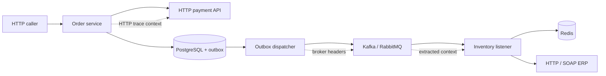
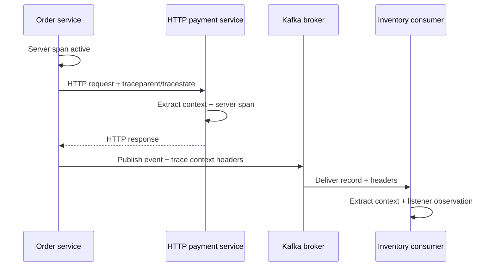
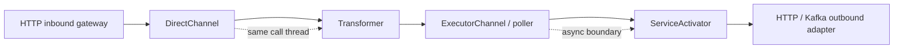

# Tracing Across HTTP and Message Headers via Supported Libraries

## 1. The Problem: A Request Crosses Multiple Protocols—Can the Trace Connect?

A user sends `POST /orders` to a Spring Boot Order service. The service calls a payment HTTP API, writes to PostgreSQL, and publishes an `OrderCreated` event to Kafka or RabbitMQ. Inventory consumes the message, checks status in Redis, and calls an ERP over HTTP/SOAP. Failures can occur at any step: an HTTP timeout, an exhausted pool, duplicate broker delivery, a slow consumer, or a message routed to a DLT.

Having only the logs "Order service finished" and "ERP timeout" is not enough to tell whether the two events are related. **Distributed tracing** connects operations across processes and protocols using trace context, while **metrics** show error/latency rates and **logs** hold detailed diagnostics. Yet traces do not automatically propagate merely because every service uses Spring.

The **Integration Observability** chapter in the **SPRING_BOOT_INTEGRATION** module focuses on connecting HTTP clients, databases, caches, message brokers, and Spring Integration adapters alongside data contracts, transactions, errors, idempotency, testing, and operations. This lesson answers a specific question: **how is trace context propagated from HTTP to HTTP and from producer to consumer via headers when the libraries in use support instrumentation and propagation?**

Logical example:



**Practical goal:** each service records appropriate spans, and HTTP/messaging libraries **inject and extract context at boundaries** when properly configured; meanwhile, business operations still keep a stable identifier for reconciliation when traces are broken by outboxes, long retries, sampling, or retention expiration.

After this lesson, you will be able to:

- Distinguish **trace ID, span ID, correlation ID, idempotency key**, and message/event ID.
- Set up Micrometer Observation/Tracing in Spring Boot and understand exporters and samplers.
- Preserve instrumentation when building `RestClient`/`WebClient` from Boot-managed builders.
- Verify trace context across HTTP headers and Kafka/RabbitMQ message headers without writing non-standard propagation by hand.
- Recognize where context is lost due to `@Async`, Reactor, Spring Integration, DLT, or transactional outboxes.
- Design safe logs/metrics/traces and write end-to-end tests with appropriate assertions.

## 2. Trace, Span, and Context Are Not the Same Concept

| Concept | Meaning | Scope |
|---|---|---|
| **Trace** | A causally related set of observed operations. | Can span multiple services, processes, and protocols. |
| **Trace ID** | Identifier of a trace, e.g., 128-bit in W3C format. | Used to locate spans belonging to the same trace when context is linked. |
| **Span** | An operation with start time, end time, duration, and attributes. | HTTP server, HTTP client, Kafka producer/consumer, or a business step. |
| **Span ID** | Unique identifier of a span within a trace. | Not an event ID or operation ID. |
| **Parent/child or span link** | Dependency/causal relationship between spans. | Representation depends on instrumentation and async messaging semantics. |
| **Trace context** | Minimal information required to continue or link a trace. | Injected into HTTP/messaging headers by a propagator. |
| **Baggage** | Selected key/value pairs carried alongside context across boundaries. | Should not contain secrets or high-cardinality/large values. |
| **Correlation ID** | Business/flow ID used to connect logs and processing steps. | Can survive outboxes, restarts, and multiple traces. |
| **Idempotency key** | Key identifying a business intent to prevent duplicate side effects. | Must stay stable across retries; a trace ID cannot replace it. |

A single HTTP request can create multiple client spans when calling payment, inventory, and shipping sequentially. A Kafka event reprocessed three days later can start a **new trace** linked to the prior workflow by event ID; it does not have to be a child span inside the original HTTP request's trace.

### 2.1. Do Not Use Trace ID as a Business Operation ID

`traceId` can change due to sampling, retries after restarts, scheduled jobs, or other trace boundaries. Application-managed `operationId` and `eventId` are the keys for **idempotency, outbox/inbox, auditing, and reconciliation**. Include those IDs in business envelopes and controlled logs, but do not turn them into metric labels by default.

## 3. At Which Boundaries Does Context Propagation Happen?

Every propagation step has two halves:

1. **Inject:** the producer/client takes the current trace context and writes it into a carrier such as HTTP headers or Kafka record headers.
2. **Extract:** the server/consumer reads headers, validates format, and creates a continuing observation/span per instrumentation policy.



This diagram illustrates a **direct publish call within the current context**. If the producer runs inside an outbox dispatcher after commit on another thread or process, **the HTTP request's context is no longer automatically present**. You must decide whether to persist/restore context in a controlled way, add span links where supported, or start a new trace paired with business correlation.

### 3.1. "Having a Header" Does Not Guarantee "Connected Traces"

A request carrying a `traceparent` header may still start a new trace if the application lacks a configured tracer/propagator or the server does not extract context. Conversely, trace context may be sent in another format such as B3 and never appear under the `traceparent` header name.

Therefore, when testing, inspect **trace/span relationships** under your actual configuration rather than merely checking for the presence of an arbitrary header string.

## 4. Instrumentation Layers in Spring Boot

In Spring Boot 3.x, the typical stack comprises:

| Layer | Responsibility |
|---|---|
| **Micrometer Observation API** | Creates observations, scopes, conventions, tags, and event hooks at framework/app level. |
| **Micrometer Tracing bridge** | Maps observations to tracing spans via implementations such as OpenTelemetry or Brave. |
| **Tracer / Propagator** | Creates/reads context and injects/extracts across carriers. |
| **Tracing/export pipeline** | Sends spans to an OTLP collector, Jaeger/Tempo, or matching backend. |
| **Spring Boot Actuator auto-configuration** | Wires the registry, tracing properties, and supported instrumentations. |
| **Spring Web / WebFlux / HTTP clients** | Creates server/client spans and invokes the configured propagator. |
| **Spring Kafka / Spring AMQP / Integration** | Provides observation hooks depending on library, version, and endpoint config. |
| **Application observations** | Measures business steps/work unknown to the framework. |

**An `ObservationRegistry` alone does not produce viewable spans** without a compatible tracing handler/bridge/exporter. Conversely, having an exporter while using an uninstrumented hand-rolled client SDK still leaves HTTP client spans missing.

### 4.1. What Does an Observation Look Like in Code?

An application can inject `ObservationRegistry`:

```java
import io.micrometer.observation.Observation;
import io.micrometer.observation.ObservationRegistry;
import org.springframework.stereotype.Service;

@Service
class ReservationWorkflow {

    private final ObservationRegistry observations;
    private final ReservationStore store;

    ReservationWorkflow(
            ObservationRegistry observations,
            ReservationStore store) {
        this.observations = observations;
        this.store = store;
    }

    void persistReservation(String operationId) {
        Observation.createNotStarted(
                "integration.reservation.persist", observations)
            .lowCardinalityKeyValue("operation", "reserve-stock")
            .observe(() -> store.persist(operationId));
    }
}
```

`ReservationStore` is an abstraction the application must implement. This observation represents a **business step**; it does not carry traces across HTTP or Kafka by itself. When a tracing handler is present, the observation can create a span or attach to the current trace. `operationId` is used in business logic to look up data, **not** placed into low-cardinality tags.

## 5. Dependencies and Baseline Configuration

Example Gradle Kotlin DSL in the Spring Boot 3.x generation:

```kotlin
dependencies {
    implementation("org.springframework.boot:spring-boot-starter-actuator")
    implementation("org.springframework.boot:spring-boot-starter-web")
    implementation("org.springframework.boot:spring-boot-starter-webflux")
    implementation("org.springframework.kafka:spring-kafka")

    runtimeOnly("io.micrometer:micrometer-tracing-bridge-otel")
    runtimeOnly("io.opentelemetry:opentelemetry-exporter-otlp")

    testImplementation("org.springframework.boot:spring-boot-starter-test")
}
```

Web/webflux/Kafka dependencies are **optional per application needs**—not every starter is required to use tracing. Pick one BOM-managed tracing bridge/provider stack; do not stack multiple tracer implementations hoping for "more traces". In newer Spring Boot versions or setups using an OpenTelemetry Java agent, exporter/tracer configuration may differ; standardize your instrumentation strategy to avoid duplicate spans.

Example configuration for **test/staging**:

```yaml
management:
  tracing:
    sampling:
      probability: 1.0
  otlp:
    tracing:
      endpoint: http://localhost:4318/v1/traces
```

OTLP endpoints and properties depend on Spring Boot/exporter version. `probability: 1.0` helps avoid missing spans during testing; **do not blindly apply 100% in production** due to overhead, PII exposure, storage cost, and backend load.

### 5.1. Three Conditions to See End-to-End Traces

1. The framework/app **creates observations or spans** at each point to be observed.
2. **Propagators inject/extract** context across the protocols in use.
3. Spans **are sampled, exported, and ingested by the backend** with compatible flush/export/retention windows.

Missing any one of the three produces the classic "HTTP log shows a `traceId`, yet nothing appears in the tracing UI" symptom.

### 5.2. Do Not Confuse Metrics with Traces

Actuator/Micrometer metrics can continue working even when traces are not sampled. An HTTP timer does not prove `traceparent` was propagated. Metrics carry bounded tags; traces carry richer attributes but still require data minimization.

## 6. HTTP Inbound: Server Spans and Where Headers Are Extracted

In Spring MVC/WebFlux with Observation instrumentation and a compatible tracing bridge, the server can read trace context from client HTTP headers, create a **server span**, and supply that context to downstream instrumentation.

Example incoming request:

```http
POST /orders HTTP/1.1
Host: orders.example
Content-Type: application/json
traceparent: 00-4bf92f3577b34da6a3ce929d0e0e4736-00f067aa0ba902b7-01
tracestate: vendor=value
X-Correlation-Id: order-flow-42

{"orderId":"O-42"}
```

The `traceparent` string follows W3C structure; the value above is dummy data and must not be treated as an auth token. `tracestate` is optional. Systems using B3 may receive `b3` or `X-B3-TraceId`/`X-B3-SpanId` headers depending on the propagator.

**Do not require callers to always send `traceparent`.** When no valid context is present, the server can start a new trace per tracing/sampling policy. When receiving untrusted inbound headers from the Internet, applications/gateways need trust boundary policies and must never treat client-chosen trace IDs as proof of identity.

### 6.1. Server Span Completion Is Not Business Completion

An HTTP `202 Accepted` response may return right after writing an outbox operation as `PENDING`. The server span ends when the HTTP exchange finishes—it does **not** stay open until the Kafka consumer finishes the workflow minutes later. Measure end-to-end business latency using operation states and timestamps separately.

## 7. Outbound HTTP with Boot-Managed `RestClient.Builder`

This is the essential pattern to avoid losing instrumentation:

```java
import org.springframework.beans.factory.annotation.Value;
import org.springframework.context.annotation.Bean;
import org.springframework.context.annotation.Configuration;
import org.springframework.web.client.RestClient;

@Configuration(proxyBeanMethods = false)
class ErpClientConfig {

    @Bean
    RestClient erpRestClient(
            RestClient.Builder bootManagedBuilder,
            @Value("${integration.erp.base-url}") String baseUrl) {

        return bootManagedBuilder
                .baseUrl(baseUrl)
                .build();
    }
}
```

This bean assumes Spring Boot auto-configures `RestClient.Builder` with a compatible Spring Web version (e.g., Boot 3.2+). When invoked inside an active observation/tracing context, Boot-configured instrumentation can create an **HTTP client observation/span** and automatically inject trace headers via the propagator.

```java
import org.springframework.stereotype.Component;
import org.springframework.web.client.RestClient;

@Component
class ErpStatusGateway {

    private final RestClient erp;

    ErpStatusGateway(RestClient erp) {
        this.erp = erp;
    }

    ReservationStatus status(String reservationId) {
        return erp.get()
                .uri("/reservations/{id}", reservationId)
                .retrieve()
                .body(ReservationStatus.class);
    }
}
```

`ReservationStatus` is an application DTO. Use `@Qualifier` when multiple `RestClient` beans exist so you inject the intended client. This example shows HTTP GET; production requires authentication, timeouts, error mapping, and TLS.

### 7.1. Anti-Pattern: Creating Clients Bypassing Managed Builders

```java
RestClient client = RestClient.create(
        "https://erp.example");
```

The code can still perform HTTP calls, yet it does not automatically inherit customizers, `ObservationRegistry`, or transport settings configured by Spring Boot on injected builders. Raw `RestClient.builder()` carries the same risk unless instrumented explicitly.

**Rule:** for production beans, inject Boot-managed `RestClient.Builder` and configure each dependency's base URL. Never construct a fresh client per request just to swap headers or correlation IDs.

## 8. `WebClient.Builder`, Reactor Context, and Asynchronous HTTP

For WebFlux, use the Boot-managed builder:

```java
import org.springframework.beans.factory.annotation.Value;
import org.springframework.context.annotation.Bean;
import org.springframework.context.annotation.Configuration;
import org.springframework.web.reactive.function.client.WebClient;

@Configuration(proxyBeanMethods = false)
class PaymentClientConfig {

    @Bean
    WebClient paymentWebClient(
            WebClient.Builder bootManagedBuilder,
            @Value("${integration.payment.base-url}") String baseUrl) {

        return bootManagedBuilder.baseUrl(baseUrl).build();
    }
}
```

In reactive pipelines, **building a `Mono` is different from subscribing to it**. Execution threads can switch between operators, making `ThreadLocal`/MDC alone unsafe for context propagation. Micrometer Tracing / Reactor context propagation must be configured compatibly with Spring Boot, Reactor, and actual subscriptions.

```java
public Mono<PaymentView> findPayment(String paymentId) {
    return paymentWebClient.get()
            .uri("/payments/{id}", paymentId)
            .retrieve()
            .bodyToMono(PaymentView.class);
}
```

`PaymentView` is an application DTO. When `findPayment` runs inside a reactive request handler with properly preserved context, HTTP client instrumentation can create the corresponding span. **Do not manually set `traceparent` inside an `ExchangeFilterFunction`** if the tracer already instruments `WebClient`: doing so can overwrite new context, break parent/child links, or create competing propagation paths.

### 8.1. When `WebClient` Runs from a Thread Without Context

A scheduled worker, `@Async` task, or message adapter may build a `Mono` after the original context has ended. No inbound HTTP parent span exists to "auto-propagate". Create a dedicated observation for that work, restore context from broker headers if supported by your libraries, or link via correlation ID. Calling `.contextWrite(...)` with a custom `correlationId` key only carries **business metadata**, not Micrometer Tracing context.

### 8.2. Do Not Call `block()` on Event Loops

Calling `block()` on a Reactor Netty event loop can stall threads and destroy throughput. Crossing imperative, reactive, and executor boundaries requires a proper context propagation strategy; do not convert everything to blocking just to make logging `traceId` easier.

## 9. W3C Trace Context, B3, and Header Propagation

Common formats:

| Format | Common headers | Meaning |
|---|---|---|
| **W3C Trace Context** | `traceparent`, `tracestate`. | Standard format carrying trace ID, parent span ID, and flags. |
| **B3 single** | `b3`. | Compact header carrying trace ID, span ID, and sampling state. |
| **B3 multi** | `X-B3-TraceId`, `X-B3-SpanId`, `X-B3-Sampled`, and optional headers. | Widely used in Brave/Zipkin setups. |
| **W3C Baggage** | `baggage`. | Carries selected metadata; not for credentials. |
| **Business correlation** | `X-Correlation-Id` or custom contract header. | Not a tracing standard; defined by the application. |

Standardize on a **consistent** propagator across services. If service A injects W3C while service B only extracts B3, requests may succeed yet traces break. Multiple propagators can be configured during migrations, provided you verify precedence and conflicting header behavior.

### 9.1. Do Not Fabricate or Modify `traceparent` with Arbitrary Strings

Anti-pattern:

```java
headers.set("traceparent",
        "00-" + orderId + "-" + requestId + "-01");
```

`orderId` and `requestId` do not obey W3C length, hex format, or span semantics. Trace IDs are not business IDs; parent span IDs must reflect the active tracer context. Always let **instrumented tracers/propagators** inject and extract headers.

### 9.2. Do Not Store Sensitive Data in `tracestate`

`tracestate` and baggage may traverse proxies, external vendors, and logs. Never put JWTs, API keys, emails, bank accounts, customer IDs, or raw payloads into them. Trace context conveys causality, not authentication or business payloads.

## 10. How Message Headers Differ from HTTP Headers

Kafka/RabbitMQ/JMS and Spring Messaging all provide header abstractions, yet their carriers differ:

| Environment | Header carrier | How data is carried |
|---|---|---|
| HTTP | `HttpHeaders`/wire headers. | Header names/values as HTTP header fields. |
| Kafka | `ProducerRecord.headers()`/`ConsumerRecord.headers()`. | One key can have multiple `byte[]` values. |
| RabbitMQ AMQP | `MessageProperties.headers`. | AMQP field table with protocol-compatible value types. |
| Spring Messaging | `MessageHeaders`. | In-JVM metadata map or mapped via adapters. |
| JMS | `JMSCorrelationID`, JMS properties, and standard headers. | Subject to JMS/provider naming and type constraints. |

A `traceparent` entry in Spring Integration `MessageHeaders` **is not guaranteed to reach Kafka record headers** if an adapter uses different header mapper/filter rules. Conversely, not every Kafka header automatically reaches listener method parameters when custom deserializers/converters are active.

**Library propagators need compatible carriers, getters, and setters.** Never copy raw `MessageHeaders` wholesale to a broker to "keep the trace"; they can contain Java objects, `replyChannel`, `errorChannel`, tokens, or non-serializable metadata.

## 11. Kafka Producer and Listener: Enabling Observation Deliberately

Spring Kafka 3.x supports Observation for templates and listener containers in matching versions. When templates and containers use `ObservationRegistry`/tracing handlers and observation is enabled, Kafka instrumentation can emit producer/consumer observations and inject/extract trace context in Kafka record headers.

Illustrative **configuration direction** when Spring Boot supports the properties:

```yaml
spring:
  kafka:
    template:
      observation-enabled: true
    listener:
      observation-enabled: true
```

Verify that these properties exist and apply to the **actual factory/template beans** in your Spring Boot version. If your app manually creates `KafkaTemplate` or `ConcurrentKafkaListenerContainerFactory` bypassing Boot's configurer, YAML settings may have no effect on live endpoints.

### 11.1. Customizing a Container Factory While Keeping Boot Conventions

```java
import org.springframework.boot.autoconfigure.kafka.ConcurrentKafkaListenerContainerFactoryConfigurer;
import org.springframework.context.annotation.Bean;
import org.springframework.kafka.config.ConcurrentKafkaListenerContainerFactory;
import org.springframework.kafka.core.ConsumerFactory;

@Bean("observedKafkaListenerFactory")
ConcurrentKafkaListenerContainerFactory<String, String>
observedKafkaListenerFactory(
        ConcurrentKafkaListenerContainerFactoryConfigurer configurer,
        ConsumerFactory<String, String> consumers) {

    var factory =
            new ConcurrentKafkaListenerContainerFactory<String, String>();

    configurer.configure(factory, consumers);
    factory.getContainerProperties().setObservationEnabled(true);
    return factory;
}
```

This snippet assumes the factory lives in a Spring configuration class, `ConsumerFactory` already has proper config/credentials/deserializers, and `ObservationRegistry` is managed by the context. If creating multiple clusters/factories, wire each factory with its matching consumer factory and observation context.

If you need to specify a non-default registry, use the `setObservationRegistry` APIs supported by your Spring Kafka version on the real component. Never instantiate an isolated `ObservationRegistry.create()` inside a factory and expect traces to export alongside the application.

### 11.2. Producer Using Boot-Managed `KafkaTemplate`

```java
import org.springframework.kafka.core.KafkaTemplate;
import org.springframework.stereotype.Component;

@Component
class OrderEventPublisher {

    private final KafkaTemplate<String, String> kafka;

    OrderEventPublisher(KafkaTemplate<String, String> kafka) {
        this.kafka = kafka;
    }

    void publish(String orderId, String jsonEnvelope) {
        kafka.send("orders.events", orderId, jsonEnvelope);
    }
}
```

When producer instrumentation is enabled and `send` runs inside an active trace context, context can be injected into **Kafka record headers**. The example omits explicit `traceparent` because **standard headers should not be set manually**.

`send(...)` returns a future in modern Spring Kafka versions. This code omits publish-failure handling; production code must observe callbacks/acks, apply bounded retries, and use an outbox when DB atomicity is needed.

### 11.3. Consumer with `@KafkaListener`

```java
import org.apache.kafka.clients.consumer.ConsumerRecord;
import org.springframework.kafka.annotation.KafkaListener;
import org.springframework.stereotype.Component;

@Component
class InventoryEventListener {

    private final InventoryApplicationService service;

    InventoryEventListener(InventoryApplicationService service) {
        this.service = service;
    }

    @KafkaListener(
        topics = "orders.events",
        groupId = "inventory-projection",
        containerFactory = "observedKafkaListenerFactory")
    public void onRecord(ConsumerRecord<String, String> record) {
        service.applyIdempotently(record.value());
    }
}
```

`InventoryApplicationService` is an application bean. When the listener container is observation-enabled and a tracing implementation exists, consumer instrumentation can extract headers, create a listener observation, and make context available to downstream HTTP client/DB observations within the listener invocation scope.

**Do not judge by annotation name alone:** if the app points to a custom container with observation disabled, `@KafkaListener` alone does not guarantee trace extraction.

## 12. Kafka Headers: What Must Be Verified in Practice

Kafka record headers consist of keys and byte values, with multiple entries per key allowed. When an instrumented producer sends:

```text
topic=orders.events
key=O-42
headers:
  traceparent = <trace context bytes>
  tracestate = <bytes if present>
  x-correlation-id = <business metadata if required by contract>
value = {"eventId":"E42","eventType":"OrderPaid", ...}
```

This layout is **illustrative**. Actual header names depend on the propagator (W3C/B3), instrumented client, header mapper, and tracing version. Do not assume every record contains `traceparent`. Filters/mappers can drop non-allowlisted headers, especially when translating between Spring `Message` and Kafka records.

### 12.1. Keep Business Headers Separate from Traces

If you need a stable correlation ID across an outbox, generate it at the business boundary and store it in the event envelope. Dispatchers can copy `correlationId` into a custom header for consumer log correlation; that is an application contract and **does not** replace library trace context.

Never use Kafka `topic/partition/offset` as an event ID; one logical event can be republished at a different offset. Traces may generate new spans on each delivery/attempt while `eventId` stays unchanged.

### 12.2. Do Not Decode Arbitrary Header Bytes as Strings

Kafka trace headers are byte arrays encoded by the propagator. In tests, decode as UTF-8 **only when the format is known**, or inspect via the propagator's getter. Never log all raw Kafka headers when security tokens, tenant data, or confidential payload references may be present.

## 13. RabbitMQ/Spring AMQP: Observations and Header Mapping

Spring AMQP provides instrumentation for `RabbitTemplate` and listener containers in supported versions. When observation is enabled on **both publisher and consumer** alongside a configured tracing registry, trace context can travel via AMQP message headers.

Illustrative skeleton:

```java
import io.micrometer.observation.ObservationRegistry;
import org.springframework.amqp.rabbit.connection.ConnectionFactory;
import org.springframework.amqp.rabbit.core.RabbitTemplate;
import org.springframework.context.annotation.Bean;

@Bean
RabbitTemplate observedRabbitTemplate(
        ConnectionFactory connectionFactory,
        ObservationRegistry registry) {

    RabbitTemplate template = new RabbitTemplate(connectionFactory);
    template.setObservationEnabled(true);
    template.setObservationRegistry(registry);
    return template;
}
```

Note: when manually constructing `RabbitTemplate` like this, preserve **message converters, credentials, retries, mandatory returns/publisher confirms, and other customizations** required by Boot or the app. In projects that already have a managed template, **prefer enabling observation on the existing bean/factory** instead of accidentally replacing it.

Listener containers must likewise enable observation through the corresponding Spring AMQP factory/container APIs. Do not assume an observed template automatically gives listeners context if containers have instrumentation turned off.

### 13.1. AMQP Headers and Spring `Message` Are Not Identical

Rabbit headers live in `MessageProperties` and can be mapped by Spring AMQP converters. If your app uses custom converters, adapters, or header allowlists, ensure propagation headers are preserved per framework conventions. Never copy the entire HTTP `Authorization` header into AMQP headers just to "preserve context".

### 13.2. Acknowledgment Differs from Span Completion

A producer span ends when the send operation succeeds/fails per instrumentation—it does **not** mean the queue consumer committed PostgreSQL. A consumer span may end when the listener method returns, yet if the method merely enqueued work to an in-memory executor, the business effect is incomplete. Operation metrics/outcomes must reflect durable business state, not trace spans alone.

## 14. Spring Integration: Where Do Traces Break?

Spring Integration includes `MessageChannel`s, gateways, transformers, routers, splitters, aggregators, and HTTP/Kafka/JMS/SFTP adapters. Trace context can flow through an integration flow **if the specific components and instrumentations support it** and context is preserved across threads.



Scenarios:

- Synchronous `DirectChannel` usually runs handlers on the sender thread; active scopes can remain on the call stack.
- `ExecutorChannel` hands off to an executor, so `ThreadLocal` observation/trace context **is not automatically copied under Java threading rules**.
- `QueueChannel` and pollers can buffer messages long enough that the original transaction and thread/trace scopes finish before polling.
- Kafka/HTTP adapters can leverage Spring Kafka/WebClient/RestClient instrumentation; verify the actual adapter code path.
- Splitters/aggregators branch into multiple flows; trace relationships may produce multiple spans, span links, or distinct traces depending on design and version.

Do not assume a `traceparent` entry inside `MessageHeaders` suffices for every Spring Integration channel to automatically extract/inject. Across process boundaries, rely on observation-capable adapter libraries or proper propagators and test them.

### 14.1. Correlation, Sequence, and Tracing Have Different Jobs

Spring Integration headers such as `CORRELATION_ID`, `SEQUENCE_NUMBER`, and `replyChannel` handle routing/aggregation/replies within a flow; they are not trace IDs. Never serialize `replyChannel`/`errorChannel` objects to a broker. In aggregators, choose business correlation keys matching your contract—**never default to `traceId` as the group key**.

## 15. Thread Context and `@Async`: Why Does `traceId` Disappear?

Micrometer/Brave/OpenTelemetry commonly use thread-local scopes during imperative execution. `@Async` or `ThreadPoolTaskExecutor` runs work on another thread: caller `MDC`/current span does not automatically appear on the worker thread without capture/restore support.

Spring Framework 6.1+ provides `ContextPropagatingTaskDecorator` built on Micrometer Context Propagation to preserve properly registered context types across task executors.

```java
import org.springframework.context.annotation.Bean;
import org.springframework.context.annotation.Configuration;
import org.springframework.core.task.TaskDecorator;
import org.springframework.core.task.support.ContextPropagatingTaskDecorator;
import org.springframework.scheduling.concurrent.ThreadPoolTaskExecutor;

@Configuration(proxyBeanMethods = false)
class IntegrationExecutorConfiguration {

    @Bean
    TaskDecorator integrationTaskDecorator() {
        return new ContextPropagatingTaskDecorator();
    }

    @Bean("integrationExecutor")
    ThreadPoolTaskExecutor integrationExecutor(
            TaskDecorator integrationTaskDecorator) {

        ThreadPoolTaskExecutor executor = new ThreadPoolTaskExecutor();
        executor.setCorePoolSize(4);
        executor.setMaxPoolSize(8);
        executor.setQueueCapacity(100);
        executor.setTaskDecorator(integrationTaskDecorator);
        executor.initialize();
        return executor;
    }
}
```

When using `@Async("integrationExecutor")` with Micrometer Context Propagation / compatible `ThreadLocal` accessors configured, the decorator can capture current context on submission and restore it during execution.

**This is not a promise to copy all business/transaction context**: thread-bound JDBC transactions are never "propagated" into distributed transactions. Tasks may run after the inbound request ends; give tasks their own observations and durable operation IDs rather than expecting parent spans to stay open indefinitely.

### 15.1. Do Not Manually Copy MDC and Forget Cleanup

Manually copying `MDC.getCopyOfContextMap()` and calling `MDC.setContextMap(...)` in workers may populate log IDs, yet **does not necessarily propagate tracer/Observation Context** and risks leaking data across tasks without restore/clear logic. Prefer official framework context propagation over hand-rolled asynchronous copies.

## 16. Reactor Context Differs from ThreadLocal and Message Headers

| Mechanism | Lifetime | Used with | Crosses brokers automatically? |
|---|---|---|---|
| ThreadLocal/MDC | Current thread. | Imperative HTTP handlers, log scopes. | No. |
| Reactor Context | Reactive subscription. | WebFlux, WebClient, Reactor operators. | No. |
| Spring `MessageHeaders` | A `Message<?>` inside an integration flow. | Spring Messaging/Integration. | Only when adapters map/serialize appropriately. |
| Kafka/AMQP wire headers | Message in broker protocol. | Cross-process messaging. | Yes, when producer injects and consumer extracts. |
| Outbox metadata in DB | Durable record after commit. | Long-lived workflows/restarts. | Can be mapped explicitly by dispatcher. |

When crossing from Reactor to an imperative executor or from HTTP to a Spring Integration poller, verify that instrumented components capture/restore context. **Never spawn `new Thread(...)` or nested `subscribe()` calls assuming Spring WebFlux propagates everything.**

### 16.1. Avoid Manual Fire-and-Forget `subscribe()`

Anti-pattern:

```java
public void dispatch() {
    webClient.post()
        .uri("/erp/reserve")
        .retrieve()
        .toBodilessEntity()
        .subscribe();  // No owner for outcome, errors, or durable state.
}
```

Besides dropping context, this risks marking a command complete before the HTTP side effect is even known. Return `Mono` for the caller to compose or persist work in a durable outbox/job processed by workers with proper retries and reconciliation.

## 17. Transactional Outbox: Trace Boundaries Are Not Automatically Durable

An essential integration pattern:

```mermaid
sequenceDiagram
    participant HTTP as Client / server span
    participant DB as Order DB + outbox
    participant W as Post-commit dispatcher
    participant K as Kafka
    participant C as Consumer
    HTTP->>DB: Commit OrderPaid + outbox E42
    DB-->>HTTP: COMMIT
    HTTP-->>HTTP: HTTP response ends span
    Note over HTTP,W: Worker runs later; HTTP context no longer exists automatically
    W->>K: Send event E42
    K->>C: Deliver E42
    C->>C: Consume + apply idempotently
```

When the dispatcher runs in a separate thread or process, producer instrumentation starts a span from the **worker's current context**, which is often a fresh trace. There is no automatic HTTP parent simply because `outbox_events` holds an `orderId`.

### 17.1. Three Ways to Represent Causality

1. **Business correlation:** store `operationId`, `eventId`, and `correlationId` in the outbox envelope and join logs/traces/dashboards by ID; usually sufficient operationally.
2. **Controlled trace context persistence:** store a carrier/snapshot supported by the tracing library and restore it in the dispatcher per policy. Evaluate trust, retention, size, propagator versioning, and abnormal trace durations.
3. **Span links:** create a new span and link it to the originating event/operation context if the tracing implementation supports links; ideal when asynchronous relationships should not look like long parent-child nesting.

Never copy raw `traceparent`/`tracestate` strings and fabricate `Span`s manually. For options 2/3, use **official propagator/SDK APIs** and verify against your implementation/version.

### 17.2. What Outbox Guarantees vs. What Traces Guarantee

| Requirement | Outbox | Trace |
|---|---|---|
| DB state + event intent commit together | **Yes**, in the same transaction. | No. |
| Publisher retry after broker outage | Yes, when dispatcher/recovery is designed. | No. |
| Consumer deduplication | Requires inbox/idempotency as well. | No. |
| Seeing which step took time | Requires metrics/traces alongside. | Can measure instrumented steps. |
| Finding operations days later | Outbox/business IDs can persist. | Subject to sampling/retention; unreliable as source of truth. |

## 18. Retries, Redelivery, and DLT: Traces Can Have Multiple Branches

When a producer retries or a broker redelivers, a single logical event can experience multiple deliveries/attempts, each generating distinct spans:

```text
eventId=E42
  dispatch attempt #1 -> Kafka timeout (may have published)
  dispatch attempt #2 -> Kafka ack success
  consumer delivery #1 -> DB commit, ack failed
  consumer delivery #2 -> inbox duplicate, ack success
```

**Do not demand that every attempt share the same span ID.** Span IDs represent single observed executions, not business events. `eventId` stays constant while retry counts and error states reflect reality. A tracing UI may display only fragments due to sampling, async boundaries, exporter errors, or retention limits.

### 18.1. DLT and Trace Context

When Spring Kafka's `DefaultErrorHandler` uses `DeadLetterPublishingRecoverer`, the recoverer can attach DLT metadata; trace propagation depends on the DLT producer/template being instrumented and context being active at publish time. Otherwise, the DLT consumer may start a new trace. Always store safe **eventId + original topic/partition/offset + error category** for investigations rather than relying solely on `traceparent`.

### 18.2. A Producer Span Does Not Mean Consumer Processing Finished

A producer span typically measures the publish operation; a consumer span measures delivery/handler execution. If a consumer receives a record, enqueues a task into an in-memory `@Async` pool, and returns, the span closes before business work commits. Measure operation status and consumer business outcomes separately; never artificially keep a span alive for hours just by holding scopes/memory.

## 19. Logging with `traceId`/`spanId`: Aids Investigation, Does Not Replace Metrics

A good log entry can include:

```text
traceId=4bf92f3577b34da6a3ce929d0e0e4736
spanId=00f067aa0ba902b7
operation=reserve-stock
eventId=E42
dependency=erp
outcome=timeout
```

Micrometer Tracing/Spring Boot can populate trace/span IDs into MDC/log correlation when configured. Never build a custom global `ThreadLocal<String> traceId` across requests—it leaks across threads and creates no real distributed spans.

### 19.1. Log Errors at the Right Layer

- HTTP client: method, URI template, status, transport error, and latency.
- Messaging producer: topic/exchange, publish outcome/ack, and retry attempts.
- Consumer: listener/group, processing outcome, redelivery/DLT, durable business state.
- DB: operation name, SQL error category, connection pool metrics; never log raw SQL parameters.
- Workflow: operationId, eventId, aggregateVersion, and state transitions.

Never log `Authorization`, cookies, unvalidated full `traceparent` headers from untrusted requests alongside PII, raw Kafka headers, or payment payloads. Tracing backends also hold sensitive data requiring access controls and retention limits.

## 20. Metrics and Traces Must Be Interpreted Together

| Signal | Question it answers | What it does NOT prove |
|---|---|---|
| HTTP server/client latency | How slow is the API/partner? | That the event was processed by consumers. |
| Kafka consumer lag | How many records behind is the group? | That business effects committed accurately. |
| Rabbit queue depth | Are messages waiting in the queue? | How many operations completed. |
| DB pool pending/active | Is the connection pool saturated? | Why a specific SQL transaction failed. |
| Outbox oldest pending age | How long have committed events waited to publish? | Whether tracing stays continuous across the outbox. |
| Traces/spans | Which instrumented segments ran and their timing/relations. | End-to-end exactly-once delivery or durability. |
| Inbox duplicate count | How many duplicates the consumer saw. | Whether producer over-sent or broker redelivered without metadata. |
| Business status age | How long an operation stayed `PENDING/UNKNOWN`. | Root cause without pairing logs/traces. |

Traces only show **instrumented behavior**, whereas broker lag and DB state capture messages whose traces may have been dropped by sampling. Operational dashboards must never rely solely on tracing UIs.

## 21. Semantic Conventions and Tag-Name Stability

Span names, attributes, and HTTP/messaging semantic conventions can evolve across Micrometer Tracing, OpenTelemetry, and instrumentation versions. Avoid brittle monitoring queries tied to **unstandardized raw attributes** if deployments upgrade frequently.

In custom application observations, use a finite operation catalog:

```java
Observation.createNotStarted(
        "integration.outbox.publish", registry)
    .lowCardinalityKeyValue("transport", "kafka")
    .lowCardinalityKeyValue("event.type", "OrderPaid")
    .observe(() -> sender.publish(message));
```

`sender` and `message` are application beans/DTOs; the example assumes `publish(...)` blocks through the intended milestone. If the method returns a `Future`/`Mono`, the observation scope closes as soon as the method returns and **does not measure total async publish duration**; instrument the completion callback or use the sending library's observation support.

### 21.1. Cardinality: Metrics vs. Trace Attributes

- Good tags for metrics: `operation=reserve-stock`, `dependency=erp`, `outcome=success|timeout`.
- Unsuitable tags for metrics: `orderId`, `eventId`, `traceId`, raw URLs with IDs, emails.
- Even on spans, minimize sensitive data and avoid large payloads; "the trace backend supports many attributes" is not permission to dump everything.

Use URI **templates** like `/orders/{id}` rather than `/orders/O-42` as low-cardinality keys. With custom HTTP clients, verify whether instrumentation recognizes templates; otherwise standardize operation names explicitly.

## 22. Sampling, Exporters, and Retention: Why Do Traces "Disappear"?

Not every request shows up in the UI:

1. **Samplers** drop or keep spans per policy.
2. Collectors or exporters can back up, drop, time out, or hit network blocks.
3. Backends enforce retention and indexing limits.
4. One service uses a different bridge/exporter, splitting the trace.
5. Incompatible propagators cause servers to start new traces.
6. Context fails to propagate across executors/messaging/outboxes.
7. Observability is disabled on Kafka templates/listeners or HTTP clients bypass builders.

### 22.1. Do Not Enable 100% Sampling Everywhere Out of Habit

In high-traffic environments, 100% sampling drives up CPU, memory, network, storage, and data-exposure risks. Choose an appropriate probability and consider collector head/tail sampling where available; rely on full-traffic metrics to detect incidents even with low trace sampling.

In tests, you can set high sampling and use an in-memory exporter/tracer to assert spans. Never let integration tests emit spans to production collectors; disable external exporters or swap in a test exporter.

### 22.2. Flushing and Shutdown

A span may be created yet not yet exported when a test or process exits. Tests should wait for the backend/test exporter with a deadline and verify batch processor flush/shutdown behavior, rather than calling an HTTP endpoint once, immediately checking the UI, and declaring "no spans exist".

## 23. Testing HTTP Trace Propagation

An HTTP integration test has two complementary checks:

**Carrier verification:** use an HTTP stub (`WireMock`, `MockWebServer`, or a Testcontainers custom server) receiving requests from production `RestClient`/`WebClient` beans; assert propagation headers match the configured format, e.g., valid W3C `traceparent`.

**Trace relationship verification:** use a tracer/test exporter/in-memory span collector to confirm client spans relate to server/business spans as expected via the real instrumentation. Never manually inject `traceparent` inside a test and assert the same string while bypassing the framework.

Test skeleton:

```java
@SpringBootTest
class ErpTracePropagationIT {

    @Autowired OrderApplicationService orders;

    @Test
    void outboundHttpCarriesTraceContext() {
        // 1. Start HTTP stub and register dynamic base-url.
        // 2. Enable Micrometer Tracing + W3C propagator in test.
        // 3. Call the application via inbound HTTP or create a test
        //    observation with a valid active scope.
        // 4. Verify the stub receives a valid traceparent header.
        // 5. Verify client/server spans via the test exporter.
    }
}
```

This is a **design skeleton**, not a complete class with imports/fixtures/assertions. If the framework uses B3, assert B3 headers rather than forcing `traceparent`. When inbound requests lack trace headers, the server can start a new trace; when valid W3C context arrives, the server can continue/relate the trace per policy.

### 23.1. Concurrent Requests Must Not Mix Context

Send two concurrent requests with distinct traces/contexts through the same singleton HTTP client; verify carriers and spans never carry the other request's trace ID. This is a critical test against storing trace context in mutable `WebClient.Builder`s or singleton fields.

## 24. Testing Trace Propagation Across Kafka/RabbitMQ

With Kafka Testcontainers or RabbitMQ Testcontainers:

1. Start a real broker with production producer/listener beans having observation enabled.
2. Enable the version-compatible tracing bridge and test exporter with 100% sampling in tests.
3. Inside an active parent observation, publish an event with a stable `eventId`.
4. Use a probe consumer, record capture, or test interceptor to inspect **wire headers** if needed.
5. Assert context is injected per configured W3C/B3 format.
6. Listener processes the event, writes DB/test probe, and creates consumer observations.
7. Poll with a bounded deadline until committed state and exported spans appear.
8. Assert causal relationship matching the library's messaging semantics: parent-child **or span link**, rather than hard-coding one model across instrumentation upgrades.
9. Republish the same `eventId` and assert business-state idempotency alongside an extra delivery/attempt.
10. Exercise DLT/retry flows to verify business correlation stays intact even if trace continuity breaks.

Never use `Thread.sleep(2000)` hoping listeners have finished. Use synchronization, DB state polling, or await helpers with deadlines to avoid flaky tests.

### 24.1. Testing When Producer/Listener Observation Is Disabled

A negative test can intentionally disable producer instrumentation and verify broker records carry no library-injected trace context (unless manually added by the app). The listener may start a fresh trace. This exposes the false assumption that "adding Actuator traces all messages automatically".

### 24.2. Verifying Rabbit Publisher Confirms Independently

Having a producer trace does not prove a Rabbit message routed/confirmed, just as a Kafka producer span does not prove an outbox row was marked `PUBLISHED`. Tests must assert producer acknowledgments/returns and business consumption as a separate **delivery contract**.

## 25. Testing `@Async`, Reactor, and Spring Integration Boundaries

Suggested test matrix:

| Context | Expectation |
|---|---|
| MVC inbound → Boot `RestClient`. | Correct server/client spans and HTTP carrier. |
| WebFlux inbound → Boot `WebClient`. | Context follows subscription, not fixed `ThreadLocal`. |
| Spring Integration `DirectChannel` on same thread. | Observation scope preserved when flow/handlers are instrumented. |
| `ExecutorChannel` or `@Async` with compatible `TaskDecorator`. | Trace context captured/restored or linked per policy. |
| Poller/`QueueChannel` after a delay. | Independent of inbound `ThreadLocal`; keeps business correlation. |
| Post-commit transactional outbox dispatcher. | Keeps `eventId`/correlation and deliberately represents trace boundary. |
| Kafka listener retry/redelivery. | Multiple spans may appear; business operation is not duplicated. |
| Uninstrumented SOAP/SFTP/custom SDK. | Document observation **gap** or add manual instrumentation in the adapter. |
| Error channel / DLT. | Records failure category and durable recovery state even if trace splits. |

When writing tracing tests, never couple listener business success to tracer availability. A down collector must not roll back domain transactions **unless specifically demanded by operational policy**.

## 26. Errors, Exceptions, and Tracing: Span Errors Do Not Replace Retry Policy

An HTTP 503 can be a valid `ClientResponse` at the transport layer; a `WebClient` filter using only `doOnError` may not even see 503 if status mapping occurs later. Conversely, TCP connection refused errors surface directly during client exchange.

Failure patterns:

| Failure | What spans/metrics can record | Additional business decision needed |
|---|---|---|
| HTTP 429/503 | Status, latency, dependency, error category. | Bounded retry/backoff, quota, deadline. |
| SOAP Fault returning HTTP 500 | HTTP status + adapter fault category. | Distinguish business faults from transient faults. |
| Kafka serialization/deserialization error | Producer/consumer error per instrumentation. | Quarantine/DLT, schema compatibility. |
| Broker delivery retry | Multiple attempts/spans. | Idempotency, ack after durable handoff. |
| DB deadlock | SQL exception/transaction retry. | Rollback attempt, bounded retry with stable key. |
| HTTP POST timeout after server commit | Client timeout span. | `UNKNOWN` + reconciliation, no blind retry. |
| DLT publish failure | DLT producer error. | Do not falsely ack original; preserve recovery state. |

**Traces do not guarantee correctness.** An error span can belong to a downstream operation that actually succeeded before the response was lost; check the authoritative store using the business key. Never decide whether to charge money or reserve stock twice based solely on span status.

## 27. Security and Trust Boundaries in Trace Context Propagation

Propagation headers traverse networks and sometimes cross organizational boundaries. Safe policies require:

- **Never treat `traceparent`, `tracestate`, or `baggage` as authentication.** Callers can forge arbitrary trace IDs.
- Enforce trust boundaries: should external inbound requests continue traces, or should the gateway start fresh traces per policy?
- Bound baggage and header counts/sizes to prevent resource exhaustion.
- Never place bearer tokens, session cookies, PII, or bank details in baggage/tracestate.
- Never forward all inbound headers outbound; allowlist only contract/tracer headers.
- Isolate client credentials per partner so shared auth filters never leak tokens to other domains.
- Never inject baggage/trace headers into brokers/topics where consumers lack authorization for that data.
- Redact URI query strings, request bodies, and Kafka keys/payloads from instrumentation/logs.
- Protect collectors/trace backends with authentication, TLS, retention limits, and access controls.
- For tenant-sensitive traces, segregate access permissions and retention per organizational policy.
- Never use trace IDs or order IDs as high-cardinality metric tags.

### 27.1. W3C Trace Context Does Not Require Endless Single Traces

A workflow spanning days, dozens of retries, and external partners naturally produces multiple traces. **Business operation IDs and causation event IDs** are the durable glue, while tracing provides time-bounded diagnostic views. Do not store raw W3C headers forever as a mandatory business data source.

## 28. Troubleshooting: Why Don't Two Services Share a Trace?

| Symptom | Common cause | What to check |
|---|---|---|
| HTTP server has trace yet outbound lacks client span. | `RestClient.create()`/`WebClient.builder()` bypassed Boot instrumentation. | Which builder and `ObservationRegistry` built the client bean? |
| Downstream HTTP server starts a new trace ID. | Incompatible W3C/B3 propagators or proxy stripped headers. | Wire headers, configured propagators, ingress/egress proxies. |
| Kafka producer span exists yet consumer is unlinked. | Template/listener container observation off, mapper stripped headers. | Actual factory beans, `record.headers()`, test exporter. |
| `RabbitTemplate` observed yet listener has no span. | Listener container observation off or AMQP headers not extracted. | Template/container config, converters, wire headers. |
| Trace vanishes after `@Async`/`ExecutorChannel`. | Context not captured/restored; `ThreadLocal` scope lost. | `TaskDecorator`/Context Propagation, subscription/thread boundaries. |
| `WebClient` logs show correlation yet tracing UI has no span. | Custom header instead of tracer context, or missing exporter/sampling. | `ObservationRegistry`, tracing bridge, sampling, exporter. |
| Tracing UI shows HTTP span yet no DB span. | JDBC instrumentation disabled or absent for that path. | Driver/agent/observation support, custom DB spans. |
| Trace splits between HTTP and outbox consumer. | Outbox dispatcher runs post-commit in a new trace. | Event correlation, explicit extraction/span-link policy. |
| DLT consumer has a different trace from original. | DLT/recoverer does not preserve/extract expected tracing headers. | DLT producer, header mapping, `eventId`. |
| Two requests mix trace IDs. | Mutable global state or uncleaned MDC. | Concurrency tests, context scope lifecycle. |
| Traces disappear randomly in production. | Sampling, exporter queue drops, backend retention. | Sampling probability, collector health, batch flush. |
| Backend shows duplicate client spans. | Both Java agent and app instrumentation active. | Instrumentation ownership, duplicate filters/agents. |
| Metric cardinality scales with traffic. | Tags contain raw URIs, `orderId`, or `traceId`. | Conventions/tag allowlists. |
| HTTP 503 not treated as exception by filter. | Status arrived as `ClientResponse`; mapping happened after filter. | Record HTTP status in observation/gateway. |
| Span finishes while workflow remains `PENDING`. | Async handoff, outbox, or downstream still running. | Business operation state and backlog metrics. |

### 28.1. Boundary-by-Boundary Investigation Runbook

1. Confirm inbound HTTP has a server observation and trace ID.
2. Inspect the **actual** HTTP client to see whether it came from a Boot-managed builder or a custom SDK.
3. Inspect carrier headers at network ingress/egress and match against W3C/B3 propagators.
4. For Kafka/RabbitMQ, inspect producer template/container factory observation flags and record headers.
5. For Spring Integration, identify `DirectChannel`, `ExecutorChannel`, pollers, async tasks, and context propagation.
6. For outboxes, locate `eventId`/`correlationId` and the dispatcher trace rather than expecting HTTP spans to outlive commit.
7. Check samplers, exporter/collector backlogs, retention, and clock synchronization.
8. Check business DB state, consumer acks/DLT, and retry attempts before declaring an operation successful.
9. Write regression tests at the **exact boundary where context was lost** instead of scattering manual trace ID logging everywhere.

## 29. Checklist for Tracing Across HTTP and Messaging

- [ ] Distinguished trace/span/correlation/event/idempotency IDs.
- [ ] Configured `ObservationRegistry`, Micrometer Tracing bridge, and environment-appropriate exporter/tracer.
- [ ] Picked a single instrumentation strategy, avoiding double Java agent + Boot auto-instrumentation.
- [ ] HTTP server accepts/extracts matching W3C/B3 propagator per trust boundary.
- [ ] Production `RestClient`/`WebClient` built from Boot-managed builders without bypassing customization.
- [ ] No hand-rolled string concatenation for `traceparent`/`tracestate`.
- [ ] Business operation IDs are never stuffed into trace IDs or replaced by trace IDs for deduplication.
- [ ] Kafka `KafkaTemplate` and listener containers actually have observation support enabled.
- [ ] `RabbitTemplate` and AMQP listener containers verified to have observation support.
- [ ] Broker headers and Spring `MessageHeaders` mappings retain required propagation fields.
- [ ] Spring Integration async/poller boundaries have an explicit context strategy.
- [ ] `@Async`/executors use Context Propagation when needed, never uncleaned MDC copies.
- [ ] Reactor pipelines handle subscription context properly without fire-and-forget `subscribe()`.
- [ ] Transactional outboxes preserve stable `eventId`/correlation and account for post-commit trace boundaries.
- [ ] Retries, DLT, and replays preserve business IDs without demanding one single span ID.
- [ ] Metrics exist for HTTP latency, Kafka lag, Rabbit queue depth, outbox age, and business state.
- [ ] Trace attributes, metric tags, and logs never leak tokens/PII or create high cardinality.
- [ ] Sampling/export/retention match traffic and security requirements.
- [ ] Tracing backends/collectors have access controls, TLS, capacity, and health monitoring.
- [ ] HTTP stub tests verify both propagation carriers **and** trace relationships.
- [ ] Kafka/RabbitMQ tests use real brokers covering headers, errors/DLT, and duplicates.
- [ ] Tests cover async/thread/Reactor/outbox boundaries and concurrent requests.
- [ ] Runbooks distinguish missing instrumentation, missing propagation, sampling, and exporter failures.

## 30. Summary

**Tracing across HTTP and messaging results from proper instrumentation and propagation at each boundary—it does not magically appear from `@KafkaListener`, a header named `traceparent`, or adding Actuator.** In Spring Boot, Micrometer Observation/Tracing works with HTTP servers/clients and supporting messaging libraries to inject/extract W3C/B3 context, emit spans, and send them to a tracing backend. To make those mechanisms work, use Boot-managed builders/factories and enable observation on the right templates and containers.

When messages pass through Spring Integration executors, pollers, Kafka/RabbitMQ DLTs, or transactional outboxes, **context can switch threads, switch processes, or finish before downstream work resumes**. Use framework context propagation where supported alongside stable business correlation/event IDs to connect asynchronous workflows; never force traces across boundaries via `ThreadLocal` hacks or use `traceparent` as a business key.

In **SPRING_BOOT_INTEGRATION**, tracing is only valuable alongside **safe logging, metrics, data transactions, broker acknowledgments, retries, idempotency, outbox/inbox, and real-dependency testing**. When you measure every milestone accurately and respect each guarantee's boundary, the system can explain why a request was slow, why an event was redelivered, or why an operation stays `UNKNOWN` without compromising business correctness.
