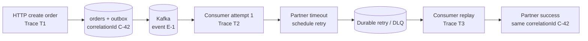
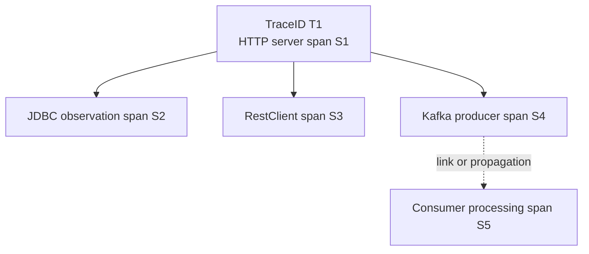
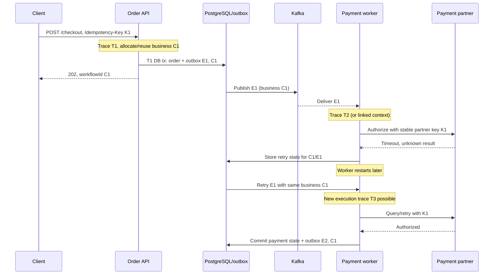
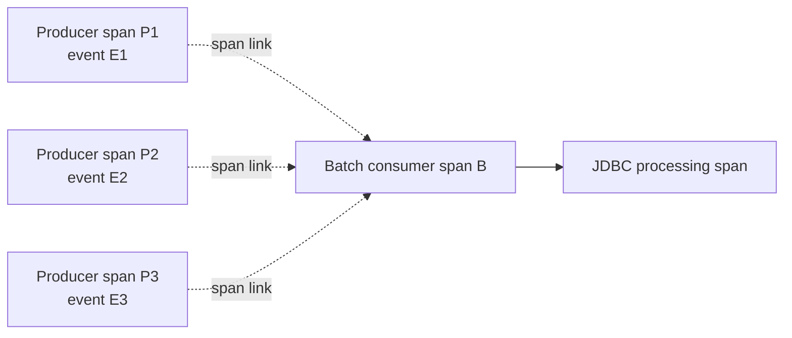

# Distinguishing Business Correlation IDs from Trace IDs

## 1. Context: A Single Order Can Span Multiple Traces

In the **SPRING_BOOT_INTEGRATION** module, an HTTP request in Spring Boot can write to PostgreSQL, create an outbox event, publish to Kafka, get routed by Spring Integration to a worker, call Redis and a partner API, and later be reprocessed after a network error. During an incident investigation, operations teams need to answer **two distinct questions**:

1. **Which business process is being executed?** For example, the entire fulfillment workflow for order `ORD-42`, or a payment request identified as `PAY-REQ-17`.
2. **Which services, threads, and operations did a single execution attempt pass through?** For example, the HTTP request at 10:00, the initial Kafka consumption, or the redelivery at 10:25.

To answer the first question, the application needs a **business correlation ID**. To answer the second, the observability system needs a **trace ID** and **span IDs**.

A common mistake is setting `correlationId = traceId` everywhere or using `traceId` as a deduplication key. That might appear to work inside a brief HTTP call, yet it breaks once work resumes after restarts, retries, or days spent waiting on a partner.



In the diagram:

- **`C-42` remains stable** across the defined business workflow, even when T1, T2, and T3 differ.
- **`E-1` remains stable** if the same business event is redelivered; it is the critical key for idempotency.
- **T1/T2/T3** illustrate observed execution attempts that may belong to distinct traces. There is no rule forcing every Kafka consumption to start a new trace ID: instrumentation, context propagation, span links, and sampling can connect them or place them in the same trace. The key point is **never using trace topology as a durable business contract**.

### Learning Objectives

After this lesson, you will be able to:

1. Distinguish `businessCorrelationId`, `traceId`, `spanId`, `eventId`, `causationId`, `requestId`, `Idempotency-Key`, and aggregate IDs.
2. Explain W3C `traceparent`/`tracestate`, `baggage`, and the relationship between trace/span IDs.
3. Design header/payload contracts so multi-step workflows, retries, fan-out, and batches remain traceable to the same business process.
4. Use Spring Boot Actuator, Micrometer Observation/Tracing, and OpenTelemetry or Brave to observe HTTP, JDBC, and messaging.
5. Deliberately propagate **business correlation IDs** across `RestClient`, `WebClient`, Kafka, and Spring Integration without confusing them with automatic trace propagation.
6. Understand MDC, thread handoffs via `ExecutorChannel`, Reactor Context, outbox/inbox, and trust boundaries.
7. Decide when to use parent-child traces, span links, or separate traces for asynchronous processing.
8. Avoid sensitive data leaks, high-cardinality metrics, header spoofing, and misleading conclusions from trace sampling.
9. Write tests verifying identity propagation, retry/duplicate behavior, sampling, invalid headers, and incident lookup.

> **Example scope:** Java 17+, Spring Boot 3.5.x, Spring Integration 6.x, Micrometer Observation/Tracing, and PostgreSQL, HTTP, Kafka/RabbitMQ/Pulsar components. Exact exporter APIs, client instrumentations, and message header mappers may vary across versions. Sample IDs such as `C-42` and `EVT-1` are illustrative, not Spring-generated ID formats.

## 2. Comparison Table of Identifier Types

| Identifier | Semantic scope | Who assigns it? | Appropriate lifetime | Primary purpose |
| --- | --- | --- | --- | --- |
| **Business correlation ID** (`businessCorrelationId`) | A contracted business workflow/operation | Authoritative ingress or orchestrating service | Survives retries, replays, restarts, and workflow steps | Find all states/logs/events of the same business process |
| **Trace ID** (`traceId`) | One distributed trace / trace graph | Tracing SDK or propagated trace context | Tied to an observed execution scope; not a business lifetime contract | Link spans to analyze execution paths and latency |
| **Span ID** (`spanId`) | One operation/unit of work within a trace | Tracing SDK | Span lifetime | Pinpoint HTTP client calls, DB queries, message handlers, etc. |
| **Aggregate ID** (`orderId`, `paymentId`) | A domain entity | Business domain system | Follows the entity, potentially very long-lived | Lookups and state transitions |
| **Event ID** (`eventId`) | An immutable business event | Producer/outbox | Stable across redeliveries/republications | Deduplication/idempotency, audit |
| **Causation ID** (`causationId`) | The immediate event/command that caused the current event | Business producer | Durable along the event chain | Build the domain causal graph |
| **Request ID** (`requestId`) | One HTTP or transport request | Gateway/client/server | Single request/attempt, per contract | Request support/debugging |
| **Idempotency key** | One client-retryable **operation** | Client or server per API contract | Across the retry/reconciliation window | Prevent duplicating business side effects |
| **Message transport ID** | A broker-assigned delivery/message ID | Kafka/Rabbit/Pulsar | Depends on broker/partition/channel | ACK, offset, transport debugging |

There is no rule requiring every category to hold a **different string** in every system: an `operationId` may serve as both business correlation ID and idempotency key **if the contract permits**. Still, you must distinguish **meaning and scope**. Above all, `traceId` and `eventId` must never be treated as interchangeable keys.

### 2.1. "Correlation ID" Can Mean Two Different Things

Spring Boot's logging documentation refers to a string built from MDC `traceId` and `spanId` as a **logging correlation ID**. That is a *log-to-trace* correlation identifier supplied by the observability platform.

This lesson uses **business correlation ID** to mean an identifier defined by a **business contract**. For example:

```text
Spring Boot log correlation:
  [4bf92f3577b34da6a3ce929d0e0e4736-00f067aa0ba902b7]

Business correlation:
  order-flow-2d834c9e
```

Both concepts are useful, yet **not identical**. Use explicit field names like `businessCorrelationId` or `workflowId` rather than letting multiple headers across the system share the name `correlationId` with conflicting definitions.

### 2.2. A Trace ID Is Not a Payment Key

An HTTP client that times out after a partner already charged successfully may send a retry request with a new trace ID. If the server or partner deduplicates using `traceId`, the retry causes a second charge. Deduplication must rely on a **contractual idempotency key** and durable storage, never on sampled tracing.

### 2.3. Business Correlation Does Not Have to Be Order ID

One order can go through multiple workflows:

```text
orderId=ORD-42
  correlationId=FLOW-CREATE-42
  correlationId=FLOW-REFUND-42
  correlationId=FLOW-RETRY-SHIP-42
```

Always using `orderId` as `businessCorrelationId` lumps every workflow together, making it hard to separate a refund from initial creation. The **granularity** of the correlation ID must be explicit: per order, per payment authorization, per fulfillment attempt, per saga instance, or per tenant-scoped business command.

## 3. W3C Trace Context: `traceparent` Is Not a Business ID

W3C Trace Context standardizes tracing propagation over HTTP:

```http
traceparent: 00-4bf92f3577b34da6a3ce929d0e0e4736-00f067aa0ba902b7-01
tracestate: vendorname=some-value
```

Version `00` of `traceparent` has four parts:

```text
00 - 4bf92f3577b34da6a3ce929d0e0e4736 - 00f067aa0ba902b7 - 01
 |                    |                         |             |
version              trace-id                  parent-id     trace-flags
```

| Field | Version 00 syntax | Meaning |
| --- | --- | --- |
| `version` | 2 hex chars; e.g., `00` | W3C trace context version |
| `trace-id` | 32 lowercase hex chars, 16 bytes, not all zeroes | Shared distributed trace |
| `parent-id` | 16 lowercase hex chars, 8 bytes, not all zeroes | Upstream operation ID used as parent |
| `trace-flags` | 2 hex chars | Bit flags, including sampled bit |
| `tracestate` | Optional vendor-specific list | Tracing vendor metadata, not a place for business payloads |

**Note:** `parent-id` in HTTP `traceparent` is the span ID passed by the **caller**; the server usually creates a **new span ID** for its own span. Therefore, do not compare "incoming parent-id" with the server span ID and wrongly conclude tracing is broken because they differ.

### 3.1. Traces and Spans Form an Execution-Time Graph



A trace typically contains multiple spans. Spans have parent-child relationships, though messaging often uses **span links** to model non-nested causality, especially for fan-out, batching, and long-running asynchronous work.

### 3.2. `trace-flags` Sampled Does Not Guarantee the Trace Exists in the Backend

The sampled bit suggests a collection decision, yet:

- Upstream/downstream services may apply independent sampling policies.
- Traces can be dropped by exporters, collectors, networks, or storage.
- Backends can lack spans even when the application executed cleanly.
- A missing trace in the UI **does not mean the business operation never happened**.

Business progress requires durable state, receipts, business logs, and metrics independent of trace sampling.

### 3.3. Never Craft `trace-id` to Embed an Order ID

Do not do this:

```text
traceId = hash(orderId)
traceId = padLeft(idempotencyKey)
```

This is improper coupling: trace IDs must follow tracing SDK rules and proper entropy/uniqueness; order IDs can be guessable, collide across scopes, or contain sensitive data. Use a **separate business correlation field** and let tracers/propagators manage `traceparent`.

### 3.4. `tracestate` Must Not Hold Business State

`tracestate` is for tracing vendor metadata, not for storing `orderStatus`, tokens, or payment outcomes. To transmit business fields, use contracted headers or schema-defined payloads. Likewise, never use `traceparent` for authentication or authorization.

## 4. Business Correlation ID Is a Data Contract

A well-defined business correlation ID must answer:

- **Scope:** a saga, an order fulfillment workflow, a payment operation, or a single request?
- **Issuing authority:** an authoritative gateway or the workflow-initiating service?
- **When it stays stable:** retries, timeouts, broker redeliveries, requeues, DLT replays, cluster restarts?
- **When it changes:** an entirely new workflow, a new refund operation, a new command?
- **Format:** UUID/ULID/random opaque ID or namespaced identifier?
- **Trust:** can clients propose an ID, and does the server validate or replace it?
- **Where it is stored:** payloads, outboxes, inboxes, database workflow state, headers, and structured logs?
- **Lookup:** can you query from ID to all events, requests, statuses, and spans across multiple traces?

Example internal contract:

```yaml
businessCorrelation:
  field: businessCorrelationId
  scope: one-order-fulfillment-workflow
  origin: order-command-service
  required: true
  format: opaque-uuid
  stableAcrossRetries: true
  durableStorage: orders_and_outbox
  visibility: internal
```

The YAML above is an **illustrative team-defined contract**, not an auto-active Spring Boot configuration.

### 4.1. Recommended Lifecycle Rules

```text
New business workflow
   -> server assigns correlation C1
   -> command accepted into durable state
   -> event E1 with C1
   -> broker delivery and redelivery still C1
   -> downstream creates event E2, inherits C1
   -> partner timeout, replay still C1
   -> workflow COMPLETE, correlation C1 remains searchable

New independent workflow for same order
   -> correlation C2 (by domain policy)
```

When splitting one workflow into sub-jobs, child jobs can retain `C1` if they belong to the same workflow while carrying a `subOperationId` when finer distinction is needed. Never mint a new business correlation ID for **every retry attempt**, losing the ability to trace full history.

### 4.2. Idempotency and Correlation Solve Different Problems

Example:

```text
businessCorrelationId = C1   # entire checkout workflow
eventId               = E7   # payment-authorized event
idempotencyKey        = K4   # single charge operation, retried with same key
traceId               = T9   # single instrumented execution
```

One checkout can contain **multiple events**, **multiple idempotent operations**, and **multiple traces**. `C1` lets you investigate the whole workflow yet **does not prove whether an event was already processed**. `E7`/unique receipts and `K4` govern deduplication per contract.

### 4.3. Causation ID Explains Immediate Cause; Correlation ID Explains Grouping

```text
Command: PlaceOrder (commandId=CMD-1, correlationId=C1)
  -> Event: OrderPlaced (eventId=E1, causationId=CMD-1, correlationId=C1)
     -> Event: PaymentAuthorized (eventId=E2, causationId=E1, correlationId=C1)
        -> Event: ShipmentRequested (eventId=E3, causationId=E2, correlationId=C1)
```

`causationId` is the **direct link** in the domain event graph; `businessCorrelationId` groups the entire chain. `traceId` describes the technical executions that emitted/consumed them and does not replace this durable event graph.

### 4.4. Missing Correlation ID: Conditional Creation

If an inbound HTTP request **starts a new workflow**, the server may generate a new ID and persist it durably alongside the command. If the request is a **retry** of an existing workflow missing the ID due to a client bug, never silently invent a new workflow to "fill the missing header" while creating duplicates; use the operation key/request contract to locate existing state or return an error.

For inbound Kafka events missing a required `businessCorrelationId`, policy may route to DLT/parking/validation failure; do not generate a fresh ID on each redelivery if the domain requires lineage preservation.

## 5. One Workflow Can Have Many Traces, Spans, and Events

Consider checkout:



Across steps:

| Step | Business correlation | Event/operation ID | Trace/Span |
| --- | --- | --- | --- |
| HTTP checkout | C1 | K1 request idempotency | T1 / HTTP server span |
| SQL order + outbox | C1 | E1 | T1 / JDBC-related spans (if instrumented) |
| Kafka publish E1 | C1 | E1 | May belong to T1 or another outbox publisher trace |
| Kafka consume E1 | C1 | E1 | T2 or trace linked from producer |
| Payment timeout/retry | C1 | K1/E1 | One or more attempts/spans/traces |
| Next-day reconciliation | C1 | K1/E1 | New T3 may appear |
| Payment result event | C1 | **New E2**, causationId=E1 | Current publisher/worker trace |

**Note:** when E1 is **redelivered**, `eventId=E1` stays constant. When processing E1 produces a **new domain event** `PaymentAuthorized`, it gets `eventId=E2` while preserving `causationId=E1` and `businessCorrelationId=C1`.

### 5.1. One-to-Many Is Normal

```text
One businessCorrelationId
    -> many eventIds / causationIds
    -> many HTTP requests and retries
    -> many traceIds
    -> many spanIds in each trace
```

Many-to-many relationships also occur:

- A batch job covering multiple business correlations shares **one batch processing span**.
- One event fanned out to three consumer groups spawns three traces/consumer spans.
- A workflow executes partially inside a single upstream-traced request.
- A reconciliation job processes 500 outbox rows, each belonging to a different `businessCorrelationId`.

Therefore, observability stores must never enforce a **one correlation ID = one trace ID** relationship.

### 5.2. During Retries, What Must Be Preserved?

| Element | Redelivery of same event | New operation in same workflow | New workflow |
| --- | --- | --- | --- |
| `businessCorrelationId` | **Keep** | **Keep** if same workflow | Usually allocate new |
| `eventId` | **Keep** | **Allocate new** for new event | New |
| `causationId` | Keep per event envelope | Set to immediate cause ID | Per new cause |
| `idempotencyKey` | Keep if retrying same external operation | New key if different operation | Per contract |
| `traceId` | **Not guaranteed to stay** | May differ | May differ |
| `spanId` | Usually a new span for the new execution | New | New |

These rules must be unit/integration tested across serialization, outbox republishing, retry topics, DLT replays, and restarts.

## 6. Designing Envelopes for Kafka, AMQP, Pulsar, and DB Outboxes

In multi-adapter systems, **`businessCorrelationId` must live durably** where it can be recovered, rather than only in MDC or HTTP request scope.

Schema example for an envelope:

```java
// IntegrationEvent.java
package example.integration.contract;

import java.time.Instant;

public record IntegrationEvent<T>(
        int schemaVersion,
        String eventId,
        String businessCorrelationId,
        String causationId,
        String aggregateId,
        String eventType,
        Instant occurredAt,
        T payload) {
}
```

JSON payload:

```json
{
  "schemaVersion": 1,
  "eventId": "EVT-ORD42-001",
  "businessCorrelationId": "FLOW-ORD42-20261121",
  "causationId": "CMD-CHECKOUT-42",
  "aggregateId": "ORD-42",
  "eventType": "order.placed",
  "occurredAt": "2026-11-21T10:00:00Z",
  "payload": {
    "orderId": "ORD-42",
    "currency": "VND",
    "amount": 250000
  }
}
```

`schemaVersion` is the **data contract** version, neither the aggregate business version nor the trace context version. `eventType` should be a stable name governed by a registry/compatibility policy; never turn it into a metric label carrying business IDs.

### 6.1. Why Put Correlation ID Inside the Envelope?

Broker headers can:

- Be stripped by an adapter/header mapper or unconfigured bridge.
- Be lost when a dead-letter converter builds a new message.
- Be omitted when an outbox only persists `payload_json`.
- Be absent from exports/archives used for replay.
- Be altered when data crosses protocols without equivalent headers.

Therefore, for business-critical correlation, store the ID in the **payload envelope or durable outbox/inbox columns**. You may **duplicate** it into message headers for fast logging/routing, but define a **source of truth** and mismatch handling rules.

### 6.2. Source of Truth When Header and Payload Conflict

```text
Kafka Header: businessCorrelationId=FLOW-A
Payload:      businessCorrelationId=FLOW-B
```

Do not silently pick one at random. A typical policy:

1. Validate required fields and format at the ingress/trust boundary.
2. When headers are merely observability copies, the valid payload is the **source of truth**.
3. If the two values differ, report `CORRELATION_MISMATCH` and DLT/park/alert per domain rules rather than merging logs of two workflows.
4. For external sources, never let a header override authenticated tenant/workflow ownership.

### 6.3. Version Evolution

When upgrading `schemaVersion=1` to `2`:

- Preserve `businessCorrelationId` semantics; avoid repurposing it from workflow ID to request ID without versioning the contract.
- If a field is renamed, support transition/compatibility in consumers and dead-letter replays.
- Never fabricate a new correlation ID when deserializing older events just because a field is absent if lineage can be verified from persistent storage.
- Establish clear rules for legacy events lacking IDs: quarantine or map from authoritative business records rather than inventing random IDs and breaking history.

## 7. Persistence: Business IDs Must Outlive Trace Backend Retention

PostgreSQL example:

```sql
CREATE TABLE order_workflow (
    workflow_id VARCHAR(100) PRIMARY KEY,
    order_id VARCHAR(100) NOT NULL,
    workflow_type VARCHAR(80) NOT NULL,
    workflow_status VARCHAR(40) NOT NULL,
    created_at TIMESTAMPTZ NOT NULL DEFAULT now(),
    updated_at TIMESTAMPTZ NOT NULL DEFAULT now()
);

CREATE TABLE integration_outbox (
    event_id VARCHAR(120) PRIMARY KEY,
    business_correlation_id VARCHAR(100) NOT NULL,
    causation_id VARCHAR(120),
    aggregate_id VARCHAR(100) NOT NULL,
    event_type VARCHAR(100) NOT NULL,
    schema_version INTEGER NOT NULL,
    payload_json JSONB NOT NULL,
    publish_state VARCHAR(30) NOT NULL DEFAULT 'PENDING',
    created_at TIMESTAMPTZ NOT NULL DEFAULT now()
);

CREATE INDEX idx_outbox_correlation
    ON integration_outbox (
        business_correlation_id, created_at
    );

CREATE TABLE integration_inbox (
    consumer_name VARCHAR(100) NOT NULL,
    event_id VARCHAR(120) NOT NULL,
    business_correlation_id VARCHAR(100) NOT NULL,
    processed_at TIMESTAMPTZ NOT NULL DEFAULT now(),
    PRIMARY KEY (consumer_name, event_id)
);
```

This is a learning schema; production requires migrations (Flyway/Liquibase), workload-tuned partitioning/retention/indexes, and PII/tenant policies. Never use trace IDs as primary keys in outbox or inbox tables.

### 7.1. Idempotent Consumer by Event ID, Lookup by Correlation ID

```text
UNIQUE(consumer_name,event_id)
    -> Prevents applying side effects twice

INDEX(business_correlation_id,created_at)
    -> Finds all events in the same workflow
```

The two IDs play distinct database roles. `businessCorrelationId` is not unique in event tables because multiple valid events share one workflow.

### 7.2. Transaction Correctness Differs from Trace Continuity

```text
T1:
  INSERT order_workflow
  INSERT order
  INSERT integration_outbox (same businessCorrelationId)
COMMIT
```

SQL writes must share an appropriate transaction owner. A continuous trace does not enable rollback across two separate DataSources/transactions. Conversely, a JDBC transaction commits cleanly even during a trace backend outage.

### 7.3. Should `traceId` Be Stored in the DB?

You can store **`firstSeenTraceId` or `lastAttemptTraceId` as diagnostic metadata** under privacy/retention rules if truly useful. However:

- Never make it a business key, unique receipt, or routing ID.
- One business event can have **multiple trace IDs** across attempts/replays.
- Traces get sampled or aged out, so stored IDs may no longer resolve in the trace backend.
- Never base transaction commits, ACKs, or authorization on this field.

For multi-attempt history, an `integration_attempt` table can hold `attemptId`, `eventId`, `businessCorrelationId`, optional `traceId`, status, and timestamps, with retention aligned to incident/audit policies.

### 7.4. Operational Support Query

```sql
SELECT event_id, event_type, publish_state, created_at
FROM integration_outbox
WHERE business_correlation_id = :correlationId
ORDER BY created_at, event_id;
```

`:correlationId` is a **named parameter** for `NamedParameterJdbcTemplate`/`JdbcClient`; in raw `psql`, replace it with an appropriate bind mechanism. Restrict cross-tenant queries by combining tenant authorization and row-level policies per system design.

## 8. Spring Boot Micrometer Tracing: Getting `traceId` Without Making It a Business ID

In Spring Boot 3.5, Actuator auto-configures Micrometer Observation/Tracing when matching dependencies exist. You can pick an OpenTelemetry or Brave bridge plus an exporter targeting Zipkin or an OTLP collector.

Maven example (pick **one** consistent bridge/exporter stack):

```xml
<dependency>
    <groupId>org.springframework.boot</groupId>
    <artifactId>spring-boot-starter-actuator</artifactId>
</dependency>
<dependency>
    <groupId>io.micrometer</groupId>
    <artifactId>micrometer-tracing-bridge-otel</artifactId>
</dependency>
<dependency>
    <groupId>io.opentelemetry</groupId>
    <artifactId>opentelemetry-exporter-otlp</artifactId>
</dependency>
```

When using the Spring Boot parent/BOM, let the BOM manage compatible versions. Never stack **Brave + OpenTelemetry bridge** without clear justification and explicit exporter/tracer configuration.

```yaml
spring:
  application:
    name: orders-integration

management:
  tracing:
    sampling:
      probability: 1.0   # For test/staging; intentionally lower in production
  otlp:
    tracing:
      endpoint: http://otel-collector:4318/v1/traces
```

`management.otlp.tracing.endpoint` illustrates the OTLP exporter path on Boot 3.5; endpoints/ports must match your collector protocol. Never treat the trace backend/collector as a source of truth for deciding whether to ACK a message.

### 8.1. Sampling Is Not Equivalent to Storing Correlation IDs

In the example, `probability: 1.0` improves visibility in tests, yet can be costly in production. With 10% sampling, over time most workflows lack a full trace in the backend. **Business correlation IDs must still appear in durable state and business logs** even without sampled traces.

### 8.2. Observation and Tracer Have Distinct Scopes

`ObservationRegistry` manages observation lifecycles for metrics/tracing handlers. `io.micrometer.tracing.Tracer` exposes the current span/trace context. `MeterRegistry` handles numeric meters. Do not confuse:

- **Observation**: an instrumented activity that can produce metrics/traces via handlers.
- **Trace/Span**: model of distributed execution and latency.
- **Business correlation**: workflow identifier governed by domain contracts.

### 8.3. Auto-Instrumentation Does Not Give Every Method a Span

Boot provides built-in observations for certain HTTP components, yet arbitrary service methods, Spring Integration channels, Kafka conversions, JDBC queries, Redis commands, or hand-rolled HTTP clients **do not automatically emit spans** just because Actuator is present. Check each library, instrumentation, agent, observation registry, auto-config conditions, and test actual traces.

### 8.4. `RestClient`/`WebClient` Builders Must Come from Boot

Boot 3.5 documentation states clearly: for HTTP clients, use **Boot auto-configured `RestClient.Builder`/`WebClient.Builder`** for automatic trace context propagation. Manually calling `RestClient.create()`/`WebClient.create()` bypasses instrumentation and propagators.

Never configure an application to **derive `traceparent` from a business ID**. Let the tracing stack manage span creation/injection and pass business fields in dedicated headers.

## 9. Reading `traceId` in Spring Boot Without Treating It as Source of Truth

Spring Boot/Micrometer provides `io.micrometer.tracing.Tracer` to access the active span. Diagnostic service example:

```java
// ExecutionLog.java
package example.integration.observability;

import io.micrometer.tracing.Span;
import io.micrometer.tracing.Tracer;
import org.slf4j.Logger;
import org.slf4j.LoggerFactory;
import org.springframework.stereotype.Component;

@Component
public class ExecutionLog {

    private static final Logger log =
            LoggerFactory.getLogger(ExecutionLog.class);

    private final Tracer tracer;

    public ExecutionLog(Tracer tracer) {
        this.tracer = tracer;
    }

    public void businessStep(
            String businessCorrelationId,
            String eventId,
            String step) {

        Span current = tracer.currentSpan();
        String traceId = current == null
                ? "none" : current.context().traceId();
        String spanId = current == null
                ? "none" : current.context().spanId();

        log.info(
                "workflow.step businessCorrelationId={} eventId={} "
                        + "step={} traceId={} spanId={}",
                businessCorrelationId, eventId, step, traceId, spanId);
    }
}
```

In this code:

- `businessCorrelationId` and `eventId` **come from the validated business envelope**.
- `traceId`/`spanId` reflect only the **current span**, never derived from business IDs.
- `tracer.currentSpan()` can return `null` when no span is active (e.g., an uninstrumented worker thread); never set `businessCorrelationId=null` as a result.
- Explicitly logging `traceId` may duplicate MDC fields that Boot already injects via log patterns, so production setups can log only business fields and let the correlation pattern include trace/span IDs.

### 9.1. A Method Can Lack an Active Span Even with Tracing Enabled

An uninstrumented scheduled reconciliation job, raw executor task, legacy callback, or SQL poller can have `currentSpan() == null`. A log missing `traceId` does not mean the event does not exist.

If an operation warrants instrumentation, create an observation/span via the official API; **never create spans just to manufacture business IDs**, and never substitute `traceId` for an event receipt.

### 9.2. Custom Observation for a Business Step

```java
// PaymentObservation.java
package example.integration.observability;

import io.micrometer.observation.Observation;
import io.micrometer.observation.ObservationRegistry;
import org.springframework.stereotype.Component;

@Component
public class PaymentObservation {

    private final ObservationRegistry observationRegistry;
    private final PaymentWorker paymentWorker;

    public PaymentObservation(
            ObservationRegistry observationRegistry,
            PaymentWorker paymentWorker) {
        this.observationRegistry = observationRegistry;
        this.paymentWorker = paymentWorker;
    }

    public void process(IntegrationEvent<?> event) {
        Observation observation = Observation.createNotStarted(
                        "integration.payment.process",
                        observationRegistry)
                .lowCardinalityKeyValue("operation", "payment")
                .lowCardinalityKeyValue("result_kind", "attempt")
                .start();

        try (Observation.Scope scope = observation.openScope()) {
            paymentWorker.apply(event);
        } catch (RuntimeException ex) {
            observation.error(ex);
            throw ex;
        } finally {
            observation.stop();
        }
    }
}
```

`PaymentWorker` is an application-provided business interface/service; `IntegrationEvent<T>` is the DTO from Section 6 (import its package). This creates an observation with a **stable name** and bounded low-cardinality keys; it does **not** put `businessCorrelationId` into metric tags.

### 9.3. When to Use High-Cardinality Observation Fields

Micrometer allows `highCardinalityKeyValue(...)` in certain observation conventions/handlers, typically intended for tracing data rather than metric tags. Even then, a business ID becomes a **span attribute** in third-party backends. Assess data classification, access controls, and cost before writing:

```java
observation.highCardinalityKeyValue(
        "business.correlation_id",
        validatedBusinessCorrelationId);
```

Do not apply this API indiscriminately to every `orderId`, user email, account number, or payment token. The safest baseline is keeping IDs in access-controlled structured logs/DBs and allowlisting only fields truly needed in the trace backend.

## 10. MDC: Placing Business Correlation IDs Next to `traceId`/`spanId`

**MDC (Mapped Diagnostic Context)** is a context map used by logging frameworks, usually thread-bound. With Micrometer Tracing, Spring Boot can populate `traceId` and `spanId` into MDC and use them as the **logging correlation ID**.

`businessCorrelationId` does not enter MDC automatically. The application can set it at the **handler boundary** after validating the envelope:

```java
// BusinessLogScope.java
package example.integration.observability;

import java.util.Objects;
import org.slf4j.MDC;

public final class BusinessLogScope implements AutoCloseable {

    private final MDC.MDCCloseable scope;

    private BusinessLogScope(String correlationId) {
        this.scope = MDC.putCloseable(
                "businessCorrelationId",
                Objects.requireNonNull(correlationId));
    }

    public static BusinessLogScope open(String correlationId) {
        return new BusinessLogScope(correlationId);
    }

    @Override
    public void close() {
        scope.close();
    }
}
```

Inside a message handler:

```java
try (BusinessLogScope ignored =
        BusinessLogScope.open(event.businessCorrelationId())) {
    log.info("Processing eventId={}", event.eventId());
    orderService.apply(event);
}
```

`MDC.putCloseable()` removes the key when the scope closes. However, if you nest multiple scopes using the same MDC key, this simple version **deletes** the key rather than restoring the prior value. If nested scopes occur, restore the previous value in `finally` to avoid wiping out the parent context. See the pattern below for nested scopes.

### 10.1. MDC Scope Pattern That Restores the Previous Value

```java
public static void withCorrelation(
        String correlationId,
        Runnable action) {

    String previous = MDC.get("businessCorrelationId");
    try {
        MDC.put("businessCorrelationId", correlationId);
        action.run();
    } finally {
        if (previous == null) {
            MDC.remove("businessCorrelationId");
        } else {
            MDC.put("businessCorrelationId", previous);
        }
    }
}
```

This is an illustrative utility method; `correlationId` must be validated before calling. Always clean up in `finally` because thread-pool executors reuse threads across workflows. Otherwise, customer A's logs could inherit workflow B's ID.

### 10.2. Custom Log Pattern for Business Fields

Example Logback pattern snippet:

```yaml
logging:
  pattern:
    correlation: "[%X{traceId:-},%X{spanId:-}] "
    level: "%5p workflow=%X{businessCorrelationId:-}"
```

This is merely an **example of adding MDC to a log layout**—check your project's full Logback pattern. Avoid accidentally dropping logger/timestamp/thread info when overriding global patterns. Prefer JSON structured logging with distinct fields and duplicate suppression over cramming many IDs into a free-text line.

### 10.3. MDC Is Not Durable

```text
Log context in HTTP thread
     ≠ Kafka message stored in broker
     ≠ Outbox row stored in database
     ≠ Reactor Context in async publisher
```

MDC exists **to format logs accurately within a scope**, not to persist business correlation across crashes. After a restart, recover `businessCorrelationId` from the **envelope/inbox/outbox**, never from a vanished thread-local context.

## 11. HTTP: Dedicated Business Header, `traceparent` Handled by Tracing Stack

Recommended clear naming:

```http
X-Business-Correlation-Id: 2d834c9e-5c1a-4fb8-9ab3-498d778ec71e
Idempotency-Key: checkout-tenantA-clientkey-17
traceparent: 00-4bf92f3577b34da6a3ce929d0e0e4736-00f067aa0ba902b7-01
```

`X-Business-Correlation-Id` is an **application-defined** header, not an HTTP, W3C Trace Context, or Spring Boot standard. `traceparent` has its own standard. `Idempotency-Key` has its own retry/operation contract. Never substitute one header for another.

### 11.1. REST Ingress: Server Assigns the ID for a New Workflow

Example interface for business service idempotency control:

```java
// WorkflowSubmissionService.java
package example.integration.checkout;

public interface WorkflowSubmissionService {

    // Claims/reuses Idempotency-Key, validates payload,
    // and commits workflow + outbox before returning.
    AcceptedWorkflow submit(String idempotencyKey, CheckoutRequest request);

    record AcceptedWorkflow(String businessCorrelationId) {
    }
}
```

`CheckoutRequest` is an application DTO. `submit` must be backed by a **durable unique key** and transaction; the interface alone does not provide idempotency. Controller:

```java
// CheckoutController.java
package example.integration.checkout;

import org.springframework.http.ResponseEntity;
import org.springframework.web.bind.annotation.PostMapping;
import org.springframework.web.bind.annotation.RequestBody;
import org.springframework.web.bind.annotation.RequestHeader;
import org.springframework.web.bind.annotation.RestController;

@RestController
public class CheckoutController {

    private final WorkflowSubmissionService submissions;

    public CheckoutController(WorkflowSubmissionService submissions) {
        this.submissions = submissions;
    }

    @PostMapping("/checkout")
    public ResponseEntity<Void> checkout(
            @RequestHeader("Idempotency-Key") String key,
            @RequestBody CheckoutRequest request) {

        var accepted = submissions.submit(key, request);
        return ResponseEntity.accepted()
                .header(
                        "X-Business-Correlation-Id",
                        accepted.businessCorrelationId())
                .build();
    }
}
```

When the client retries with the same `Idempotency-Key` and identical payload, the service **retrieves the stored correlation ID** instead of creating a new workflow. When the same key arrives with a different payload, the service must return a conflict per the API contract. A `202 Accepted` should only return once work is durably persisted to continue per commitment.

**Trace IDs across the two HTTP requests may differ**, yet the response header `X-Business-Correlation-Id` preserves the same workflow ID. This is the single most effective test for catching accidental use of `traceId` as a business ID.

### 11.2. RestClient: Use the Spring Boot-Provided Builder

```java
// PartnerHttpConfiguration.java
package example.integration.partner;

import org.springframework.context.annotation.Bean;
import org.springframework.context.annotation.Configuration;
import org.springframework.web.client.RestClient;

@Configuration(proxyBeanMethods = false)
public class PartnerHttpConfiguration {

    @Bean
    RestClient partnerRestClient(RestClient.Builder builder) {
        return builder
                .baseUrl("https://partner.example")
                .build();
    }
}
```

`RestClient.Builder` is auto-configured by Spring Boot under matching conditions, allowing observation/trace propagation customizers to apply. Sending a request:

```java
// PartnerGateway.java
package example.integration.partner;

import org.springframework.stereotype.Component;
import org.springframework.web.client.RestClient;

@Component
public class PartnerGateway {

    private final RestClient client;

    public PartnerGateway(RestClient partnerRestClient) {
        this.client = partnerRestClient;
    }

    public void authorize(
            String businessCorrelationId,
            String operationId,
            Object requestBody) {

        client.post()
                .uri("/authorizations")
                .header(
                        "X-Business-Correlation-Id",
                        businessCorrelationId)
                .header("Idempotency-Key", operationId)
                .body(requestBody)
                .retrieve()
                .toBodilessEntity();
    }
}
```

Business headers are **set explicitly per contract**. `traceparent`/tracing headers are left to Boot/Micrometer propagators when an active tracing context and HTTP client instrumentation exist. A call outside any active span may start a new client observation/span depending on instrumentation; not every execution shares the original request's trace.

### 11.3. Manual `RestClient` Creation Can Lose Automatic Propagation

```java
RestClient client = RestClient.create("https://partner.example");
```

Using this manual path instead of Boot's auto-configured builder may omit observation/tracing customizers, leaving downstream with the business header but no `traceparent`. **Never "fix" this by sending a fake `traceparent`**; use the proper builder/instrumentation and verify real requests.

### 11.4. Headers Are Not Authorization

A partner echoing back `X-Business-Correlation-Id` does not prove authorization to act on that order or tenant. Always authenticate callers and verify workflow ownership and operation mapping. Headers help support teams, not access control.

## 12. `WebClient` and Reactive Context: Same Business ID, Different Execution Context

With WebFlux:

```java
// ReactivePartnerConfiguration.java
package example.integration.partner;

import org.springframework.context.annotation.Bean;
import org.springframework.context.annotation.Configuration;
import org.springframework.web.reactive.function.client.WebClient;

@Configuration(proxyBeanMethods = false)
public class ReactivePartnerConfiguration {

    @Bean
    WebClient reactivePartnerClient(WebClient.Builder builder) {
        return builder
                .baseUrl("https://partner.example")
                .build();
    }
}
```

```java
// ReactivePartnerGateway.java
package example.integration.partner;

import org.springframework.web.reactive.function.client.WebClient;
import reactor.core.publisher.Mono;

public class ReactivePartnerGateway {

    private final WebClient client;

    public ReactivePartnerGateway(WebClient client) {
        this.client = client;
    }

    public Mono<String> checkStatus(
            String businessCorrelationId,
            String paymentId) {

        return client.get()
                .uri("/payments/{id}", paymentId)
                .header(
                        "X-Business-Correlation-Id",
                        businessCorrelationId)
                .retrieve()
                .bodyToMono(String.class);
    }
}
```

Here the business ID travels as a **method argument**, independent of MDC `ThreadLocal`. Reactive tracing context can flow through Reactor Context across operators/subscriptions when properly instrumented; never assume `MDC.get("traceId")` inside an arbitrary operator will always be populated.

### 12.1. Fire-and-Forget `subscribe()` Alters the Completion Contract

```java
// Dangerous if the caller immediately returns success/ACK after this line:
reactivePartnerGateway.checkStatus(correlationId, paymentId).subscribe();
```

Network calls and trace spans may complete after the caller ACKs Kafka or returns the HTTP response. Use a reactive pipeline **managed to completion by the caller/adapter** or a durable inbox/outbox—never fire a detached `subscribe()` and rely on the current trace ID as proof of completion.

### 12.2. Batching Can Make Traces and Correlations Many-to-Many

A reactive `Flux` might process 100 events spanning 20 workflows. An observation around `collectList()` reflects batch processing rather than a single `businessCorrelationId`. On metrics, tag only `batch_size_band`, `status`, and `consumer_group`; in logs/DB keep per-event correlation, and let spans reference originating contexts via **span links**.

## 13. Kafka: Distinguishing Event Envelopes, Broker Headers, and Trace Propagation

Kafka carries several kinds of metadata:

| Field | Example | Meaning |
| --- | --- | --- |
| Topic/partition/offset | `orders.status/2/1052` | Record position in Kafka |
| Record key | `ORD-42` | Routing/partitioning key per contract |
| Record headers | `businessCorrelationId=C1`, optional tracing headers | Metadata sent across the broker |
| Record value | JSON envelope with `eventId=E1`, `businessCorrelationId=C1` | Business source of truth when defined by contract |
| Trace context | Context propagated by producer/consumer instrumentation | Connects producer/consumer observations, not event identity |

**The same event `E1` can be published at a different offset** if an outbox publisher retries. Thus `(topic, partition, offset)` is a delivery position, not a business idempotency ID. Kafka key `ORD-42` controls partitioning/ordering under matching conditions, yet is neither a workflow ID nor a replacement for `eventId`.

### 13.1. Producer: Copy Business IDs to Headers, Keep Them in the Payload

```java
// OrderEventPublisher.java
package example.integration.messaging;

import java.nio.charset.StandardCharsets;
import org.apache.kafka.clients.producer.ProducerRecord;
import org.springframework.kafka.core.KafkaTemplate;
import org.springframework.stereotype.Component;

@Component
public class OrderEventPublisher {

    private final KafkaTemplate<String, String> kafkaTemplate;

    public OrderEventPublisher(
            KafkaTemplate<String, String> kafkaTemplate) {
        this.kafkaTemplate = kafkaTemplate;
    }

    public void publish(
            IntegrationEvent<?> event,
            String serializedJson) {

        ProducerRecord<String, String> record =
                new ProducerRecord<>(
                        "orders.events.v1",
                        event.aggregateId(),
                        serializedJson);

        record.headers().add(
                "businessCorrelationId",
                event.businessCorrelationId()
                        .getBytes(StandardCharsets.UTF_8));
        record.headers().add(
                "eventId",
                event.eventId().getBytes(StandardCharsets.UTF_8));

        kafkaTemplate.send(record);
    }
}
```

This snippet only demonstrates **attaching business headers**; `IntegrationEvent<T>` must be imported from the contract package. `serializedJson` must be the JSON of the **exact same event**, produced by a contract-compliant serializer. A production implementation must:

- Track the `CompletableFuture<SendResult<...>>`/callback from `KafkaTemplate.send` and handle broker ACKs/failures.
- Keep `eventId` stable when retrying outbox publishes.
- Mark `outbox=PUBLISHED` only after confirmed publish outcomes per policy.
- Verify Spring Kafka tracing instrumentation/observations so trace context injects/extracts properly (regardless of `ProducerRecord`, `Message<?>`, or template converter APIs).
- Never manually populate `traceparent` with `eventId`/`correlationId` and never assume every Spring Kafka configuration enables tracing automatically.

### 13.2. Consumer: Read Business ID from Envelope, Validate with Header

```java
// OrderEventListener.java
package example.integration.messaging;

import com.fasterxml.jackson.databind.ObjectMapper;
import java.nio.charset.StandardCharsets;
import java.util.Objects;
import org.apache.kafka.clients.consumer.ConsumerRecord;
import org.apache.kafka.common.header.Header;
import org.springframework.kafka.annotation.KafkaListener;
import org.springframework.stereotype.Component;

@Component
public class OrderEventListener {

    private final ObjectMapper mapper;
    private final OrderEventService orderEventService;

    public OrderEventListener(
            ObjectMapper mapper,
            OrderEventService orderEventService) {
        this.mapper = mapper;
        this.orderEventService = orderEventService;
    }

    @KafkaListener(
            topics = "orders.events.v1",
            groupId = "orders-projection")
    public void consume(ConsumerRecord<String, String> record)
            throws Exception {

        IntegrationEvent<?> event =
                mapper.readValue(record.value(), IntegrationEvent.class);

        Header copiedHeader =
                record.headers().lastHeader("businessCorrelationId");
        if (copiedHeader != null) {
            String copied = new String(
                    copiedHeader.value(), StandardCharsets.UTF_8);
            if (!Objects.equals(
                    copied, event.businessCorrelationId())) {
                throw new IllegalArgumentException(
                        "Correlation ID header/payload mismatch");
            }
        }

        // Method on another service bean managing DB transaction/inbox.
        orderEventService.applyAndCommit(event);
    }
}
```

`OrderEventService` is an application service implementing `applyAndCommit(IntegrationEvent<?> event)` with proper transactions/receipts. Deserializing JSON records with Jackson requires validating required fields, payload schema, size, event type, and event ID; for generic payloads, use type-safe deserializers or `JsonNode` per contract rather than blindly trusting deserialized data.

**If the consumer method returns right after dispatching to an `ExecutorChannel`**, broker ACK/offset commit can occur **before the business DB commits**. Either process synchronously through the durable point, or record an inbox `PENDING` entry before ACK and let async workers recover safely. Having a business correlation ID does not make a flow safe without durability.

### 13.3. Do Not Assume Parent-Child Traces Across Kafka

Spring Kafka Micrometer observations, native Kafka client instrumentation, or an OpenTelemetry agent can create producer/consumer spans and invoke propagators. The resulting topology may use **parent-child** or **span links** depending on configuration and version. A record carrying business correlation `C1` must remain searchable even when traces do not form one unbroken tree.

Tests should assert:

1. Envelope contains `C1`.
2. Record header `C1` (if required by contract) matches the envelope.
3. Producer/consumer observations propagate context per instrumentation (when enabled).
4. Redelivery at a new offset preserves `eventId=E1` and `correlation=C1`.
5. Consumer idempotency receipts work unchanged even when trace context is absent or `traceId` changes.

## 14. Spring Integration: Aggregator `correlationId` Header Is Not a Default Workflow ID

Spring Integration uses a separate correlation concept **for message grouping**. In a splitter → aggregator flow, the framework can use:

- `IntegrationMessageHeaderAccessor.CORRELATION_ID` to group messages belonging to one sequence.
- `IntegrationMessageHeaderAccessor.SEQUENCE_NUMBER` to track part order.
- `IntegrationMessageHeaderAccessor.SEQUENCE_SIZE` to track expected part count.
- `MessageHeaders.ID` to identify a single Spring `Message<?>` instance.

These headers **are not automatically business workflow IDs**. For instance, a workflow `C1` with three splits looks like:

```text
businessCorrelationId=C1          # business workflow
Spring Integration correlationId=G7 # aggregator message group
sequenceNumber=1,2,3              # split sequence
eventId=E1                         # one business event
traceId=T9/T10/...                 # observations per scope
```

One workflow can spawn multiple batches/aggregator groups. Trying to use `businessCorrelationId` as the sole group key can merge splits from separate batches, confuse aggregator completion counts, and cause memory/persistence leaks.

### 14.1. Use Dedicated Header Names for Business IDs

```java
// BusinessMessageHeaders.java
package example.integration.messaging;

public final class BusinessMessageHeaders {
    public static final String BUSINESS_CORRELATION_ID =
            "businessCorrelationId";
    public static final String EVENT_ID = "eventId";
    public static final String CAUSATION_ID = "causationId";

    private BusinessMessageHeaders() {
    }
}
```

```java
Message<?> message = MessageBuilder.withPayload(event)
        .setHeader(
                BusinessMessageHeaders.BUSINESS_CORRELATION_ID,
                event.businessCorrelationId())
        .setHeader(
                BusinessMessageHeaders.EVENT_ID,
                event.eventId())
        .build();
```

Imports:

```java
import org.springframework.messaging.Message;
import org.springframework.messaging.support.MessageBuilder;
```

Keys in `BusinessMessageHeaders` are **custom**, not Spring-provided constants. **Never** overwrite `IntegrationMessageHeaderAccessor.CORRELATION_ID` with a business ID unless you also explicitly design the aggregator's `CorrelationStrategy` around it.

### 14.2. Message ID Can Change Inside a Pipeline

Spring Messaging `MessageHeaders.ID` identifies one **message instance**; a transformer or enricher constructing a new message can produce a new message ID. Thus:

```text
MessageHeaders.ID ≠ stable business eventId
Integration CORRELATION_ID ≠ businessCorrelationId (unless explicitly designed)
traceId ≠ MessageHeaders.ID
```

Using `MessageHeaders.ID` as a unique receipt allows an event to be processed twice after a transformer creates a new message instance. Keep the business `eventId` in the envelope and durable receipt store.

### 14.3. `ExecutorChannel` Switches Threads, Not Business IDs

```text
HTTP caller (trace T1, business C1)
  → DirectChannel
  → ExecutorChannel
      → worker thread (trace may need propagation/observation)
      → business event C1 must still be present in message envelope
```

A `TaskDecorator` can help carry MDC/tracing context across threads, yet **ThreadLocal/MDC should never be the source of truth** for business IDs; it can drop or leak across reused worker threads. Handlers should read `businessCorrelationId` from the validated payload and open their own MDC scope.

### 14.4. Enable Spring Integration Observations Deliberately

Per **Spring Integration 6.5** documentation, the presence of an `ObservationRegistry` **does not automatically instrument every `IntegrationManagement` component**. Enable it explicitly:

```java
// IntegrationObservabilityConfiguration.java
package example.integration.config;

import org.springframework.context.annotation.Configuration;
import org.springframework.integration.config.EnableIntegration;
import org.springframework.integration.config.EnableIntegrationManagement;

@Configuration(proxyBeanMethods = false)
@EnableIntegration
@EnableIntegrationManagement(observationPatterns = "*")
public class IntegrationObservabilityConfiguration {
}
```

`observationPatterns="*"` instruments all eligible components for demonstration/debugging. Under high traffic, **target specific patterns for the channels/handlers you need** to avoid unnecessary spans and metrics. This requires a properly wired `ObservationRegistry`, matching handlers/tracing backend, and output verification. Specific components/versions have their own conventions; Spring Integration 6.5 also instruments `SourcePollingChannelAdapter` according to that version's documentation.

### 14.5. Observation Propagation May Modify Message Headers to Carry Trace Context

Spring Integration observes `MessageChannel` senders and `MessageHandler` receivers using Micrometer Observation; when the right endpoints are enabled, producers can inject trace metadata into message headers and consumers extract it to create linked observations. This **differs from persisting `businessCorrelationId`**, which remains the responsibility of the envelope and application contract.

If a broker, persistent channel, or custom adapter/header mapper sits between endpoints, test that **actual message headers survive intact**; never assume trace context crosses arbitrary protocols or custom serializers automatically.

## 15. RabbitMQ and Pulsar: Both Metadata Layers Still Need to Exist

For RabbitMQ/Spring AMQP:

- Exchange, routing key, and delivery tag: transport metadata.
- AMQP application headers: where `businessCorrelationId` and `eventId` can be copied.
- Payload envelope: where business identity must stay durable per contract.
- Tracing context: injected and extracted by instrumentation/header propagators when properly configured.

`RabbitTemplate` example:

```java
rabbitTemplate.convertAndSend(
        "orders.events.exchange",
        "order.placed",
        event,
        message -> {
            message.getMessageProperties().setHeader(
                    "businessCorrelationId",
                    event.businessCorrelationId());
            message.getMessageProperties().setHeader(
                    "eventId",
                    event.eventId());
            return message;
        });
```

`rabbitTemplate` and `event` are application beans/DTOs; the JSON message converter must serialize the envelope per schema. On consumer redelivery after a NACK or connection drop, the business ID and `eventId` stay intact. A broker delivery tag is never a business idempotency key.

For Pulsar/Spring Pulsar:

- Subscription types (Exclusive, Failover, Shared, Key_Shared) affect key-based parallelism/ordering.
- Message properties can carry business headers if producer/consumer converters map them.
- Pulsar message IDs do not replace stable `eventId`s when producers republish.
- Tracing propagation and spans depend on Spring Pulsar/client versions and instrumentation; verify serialization/extraction in practice.

### 15.1. DLT and Retry Topics Must Copy Lineage

When moving an event to a retry topic/DLT:

```json
{
  "eventId": "EVT-ORD42-001",
  "businessCorrelationId": "FLOW-ORD42-20261121",
  "retryAttempt": 4,
  "originalTopic": "orders.events.v1",
  "errorCategory": "partner.timeout"
}
```

This example shows **retry envelope metadata**; if emitting a brand-new domain event to report failure, that new event needs its own `eventId` with a matching `causationId`. When retrying the **original event**, preserve its `eventId`, business correlation, and payload contract.

### 15.2. Do Not Use `traceparent` as a DLT Replay Key

Old trace context may have expired from retention or become stale when a message replays a week later. Replays must rely on durable business identity, event receipts, and recovery policies; tracing can start a new trace and link to the origin trace if metadata and instrumentation allow.

## 16. Baggage: Carrying Cross-Service Context Without Replacing the Business Envelope

W3C `baggage` propagates application-defined key/value pairs **independently** of Trace Context. Example:

```http
baggage: rollout.group=blue,feature.variant=A
```

This differs from:

```http
traceparent: 00-4bf92f3577b34da6a3ce929d0e0e4736-00f067aa0ba902b7-01
X-Business-Correlation-Id: FLOW-42
```

### 16.1. Why Not Put Every ID into Baggage?

- Baggage can be sent to **every downstream** where propagation is enabled, including external vendors.
- It can be logged by proxies, agents, and error-reporting tools.
- Header size, cardinality, and overhead grow with every key/value pair.
- Baggage is not a durable work store; if an outbox stores only the payload, request-thread baggage vanishes before replay.
- A `tenantId`/`userId`/email in baggage can leak data or mislead downstream services into trusting unverified authorization claims.

**Allowlist** only non-sensitive fields that genuinely must follow requests, with strict length/type bounds. For `businessCorrelationId` that must survive outboxes and restarts, **envelopes/DBs remain the source of truth** even if also mirrored in baggage for tracing.

### 16.2. Baggage and MDC Are Separate Mechanisms

Values in baggage **do not automatically appear** in MDC unless tracer/baggage correlation is configured. Spring Boot 3.5 exposes properties such as:

```yaml
management:
  tracing:
    baggage:
      remote-fields:
        - "x-internal-workflow-hint"
      correlation:
        fields:
          - "x-internal-workflow-hint"
```

This illustrates configuring an **allowlisted, non-sensitive** field, not a universal requirement. Wire formats and remote header mappings for baggage differ across OpenTelemetry/Brave/B3/W3C—verify for your tracer and version. If you already pass business IDs via **envelopes/custom HTTP headers**, an extra baggage layer may be unnecessary.

### 16.3. Never Populate Baggage Directly from Untrusted HTTP Headers

Validate/verify values against a trusted source before accepting them into baggage. Never let clients set `isAdmin=true` or `tenant=otherTenant` in baggage for downstream services to trust as authorization facts. Baggage serves observability/context convenience, not identity or authorization boundaries.

### 16.4. Baggage Is Not a Metric Tag

A baggage value can be configured to populate span tags or MDC fields. Even so, **never** treat that as justification to push `businessCorrelationId` into Prometheus metric labels. High-cardinality correlation IDs belong in policy-governed logs/traces/DBs, while metrics use bounded dimensions.

## 17. Parent-Child Spans vs. Span Links: Do Not Force an Entire Workflow into One Trace

In short HTTP requests, parent-child spans are intuitive:

```text
HTTP server span
  ├── JDBC span
  └── HTTP client span
```

In event-driven systems:

```text
Producer message creation context P
  -> Kafka / RabbitMQ / Pulsar
  -> Consumer attempt A after 10 seconds
  -> Consumer attempt B after 40 minutes
  -> DLQ replay after two days
```

**Parent-child is not always the right model.** A consumer may process a batch of 100 messages from many producer traces; a span has only **one parent**, yet can hold **many links**. OpenTelemetry messaging semantic conventions use span links as the default correlation mechanism across many producer/consumer scenarios—especially batching and fan-out—while allowing parent-child selection in certain single-message cases.



No single trace ID can represent **all business correlations** in such a batch. For business tracking, every event still carries its own `businessCorrelationId`.

### 17.1. When to Connect Parent-Child vs. When to Link?

| Situation | Appropriate tracing model | Business identity |
| --- | --- | --- |
| HTTP server calling RestClient in same request | Child HTTP client span under current trace | Same `C1` if same workflow |
| Short async task with propagated active context | Child observation/span when propagation works | `C1` must still pass via message/argument |
| Kafka single-message consumer | Parent or link per instrumentation semantics | `C1` and `E1` inside envelope |
| Kafka batch consumer from multiple producers | Span links to multiple producer creation contexts | Corresponding multiple `C`/`E` values |
| Retry after 2 days | New trace linked to origin if feasible; do not force old trace | `C1`/`E1` preserved |
| Scheduled reconciliation reading 500 rows | Reconcile batch span, links/per-event spans per instrumentation | Up to 500 distinct business IDs |
| SAGA compensation | Span for compensation attempt; parent/link per execution context | Keep or mint new business ID per domain contract with clear causation |

### 17.2. OpenTelemetry API for Span Links (Illustrative Direct OTel Usage)

```java
// Illustrative only when the application directly instruments the OpenTelemetry API.
SpanBuilder builder = otelTracer.spanBuilder("orders.reconcile");

if (originalProducerSpanContext != null
        && originalProducerSpanContext.isValid()) {
    builder.addLink(originalProducerSpanContext);
}

Span span = builder.startSpan();
try (Scope scope = span.makeCurrent()) {
    reconciler.processPendingEvent(event);
} finally {
    span.end();
}
```

Imports:

```java
import io.opentelemetry.api.trace.Span;
import io.opentelemetry.api.trace.SpanBuilder;
import io.opentelemetry.context.Scope;
```

`otelTracer`, `originalProducerSpanContext`, `reconciler`, and `event` are application dependencies/values. `originalProducerSpanContext` must be extracted from a **valid, controlled trace context**, never synthesized from a business correlation ID. `io.opentelemetry.api.trace.Tracer` is a different interface from `io.micrometer.tracing.Tracer`; do not confuse imports. With standard Spring Boot Micrometer instrumentation, **prefer auto observations/propagation first** and add manual OTel spans only when truly required to avoid double instrumentation.

### 17.3. Do Not Try to Keep One Span Alive for Days

A span kept open across 48 hours of waiting on a partner:

- Distorts latency: most of the duration is **waiting state**, not CPU/HTTP work.
- Is difficult to export/retain and fails to finish if the pod crashes.
- Couples tracing backend retention to business workflow lifetime.

Instead, persist durable workflow state and emit **bounded spans** per action/attempt, linked via trace context where appropriate and always queryable by business correlation ID.

## 18. Sampling, Retention, and Incident Investigation

A trace can be missing from the backend due to:

- Head sampling probability, tail sampling policies, or upstream sampling flags.
- Collector drops, exporter timeouts, network outages, or backend overload.
- Backend retention shorter than workflow duration.
- Missing instrumentation on an HTTP hop, channel, listener, or worker.
- Security gateways stripping external trace headers.

None of these proves the work failed. Business correlation and DB queries tell the **actual business state**.

### 18.1. Sampling Differs from Logging/Audit Retention

| Data source | Sampled? | Valid as business source of truth? |
| --- | --- | --- |
| Trace spans | Typically sampled | **No** |
| Application logs | May be sampled/filtered/aged out | Insufficient to replace durable workflow state |
| Numeric metrics | Aggregated; do not store per-event records | No |
| Outbox/inbox/receipt tables | Follow DB transactions/retention | **Yes** within contract scope |
| External partner status | Per API/partner contract | Reconcile when outcome is unknown |
| Business audit ledger | Per system governance | Can be authoritative |

`businessCorrelationId` connects records in logs and DBs even when traces are sampled out. Never build an incident workflow that offers only "open trace by `traceId`" with no lookup by workflow ID.

### 18.2. Do Not Report Business SLAs from Trace IDs

A payment workflow might span three attempts, three traces, and 30 minutes of wall-clock time. Computing "payment latency" solely from the 50 ms trace of the final retry severely distorts the true SLA.

To calculate end-to-end business latency:

```text
workflow.created_at
workflow.completed_at
workflow.businessCorrelationId
```

This yields **workflow completion latency**; trace spans explain **individual segments** in workers/HTTP/DB, yet do not automatically sum into true SLAs across queue/retry waits.

### 18.3. Trace Sampling Must Never Govern Idempotency

Anti-pattern:

```java
if (tracer.currentSpan() == null) {
    // Skip deduplication when no trace exists?
}
```

Trace spans can be absent due to sampling, async hops, or disabled observability. Deduplication must rely on `eventId`, unique constraints, operation idempotency keys, and transaction receipts—**completely independent of whether tracing is active**.

## 19. Security and Trust Boundaries: Do Not Turn Correlation into an Access Token

An exposed HTTP API can receive headers like:

```http
X-Business-Correlation-Id: FLOW-42
traceparent: 00-4bf92f3577b34da6a3ce929d0e0e4736-00f067aa0ba902b7-01
baggage: tenant=other-team
```

**Every one of these values can be forged by the client.** Never treat them as proof that the caller is authorized to read `FLOW-42`, view another tenant's data, or receive priority sampling.

### 19.1. Classify Fields Before Propagating

| Field | Should be treated as | How to handle |
| --- | --- | --- |
| `traceparent` | Untrusted incoming trace metadata | Tracer/proxy validates W3C format, enforces limits and accept/restart policy |
| `tracestate` | Optional vendor metadata | Validate, bound size, strip PII |
| `baggage` | Distributed key-value from caller | Allowlist; never trust self-asserted tenant/role |
| `X-Business-Correlation-Id` | Proposed/echoed business identifier | Validate format, bind to authenticated workflow/tenant |
| `Idempotency-Key` | Client operation key | Scope by tenant/user/operation and payload fingerprint |
| `Authorization` | Authentication credential | Handle only in auth pipeline; never copy to traces/logs |
| `eventId` | Business event identity | Validate producer/namespace/immutability, unique receipt |

### 19.2. Validate IDs Early and Bound Size

If the system allows safe ASCII opaque IDs:

```java
// CorrelationIds.java
package example.integration.contract;

import java.util.regex.Pattern;

public final class CorrelationIds {

    private static final Pattern SAFE =
            Pattern.compile("[A-Za-z0-9][A-Za-z0-9._:-]{0,127}");

    private CorrelationIds() {
    }

    public static String requireValid(String value) {
        if (value == null || !SAFE.matcher(value).matches()) {
            throw new IllegalArgumentException(
                    "Invalid business correlation ID format");
        }
        return value;
    }
}
```

This regex is merely **one example contract**, not mandatory for all organizations. It limits length to 1–128 characters and blocks CR/LF/control characters that cause log/header injection. If using UUIDs, parse with `UUID.fromString` and canonicalize; also verify namespace/tenant ownership.

### 19.3. Identification Does Not Imply Authorization

When a client calls:

```http
GET /workflows/FLOW-42
```

the server must authenticate the caller and verify the workflow belongs to the authorized tenant/account. An unguessable correlation ID **does not** make a lookup endpoint safe without access checks.

Likewise, if `businessCorrelationId` enters MDC, log-search UIs must enforce tenant-scoped permissions and retention policies.

### 19.4. W3C `traceparent` Can Be Abused

Risks:

- Malformed/oversized headers causing parser/logging overhead.
- Attackers attempting to force sampling or inject invalid trace context.
- Deliberate trace ID reuse to make unrelated traffic appear linked.
- Baggage/tracestate carrying data downstream services should not receive.

Let the tracing library/proxy validate W3C syntax and apply ingress limits and trust policies. Never insert raw user-supplied trace IDs directly into log/DB keys without validation. If a boundary starts a new trace, do not alter an already validly stored business ID.

### 19.5. Privacy and Cardinality

Never embed emails, card numbers, access tokens, addresses, or health data into `businessCorrelationId` for "readability". Use **opaque IDs**. On trace/span attributes, never send raw payloads, SQL bind values, or `Authorization` headers to the tracing backend.

`businessCorrelationId` can still link a user's activity across events; even opaque IDs require access control and retention limits.

## 20. Logging and Metrics: Two Correlation Dimensions Without Exploding Cardinality

A well-structured log event:

```json
{
  "timestamp": "2026-11-21T10:12:34Z",
  "level": "INFO",
  "service": "orders-integration",
  "event": "payment.retry_scheduled",
  "businessCorrelationId": "FLOW-ORD42-20261121",
  "eventId": "EVT-ORD42-001",
  "traceId": "4bf92f3577b34da6a3ce929d0e0e4736",
  "spanId": "00f067aa0ba902b7",
  "attempt": 2,
  "nextAttemptDelaySeconds": 60,
  "result": "RETRYABLE"
}
```

This is an **illustrative log structure**, not Boot's default JSON layout. Depending on tracing context, `traceId`/`spanId` may be absent; business fields must still be logged at key business milestones.

### 20.1. Keep Business IDs in Logs, Not in Meter Labels

Do not do this:

```text
integration_events_processed_total{
  businessCorrelationId="FLOW-ORD42-20261121",
  eventId="EVT-ORD42-001"
}
```

Every new ID spawns a new time series, causing a **high-cardinality explosion**. Use:

```text
integration_events_processed_total{
  source="kafka",
  event_type="order.placed",
  outcome="duplicate"
}
```

`source`, `event_type`, and `outcome` come from a finite allowlist. Specific IDs belong in policy-governed logs/traces or direct DB queries.

### 20.2. Measure Business Completion Separately from Transport

| Metric | Question |
| --- | --- |
| `integration_received_total` | How many deliveries arrived at ingress? |
| `integration_executor_accepted_total` | How many tasks were accepted by the executor? |
| `integration_business_committed_total` | How many new effects committed to the DB? |
| `integration_duplicates_total` | How many deliveries were confirmed already processed? |
| `integration_gaps_total` | How many events lacked a predecessor? |
| `integration_outbox_oldest_age_seconds` | How long has the outbox waited to publish? |
| `integration_workflow_duration_seconds` | How long until the business workflow completed? |
| `http_client_requests_seconds` | How long did an HTTP call take? |
| `jdbc_pool_pending` | Are threads waiting for database connections? |

These are **suggested metric names**, not guaranteed built-ins in Actuator/Micrometer. They differ from spans and require clear metric owners, counters, and gauges.

### 20.3. Correlation Aids Queries, Does Not Replace SLOs

A workflow `C1` goes through 10 attempts. Searching logs by `C1` finds every retry; `workflow_duration_seconds` must be computed from state timestamps. Never count 10 attempts as 10 completed workflows.

### 20.4. Do Not Log Every Event at Unbounded DEBUG

Spring Integration and HTTP clients can emit massive debug logs under high traffic. Choose key milestones: `accepted`, `persisted`, `published`, `processed`, `failed`, `retried`, `DLT`, `completed`. Sample/filter logs per policy, while maintaining a **separate durable source for business audits** when legally or operationally required.

## 21. Testing the ID Lifecycle: One Workflow, Multiple Attempts and Events

A unit test checking the **data contract**, independent of any tracer:

```java
// BusinessCorrelationContractTest.java
package example.integration.contract;

import java.time.Instant;
import java.util.Map;
import org.junit.jupiter.api.Test;

import static org.assertj.core.api.Assertions.assertThat;

class BusinessCorrelationContractTest {

    @Test
    void replayKeepsEventIdAndBusinessCorrelation() {
        var first = new IntegrationEvent<>(
                1,
                "EVT-1",
                "FLOW-42",
                "CMD-1",
                "ORD-42",
                "order.placed",
                Instant.parse("2026-11-21T10:00:00Z"),
                Map.of("status", "PLACED"));

        // Simulates retrieving the exact envelope from outbox/retry.
        var replay = first;

        assertThat(replay.eventId()).isEqualTo("EVT-1");
        assertThat(replay.businessCorrelationId())
                .isEqualTo("FLOW-42");
        assertThat(replay.causationId()).isEqualTo("CMD-1");
    }

    @Test
    void newEventWithinWorkflowGetsNewEventId() {
        var created = new IntegrationEvent<>(
                1, "EVT-1", "FLOW-42", "CMD-1",
                "ORD-42", "order.placed",
                Instant.parse("2026-11-21T10:00:00Z"),
                Map.of("status", "PLACED"));

        var paymentAuthorized = new IntegrationEvent<>(
                1, "EVT-2", created.businessCorrelationId(),
                created.eventId(), created.aggregateId(),
                "payment.authorized",
                Instant.parse("2026-11-21T10:01:00Z"),
                Map.of("status", "AUTHORIZED"));

        assertThat(paymentAuthorized.eventId())
                .isNotEqualTo(created.eventId());
        assertThat(paymentAuthorized.businessCorrelationId())
                .isEqualTo(created.businessCorrelationId());
        assertThat(paymentAuthorized.causationId())
                .isEqualTo(created.eventId());
    }
}
```

This test illustrates invariants. In production, replay means **deserializing from a persisted envelope**, not merely `var replay = first`. Add serialization roundtrip tests, DLT replay tests, and restart tests with PostgreSQL/Kafka to prove IDs persist across adapters.

## 22. Testing HTTP: Same Idempotency Key, Two Requests, One Workflow

An essential integration test:

```text
Given:
  POST /checkout with Idempotency-Key=K1
  same tenant and same canonical business payload

When:
  Request A is accepted by server and persists workflow C1
  Client times out / loses HTTP response
  Request B retries with K1 and identical payload

Then:
  B returns X-Business-Correlation-Id=C1
  No additional order/outbox business event is created
  C1 remains usable to look up the workflow
  Trace IDs of A and B are NOT an assertion requirement for business identity
```

### 22.1. MockMvc Test Skeleton

```java
// CheckoutCorrelationIT.java
package example.integration.checkout;

import org.junit.jupiter.api.Test;
import org.springframework.beans.factory.annotation.Autowired;
import org.springframework.boot.test.autoconfigure.web.servlet.AutoConfigureMockMvc;
import org.springframework.boot.test.context.SpringBootTest;
import org.springframework.http.MediaType;
import org.springframework.test.web.servlet.MockMvc;

import static org.assertj.core.api.Assertions.assertThat;
import static org.springframework.test.web.servlet.request.MockMvcRequestBuilders.post;
import static org.springframework.test.web.servlet.result.MockMvcResultMatchers.status;

@SpringBootTest
@AutoConfigureMockMvc
class CheckoutCorrelationIT {

    @Autowired
    MockMvc mvc;

    @Test
    void sameOperationRetryKeepsBusinessCorrelationId()
            throws Exception {

        String body = """
                {"orderId":"ORD-42","amount":250000,"currency":"VND"}
                """;

        var first = mvc.perform(
                    post("/checkout")
                        .header("Idempotency-Key", "checkout-key-42")
                        .contentType(MediaType.APPLICATION_JSON)
                        .content(body))
                .andExpect(status().isAccepted())
                .andReturn();

        var second = mvc.perform(
                    post("/checkout")
                        .header("Idempotency-Key", "checkout-key-42")
                        .contentType(MediaType.APPLICATION_JSON)
                        .content(body))
                .andExpect(status().isAccepted())
                .andReturn();

        String a = first.getResponse().getHeader(
                "X-Business-Correlation-Id");
        String b = second.getResponse().getHeader(
                "X-Business-Correlation-Id");

        assertThat(a).isNotBlank();
        assertThat(b).isEqualTo(a);

        // Add count(*)=1 assertions on workflow/outbox tables
        // and payload fingerprint checks using real project repositories.
    }
}
```

This test assumes the app implements `WorkflowSubmissionService.submit` with a **durable idempotency store**. If the controller returns a fresh `UUID.randomUUID()` every time without persistence, the test must fail. Never make the test pass by mocking the service to return a fixed ID and claiming DB uniqueness is proven.

### 22.2. Testing Same Key, Different Payload

```text
Request A: key=K1, amount=250000 -> accepted C1
Request B: key=K1, amount=350000 -> conflict
```

In this domain, the test expects the server **not to create a new `C2`** and not to silently return A's result as if `amount=350000` were accepted. Canonical request fingerprinting/validation and key scoping by tenant/operation are required.

### 22.3. Testing Without a Tracing Backend

Run a test environment with span export disabled (or matching sampling settings). The controller must still generate/recover a **stable business correlation ID**, and inbox/outbox rows must still be written. In Spring Boot tests, tracing reporters are often disabled in `@SpringBootTest`; to assert actual spans/export, wire a **test-specific tracer/in-memory exporter** instead of expecting a live backend UI record.

### 22.4. Do Not Force Trace IDs to Differ in Every Retry Test

If a client intentionally forwards the same trace context, request B may relate to the same trace; if instrumentation starts a new root, trace IDs can differ. Business contract tests must preserve `C1` **whether** trace IDs of A and B match or differ. You can use test-controlled tracing context to verify both cases, without making "the two trace IDs must differ" a business invariant.

## 23. Propagation Test Matrix Across HTTP, Spring Integration, and Brokers

| Case | Must stay constant | May change | Verification point |
| --- | --- | --- | --- |
| HTTP → RestClient | Business `C1`, operation key per contract | Outbound span ID | WireMock/MockWebServer request headers |
| HTTP → WebClient | Business `C1` | Reactive execution thread/span | Reactive integration test + captured request |
| HTTP → JDBC outbox | Business `C1`, event `E1`, causation | Trace ID may not be stored | SQL query inside transaction/DB |
| Outbox → Kafka | Envelope `C1`/`E1`; header copy if specified | Kafka offset, producer span | Testcontainers Kafka/record inspection |
| Kafka redelivery `E1` | Stable `C1`/`E1` | Delivery attempt, consumer span/trace | Kill/restart consumer and DB receipt |
| Kafka → Spring Integration `ExecutorChannel` | Payload/envelope `C1`/`E1` | Thread/MDC/active span | Latch + handler logs/observations |
| Splitter/Aggregator | `C1` in payload | Integration group correlation/sequence | Group key/sequence contract test |
| Kafka → RabbitMQ bridge | `C1`/`E1` | Transport IDs, trace topology | End-to-end headers & payload mapping |
| Pulsar republish | `C1`/`E1` per event contract | Pulsar message ID | Consumer idempotency test |
| Retry topic/DLT | Stable `C1`/`E1` on same-event replay | Attempt ID, trace ID | Serialized retry envelope |
| New domain event `E2` | `C1` kept, `causation=E1` | `eventId=E2`, trace/spans | Event contract test |
| Reconciliation after restart | `C1`/`E1` from DB | New trace/span IDs may appear | Persistent state + new process |
| Multi-workflow batch | Distinct `C1`/`C2`... per event | One batch span or span links | Per-message metadata/links |
| Sampled-out trace | `C1`/`E1` still exist | No span in backend | DB and logs |
| Invalid business header | Must not bind wrong workflow | Request rejected/parked | Negative security tests |

### 23.1. Testing RestClient: Two Headers with Distinct Owners

In an HTTP test against a fake partner:

1. Start a Spring Boot context with Micrometer tracing test config and **auto-configured `RestClient.Builder`**.
2. Create an active observation/trace on the caller.
3. Call `PartnerGateway.authorize(C1, K1, ...)`.
4. Verify outgoing `X-Business-Correlation-Id=C1`, `Idempotency-Key=K1`.
5. Verify a valid `traceparent` when tracing propagation is enabled and an active context exists; never assert `traceId=C1`.
6. Exercise a manual uninstrumented client path to observe the drop in trace propagation while business headers still pass.

Never hard-code a fixed `traceId` under a random/sampling SDK. Either inject a deterministic test tracer or assert structural relationships via in-memory spans.

### 23.2. Testing Kafka Headers and Durable Data

To avoid fake tests:

```text
Produce E1/C1 with event envelope and business header
  → read actual Kafka record with Testcontainers
  → assert record value C1/E1
  → assert header C1 exactly equals payload C1
  → consume and commit inbox
  → simulate rebalance/retry/new offset with same E1/C1
  → assert inbox receipt count = 1, business effect = 1
```

Do not merely assert `KafkaTemplate.send()` was invoked. Real tests must cover serialization, headers, and the consumer path while separating broker ACK from business DB commit. Idempotency comes from `eventId` and DB constraints, not tracing.

### 23.3. Testing Spring Integration Aggregator Does Not Merge Workflows

```text
Batch A:
  businessCorrelationId=C1
  integrationGroupId=GA
  sequence 1/2 and 2/2

Batch B:
  businessCorrelationId=C1 (same workflow!)
  integrationGroupId=GB
  sequence 1/2 and 2/2

Expected:
  Aggregator emits two separate batch results GA and GB
  Both outputs retain business C1
```

This test catches the bug of using business correlation ID as the **sole group key** when a workflow has multiple batches. Use a custom `CorrelationStrategy` or let framework sequence headers work properly; never overwrite `IntegrationMessageHeaderAccessor.CORRELATION_ID` with `C1` across every split.

### 23.4. Testing MDC When `ExecutorChannel` Reuses Threads

```text
Worker thread reused:
  Event E1 -> businessCorrelationId=C1
  Event E2 -> businessCorrelationId=C2

Expected logs/scopes:
  E1 logs carry C1, not C2
  E2 logs carry C2, not C1
  after each handler -> previous MDC state restored/removed
```

In the test, configure a single-thread executor (`core=max=1`) and latches/futures with timeouts to guarantee the same thread handles both tasks. Never call `Thread.sleep()` and read MDC from the test thread: MDC is thread-local, so assertions must inspect **inside the worker**.

### 23.5. Testing Invalid W3C Headers and Privacy

```text
traceparent invalid length
traceparent trace-id all zeroes
traceparent parent-id all zeroes
traceparent non-hex characters
baggage oversized / unexpected "tenant" attribute
X-Business-Correlation-Id contains newline/control char
X-Business-Correlation-Id from another tenant
```

Expected:

- Tracing context is **validated/reset/rejected per policy** by the library/proxy without crashing the entire flow on a malformed header.
- Valid business correlation is still verified against domain identity and tenant ownership.
- No raw dangerous headers logged; no PII attached to spans/metrics.
- Invalid/mismatched business correlation is never treated as duplicate success.

### 23.6. Fault Injection: Trace Backend Outage

Temporarily shut down the collector/Zipkin backend and run a workflow:

- HTTP/outbox/consumer still honor transaction and ACK contracts.
- Business `C1` and `E1` still persist durably.
- The exporter logs/drops per telemetry policy without losing business events.
- Monitoring still retains business metrics, logs, and DB queries for incident response.

If the app is configured to crash simply because the exporter lost connectivity, review telemetry pipeline coupling. Observability should support the system, not become a single point of failure for order processing—unless explicitly mandated by specialized compliance/audit design.

## 24. Troubleshooting When Traces and Business Correlation Break

### 24.1. Symptoms and Root-Cause Differentiation

| Symptom | Possible cause | What to verify |
| --- | --- | --- |
| Logs have `traceId` yet lack business `C` | Handler did not extract ID from envelope or MDC scope missing | DTO/header mapping, context setup |
| Logs have `C` yet lack `traceId` | No active span, tracing disabled/sampled, context not propagated | Tracer, `ObservationRegistry`, executor/Reactor hops |
| Outbound HTTP lacks `traceparent` | Used `RestClient.create()`/custom `WebClient` bypassing Boot builder | HTTP client bean and observation customizers |
| Kafka consumer `C1` right yet trace differs from producer | Async trace/link semantics, sampling, or broken propagation | Record headers, producer/consumer instrumentation |
| Kafka consumer `C` differs from outbox `C` | Envelope/header mapper, DLT converter, or producer bug | Compare payload vs. header vs. DB row |
| DLT replay mints new `C` | Consumer generates correlation per attempt | DLT envelope/persistent source of truth |
| Event `E1` has multiple trace IDs | Redelivery/retry/restart—often expected | Unique receipt/`eventId` and attempt logs |
| One trace linked to many business IDs | Batch processing/fan-out—often expected | Per-event IDs, span links |
| Aggregator merges batches incorrectly | Used business `C` as Spring Integration group key | Sequence/correlation strategy |
| Event B's MDC carries Event A's `C` | Thread pool reuse without cleanup | MDC `finally`, `TaskDecorator` |
| Metrics explode in series count | Tagged by correlation/`eventId`/`userId` | Remove high-cardinality meter labels |
| Support cannot find old trace | Trace expired retention or was sampled out | DB workflow/outbox, structured logs |
| Same `Idempotency-Key` returns different workflow ID | No durable unique key/atomic claim | Checkout idempotency table/transaction |
| Same `eventId` with different payload | Producer broke immutable event contract | Compare stored fingerprint, alert |
| `baggage` header leaks tenant | Propagated untrusted PII/identity | Allowlist, trust boundary, tracing config |
| `traceId` used as dedupe key | Confused observability with business identity | Unique business receipt and retry tests |

### 24.2. Runbook: Support Only Has a `traceId`

1. Look up the trace in the backend by ID; check timestamp, retention, and sampling.
2. From related spans/logs, extract validated `businessCorrelationId`, `eventId`, or order ID.
3. Inspect workflow records/outbox/inbox by **business ID**; never assume the trace represents the entire history.
4. Search logs for other attempts/traces sharing `C`, including retries and compensations.
5. Check final business state and committed side effects.
6. If the trace does not exist, fall back to logs/DB using the external operation key; never conclude "no transaction occurred".

### 24.3. Runbook: Support Only Has a Business Correlation ID

1. Verify the requester is authorized to view the workflow for that tenant/account.
2. Query `order_workflow`, outbox/inbox, and events by correlation ID.
3. Sort events by business sequence/time rather than trace span order.
4. From each event/attempt, look up matching logs and `traceId` if still retained.
5. Use spans to pinpoint bottlenecks: HTTP partner, DB lock, broker lag, executor queue.
6. If multiple traces exist, do not attempt to merge them by altering trace IDs; keep the business timeline in DB/audit.
7. Report business status, retry state, and recovery action from the source of truth—never from a single successful span.

### 24.4. Runbook: Business ID Changed After Retry

1. Identify the original message and persisted `businessCorrelationId`.
2. Inspect serializers/envelope mappers at outbox → broker, retry → DLT, and workers.
3. Search for `UUID.randomUUID()` calls inside listener attempt paths.
4. Check whether `MessageHeaders.ID` or `traceId` was mistakenly copied into the business field.
5. Verify whether client retries with the same idempotency key recover the original workflow.
6. Fix the mapping/contract and add serialization/replay/restart tests keeping `C` stable.
7. For already-emitted data, build a reconciliation plan mapping IDs from authoritative records instead of blindly merging unproven workflows.

### 24.5. Runbook: Lost Trace Context Across Spring Integration

1. Check Spring Integration version and confirm `ObservationRegistry`/tracing bridge in the context.
2. Check `@EnableIntegrationManagement` and `observationPatterns` cover the target channels/handlers.
3. Inspect `ExecutorChannel`, `QueueChannel`, header mapper, gateway, and broker bridge boundaries.
4. Check whether trace headers/context actually traverse message headers when producer/consumer observation is on.
5. Distinguish **trace sampling** from **trace propagation** and **business header copying**.
6. Use controlled test tracing exporters/observations rather than guessing from a single log line.
7. Always read `businessCorrelationId` from the envelope even when a new trace must start.

## 25. End-to-End Scenario: Three Traces, One Payment Process

**Hypothetical scenario:** an order `ORD-42` is created, the payment partner times out, and a retry job runs 30 minutes later. Operators see three trace IDs across three executions and mistake them for **three independent payments**.

### 25.1. Actual Business Timeline

```text
10:00:00
  POST /checkout
  businessCorrelationId = FLOW-42
  idempotencyKey        = PAY-OP-42
  traceId               = 11111111111111111111111111111111
  -> commit order + outbox event EVT-1

10:00:05
  Kafka consumer processes EVT-1
  businessCorrelationId = FLOW-42
  eventId               = EVT-1
  traceId               = 22222222222222222222222222222222
  -> partner HTTP timeout, unknown outcome
  -> durable retry scheduled

10:30:00
  Retry worker handles same EVT-1
  businessCorrelationId = FLOW-42
  eventId               = EVT-1
  traceId               = 33333333333333333333333333333333
  -> partner status query with PAY-OP-42: already authorized
  -> commit payment state
  -> emit new event EVT-2, causationId=EVT-1, correlation=FLOW-42
```

These trace IDs are illustrative strings, not real collector data. They follow 32-hex format and differ to highlight the concept; real instrumentation may connect spans/links differently.

### 25.2. Wrong vs. Right Interpretations

| Claim | True or false? | Why |
| --- | --- | --- |
| "There are three trace IDs, so there are three checkout workflows." | **False** | Three traces can be three attempts belonging to `C1` |
| "Same `FLOW-42` means payment happened three times." | **False** | Correlation groups work; it does not count side effects |
| "`EVT-1` had two deliveries, so DB must have two effects." | **False** | At-least-once delivery needs idempotent receipts |
| "Trace backend missed `T2`, so payment never happened." | **False** | Sampling/retention/export is not business truth |
| "`PAY-OP-42` must remain stable when querying the partner." | **True per contract** | Same payment operation with unknown outcome |
| "`EVT-2` should use a different `eventId` from `EVT-1`, same workflow." | **True** | It is a new domain event caused by `EVT-1` |
| "Order workflow status can be looked up from `FLOW-42`." | **True when designed** | Requires durable workflow state and authorized queries |

### 25.3. Designing Support Queries

With appropriate permissions:

```sql
SELECT workflow_id, order_id, workflow_status,
       created_at, updated_at
FROM order_workflow
WHERE workflow_id = :businessCorrelationId;
```

```sql
SELECT event_id, causation_id, event_type,
       publish_state, created_at
FROM integration_outbox
WHERE business_correlation_id = :businessCorrelationId
ORDER BY created_at, event_id;
```

Queries use application named parameters rather than concatenating user input. Add `tenant_id` predicates when schemas are multi-tenant. Once you have event IDs and timestamps, operators can look up the distinct trace IDs in logs to analyze latency per attempt.

### 25.4. An Architectural Bug That Tests Will Catch

If a consumer runs:

```java
String correlationId = tracer.currentSpan().context().traceId();
```

and persists that variable into the outbox, a retry may generate a different correlation ID. Consequences:

- Support cannot link attempts together.
- DLT replays get counted as brand-new workflows.
- Business completion dashboards double-count.
- If used as an idempotency key, **duplicate effects** can happen.

**Fix:** derive `businessCorrelationId` exclusively from durable event/workflow identity; read `traceId` from the tracer **only for diagnostics**. Separate `eventId`/operation keys handle deduplication and must never be replaced by any trace/span ID.

### 25.5. Sample Logs After the Fix

```text
INFO workflow.accepted
  businessCorrelationId=FLOW-42 eventId=EVT-1
  traceId=11111111111111111111111111111111

WARN payment.partner_timeout
  businessCorrelationId=FLOW-42 eventId=EVT-1 attempt=1
  traceId=22222222222222222222222222222222

INFO payment.reconciled
  businessCorrelationId=FLOW-42 eventId=EVT-1 attempt=2
  traceId=33333333333333333333333333333333

INFO workflow.completed
  businessCorrelationId=FLOW-42 causationId=EVT-1 eventId=EVT-2
```

The final workflow log may lack trace/span IDs if emitted by an uninstrumented scheduled job. Missing a trace ID does not invalidate completion: DB workflow/outbox receipts are the authoritative proof of business state per contract.

## 26. Design, Testing, and Operations Checklist

1. **Define scope** of business correlation: workflow, saga, order fulfillment, or payment operation.
2. **Use explicit naming** like `businessCorrelationId`/`workflowId`, not ambiguous `correlationId`.
3. **Never assign** business IDs from `traceId` or `spanId`.
4. **Separate** `eventId` (deduplication), `causationId` (domain causal link), `Idempotency-Key` (retryable operation), and aggregate ID.
5. **Issue IDs at the right authority** when starting workflows; validate client-proposed IDs.
6. **Stay stable across retries:** same business operation/replay preserves correlation, event, and idempotency keys per contract.
7. **New events get new `eventId`s**, keeping matching correlation/causation.
8. **Persist durably** business correlation in workflow state, outbox/inbox, and event envelopes.
9. **Never make headers or MDC the sole storage** for business IDs.
10. **Define source of truth** if envelope and broker header conflict.
11. **Keep standard trace context** in `traceparent`/`tracestate` via tracers/propagators, never synthesized from business IDs.
12. **Never treat `traceparent` as authorization**; validate untrusted headers.
13. **Use Boot auto-configured HTTP builders** for `RestClient`/`WebClient` to receive tracing customizers.
14. **Verify Kafka/Rabbit/Pulsar header mappings**, retry/DLT forwarding, and actual serialization.
15. **Distinguish Spring Integration group correlation headers** from business workflow correlation.
16. **Enable Integration observations selectively** via `ObservationRegistry` and `@EnableIntegrationManagement(observationPatterns=...)` as supported by your version.
17. **Use span links when appropriate** for fan-out, batches, and background retries; never force one trace across days.
18. **Clean up MDC scopes** to prevent leakage across worker threads.
19. **Test reactive context propagation**; never assume `ThreadLocal` survives inside WebFlux.
20. **Allowlist baggage**, avoiding sensitive data, untrusted tenant roles, and header bloat.
21. **Keep metric tags low-cardinality**; never tag by `eventId`/`businessCorrelationId`/`userId`.
22. **Traces undergo sampling/retention**; determine business completion from durable state.
23. **Keep idempotency independent of sampling**; missing traces must never skip deduplication.
24. **ACK after durable boundaries**, not after `ExecutorChannel.send()==true` if work is unpersisted.
25. **Test HTTP retries** with same key/same payload returning the same workflow ID.
26. **Test payload conflicts** with same key/ID so they are not accepted as valid duplicates.
27. **Test Kafka replays and DLT** keeping `C1`/`E1` even with new traces/attempts.
28. **Test splitter/aggregator** so `C1` does not wrongly merge separate message groups.
29. **Test MDC/context reuse** on a single-thread executor across two different workflows.
30. **Test tracing disabled/collector outage**: business state/receipts/ACKs must stay accurate.
31. **Authorize workflow lookups** by authenticated tenant/operation, not mere possession of an opaque ID.
32. **Maintain bidirectional lookup runbooks**: from `traceId` to business correlation, and from business ID to all attempts/traces.
33. **Maintain business SLOs independent** of span durations, using workflow timestamps and backlog age.
34. **Review exporter/backend costs**, sensitive fields, retention, dashboards, and audit policies.

### Self-Check Questions

**1.** Why can a single business workflow have three trace IDs while still being one business process?

**2.** How do `traceId` and `spanId` differ? Whose span ID is `parent-id` inside `traceparent`?

**3.** Which four distinct problems do `businessCorrelationId`, `eventId`, `causationId`, and `Idempotency-Key` solve?

**4.** Why shouldn't `traceId` be used as the unique key in a `processed_event` table?

**5.** Spring Boot describes a "logging correlation ID" built from `traceId`/`spanId`. Does that mean `businessCorrelationId` is automatically placed in MDC?

**6.** If a client sends two `POST` requests with the same `Idempotency-Key` after a timeout, must they share the same `traceId`? Which ID must stay stable?

**7.** In a Kafka DLT replay a week later, why must business correlation still be readable even after old traces expire?

**8.** What is Spring Integration `IntegrationMessageHeaderAccessor.CORRELATION_ID` used for in splitters/aggregators? Is it always equal to the workflow ID?

**9.** When `RestClient.create()` fails to propagate `traceparent`, how should instrumentation be fixed?

**10.** When are span links more suitable than parent-child spans in messaging?

**11.** Should emails, tenant roles, or `businessCorrelationId` be placed in `baggage` and metric labels? Why or why not?

**12.** Why does `currentSpan()==null` in a worker not prove the worker failed to process the message?

**13.** If two records in the same Kafka batch belong to two workflows, which single business ID should a batch span use?

**14.** How can you test that a client-supplied business header `C1` cannot access another tenant's workflow?

**15.** When you only have an old `traceId` yet the trace backend has no record left, what durable data can support investigation?

**16.** How do tracing and distributed transactions differ? Does one continuous trace make two database writes atomic?

## References

- [W3C Trace Context](https://www.w3.org/TR/trace-context/): `traceparent`/`tracestate` structure, validation, sampling flags, and privacy.
- [W3C Baggage](https://www.w3.org/TR/baggage/): key/value context propagation independent of Trace Context, security, and privacy.
- [OpenTelemetry — Messaging Spans Semantic Conventions](https://opentelemetry.io/docs/specs/semconv/messaging/messaging-spans/): producer/consumer, batching, span links, and parent relationships.
- [OpenTelemetry — Context Propagation](https://opentelemetry.io/docs/concepts/context-propagation/): injecting/extracting context across process boundaries.
- [Spring Boot 3.5 — Tracing](https://docs.spring.io/spring-boot/3.5/reference/actuator/tracing.html): Micrometer Tracing auto-configuration, trace/span MDC, and HTTP client builders.
- [Spring Boot 3.5 — Observability](https://docs.spring.io/spring-boot/3.5/reference/actuator/observability.html): `ObservationRegistry`, observations, and context propagation.
- [Spring Boot 3.5 — Common Application Properties](https://docs.spring.io/spring-boot/3.5/appendix/application-properties/index.html): management tracing, baggage, sampling, and logging options.
- [Spring Integration 6.5 — Metrics and Management](https://docs.spring.io/spring-integration/reference/6.5/metrics.html): `ObservationRegistry`, `@EnableIntegrationManagement`, `observationPatterns`, and message observations.
- [Spring Integration 6.5 — Messages](https://docs.spring.io/spring-integration/reference/6.5/message.html): message IDs, correlation/sequence headers, and metadata.
- [Spring Integration 6.5 — Aggregator](https://docs.spring.io/spring-integration/reference/6.5/aggregator.html): correlation/release strategies and grouping semantics.
- [Spring Integration 6.5 — Error Handling](https://docs.spring.io/spring-integration/reference/6.5/error-handling.html): errors from async channels and message headers.
- [Spring Framework — Observability Support](https://docs.spring.io/spring-framework/reference/integration/observability.html): Micrometer Observation abstraction and instrumentation.
- [Spring Kafka — Listener Containers](https://docs.spring.io/spring-kafka/reference/kafka/receiving-messages/message-listener-container.html): consumer/ACK/concurrency/rebalance boundaries.
- [Spring AMQP — Receiving Messages](https://docs.spring.io/spring-amqp/reference/amqp/receiving-messages/async-consumer.html): AMQP listener lifecycle, headers/ACK, redelivery.
- [Spring for Apache Pulsar — Reference](https://docs.spring.io/spring-pulsar/reference/): subscriptions, message properties, and ACK.
- [Micrometer Tracing — Reference](https://docs.micrometer.io/tracing/reference/): Tracer API, baggage, and span context.
- [Testcontainers — PostgreSQL](https://java.testcontainers.org/modules/databases/postgres/): verifying real inbox/outbox state in integration tests.

## Conclusion

**Business correlation IDs** answer "*which business workflow is this?*"; **trace IDs** answer "*which spans observed this distributed execution?*". An order, payment, or saga may run across many HTTP requests, broker deliveries, workers, retries, and traces; the business correlation identifier must be **contract-stable and durably persisted** in workflow state, event envelopes, outboxes, and inboxes. Trace IDs and span IDs are **observability context** identifiers managed by tracers via `traceparent`/`tracestate`, sampling, and span links; they never replace `eventId`, `Idempotency-Key`, or transaction receipts. In Spring Boot, combine Micrometer Tracing, `RestClient.Builder`/`WebClient.Builder`, Spring Integration observations, message header mapping, structured logs, and properly cleaned MDC—while keeping **authorization, idempotency, ACKs, retries, and business completion** independent of the trace backend. When you design and test both directions—**business ID → attempts/traces** and **trace ID → business workflow**—integration systems become far easier to diagnose without sacrificing business correctness.
