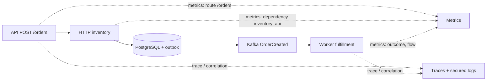

# Bounding Label Cardinality and Excluding Personal Identifiers from Metrics

## 1. Context: Observing Integrations Without Exploding Time-Series Counts

A **Spring Boot Integration** system often crosses multiple boundaries: REST APIs calling partners with `RestClient`/`WebClient`, JDBC/JPA transactions, Redis caches, Kafka/RabbitMQ, HTTP inbound/outbound gateways, and Spring Integration adapters. Operations teams need throughput, latency, error rates, retry counts, backlog, and dependency health. Micrometer together with Spring Boot Actuator collects **metrics** at those points; Prometheus or another monitoring backend stores and queries them.

A common design mistake is putting `userId`, `orderId`, `correlationId`, `eventId`, or full URLs containing IDs into metric **tags/labels** so engineers can "look up individual requests easily". When every request introduces a new value, a single metric can spawn hundreds of thousands or millions of label combinations. That consumes application RAM, inflates scrape sizes, stresses storage, slows queries, and drives up observability costs. Worse, placing personal identifiers into labels leaks unnecessary data into systems governed by different access and retention policies than the business database.

**Guiding principle of this lesson:** Metric labels must be **finite, controlled value sets useful for aggregation**. Identifiers for a person, request, order, or event belong to the business domain; they should appear only in access-controlled logs/traces when genuinely needed and authorized. Design labels around the operational questions to answer, not around whatever fields happen to sit in the payload.

Learning objectives:

1. Explain cardinality, how label combinations multiply series counts, and histogram impact.
2. Distinguish metric tags from correlation IDs, trace IDs, and log attributes.
3. Select safe labels for HTTP clients, Redis, JDBC, brokers, and Spring Integration.
4. Configure Spring Boot/Micrometer, set defensive bounds, and test series growth.
5. Handle unexpected label values without losing error and latency visibility.

## 2. How Metric Name, Label, and Time Series Differ

A metric describes a measurement. Example:

```text
integration_partner_requests_total{
    dependency="quote_api",
    operation="get_quote",
    outcome="success"
} 1642
```

`integration_partner_requests_total` is the series name in this Prometheus-style example; `dependency`, `operation`, and `outcome` are **label keys**, and their associated strings are **label values**. Each unique combination of metric name and label key-value pairs defines one time series. In practice, collection infrastructure may add system labels like `job`, `instance`, `pod`, and `namespace`.

**Cardinality of a label** is the number of distinct values that label takes. **Cardinality of a metric** is typically the number of label combinations that actually occur. With three labels having 5, 4, and 8 values respectively, the theoretical maximum when every combination occurs is:

```text
5 dependency × 4 operation × 8 outcome = 160 series
```

Adding `orderId` with 100,000 values across multiple operations raises the theoretical ceiling to:

```text
5 × 4 × 8 × 100,000 = 16,000,000 series
```

This is an **illustrative upper bound**, not a claim that every combination occurs. Even a steady stream of new `orderId` values makes cardinality grow continuously. In Kubernetes, `instance` or `pod` labels multiply series further by replica count.

### 2.1. Traps from Histograms, Percentiles, and SLO Buckets

A counter with a given tag set generally creates fewer series than a histogram. Enabling histogram export on a timer causes each label combination to generate multiple series: buckets, sum, and count (depending on backend/config). Multiplying bucket count by label combinations amplifies exporter and storage pressure.

Thus, a metric with 200 label combinations **does not necessarily emit only 200 time series**. Before turning on percentile histograms or many SLO buckets, inspect actual bucket counts and emitted series at the metrics endpoint and backend. Above all, never enable histograms on metrics carrying raw URLs, dynamic topics, or user identifiers.

### 2.2. Four Questions to Evaluate Any Label

- **How many distinct values can appear?** Is it bounded around 3–20 values, or generated per request?
- **Who controls the values?** An internal enum/contract, tenant data, partner URLs, or arbitrary client input?
- **Could the label contain personal/sensitive data?** Email, phone number, IP, customer identifier, token, or linkable order ID?
- **Do you need aggregation or individual lookup?** To trace one request, use access-controlled traces/logs; metrics answer trends.

## 3. Recommended Labels vs. Labels to Avoid

| Field category | Example | Decision | Rationale |
| --- | --- | --- | --- |
| Registered dependency name | `dependency="inventory_api"` | Use | Finite list tied to runbooks |
| Standardized operation name | `operation="reserve_stock"` | Use | Contract-bound and stable count |
| Enum-based outcome | `outcome="success" / "timeout" / "rejected"` | Use | Essential for error rates and alerts |
| HTTP method | `method="GET"` | Use | Very few distinct values |
| HTTP status class | `status_family="5xx"` | Use | Tiny set, good for aggregation |
| URI pattern | `uri="/orders/{orderId}"` | Use when route is normalized | Prevents IDs from spawning series |
| Static broker topic | `topic="orders.events.v1"` | Conditional | Only when topics come from a finite allowlist |
| System-defined cache name | `cache="product_lookup"` | Conditional | Block user-generated cache names |
| `tenantId`, `customerId`, `userId` | `userId="u-94820"` | Exclude from metric labels | High cardinality, identifies individuals |
| `orderId`, `eventId`, `messageId` | `eventId="..."` | Exclude from metric labels | New value per business action/event |
| `correlationId`, `traceId`, `spanId` | `traceId="..."` | Exclude from metric labels | Used for individual tracing, not aggregation |
| Email, phone, IP, session/token | `email="person@example.org"` | Exclude from metric labels | Personal, sensitive, or linkable data |
| Raw URL/query string | `uri="/orders/123?email=..."` | Exclude from metric labels | Explodes cardinality and leaks data |
| Full SQL, Redis key, Kafka record key | `key="inventory:user:123"` | Exclude from metric labels | Dynamic content, may embed business data |
| Full exception message | `error="User 123 not found"` | Exclude from metric labels | Unbounded cardinality and payload leakage |

**Do not use hashing to "solve" cardinality.** `hash(userId)` still yields nearly one new value per person and remains reversible by comparison. Hashing identifiers does not automatically anonymize them or make metrics compliant with security policies.

### 3.1. Can Tenant Be Used as a Label?

A `tenant` label looks tempting in SaaS monitoring, yet large tenant counts grow cardinality with customer scale. Moreover, tenant IDs can be restricted information. Only use approved, bounded groupings—for example `service_tier="free" / "standard" / "enterprise"`—if tier info is permitted. When per-tenant analysis is needed, use access-controlled dedicated dashboards and appropriate data stores rather than turning every metric into a per-tenant query.

## 4. Label Contracts in Integration Systems

Define a **metric contract** for each component, just like an HTTP or event data contract:

| Metric | Unit | Allowed labels | Suggested budget | Purpose |
| --- | --- | --- | --- | --- |
| `integration.partner.requests` | Requests | `dependency`, `operation`, `outcome` | 8 × 10 × 5 | Partner error rate |
| `integration.partner.duration` | Seconds | `dependency`, `operation`, `outcome` | 8 × 10 × 5 | Partner latency |
| `integration.message.processed` | Messages | `transport`, `flow`, `outcome` | 4 × 20 × 5 | Flow processing rate and errors |
| `integration.cache.access` | Operations | `cache`, `result` | 12 × 3 | Cache hit/miss/error |
| `integration.delivery.retries` | Retries | `dependency`, `reason` | 8 × 5 | Assessing retry storms |

These numbers are **illustrative initial budgets**, not universal limits. With `8 × 10 × 5 = 400` label combinations, if a histogram exports 12 extra series per label set, that single metric generates roughly 4,800 series before replica or backend labels. Adjust budgets to actual bucket counts and exporters.

Specify for every metric:

1. **Owner:** which team owns the metric name, semantics, and dashboards.
2. **Instrument type:** counter, timer, gauge, distribution summary, or long-task timer.
3. **Unit:** seconds, bytes, records, retries—keep consistent and avoid contradicting backend units.
4. **Tag allowlist:** key names, value types, allowed value lists, or normalizers.
5. **Cardinality budget:** estimated maximum series and alerting criteria.
6. **Missing/invalid rules:** map missing required tags to `unknown`, `other`, or reject instrumentation—never fall back to raw input.
7. **Information policy:** metrics contain no personal IDs, secrets, tokens, or raw payloads, and comply with backend retention and RBAC.

Whenever label candidates originate from user-controlled values—webhook names, URLs, dynamic table names, tenant topics, or arbitrary partner names—**map them to predefined buckets**. Never rely on string truncation alone: a 20-character string still permits millions of distinct values.

## 5. Spring Boot/Micrometer: Baseline Configuration

Example using Spring Boot 3.x and Micrometer managed by the Spring Boot BOM:

```kotlin
// build.gradle.kts — Spring Boot manages dependency versions
implementation("org.springframework.boot:spring-boot-starter-actuator")
runtimeOnly("io.micrometer:micrometer-registry-prometheus")
```

```yaml
# application.yml — illustrative endpoints only
management:
  endpoints:
    web:
      exposure:
        include: health,info,prometheus
  metrics:
    tags:
      application: order-integration
```

`GET /actuator/prometheus` lets you inspect output when the Prometheus registry is enabled. In production, secure Actuator via authorization and network policies; **metric labels must never transport personal identifiers** even when endpoints are private. `application` should be a stable service name—never a deployment, request, or user ID as a common tag.

Spring Boot/Micrometer often already export HTTP server/client, JVM, datasource, and framework metrics through built-in instrumentation. Check live metrics before writing redundant counters. Micrometer meter names and Prometheus time-series names can differ due to naming conventions; e.g., timers typically gain `_seconds_count`, `_seconds_sum`, and optional buckets.

### 5.1. Measuring Partner HTTP Calls with Bounded Tags

A clean control strategy defines `dependency`/`operation` with constants or enums and `outcome` from the metric contract's value set. Example service calling one quote API:

```java
import io.micrometer.core.instrument.MeterRegistry;
import io.micrometer.core.instrument.Timer;
import org.springframework.stereotype.Service;
import org.springframework.web.client.RestClient;
import org.springframework.web.client.RestClientException;
import org.springframework.web.client.RestClientResponseException;

@Service
public class QuoteClient {
    private final RestClient http;
    private final MeterRegistry meters;

    public QuoteClient(RestClient.Builder builder, MeterRegistry meters) {
        this.http = builder.baseUrl("https://quote.example.internal").build();
        this.meters = meters;
    }

    public String getQuote(String sku, String correlationId) {
        Timer.Sample sample = Timer.start(meters);
        String outcome = "success";
        try {
            return http.get()
                    .uri("/quotes/{sku}", sku) // URI template, do not concatenate raw URL
                    .header("X-Correlation-Id", correlationId)
                    .retrieve()
                    .body(String.class);
        } catch (RestClientResponseException ex) {
            outcome = ex.getStatusCode().is5xxServerError()
                    ? "server_error" : "client_error";
            throw ex;
        } catch (RestClientException ex) {
            outcome = "transport_error";
            throw ex;
        } finally {
            sample.stop(Timer.builder("integration.partner.duration")
                    .description("Latency of quote partner requests")
                    .tag("dependency", "quote_api")
                    .tag("operation", "get_quote")
                    .tag("outcome", outcome)
                    .register(meters));
        }
    }
}
```

Here `correlationId` is only sent over the HTTP contract, **never attached to the timer**. `sku` can have hundreds of thousands of values so it is omitted from labels as well. Metric labels remain strictly finite: `quote_api`, `get_quote`, and standardized `outcome` values.

This snippet demonstrates tag control; production systems also configure timeouts, Retry/Bulkhead/Circuit Breaker, and contract-aligned null handling. If retries wrap this method externally, one invocation here represents one attempt—place instrumentation at the exact layer and use distinct metric/operation names to avoid miscounting.

### 5.2. Using the Observation API When Combining Metrics and Traces

Micrometer Observation distinguishes **low-cardinality key-values** from **high-cardinality key-values** for different destinations. Low-cardinality key-values enter metrics and can appear in traces; high-cardinality values typically go to tracing depending on handlers. Still, **high-cardinality does not mean safe for personal data**.

```java
import io.micrometer.observation.Observation;
import io.micrometer.observation.ObservationRegistry;

void observePartnerCall(ObservationRegistry observations, Runnable action) {
    Observation.createNotStarted("integration.partner.call", observations)
            .lowCardinalityKeyValue("dependency", "quote_api")
            .lowCardinalityKeyValue("operation", "get_quote")
            .observe(action);
}
```

Likewise, never add `orderId` or email to `lowCardinalityKeyValue`. To follow an order across hops, pass `correlationId` and query access-controlled structured logs/traces. Only put identifiers into trace attributes after evaluating need, RBAC, retention, masking, and data policy—never assume trace storage permits unrestricted PII.

## 6. Blocking Cardinality Growth as a Last Line of Defense

Micrometer provides `MeterFilter` to accept, deny, or transform meter IDs during registration. You can cap **distinct tag values** for a metric prefix:

```java
import io.micrometer.core.instrument.config.MeterFilter;
import org.springframework.context.annotation.Bean;
import org.springframework.context.annotation.Configuration;

@Configuration
class MetricCardinalityConfig {

    @Bean
    MeterFilter limitPartnerDependencyValues() {
        return MeterFilter.maximumAllowableTags(
                "integration.partner.",
                "dependency",
                8,
                MeterFilter.deny());
    }
}
```

With this setup, once meters matching the prefix exceed the limit for `dependency`, new registrations are denied per policy. This is a **circuit breaker guardrail**, not a value normalizer or PII scrubber. Nor does it cap other unchecked tags like `uri`, `topic`, or `userId`.

Consequences to understand:

- If a legitimate new tag value is denied after hitting the cap, metrics for that slice are **dropped**. Alert on or inspect denied meter counts and adjust contracts rather than silently losing telemetry.
- Per-instance registry caps do not equal cluster-wide cardinality limits: total pods/replicas and backend-added labels still multiply series.
- Filters run at **meter registration**, not as a retroactive purge of already-sent time series. Fixing dangerous labels requires updating instrumentation, checking registries/backends, and handling retention per policy.
- Never treat a deny filter as PII protection. Strip sensitive fields **before** calling `Counter.builder()`, `Timer.builder()`, `registry.counter()`, or `Observation.lowCardinalityKeyValue()`.

CI checks can flag banned tag names, yet PII can still slip through innocent-looking keys like `uri`, `resource`, `topic`, or `exception`. Therefore, **allowlisting data sources and value sets** is far more reliable than blocklisting key names.

## 7. Avoiding Dynamic Labels at Integration Boundaries

### 7.1. HTTP Server and HTTP Client

Common mistake:

```text
# Dangerous: thousands of orderIds spawn thousands of label values
uri="/orders/ORD-12345"
uri="/orders/ORD-12346"

# Safe for aggregating by logical endpoint
uri="/orders/{orderId}"
method="GET"
outcome="success"
```

In Spring MVC, prefer framework-provided route patterns/endpoint names; in `RestClient`/`WebClient`, pass URI templates whenever possible instead of concatenating IDs into path strings before instrumentation. Outbound calls lacking templates or targeting dynamic URLs must be **mapped to logical operations** like `get_order` or `partner_quote`; never put raw hostnames, query strings, or tokens into labels.

Never use raw exception message strings as tags. Classify failures into a finite set like `timeout`, `connect_error`, `4xx`, `5xx`, `bulkhead_rejected`. If using exception class names, verify the actual class set is bounded and free of dynamically generated class names.

### 7.2. JDBC, Databases, and Redis

For JDBC, labels should identify the **registered database pool**, operation category, or repository/use-case name. Never attach SQL containing actual parameters, emails, or record keys. A query:

```sql
SELECT status FROM orders WHERE order_id = ?
```

can be observed under a static operation name like `order_lookup`, never with a label `sql="SELECT ... order_id=ORD-123"`. Similarly, Redis keys like `inventory:tenant-1:sku-123` or cache entry keys must never become labels. Use `cache="inventory"`, `operation="get"`, `result="hit"/"miss"/"error"`.

In multi-tenant systems, even generating datasource/pool names per tenant inflates cardinality. Cap datasource count, group metrics by service tier, or move per-tenant analytics elsewhere. If a cache manager creates cache names dynamically, refactor to a finite list of caches.

### 7.3. Kafka, RabbitMQ/JMS, and Spring Integration

Relatively safe values when managed:

- `transport="kafka"/"rabbitmq"/"jms"`.
- `flow="order_created_inbound"` or a stable deployed flow name.
- `consumer_group="fulfillment"` when consumer groups are controlled.
- `topic="orders.events.v1"` when topics are statically registered rather than created per tenant/request.
- `outcome="ack"/"retry"/"dead_letter"/"rejected"` per business policy.

Values to avoid: Kafka record keys; partition offsets; `eventId`, `messageId`, `correlationId`; RabbitMQ routing keys containing order/tenant IDs; per-user queues/topics; arbitrary producer headers.

For example, `order.tenant-123.events` can create one metric series per tenant. Pick normalized labels like `topic_family="order_events"` or `flow="order_events_consumer"` and track actual topic/queue counts via dedicated admin tooling. Spring Integration channel/component names should be finite deployment flow names; beware dynamic channel creation driven by message data.

Never emit broker lag or retry counters per `eventId`. To investigate a specific message, use envelopes (`eventId`, `causationId`), structured logs, tracing, and access-controlled broker admin tools.

### 7.4. MQTT, TCP, UDP, File, and HTTP Adapters

MQTT topics frequently embed device IDs, e.g., `devices/sensor-17/telemetry`. Recording the raw topic creates a new label value for every device added. Normalize to `topic_pattern="devices/{deviceId}/telemetry"` or `message_type="telemetry"`. For TCP/UDP, never put client IP/port, connection IDs, or device IDs into labels; use `protocol="tcp"/"udp"`, `adapter="weighing_ingest"`, `result="accepted"/"invalid"/"timeout"`.

For file/SFTP/FTP adapters, never put paths or filenames containing dates, order codes, or customer names into labels; use `adapter="daily_import"`, `file_type="csv"`, `outcome="processed"`. Detailed paths, addresses, and filenames belong in access-controlled logs if truly required.

## 8. Logs and Traces Support Detailed Investigation

Metrics, logs, and traces answer three distinct classes of questions:

| Signal | Best answers | Identifying data |
| --- | --- | --- |
| **Metrics** | How many, rising or falling, what is latency/error rate? | Finite, aggregated labels |
| **Structured logs** | At which step did a specific request/event fail? | On-demand IDs under masking/RBAC controls |
| **Distributed traces** | Step-by-step timing and cross-service call graph? | Policy-approved trace/span attributes |

Order creation workflow example:



Calls can carry `X-Correlation-Id` or W3C trace context (`traceparent`) across HTTP and message brokers per contract. Logs may record these IDs **when authorized** to join related steps. They still do not belong in metric labels.

### 8.1. Do Exemplars Change the Rule?

Some metrics/tracing stacks support **exemplars**: sample measurements attached to a trace ID and stored separately from the main series dimensions. They let operators jump from a latency spike to a sample trace without adding a `traceId` label to all time series. Support depends on exporter/backend configuration, and target traces still require access control and retention policies.

### 8.2. Do Not Assume Logs/Traces Are Allowed to Contain PII

Avoid logging or tracing emails, tokens, phone numbers, message bodies, or identifying IDs without clear legal and technical justification. Authorized opaque identifiers can be logged under RBAC, masking, retention, export, and deletion policies. If correlation is needed without storing original personal IDs, issue a random workflow-scoped correlation ID with defined lifetime and access rules.

Never assume having "high cardinality" in a tracing API name exempts data from governance. Tracing backends still incur indexing costs and security requirements.

## 9. Setting Cardinality Budgets and Breaking Down by Environment

A metric contract can budget cardinality across three levels:

1. **Per metric per instance:** actual label combinations and churn over time.
2. **Per service/application:** total registered meters, exported series count, and new tag values per hour.
3. **Per monitoring backend:** total active series, ingested samples/sec, memory, churn, and cost per job/namespace.

Example bounded payment group:

```text
dependency = {quote_api, inventory_api, payment_api}       -> 3
operation  = {get_quote, check_stock, authorize, capture} -> 4
outcome    = {success, client_error, server_error,
              timeout, rejected}                         -> 5
3 × 4 × 5 = max 60 metric label combinations/service instance
```

With 20 replicas, that single metric yields up to roughly 1,200 combinations from the `instance` label alone; adding histogram buckets multiplies series further. Formulas are estimates: real instance counts, scrape labels, and emission paths determine final totals.

Key considerations:

- **Avoid unnecessary per-pod/instance labels** on aggregate dashboards; backends can retain target labels separately.
- **Review new labels** alongside dashboards and alerts, because one 10-value label can multiply series count by up to 10×.
- **Normalize user-derived labels at the source** with checked mappings rather than relying solely on tag-count caps.
- **Budget for long-term churn:** series count is also driven by churn—series repeatedly appearing and disappearing as workloads shift.
- **Never use sampling to excuse ID labels:** sampling requests does not stop cardinality from climbing over time for the values that still get recorded.

## 10. Inspecting `/actuator/prometheus` and PromQL

When validating a service on staging, verify both **current level** and **rate of new value creation**:

```bash
# Inspect metrics on a running app with authorized access
curl -fsS http://localhost:8080/actuator/prometheus
```

For Prometheus backends, illustrative queries:

```promql
# Current series count by metric name for this job
topk(20, count by (__name__) ({job="order-integration"}))
```

```promql
# Active series specifically for the integration group
count({job="order-integration", __name__=~"integration_.*"})
```

```promql
# Distinct dependency label values on a specific metric, per actual output
count(count by (dependency) (
  integration_partner_duration_seconds_count{job="order-integration"}
))
```

These commands/queries are illustrative; substitute your project's observed `job` and metric names. Queries on large datasets can be expensive—scope tightly by job and run only in authorized environments. Other monitoring backends use their own syntax.

Alongside series counts, monitor scrape errors, response payload sizes, scrape duration, series creation rate, and storage cost. A metric suddenly jumping from dozens to tens of thousands of series after a deploy signals that instrumentation just leaked an `id` or raw URL into a label.

## 11. Testing Against ID Leaks and Series Explosion

| Scenario | How to execute | Expectation |
| --- | --- | --- |
| 10,000 requests with distinct order IDs | Call route `/orders/{orderId}` | HTTP series count does not grow linearly with order IDs |
| 1,000 distinct correlation IDs | Invoke one operation with same outcome | Metric tags contain no `correlationId` or trace ID |
| Diverse partner failures | Trigger timeout, HTTP 4xx, 5xx, connection error | `outcome` stays within predefined enum |
| Device-varying MQTT topics | Publish from many devices/topic paths | Labels hold topic pattern or message type, never device ID |
| Kafka messages with distinct event IDs | Redeliver and retry repeatedly | Counters/timers carry only bounded flow/outcome labels |
| Tenant-prefixed Redis keys | Generate thousands of keys and cache misses | Cache metrics group by cache name/operation/result, never key/tenant |
| Unregistered URIs | Send unknown paths, query params, IDs | Unknown routes normalize/drop rather than creating raw-URI series |
| Label exceeding budget | Inject many `dependency` values in dedicated test | `MeterFilter` reacts per policy and signals metric drops |
| Multiple instances/replicas | Scale service in staging | Series scale with replicas/buckets as budgeted, not request IDs |
| Input containing emails or tokens | Send sensitive data in URLs/headers/payloads | Never appears in `/actuator/prometheus`, exporter, or backend |

In an integration test, use `SimpleMeterRegistry` or a compatible test registry to enumerate registered `Meter.Id`s and `Tag`s. After sending many requests with fresh IDs, verify:

- Zero forbidden tag keys (e.g., `userId`, `email`, `orderId`, `correlationId`, `eventId`).
- Zero forbidden tag values containing emails, tokens, raw paths, or request IDs.
- New meter/series counts remain within budget across representative traffic, not just a single request.
- Meters sharing a metric name have consistent tag key sets to prevent backend rejection.
- Unknown dependencies/operations normalize to a predefined bucket rather than creating `"unknown:"` + raw value.

Checking forbidden keys alone is insufficient. A developer might stuff an email into `name` or an ID path into `resource`; tests must scan **tag values** and inspect tag sources too. Even more importantly, check the **actual exported series** at the exporter, since `Meter` objects in the registry do not reflect all buckets and backend-added labels.

## 12. Incident Response When High-Cardinality or PII Series Leak

Practical remediation plan:

1. **Stop the leak:** patch instrumentation to normalize/drop dynamic tags; prioritize deploying the fix before adding any new labels.
2. **Scope the impact:** identify which metrics, labels, deployments, and time windows captured improper values.
3. **Assess data sensitivity:** classify PII/secrets, audit who has access to dashboards, exporters, remote writes, and backends; engage organizational data-incident procedures if required.
4. **Contain spread:** adjust scrapers/exporters/remote-write filters and access controls where possible—do not merely hide the label in dashboard UIs.
5. **Handle storage:** determine retention and deletion/purge capabilities in the observability backend; deploying a code fix **does not delete** old time series.
6. **Restore observability:** verify new metrics stay finite, dashboards/alerts keep working, and deny filters are not silently dropping signals.
7. **Prevent recurrence:** update metric contracts, automated tests, and code-review checklists for new tags.

For non-sensitive high cardinality, reducing histogram buckets or collapsing operations/routes into logical groups may suffice. Always check dashboards and alerts referencing any renamed or removed labels so critical operational visibility is preserved.

## 13. Common Pitfalls to Spot Early

- **Using log IDs as metric tags:** trace IDs, correlation IDs, and event IDs change per request and rapidly explode cardinality.
- **Believing hashing anonymizes data:** hashed IDs remain high-cardinality, linkable to individuals, and insufficient as security controls.
- **Putting full URLs in `uri`:** raw paths, query strings, and order IDs create unbounded series and can leak PII.
- **Using dynamic message/topic names:** topic/queue/MQTT device/file names often vary per business entity.
- **Putting exception messages into labels:** messages can embed customer names, order numbers, or arbitrary runtime strings.
- **Multiplying low-cardinality tags without checking the product:** 20 × 30 × 15 × 10 is huge even when no single tag has thousands of values.
- **Enabling histograms on every metric:** buckets multiply series counts and inflate storage quickly.
- **Relying solely on `MeterFilter` deny:** drops new metrics without enforcing safe tag selection at the source.
- **Assuming metrics on a private network can hold PII:** metrics get scraped, remote-written, backed up, shared, and retained long-term.
- **Skipping tests after adding a new dependency:** a "temporary shortcut" putting raw partner URLs into tags can linger for years.

## 14. Implementation Checklist for Spring Boot Integration

- [ ] Every metric has a defined name, unit, owner, allowed tag set, cardinality budget, and alerting purpose.
- [ ] `dependency`, `operation`, `outcome`, `flow`, and `topic_family` come from controlled finite lists or enums.
- [ ] Zero user/customer/tenant/order/event/correlation/trace IDs, emails, IPs, tokens, raw URLs, raw SQL, Redis keys, or broker keys in metric labels.
- [ ] HTTP server uses route templates; HTTP client uses logical operations instead of input-concatenated URLs.
- [ ] Kafka/RabbitMQ/MQTT and Spring Integration avoid dynamic topics, routing keys, or channels containing identifiers in tags.
- [ ] Histograms/SLO buckets are enabled selectively with series estimates factoring in label combinations and replicas.
- [ ] Instrumentation preserves correlation via logs/traces under data policies rather than putting trace IDs in metric labels.
- [ ] Guardrail `MeterFilter` (or equivalent) is configured with alerts on tag-value growth or denied meters.
- [ ] CI/integration tests send diverse dynamic IDs and inspect tag names, tag values, and exported series counts.
- [ ] Actuator/prometheus endpoints are secured; metric backends enforce proper RBAC, retention, and deletion workflows.
- [ ] Dashboards monitor active series/churn, scrape health, and storage cost after instrumentation changes.

**Desired outcome:** integration components emit rich metrics to alert on slow Redis, broker lag, partner HTTP timeouts, failing adapters, and rising retries while keeping time-series counts tightly bounded. When investigating a specific user, order, or message, operators query authorized logs/traces instead of spawning a time series per identifier.
