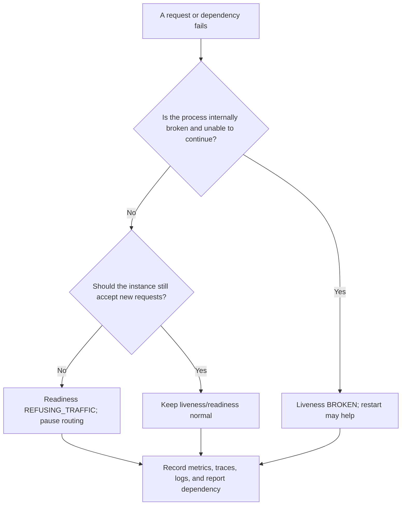

# Never Tie Liveness Directly to Every External Service

## 1. A Partner Outage Should Not Turn into an Application Restart Loop

In **SPRING_BOOT_INTEGRATION**, a Spring Boot application commonly uses HTTP clients to call partners, queries databases, reads caches, exchanges messages over brokers, and runs Spring Integration adapters. Each of those components can fail independently. If the application treats **any** external connectivity error as a *liveness* failure, orchestrators like Kubernetes will repeatedly restart instances even while the application process itself is completely healthy.

Suppose an order service runs three pods and an external shipping gateway stops responding for 10 minutes:

1. Every pod calls its health endpoint and gets `DOWN` because the shipping gateway connectivity check failed.
2. If that result drives the **liveness probe**, Kubernetes treats the pods as dead and restarts them.
3. Newly started pods still cannot reach the same shipping gateway. The check fails again, continuing the restart loop.
4. Meanwhile, unrelated features that do not need the shipping gateway (such as looking up saved orders) are disrupted, caches go cold, connection pools constantly rebuild, and recovery traffic hammers the already struggling system.

This is a *cascading failure*: a single dependency outage spreads into an outage of the application itself. **Restarting an application only helps when the fault is internal to the process and restarting has a chance to clear it.** When a shared external partner is down for all pods, restarts will not bring the partner back.

This lesson distinguishes **liveness**, **readiness**, and **dependency health** observability in Spring Boot Actuator—so you pick the right check for each signal instead of cramming every dependency into one endpoint that triggers restarts.

## 2. Liveness, Readiness, and Startup Probes Answer Three Different Questions

| Signal type | Question to answer | Typical Kubernetes action on failure | Examples |
|---|---|---|---|
| **Liveness** | Is the process still capable of running, or does it need a restart? | Restarts the container after failure threshold | Application entered an unrecoverable internal state |
| **Readiness** | Should the instance accept new requests through the Service/load balancer **right now**? | Temporarily removes the Pod from ready endpoints; never restarts solely on readiness failure | Pod is starting up, draining, or unable to serve core requests |
| **Startup** | Has the application finished starting up so liveness/readiness checks can begin? | Grants a startup window, then may restart if startup keeps failing | Slow startup loading configs, migrations, or caches |
| **Dependency/operational health** | Are partner HTTP APIs, databases, caches, and brokers healthy and performing well? | Primarily drives observability, alerting, and operational decisions | Redis connection errors, rising broker lag, HTTP 503 rates |

**Liveness** should reflect **the process's own ability to function**. When a partner HTTP API stops responding, the process stays alive, accepts requests, returns controlled errors, switches to fallbacks, or drains queues once the dependency recovers—so never mark liveness `DOWN` over HTTP errors.

**Readiness** has a different scope: a Pod can be alive yet temporarily unfit for incoming traffic. Examples include startup warmup, graceful shutdown, or a **local** malfunction preventing it from serving critical requests. Even so, wiring readiness directly to **every** dependency risks pulling all pods from the Service during a shared outage. Readiness governs traffic admission and must align with the application's service contract.

**Startup probes** protect slow startups. When a startup probe is configured, Kubernetes delays liveness and readiness probes until the startup probe succeeds, giving the app time to initialize without premature liveness restarts.

### Decision Flow



This diagram is a design principle, not automatic code across every Spring Boot version. The application must decide when a failure truly represents internal breakage and configure health groups so external failures never become restart triggers.

## 3. Spring Boot Actuator: Health Groups and Application Availability States

Spring Boot Actuator provides `/actuator/health` and can expose Kubernetes-oriented groups:

- `/actuator/health/liveness`: backed by `LivenessStateHealthIndicator` and `ApplicationAvailability`.
- `/actuator/health/readiness`: backed by `ReadinessStateHealthIndicator` and `ApplicationAvailability`.
- `/actuator/health`: aggregated health; typically includes registered `HealthIndicator`s such as DB, disk, Redis, or brokers when matching auto-configurations are present.

Do not confuse **aggregated health** with the **liveness group**. A failing database can turn `/actuator/health` `DOWN` while `/actuator/health/liveness` stays `UP`. That behavior is completely sound: the database has an outage, yet the Java process does not need restarting.

In Kubernetes, Spring Boot can auto-detect the environment and enable availability probes; you can also enable them explicitly for consistent behavior across tests and other environments:

```yaml
# application.yml
management:
  endpoint:
    health:
      probes:
        enabled: true
        add-additional-paths: true
      group:
        liveness:
          include: livenessState
        readiness:
          include: readinessState
  endpoints:
    web:
      exposure:
        include: health,info
```

Requires `spring-boot-starter-actuator`; with Gradle:

```groovy
implementation 'org.springframework.boot:spring-boot-starter-actuator'
```

Both probe groups above are cleanly scoped: liveness reads application liveness state, and readiness reads traffic acceptance state. The configuration **does not** attach a list of external dependencies to liveness. With `add-additional-paths: true`, Spring Boot exposes `/livez` and `/readyz` on the **main application port** when supported by the version/feature. This helps when Actuator runs on a separate management port: the management port might remain responsive even when the main HTTP port stops accepting connections.

Note: `ApplicationAvailability` alone does not catch every JVM deadlock or internal resource exhaustion. Monitor threads, connection pools, event loops, queues, and application signals to pinpoint faults where restarts genuinely help.

### States in Spring Boot

| Type | State | Typical meaning |
|---|---|---|
| `LivenessState` | `CORRECT` | Spring Boot has not detected internal application breakage |
| `LivenessState` | `BROKEN` | Application hit an unrecoverable internal state, usually needing restart |
| `ReadinessState` | `ACCEPTING_TRAFFIC` | Ready to handle incoming requests |
| `ReadinessState` | `REFUSING_TRAFFIC` | Temporarily refusing new traffic |

Spring Boot drives transitions along the application lifecycle; applications can also publish `AvailabilityChangeEvent` in **explicit internal scenarios**. Never set `LivenessState.BROKEN` whenever an HTTP client returns 503 or Redis times out.

## 4. Configuring Kubernetes Probes for the Right Signals

Illustrative Deployment snippet for an app serving HTTP on port 8080:

```yaml
spec:
  containers:
    - name: order-service
      image: example/order-service:1.0
      ports:
        - name: http
          containerPort: 8080
      startupProbe:
        httpGet:
          path: /livez
          port: http
        periodSeconds: 5
        timeoutSeconds: 2
        failureThreshold: 30
      livenessProbe:
        httpGet:
          path: /livez
          port: http
        periodSeconds: 10
        timeoutSeconds: 2
        failureThreshold: 3
      readinessProbe:
        httpGet:
          path: /readyz
          port: http
        periodSeconds: 5
        timeoutSeconds: 2
        failureThreshold: 2
```

This shows only the `containers` section of a Deployment; merge into a full manifest with environment-specific images and ports. Parameters are illustrative:

- `startupProbe` allows up to roughly 150 seconds (30 checks × 5 seconds, excluding scheduling/request jitter) for startup to succeed before activating the other probes.
- `livenessProbe` failing consecutively past its threshold triggers kubelet to restart the container.
- `readinessProbe` failure removes the Pod from Service endpoints without triggering restarts by itself.
- Kubernetes `timeoutSeconds` bounds **HTTP probe** waiting time, not business request timeouts or deadlines.

For standard Spring Boot health endpoints, `UP` returns HTTP 200 while `DOWN` or `OUT_OF_SERVICE` typically returns 503 (depending on status-to-HTTP mapping). Kubernetes treats HTTP 200–399 as success and updates Pod status after consecutive threshold crossings.

Without additional paths enabled, target `/actuator/health/liveness` and `/actuator/health/readiness` on the matching port. Verify context paths, security filters, and which port serves probes. An endpoint returning 401/403 due to missing permissions does not mean the app is dead; align network rules, authentication, and exposure levels of health endpoints with cluster policy.

## 5. Classifying Dependencies by Impact Instead of Wiring Everything into Liveness

There is no single rule that "all dependencies must be `UP` for readiness to be `UP`". Base decisions on what the Pod **actually commits to serving** and how gracefully it can degrade.

| Component | Common failure | Liveness assessment | Readiness and recovery path |
|---|---|---|---|
| Shipping partner HTTP API | 503, timeout, rate limit | Unchanged—fault is external | Usually keep Pod ready if it still takes/looks up orders and schedules retries; track errors/circuit breaker separately |
| Primary database | Pool exhausted, failover, query timeout | Do not default to restarting all Pods | May turn unready if zero core requests can be served; weigh risk of all Pods losing endpoints simultaneously |
| External Redis/cache | Cache misses, timeouts | Unchanged | Keep ready when DB fallback or valid stale cache exists; tie to readiness only if cache is strictly mandatory for every request |
| Kafka/RabbitMQ broker | Broker unreachable, publish failures | Unchanged | With an outbox, the app can keep accepting requests and writing durably to DB; monitor backlog/retries instead of restarting |
| Spring Integration adapter | Inbound poller fails, outbound HTTP broken | Unchanged if flows can recover | Assess availability of exposed APIs individually; log error channels and failed message counts |
| Quartz/worker | Scheduled job fails | Do not restart by default | API stays ready; jobs rely on retries, dead-lettering, or isolated failure states |
| Unrecoverable internal fault | Dead worker thread with no restart hook, stuck internal state machine | May flip `BROKEN` once verified that restart fixes it | Liveness is the right signal when truly unrecoverable internally |
| Pod gracefully shutting down | App preparing to stop taking traffic | Not necessarily `BROKEN` | Transition to `REFUSING_TRAFFIC` to drain before stopping |

If **every** Pod shares one database and readiness demands live DB connectivity, a database blip marks every Pod unready at once. That may make sense if zero requests can proceed, yet it also disables controlled error responses, cached reads, and degraded modes. Before adding any dependency to readiness, answer: "When this shared dependency fails entirely, what should ingress and clients experience?"

A shared dependency outage may justify **disabling one feature** while keeping other endpoints alive. Pod-level probes cannot distinguish individual HTTP routes. Use circuit breakers, fallbacks, feature-level availability, or split services by responsibility to reduce blast radius.

## 6. Observing Dependencies Separately Without Making Liveness Call Outbound

The issue is not "whether checking a partner HTTP API is allowed", but **how the result is used**:

- Checking dependencies for dashboards, alerts, incident triage, and business routing is helpful.
- Calling a partner HTTP API every few seconds inside **liveness** to decide Pod restarts is usually wrong.
- When every Pod actively probes the same congested service, health checks amplify traffic right when the dependency is struggling.

One clean option is creating a **dedicated health group** for dependencies that reads the latest status observed by real HTTP calls, circuit breakers, or a rate-limited/time-bounded background check. The health endpoint simply reads an in-memory snapshot without performing I/O on every Kubernetes probe.

### 6.1. Example `HealthIndicator` Reading Observed State

Suppose the application has a gateway calling the shipping service. That gateway updates a snapshot whenever an HTTP call finishes or a circuit breaker changes state. The indicator below deliberately performs zero HTTP calls inside `health()`:

```java
import java.time.Instant;
import java.util.concurrent.atomic.AtomicReference;
import org.springframework.boot.actuate.health.Health;
import org.springframework.boot.actuate.health.HealthIndicator;
import org.springframework.stereotype.Component;

record PartnerSnapshot(boolean available, Instant observedAt) {}

@Component
class ShippingPartnerStatus {
    private final AtomicReference<PartnerSnapshot> snapshot =
        new AtomicReference<>(
            new PartnerSnapshot(false, Instant.EPOCH));

    void recordSuccess() {
        snapshot.set(new PartnerSnapshot(true, Instant.now()));
    }

    void recordFailure() {
        snapshot.set(new PartnerSnapshot(false, Instant.now()));
    }

    PartnerSnapshot current() {
        return snapshot.get();
    }
}

@Component("shippingPartnerHealthIndicator")
class ShippingPartnerHealthIndicator implements HealthIndicator {
    private final ShippingPartnerStatus status;

    ShippingPartnerHealthIndicator(ShippingPartnerStatus status) {
        this.status = status;
    }

    @Override
    public Health health() {
        PartnerSnapshot latest = status.current();

        if (latest.observedAt().equals(Instant.EPOCH)) {
            return Health.unknown()
                .withDetail("reason", "No observation yet")
                .build();
        }

        Health.Builder builder = latest.available()
            ? Health.up()
            : Health.down();

        return builder
            .withDetail("lastObservedAt", latest.observedAt().toString())
            .build();
    }
}
```

Configuring the dedicated health group:

```yaml
management:
  endpoint:
    health:
      probes:
        enabled: true
      group:
        liveness:
          include: livenessState
        readiness:
          include: readinessState
        partners:
          include: shippingPartner
          show-details: never
```

With bean `shippingPartnerHealthIndicator`, Spring Boot registers contributor ID `shippingPartner`. Then:

| Endpoint | Data used | When shipping partner is `DOWN` |
|---|---|---|
| `/actuator/health/liveness` | `livenessState` | Stays `UP` if the app is not internally broken |
| `/actuator/health/readiness` | `readinessState` | Stays `UP` if the app chooses to continue accepting traffic |
| `/actuator/health/partners` | `shippingPartner` | `DOWN`; can return 503 for monitoring visibility |
| `/actuator/health` | Aggregates default health contributors | May report `DOWN` due to partner; **never use this aggregated endpoint for liveness** |

One gap to address before production: **this snapshot alone does not distinguish "partner broken right now" from "last failed hours ago"**. Add a *staleness threshold* and emit `UNKNOWN` or a separate alert when observations age out. Avoid marking the whole partner broken from a single 4xx caused by invalid request data; derive dependency state from appropriate error classes and statistical signals.

If using scheduled active checks, enforce short timeouts, reasonable intervals, jitter, and concurrency caps; consider having a single dedicated observer run checks to avoid hammering partners. Never let health endpoints issue unbounded external calls.

### 6.2. Change Readiness Only When the **Instance's** Ability to Serve Changes

Spring Boot supports `AvailabilityChangeEvent` to signal readiness shifts—for example, when an instance starts draining or hits a **local** condition preventing new work:

```java
import org.springframework.boot.availability.AvailabilityChangeEvent;
import org.springframework.boot.availability.ReadinessState;
import org.springframework.context.ApplicationEventPublisher;
import org.springframework.stereotype.Component;

@Component
class TrafficAcceptance {
    private final ApplicationEventPublisher events;

    TrafficAcceptance(ApplicationEventPublisher events) {
        this.events = events;
    }

    void beginDraining() {
        AvailabilityChangeEvent.publish(
            events, ReadinessState.REFUSING_TRAFFIC);
    }

    void resumeReceiving() {
        AvailabilityChangeEvent.publish(
            events, ReadinessState.ACCEPTING_TRAFFIC);
    }
}
```

This illustrates only the **readiness-transition API**; the application still must coordinate draining, completing in-flight requests, and lifecycle state. Never call `beginDraining()` every time the shipping partner returns 503, or all Pods may pull themselves from the Service without helping the outage.

In a pure message-processing service with no HTTP business traffic, readiness may track worker readiness or not be wired to HTTP routing at all. Even there, broker check failures must never automatically flip liveness to `BROKEN`.

## 7. Put Integration Failure Observability in the Right Places

Liveness and readiness are **lifecycle control signals** with coarse resolution: one final state per Pod. Diagnosing integration flows demands finer telemetry showing which component failed, since when, how many requests/messages are impacted, and whether recovery is underway.

### 7.1. HTTP Clients and Circuit Breakers

Monitor at minimum:

- Request counts by dependency and outcome category: success, timeout, HTTP 429, 5xx, connection errors.
- Latency percentiles, retry counts, total time spent vs. remaining deadline.
- Circuit breaker state (`CLOSED`/`OPEN`/`HALF_OPEN`), short-circuited call counts, recovery rate.
- Failed requests handled via fallback vs. failed requests without fallback.

Circuit breakers shield broken downstreams from excess calls, yet an `OPEN` breaker for a partner **does not mean the app process is dead**. A separate health group can expose that status while liveness continues reflecting application health.

### 7.2. Databases, Caches, Brokers, and Spring Integration

| Integration flow | Signals more useful than restarting pods |
|---|---|
| JDBC/JPA | Connection pool active/pending, acquire timeouts, query latency, lock waits, transaction rollbacks |
| Redis/cache | Cache hits/misses, timeouts, DB fallback rate, cache read latency, stale data served rate |
| Kafka/RabbitMQ | Broker connectivity, consumer lag, unacked messages, publish failures, retries/DLQs, message queue wait time |
| Transactional outbox | Total `PENDING` rows, oldest row age, republish attempts, dead-lettered or stuck events |
| Spring Integration | Channel/handler message counts, processing time, error channel volume, queue depth, failed messages and retries |
| Quartz/scheduler | Missed fires, misfires, failed runs, job runtime, incomplete checkpoints |

Exact enabled metrics depend on each adapter's instrumentation and setup. Some come from Actuator/Micrometer or client libraries, while others require explicit business metrics. Never equate "Actuator health returns 200" with "zero broker lag" or "outbox drained": both can fail badly while the process and Pod stay healthy.

### 7.3. Recording Metrics with Micrometer

Where partner HTTP responses are handled, record counters with a **bounded dependency name**:

```java
import io.micrometer.core.instrument.MeterRegistry;
import org.springframework.stereotype.Component;

@Component
class IntegrationMetrics {
    private final MeterRegistry registry;

    IntegrationMetrics(MeterRegistry registry) {
        this.registry = registry;
    }

    void recordPartnerCall(String partner, String outcome) {
        registry.counter(
            "integration.partner.calls",
            "partner", partner,
            "outcome", outcome
        ).increment();
    }
}
```

Values like `partner=shipping` and `outcome=success|timeout|http_5xx` must come from a controlled catalog. Never use `orderId`, customer IDs, arbitrary URLs, or `exception.message` as metric tags, as they create **excessive cardinality**, inflate costs, and overload metric backends.

Include `traceId`, `correlationId`, `operationId`, and `messageId` in logs/traces to follow work across HTTP, databases, brokers, and Spring Integration. With retries, traces must distinguish one **business operation** from each **attempt**—never count a request retried three times as three separate orders.

### 7.4. Alert on Impact and Trends

Alert when partner HTTP error rates stay elevated for several minutes **and** impacted transactions cross a threshold; when outbox backlog or oldest record age grows; when consumer lag exceeds drain capacity; or when request deadlines expire sharply. Those alerts guide engineers to open circuit breakers, activate fallbacks, drain queues, or investigate downstreams.

Never wire dependency-failure alerts to automatically instruct Kubernetes to restart all pods. Restarts target process, config, or local resource issues that a fresh container can actually resolve.

## 8. Testing to Prove Dependency Failures Do Not Break Liveness

Reading YAML alone is not enough. Deliberately fail HTTP partners, databases, caches, and brokers in tests and verify **each health endpoint changes strictly per policy**.

### 8.1. Integration Testing with MockMvc and Spring Boot Actuator

Assuming the app defines `ShippingPartnerStatus` and `ShippingPartnerHealthIndicator` from Section 6, here is a JUnit 5 / Spring Boot Test / MockMvc test (common JUnit/Spring imports omitted):

```java
@SpringBootTest(properties = {
    "management.endpoint.health.probes.enabled=true",
    "management.endpoint.health.group.liveness.include=livenessState",
    "management.endpoint.health.group.readiness.include=readinessState",
    "management.endpoint.health.group.partners.include=shippingPartner"
})
@AutoConfigureMockMvc
class ProbeIsolationIntegrationTest {
    @Autowired
    MockMvc mvc;

    @Autowired
    ShippingPartnerStatus shippingPartner;

    @Autowired
    ApplicationEventPublisher events;

    @BeforeEach
    void partnerIsUnavailableButApplicationIsReady() {
        shippingPartner.recordFailure();
        AvailabilityChangeEvent.publish(
            events, ReadinessState.ACCEPTING_TRAFFIC);
    }

    @AfterEach
    void restorePartnerState() {
        shippingPartner.recordSuccess();
    }

    @Test
    void dependencyFailureDoesNotFailLivenessOrReadiness() throws Exception {
        mvc.perform(get("/actuator/health/partners"))
            .andExpect(status().isServiceUnavailable());

        mvc.perform(get("/actuator/health/liveness"))
            .andExpect(status().isOk());

        mvc.perform(get("/actuator/health/readiness"))
            .andExpect(status().isOk());
    }

    @Test
    void explicitTrafficDrainingChangesReadinessNotLiveness()
            throws Exception {
        AvailabilityChangeEvent.publish(
            events, ReadinessState.REFUSING_TRAFFIC);

        mvc.perform(get("/actuator/health/readiness"))
            .andExpect(status().isServiceUnavailable());

        mvc.perform(get("/actuator/health/liveness"))
            .andExpect(status().isOk());
    }
}
```

This test verifies the **health group contract**, not live partner HTTP calls. Test runtime needs `spring-boot-starter-test` and security config permitting health endpoint reads in tests. If Spring Security restricts Actuator, configure authorized test clients or allowlist kubelet probe paths via network policy—never disable security across the entire API just to test probes.

Because the test mutates `ApplicationAvailability` and snapshot state in a shared `ApplicationContext`, run such tests sequentially or isolate contexts and restore state afterward. In live environments, never allow arbitrary user requests to publish `AvailabilityChangeEvent`.

### 8.2. Failure Test Matrix

| Failure event | Expected liveness | Expected readiness | Required observability |
|---|---|---|---|
| Partner HTTP returns 503; app has fallback/queue | `UP` | `UP` if contract still satisfied | `partners` group `DOWN`; retry/circuit breaker/error metrics rise |
| Broker temporarily disconnected; outbox still writes | `UP` | Can stay `UP` for order-intake API | Outbox backlog rises; publish failures logged/alerted |
| Redis times out; DB fallback has headroom | `UP` | `UP` | Cache fallbacks, latency, DB load, and error rates tracked |
| Primary database unreachable | `UP` while process runs | Per real capability; possibly `DOWN` if unable to serve | DB health `DOWN`, pool and error metrics rise |
| Instance draining intentionally | `UP` | `DOWN`/`OUT_OF_SERVICE` | New requests stop hitting Pod; in-flight work finishes per policy |
| App still starting up | Per lifecycle state | Not yet ready | Startup probe gives enough time without premature liveness restarts |
| Unrecoverable internal fault | May go `DOWN`/`BROKEN` | Usually unready | Liveness restarts within bounds with evidence of internal fault |

These expectations reflect an **illustrative design policy**, not a universal default across all configs. For instance, a pure broker relay lacking temporary storage might need readiness `DOWN` when it cannot accept messages—still without flipping liveness `DOWN`.

### 8.3. Testing in a Kubernetes Environment

To prove no restart loop happens when a dependency fails, deploy at least two Pods and use an HTTP stub like WireMock or a test environment returning 503/timeouts:

1. Send requests through the app to trigger dependency failures and verify error responses or fallbacks.
2. Check `/livez` on every Pod stays healthy, `/readyz` follows service policy, and the `partners` group reports `DOWN`.
3. Watch Pod `restartCount` and Events across a window spanning multiple liveness probe cycles; confirm zero restarts occur solely from partner failures.
4. Restore the dependency and verify circuit breakers/HTTP clients recover, error metrics drop, and workflows resume.
5. Separately test readiness dropping during draining and slow startup scenarios to confirm Kubernetes honors each probe's role.

Example diagnostic commands for operators with cluster access:

```bash
kubectl get pods -n integration -o wide
kubectl describe pod <pod-name> -n integration
kubectl get endpointslices -n integration

# Run inside a test pod if curl is available in the image:
curl -i http://localhost:8080/livez
curl -i http://localhost:8080/readyz
curl -i http://localhost:8080/actuator/health/partners
```

These are manual test-environment checks, not commands run inside this repository. Substitute your namespace, Pod, port, and credentials; in production, prefer `port-forward`, ephemeral debug containers, or proper observability tooling instead of assuming `curl` exists in app images.

## 9. Common Misconfigurations and Why They Are Dangerous

### Mistake 1: Using Aggregated Health for Liveness

```yaml
# WRONG if aggregated health depends on external systems.
livenessProbe:
  httpGet:
    path: /actuator/health
    port: 8080
```

When DB/Redis/broker/partner indicators pull aggregated health `DOWN`, kubelet can restart Pods endlessly even though the app could degrade gracefully or use fallbacks. Fix by pointing liveness to the isolated `/actuator/health/liveness` or `/livez` group.

### Mistake 2: Pinging Dozens of HTTP Dependencies Inside a Liveness Check

A custom `/health/live` endpoint making 10 synchronous network calls can take seconds; one timed-out partner times out the probe. With 100 Pods, that fires 1,000 pings right when the dependency is congested. Use internal state for liveness, and use snapshots or bounded checks for dependency health.

### Mistake 3: Putting Every Dependency into Readiness Without Cluster-Wide Assessment

If a broker stops, every Pod turns unready together—leaving the Kubernetes Service with zero ready endpoints, breaking even read-only database APIs. Base readiness on **ability to serve critical requests**, fallbacks, and desired ingress behavior.

### Mistake 4: Running Actuator on a Separate Port Yet Only Probing the Management Port

The management server can respond fine while the main application port is deadlocked or misconfigured. To observe real traffic readiness on the main port, enable `add-additional-paths` and point Kubernetes probes at `/livez`/`/readyz` on the app port. Verify Spring Security and network policies do not block probes.

### Mistake 5: Running Heavy Checks Inside Probes

Even a simple database query occupies a connection when the pool is already exhausted; repeated across all Pods, probes add load. Restart-controlling health endpoints must be fast, purposeful, and avoid unnecessary I/O.

### Mistake 6: Expecting Liveness to Catch Every Runtime Bug

`LivenessState.CORRECT` does not certify that the app has no memory leaks, thread starvation, deadlocks, or data bugs. Liveness is a coarse safety net; complement it with alerts on CPU, memory, GC, thread pools, event loops, queue lag, and business SLOs. When Pods continuously overload, backpressure, autoscaling, or code fixes beat simply restarting more often.

## 10. Operations Checklist and Completion Criteria

Before deploying a Spring Boot integration flow involving HTTP clients, databases, caches, brokers, and Spring Integration adapters, verify:

1. **Liveness** relies solely on application vitality and internal faults that restarts can resolve—never directly on external endpoints.
2. **Readiness** reflects Pod traffic capability; for shared dependencies, clearly decide between staying ready, degrading, or pausing traffic.
3. **Startup probe** protects slow initialization; `timeout`/`failureThreshold` match realistic startup times.
4. Spring Boot Actuator separates `liveness`/`readiness` groups; Kubernetes probes point to the right endpoints and application port.
5. Aggregated health and dependency groups serve independent monitoring with tight timeouts, reasonable cost, and no request storms.
6. Metrics and logs/traces cover HTTP timeouts/503s, DB pools, cache fallbacks, broker lag, outbox backlogs, Spring Integration error channels, and retries.
7. Tested dependency failures across multiple probe windows and confirmed **Pods do not restart uselessly**, while features degrade or retry per contract.
8. Tested readiness during draining, slow startup, and a real internal fault to validate lifecycle signals.
9. Alerts target business impact and recovery paths when external systems return—never relying solely on one `UP`/`DOWN` flag.

**Core principle:** liveness answers "does the process need restarting?"; readiness answers "should this Pod receive new requests?"; dependency health answers "what is failing outside?". Separating these three goals keeps Spring Boot HTTP, database, cache, and broker integrations running in the right mode, curbs cascading restarts, and gives operators the telemetry needed to recover cleanly.
