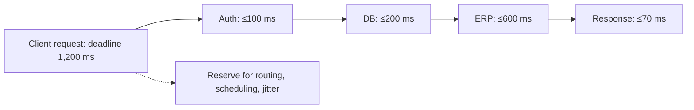
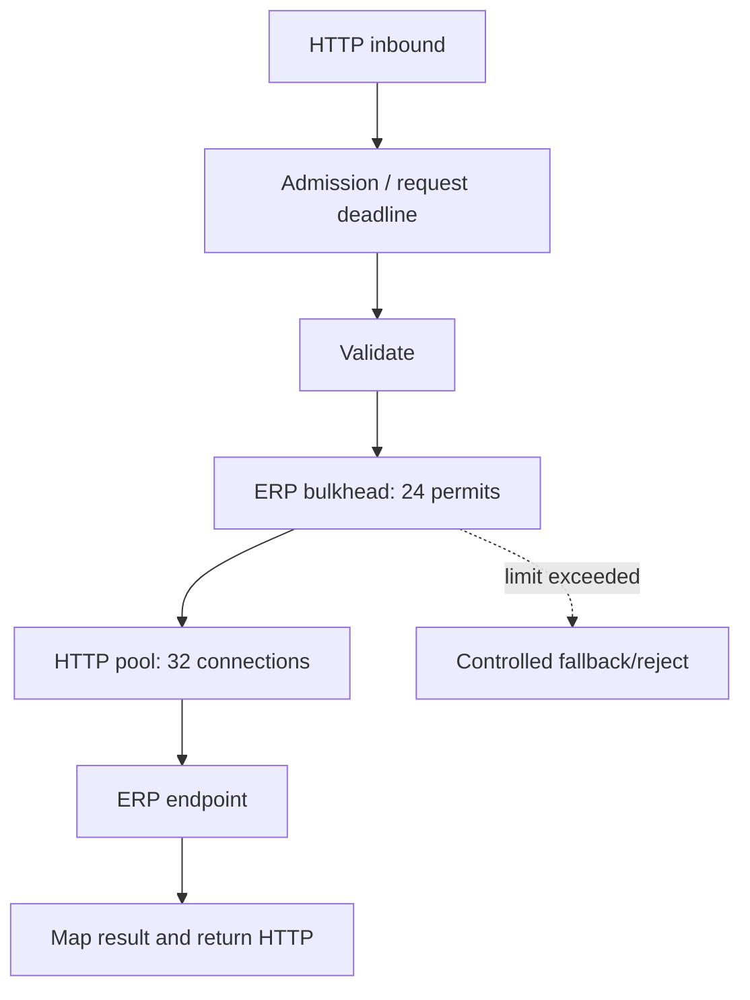

# Timeout Budgets, Connection Counts, and Concurrency Limits per Dependency

## 1. Why Must Resources Be Managed at Integration Boundaries?

A Spring Boot application may handle multiple types of integration within a single request: authenticating over HTTP, reading from PostgreSQL, looking up Redis, calling an ERP system via REST/SOAP, and publishing events to Kafka or RabbitMQ. When all dependencies are healthy, each call takes only tens to hundreds of milliseconds. When one dependency slows down, **threads, connections, queues, and wait times** can be held longer than expected, slowing down even unrelated features.

In the **SPRING_BOOT_INTEGRATION** module, the operational goal is to organize integration flows across HTTP clients, databases, caches, message brokers, and Spring Integration adapters while controlling configuration, data contracts, transactions, errors, duplicates, testing, and observability. Three decisions must be designed together:

1. **Timeout budget:** How much time is each call allowed to spend, including waiting for resources and retries?
2. **Connection count:** How many connections is the application allowed to open and hold toward each dependent system?
3. **Concurrency limit:** How many tasks are allowed to use that dependency simultaneously, and what happens when the limit is exceeded?

These three quantities are related but **not synonymous**. A connection pool of 32 connections does not guarantee that only 32 business operations are waiting: there could also be hundreds of requests sitting in the queue waiting to acquire a connection. A semaphore limiting 20 tasks does not automatically set a completion deadline for those 20 tasks. A 500 ms timeout does not by itself protect a database from 1,000 requests starting at the same time.

> **Running scenario:** The `GET /orders/{id}/status` API targets a response time of around 1.2 seconds. Each request reads PostgreSQL, checks Redis, and calls the ERP to check payment status. The ERP occasionally spikes in latency from 200 ms to 5 seconds. We need to maintain API responsiveness and protect both the ERP and internal resources.

## 2. Distinguishing Timeout, Connection, Concurrency, and Rate

| Concept | What It Controls | Operational Question | When Threshold Is Exceeded |
|---|---|---|---|
| **Timeout/deadline** | Time allotted to an operation or the entire request | Until when is the call allowed to wait? | Return an error, cancel, or stop waiting depending on transport capabilities. |
| **Connection pool** | Number of usable connections to an endpoint/database | How many sockets/sessions are reused? | Wait for a connection, reject, or create more up to the limit. |
| **Concurrency limit / bulkhead** | Number of tasks being served simultaneously | How many in-flight calls are going to the ERP? | Wait with a bound or fail fast. |
| **Rate limit** | Number of requests that can be initiated in a time window | How many requests per second can be sent? | Delay, throttle, or reject. |
| **Queue bound** | Number of tasks allowed to wait for a resource | How long can the queue grow? | Backpressure, reject, or defer for later processing. |
| **Retry budget** | Number of attempts and time allowed for retries | During transient errors, how much load amplification is allowed? | Stop retrying, return an error/unknown result. |

For example: the ERP can only handle about 30 concurrent commands reliably and has a limit of 100 requests/second. The application should have a **bulkhead of at most 24 concurrent calls**, a **rate limit matching the quota**, and an HTTP connection pool at least large enough to serve those calls. All three numbers are **illustrative values** that must be verified against actual quotas and load testing.

### Why Is Little's Law Useful?

For a system in a steady state, Little's Law gives the relationship:

\[
L = \lambda W
\]

Where `L` is the average number of tasks in the system, `λ` is the average arrival rate (requests/second), and `W` is the average time each task spends in the system (seconds). For instance, at 40 requests/second with an average wait and processing time of 0.3 seconds, **on average about 12 requests are present** during that period.

The number 12 is **not** the pool limit you should configure: long-tail latency, peak traffic bursts, and queueing will increase the required concurrency. In particular, if the ERP slows to 3 seconds while the arrival rate remains 40 requests/second, the average number of in-flight requests *could* grow to around 120 if unbounded; the system will pile up load instead of recovering. You must use latency distributions, burst traffic, and load tests to choose final limits.

## 3. Starting from the End-to-End Time Budget

A **deadline** is the latest point in time at which a request is still useful to the caller. A **timeout** is usually the maximum duration for an operation starting from when that operation begins. If each layer independently uses a 5-second timeout, a request passing through four layers can wait far longer than the end-to-end SLA.

For an API targeting 1,200 ms, an *illustrative* breakdown:

| Item on the Sequential Processing Path | Budget |
|---|---:|
| Admission, routing, input validation | 80 ms |
| Authentication/authorization | 100 ms |
| Database read and data transformation | 200 ms |
| ERP call (including connection acquisition, network, response, retry if any) | 600 ms |
| Response construction and writing back to client | 70 ms |
| Reserve for variance and overhead | 150 ms |
| **Total** | **1,200 ms** |

This budget is an **initial design limit**, not a guaranteed p99 measurement. You cannot sum the p99 percentiles of individual layers and claim that is the end-to-end p99; you must measure the end-to-end request under realistic load.

If two independent calls run **in parallel**, the time-limiting branch is the longest branch plus coordination overhead, rather than the simple sum of both branches. However, parallelism can multiply connection counts and concurrency several times over; you must account for the load created by fan-out.



### 3.1. The Deadline Must Shrink as It Passes Through Layers

If a request starts with 1,200 ms remaining, but queueing and input validation have already consumed 400 ms, the caller **should not** grant the ERP a full 600 ms if final steps still remain. Before each outbound call, calculate the remaining time:

```text
remaining = requestDeadline - currentTime
allowedForDependency = min(configuredDependencyBudget, remaining - responseReserve)
if allowedForDependency <= 0: fail fast
```

Use a *monotonic clock* for measuring durations within a single process; deadlines propagated over the network may need normalized timestamps and clock-skew handling. If the protocol supports deadline propagation, pass this information to downstream services; if not, the caller must still enforce remaining time itself.

**Timing out does not mean the dependency has stopped processing.** Especially for payment charges, order creation, or broker writes, after a timeout the business state may be *unknown*: you must use an idempotency key, status lookup, or reconciliation before resending.

### 3.2. Retries Also Share the Budget

Suppose the ERP is allocated 600 ms. A retry policy might allow two attempts of at most 250 ms each, a 50 ms wait between attempts, and 50 ms reserved for overhead:

```text
Attempt 1 ≤ 250 ms
Backoff     50 ms
Attempt 2 ≤ 250 ms
Reserve     50 ms
-----------------
Budget     600 ms
```

In implementation, the second attempt needs to use the **actual remaining time**; do not automatically start a retry if the deadline is nearly exhausted. Non-idempotent operations may only be retried when the partner contract and reconciliation mechanism allow it.

## 4. Timeout Types That Need Separate Definitions

"HTTP timeout = 500 ms" is usually too vague. An outbound request has several distinct phases:

| Phase | Example | Timeout Meaning |
|---|---|---|
| Waiting for a connection from the pool | All sockets are busy | **Pool acquisition timeout**; if exceeded, it must not silently wait forever. |
| DNS/name resolution | Resolving hostname | May be governed by a separate resolver/OS timeout; not every client covers DNS under connect timeout. |
| TCP connect | Establishing socket | **Connect timeout**; does not include full server-side processing time. |
| TLS handshake | Negotiating certificates and keys | Some transports have a separate handshake timeout. |
| Waiting for response / socket read | Server processes slowly or stops sending data | Response/read timeout; check clearly whether it means *idle between reads* or *time to response*. |
| Entire request | DNS + acquire + connect + send + wait + read + decode + retry | **Overall deadline/timeout**, usually managed by the caller or an outer wrapper/framework. |
| Database transaction/query | JDBC waiting on a lock or running a query | Transaction timeout, statement/query timeout, and lock timeout are distinct mechanisms. |
| Message processing | Consumer processing a message or batch | Business processing deadline; does not replace broker poll/heartbeat/ack mechanisms. |

**Do not equate socket read timeout with end-to-end timeout.** With streaming responses, small chunks of data may be sent continuously so each read stays under the read timeout, while total duration is much longer. With reactive clients, a properly placed `Mono.timeout(...)` can bound the time from subscription to `Mono` completion, but cancellation does not guarantee the server stops side effects.

## 5. Building a Budget Table per Dependency

Limits should be tied to the **dependency/operation name**, because a simple DB lookup query, an ERP status check, and a million-row file import job have different characteristics. Do not use a single `timeout=30s`, `pool=100` pair for everything.

An initial design table (**hypothetical** numbers to illustrate how decisions are recorded):

| Dependency/Operation | Total Timeout per Turn | Max Connections/Sessions per Instance | Max Concurrency per Instance | Queue/Policy |
|---|---:|---:|---:|---|
| PostgreSQL lookup query | 250 ms for query scope | Hikari `maximumPoolSize=16` | Max 16 DB connections at a time | Acquire connection max 300 ms; return controlled error on overload. |
| ERP `GetOrderStatus` over HTTP | 600 ms including retry | Pool 32 connections/route | Bulkhead 24 calls | Short permit wait or fast reject; bounded connection queue. |
| Redis cache read | 100 ms per call SLA | Depends on driver multiplexing/pooling | Limit in-flight/queued requests per benchmarks | If cache is optional, have an explicit fallback policy. |
| Broker publish event | 500 ms for waiting on publish result per contract | Per broker client/connection | Bound producer pending and buffers | Apply backpressure when full; never buffer infinitely in RAM. |

**The two DB timeouts in the table do not conflict:** a 300 ms connection acquisition timeout and a 250 ms query budget are limits on two different phases. If the overall request deadline requires DB work to finish within 200 ms, total wait + execution must be capped by that deadline; do not assume 300 + 250 = 550 ms is acceptable by default.

Do not leave the table only in documentation. A reliable operational system should have a single owner for **environment-specific configuration**, explicitly documenting who approves quotas, the rationale for numbers, and the metrics used for tuning.

## 6. Synchronous HTTP: Pool, Connect/Read Timeout, and Bulkhead

When calling REST/SOAP from Spring Boot using `RestClient`, `RestTemplate`, or `WebServiceTemplate`, a thread may block waiting for a socket/response. If requests flood in while the ERP stops responding, both the HTTP pool and request-processing threads can be exhausted.

### 6.1. Creating an HTTP Connection Pool per Dependency

With a Spring Boot 3.x stack, one option is `RestClient` backed by Apache HttpClient 5. Design pseudocode:

```text
erpHttpClient:
  maxTotalConnections = 32
  maxConnectionsPerRoute = 32
  connectionAcquisitionTimeout = 80 ms
  tcpConnectTimeout = 150 ms
  responseTimeout = 450 ms

erpBulkhead:
  maxConcurrentCalls = 24
  maxWait = 0..20 ms

erpOperation:
  overallDeadline = min(600 ms, remainingRequestTime)
```

The names above are **conceptual labels**, not built-in Spring Boot properties. Map them to the actual API of the HTTP client/Resilience4j version in use. Transport-level `responseTimeout` does not replace `overallDeadline`, and acquire + connect + response time can exceed 600 ms if not enforced from the calling layer.

**Reuse clients and connection managers** as singleton beans; never create a new `RestClient` with a new pool per request. With multiple dependencies, separate configurations/pools by critical endpoint groups so a slow ERP does not starve authentication or payment services. If one pool is shared across multiple routes, carefully check `maxTotal` and `maxPerRoute` instead of assuming both values are identical.

### 6.2. Bulkhead Blocks Before Acquiring a Connection

A bulkhead limits the number of concurrent calls to a system, similar to compartments on a ship: a problem in dependency A does not consume all resources of dependency B. A semaphore bulkhead fits when limiting in-flight calls; for blocking code, if thread isolation is needed, consider a dedicated executor with a **bounded queue**.

Example Resilience4j configuration, if the application integrates the corresponding Bulkhead module:

```yaml
resilience4j:
  bulkhead:
    instances:
      erpStatus:
        maxConcurrentCalls: 24
        maxWaitDuration: 0ms
```

This is a **Resilience4j library** configuration, not a default Spring Boot starter property. Using `@Bulkhead(name = "erpStatus")` requires integrating the dependency and appropriate AOP support; self-invocation within the same bean may bypass the proxy. With `maxWaitDuration: 0ms`, requests exceeding the limit are rejected immediately so the caller can fall back or return a controlled error.

**The bulkhead does not need to equal the pool size.** With a 32-connection pool and a bulkhead of 24, 24 business calls enter first, while spare connections can serve health checks or background tasks if they share the pool. If requests wait for a permit, explicitly check whether that wait time counts toward the deadline; **yes** is the safe choice.

### 6.3. Error Policy and Returned Information

Distinguish `connection pool exhausted`, `bulkhead full`, `connect timeout`, `read timeout`, `overall deadline exceeded`, and `HTTP 429/503` from upstream. They lead to different actions. The system can:

- Return a consistent error to the caller and include `Retry-After` only when there is a valid basis to determine when to retry.
- Return stale cached data for **read** operations if the business allows stale data and it is explicitly documented.
- Offload the command to a queue for later processing **only when** the API/contract permits an asynchronous response.
- Open a circuit breaker when enough qualifying errors occur to avoid continuing to call an unresponsive upstream.

Never fall back on a payment charge, order confirmation, or critical state update with a fake "success" value.

## 7. WebClient/Reactor Netty: Limiting Connections and Pending Acquire Queues

In a reactive flow, the absence of blocking threads does not mean you can allow tens of thousands of concurrent requests. `WebClient` using Reactor Netty (when configured on that stack) still manages a connection pool and a pending-acquire queue. An example **Spring Boot 3.x + Reactor Netty** configuration:

```java
import java.time.Duration;
import io.netty.channel.ChannelOption;
import org.springframework.context.annotation.Bean;
import org.springframework.context.annotation.Configuration;
import org.springframework.http.client.reactive.ReactorClientHttpConnector;
import org.springframework.web.reactive.function.client.WebClient;
import reactor.netty.http.client.HttpClient;
import reactor.netty.resources.ConnectionProvider;

@Configuration
public class ErpWebClientConfiguration {

    @Bean(destroyMethod = "dispose")
    ConnectionProvider erpConnectionProvider() {
        return ConnectionProvider.builder("erp-status-pool")
                .maxConnections(32)
                .pendingAcquireMaxCount(64)
                .pendingAcquireTimeout(Duration.ofMillis(80))
                .build();
    }

    @Bean
    WebClient erpWebClient(ConnectionProvider erpConnectionProvider) {
        HttpClient client = HttpClient.create(erpConnectionProvider)
                .option(ChannelOption.CONNECT_TIMEOUT_MILLIS, 150)
                .responseTimeout(Duration.ofMillis(450));

        return WebClient.builder()
                .baseUrl("https://erp.example.invalid")
                .clientConnector(new ReactorClientHttpConnector(client))
                .build();
    }
}
```

The `.invalid` address above is illustrative only; in practice, load the URL from externalized configuration. `maxConnections` on `ConnectionProvider` may apply per pool/remote address in Reactor Netty, so verify how the provider behaves when a client accesses multiple hosts. `pendingAcquireMaxCount(64)` bounds the queue; when full, acquisition fails instead of growing unboundedly. `responseTimeout` here is a transport-level timeout and **does not guarantee the entire pipeline finishes within 450 ms**.

At the call site, you can bound `Mono` completion time:

```java
import java.time.Duration;
import reactor.core.publisher.Mono;

Mono<OrderStatusDto> loadStatus(String orderId, WebClient erpWebClient) {
    return erpWebClient.get()
            .uri("/orders/{id}/status", orderId)
            .retrieve()
            .bodyToMono(OrderStatusDto.class)
            .timeout(Duration.ofMillis(600));
}
```

`OrderStatusDto` is an application-defined DTO. `Mono.timeout` limits the duration of this publisher from subscription time, including the HTTP steps inside it; if an outer layer has a shorter deadline, use a timeout **derived from the remaining time**. Placing `.timeout(...)` after `bodyToMono(...)` works well for single responses; streaming `Flux` pipelines require separate timeouts for the **entire stream** and for idle periods.

For fan-out from a `Flux`, set `flatMap(mapper, concurrency)` or an equivalent bulkhead mechanism to limit active calls. Avoid unbounded `flatMap` when the data source may contain thousands of items. Never call `.block()` on the WebFlux event loop, as it can stall the event loop and invalidate all load assumptions.

## 8. JDBC and HikariCP: Connections Cannot Grow Indefinitely

Most Spring Boot applications use JDBC/JPA with HikariCP. Each database connection incurs server resource, session, memory, and lock-contention costs. Increasing `maximumPoolSize` indefinitely usually makes the database slower.

Example configuration:

```yaml
spring:
  datasource:
    url: ${ORDERS_DB_URL}
    username: ${ORDERS_DB_USERNAME}
    password: ${ORDERS_DB_PASSWORD}
    hikari:
      maximum-pool-size: 16
      minimum-idle: 4
      connection-timeout: 300
```

HikariCP's `connection-timeout` here is in **milliseconds** and set to 300 ms to avoid falling below the minimum HikariCP normally accepts (250 ms). This is the deadline to **borrow a connection from the pool**, not a limit on SQL query execution time. To bound SQL execution time, use JDBC/JPA query/statement timeouts, appropriate transaction timeouts, and, if needed, database-side limits.

### 8.1. Pool Size Must Be Calculated Across All Replicas

If the application has **4 replicas** and each replica has a Hikari pool of **16**, total potential connections for one datasource are:

\[
C_{\text{app, max}} = 4 \times 16 = 64
\]

If the database only allocates 80 connections for this application, the remaining **16 connections are reserve** for operational tasks, migrations, and spikes. In practice, you must also include background workers, batch jobs, administrative connections, pools from other services, rolling deployments, and maximum replica count during autoscaling. Never treat the database's `max_connections` as a per-instance budget.

### 8.2. How Long Does a Transaction Hold a Connection?

A `@Transactional` transaction can hold a connection for a long time if it runs a query and then makes an HTTP call to the ERP in the same method. This increases both connection hold time and database lock duration. It is better to separate remote calls from the transaction when business correctness allows, persist intermediate/outbox state, and use short, purposeful DB transactions.

An example path **not to apply by default**:

```text
@Transactional
  read DB
  call ERP (may take several seconds)
  update DB
commit
```

For multi-system write flows, the right solution is not merely adding a transaction timeout: HTTP/SOAP and brokers usually sit outside the database transaction; you need idempotency, compensation mechanisms, or reconciliation when external outcomes are uncertain.

## 9. Redis and Cache: Limit Pending Requests, Not Just Sockets

A Redis client like Lettuce can **multiplex multiple commands over a single connection**, so you cannot deduce from "a 4-connection pool" that "only 4 Redis commands run concurrently." You must measure command latency, queued/pending requests, reconnects, and timeouts to observe real pressure.

With Spring Boot 3.x, common Redis properties to evaluate include:

```yaml
spring:
  data:
    redis:
      host: ${REDIS_HOST}
      port: ${REDIS_PORT:6379}
      connect-timeout: 200ms
      timeout: 500ms
```

These values are examples only and must be verified against your project's Spring Boot/driver version. `spring.data.redis.timeout` governs Redis operation timeouts per the active client's mechanism and **does not replace the end-to-end deadline** when the caller has other steps.

Cache fallbacks must follow data characteristics: falling back from a cache miss to reading the DB can **stampede load onto the database** right when Redis fails. For non-critical reads, you may use stale cache or controlled degradation; for access permissions, balances, and payment status, stricter consistency policies are required. A short cache timeout is only useful if the fallback path also has its own concurrency and connection budget.

## 10. Brokers: Consumer Concurrency and In-Flight Messages

Messaging systems do not share the same connection model across every platform. With Kafka, active consumers are constrained by partition assignment, the poll loop, and record processing. With RabbitMQ, each consumer/channel can receive multiple unacknowledged messages depending on prefetch. In both cases, **business processing concurrency** may be greater or smaller than the connection count.

### 10.1. Kafka: Partitions, Poll, and Processing Time

Suppose a topic has **8 partitions**, a deployment has 4 replicas, and each replica configures listener concurrency 3: a total of **12 consumer threads/containers are created**, yet within one consumer group at most **8 consumers receive partition assignments** to read this topic at any point in time, assuming no other configuration factors. Increasing concurrency to 20 does not create more partitions or scale throughput linearly.

When a consumer calls the ERP per message:

- Limit in-flight calls to the ERP directly in the handler or via a bounded executor; consider what degree of parallelism is permitted relative to key/partition ordering.
- Tune `max.poll.records`, `max.poll.interval.ms`, and ack/offset commit behavior according to real processing times; taking too long can trigger consumer rebalances.
- If offloading work to an async executor, define clearly **when offsets may be committed** and how errors after commit are handled.
- For retryable errors, use appropriate backoff and DLQ/parking topics; do not create a retry storm against the ERP.

### 10.2. RabbitMQ: `prefetch` and Listener Concurrency

Example Spring AMQP listener configuration with a simple container:

```yaml
spring:
  rabbitmq:
    listener:
      simple:
        concurrency: 2
        max-concurrency: 4
        prefetch: 20
```

When each consumer is allowed to hold up to 20 unacknowledged messages, at 4 consumers there can be **up to around 80 in-flight/unacked messages** per instance. This is an illustrative calculation for per-consumer prefetch, while exact distribution depends on broker/container configuration. If every message triggers an HTTP call, 80 messages can place heavy pressure on the ERP; use a bulkhead and tune prefetch to balance throughput with resilience.

Do not configure a huge `prefetch` just to "improve speed": messages sitting long in an unacked state increase redelivery latency and consume memory. Consumers must have explicit ack/nack, retry, DLQ, and idempotency policies when processing fails or the process stops.

### 10.3. Producers and Buffers Must Also Be Bounded

Kafka/RabbitMQ producers have buffers, timeouts, and delivery confirmation mechanisms depending on the client. If upstream/broker is slow, publish calls can block, fill buffers, or return asynchronous errors. Monitor pending sends and confirmation failures, set timeouts for waiting on broker results, and never assume "called send" means "message durably persisted." With an outbox, control both the outbox polling rate and the unpublished backlog.

## 11. Spring Integration Flows and Task Executors

Spring Integration can wire HTTP inbound/outbound, JDBC, Redis, JMS, AMQP, and channels/adapters into a single flow. Operational risks commonly arise at **synchronous and asynchronous boundaries**:

- `DirectChannel` passes messages synchronously on the caller's thread; a slow downstream slows down the caller.
- Queue- or executor-backed channels/endpoints decouple threads but introduce **queues** and the ability to accept load beyond processing capacity.
- When using `ExecutorChannel`, design the thread pool, queue capacity, rejection policy, and message preservation/recovery mechanisms based on durability requirements.
- Pollers need appropriate `maxMessagesPerPoll`, triggers/intervals, and concurrency limits; polling faster than processing can grow the queue endlessly.

A design approach for a synchronous flow:



In an asynchronous flow, the enqueue policy must state clearly what happens when the queue is full: **block caller**, **reject**, **persist durably for later processing**, or **throttle upstream**. An executor with an `unbounded queue` is not an overload protection strategy; it merely delays failure until memory or latency breaches limits.

## 12. Calculating Capacity from Load, Replicas, and Fan-Out

Choosing pool sizes and concurrency must start from **target load** and **dependency capacity**. Practical process:

1. Determine per-operation throughput at normal load, p95/p99, and bursts (not just daily averages).
2. Map the number of outbound calls generated by each inbound request, including retries, cache misses, and background jobs.
3. Measure latency and service-time distribution at the dependency; use `L ≈ λW` to estimate average in-flight calls per operation.
4. Obtain upstream limits/quotas or sustainable thresholds; subtract capacity reserved for other services and health/maintenance.
5. Allocate capacity across the **maximum number of replicas that can run simultaneously**, including rolling deployments and autoscaling.
6. Choose bulkhead, pool size, queue bounds, and timeouts; verify with load testing and fault injection rather than tuning from a single formula.

For example, the ERP is confirmed to handle at most 100 concurrent calls system-wide. There are 4 application replicas at peak, and other systems use around 20 slots. Remaining budget for the application is **80 slots**, or on average **20 slots per replica** if split evenly. Setting 24 permits per replica gives a theoretical total of **96 permits** and can exceed the remaining quota. Therefore, reduce it to around 20 or lower, or use a global quota mechanism rather than only local limits.

| Sizing Question | Common Mistake | Correct Check |
|---|---|---|
| What does `pool=100` on 6 pods mean? | Counting only 100 connections. | Up to ~600 connections across all replicas, before counting other pools. |
| If `40 RPS × 0.3 s = 12`, are 12 permits enough? | Using the average as a peak limit. | Check latency distribution, bursts, queues, and downstream quotas. |
| ERP has 100 slots, app has 4 pods, so 25/pod? | Forgetting other applications calling the ERP. | Subtract reserved capacity and other callers' load before dividing. |
| Have 100 sockets, so run 100 jobs? | Equating sockets with business tasks. | Limit in-flight by CPU, DB, rate/quotas, and idempotency. |
| Will adding replicas always increase throughput? | Forgetting shared upstream capacity. | Check DB max connections, ERP quotas, and broker partitions. |

**Self-multiplying load during retries:** if 100 requests/second can each try up to 3 times, in the worst-case failure upstream could see nearly 300 attempts/second, not counting retries at gateways, HTTP clients, and brokers. Have a single explicit, bounded, and coordinated retry policy across layers; use exponential backoff with jitter where appropriate.

## 13. Admission Control, Queues, and Protection Order

When the system is overloaded, the order of decisions directly determines how gracefully it degrades:

```text
Incoming request
  ├─ Valid deadline remaining?  No  → fail fast
  ├─ Exceeds rate limit?        Yes → throttle/reject
  ├─ Bulkhead permit available? No  → reject or wait a few ms max
  ├─ Acquire connection from pool   Timeout → pool acquisition error
  ├─ Call dependency                Timeout → timeout/cancel attempt
  ├─ Eligible for retry?        Yes → check deadline + retry budget
  └─ Return response / event        Log/record outcome metric
```

Wait limits for permits and connections should be short enough not to turn a few-hundred-millisecond blip into thousands of requests queued for many seconds. A queue can absorb short bursts, but only while wait time stays within SLA; for slower processing, you need an asynchronous contract and durable message storage.

### Reserving Capacity for Critical Functions

A system might share the ERP for `GetOrderStatus`, `SubmitPayment`, and a midnight sync job of 100,000 orders. Do not let batch jobs consume the entire pool and starve interactive requests. You can apply:

- Separate pools/bulkheads per **partner and operation group** with different profiles.
- Batch worker limits smaller than upstream spare headroom during peak hours.
- Prioritizing/degrading less critical read queries when quota for payment operations runs low.
- Schedulers, circuit breakers, or operational flags to throttle batch traffic when downstream is overloaded.

If using a global quota across multiple replicas, account for the reliability and latency of the coordination mechanism (e.g., a Redis-backed rate limiter); when the limiting service fails, have pre-defined fallbacks and local limits.

## 14. Observing Whether Limits Are Actually Right

Watching only HTTP 5xx rates is not enough. Before errors spike, **long connection pool waits**, near-full bulkheads, and growing queues are often the first warning signs.

| Metric Group | What to Monitor | Anomaly Signs |
|---|---|---|
| End-to-end request | p50/p95/p99 latency, error rate, deadline exceeded | p99 rises while p50 remains normal. |
| Bulkhead | In-flight calls, available permits, rejected calls, wait duration | Rejections rise or permits are held for a long time. |
| HTTP connection pool | Leased/active, idle, pending acquisitions, acquire timeout | High pending count, active pinned at max for long periods. |
| JDBC/Hikari | Active, idle, pending, connection acquisition time, timeout | Threads waiting for the pool even though DB CPU is not saturated. |
| Dependency transport | Categorized connect/read/response timeouts; 429/503; TLS/DNS errors | Errors concentrated in one phase or one endpoint. |
| Retry/circuit breaker | Attempt counts, retry rate, breaker state, and short-circuit rate | Retries drive up outbound QPS while success rate drops. |
| Messaging | Consumer lag, unacked/prefetch, queue depth, processing time, DLQ | Backlog grows rapidly after increasing concurrency. |
| Shared resources | JVM threads, heap, GC, CPU, file descriptors, socket states | Queues or threads grow even though throughput does not increase. |

In Spring Boot, you can use Micrometer/Actuator and appropriate instrumentation to capture several metric groups; exact metric names depend on the version/client integrated. For Hikari, pool metrics are useful when the registry is enabled; for Reactor Netty, configure metrics on the connection provider/client per the version in use.

Each trace should identify the dependency alias, operation, and time spent in queue/acquire/connect/remote work **where measurable**. Do not put `customerId`, URLs containing order IDs, tokens, full messages, or arbitrary `transactionId` values into metric labels, as that causes high cardinality and data leaks. Use fixed dependency names like `erp-status`, `orders-db`, `redis-cache`.

### 14.1. Examples of Cause-Based Alerts

- `erp-status` p95 rising alongside high `pending acquire`: check pool exhaustion, response latency, and upstream availability.
- `orders-db` high Hikari pending but low active DB work: check transactions holding connections too long, locks, and remote calls inside transactions.
- Bulkhead rejection rate rising while latency stays low: the limit may be protecting the system; compare offered load, downstream quota, and rejection ratio before increasing permits.
- Kafka consumer lag growing continuously: check actual throughput, downstream saturation, rebalances, and exceptions/retries; increasing consumer concurrency only helps if partitions and downstream capacity remain.

A good SLO distinguishes **caller errors**, **dependency errors**, **controlled overload**, and **end-to-end timeouts**. Optimizing solely to reduce 5xx rates by enlarging queues usually worsens p99 and hides failures.

## 15. Testing Before Production Rollout

Establish an initial configuration and verify it using an intentional load-testing matrix:

| Scenario | What Must Be Proven |
|---|---|
| Normal load | Latency within SLO; pool/bulkhead usage below expected thresholds. |
| Short heavy burst | Queues do not grow unboundedly; rejections respond quickly and consistently. |
| ERP response delayed 5 seconds | API deadline is respected; independent requests continue being served. |
| ERP returns 429/503 | Retries use backoff, respect quota, and do not trigger traffic storms. |
| TCP connect or TLS handshake hangs/fails | Proper timeouts trigger without holding connections/threads indefinitely. |
| Database capacity reduced by 50% | Hikari pending/acquire timeouts are recorded; batch traffic is properly throttled. |
| Complete Redis failure | Fallback does not cause a request stampede to DB; critical paths have clear policies. |
| Broker consumer receives large backlog | Concurrency, prefetch/lag, and unacked stay bounded; no premature acks. |
| Application scales from 2 to 6 replicas | Total system-wide connections and concurrency remain within quota. |
| Worker restarts before write response arrives | No duplicate side effects thanks to idempotency/reconciliation; unknown states are tracked. |

During fault-injection testing, measure **total request time**, acquire wait time, upstream time, attempt counts, rejection rates, and sustained throughput for other operations. A test that only asserts "a timeout exception is thrown after 600 ms" does not prove the system handles load safely.

## 16. Runbook When a Dependency Slows Down

Suppose the dashboard alerts on a sharp p99 spike for `erp-status`. An investigation sequence:

1. **Determine scope:** Are other endpoints experiencing latency spikes, are there 429/5xx errors, or only ERP timeouts?
2. **Check pressure:** Active/pending HTTP connections, bulkhead in-flight/rejected counts, retry attempt counts, and current fan-out.
3. **Inspect deadlines:** Are failures occurring during acquisition, connect, TLS, response, or end-to-end timeout? How much deadline remained when the ERP call started?
4. **Protect the system:** Reduce concurrency of batch/less-critical operations; verify bulkheads, bounded queues, and circuit breakers are enforcing policy.
5. **Find the root cause:** Is the ERP genuinely slow, or is there a connection leak, DNS/network issue, pool misconfiguration, or thread starvation inside the app?
6. **Manage state:** For writes with unknown outcomes, flag for reconciliation; do not bulk-retry manually before knowing whether writes committed.
7. **Controlled recovery:** Gradually restore traffic once upstream stabilizes; verify backlogs, DLQs, job states, and transaction reconciliation.

Do not increase pool sizes or worker counts merely because many requests are waiting: if the root cause is upstream saturation, adding pressure can prolong the outage.

## 17. Common Design Mistakes

| Antipattern | Consequence | Alternative |
|---|---|---|
| Using the same 30-second timeout for every dependency | One failing backend holds many resources and blows the API deadline. | Per-operation timeouts and caller-propagated deadlines. |
| Setting only read timeout, forgetting connection acquisition timeout | Requests can still wait in the pool for a very long time. | Bound every phase and total request time. |
| Creating a client/connection pool per request | Wastes sockets/FDs, loses reuse, makes total load hard to track. | Reuse clients/pools and manage bean lifecycles. |
| Unbounded pools/workers | Exhausts RAM, connections, CPU, or downstream quotas. | Bounded pools, queues, and bulkheads. |
| Rate limit only, no concurrency limit | When latency rises, in-flight requests still balloon. | Rate limit **and** bulkhead matched to capacity. |
| Concurrency limit only, no rate limit | Fast calls can exceed requests/second quotas. | Add quota/rate limiter when the partner requires it. |
| Retrying every error 3 times across multiple layers | Multiplies load, slows recovery, and duplicates side effects. | Classified retries, retry budget, and single clear ownership. |
| Making HTTP calls inside a long DB transaction | Holds connections/locks, increases pool pending waits. | Short transactions, workflow state/outbox, and reconciliation. |
| Setting a large `prefetch` to boost throughput | Many unacked messages, bloated in-process backlog. | Size prefetch and worker concurrency to downstream capacity. |
| Sending all requests to DB when cache fails | Secondary cascading overload on the DB. | Rate/concurrency-bounded fallback and clear stale/miss policy. |

## 18. Configuration and Operations Checklist

- [ ] Each dependency/operation has a documented owner, quota/SLA, and timeout budget.
- [ ] APIs have end-to-end deadlines; outbound calls derive budgets from **remaining time**.
- [ ] Pool acquisition, DNS/connect, TLS, response/read, overall timeout, and query timeout are distinguished.
- [ ] HTTP clients, JDBC DataSources, Redis clients, and broker connections are reused with clear lifecycles.
- [ ] Connection pools and in-flight limits have per-dependency quotas; queues are bounded and overload behavior is defined.
- [ ] Total connections/concurrency are calculated across peak replicas, rolling deployments, and shared callers.
- [ ] Retries apply only to safe errors and operations; backoff, jitter, attempt count, and duration are all bounded.
- [ ] Write side effects use idempotency or reconciliation; timeouts are not misinterpreted as guaranteed failures.
- [ ] Spring Integration pollers, executors, and broker consumers have matching concurrency, queue, and ack policies.
- [ ] DB transactions do not hold connections across long remote calls unless strictly necessary.
- [ ] Dashboards show latency, pool pending, bulkhead rejections, attempts, errors, consumer lag, and deadlines exceeded.
- [ ] Load tests cover bursts, slow dependencies, network failures, scale-out, retry storms, and restarts.
- [ ] Runbooks describe load shedding, backlog handling, and controlled recovery.

## 19. Summary

**Timeouts bound time, connection pools bound connection resources, bulkheads bound active execution, rate limits bound request velocity, and queues bound waiting work.** No single mechanism replaces the others. Together they must respect the end-to-end deadline and the real capacity of each dependent system.

For Spring Boot integrations, design **per dependency and per operation**, measure load and latency, compute total limits across replicas, govern retries/idempotency, and watch saturation signals. When an ERP, database, cache, or broker slows down, proper limits let the application degrade predictably, protect critical business flows, and provide the signals needed for safe recovery.
