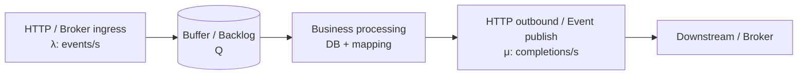
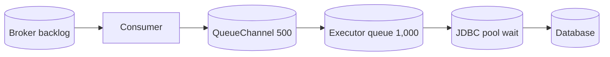
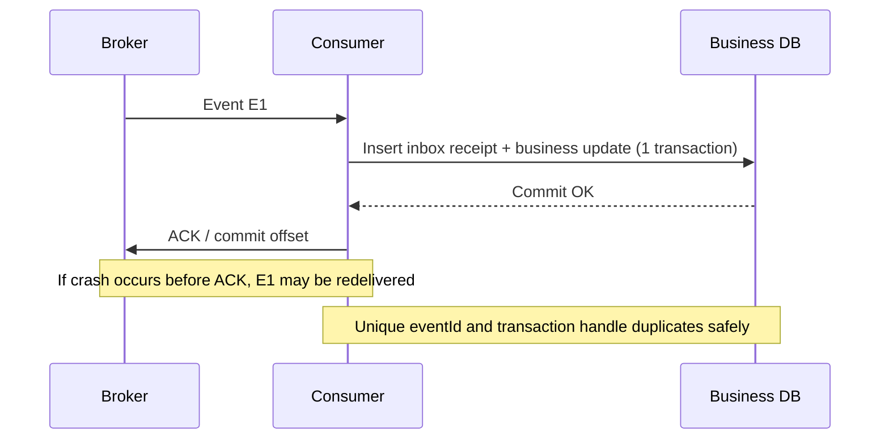

# Balancing Ingress, Processing, and Egress Rates

## 1. Why Can an Integration System Overload Even When Every Component Is Running?

Suppose a Spring Boot application receives order events from a broker, writes data to PostgreSQL, calls a payment API, and publishes result events to another topic. Normally, the service processes 600 events per second. During peak hours, upstream pushes up to 1,000 events per second for 15 minutes.

Several symptoms can appear:

- The broker keeps accepting events, but **consumer lag/backlog** grows rapidly.
- Processing threads increase while the JDBC pool runs out of connections and the HTTP client waits for connections.
- Some partner requests fail with HTTP 429/503, time out, or respond very slowly.
- Retries amplify load against the very dependency that is already slow; the DLQ starts filling up.
- When consumer concurrency is increased, the database or partner API overloads even further.

The core problem is not simply "add more threads." An integration pipeline consists of multiple stages, each with its own **throughput capacity, resource limits, and queueing behavior**. When the arrival rate exceeds the completion rate, unprocessed work accumulates somewhere: in the broker, an in-memory queue, an executor, a connection pool, or at the partner.

In the **SPRING_BOOT_INTEGRATION** module, integration operations mean organizing HTTP, database, cache, broker, and Spring Integration adapter flows so that **ingress, processing, and egress rates are coordinated around the weakest capacity**, while preserving the correctness of data contracts, transactions, acknowledgments, retries, and duplicate handling.

### Learning Objectives

After this lesson, you will be able to:

1. Distinguish **ingress rate**, **processing throughput**, **egress rate**, **concurrency**, **latency**, and **backlog**.
2. Calculate queue growth rate, in-flight work, and backlog drain time using simple models.
3. Choose **buffering**, **backpressure**, **rate limiting**, **load shedding**, and **bulkheads** for different integration boundaries.
4. Configure explicit limits in Spring Integration, Kafka/RabbitMQ/Pulsar, and HTTP/JDBC adapters without confusing concurrency with throughput.
5. Design acks, retries, transactions, idempotency, and shutdown so correctness is never traded away for raw speed.
6. Build dashboards/SLOs, load tests, and backlog incident runbooks.

> **Version scope:** Java examples use Java 17+, Spring Boot 3.x, and Spring Integration 6.x compatible with the Spring Boot BOM. Kafka/RabbitMQ configurations and class names may vary across product lines; always verify against your exact production version. Numbers in this lesson are hypothetical for design practice, **not universal tuning values** for all systems.

## 2. Three-Rate Model of a Pipeline

Consider the flow:



Notation:

| Symbol | Meaning | Unit |
| --- | --- | --- |
| `λ` (lambda) | Rate at which new events enter the pipeline | events/second |
| `μ` (mu) | Sustainable serving capacity at a given load and configuration | events/second |
| `Q` | Number of events waiting in a buffer or broker backlog | events |
| `W` | Time an event spends in the system (depending on measurement boundary) | seconds |
| `L` | Average number of events in the system, both waiting and processing | events |
| `C` | Number of concurrently executing tasks (in-flight/concurrency) | tasks |

In a **stable** system, when long-term arrivals and departures balance, **Little's Law** applies:

\[
L=\lambda W
\]

If the pipeline completes an average of 400 events/second and an event takes an average of 0.25 seconds from arrival to completion, the average number of events inside that measurement boundary is approximately:

\[
L=400\times 0{,}25=100
\]

This is a **law for steady-state averages**, not an instruction to set `maxPoolSize=100`. `L` includes events that are **waiting**, whereas working threads are only a subset and do not necessarily equal in-flight requests/events. Networking, async I/O, batching, and parallel processing make the relationship to thread counts more complex.

### 2.1. When Ingress Exceeds Completion Rate

If `λ=1,000` events/second while the pipeline only completes `μ=600` events/second, the backlog grows roughly at:

\[
\frac{dQ}{dt}\approx \lambda-\mu=400 \text{ events/second}
\]

After 15 minutes:

\[
\Delta Q\approx400\times15\times60=360,000 \text{ events}
\]

This assumes arrival and completion rates are roughly constant over the window, with no drops, DLQ routing, or other effects on the backlog. In reality, throughput can **drop further** under overload due to GC, lock contention, timeouts, and retries.

If after the peak, the arrival rate drops to 300/second while the system still processes 600/second, the net backlog drain rate is `600-300=300` events/second. With 360,000 queued events, drain time is approximately:

\[
360,000 / 300 = 1,200 \text{ seconds} = 20 \text{ minutes}
\]

Therefore, "increasing consumers by 50%" does not mean the backlog will vanish in minutes if downstream still caps total throughput.

### 2.2. The Bottleneck Determines Long-Term Throughput

A sequential pipeline has three steps with capacities:

```text
Receive from broker   : 2,000 events/s
DB + business logic   :   700 events/s
Call partner API      :   400 events/s
```

If every event must pass through **all three steps**, maximum sustainable throughput under this simple model cannot exceed roughly **400 events/second**. Adding consumers only causes more events to queue ahead of the partner API; it does not increase the partner's response capacity.

The `min(capacity)` formula applies when each input goes through the same sequence of steps. If one event fans out into three HTTP calls, normalize by unit of work:

```text
1 order event → 1 DB transaction + 3 partner API requests
```

If the partner handles at most 900 requests/second total, this step's capacity is at most around **300 order events/second** before accounting for overhead, retries, and additional requests.

## 3. Do Not Confuse Operational Quantities

| Quantity | Question Answered | Common Mistake |
| --- | --- | --- |
| **Arrival rate** | How much new data arrives per second? | Using HTTP request count as a proxy for post-fan-out event volume |
| **Completion throughput** | How much work completes successfully? | Counting messages read instead of committed transactions |
| **Concurrency** | How many tasks are running simultaneously? | Assuming more threads linearly increase throughput |
| **Latency** | How long from start to finish? | Measuring only CPU work, ignoring buffer/pool wait time |
| **Backlog/lag** | How much data is still waiting? | Looking only at queue size without checking message age |
| **Capacity** | What rate can the pipeline sustain under what conditions? | Treating a short burst peak as sustainable capacity |
| **Success rate** | How many operations achieve their business outcome? | Counting DLQ/retries as successful processing |

**Measuring at the right point** is critical. If a consumer receives an event, parses it, and acks before the database commits, the "consumed" metric goes up even though business work may still be incomplete. If the operational goal is "order processed," completion must be measured after the **appropriate business boundary**, not merely upon message receipt.

### Total Latency Must Include Waiting Time

An event may experience:

\[
T_{\text{end-to-end}}
=T_{\text{backlog}}+T_{\text{queue}}+T_{\text{processing}}
+T_{\text{downstream}}+T_{\text{retry}}
\]

These components represent a decomposition for a specific pipeline; some stages may overlap with async processing. Even with overlap, **do not measure only handler execution time** and treat it as the total latency users care about.

## 4. Buffering Absorbs Spikes; It Does Not Create Capacity

A **buffer** lets the receiver keep accepting data briefly even if downstream processing slows down temporarily. Common buffers:

- Durable backlog in Kafka, Pulsar, or RabbitMQ according to retention settings.
- Spring Integration's in-memory `QueueChannel`.
- `ThreadPoolTaskExecutor`'s task queue.
- Pending requests in an HTTP client connection pool.
- Connection wait queues in HikariCP.
- Producer batch buffers and network buffers.

Multiple buffer layers can coexist and scatter "waiting capacity":



When in-app queues are too large, broker lag may look low while user-perceived latency is very high because work has moved into invisible in-process queues. If the process crashes, messages sitting only in memory queues may be **lost** unless upstream has unacked tracking and proper redelivery.

### 4.1. Sizing a Buffer from a Burst

Suppose for 30 seconds ingress rises from 400 to 1,000 events/second while the system steadily processes 600 events/second:

\[
Q_{\text{burst}}\approx(1,000-600)\times30=12,000
\]

If an average message payload is 8 KiB, **raw payload alone** is about 96,000 KiB (~93.75 MiB), excluding objects, metadata, retries, and runtime overhead. Do not treat this figure as sufficient heap sizing: memory overhead and GC pressure can be significant.

If a burst lasts longer than expected, any finite buffer will fill up. Thus **a buffer must pair with a full-queue action**, not merely raising `queueCapacity`.

### 4.2. Bounded Queues vs. Unbounded Queues

| Type | Benefit | Risk |
| --- | --- | --- |
| Unbounded or huge queue | Fewer immediate rejections during short spikes | Higher latency, OOM, slow recovery, hidden bottlenecks |
| Bounded queue | Caps resources and exposes bottlenecks clearly | Must handle rejection/pausing; wrong ack placement can lose messages |
| Durable broker backlog | Survives consumer stops and supports policy-based replay | Needs storage capacity, retention, quotas, and a drain plan |

To protect critical business data, it is usually better to **slow broker consumption and keep unacked work at the durable source**, or persist to durable storage before acknowledging. Pushing everything into a `QueueChannel` and acking immediately is a dangerous tradeoff if the process can crash.

## 5. Backpressure, Rate Limiting, and Load Shedding

These three mechanisms all address overload, but work differently.

| Mechanism | Meaning | Appropriate Example |
| --- | --- | --- |
| **Backpressure** | Receiver signals or manifests that it cannot accept faster; upstream slows down | Reactive Streams demand, broker consumer pause/prefetch, bounded channel |
| **Rate limiting** | Limits requests/messages allowed per unit of time | Partner API allows at most 200 requests/s |
| **Concurrency limiting / bulkhead** | Limits tasks executing simultaneously | At most 16 concurrent connections calling partner API per instance |
| **Load shedding** | Rejects or drops work when over capacity, per policy | HTTP 429/503 for requests that cannot be accepted |
| **Batching** | Processes/sends multiple records in one operation | JDBC batch or producer message batch |

**True backpressure must cross the boundary.** A full `QueueChannel` may cause `send` to return `false`; however, if upstream already acked the broker message and nothing persisted it elsewhere, that is **data loss**, not safe backpressure.

### 5.1. For HTTP Ingress

HTTP request/response does not offer a consumer cursor like Kafka. When the service is full:

- Return **429 Too Many Requests** if the client exceeds its quota/rate limit.
- Return **503 Service Unavailable** if capacity is temporarily insufficient, with `Retry-After` when appropriate.
- Limit request body size, wait times, in-flight requests, and queue depth.
- Only return **202 Accepted** once the contract's "accepted" guarantee is met; if durability is required, persist to a database/outbox/broker first.

Never return `202` right after putting data into an in-memory queue and call it "safely persisted," unless the API explicitly documents best-effort semantics where data loss is acceptable.

### 5.2. For Broker Ingress

Brokers provide throttling controls aligned with their delivery semantics:

- Reduce poll/fetch size, consumer prefetch, or receiver queue.
- Pause consumption/polling in the application where supported by the driver/container.
- Only ack/commit once work reaches an appropriate durable state.
- Let backlog sit in the broker under managed quotas/retention instead of creating unbounded in-memory queues.

Details differ across Kafka, RabbitMQ, Pulsar, and subscription types; a single universal property cannot throttle every broker.

### 5.3. For Reactive Pipelines

Reactive Streams provide demand: downstream requests only as many items as it can accept. However, merely swapping `RestClient` for `WebClient` **does not make the database or partner faster**. Bound `flatMap(..., concurrency)`, set timeouts, bound buffers, and define policies when sources do not honor or propagate backpressure.

Illustrative Reactor example with bounded concurrency:

```java
Flux<OrderEvent> incoming = getEvents();

Flux<ProcessingResult> results = incoming
        .flatMap(
            event -> processAsync(event)
                    .timeout(Duration.ofSeconds(2)),
            16
        );
```

`getEvents()` and `processAsync(...)` are application methods that you must implement. The number 16 is the **concurrent inner-publisher subscription limit** of `flatMap` in this example, not a cluster-wide quota. You must decide timeout/error handling, blocking I/O schedulers, and how upstream honors demand. Avoid calling `.block()` directly on the WebFlux/Netty event loop.

## 6. Choosing Concurrency with Data, Not Guesswork

A worker processing events sequentially at 40 ms/event on average has theoretical capacity:

\[
1/0{,}04=25 \text{ events/second}
\]

To handle 1,000 events/second, simple arithmetic suggests **at least 40 workers** if all workers are independent and downstream resources are unlimited. Yet 40 is a **theoretical bound** assuming zero overhead, lock contention, batching, latency skew, or shared bottlenecks.

In reality:

- If those 40 ms consist mostly of I/O wait, asynchronous I/O can increase in-flight volume without matching thread count.
- If the database pool only has 20 connections and each event holds a connection throughout processing, scaling to 80 workers just builds a pool wait queue.
- If the partner allows at most 600 requests/s, going from 40 to 80 workers cannot exceed that quota.
- As utilization nears 100%, service-time variance causes p95/p99 queueing latency to surge sharply.

Choose concurrency via **load tests on representative workloads and infrastructure**, observing completion rate, p95/p99, and error rate, then adjusting based on the observed bottleneck.

### 6.1. Two Limits to Separate

```text
maxConcurrency = 16       # tasks currently executing
maxQueueSize   = 500      # tasks allowed to wait
```

If you limit concurrency only while leaving the queue unbounded, requests still pile up when downstream slows down. If you limit only the queue while allowing huge concurrency, you can trigger a "thundering herd" against the database. You need **both**, plus a defined action when the queue is full.

### 6.2. Per-Instance vs. Global Limits

A `Semaphore(16)` in a singleton Spring bean means **16 concurrent calls per instance**. With 10 replicas, the whole system can open up to around 160 concurrent connections to the same partner. If the partner quota is only 60 requests/s across all clients, you need global quota coordination, or per-replica budget allocation paired with matching autoscaling limits.

Do not confuse "open connections," "in-flight requests," and "requests/s": keep-alive and multiplexing can decouple these numbers.

## 7. Spring Integration Example: Bounding Buffers and Poll Rates

Spring Integration structures pipelines via `MessageChannel`, `QueueChannel`, pollers, endpoints, and handlers. The following illustrates **a bounded in-memory buffer** and **a polled consuming flow** so it is clear where capacity is configured.

### 7.1. Dependency

```xml
<!-- Maven, application using Spring Boot BOM/parent -->
<dependency>
    <groupId>org.springframework.boot</groupId>
    <artifactId>spring-boot-starter-integration</artifactId>
</dependency>
```

### 7.2. Configuring the Channel and Flow

```java
package example.integration.flow;

import java.time.Duration;
import org.springframework.context.annotation.Bean;
import org.springframework.context.annotation.Configuration;
import org.springframework.integration.channel.QueueChannel;
import org.springframework.integration.dsl.IntegrationFlow;
import org.springframework.integration.dsl.Pollers;

@Configuration(proxyBeanMethods = false)
public class BoundedFlowConfiguration {

    @Bean
    QueueChannel inboundBuffer() {
        // Max 500 messages waiting in this instance's memory.
        return new QueueChannel(500);
    }

    @Bean
    IntegrationFlow orderProcessingFlow(
            QueueChannel inboundBuffer,
            OrderEventHandler orderEventHandler) {

        return IntegrationFlow
                .from(inboundBuffer, endpoint -> endpoint.poller(
                        Pollers.fixedDelay(Duration.ofMillis(100))
                                .maxMessagesPerPoll(10)))
                .handle(orderEventHandler, "handle")
                .get();
    }
}
```

Application-provided handler:

```java
package example.integration.flow;

import org.springframework.stereotype.Component;

@Component
public class OrderEventHandler {

    private final OrderBusinessService businessService;

    public OrderEventHandler(OrderBusinessService businessService) {
        this.businessService = businessService;
    }

    public void handle(OrderEvent event) {
        businessService.process(event);
    }
}

record OrderEvent(String eventId, String orderId) {
}
```

`OrderBusinessService` is the application's business service. For example:

```java
package example.integration.flow;

public interface OrderBusinessService {
    void process(OrderEvent event);
}
```

**Explaining the limits**:

- `new QueueChannel(500)`: at most 500 queued messages in this **instance's** channel, not a persistent queue.
- `fixedDelay(100 ms)`: the next poll is scheduled after the current processing turn per scheduler semantics; if the handler is slow, poll frequency drops.
- `maxMessagesPerPoll(10)`: maximum messages fetched per poll cycle. It **is not a guarantee of 100 messages/second**, because processing duration, scheduling, and concurrency also affect rate.
- In this flow, no dedicated worker pool is configured; do not assume the endpoint automatically processes 10 messages in parallel. Explicitly configure concurrency and a task executor if the workload requires it.

### 7.3. Sending to a Bounded Channel and Handling Full Capacity

```java
package example.integration.flow;

import java.util.concurrent.RejectedExecutionException;
import org.springframework.beans.factory.annotation.Qualifier;
import org.springframework.messaging.MessageChannel;
import org.springframework.messaging.support.MessageBuilder;
import org.springframework.stereotype.Component;

@Component
public class OrderIngressAdapter {

    private final MessageChannel inboundBuffer;

    public OrderIngressAdapter(
            @Qualifier("inboundBuffer") MessageChannel inboundBuffer) {
        this.inboundBuffer = inboundBuffer;
    }

    public void offer(OrderEvent event) {
        boolean accepted = inboundBuffer.send(
                MessageBuilder.withPayload(event).build(),
                100 // wait at most 100 ms if QueueChannel is full
        );

        if (!accepted) {
            throw new RejectedExecutionException(
                    "Local processing buffer is full");
        }
    }
}
```

Mandatory rule: `send(..., 100)` only confirms the message **entered the in-memory buffer**; it does not confirm business completion and **does not guarantee durability**. If the source is Kafka/RabbitMQ/Pulsar, **do not ack just because `offer` succeeded**, unless another durable record exists or the business contract accepts message loss on process crash.

When the handler throws an exception after a message is pulled from `QueueChannel`, the message does not automatically return to the origin broker. You must design an error flow/retry or use the broker/durable store as the source of truth for incomplete work.

### 7.4. When a Worker Pool Is Needed

You can use a `TaskExecutor` or concurrency-capable endpoints for parallel processing. Every executor must have a **bounded queue**, an explicit rejection policy, and active/queued metrics. Example pool:

```java
@Bean
ThreadPoolTaskExecutor integrationWorkerExecutor() {
    var pool = new ThreadPoolTaskExecutor();
    pool.setCorePoolSize(4);
    pool.setMaxPoolSize(8);
    pool.setQueueCapacity(100);
    pool.setThreadNamePrefix("integration-worker-");
    pool.initialize();
    return pool;
}
```

Required imports are `org.springframework.context.annotation.Bean` and `org.springframework.scheduling.concurrent.ThreadPoolTaskExecutor`. This snippet only defines the pool; **it does not automatically wire the pool into the flow**. To use it, attach the executor to the appropriate poller or channel/endpoint and verify rejection semantics. In particular, do not let executor exceptions or full queues cause a broker consumer to ack erroneously.

**Demo limitation:** `QueueChannel` is suitable for understanding flows and for best-effort work recoverable from another source. For financial or order messages that must not be lost, use a durable broker/inbox/outbox, and confirm upstream only after a valid durable persistence point.

## 8. Throttling Consumers in Kafka, RabbitMQ, and Pulsar

Brokers have different intake mechanisms. Throttle **right at the listener/container layer** before pushing uncontrolled volume into internal queues.

### 8.1. Kafka: Poll, Partitions, Concurrency, and Commit

An illustrative starting configuration:

```yaml
spring:
  kafka:
    consumer:
      enable-auto-commit: false
      max-poll-records: 100
      properties:
        max.poll.interval.ms: 300000
    listener:
      concurrency: 4
      ack-mode: manual
```

Explanation:

- `max-poll-records` caps records returned per `poll()`; **it is not a requests/s limit** from the broker.
- `listener.concurrency=4` creates concurrent consumer/listener containers per Spring Kafka's structure. Assigned partition count bounds parallel processing within a consumer group.
- `max.poll.interval.ms` limits time between polls per Kafka rules. If the handler processes batches too slowly, the consumer may lose membership/rebalance, causing message redelivery.
- `ack-mode=manual` requires acking at the right time and configuring an appropriate error handler; enabling manual mode alone does not guarantee database exactly-once semantics.

Minimal listener example that acks **only after the service completes its data transaction**:

```java
package example.integration.kafka;

import org.springframework.kafka.annotation.KafkaListener;
import org.springframework.kafka.support.Acknowledgment;
import org.springframework.stereotype.Component;

@Component
public class OrderEventKafkaListener {

    private final OrderProcessingService service;

    public OrderEventKafkaListener(OrderProcessingService service) {
        this.service = service;
    }

    @KafkaListener(
            topics = "${integration.orders.topic}",
            groupId = "${integration.orders.group-id}")
    public void onMessage(String payload, Acknowledgment ack) {
        service.processIdempotently(payload);
        ack.acknowledge();
    }
}
```

Here `OrderProcessingService` must be defined by the application. `processIdempotently` must complete its commit/appropriate durable write **before** acking. If the process crashes right after DB commit but before Kafka offset commit, the message may be redelivered; the service must handle duplicates safely.

When processing is slow, do not solve it simply by raising `max.poll.interval.ms` indefinitely. Recalculate batch size and concurrency, split work into stages, limit HTTP/DB calls, or adopt an appropriate transaction/outbox pattern. If using an async handler, be especially careful not to ack before the future completes.

### 8.2. RabbitMQ: Prefetch and Manual Ack

RabbitMQ pushes deliveries to consumers within **prefetch** and unacked message limits. Example Spring AMQP listener:

```yaml
spring:
  rabbitmq:
    listener:
      simple:
        prefetch: 20
        concurrency: 4
        max-concurrency: 8
        acknowledge-mode: manual
```

With a `simple` container, these settings control consumer count and cap unacked deliveries per Spring AMQP/RabbitMQ semantics. You should:

- Ack only after required work has committed or been durably persisted in an appropriate store.
- Nack/requeue in a controlled way for transient errors; avoid infinite immediate requeue loops.
- Configure DLX/DLQ and appropriate TTL/queue policies for unprocessable messages.
- Avoid setting prefetch too high when each message consumes significant memory or DB connections.

`prefetch=20` **does not mean at most 20 messages/second**. It bounds unacked deliveries per consumer, while throughput depends on processing time, consumer count, and the broker.

### 8.3. Pulsar: Receiver Queue, Subscription, and Permits

Pulsar throttles delivery via client receiver queues and flow control, alongside subscription types and broker policies. With Spring Pulsar, you can configure consumers/listeners via `spring.pulsar.consumer.*` and `spring.pulsar.listener.*`, or use builder customizers when specialized Pulsar Java client options are needed.

When choosing a subscription:

| Type | Operational Impact |
| --- | --- |
| `Exclusive` | One active consumer on the subscription; does not scale out across multiple consumers on the same subscription |
| `Failover` | Has standby consumers; fault tolerance differs from throughput scale-out |
| `Shared` | Distributes messages across multiple consumers; no global ordering guarantee |
| `Key_Shared` | Distributes by key within supported semantics; check batching and ordering carefully |

Reducing the receiver queue or consumer count when downstream is overloaded helps curb in-process queued messages, though you must check redelivery/negative-ack behavior and resource bounds. Shrinking the queue alone does not increase DB or partner API write capacity.

### 8.4. Short Comparison

| Broker | Common Throttling Knobs | Data-Safety Boundary |
| --- | --- | --- |
| Kafka | `max.poll.records`, consumer concurrency, pause/resume, offset commit | Commit after processing/persistence per semantics; watch rebalances |
| RabbitMQ | Prefetch, consumer count, ack/nack, DLQ | Ack after commit/durable point; avoid requeue loops |
| Pulsar | Receiver queue, subscription, consumer count, ack/redelivery | Ack per contract after processing; idempotency on redelivery |

**Do not choose a single concurrency number across every broker.** Workload patterns, partitioning, consumer counts, handler durations, and delivery models produce different effective limits.

## 9. Protecting Downstream HTTP with Concurrency Limits and Timeouts

A system might receive 1,000 events/s while a partner handles only 100 requests/s or 20 concurrent requests. If every listener calls `RestClient` without bounds, timeouts and retries can push the partner into sustained overload.

### 9.1. Simple Bulkhead Example with `Semaphore`

```java
package example.integration.partner;

import java.util.concurrent.Semaphore;
import java.util.concurrent.RejectedExecutionException;
import org.springframework.stereotype.Component;
import org.springframework.web.client.RestClient;

@Component
public class BoundedPartnerClient {

    private final RestClient client;
    private final Semaphore inFlight = new Semaphore(16);

    public BoundedPartnerClient(RestClient.Builder builder) {
        this.client = builder
                .baseUrl("https://partner.example.test")
                .build();
    }

    public PartnerStatus fetchStatus(String id) {
        if (!inFlight.tryAcquire()) {
            throw new RejectedExecutionException(
                    "Partner bulkhead is saturated");
        }

        try {
            PartnerStatus body = client.get()
                    .uri("/v1/status/{id}", id)
                    .retrieve()
                    .body(PartnerStatus.class);
            if (body == null) {
                throw new IllegalStateException("Empty partner response");
            }
            return body;
        } finally {
            inFlight.release();
        }
    }

    public record PartnerStatus(String id, String state) {
    }
}
```

In this example, the `BoundedPartnerClient` bean is a singleton, so the semaphore is shared across calls **on the same instance**. Once all 16 permits are busy, new calls are rejected immediately so **no extra threads block waiting**. The caller must decide whether to retry later, leave the message on the broker, or return 503; never treat rejection as successful processing.

This snippet illustrates the limiting mechanism only; it omits auth/TLS, connect/read timeouts, cluster-wide rate limits, and a circuit breaker. The `.example.test` URL is a placeholder endpoint. In production, configure `RestClient` via `@ConfigurationProperties`, SSL bundles if applicable, timeouts, pooling, and proper instrumentation.

### 9.2. A Bulkhead Does Not Replace a Rate Limiter

If the partner has very low latency, 16 in-flight requests can still generate more than 100 requests/s. Conversely, when latency rises to 2 seconds, the same 16 permits yield at most around 8 requests/s under simple conditions.

Therefore:

- **Concurrency limits** cap how many tasks are waiting on responses.
- **Rate limiters** cap request counts over time.
- **Timeouts** release resources when responses do not arrive.
- **Circuit breakers** curtail calls to a persistently failing dependency according to policy.

These settings must be designed together. If timeouts are too long, permits stay held too long; if retries fire immediately after rejection, you create a **retry storm** that adds even more load.

### 9.3. HTTP 429/503 and `Retry-After`

When the partner returns 429, honor the retry policy where applicable, including `Retry-After` and total attempt caps. Non-idempotent commands such as recording payments require an **idempotency key** or reconciliation mechanism; a timeout does not prove the server never executed the operation.

When the application itself receives HTTP ingress without remaining capacity, return an appropriate overload error rather than queueing endlessly in a thread pool. For mandatory work, split the intake endpoint to write durably to an inbox/outbox, return 202 after commit, and process via background consumers.

## 10. JDBC, Connection Pools, and Cache Also Create Backpressure

### 10.1. JDBC/HikariCP

Spring Boot typically uses HikariCP when the JDBC starter and matching dependencies are present. Example:

```yaml
spring:
  datasource:
    hikari:
      maximum-pool-size: 20
      connection-timeout: 2s
```

Two properties:

- `maximum-pool-size=20`: caps database connections in the pool **per instance**.
- `connection-timeout=2s`: maximum wait to borrow a connection from the pool before failing; not a SQL query timeout.

If 10 replicas each allow 20 connections, theoretically the application can open up to around 200 DB connections, excluding other services. The database might not tolerate that number. Allocate connection budgets **cluster-wide** and monitor active/idle/pending pool metrics.

Adding connections **does not guarantee** a faster DB: the bottleneck may be CPU, I/O, indexes, locks, overly long transactions, or N+1 queries.

### 10.2. Keep Transactions Short

Risky pattern:

```java
@Transactional
public void process(OrderEvent event) {
    orderRepository.save(...);
    partnerClient.callExternalApi(...); // may wait several seconds
    receiptRepository.save(...);
}
```

In this pattern, a database transaction stays open while waiting on HTTP. That can hold locks and connections for long periods, reducing throughput and increasing deadlocks/timeouts. For external calls, consider splitting transactions, using an outbox, or implementing a workflow/saga with intermediate states; never expect `@Transactional` to stretch into an atomic transaction across HTTP, DB, and broker.

### 10.3. Redis/Cache

Redis is an I/O dependency. Increasing consumer concurrency while Redis is slow can cause:

- Many pending requests, driver timeouts, and growing buffers.
- Cache stampedes when many requests miss the same key simultaneously.
- Uneven write load when TTLs expire en masse.

Mitigations: limit in-flight calls, set timeouts, define fallback policies that account for stale data, add jitter to key TTLs, use single-flight for hot keys, and monitor command latency. **Never use a cache to mask an undersized database** unless cached data has explicit consistency and recovery policies.

## 11. Data Durability: Ack, Retry, and Idempotency Matter More Than Read Speed

A consumer can boost its "received" metric by acking immediately and pushing work into an in-process queue. Yet if the process crashes, that work can disappear. For orders, payments, or inventory updates, **intake durability** is part of the business contract.

### 11.1. Safe Boundary



This strategy typically achieves **at-least-once delivery** with **idempotent effects**, not universal exactly-once across all systems. Verify the broker's specific ack/commit semantics and the database's transactional boundary.

### 11.2. Receipt/Inbox and Unique Constraint

A hypothetical table:

```sql
CREATE TABLE processed_event (
    event_id VARCHAR(80) PRIMARY KEY,
    processed_at TIMESTAMP NOT NULL
);
```

Inside a single transaction:

```text
1. Check/insert event_id into processed_event.
2. If event_id was already processed, create no new side effect.
3. Update required business data.
4. Commit.
5. Only after commit, ACK upstream.
```

A "check-then-insert" pattern must handle races when two consumers receive the same event simultaneously. A unique constraint and appropriate transaction isolation or conditional insert form the critical data boundary. Never use an in-JVM `HashSet` for cluster-wide deduplication.

### 11.3. Outbox on the Sending Side

On the producer side, if the database commits but publishing the message fails, you can use a **transactional outbox**:

```text
HTTP request → transaction: business row + outbox row
            → commit
            → background outbox publisher
            → broker
            → mark published
```

An outbox decouples business write rates from broker publish rates. However, the outbox buffer must also be monitored for **unpublished record age, drain rate, retry count, and table size**. If the broker is down for hours while the app keeps inserting into the outbox at high speed, the database can fill up.

## 12. Retries: Recovery Tool or Overload Amplifier?

When a dependency slows down, retries easily multiply work:

```text
100 requests/s × 1 attempt = 100 requests/s downstream
100 requests/s × (1 + 2 retries) = up to 300 attempts/s
```

Actual volume depends on error rates and retry timing; the example above illustrates the risk when **all** calls fail and are retried twice.

### 12.1. Safe Retry Rules

1. **Classify errors:** transient timeouts/503s may be retried; schema errors, 401/403, untrusted certificates, or invalid data usually require fixing configuration/data.
2. **Limit attempts and total time:** retries must not hold threads or in-flight slots too long.
3. **Backoff and jitter:** avoid many instances retrying simultaneously the moment upstream recovers.
4. **Honor `Retry-After`** and downstream quotas when provided.
5. **Idempotency:** before retrying a side effect, verify it can be executed again safely.
6. **Move retries off the hot path when needed:** route to a retry topic/delayed queue or durable scheduler instead of sleeping for minutes on a listener thread.
7. **DLQ/parking lot:** support investigation, data repair, and procedural replay.

### 12.2. Retry Budget

One operational technique is capping total retry traffic using a **retry budget**, rather than letting every client retry unboundedly. For example, allow only up to a fixed ratio of extra attempts relative to fresh traffic within a measurement window, prioritizing new requests or work with tighter deadlines.

Do not apply the same budget to every operation regardless of criticality: durably persisted events can wait longer, whereas interactive user HTTP requests usually need faster timeouts and early feedback.

### 12.3. Poison Messages

A malformed message can be redelivered endlessly if the container retries unboundedly. Symptoms include a busy consumer with near-zero completion throughput, stagnant lag, and the same exception repeating in logs.

Distinguish **transient errors** from **poison messages**, route unprocessable messages to a DLQ in a controlled manner, and do not ack messages prematurely before recording the policy decision. A DLQ does not "delete the error"; it is a queue of work requiring operator intervention.

## 13. Batching, Bulk Operations, and Impact on Throughput

Batching generally reduces round trips:

- JDBC batch insert/update instead of one SQL statement per record.
- Producer batching messages appropriately.
- HTTP bulk endpoints when supported by the partner.
- Cache `MGET`/pipelining where applicable.

Yet large batches are not free:

| Increasing Batch Size | Potential Positive Effect | Potential Negative Effect |
| --- | --- | --- |
| Reduces per-record overhead | Higher total throughput | First record latency rises while waiting to form a batch |
| Fewer network round trips | Lower CPU/network overhead | Large payloads raise timeout/retry cost |
| Leverages bulk inserts | Better DB efficiency | Longer transactions, heavier locks and rollbacks |
| Fewer broker sends | Better bandwidth utilization | Ordering, key routing, and dead-lettering become harder |

Choose batch sizes empirically, checking **p99 latency and memory** as well as total throughput. If a batch of 100 events has 1 bad event, define partial-success/retry policies and idempotency before increasing batch size.

## 14. SLOs and Monitoring: Knowing Where the System Is Slow

A useful dashboard tracks each stage, not just overall CPU:

| Location | Metrics to Watch | Interpretation |
| --- | --- | --- |
| HTTP ingress | Request rate, 429/503, p95/p99 latency, in-flight | Are clients being rejected or waiting too long? |
| Broker ingress | Consumer lag/backlog, oldest message age, deliveries/s | Is work piling up outside the app? |
| Internal buffer | Queue depth/capacity, time-in-queue, rejected sends | Is backlog spilling into the heap? |
| Worker executor | Active threads, queue size, rejections, task duration | Are workers saturated or blocked on I/O? |
| Database | Hikari active/idle/pending, acquire time, query latency, lock waits | Is the bottleneck connections or actual SQL? |
| HTTP outbound | Requests/s, in-flight, pool pending, timeouts, 429/503 | Is the partner API slow or hitting quotas? |
| Publisher | Outbox lag/age, send latency, publish failures | Is business work committing while events fail to publish? |
| Consumer outcome | Business completions/s, retry rate, DLQ, dedupe | **True completion rate** and business errors |
| JVM/host | CPU, heap, GC pauses, threads, network/disk | Are local resources degrading throughput? |

### 14.1. Measure Backlog in Time, Not Only Count

A backlog of 10,000 messages when consumers complete 5,000 messages/s is completely different from a backlog of 10,000 at 5 messages/s. An approximate metric:

\[
T_{\text{drain}}\approx\frac{Q}{\mu-\lambda}
\quad \text{when } \mu>\lambda
\]

Where `λ` is fresh ingress and `μ` is sustainable completion throughput under current conditions. This is only a simple forecast assuming relatively stable rates and identical work units.

Beyond backlog size, track **oldest unprocessed message age** or end-to-end age. A small backlog containing a message stuck for hours can still severely violate SLOs.

### 14.2. Defining Business-Meaningful SLOs

Illustrative (hypothetical) example for an order flow:

| SLO | Example Definition |
| --- | --- |
| Processing latency | 99% of valid events reach business completion within 60 seconds of broker receipt |
| Completeness | 99.99% of valid events eventually complete or enter an investigable error state |
| Backlog health | Oldest unprocessed event age stays under 5 minutes during normal operations |
| Duplicate effects rate | Zero duplicate business updates occur for the same idempotency key |

Values must be agreed upon by product, operations, and partners based on real requirements. **An SLO of "99% of messages consumed" is meaningless** if the consumer acks before recording the business outcome.

### 14.3. Tracing and Correlation IDs

To trace `HTTP request → DB transaction → outbox → broker → consumer → partner HTTP`, you need:

- Correlation IDs or trace context consistently propagated across headers/message properties.
- Event ID, aggregate ID, and schema version carried per the contract.
- Trace spans measuring queue/publish/consume durations wherever measurable.
- Structured logging that **never logs sensitive full payloads**, tokens, or unnecessary personal data.

Micrometer/Actuator and per-client instrumentation can provide metrics, but having a working broker adapter does not mean every backlog, DLQ, or age metric appears automatically. Integrate additional metrics/dashboards from the broker, database, and application.

## 15. Load Testing and Capacity Planning

Do not optimize based on a quick "fire 10,000 messages" test and call it done. You need a multi-phase plan:

1. **Baseline:** measure throughput and p95/p99 when upstream is below capacity.
2. **Ramp:** gradually increase ingress to find where queue depth/latency begins climbing continuously.
3. **Sustained load:** hold load long enough to expose locks, GC issues, leaks, and compaction.
4. **Burst:** apply short traffic spikes and verify backlog drain rate and time.
5. **Downstream slowdown:** deliberately increase latency or return 429/503 from the partner.
6. **Broker/DB disruption:** test restarts, connection drops, rebalances, or pool exhaustion.
7. **Recovery:** confirm no committed messages are lost, no duplicate side effects occur, and backlog drains at the expected rate.

### 15.1. Sample Load Test Plan Table

| Phase | Hypothetical Ingress | Duration | What to Observe |
| --- | --- | --- | --- |
| Baseline | 200/s | 10 min | Stable p95, CPU, pools, and latency |
| Ramp | 200 → 800/s | 20 min | Point where Q starts rising, success throughput |
| Burst | 1,200/s | 2 min | Backlog growth, memory, and rejections |
| Recovery | 300/s | 15 min | Drain rate, message age, and retries |
| Partner failure | API returns 503/429 | 5 min | Circuit breaker, retry budget, DLQ/outbox |
| Broker restart | Brief broker loss | As planned | Redelivery, duplicate effects, recovery |

Values are samples only. Load generation workloads must have **realistic key/tenant distributions and payload sizes**, including large messages, hot keys, dominant tenants, and the ratio of requests that fan out to multiple HTTP calls.

### 15.2. How to Locate the Bottleneck

As load rises, iterate in a loop:

```text
Increase ingress in a controlled manner
     ↓
Measure completion throughput + latency + queue
     ↓
Identify the first component to saturate
     ↓
Apply one targeted change (query, batch, quota, concurrency...)
     ↓
Retest and verify the bottleneck didn't shift somewhere worse
```

For example:

- Hikari pending rising, DB CPU low: check transactions holding connections too long, pool size, lock waits, and HTTP calls inside transactions.
- HTTP 429 rising: throttle send rate and respect quotas; **do not** just enlarge the executor pool.
- JVM CPU 100%, DB pool idle: look for CPU-bound transforms/serialization, GC pressure, and payload sizes.
- Broker lag rising, CPU/DB idle: inspect partition count, assignments, poll loop, consumer group, or listener configuration.

## 16. Autoscaling and System-Wide Capacity Limits

Autoscaling helps only when the workload can be distributed and downstream still has spare capacity:

| Scaling Action | When Helpful | When Harmful |
| --- | --- | --- |
| Add Kafka consumer instance | Enough partitions exist and work can be parallelized | Partition-bound; increases DB connections/HTTP calls |
| Add Rabbit/Pulsar consumers | Broker and downstream have spare capacity | Prefetch/receiver queues, redeliveries, and pools saturate |
| Increase worker threads | Handlers are mostly I/O-bound and downstream tolerates it | Increases contention, OOM risk, and latency |
| Enlarge database pool | DB accepts more connections and was pool-starved | DB CPU/IO saturates and lock contention worsens |
| Add application replicas | Quotas/partitions and infrastructure support it | Cluster-wide partner quotas get exceeded |

If an autoscaler triggers on backlog, factor in **completion throughput, lag age, max replicas, cooldown, and downstream capacity**. Scaling endlessly on a backlog that cannot drain because a partner API allows only 100 requests/s increases cost without improving SLOs.

### 16.1. Backlog-Driven Scaling Needs Both Age and Rate

Two subscriptions both have 50,000 messages:

- Subscription A: consumer drains 10,000/s, ingress 8,000/s → backlog shrinks by 2,000/s, ~25 seconds remaining if steady.
- Subscription B: consumer drains 500/s, ingress 700/s → backlog **grows** by 200/s; scaling must examine the bottleneck.

Counting backlog alone does not distinguish the two scenarios. In operations, alert **when backlog grows continuously or age approaches the SLO**, then use throughput and dependency saturation to decide whether to scale or throttle.

## 17. Startup, Shutdown, and Deploying Without Losing Work

During a rolling update or when the app receives SIGTERM:

1. Stop accepting new work or flip readiness appropriately so traffic stops routing to the terminating instance.
2. Allow in-flight tasks to finish within an explicit **grace period**.
3. Complete commits/acks for work that truly finished processing.
4. Leave incomplete work in durable sources for redelivery, or persist before shutdown.
5. Close HTTP clients, connection pools, and listener containers in order, with timeouts.

A non-durable `QueueChannel` holding 500 events has no automatic mechanism to migrate them to a new instance. If upstream already acked before enqueueing, shutdown can lose those events. For critical work, keep work anchored in the broker/outbox or use durable storage.

### 17.1. Readiness vs. Liveness

- **Liveness:** whether the process is alive or needs restarting.
- **Readiness:** whether the instance should receive new traffic or work right now.

If a dependency fails, **do not let every downstream failure fail liveness by default**, as that triggers restart storms. Depending on the architecture, degrade readiness, pause consumers, open circuit breakers, or hold backlog on the broker while the process stays healthy enough to recover.

## 18. Synthesis Scenario: Order Events Triple

**Context (hypothetical):**

- Normally the broker receives 300 events/s.
- During a promotion it receives 900 events/s for 20 minutes.
- DB processing handles 1,200 events/s without partner calls, but the partner API supports only 500 requests/s.
- Each order event calls the partner API once; p95 response is ~250 ms.
- Consumer uses 30 workers, HTTP client has no bulkhead; each worker holds a DB transaction while waiting on the API.

### 18.1. What Will Happen?

Sustainable partner-limited capacity is no more than roughly **500 events/s** before accounting for errors/retries. Arrival exceeds capacity by ~400/s; backlog accumulated over 20 minutes is approximately:

\[
400\times20\times60=480,000 \text{ events}
\]

With a 250 ms p95, the in-flight requests needed to sustain 500 req/s depend on actual mean service time and variance. You cannot plug p95 in as mean service time to compute exact concurrency. Thirty workers may become a bottleneck **before** 500/s if most time is spent waiting on the API, or the API may throttle even lower under bursts.

### 18.2. How to Investigate

1. Compare arrival rate with **business completion rate**, not "messages polled."
2. Check partner 429/503 responses and outbound p95/p99.
3. Inspect Hikari active/pending counts, transaction durations, and lock waits.
4. Check broker backlog and message age, retry counts, and DLQ rates.
5. Verify ack timing: are consumers acking before DB commits or result event publishing?

### 18.3. Design Improvements

- Enforce partner quotas/rate limits and bulkheads matched to real capacity instead of scaling consumers unboundedly.
- Shorten DB transactions; avoid holding connections across network calls when unnecessary.
- Use an outbox/async workflow if business rules allow, decoupling ingestion from slow outbound calls.
- Keep unprocessed work durable in the broker/inbox/outbox with idempotency and backoff retries.
- Match consumer concurrency to partition count and downstream quota; bound internal queues.
- Set SLOs on event age and backlog drain time; load test and rehearse partner 429 responses ahead of peaks.

### 18.4. How Long to Recover After the Promotion?

If ingress returns to 300/s, effective throughput stays at 500/s, and retries subside, net drain capacity is 200/s. For 480,000 events:

\[
480,000/200=2,400\text{ seconds}=40\text{ minutes}
\]

If the business requires clearing everything within 15 minutes, the fix is not "enlarging the HTTP thread pool" when the partner supports only 500 requests/s; you must negotiate higher quotas, reduce calls, batch via bulk APIs, change workflows, or proactively pace/spread load beforehand.

## 19. Rate-Balancing Operations Checklist

1. **Attach units:** ingress/s, completions/s, downstream requests/s, payload sizes, and fan-out.
2. **Identify the bottleneck:** CPU, DB, partner HTTP, broker partitions, cache, or pool/executor.
3. **Bounded resources:** finite queue capacities, concurrency, HTTP pools, JDBC pools, timeouts, and retry budgets.
4. **End-to-end backpressure:** when one layer fills, upstream slows down or holds messages in durable storage.
5. **Ack at the right boundary:** ack/commit only after business state is safely persisted under chosen semantics.
6. **Idempotency:** event IDs, unique constraints, inbox/outbox, and retry/redelivery policies.
7. **Data contracts:** schema versions and error handling must not turn valid messages into endless poison messages.
8. **Timeouts and circuit breakers:** avoid holding resources during prolonged downstream outages; avoid retry storms.
9. **Controlled scaling:** check partition counts, global quotas, and total DB connections before adding replicas.
10. **Stage-by-stage observability:** backlog **and message age**, queue depth, pool pending, completion rate, retries, DLQ, p95/p99.
11. **Load/failure testing:** baseline, ramp, burst, downstream slowdown, broker restart, drain, and shutdown.
12. **Business SLOs:** clearly define when an event counts as processed, not merely read from the broker.

### Self-Check Questions

**1.** If inbound is 800 messages/s and consumers complete 500 messages/s for 10 minutes, roughly how much does the backlog grow? What assumptions must be stated?

**2.** The system has 300 messages in a `QueueChannel` while broker lag is 0. Why can you not conclude all messages have been safely processed?

**3.** What is the difference between Kafka's `max.poll.records`, RabbitMQ's `prefetch`, an HTTP concurrency limit, and a req/s rate limit?

**4.** Why can raising Hikari's maximum pool size from 20 to 100 make the database slower?

**5.** A producer times out after the broker wrote the message but before returning an ack; what conditions must retries satisfy to prevent duplicate business effects?

**6.** Why does `maxMessagesPerPoll(10)` with a 100 ms poller not equate to a fixed throughput of 100 messages/s?

**7.** When backlog grows while application CPU is low, which dependencies must you measure before adding replicas?

**8.** During a rolling deployment, why must you check readiness, acks, and in-memory queues instead of simply waiting for the process to exit?

## Conclusion

Balancing ingress, processing, and egress rates in Spring Boot is not a matter of sizing one `thread pool` large enough. You must quantify **arrival rate, completion throughput, backlog, latency, and each downstream's capacity**, then apply bounded buffers, backpressure, concurrency/rate limits, timeouts, and controlled retries at the right boundaries. Across HTTP, database, cache, broker, and Spring Integration systems, **acks/commits, transactions, inbox/outbox, and idempotency** must accompany traffic throttling so correctness is never traded for illusory throughput metrics. Ultimately, per-stage dashboards, message-age SLOs, load tests, and recovery drills are what prove an integration flow remains stable under peak load and dependency failures.
