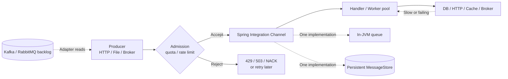
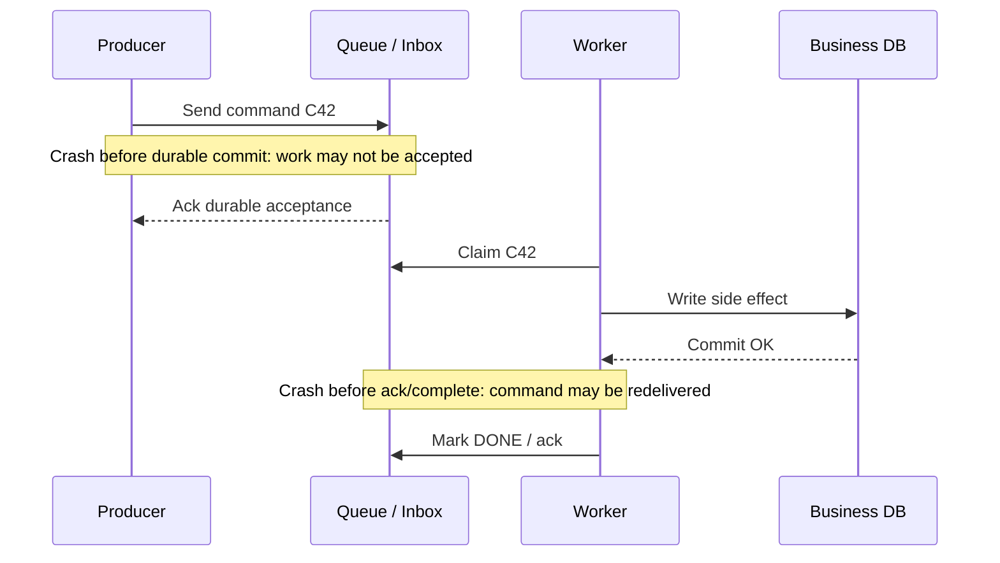

# Bounding Queues, Memory, and State Storage Capacity

## 1. Why Can a Functionally Correct Integration Still Crash Under Load?

Suppose `order-service` receives 800 requests/second over HTTP and forwards commands into Spring Integration to call `warehouse-service`. When Warehouse is healthy, the system handles about 900 commands/second. During an overload event, processing rate drops to 600 commands/second. If it keeps accepting new work, the backlog grows by **200 commands/second**. After 10 minutes, there will be roughly **120,000 unprocessed commands**.

If these commands sit in an unbounded heap `QueueChannel`, the JVM can run out of memory. If moved to a database message store without quotas, the database can fill its disk. If left in Kafka while consumer lag grows continuously, log retention and broker storage also have limits. **Changing where the backlog lives does not eliminate the capacity problem.**

The **Integration Operations** chapter of the **SPRING_BOOT_INTEGRATION** module focuses on operating flows across HTTP clients, databases, caches, brokers, and Spring Integration adapters. A reliable integration system must know **how much work to accept, where to keep it, how long to keep it, what to do when full, and how to recover**. That ties directly into data contracts, transactions, errors, duplicate handling, testing, and observability.

**After this lesson, you will be able to:**

1. Distinguish JVM message queues, executor task queues, broker backlogs, and state stored in databases/caches.
2. Bound `QueueChannel`, `ExecutorChannel`, and concurrent operations.
3. Estimate capacity from arrival rate, throughput, message size, and overload tolerance duration.
4. Design admission control and backpressure instead of unbounded queues.
5. Choose durable message/state storage via `MessageStore`, `MetadataStore`, inbox/outbox, and brokers.
6. Bound message groups, idempotency keys, temporary files, retry records, and retention.
7. Define metrics, alert thresholds, and tests for full queues, heap exhaustion, near-full disks, and restarts.

> **Version scope:** Examples use Java 17+, Spring Boot 3.x, Spring Integration 6.x, and Spring Kafka/Spring AMQP compatible with the project BOM. APIs/properties in other versions (especially Boot 4.x, Integration 7.x) should be checked against official docs before use. Configuration names under `app.integration.*` are **application-defined custom configuration**, not auto-bound Spring Boot properties.

## 2. Four Places Where Backlog Can Exist



| Work Storage Location | Example | Primary Limits | After Process Crash |
| --- | --- | --- | --- |
| **JVM heap** | `QueueChannel` using an in-memory queue. | Message count, object size, heap/GC. | Queued messages are usually lost; not durable by default. |
| **Executor task queue** | `ThreadPoolTaskExecutor` behind `ExecutorChannel`. | Thread pool, queue capacity, heap. | Queued tasks are usually lost. |
| **Broker** | Kafka log, RabbitMQ queue. | Disk, retention, quota, prefetch, consumer lag. | Depends on broker durability and ack/commit policy. |
| **Persistent store** | JDBC-backed channel, inbox/outbox, message group store. | DB rows, indexes, WAL/redo logs, disk, retention. | Recoverable depending on transaction and consumer/claim semantics. |
| **Auxiliary state storage** | Dedup metadata, aggregator groups, file checkpoints. | Key/group count, TTL, cache/DB memory/disk. | Store-dependent: lost if in-memory, retained if persistent. |

A single flow can have **multiple simultaneous queues**: Kafka carries backlog, the executor holds queued tasks, and the service accumulates HTTP requests waiting for DB connections. Monitoring only one queue makes it easy to miss where pressure is actually building.

### 2.1. Which Message Channels Actually Have Queues?

| Spring Integration Channel | Characteristics | Key Takeaways |
| --- | --- | --- |
| `DirectChannel` | Invokes handler synchronously on sender's thread; no traditional queue storage. | Sender blocks when handler is slow; errors propagate back. |
| `QueueChannel` | Pollable channel with a queue; can be configured with finite capacity. | If backed by an in-memory queue, does not survive restarts. |
| `ExecutorChannel` | Dispatches handler via an executor; executor may queue tasks. | Task queue size is often where backlog hides. |
| `PriorityChannel` | Orders messages by priority. | Priority does not replace quotas and risks starving low-priority messages. |
| `PublishSubscribeChannel` | Broadcasts to multiple subscribers. | Not persistent by default; attached executors can add backlog. |
| `FluxMessageChannel` | Integrates with Reactive Streams. | Backpressure depends on subscribers/operators and each bridge; does not automatically make upstream lossless. |

**There is no single global "enable backpressure" switch** for all adapters. With `DirectChannel`, pressure propagates via thread blocking. With `QueueChannel`, senders must handle full queues. With Kafka/RabbitMQ, fetch/ack rates and retention must be coordinated. With HTTP, returning `202 Accepted` creates an obligation to persist work durably.

## 3. Calculations to Know Before Setting Capacity

Let:

- `λ` (*arrival rate*): average messages arriving per second.
- `μ` (*service rate*): messages one worker processes per second.
- `c`: number of workers able to run in parallel.
- `μ_total ≈ c × μ`: theoretical capacity, which must be discounted for overhead and real bottlenecks.
- `Q`: queued messages, excluding those actively processing if measured separately.

When arrival rate exceeds actual processing rate, backlog grows roughly as:

```text
Backlog growth over T seconds ≈ max(0, λ - μ_total) × T

Time to fill queue ≈ (capacity - current backlog)
                     / max(0, λ - μ_total)
```

**Example:** 800 messages/second arrive, 600 messages/second leave, queue capacity is 2,000, initially empty. The queue fills in about **10 seconds**. After 600 seconds, there is a deficit of 120,000 messages. Raising capacity from 2,000 to 10,000 cannot fix a sustained 200/s deficit: it merely delays filling up by 40 seconds.

### 3.1. Steady-State Check

If long-term arrival rate `λ` consistently exceeds processing capacity `μ_total`, **no finite queue can keep the system stable**. You must lower the admission rate, add real processing capacity, optimize downstream, shard workloads, or offload non-urgent requests to batch/delayed processing.

When the system is roughly stable, **Little's Law** gives the average relationship:

```text
Average work in system L = λ × W

λ: long-term throughput of a stable system (tasks/second)
W: average time one task spends in the system (seconds)
```

For example, at 100 jobs/second throughput where each job takes an average of 2 seconds end-to-end, about 200 jobs are in the system on average. This formula **does not** directly prescribe the queue size required to absorb bursts, tail latency, or downstream errors; you must measure real distributions.

### 3.2. Estimate Heap Instead of Only Counting Messages

```text
Heap used by queue
  ≈ message count × (payload + headers + object overhead)
     + other queue/metadata/buffer overhead
```

With 120,000 queued messages at **2 KiB** payload each, raw data bytes alone are nearly **234 MiB**, excluding message headers, Java objects, queue nodes, references, metadata, decoder buffers, and copies. If payloads are JSON `String`s, nested DTOs, or large `byte[]`s, real footprint can far exceed wire/file size.

Do not set capacity by pure `heapBytes / payloadBytes`. Leave headroom for the HTTP server, thread stacks, Jackson, caches, Hibernate, metrics, GC headroom, and burst variance. Measure **live heap after GC, allocation rate, and queue occupancy** under production-like load.

### 3.3. Is Size Measured in Count or Bytes?

A queue capped at 500 messages can still hold 500 payloads of 10 MiB each. Count is bounded, yet heap still requires gigabytes. Depending on risk, enforce **simultaneously**:

1. Message count limit.
2. Payload size or queued byte limit.
3. Running job count and concurrent downstream request limits.
4. Wait-time limits, backlog age limits, and per-tenant/partner quotas.

For files or binary payloads, put **metadata or a reference URI** in the message; store contents in lifecycle-managed file/object storage rather than holding multi-MB objects in heap.

## 4. Using a Bounded `QueueChannel`

### 4.1. Declaring a Channel with Explicit Capacity

The following Java DSL snippet uses a queue capped at 256 messages and a poller processing sequentially with one consumer endpoint. This is an example of an **in-JVM work queue**, not a durable queue:

```java
// ImportQueueConfiguration.java
import java.time.Duration;
import org.springframework.beans.factory.annotation.Qualifier;
import org.springframework.context.annotation.Bean;
import org.springframework.context.annotation.Configuration;
import org.springframework.integration.channel.QueueChannel;
import org.springframework.integration.dsl.IntegrationFlow;
import org.springframework.integration.dsl.Pollers;

@Configuration(proxyBeanMethods = false)
public class ImportQueueConfiguration {

    @Bean("importJobs")
    QueueChannel importJobs() {
        return new QueueChannel(256);
    }

    @Bean
    IntegrationFlow importJobFlow(
        @Qualifier("importJobs") QueueChannel queue,
        ImportJobHandler handler
    ) {
        return IntegrationFlow.from(queue)
            .handle(handler, "process",
                endpoint -> endpoint.poller(
                    Pollers.fixedDelay(Duration.ofMillis(200))
                        .maxMessagesPerPoll(20)
                )
            )
            .get();
    }
}
```

Assume `ImportJobHandler` is a Spring bean with `void process(ImportJob job)`. With a synchronous handler, `maxMessagesPerPoll(20)` means **each poll takes up to 20 messages**; it does not spawn 20 parallel workers. To get concurrency, configure an executor or separate partitions/consumers while considering ordering and downstream DB/API capacity.

`QueueChannel(256)` bounds the queue, but **does not make inputs durable**. On process crash, messages not persisted in a broker/database can be lost. Use this design only if messages can be safely regenerated/replayed or the source is acked after a durable checkpoint in another stage.

### 4.2. The Sender Must Handle Full Queues

```java
// ImportJobSubmission.java
import org.springframework.beans.factory.annotation.Qualifier;
import org.springframework.integration.channel.QueueChannel;
import org.springframework.messaging.support.MessageBuilder;
import org.springframework.stereotype.Service;

@Service
public class ImportJobSubmission {
    private final QueueChannel jobs;

    public ImportJobSubmission(
        @Qualifier("importJobs") QueueChannel jobs
    ) {
        this.jobs = jobs;
    }

    public void submit(ImportJob job) {
        boolean accepted = jobs.send(
            MessageBuilder.withPayload(job)
                .setHeader("commandId", job.commandId())
                .build(),
            0L // Do not wait when the queue is full.
        );

        if (!accepted) {
            throw new QueueCapacityExceededException(
                "Import queue is full, please try again later"
            );
        }
    }
}
```

`ImportJob` is a DTO holding only command ID, job type, and data references; `QueueCapacityExceededException` is an application-defined exception. With `send(message, timeout)`, a timeout of 0 instructs the send not to block when the queue cannot accept more. Within the same system, avoid long timeouts that block HTTP threads indefinitely.

**Distinguish two kinds of success:**

- `send(...) == true`: the queue/channel accepted the message per the channel contract.
- **Business success**: the handler completed processing and committed side effects.

With an in-memory `QueueChannel`, even `send(...) == true` does **not** mean the message survives a restart. If an HTTP API promises asynchronous job processing and returns `202 Accepted`, a **durable acceptance boundary** such as an inbox/outbox DB table or a properly acknowledged broker must precede the 202 response.

### 4.3. What Error Should Be Returned When the Queue Is Full?

For an HTTP command endpoint:

| Situation | Appropriate Response |
| --- | --- |
| Client exceeds its own quota | `429 Too Many Requests`, optionally with `Retry-After`. |
| Entire system temporarily overloaded | `503 Service Unavailable` or contract-defined response. |
| Command durably saved, workers busy | `202 Accepted` with job ID/status URL; do not report completed. |
| Command cannot yet be durably saved | Do not return a false 202; reject or ask client to retry with idempotency key. |
| Sustained overload not clearing quickly | Admission control/circuit breaker, scale capacity, or prioritize workloads. |

HTTP status codes are part of the consumer **contract**. For commands with side effects, client retries must keep the same business/idempotency key. Do not promise an exact `Retry-After` if the application cannot predict when a slot will open.

## 5. `ExecutorChannel` and the Hidden Task Queue Behind a Thread Pool

A flow needing to run handlers on another thread can use `ExecutorChannel`. Then, backlog usually sits in the **executor's work queue**, not in a `QueueChannel`.

```java
// AsyncChannelConfiguration.java
import java.util.concurrent.ThreadPoolExecutor;
import org.springframework.context.annotation.Bean;
import org.springframework.context.annotation.Configuration;
import org.springframework.integration.channel.ExecutorChannel;
import org.springframework.scheduling.concurrent.ThreadPoolTaskExecutor;

@Configuration(proxyBeanMethods = false)
public class AsyncChannelConfiguration {

    @Bean
    ThreadPoolTaskExecutor integrationExecutor() {
        ThreadPoolTaskExecutor executor = new ThreadPoolTaskExecutor();
        executor.setCorePoolSize(4);
        executor.setMaxPoolSize(8);
        executor.setQueueCapacity(200);
        executor.setThreadNamePrefix("integration-");
        executor.setRejectedExecutionHandler(
            new ThreadPoolExecutor.AbortPolicy()
        );
        executor.setWaitForTasksToCompleteOnShutdown(true);
        return executor;
    }

    @Bean("outboundCommands")
    ExecutorChannel outboundCommands(
        ThreadPoolTaskExecutor integrationExecutor
    ) {
        return new ExecutorChannel(integrationExecutor);
    }
}
```

Explaining the limits:

- `corePoolSize=4`: maintained core thread count.
- `queueCapacity=200`: tasks able to queue before the executor scales toward `maxPoolSize` per `ThreadPoolExecutor` semantics.
- `maxPoolSize=8`: maximum threads for the executor.
- `AbortPolicy`: rejects tasks when no capacity remains; the producer must handle the exception.
- `setWaitForTasksToCompleteOnShutdown(true)`: aids controlled shutdown, does **not** create durability across process kills/crashes, and should not be treated as an unbounded drain guarantee.

**Common pitfall:** When `queueCapacity` is positive, `ThreadPoolExecutor` fills core threads and then **fills the queue before spawning additional threads up to max**. Consequently, raising max pool size does not increase concurrency early if the queue is large. Measure queue wait time and align queue capacity with your latency budget.

### 5.1. `ExecutorChannel.send(...)` Does Not Guarantee Execution Finished

The sender can hand a task to the executor successfully while the handler has not started yet. If the handler fails later, exceptions do not return directly to the sender as with a synchronous `DirectChannel`. You need an error channel, tracing, and proper recovery.

If the application commits a Kafka offset or returns HTTP 202 **right after submitting to an in-memory executor queue**, work can be lost if the pod crashes. Never place the acknowledgment boundary there unless the source can replay and the handler is idempotent.

### 5.2. Thread Limits Alone Are Not Enough

Suppose an executor has 8 workers, but each handler launches 10 async HTTP requests or loads a huge file before sending; it can still exhaust network connections or heap. Limit by the **most expensive resource unit**:

- In-flight requests per upstream (bulkhead/semaphore).
- DB connections, Redis connections, or Kafka producer buffers.
- Buffered upload/download bytes.
- Concurrent jobs/files being parsed.
- CPU/GC budget and container memory limit.

## 6. Backpressure: Slow Down Intake Before Running Out of Memory

**Backpressure** signals "the receiver is slow" back to the sender or source so work does not pile up indefinitely.

### 6.1. Distinguishing Backpressure, Buffering, and Dropping

| Behavior | Description | Appropriate When |
| --- | --- | --- |
| Buffering | Temporarily stores backlog to absorb bursts. | Short bursts with clear quotas and recovering throughput. |
| Backpressure | Slows producer, pauses source, or reduces concurrency. | Producer can adapt its rate. |
| Rejection | Refuses new work; returns `429/503` or throws capacity error. | New work cannot be safely retained. |
| Durable handoff | Accepts and persists in DB/broker, returns job ID. | Work must survive restarts and run asynchronously. |
| Shedding | Intentionally drops low-priority work per contract. | Telemetry or regenerable data; never arbitrarily for payments/orders. |

A long queue lowers rejections during bursts but **increases latency**. For deadline-sensitive data, old jobs in a backlog may lose value. Track **oldest message age** instead of queue size alone.

### 6.2. Quota-Based Admission Controller

A production strategy might apply:

1. Check rate limits and per-tenant quotas before deserializing large payloads.
2. Check queue/DB/disk capacity and active job counts.
3. Accept commands only when able to persist durably or allocate a processing slot per contract.
4. On overload, return structured errors; clients retry only with backoff, jitter, and stable idempotency keys.
5. Lower `maxMessagesPerPoll` or pause consumers when downstream is overloaded; do not keep fetching simply because the broker has data ready.

Per-tenant quotas prevent one partner's burst from starving other partners' orders. To prevent starvation, segregate queues/workers or use weighted fair scheduling while still enforcing total shared resource quotas.

## 7. Do Not Confuse In-App Queues with Kafka/RabbitMQ Backlogs

### 7.1. Kafka: Backlog Usually Belongs on the Broker

Kafka stores records in logs by topic/partition under retention/compaction policies. A slow consumer increases **consumer lag**. Typically there is no reason to pull huge volumes of records from Kafka into an in-heap `QueueChannel` and commit offsets before processing.

Controls to manage:

| Knob | Effect | Misconfiguration Risk |
| --- | --- | --- |
| `max.poll.records` | Caps records returned per consumer poll. | Overly large batches stretch processing time and memory. |
| `max.poll.interval.ms` | Caps interval between successful polls per Kafka consumer semantics. | Blocking too long triggers rebalances. |
| Listener concurrency | Increases parallel processing threads across partitions. | Useless beyond partition count; easily overloads DB/upstream. |
| Pause/resume partitions/container | Pauses fetching under backpressure. | Must still preserve poll/heartbeat per framework behavior. |
| Offset commit / acknowledgment | Marks consume progress. | Committing before durable processing loses messages on crash. |
| Topic retention / storage quota | Bounds data retention time/size. | Lag exceeding retention loses ability to replay old data. |

Depending on concurrency and container options, Spring Kafka can pause/resume to reduce intake while honoring liveness/poll requirements. Never sleep for minutes in a listener thread to "shed load" without checking rebalances and timeouts.

**Invariant:** an offset is complete only after side effects commit or work moves into another durable store with explicit recovery.

### 7.2. RabbitMQ: Prefetch and Acknowledgment

RabbitMQ pushes messages to consumers and lets you cap **unacked** messages via prefetch. If prefetch is too large relative to processing capacity, one consumer can hold many deliveries in memory and cause imbalance.

- Size prefetch to concurrency, message size, and processing time.
- Ack after side effects are committed per contract.
- On handler errors, choose nack/requeue, delayed retry, or dead-lettering; avoid infinite requeue loops for poison messages.
- Choose durable queues, persistent messages, or quorum queues per broker reliability needs; calling something a "queue" does not automatically guarantee power-loss durability.
- Monitor ready messages, unacked messages, memory/disk alarms, and backlog age.

**Prefetch limits unacked messages per consumer, not total broker queue quota.** The broker still needs retention/TTL, max-length/max-length-bytes, dead-lettering, and storage capacity per features/versions in use.

### 7.3. Avoid Multi-Layer Retry Storms

Suppose every layer retries three times: HTTP client, Spring Integration handler, Kafka container, and caller. One downstream error can trigger far more calls than expected. Establish **a primary retry owner per boundary**, a retry budget, backoff/jitter, and business idempotency.

A command that finished processing whose ack was lost may be redelivered. A bounded queue does not solve this; unique business keys, inboxes, and version guards protect side effects.

## 8. When a Durable Queue Is Needed: `MessageStore`

`QueueChannel` is in-memory by default. Spring Integration supports **persistent message stores** for certain channel/queue types and stateful components via JDBC, Redis, MongoDB, etc., depending on requirements.

### 8.1. Differences Between an In-Memory Queue and a Durable Queue

| Property | In-Memory QueueChannel | Message-Store-Backed Channel |
| --- | --- | --- |
| Where does queued data live? | JVM heap. | Out-of-process store or configured durable storage. |
| Access speed | Usually low latency. | Involves I/O, serialization, and contention. |
| Process crash | Queued messages can be lost. | Recoverable if store/transactions are designed properly. |
| Quota | Capacity by element count. | Must manage rows, bytes, disk, and retention separately. |
| Multi-instance | Cannot share queue automatically. | Can share store, but claim/concurrency semantics must be verified. |
| Exactly-once | No. | Also **not** automatic; requires inbox/idempotency and transaction boundaries. |

Classes such as `JdbcChannelMessageStore`, `MessageGroupQueue`, and `MessageStore` implementations can back store-based queues. Class names depend on module/version; for JDBC, you need the JDBC starter, `spring-integration-jdbc`, and database-specific schema tables.

### 8.2. Example Direction for Persistent Channel Configuration

The following illustrates using a JDBC channel store. In a real project, create Spring Integration's tables for your database dialect, verify transactions, and match library versions:

```java
// JdbcQueueConfiguration.java
import javax.sql.DataSource;
import org.springframework.context.annotation.Bean;
import org.springframework.context.annotation.Configuration;
import org.springframework.integration.channel.QueueChannel;
import org.springframework.integration.jdbc.store.JdbcChannelMessageStore;
import org.springframework.integration.store.MessageGroupQueue;

@Configuration(proxyBeanMethods = false)
public class JdbcQueueConfiguration {

    @Bean
    JdbcChannelMessageStore integrationJdbcMessageStore(
        DataSource dataSource
    ) {
        JdbcChannelMessageStore store =
            new JdbcChannelMessageStore(dataSource);
        store.setRegion("orders-integration");
        return store;
    }

    @Bean("durableCommands")
    QueueChannel durableCommands(JdbcChannelMessageStore store) {
        return new QueueChannel(
            new MessageGroupQueue(store, "reserve-stock-commands")
        );
    }
}
```

This is a **structural example**, not a complete production solution. Answer these questions:

1. Does the database/message store have durable commits, backups, replication, and quotas?
2. Which transaction does `send` to the channel join? Can it roll back if the DB transaction fails?
3. If a consumer pulls a message from the store and crashes before side effects, is it redelivered or lost? Where are transactions/acks/claims designed?
4. Do two pods polling concurrently exclude each other under the active implementation and isolation level?
5. Does the store have proper indexes and expired-record cleanup?
6. Is serialization compatible across code versions and DTO/class evolution?

Never assume a SQL table makes a queue "exactly-once." For critical workflows, an **application inbox/outbox** with explicit statuses is often easier to audit and replay than a generic message queue when tracking business progress.

### 8.3. Do Not Trade Heap OOM for Disk Full

If producers write 1,000 events/second while consumers handle 600 events/second, a persistent queue still grows by 400 events/second. When disk/DB quota runs out, the system fails at persistence time.

Set total limits on:

- Queued messages/bytes allowed for admission.
- Per-tenant/workflow/priority quotas.
- Low/high watermark alerts for disk and WAL/transaction logs.
- Producer rate limits or safe rejections as quotas near saturation.
- Replay/reconciliation capability when purging or archiving aged data.

## 9. Storing Flow State: `MessageStore`, `MessageGroupStore`, `MetadataStore`

Not all state is "queued messages." Spring Integration includes stateful components:

| State | Example | Capacity Grows With |
| --- | --- | --- |
| **Queued message** | Commands awaiting handler. | (Arrival - throughput) × payload size. |
| **Message group** | `Aggregator` waiting for full message correlation group. | Open groups × messages per group. |
| **Resequencer state** | Waiting for missing sequence messages. | Out-of-order rate × missing message duration. |
| **Filter/checkpoint metadata** | `AcceptOnce` for files, remote file sync metadata. | Seen paths/keys × purge policy. |
| **Idempotency/inbox marker** | Processed `eventId`s. | Throughput × dedup retention. |
| **Outbox/retry record** | Unpublished events, `nextAttemptAt`, attempt count. | Backlog during errors + dead-letter retention. |
| **In-flight operation** | HTTP requests, DB transactions, uploads. | Concurrency × payload/buffer/connections. |

### 9.1. `MessageGroupStore` and Aggregators/Resequencers

An `Aggregator` waits for multiple messages sharing a correlation key, e.g., `batch-42` with 100 lines. If one item never arrives, the message group can linger indefinitely.

```text
Group batch-42:
  expected sequence: 1..100
  arrived: 1..99
  missing: 100
  => group incomplete; continues holding 99 messages + metadata
```

With 10,000 such batches, state grows steadily even with zero inbound queue backlog. Define:

- Bounded correlation-key cardinality; never mint a new UUID per retry that spawns endless new groups.
- Maximum open groups and message/size limits per group.
- Release strategies, timeouts, incomplete-group handling, and discard/partial-result policies.
- Expiry/removal policies for completed groups and residual state.
- Restart-durable state storage, or upstream capability to replay the whole group.

Spring Integration supports timeouts/expiration and components such as `MessageGroupStoreReaper` to clean up message groups. **Expiring a group does not automatically solve batch correctness**: decide whether to emit partial results, park/discard the group, raise an error, or request replay. For orders/payments, never silently treat an incomplete batch as complete.

### 9.2. `MetadataStore` Differs from a Business Inbox

`MetadataStore` stores information such as files already read, checkpoint keys, or `AcceptOnce` markers. Examples:

- `SimpleMetadataStore`: in-memory metadata.
- `PropertiesPersistingMetadataStore`: persists to a file per implementation behavior.
- `JdbcMetadataStore`/`RedisMetadataStore`: external metadata store; evaluate versioned concurrent update mechanisms.

When multiple pods coordinate, choose an implementation supporting atomic compare-and-set or proper distributed claiming. Even with persistent metadata, a "seen" file does not prove **business data committed**. For side-effecting operations, store an **inbox marker** and side effect in an appropriate transaction or use idempotent/reconciliation designs.

### 9.3. Retry State Can Grow Unboundedly

Retry records should use statuses such as `PENDING`, `RETRY_WAIT`, `IN_PROGRESS`, `DONE`, `DEAD`, `UNKNOWN_OUTCOME`, along with:

```json
{
  "commandId": "reserve-ORD-42",
  "status": "RETRY_WAIT",
  "attemptCount": 3,
  "nextAttemptAt": "2026-11-21T08:05:00Z",
  "lastErrorCategory": "UPSTREAM_503",
  "payloadReference": "obj://commands/reserve-ORD-42.json"
}
```

This is an **illustrative application model**, not an internal Spring Integration schema. Set max attempts, max age, lease timeouts, dead-letter/parking, quotas, and per-status retention. If every failure inserts a new record without updating/cleaning old ones, storage grows even when messages eventually succeed.

## 10. Sizing State Storage by Retention

### 10.1. Dedup/Inbox Key Storage

Suppose the system handles **100 events/second** and must keep dedup markers for **7 days**:

```text
Key count ≈ 100 × 86,400 × 7 = 60,480,000 keys

Assuming 100 bytes raw data per marker:
Raw payload ≈ 6,048,000,000 bytes ≈ 6.05 GB
```

This **excludes** indexes, row/page overhead, replication, logs/WAL, Redis key-object overhead, fragmentation, and backups. On real storage, benchmark actual footprint and apply safety margins. If traffic triples, marker storage roughly triples as well.

### 10.2. How Long Should Retention Be?

An idempotency key or inbox marker is only useful if it still exists whenever **the same command/event can reappear**. TTL policy must consider:

1. Producer/client retry duration.
2. Kafka retention, RabbitMQ DLT, and replay windows.
3. Maximum delay between an event and its reprocessing.
4. Data retention windows for incident recovery or backfills.
5. Business command identity definitions and ID reuse across years.

If markers expire after 24 hours while DLTs can be replayed after 7 days, an old event can be treated as brand new after marker expiry. When business rules forbid that, use longer retention or long-lived version/sequence/invariant checks in the business store.

**Never delete business facts just to shrink a dedup store.** Keys like transaction IDs, payment IDs, or orders require permanent uniqueness by design, whereas metadata like "polled temp file" can expire much sooner.

### 10.3. Cleanup Criteria Instead of Fixed TTLs

| Data Type | Before Purging | What to Preserve |
| --- | --- | --- |
| `DONE` work items | Audited and past valid replay window. | Traceability, idempotency horizon. |
| `RETRY_WAIT` | Never delete before scheduled execution. | Incomplete work. |
| `UNKNOWN_OUTCOME` | Reconciled or approved for state transition. | Prevention of duplicate side effects. |
| `DEAD`/quarantine | Past incident resolution window and archived per policy. | Investigation/replay capability. |
| Aggregator incomplete group | Timed out with explicit partial/discard handling. | Avoiding false batch completion. |
| File metadata | No longer needed to prevent duplicate ingestion in replay window. | Source might still re-emit the same file. |
| Temp file `.writing` | Writer confirmed dead, timeout elapsed, no valid lock remains. | Avoiding deletion of an actively written file. |

### 10.4. Quotas by Actual Bytes

For DBs:

- Monitor table/index sizes, WAL/redo/binlog, replication, and backups.
- Evaluate VACUUM/compaction, fragmentation, partitioning, and cleanup jobs.
- Consider externalizing large payloads instead of storing full JSON/XML in every row.
- Index `status` + `nextAttemptAt` to locate due work without full table scans on every poll.

For Redis/cache:

- Monitor `used_memory`, key counts, evictions, and replication/AOF/RDB memory pressure.
- Never apply eviction policies that drop critical idempotency keys.
- Cache TTL is not synonymous with business inbox TTL.

For Kafka/RabbitMQ:

- Monitor bytes/day, retention horizon, replication factor, disk watermarks, and consumer lag/age.
- A full broker can block both publishing and consuming; write the runbook before it happens.

## 11. Storing Payloads Outside the Queue: Metadata + Reference

Queues do not have to carry whole files or HTTP bodies.

### 11.1. Lightweight Command Example

Instead of sending:

```java
// Avoid: large payloads copied across channels/queues/serializers.
public record ImportJob(
    String commandId,
    byte[] fullCsvBytes
) {}
```

you can use:

```java
// Place each public record in its own Java file.
public record ImportJob(
    String commandId,
    String tenantId,
    String objectKey,
    long expectedSizeBytes,
    String sha256
) {}
```

The producer writes the file to object storage with a checksum and restricted access, then sends a small command pointing to the object. Consumers stream/chunk-read it instead of loading everything into heap.

**In return, you need a data lifecycle contract:**

- The object is completely written and readable **before** the message is published.
- The object is not deleted while commands in queues/backlogs still reference it.
- Checksum and size are verified before use.
- `objectKey` must not become a path traversal/SSRF vector; consumers only access trusted buckets/prefixes under strict permissions.
- Orphan cleanup handles objects uploaded when publishing fails, plus objects whose processing finished.

### 11.2. Avoid Copying Payloads Across Multiple Hops

A `transform → queue → route → executor → HTTP client` flow can allocate many copies of JSON/DTOs on the heap, especially during serialization/deserialization and logging. Do not log full payloads, do not maintain TTL-less caches, and do not load large files into a single `String` when streaming works.

## 12. Bounding File Adapters and Filesystems

Spring Integration file inbound/outbound adapters commonly coexist with in-progress files, completed files, archives, and quarantines:

```text
exchange/
├── inbound/       # Files published by producer.
├── processing/    # Files claimed, awaiting/in ingestion.
├── archive/       # Successfully processed.
├── quarantine/    # Malformed or requiring manual inspection.
└── outbound/      # Reports + temporary *.writing files.
```

Storage risks:

| Risk | Consequence | Mitigation |
| --- | --- | --- |
| Input arrives faster than parser | Landing fills disk/inodes. | Quotas, producer backpressure, oldest-file-age alerts. |
| `.writing` files not cleaned up | Crashed writer leaves huge temp files behind. | Timeout/lease-based cleanup checking writer liveness. |
| Archive kept forever | Disk fills even with empty queues. | Retention/tiering archive to appropriate storage. |
| Quarantine has no owner | Failed files pile up unaddressed. | Alerts, ticketing, replay SLAs, and retention. |
| Same file read twice after restart | Duplicate side effects. | Durable batch ID/inbox, not just in-memory `AcceptOnce`. |
| Oversized files | Parsing/deserialization blows memory. | Streaming, max file size, chunking, concurrency limits. |

**Atomic rename** from `.writing` to the final name can prevent consumers from reading partial files **if** the same filesystem supports the expected semantics. It does not prevent disk-full errors, does not replace checksums, and does not make rename + database commit a single transaction.

## 13. Retries, Timeouts, and Circuit Breakers Can Grow Backlogs

When downstream HTTP slows down, a handler might retry three times with backoff. That increases **service time**, lowering effective throughput. With a bounded queue, the queue fills faster:

```text
Effective processing time per command
  = sum of attempt durations
    + backoff between attempts
    + deserialize/DB/commit overhead
```

For example, three 5-second HTTP read timeouts plus 250 + 500 ms backoff can exceed 15 seconds for one job. With only 8 workers, maximum throughput for such jobs can plummet. Therefore:

1. Compute an **overall deadline**, not just per-attempt timeouts.
2. Retry only transient errors and commands with idempotency/inquiry support.
3. Use backoff/jitter, circuit breakers, and concurrency limits to avoid thundering herds.
4. For prolonged outages, transition jobs to durable `RETRY_WAIT` with `nextAttemptAt` instead of sleeping worker threads for minutes.
5. Never commit Kafka offsets or ack RabbitMQ merely because a job was handed to an in-memory executor.

An open circuit breaker relieves pressure on downstream, but upstream backlog **still** must be managed. Opening a breaker while accepting unboundedly still piles up work in queues or on disk.

## 14. Crashes, Transactions, and Ensuring Work Is Not Lost

### 14.1. Three Failure Windows



The solution is not "never retry," but **designing idempotency at the business boundary**:

1. Producer keeps a stable `commandId` across retries.
2. Durable store/queue records acceptance before confirming success.
3. Worker writes side effects under transactional control.
4. On crash after side effect but before ack, redelivered messages **create no duplicate side effects**.
5. Run a reconciler for expired `IN_PROGRESS` and `UNKNOWN_OUTCOME` commands.

### 14.2. Transactional Inbox/Outbox

For database + Kafka or HTTP integrations:

- **Inbox:** store `eventId/commandId` and business updates in one local transaction to eliminate duplicate processing.
- **Outbox:** store business changes and events to publish in one local transaction; workers publish and update status afterward.
- **Lease/fencing/versioning:** prevent two workers from processing concurrently or a stale worker from overwriting results after losing its claim.

These mechanisms require tested unique constraints and transaction/locking rules. A persistent queue does **not** automatically replace inbox/outbox when side effects span systems outside a shared transaction.

### 14.3. When May Messages/State Be Deleted?

Never delete at "handler started." Mark `DONE`/delete only after the corresponding obligation has completed or been durably handed off to the next stage. For exceptions or uncertain timeouts, retain state for reconciliation.

If a cleanup job deletes messages prematurely, no amount of later queue capacity expansion can recover them.

## 15. Monitoring Capacity by Count, Age, and Bytes

### 15.1. Metrics to Track

| Group | Metrics/Signals | What You Need to Know |
| --- | --- | --- |
| In-memory queue | Queue depth, capacity, remaining slots, enqueue failures. | Is it about to fill up? |
| Executor | Active threads, queue size, rejected tasks, task wait time. | Is the executor bottlenecked? |
| JVM | Heap used **after GC**, allocation rate, GC pauses, OOM, container memory. | Are queues causing memory pressure? |
| Throughput | Arrival rate, completion rate, p95/p99 processing time. | Is the system keeping up or falling behind? |
| Backlog age | Oldest job age, time-in-queue p95/p99. | Are SLAs breached before the queue fills? |
| Broker | Kafka consumer lag/lag age, RabbitMQ ready/unacked, broker disk. | Approaching retention or quota limits? |
| DB store | Queued rows/bytes, active groups, stale leases, WAL/disk, slow queries. | Is storage growing without bound? |
| Dedup | Marker count, TTL distributions, duplicate/replay rate. | Is retention sufficient yet affordable? |
| File | Input/archived/quarantine bytes, stale `.writing`, inodes/free disk. | Is the file adapter running out of storage? |
| Recovery | Retry-wait, dead-letter, unknown-outcome age, replay success. | Is work stuck unaddressed? |

Spring Boot Actuator/Micrometer can expose JVM/executor/HTTP metrics depending on configuration. For Spring Integration, enable observation/management and register custom meters for channel/backlog metrics. **Do not assume every metric in the table is emitted automatically**: inbox/outbox, oldest-age, and durable message store gauges usually require application-built queries/instrumentation.

Do not use individual `commandId`, `tenantId`, or unbounded filenames as metric tags; they cause high cardinality and can leak data. Use normalized flow names, channels, error categories, statuses, tenant tiers, or traffic classes.

### 15.2. Watermarks and Alerts

An example policy to calibrate to your SLOs:

| State | Indicator | Action |
| --- | --- | --- |
| Normal | Low queue depth, arrival ≤ throughput, stable oldest-age. | Monitor trends. |
| Warning | Capacity >70% sustained or lag age climbing. | Throttle non-essential concurrency, check upstream, scale capacity with measurement. |
| Critical | Capacity >90%, oldest-age near SLA, or low free disk. | Restrict admission, page on-call, shift to delayed retry/reconciliation. |
| Exhausted | Sends rejected, disk limits hit, OOM risk. | Return 429/503/NACK per contract, preserve durable data, never swallow errors. |

70%/90% thresholds are **illustrative only**, not universal standards. Alerting on *time-to-full* is sometimes more valuable than current occupancy: a queue at 30% growing at 200/s and filling in 10 seconds is more dangerous than an 80% queue draining steadily.

```text
Estimated time-to-full =
  (capacity - depth) / max(arrival_rate - completion_rate, ε)

Interpret only while backlog is growing and measured rates are sufficiently stable.
```

## 16. Testing Capacity and Rejection Behavior

Do not only test "the handler succeeds on one message." Tests must prove the system **does not accept unboundedly, does not silently lose work, and recovers** when resource boundaries fail.

### 16.1. Full `QueueChannel` Test

```java
import static org.junit.jupiter.api.Assertions.assertEquals;
import static org.junit.jupiter.api.Assertions.assertFalse;
import static org.junit.jupiter.api.Assertions.assertTrue;

import org.junit.jupiter.api.Test;
import org.springframework.integration.channel.QueueChannel;
import org.springframework.messaging.support.MessageBuilder;

class BoundedQueueChannelTest {

    @Test
    void rejectsNewMessageWhenCapacityIsFull() {
        QueueChannel queue = new QueueChannel(2);

        assertTrue(queue.send(
            MessageBuilder.withPayload("cmd-1").build(), 0L
        ));
        assertTrue(queue.send(
            MessageBuilder.withPayload("cmd-2").build(), 0L
        ));
        assertFalse(queue.send(
            MessageBuilder.withPayload("cmd-3").build(), 0L
        ));

        assertEquals(2, queue.getQueueSize());
        assertEquals("cmd-1", queue.receive(0L).getPayload());

        assertTrue(queue.send(
            MessageBuilder.withPayload("cmd-3").build(), 0L
        ));
    }
}
```

This test verifies message count capping and renewed acceptance after dequeueing; it does **not** prove durability, acknowledgments, transactions, or concurrency across multiple pods.

### 16.2. Executor Rejection Test

Create an executor with few workers and a small queue, and use a `CountDownLatch` in the handler to hold threads busy. Submit more tasks than capacity and assert subsequent tasks are rejected **with the chosen exception/policy**. Then release the latch and verify how many jobs ran. Avoid fixed `Thread.sleep` calls because they make tests flaky.

### 16.3. Integration/Failure Test Matrix

| Scenario | What Must Be Proven |
| --- | --- |
| Producer burst > consumer throughput | Bounded capacity and rejection/backpressure trigger before OOM. |
| Oversized payload | Message size limit rejects before accumulating in heap. |
| Downstream 503 for 10 minutes | Retries stay within budget; queues/DB do not grow past quota. |
| Kafka lag approaches retention | Alerts and recovery actions trigger before replay window is lost. |
| Excessive RabbitMQ prefetch | After tuning, unacked count and memory stay within limits. |
| DB message store full | No false durable acceptance returned; error surfaced and covered in runbook. |
| Crash after enqueue, before ack | Durable work is recovered; in-memory-only makes no durability promise. |
| Crash after business commit, before ack | Replay creates no duplicate side effects. |
| Two workers claim same job | Unique key/lease/fencing protects state. |
| Aggregator missing an element | Group times out/parks per contract without leaking forever. |
| Dedup TTL expires before DLT replay | Test catches risk of duplicate side effects. |
| Disk/archive nearly full | Inbound or outbound enforces quota without corrupting committed data. |
| Graceful shutdown | Workers drain within deadline; remainder recovers on restart. |
| Hard kill / OOMKill | Replay path from broker/DB works without losing critical tasks. |

### 16.4. Measure Under Real Dependencies Instead of Relying Only on Unit Tests

With Testcontainers, you can run PostgreSQL/MySQL message stores, Kafka, RabbitMQ, or Redis to test restarts, persistence, and concurrency. For file adapters, test on production-like volumes/storage to verify capacity, permissions, atomic renames, and cleanup.

Load tests must measure simultaneously: request latency, queue age/depth, throughput, GC, CPU, disk, DB pool, and retry counts. Looking only at final TPS while ignoring backlog can make TPS look fine for minutes right before memory runs out.

## 17. Runbook for Abnormal Backlog Growth

When a queue/backlog alert fires:

1. **Locate the bottleneck:** arrival vs. completion rate, oldest message age, worker utilization, upstream 429/5xx, DB latency, disk.
2. **Protect data safety:** inspect acknowledgment boundaries, durable stores, and replay capability; never purge queues or advance offsets to "clear lag" without understanding consequences.
3. **Find root cause:** downstream outage, DNS/TLS/auth failure, schema mismatch, deadlocks, thread pool saturation, or producer burst.
4. **Stop growth:** tighten admission, pause consumers properly, or rate-limit producers; prioritize critical traffic instead of enqueueing endlessly.
5. **Controlled recovery:** resume consumers at a pace the DB/upstream can sustain, using jitter to prevent synchronized retry waves.
6. **Handle aged data:** DLT/quarantine/unknown-outcome records need an owner and stable replay IDs; never auto-purge them like a cache.
7. **Re-evaluate capacity:** use arrival/throughput, time-to-full, storage growth, and tail latency to adjust quotas, workers, and retention.
8. **Record the incident:** archive metrics/logs/traces and update dashboards and fault-injection tests to prevent recurrence.

A good runbook specifies **who is authorized to delete/replay data**, business-state impact, and post-recovery verification. For payments/orders, "purge the backlog to turn the service green" is rarely acceptable.

## 18. Common Mistakes

| Mistake | Consequence | Fix |
| --- | --- | --- |
| Unbounded `new QueueChannel()` for all messages | Backlog exhausts heap. | Bounded capacity + size limit + backpressure. |
| Limiting only message count, not bytes | 100 huge messages still cause OOM. | Byte quotas and payload references/streaming. |
| Pushing to `ExecutorChannel` and returning HTTP 202 | Crash loses accepted tasks. | Durable acceptance before response. |
| Increasing queue capacity when throughput < arrival | Only delays filling up. | Admission control or real capacity expansion. |
| Raising `maxPoolSize` while keeping a huge task queue | Executor does not scale threads as expected. | Understand queue-first semantics and monitor active threads. |
| Committing Kafka offsets while work is only in heap | Crash loses work. | Commit only after durable boundary. |
| Setting huge RabbitMQ prefetch | High unacked/memory, poor distribution. | Size prefetch to concurrency and payloads. |
| Treating JDBC message store as exactly-once | Replays/partial side effects still duplicate. | Transactions/inbox/outbox/unique keys. |
| Retaining aggregator groups forever | Group state/disk grows unboundedly. | Group timeouts, reaper, and clear incomplete handling. |
| Setting dedup TTL shorter than replay horizon | Old events can re-execute. | Match retention to business/replay SLA. |
| Enabling Redis eviction on critical idempotency keys | Duplicate-tracking markers get dropped. | Durable/properly sized storage; no careless eviction. |
| Retrying at every layer on downstream 503 | Thundering herd, rapidly growing backlog. | Retry budget, jitter, single retry owner. |
| Measuring only queue depth without message age | Messages miss SLA before queue fills. | Track oldest age / time-in-queue. |
| Monitoring only heap, forgetting disk/inodes | File archives/stores fill the volume. | Disk quotas, lifecycle policies, and alerts. |
| Swallowing exceptions when queues are full | Producer believes work was accepted. | Clear error/ack contracts. |
| Purging `UNKNOWN_OUTCOME` like cache files | Loses reconciliation for possibly committed commands. | Manual/scheduled reconciliation. |
| Scaling up pods without checking DB/broker connection quotas | Downstream saturates worse. | Cluster-wide resource budgets. |

## 19. Pre-Production Capacity Design Checklist

1. **Map every backlog point:** channels, executors, brokers, inbox/outbox, aggregators, Redis, file archives, and in-flight HTTP.
2. **Measure λ/μ and tail latency:** normal, peak, and longest outage to survive.
3. **Set quotas by count + bytes + age:** system-wide and per-tenant if needed.
4. **Define durable boundaries:** when 202 may be returned, brokers acked, or files confirmed received.
5. **Design full-capacity behavior:** reject/429/503, pause, delayed retry, and ensuring retries do not create duplicates.
6. **Bound executors/pools:** concurrency, task queues, connection pools, file sizes, and CPU/memory budgets.
7. **Manage state:** retention for message groups, inbox/dedup, DLT, temp files, archives, and unknown outcomes.
8. **Test crash/replay:** before and after durable acceptance, and after DB commit before ack.
9. **Observability and alerts:** queue capacity, time-to-full, oldest age, disk, GC, rejected sends, retry/DLT lag.
10. **Write runbooks:** who may pause/replay/delete, recovery SLAs, and post-incident data verification.

**Self-Check Questions**

1. Why does a bounded `QueueChannel(256)` not equate to a durable queue?
2. If arrival is 800/s and throughput is 600/s, roughly how long does an empty 2,000-message queue take to fill?
3. Why is a 500-message cap insufficient if each payload can be 10 MiB?
4. Does `maxMessagesPerPoll(20)` create 20 concurrent workers?
5. Why is `ExecutorChannel.send(...)` returning true insufficient to return HTTP 202?
6. How do `maxPoolSize` and `queueCapacity` interact in `ThreadPoolTaskExecutor` to affect concurrency?
7. What is the difference between Kafka consumer lag and messages sitting in a local `QueueChannel`?
8. Why must dedup TTL account for DLT replay/backfills rather than just a few minutes of retries?
9. If an aggregator never receives its final message, what mechanisms prevent retaining the group forever?
10. Why monitor **oldest message age** in addition to queue depth?
11. If the process crashes after DB commit but before broker ack, what mechanism prevents side effects from repeating?
12. When a disk-backed message store nears full capacity, why does increasing heap not solve the problem?

## 20. References

- [Spring Integration — Message Channels](https://docs.spring.io/spring-integration/reference/channel.html): `DirectChannel`, `QueueChannel`, `ExecutorChannel`, and channel types.
- [Spring Integration — Polling Consumer](https://docs.spring.io/spring-integration/reference/endpoint.html#polling-consumer): polling, `maxMessagesPerPoll`, and execution schedules.
- [Spring Integration — Message Store](https://docs.spring.io/spring-integration/reference/message-store.html): storing messages, message groups, and persistent implementations.
- [Spring Integration — Aggregator](https://docs.spring.io/spring-integration/reference/aggregator.html): correlation, release, group timeouts, and message group lifecycles.
- [Spring Integration — System Management](https://docs.spring.io/spring-integration/reference/metrics.html): observation/metrics for Spring Integration components.
- [Spring Framework — Task Execution and Scheduling](https://docs.spring.io/spring-framework/reference/integration/scheduling.html): `ThreadPoolTaskExecutor` and task scheduling.
- [Spring for Apache Kafka — Reference](https://docs.spring.io/spring-kafka/reference/): listener concurrency, pause/resume, acknowledgment, and error handling.
- [Spring AMQP — Reference](https://docs.spring.io/spring-amqp/reference/): prefetch, acknowledgment, dead-lettering, and RabbitMQ listener containers.
- [Spring Boot — Actuator and Metrics](https://docs.spring.io/spring-boot/reference/actuator/metrics.html): JVM, executor, HTTP metrics, and Micrometer.
- [Little's Law — Queueing Theory](https://en.wikipedia.org/wiki/Little%27s_law): relationship between throughput, items in system, and residence time.
