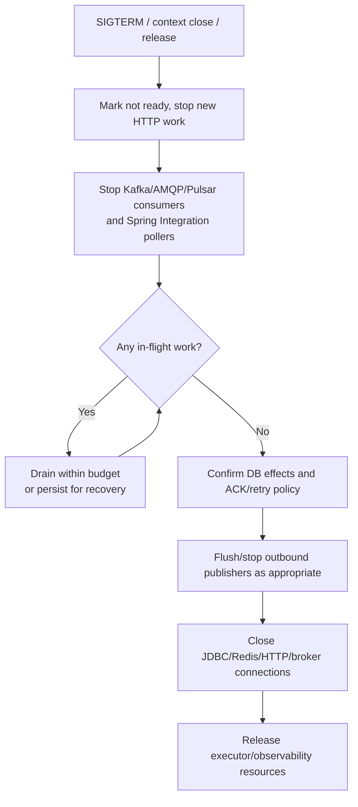
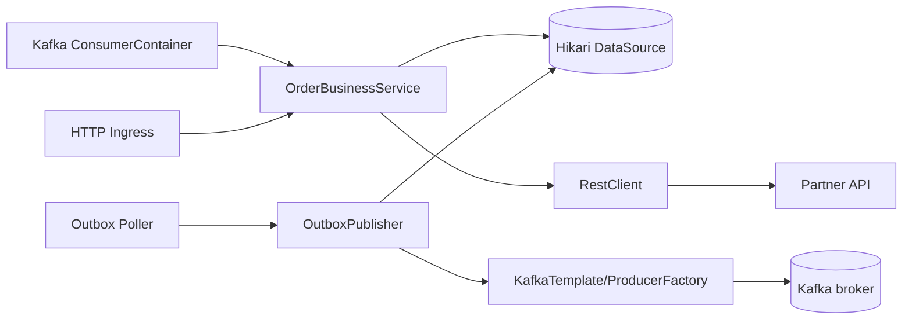
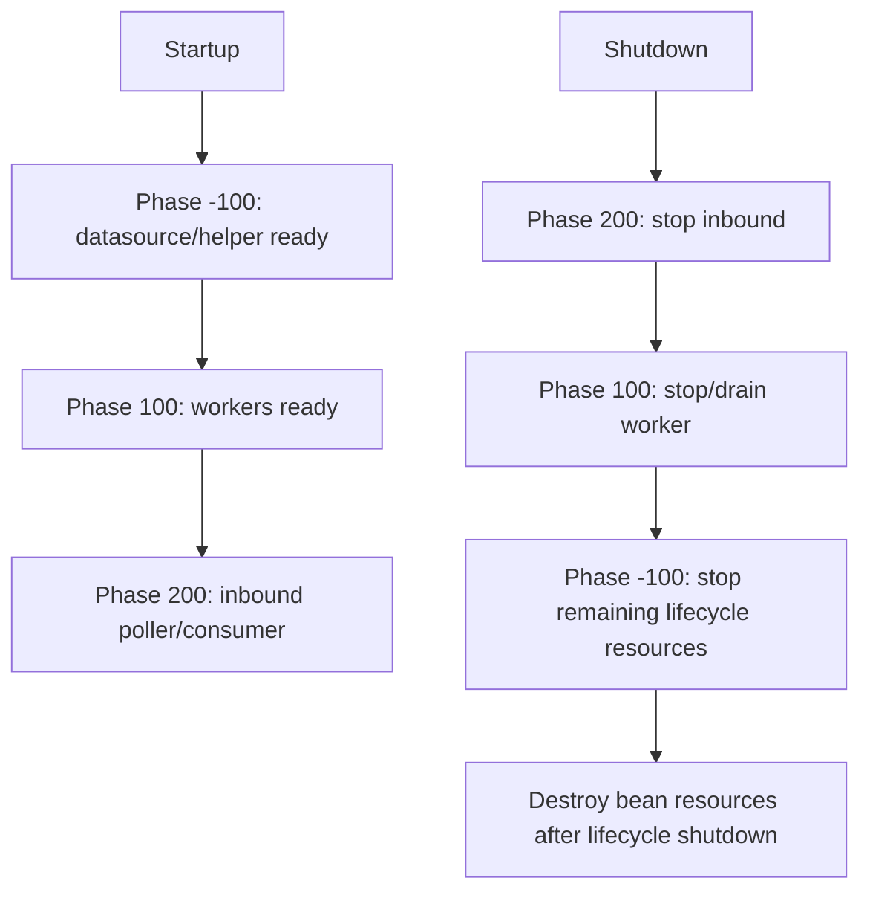
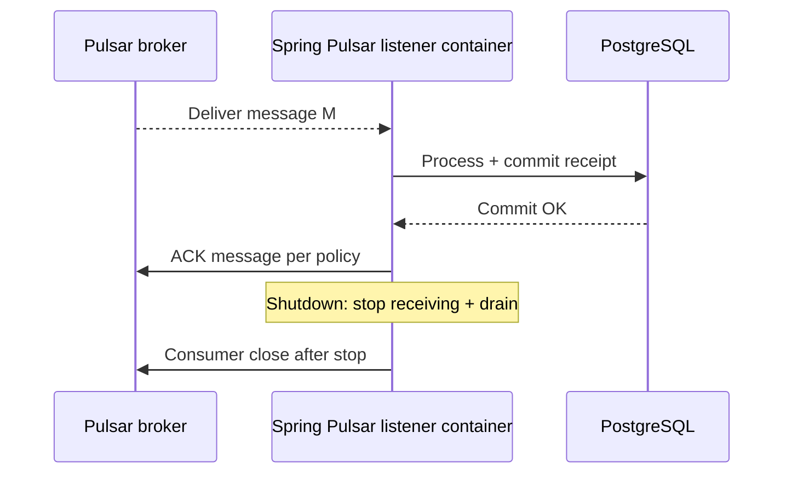
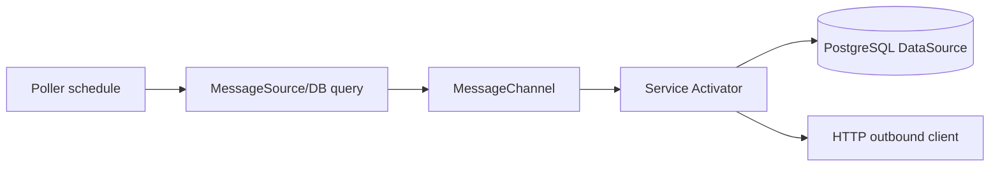
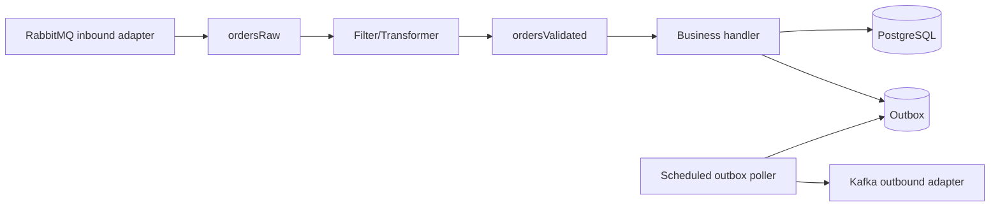
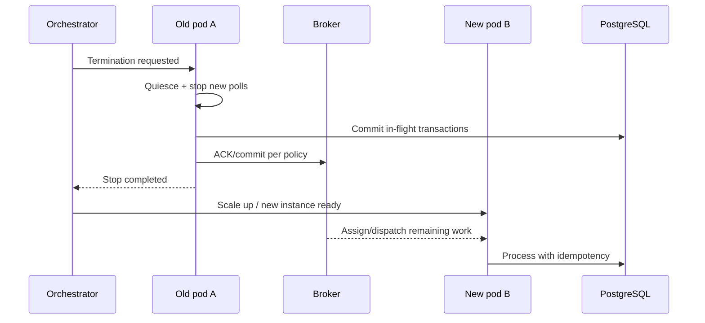

# Stopping Consumers or Pollers Before Closing Connection Resources

## 1. Problem: Application Shuts Down While Work Is Still Running

In a Spring Boot integration service, **shutting down an application** is not just closing the HTTP port and freeing memory. An instance may also be:

- Reading Kafka records, RabbitMQ deliveries, or Pulsar messages and writing to PostgreSQL.
- Running a `@Scheduled` job or Spring Integration poller fetching work from an inbox/outbox.
- Using `WebClient`/`RestClient` to call a partner API and waiting for the result.
- Updating Redis cache, recording transaction status, or publishing a new event via a broker.
- Holding JDBC connections, broker producer/consumer connections, HTTP connection pools, and task executors.

If the application **closes `DataSource`, the Redis connection factory, or HTTP clients first**, while consumers/pollers are still fetching and processing messages, running tasks can hit:

```text
KafkaListener → reads OrderCreated
                   ↓
Shutdown thread → HikariDataSource.close()
                   ↓
KafkaListener → writes inbox/DB → SQLException: pool closed
                   ↓
ACK or retry depends on policy; can cause data loss or duplicate processing
```

This is a **shutdown ordering** bug. A proper sequence must ensure anything generating new work **stops first**, already-accepted work **finishes or moves to durable storage**, and only then do connection resources close.

In the **SPRING_BOOT_INTEGRATION** module, shutdown correctness ties directly into HTTP clients, databases, caches, brokers, Spring Integration adapters, transactions, retries, duplicate processing, testing, and observability.

### Learning Objectives

After this lesson, you will be able to:

1. Build the shutdown sequence: **quiesce ingress → stop consumers/pollers → drain → commit/ack/recover → close connections**.
2. Understand `SmartLifecycle`, `phase`, `stop(Runnable)`, Spring Boot graceful shutdown, and shutdown timeouts.
3. Stop the exact component owning polling/consuming across Spring Kafka, RabbitMQ, Pulsar, Spring Integration, and `@Scheduled`.
4. Explain why a `QueueChannel` or executor accepting a task **does not mean** the task completed durably.
5. Maintain safety across DB transactions, broker acknowledgements, idempotency, outbox/inbox, and HTTP calls.
6. Plan shutdown budgets in Kubernetes and handle deadline expiry or `SIGKILL`.
7. Test shutdown ordering, redelivery, and data consistency rather than merely verifying JVM exit.

> **Scope:** Java 17+, Spring Boot 3.x, Spring Integration 6.x, and clients compatible with the Spring Boot BOM; detailed examples focus on Kafka + PostgreSQL + Spring Integration. In other versions, lifecycle APIs, timeouts, and framework properties may differ. Diagrams show the **safe coordination strategy**, without implying every system performs all steps automatically unless configured.

## 2. Distinguishing Five Operations Commonly Lumped Under "Stop"

| Operation | What Does It Do? | What Is Not Yet Guaranteed |
| --- | --- | --- |
| **Quiesce / stop accepting** | Stops accepting new tasks from HTTP, broker, scheduler, or poller | Already-accepted work may still be running |
| **Pause** | Temporarily suspends a source, resumable later | Does not necessarily stop workers or close connections |
| **Stop consumer/poller** | Prevents an endpoint from dispatching more work per its lifecycle | Does not automatically wait for tasks offloaded to separate executors |
| **Drain in-flight** | Waits for accepted work to finish or reach durable storage | Does not prevent duplicates if upstream redelivers |
| **Destroy / close resources** | Closes `DataSource`, broker clients, HTTP pools, cache clients, executors | Cannot rescue tasks that still need those resources |

Overall flow:



In practice, some steps can overlap in a controlled way: for example, keeping outbound Kafka producers alive after inbound Kafka consumers stop so in-flight handlers can finish publishing. You cannot enforce a rigid rule like "close **all** Kafka connections before DB" if consumers still need a producer to emit results.

### 2.1. Durability Point Is the Acceptance Criterion

For an order event, "done processing" usually means one of these states:

- The DB transaction containing **business effect + inbox receipt** has committed.
- Work has been recorded in a **durable inbox/work table** with workers/retries taking over.
- Outbound events have been saved in a **transactional outbox**.
- A broker publish received confirmation per policy, and publish status was recorded durably or can be safely retried.

`MessageChannel.send()` returning true or an executor queue accepting a task **is not enough** if the queue is in-JVM. For payments, inventory, or orders, never equate "entered RAM" with "processed."

### 2.2. Shutdown Cannot Promise Every Task Finishes Unboundedly

A partner HTTP API may hang, a DB transaction may wait on a lock, or a broker may disconnect. In practice you must set a **deadline**:

1. Try to stop intake and wait for eligible work to finish.
2. As time runs out, stop waiting indefinitely and leave incomplete work at a **recovery point**.
3. Let the broker redeliver unacked/uncommitted messages, or leave inbox/outbox records pending.
4. Let the process exit within the shutdown deadline, ensuring the next startup handles duplicates safely.

**Graceful shutdown reduces data loss and disruption; it does not replace durability and idempotency.**

## 3. Who Actually Owns Resources and Work Emitters?

One application may have several components sharing the same type of resource:



To stop in the right order, distinguish:

- **Ingress owner:** HTTP connector/controller, Kafka/Rabbit/Pulsar listener containers, `SourcePollingChannelAdapter`, `@Scheduled` tasks.
- **Work owner:** business handlers, message channels, executors, poller workers, callbacks/futures.
- **Resource owner:** `DataSource`, Redis `ConnectionFactory`, HTTP client connection pools, broker producer/consumer factories.
- **Durable owner:** PostgreSQL inbox/outbox, broker queues/topics, transaction logs, or object storage.

A `@KafkaListener` does not necessarily create `KafkaConsumer` itself; usually the **listener container** managed by Spring Kafka owns the consumer lifecycle. A Spring Integration flow does not own every connection by itself: the Kafka adapter uses Spring Kafka's container/factory, the JDBC adapter uses `DataSource`, and the HTTP adapter uses the underlying request factory/client.

### 3.1. Shutdown Map Before Deployment

| Component | Who Starts/Stops It? | Emits New Work? | Must Survive Until End of Drain? |
| --- | --- | --- | --- |
| HTTP inbound server | Embedded server/Spring Boot | Yes | Must stop new intake, let in-flight finish |
| Kafka listener | `KafkaListenerEndpointRegistry` / listener container | Yes | Stop early; commit/close managed by container |
| RabbitMQ listener | Spring AMQP listener container/registry | Yes | Stop early, finish in-progress ACK/NACKs |
| Pulsar listener | Spring Pulsar listener container/client | Yes | Stop early, ack/redelivery per subscription |
| Spring Integration poller | `SourcePollingChannelAdapter` or polling consumer endpoint | Yes | Stop before closing DB/HTTP/broker it uses |
| `@Scheduled` job | Scheduling infrastructure | Yes | Stop scheduling, wait for running callback |
| Executor worker | `TaskExecutor`/custom executor | Not necessarily ingress | Must complete or cancel cleanly |
| JDBC pool | `HikariDataSource` | No | **Yes**, until transactions have finished |
| HTTP outbound pool | Client connector/request factory | No | **Yes**, until HTTP calls have finished |
| Redis connection factory | Lettuce/Jedis connection owner | No | **Yes**, until cache operations finish |
| Broker producer | `KafkaTemplate`/ProducerFactory or SDK client | Not ingress | Yes if tasks are still publishing |
| Tracing/metrics/logging | Observability infrastructure | No | Should live long enough to flush telemetry |

When a custom bean closes another bean's connections inside `@PreDestroy`, revisit ownership. Spring-managed resources should generally close via **context lifecycle**, avoiding handlers calling `dataSource.close()` while consumers are still running.

## 4. Spring `SmartLifecycle`: Ordering Shutdown

Spring manages lifecycle-aware components via `Lifecycle` and `SmartLifecycle`. The `SmartLifecycle` interface provides:

```java
// Sketch of core methods, not a re-declaration of the Spring interface
public interface SmartLifecycle extends Lifecycle, Phased {
    void stop(Runnable callback);
    boolean isAutoStartup();
    int getPhase();
}
```

In Spring, methods may have default implementations depending on version. Key rules to remember:

1. **Startup:** lower phases usually **start before** higher phases.
2. **Shutdown:** higher phases usually **stop before** lower phases.
3. With `stop(Runnable callback)`, an asynchronous component **must invoke the callback once stopped** so the lifecycle processor can move on to subsequent steps/phases.
4. Spring waits only up to the **phase shutdown timeout**. Forgetting the callback stalls the phase until timeout, after which closing proceeds while work may still be running.
5. Bean dependency relationships can also influence ordering and must be considered alongside phases.



Phases `-100/100/200` are **illustrative only**. Framework adapters have different default phases, some very close to `Integer.MAX_VALUE`. **Never copy example phase numbers straight to production without inspecting the actual phases of your listener containers and endpoints.**

### 4.1. Lifecycle Processor Timeout Configuration Example

```yaml
spring:
  lifecycle:
    timeout-per-shutdown-phase: 30s
```

`spring.lifecycle.timeout-per-shutdown-phase` caps how long Spring Boot waits for **each phase group** when stopping `SmartLifecycle` beans. It **is not** a total JVM deadline and **does not guarantee** running network calls are automatically aborted after 30 seconds.

If a flow spans multiple phases, total shutdown time can exceed one timeout period. When deploying on Kubernetes or a process manager with a shared deadline, also include:

- `preStop` hook or deregistration time.
- Drain time across phases.
- Connection closing and metrics flushing time.
- Safety margin before forced kill.

### 4.2. `stop()` and `stop(Runnable)` Are Not Identical

A listener/poller can stop asynchronously. Calling `stop()` and immediately closing the Hikari pool on the next line may not wait for in-flight processing to finish. When integrating with Spring lifecycle, `stop(Runnable)` lets you signal **finished stopping** rather than merely "stop requested."

Illustrative pseudocode:

```java
@Override
public void stop(Runnable callback) {
    stopAcceptingNewWork();
    waitOrArrangeDrain(() -> {
        markStopped();
        callback.run(); // callback ONLY after quiesce/drain completes
    });
}
```

`stopAcceptingNewWork`, `waitOrArrangeDrain`, and `markStopped` are pseudocode. Real implementations need timeout/error handling and must **invoke the callback exactly once**, even with zero active work, so the lifecycle processor never hangs.

### 4.3. `@PreDestroy` Does Not Orchestrate Overall Shutdown

`@PreDestroy` and `DisposableBean.destroy()` generally belong to the **bean destruction** stage after lifecycle stop in a normal Spring context. They are suitable for releasing resources the bean itself **owns**. Writing:

```java
@PreDestroy
void closeEverything() {
    dataSource.close();
    // Then trying to stop consumers afterward...
}
```

is an antipattern when this bean does not fully control consumer lifecycles. Better: use `SmartLifecycle`/registries to stop ingress first, then let containers and resource owners close in standard lifecycle order. `@PreDestroy` on one bean **is no promise** that manually spawned threads elsewhere have stopped.

## 5. HTTP Inbound: Graceful Web Shutdown Does Not Stop Broker Consumers

Spring Boot supports graceful shutdown for embedded web servers:

```yaml
server:
  shutdown: graceful
spring:
  lifecycle:
    timeout-per-shutdown-phase: 30s
```

Its main effect is stopping acceptance of **new HTTP requests** and giving active requests time to complete per the embedded server/connector's behavior. However:

- Kafka/RabbitMQ/Pulsar consumers have their **own** lifecycles, independent of HTTP requests.
- `@Scheduled` jobs and Spring Integration pollers can keep running unless stopped.
- An HTTP handler that hands a task to an executor and returns **does not prove the task completed**.
- Graceful web shutdown does not automatically make outbound calls idempotent or make DB + broker transactions atomic.

**Desired order:** inbound traffic stops growing, brokers/pollers stop picking up new work, already-accepted work finishes or recovers, and only then do outbound resources close.

### 5.1. Readiness, Liveness, and Shutdown Signals

Readiness indicates whether the instance **should accept new work**; liveness indicates whether the process is still healthy. During planned shutdown:

1. Let the load balancer/kube-proxy stop routing new requests via readiness/deregistration.
2. Proactively stop broker consumers/pollers via lifecycle.
3. Let in-progress work finish or persist durably.
4. Send/commit proper acks; only then close resources.

Do not turn a Kafka poison message or a transient partner HTTP outage into repeated liveness failures; that causes restart storms and amplifies redeliveries.

## 6. Kafka Listener: Stop Container, Do Not Close Producer/DB First

With `@KafkaListener`, the listener container manages Kafka consumer threads and poll/commit decisions. Example:

```java
package example.integration.kafka;

import org.apache.kafka.clients.consumer.ConsumerRecord;
import org.springframework.kafka.annotation.KafkaListener;
import org.springframework.stereotype.Component;

@Component
public class OrdersKafkaConsumer {

    private final OrdersEventService service;

    public OrdersKafkaConsumer(OrdersEventService service) {
        this.service = service;
    }

    @KafkaListener(
            id = "orders-consumer",
            topics = "${integration.kafka.orders-topic:orders.events.v1}",
            groupId = "${spring.kafka.consumer.group-id}")
    public void onOrder(ConsumerRecord<String, OrderCreatedV1> record) {
        service.applyIdempotently(record.value());
    }
}
```

`OrdersEventService` and `OrderCreatedV1` are application components to implement. `applyIdempotently` should validate the contract, write the receipt, and apply business logic **in one DB transaction**. Do not offload to an executor task at the end of the listener if the container is configured to commit offsets when the listener method returns.

### 6.1. Container Lifecycle Differs from `KafkaTemplate`

| Component | Responsibility | During Shutdown |
| --- | --- | --- |
| `KafkaListenerEndpointRegistry` | Manages listener containers created by `@KafkaListener` | Containers stop via lifecycle or registry API |
| `MessageListenerContainer` | Polls, dispatches, commits/acks offsets, group membership | Must stop fetching records and finish processing per policy |
| `KafkaTemplate` | Publishes outbound records | Keep alive while in-flight tasks still need to send |
| `ProducerFactory` | Owns/supplies producer connections | Close after required publishes and releases |
| `DataSource` | JDBC transactions and pool | Close after running DB work finishes |

If a Kafka listener updates the DB and then publishes an event, **closing `ProducerFactory` or `DataSource` before the listener completes** causes failures even while the consumer is still draining.

### 6.2. Stop, Pause, and Container Registry

An application can control listeners by ID:

```java
package example.integration.kafka;

import org.springframework.kafka.config.KafkaListenerEndpointRegistry;
import org.springframework.kafka.listener.MessageListenerContainer;
import org.springframework.stereotype.Service;

@Service
public class OrdersConsumerControl {

    private final KafkaListenerEndpointRegistry registry;

    public OrdersConsumerControl(KafkaListenerEndpointRegistry registry) {
        this.registry = registry;
    }

    public void pause() {
        MessageListenerContainer container =
                registry.getListenerContainer("orders-consumer");
        if (container == null) {
            throw new IllegalStateException("Unknown listener ID");
        }
        container.pause();
    }

    public void resume() {
        MessageListenerContainer container =
                registry.getListenerContainer("orders-consumer");
        if (container == null) {
            throw new IllegalStateException("Unknown listener ID");
        }
        container.resume();
    }
}
```

`pause()` is typically used to **temporarily pause new intake** while maintaining appropriate consumer/group lifecycles; it is not the same as stopping completely and closing connections. For process shutdown, usually let Spring manage **stopping listener containers** via `SmartLifecycle`.

**Do not confuse pause with drain:** an in-flight record/batch may still be running, and handler-spawned worker threads live outside the listener container lifecycle.

### 6.3. Ack/Commit and Redelivery

```yaml
spring:
  kafka:
    consumer:
      group-id: orders-worker
      enable-auto-commit: false
    listener:
      ack-mode: record
```

This illustrates a record listener configuration; final commit policy also depends on container transactions, error handlers, batch/record mode, and version. `enable-auto-commit: false` lets the Spring Kafka container control offsets rather than periodic Kafka auto-commits.

Three points in time:

```text
T1: record is polled
T2: DB transaction commits
T3: offset is committed
```

If the process stops after T2 but before T3, the record may be redelivered: **at-least-once redelivery**. If the process stops before T2 with the offset uncommitted, the record can still be reprocessed. The dangerous case is T3 happening when work was only enqueued in RAM and the process is killed before T2.

### 6.4. Do Not Force Commits Just to "Clear the Backlog"

Some implementations attempt to commit offsets for all polled records during shutdown so the listener exits faster. That **can lose data** if no durable receipt or business commit exists yet. When the deadline expires, it is safer to let uncommitted records be redelivered, relying on idempotency for already-committed records.

## 7. RabbitMQ Consumer: Prefetch and ACK/NACK Before Closing Connections

The Spring AMQP listener container manages consumer connections/channels, new message intake, and acknowledgments. Listener example:

```java
package example.integration.rabbit;

import org.springframework.amqp.rabbit.annotation.RabbitListener;
import org.springframework.stereotype.Component;

@Component
public class PaymentRabbitConsumer {

    private final PaymentService paymentService;

    public PaymentRabbitConsumer(PaymentService paymentService) {
        this.paymentService = paymentService;
    }

    @RabbitListener(
            id = "payment-inbound",
            queues = "${integration.rabbit.payment-queue:payments.inbound}")
    public void accept(PaymentCommand command) {
        paymentService.processIdempotently(command);
    }
}
```

This is a structural example: `PaymentCommand`, `PaymentService`, serializers/message converters, queue topology, authentication, and DLQ policies must be supplied by the app. With Spring AMQP's `AUTO` listener mode, successful execution usually results in an ACK per container config; exceptions can cause reject/requeue/DLQ per error handler and policy.

### 7.1. Behaviors to Verify During Shutdown

- **Stop the listener container** to stop dispatching new deliveries.
- Let active deliveries finish within the allowed window.
- If the handler succeeds, ACK per policy; if it fails, NACK/requeue/reject/DLQ appropriately.
- Only afterward allow `CachingConnectionFactory`/AMQP connections to close.
- With `MANUAL` ack mode, ACK/NACK responsibility lies with the application; never lose manual ACKs due to premature channel closure.

### 7.2. Prefetch and In-Flight

If a listener uses `prefetch=100` across multiple consumer threads, hundreds of deliveries may already be pushed by the broker into the client before business processing. Lowering prefetch/concurrency to match capacity reduces pending volume during shutdown.

```yaml
spring:
  rabbitmq:
    listener:
      simple:
        prefetch: 20
        concurrency: 2
        max-concurrency: 4
        acknowledge-mode: auto
```

This example uses the **simple listener container**; if the project uses the direct container, properties live under `spring.rabbitmq.listener.direct.*`. Never mistake prefetch for a cluster-wide absolute cap across all listeners.

If the AMQP connection closes while deliveries are **unacked**, the broker can requeue/redeliver depending on queue/broker settings. That aids recovery but can repeat already-committed side effects; idempotency keys and transactional receipts are required.

### 7.3. Stop and Connection Factory Ownership

For a registry-managed `@RabbitListener`, prefer letting Spring AMQP stop the container on context close. If the application manually closes `CachingConnectionFactory` in a service's `@PreDestroy`, still-running listeners can encounter `ShutdownSignalException`, closed channels, or failed acks.

Do not use `@RabbitListener` stop as a signal to tear down all of RabbitMQ: outbound `RabbitTemplate` may still need to publish results, retries, or DLQ entries while draining.

## 8. Apache Pulsar: Subscriptions, ACKs, and Client Lifecycle

Spring for Apache Pulsar provides listener containers for `@PulsarListener`; the Pulsar Java client manages consumers, subscriptions, and acknowledgments. Conceptually this mirrors Kafka/RabbitMQ, though you must never copy one broker's ACK configuration blindly to another.



During shutdown:

1. Stop or pause new message intake using the **version-matched Pulsar listener container** lifecycle/control API.
2. Wait for handlers holding active messages to commit transactions or reach durable persistence.
3. ACK only upon policy-defined success; for incomplete work, let redelivery/retry act per the chosen subscription, negative acknowledgment, or ack timeout.
4. Close producer/client connections **after** work has finished or been safely recovered.

Pulsar supports subscription modes such as Exclusive, Shared, Failover, and Key_Shared; ordering, redelivery, ack timeouts, and negative ACKs each behave differently. A new pod can start consuming on the subscription while an old pod is shutting down; **business-layer idempotency remains mandatory** whenever DB and broker boundaries are not atomic.

Do not assume a property like `spring.pulsar.listener.shutdown-wait` exists in every Boot release. Check the container/lifecycle API of the **exact Spring Pulsar version in use**, and test against a real broker.

## 9. Spring Integration: Stop Pollers Before Closing `DataSource`

In Spring Integration, `SourcePollingChannelAdapter` and `PollingConsumer` are scheduled polling endpoints. An inbound JDBC adapter may run periodic queries; a file poller checks directories; an outbox poller calls a repository for unsent events.



**Common mistake:** mistaking `MessageChannel` for the poller. Channels merely pass messages; the **endpoint/polling scheduler** actively pulls work. To stop polling, you must stop the **endpoint or scheduler** that owns the poll source.

### 9.1. Java DSL Example: Outbox Polling

```java
package example.integration.outbox;

import java.time.Duration;
import org.springframework.context.annotation.Bean;
import org.springframework.context.annotation.Configuration;
import org.springframework.integration.dsl.IntegrationFlow;
import org.springframework.integration.dsl.Pollers;

@Configuration(proxyBeanMethods = false)
public class OutboxPollingConfiguration {

    @Bean
    IntegrationFlow outboxPollingFlow(
            OutboxMessageSource source,
            OutboxPublisher publisher) {

        return IntegrationFlow
                .fromSupplier(
                        source::pollNext,
                        endpoint -> endpoint
                                .id("outboxPoller")
                                .poller(Pollers
                                        .fixedDelay(Duration.ofSeconds(2))
                                        .maxMessagesPerPoll(10)))
                .handle(OutboxEvent.class, (event, headers) -> {
                    publisher.publish(event);
                    return null;
                })
                .get();
    }
}
```

`OutboxMessageSource.pollNext()` is an application API to implement: returning an `OutboxEvent` if present, or `null` when idle. `OutboxPublisher.publish(...)` must have clear semantics: blocking synchronously for broker confirmation, or enqueueing async with future tracking. Never mark a row `published` before the committed confirmation point.

**Shutdown takeaway:** stop `outboxPoller`/the polling endpoint before closing `DataSource` and the broker producer. Canceling a poll schedule does not necessarily wait for asynchronously running tasks; if `publisher.publish` returns a `CompletableFuture` and the handler does not wait, you still need future tracking.

### 9.2. Tag Endpoint IDs for Control

In Java DSL, `.id("outboxPoller")` assigns the endpoint ID; exact bean naming and retrieval depend on Spring Integration version registration/context rules. A control plane can look up the `SmartLifecycle` endpoint by ID and invoke `stop()` or `stop(Runnable)` per real semantics.

**Do not call** `applicationContext.getBean("outboxPoller", MessageChannel.class)` and try to stop it: `outboxPoller` is an endpoint, not a channel. With multiple pollers or integration flows, give each endpoint a distinct name to avoid stopping the wrong one.

### 9.3. Pollers Using DB Transactions

An outbox poller may run inside a transaction, claim rows, and publish. Order matters:

```text
Stop scheduling new polls
      ↓
Allow current poll transaction/handler to finish or roll back
      ↓
Ensure pending rows remain recoverable
      ↓
Close publisher/DB connections
```

If a poller claimed a row as `SENDING` and the process dies before marking success, you need a **lease/recovery policy**: overdue rows are reclaimed cleanly rather than stuck forever. Across multiple instances, use DB constraints/locking such as `FOR UPDATE SKIP LOCKED` where appropriate on PostgreSQL, along with checkpoints and timeouts; an in-RAM `QueueChannel` alone does not guarantee single delivery across replicas.

### 9.4. What Does Poller Stop Mean for an Active `receive()`?

Stopping an endpoint normally prevents **new poll cycles**. Yet an active `receive()` blocked on SQL/sockets or a handler awaiting HTTP may not have finished. Therefore configure:

- JDBC query timeouts/lock timeouts.
- HTTP connect/response timeouts.
- Broker send timeouts and retry budgets.
- Shutdown drain budgets for active work.

Never use a fixed `Thread.sleep` and assume every poller has stopped; inspect actual lifecycle states and in-flight metrics.

## 10. `@Scheduled` and `@Async`: Work Sources Outside Spring Integration

A service may use `@Scheduled` for maintenance or polling without declaring an `IntegrationFlow`:

```java
package example.integration.jobs;

import org.springframework.scheduling.annotation.Scheduled;
import org.springframework.stereotype.Component;

@Component
public class PendingDeliveryJob {

    private final PendingDeliveryService service;

    public PendingDeliveryJob(PendingDeliveryService service) {
        this.service = service;
    }

    @Scheduled(fixedDelayString = "${integration.delivery.poll-ms:2000}")
    public void processPending() {
        service.runOneBoundedBatch();
    }
}
```

`@Scheduled` requires scheduling infrastructure enabled (e.g., `@EnableScheduling`). The method must run a **bounded batch** and never hold a thread indefinitely. The scheduler stops scheduling new runs on shutdown per lifecycle/bean destruction, but **by default it does not guarantee** every callback/blocking operation stops the instant SIGTERM arrives.

### 10.1. Waiting on Task Executors and Schedulers

```yaml
spring:
  task:
    execution:
      shutdown:
        await-termination: true
        await-termination-period: 20s
    scheduling:
      shutdown:
        await-termination: true
        await-termination-period: 20s
```

These properties configure Spring Boot auto-configured task execution/scheduling pools. For **custom** `ThreadPoolTaskExecutor`/`ThreadPoolTaskScheduler` beans, check exact bean lifecycle setters rather than assuming the properties above apply to every manually constructed thread pool.

Custom executor example:

```java
package example.integration.jobs;

import org.springframework.context.annotation.Bean;
import org.springframework.context.annotation.Configuration;
import org.springframework.scheduling.concurrent.ThreadPoolTaskExecutor;

@Configuration(proxyBeanMethods = false)
public class WorkerExecutorConfiguration {

    @Bean
    ThreadPoolTaskExecutor outboundWorkerExecutor() {
        var executor = new ThreadPoolTaskExecutor();
        executor.setCorePoolSize(4);
        executor.setMaxPoolSize(8);
        executor.setQueueCapacity(100);
        executor.setThreadNamePrefix("outbound-worker-");
        executor.setWaitForTasksToCompleteOnShutdown(true);
        executor.setAwaitTerminationSeconds(20);
        executor.initialize();
        return executor;
    }
}
```

**Warning:** `setWaitForTasksToCompleteOnShutdown(true)` must be well understood. It can allow already-queued tasks to keep running during shutdown; if the resources those tasks need are closed early, errors still occur. Coordinate **stopping new submissions**, draining with a deadline, and resource lifecycles.

### 10.2. `@Async` Returning a Future vs. Fire-and-Forget

If a worker receives a Kafka record and calls:

```java
@Async
public void sendPartnerNotification(OrderCommand command) {
    partnerClient.post(command);
}
```

and the listener returns immediately, the listener container may ack per policy before the HTTP call finishes. If the task is sitting in the executor queue when the process dies, work can be lost. Use a durable job/outbox if the notification is mandatory.

When the method returns a `CompletableFuture`, the caller can track the outcome, but **an owner must hold the reference** and coordinate shutdown; merely creating and discarding a future provides no recovery.

### 10.3. Do Not Use `System.exit(0)` as a Poller Shutdown Button

`System.exit` triggers shutdown hooks under normal conditions depending on JVM/runtime; `SIGKILL`, severe OOMs, or node failures may skip cleanup. For planned stops, use container/application lifecycle mechanisms rather than killing the process from a handler without a drain budget and ack tracking.

## 11. When to Close `DataSource`, Redis, and HTTP Clients?

Outbound resources must stay alive long enough for **in-flight business work**, not merely until ingress stops accepting:

| Resource | Who Might Still Use It? | Condition Before Close |
| --- | --- | --- |
| Hikari `DataSource` | Listeners writing inbox, pollers claiming outbox, business transactions | No remaining transactions/handlers needing DB, or durable work left safely for recovery |
| Redis connection factory | Cache invalidation, rate limiters, dedup cache | Needed operations finished/safely retryable; never rely on volatile Redis as durable idempotency receipt |
| HTTP `RestClient`/ `WebClient` pool | Partner API calls, webhook senders | In-flight calls returned, timed out, or handed to durable retry |
| Kafka/Rabbit/Pulsar producer | Outbox publishers, DLT recoverers | Sends confirmed or pending data remains replayable |
| Kafka/Rabbit/Pulsar consumer | Inbound adapters/listeners | Stopped new intake and handled ACK/recovery per policy |
| Metrics/tracing exporter | Capturing shutdown/error/latency telemetry | Flushed within budget after work stops |

### 11.1. `HikariDataSource.close()` Does Not Drain Business Work

Calling `close()` on a Hikari pool stops granting new connections and begins closing the pool per Hikari semantics. It **knows nothing** about your outbox status, Kafka offsets, or pending `@Transactional` tasks. Never write:

```java
@PreDestroy
void stop() {
    dataSource.close();           // closes resource first
    consumerControl.pause();      // consumer may still be processing
}
```

This is an ownership and ordering antipattern. In Spring Boot, keep **containers/broker listeners/pollers as managed lifecycle beans** so Spring stops them before `DataSource` destruction; custom resources should declare destroy callbacks on their **owner beans**.

### 11.2. HTTP Clients Have Multiple Resource Types

`RestClient` can use the JDK HTTP client, Apache HttpClient, Jetty, or another request factory; `WebClient` can use Reactor Netty. Connection pools and SSL contexts may belong to builders, connectors, providers, or shared global resources.

- Close only **application-owned resources**; avoid disposing shared global Reactor Netty resources while other flows are still running.
- Let provider/bean destruction follow the appropriate lifecycle if Boot manages the client.
- Before closing an HTTP pool, ensure active requests have timed out and outcomes/failures are recorded per the delivery contract.
- If the partner returned HTTP 200 but the app died before writing the DB receipt, retries can call again. You need an idempotency key or reconciliation rather than relying on shutdown to prevent duplicates.

### 11.3. Redis Cache Is Not the Source of Truth by Default

If Redis closes before a listener finishes cache invalidation, safety depends on business semantics:

- For derived caches with TTLs, invalidation can be retried or caches rebuilt per policy.
- For Redis used as a distributed lock or rate limiter, account for lease expiry and duplicate workers.
- For payments/orders, never use a standalone TTL cache key in place of a database unique constraint for critical idempotency.

## 12. Stopping Outbound Publishers: Wait for Confirmation, Not Forever

A Kafka producer may hold buffered records not yet confirmed by the broker. During drain:

1. Stop all sources generating new publish requests.
2. Wait for tracked send futures to complete within a **finite deadline**.
3. Record publish outcomes or leave outbox rows pending when outcomes are unknown.
4. Let the producer factory/container close after the drain stage.

```java
// Illustrative send-result tracking in a business publisher
CompletableFuture<SendResult<String, OutboxEvent>> future =
        kafkaTemplate.send(topic, event.aggregateId(), event);

future.whenComplete((result, error) -> {
    if (error == null) {
        markAsPublishedAfterBrokerAck(event.eventId());
    } else {
        recordRetryableFailure(event.eventId(), error);
    }
});
```

`markAsPublishedAfterBrokerAck` and `recordRetryableFailure` are application service methods; this snippet shows the **idea**, not a full transactional outbox implementation. If the callback writes to the database after `DataSource` has closed, it can fail: include **in-flight callbacks** in the drain, or let publisher state recover from the durable outbox.

### 12.1. `KafkaTemplate.flush()` Does Not Replace an Outbox

`flush()` tells the producer to send and wait for buffered records per Kafka client semantics, yet:

- It does not create an atomic transaction with a committed DB transaction.
- It does not ensure the application recorded `published_at` for each event.
- It does not track which callbacks are still writing to the DB.
- It cannot fix network partitions or denied topic permissions.

Whenever unsure if a send succeeded, **keep the event in the outbox for controlled retry**, accept possible redelivery, and enforce downstream idempotency.

### 12.2. When Should the DLT Recoverer Stop?

Kafka/RabbitMQ error handlers may send bad messages to a DLT/DLQ during shutdown. Closing outbound producers/connections before DLT publishing finishes turns a **recoverable** data error into another recovery failure.

When using a DLT:

- Keep the DLT publisher alive at least until in-flight recovery completes or durable retry exists.
- If DLT publishing fails, **never assume the source record was safely recovered**.
- Record topic/partition/offset/error-category metadata for investigation while restricting sensitive raw payloads.
- Verify ack/offset behavior with the specific error handler rather than guessing from a channel's `send()`.

## 13. Example: Stopping a Kafka Listener Using a Callback

When an application needs an **operations API** or coordinated runbook before exiting, you can retrieve the listener container from the registry and **await its callback** instead of calling stop and immediately tearing down pools.

```java
package example.integration.operations;

import java.time.Duration;
import java.util.concurrent.CountDownLatch;
import java.util.concurrent.TimeUnit;

import org.springframework.kafka.config.KafkaListenerEndpointRegistry;
import org.springframework.kafka.listener.MessageListenerContainer;
import org.springframework.stereotype.Component;

@Component
public class OrdersConsumerStopControl {

    private final KafkaListenerEndpointRegistry registry;

    public OrdersConsumerStopControl(KafkaListenerEndpointRegistry registry) {
        this.registry = registry;
    }

    public boolean stopAndAwait(Duration timeout)
            throws InterruptedException {

        MessageListenerContainer container =
                registry.getListenerContainer("orders-consumer");

        if (container == null) {
            throw new IllegalStateException(
                    "orders-consumer listener not registered");
        }

        if (!container.isRunning()) {
            return true;
        }

        CountDownLatch stopped = new CountDownLatch(1);
        container.stop(stopped::countDown);

        return stopped.await(timeout.toMillis(), TimeUnit.MILLISECONDS);
    }
}
```

In Spring Kafka 3.x, listener containers support stop callbacks via the lifecycle API. Example:

```java
boolean stopped =
        ordersConsumerStopControl.stopAndAwait(Duration.ofSeconds(20));

if (!stopped) {
    // Do not call this a successful drain; alert or proceed
    // per the deployment's recovery policy.
    throw new IllegalStateException(
            "Kafka consumer did not stop within shutdown budget");
}
```

This call illustrates **one step in orchestration**; it does not mean you should drop it straight into an arbitrary bean's `@PreDestroy`. Spring Kafka listener containers already integrate with ApplicationContext lifecycle; unless special coordination is needed, **letting the framework manage stopping** is usually safer and simpler than calling stop twice.

### 13.1. The Callback Signals Container Stop, Not External Work Completion

If a listener does:

```java
@KafkaListener(id = "orders-consumer", topics = "orders.events.v1")
public void consume(OrderCreatedV1 event) {
    executor.execute(() -> billingService.process(event));
    // Method returns as soon as the task is queued
}
```

then the container can stop and invoke its callback while the `executor` task is still running. **The container stop callback does not track work offloaded by the handler** unless completion is integrated back into the listener contract.

Therefore, verify that `@KafkaListener` processes synchronously up to a durable point **or** returns only after persisting a durable inbox entry. If async tasks live outside the container, manage executor draining and recovery separately.

### 13.2. Why Not Call `Consumer.close()` Directly Inside a Listener?

The Kafka consumer client is owned by the Spring listener container and is not safe for arbitrary multi-threaded access. Closing the raw consumer from another thread or business handler can cause races/lifecycle conflicts. Use the **listener container/registry API** provided by the framework for start/pause/stop.

## 14. A `SmartLifecycle` Stop Gate with Explicit Phase

In special cases, you may add a **gate** solely to coordinate stopping an inbound listener earlier than other managed components. Kafka listener containers already implement `SmartLifecycle`; the following example is only for when you **intentionally need a custom hook**, not a required setup.

```java
package example.integration.operations;

import java.util.concurrent.atomic.AtomicBoolean;

import org.springframework.context.SmartLifecycle;
import org.springframework.kafka.config.KafkaListenerEndpointRegistry;
import org.springframework.kafka.listener.MessageListenerContainer;
import org.springframework.stereotype.Component;

@Component
public class OrdersIntakeStopGate implements SmartLifecycle {

    private final KafkaListenerEndpointRegistry registry;
    private final AtomicBoolean running = new AtomicBoolean(false);

    public OrdersIntakeStopGate(KafkaListenerEndpointRegistry registry) {
        this.registry = registry;
    }

    @Override
    public void start() {
        // Gate does not create the consumer; the registry manages it.
        running.set(true);
    }

    @Override
    public void stop(Runnable callback) {
        if (!running.getAndSet(false)) {
            callback.run();
            return;
        }

        MessageListenerContainer container =
                registry.getListenerContainer("orders-consumer");

        if (container == null || !container.isRunning()) {
            callback.run();
            return;
        }

        container.stop(callback);
    }

    @Override
    public void stop() {
        // Spring lifecycle processor prefers the callback overload.
        stop(() -> {});
    }

    @Override
    public boolean isRunning() {
        return running.get();
    }

    @Override
    public boolean isAutoStartup() {
        return true;
    }

    @Override
    public int getPhase() {
        return Integer.MAX_VALUE - 50;
    }
}
```

**Read the code with its limitations in mind:**

1. A high phase causes the gate to be stopped **earlier** than lower-phase `SmartLifecycle` beans. The example uses `MAX_VALUE - 50` to sit after common Spring Kafka default startup phases; **verify the real phase** if registries/containers are customized.
2. The gate calls `container.stop(callback)` and marks the phase shutdown complete only when the callback runs.
3. The registry stopping the container again afterward must be treated as an **idempotent lifecycle operation** and tested against your exact version.
4. Callback-less `stop()` in the example **is not a synchronous wait API**; if operations need a manual blocking wait, use `stopAndAwait` from section 13.
5. Such a gate **is unaware** of worker tasks detached from the listener and cannot guarantee all HTTP/database callbacks finished.

In production, unless custom orchestration is needed, prefer **configuring managed listener containers, phases, and executor shutdown** instead of adding overlapping coordinators. This example illustrates callback/phase mechanics, not a mandatory pattern for every service.

### 14.1. Reverse Order on Startup

A high phase **stops early** but also **starts late**. If a listener requires DB/migrations ready before consuming messages, also check **startup dependencies**. Do not tune phases solely for shutdown and inadvertently let a listener start before database schema migrations finish.

## 15. Tracking In-Flight Work: A Drain Counter Does Not Replace Durable Storage

If a listener or polling endpoint spawns **asynchronous tasks outside the container**, count active in-flight tasks. An in-flight counter lets you wait within a bounded deadline:

```java
package example.integration.operations;

import java.time.Duration;
import java.util.concurrent.locks.Condition;
import java.util.concurrent.locks.ReentrantLock;

public final class InFlightTracker {

    private final ReentrantLock lock = new ReentrantLock();
    private final Condition empty = lock.newCondition();
    private int active;

    public void begin() {
        lock.lock();
        try {
            active++;
        } finally {
            lock.unlock();
        }
    }

    public void complete() {
        lock.lock();
        try {
            if (active <= 0) {
                throw new IllegalStateException("Unbalanced completion");
            }
            active--;
            if (active == 0) {
                empty.signalAll();
            }
        } finally {
            lock.unlock();
        }
    }

    public boolean awaitEmpty(Duration timeout)
            throws InterruptedException {

        long remaining = timeout.toNanos();
        lock.lockInterruptibly();
        try {
            while (active != 0) {
                if (remaining <= 0L) {
                    return false;
                }
                remaining = empty.awaitNanos(remaining);
            }
            return true;
        } finally {
            lock.unlock();
        }
    }
}
```

When using with an executor, register in-flight **before** submitting and balance the count if submission is rejected:

```java
tracker.begin();
try {
    executor.execute(() -> {
        try {
            processor.process(command);
        } finally {
            tracker.complete();
        }
    });
} catch (RuntimeException rejected) {
    tracker.complete();
    throw rejected;
}
```

`tracker`, `executor`, `processor`, and `command` are application beans/variables. During shutdown:

```text
1. Stop ingress/stop submitting
2. Wait for listener/poller stop callback
3. awaitEmpty(deadline) with no new submissions possible
4. Close resources per lifecycle
```

**Precondition:** no new task may register **after** the drain thread observes the counter at 0. Coordinate safely with an ingress gate/quiescing flag, and make sure tracking covers any futures/callbacks that perform side effects.

**Limitation:** the counter only tracks tasks inside the process and **cannot save data across crashes/SIGKILL**. Tasks queued in the executor that haven't started yet must still be counted, and business logic must have durable inbox/outbox or broker redelivery.

### 15.1. Do Not Wait for Zero Forever

If an HTTP request lacks a response timeout or a DB transaction waits on a lock indefinitely, draining may never reach 0. You need:

- Hard deadlines on every I/O operation.
- Total drain timeout sufficient for normal completion.
- Circuit breakers/backoff to dampen retry storms.
- Pending/retry marking and idempotency when the deadline expires.

Exceeding the shutdown timeout **never justifies** marking a record successful. It is an operational event requiring metrics, alerts, and a recovery policy.

## 16. Transactional Inbox/Outbox as Shutdown Insurance

When protecting an `HTTP → PostgreSQL → Kafka → consumer` flow, identify where durable state is held:

```mermaid
sequenceDiagram
    participant HTTP as HTTP ingress
    participant APP as Order service
    participant DB as PostgreSQL
    participant OUT as Outbox publisher
    participant K as Kafka
    HTTP->>APP: CreateOrder
    APP->>DB: BEGIN; insert order + outbox event
    DB-->>APP: COMMIT
    APP-->>HTTP: Accepted/created per contract
    OUT->>DB: Poll pending outbox
    OUT->>K: Publish event
    K-->>OUT: ACK (or timeout)
    OUT->>DB: Mark published per outcome/policy
```

During shutdown:

- HTTP stops accepting new requests.
- Outbox poller stops claiming new rows and finishes already-claimed work if possible.
- If a send is waiting on the broker, the row retains status/lease to recover after a crash.
- Producer and DB stay alive until in-flight callbacks finish or release under the recovery policy.
- Downstream consumers must support redelivery/idempotency.

### 16.1. Inbox Decouples Broker ACK from Long Business Work

A Kafka listener can:

```text
Consume OrderCreated
   → BEGIN DB transaction
   → insert inbox(eventId, payload, status=PENDING) if absent
   → COMMIT
   → ACK/commit offset per container policy
   → background worker processes inbox
```

With this flow, if the process dies **after ACK but before business work**, the `PENDING` row remains in the DB for a worker to resume on the next run. If redelivered due to a failed offset commit, the unique constraint on `eventId` prevents duplicating the inbox row. Use this pattern only after designing status transitions, retries, dead-lettering, cleanup, and inbox concurrency limits.

### 16.2. Do Not Let `@Transactional` Fake Atomicity Between DB and Broker

A database transaction and a Kafka publish transaction do not automatically merge into **one atomic transaction**. Spring Kafka provides transaction features, but commit ordering and failure modes must be understood for your exact version. For flows combining DB + partner HTTP + broker, outbox/inbox/idempotency is usually a clearer design.

### 16.3. Critical Crash Scenarios

| Crash Point | Possible Outcome | Safeguard |
| --- | --- | --- |
| Before DB commit | Business state not durable; message may redeliver | Do not ack before commit |
| After DB commit, before broker ACK | Message may be redelivered | Inbox receipt + idempotency |
| After JVM queue enqueue, before DB commit | Work may be lost if already ACKed | Do not use volatile queues as durability points |
| After Kafka publish ACK, before marking outbox | Event may be sent again | Stable `eventId`, consumer deduplication |
| During partner HTTP call, response unknown | Unknown whether side effect occurred | Partner idempotency key/reconciliation |
| After DB pool close while callback still runs | SQLException/pool closed | Drain callbacks before resource destruction |

When designing shutdown, proactively **rehearse each crash point**. A test that merely calls `context.close()` and sees no exceptions is insufficient to prove at-least-once/idempotent business semantics.

## 17. Stop Order in a Concrete Spring Integration Flow

Suppose the flow is:



A useful shutdown sequence:

1. Stop HTTP/RabbitMQ ingress creating new orders.
2. Let active `ordersRaw`/`DirectChannel` handlers complete their DB transactions.
3. Stop the outbox poller from claiming new batches.
4. Complete or update status for already-claimed outbox batches, awaiting Kafka send futures within budget.
5. Stop/close the Kafka outbound connection once no tasks need to publish.
6. Close the PostgreSQL pool once no handlers, pollers, or callbacks need the DB.
7. Flush metrics and exit the process.

**The order between steps 1 and 3 may vary by strategy:** some systems let the outbox publisher drain a small backlog after ingress stops; others stop new claims immediately to bound shutdown duration. What never changes is: **never close the database or outbound producer before dependent work has stopped or moved to a recoverable state**.

### 17.1. `DirectChannel` and `ExecutorChannel` Differ at Shutdown

Synchronous `DirectChannel` normally informs the upstream endpoint whether the handler succeeded or threw an exception. With `ExecutorChannel`, a successful send may only mean the executor accepted the task:

```text
AMQP delivery → ExecutorChannel.send() → task in JVM queue
                                 ↘ listener exits / may ACK
Task runs later → writes DB
```

If the container acks immediately when the listener returns, the message has been handed to a volatile **RAM queue**. Graceful shutdown reduces the odds of loss, yet provides no guarantee under `SIGKILL` or node crashes. You need a durable inbox or to tie ACK to business completion per adapter capabilities.

## 18. Kubernetes: `preStop`, `SIGTERM`, and Termination Grace Period

Kubernetes normally terminates a pod via a deadline-bound sequence:

```text
Pod marked terminating
    → kubelet executes preStop hook (if configured)
    → sends SIGTERM when hook returns / per termination handling
    → process runs shutdown hooks
    → after terminationGracePeriodSeconds, remaining process may receive SIGKILL
```

**Important:** `preStop` time consumes the **same termination grace period budget**; it is not free extra time. Endpoint/readiness propagation and load-balancer traffic draining have latency; build an adequate buffer into your design.

### 18.1. Illustrative Kubernetes Configuration

```yaml
apiVersion: apps/v1
kind: Deployment
metadata:
  name: orders-worker
spec:
  replicas: 3
  selector:
    matchLabels:
      app: orders-worker
  template:
    metadata:
      labels:
        app: orders-worker
    spec:
      terminationGracePeriodSeconds: 90
      containers:
        - name: orders-worker
          image: example/orders-worker:1.0.0
          ports:
            - containerPort: 8080
          lifecycle:
            preStop:
              httpGet:
                path: /internal/quiesce
                port: 8080
```

`/internal/quiesce` is an **operational endpoint the application must implement and secure itself**; Spring Boot does not provide this URL out of the box. It can proactively stop intake/mark unready and return quickly so the process proceeds to receive SIGTERM and run lifecycle shutdown. **Never** expose this endpoint publicly on the Internet or leave it as an unauthenticated "kill switch."

For a Kafka-only worker, Kubernetes readiness false **does not stop consumers from polling the broker**; you must stop/pause Kafka listener containers. Kube readiness mainly affects Services/load-balancer routing, not every internal work source.

### 18.2. Boot Config Aligned with Pod Deadline

```yaml
server:
  shutdown: graceful

spring:
  lifecycle:
    timeout-per-shutdown-phase: 25s
  task:
    execution:
      shutdown:
        await-termination: true
        await-termination-period: 20s
    scheduling:
      shutdown:
        await-termination: true
        await-termination-period: 20s
```

The 25/20/90-second figures are **budget illustrations**, not universal production defaults. More than one shutdown phase may use the 25-second timeout; combined with `preStop`, bean destruction, HTTP pool closing, and metrics flushing, total time can exceed 90 seconds if unmeasured.

### 18.3. What Should `preStop` Do?

- Quiesce ingress early and stop admitting new work into the process.
- Optionally transition readiness to stop new traffic per design.
- Never close database/publisher pools while messages are still draining.
- Never blindly `sleep 60` without calculating the budget.
- Ensure idempotency: `preStop` may fire close to lifecycle shutdown, and the app must tolerate repeated stop signals.

If `preStop` fails or is skipped during a crash/node failure, business correctness must still rely on broker redelivery and inbox/outbox, never on `preStop` alone.

## 19. Calculating Shutdown Budget from SLOs

A design formula:

\[
T_{\mathrm{preStop}}+
T_{\mathrm{stopIngress}}+
T_{\mathrm{drain}}+
T_{\mathrm{close}}+
T_{\mathrm{safety}}
< T_{\mathrm{grace}}
\]

Where:

- `T_preStop`: hook duration and required propagation delay.
- `T_stopIngress`: stopping listeners/pollers and halting new work.
- `T_drain`: waiting for in-flight work or persisting pending state.
- `T_close`: closing resource pools and flushing telemetry.
- `T_safety`: headroom for scheduling, kernel, or GC delays.
- `T_grace`: Kubernetes/service-manager deadline.

**Illustrative** example with `T_grace=90s`: preStop/propagation 8s, stop intake 7s, drain 40s, close resources 15s, safety 15s → total 85s, leaving 5s buffer. In production, measure actual timings and you may need **more headroom**, especially when multiple lifecycle phases run sequentially.

### 19.1. Budget from Real Work, Not Wishful Thinking

Suppose `max.poll.records=500`, each record takes 100 ms, processed sequentially:

```text
500 records × 100 ms/record = 50 seconds
```

If a consumer is partway through its last batch when SIGTERM arrives, a 10-second drain budget will fall short. Optimizations may include:

- Lowering batch/prefetch sizes when work is slow.
- Raising concurrency **within** DB pool and HTTP quota limits.
- Keeping record handlers short—saving to a durable inbox before acking.
- Using I/O deadlines and cooperative cancellation; never holding locks/connections indefinitely.
- Ensuring business transactions can retry safely if interrupted.

A broker consumer can stop polling yet still be waiting on I/O or worker callbacks. Measure p95/p99 in-flight duration, not just averages.

### 19.2. `timeout-per-shutdown-phase` Is Not the Total Deadline

If there are three phases and each may wait 25s, total lifecycle stop can approach ~75s before bean destruction and `preStop`. Do not configure 60s per phase on a pod with a 30s grace period and expect graceful shutdown to succeed.

### 19.3. Plan for Drain Timeouts

If `in_flight > 0` when the deadline expires:

1. Log/record metrics with counts, endpoints, and duration—without logging sensitive data.
2. Never ack records that haven't reached a durable boundary.
3. Ensure inbox/outbox/pending leases remain recoverable.
4. Let clients/handlers cancel per framework semantics and preserve transaction rollbacks as needed.
5. Never stall process exit indefinitely, risking a `SIGKILL` while holding even more active work.

**No single `stop()` API turns every failure mode into "exactly once."** Guaranteed semantics must be explicitly documented in the business contract.

## 20. Multi-Instance Shutdown: Do Not Halt the Whole Cluster at Once

Multi-replica systems require **cluster-wide** coordination, not just single-JVM tuning. During a rolling deployment:



Exact ordering of scale-up and termination depends on deployment strategy and broker group assignment; **new pods may start before old pods stop**. The diagram highlights the critical invariant: overlapping replicas must honor the same data contract and prevent duplicate side effects.

### 20.1. Rolling Updates and Availability Limits

For a multi-replica Deployment, `maxUnavailable`/`maxSurge`, PodDisruptionBudget, and readiness govern pod availability. They **do not automatically ensure** business transactions finish, and PodDisruptionBudget cannot prevent node crashes.

If a topic has only one Kafka partition but runs 10 consumer replicas, only one consumer in a group is typically assigned that partition at a time; adding pods does not parallelize a single partition indefinitely. During stops/rebalances, uncommitted records still need idempotency to avoid duplicate effects.

### 20.2. Global Concurrency and API Quotas

If each pod has 20 HTTP outbound workers and a rollout runs old and new pods side by side, total in-flight HTTP calls can spike sharply. Draining pods may still call partners while new pods ramp up traffic. You need:

- Global concurrency/rate budgets for partner APIs.
- Bounded backoff and `Retry-After` compliance per contract.
- Timeouts on all outbound calls.
- DLT/parking/reconciliation for unknown outcomes.
- SLOs measuring end-to-end business completion, not just Ready replica counts.

### 20.3. Cron Jobs and Polling Across Multiple Replicas

If every pod runs a `@Scheduled` outbox poller, stopping one pod does not stop other pollers. Work claims must use DB constraints or distributed coordination to prevent uncontrolled duplicate claims.

With PostgreSQL, `SELECT ... FOR UPDATE SKIP LOCKED` can be part of claiming inside a short transaction, but does not replace leases/retries if a worker dies after claiming. Per-node scheduled tasks do not create leader election by themselves.

## 21. Metrics to Track Before, During, and After Shutdown

A process can exit with "no exceptions" yet lose data if the app acked too early. Observe the **data path**, not only the JVM exit code.

| Metric/Signal | Purpose | Anomaly Sign |
| --- | --- | --- |
| `shutdown_started`, `shutdown_completed` | Record each shutdown and duration | Missing completed event before pod kill |
| Inbound listener running/stopping state | Know if endpoint still accepts work | Still polling after DB closed |
| `in_flight` by integration name | How much work is actively running | Still high near grace period expiry |
| Poller scheduled/running | Whether poller is still ticking/querying | DB queries appear after stop requested |
| Executor active/queued/rejected | Detect RAM queue backlogs | Queue grows while ingress is quiescing |
| DB pool active/idle/pending | See if JDBC is still needed | "pool closed" while active work > 0 |
| Kafka consumer lag/offset commits | Monitor backlog/redeliveries | Abnormal lag spikes after rollout |
| RabbitMQ unacked / redelivered | Track pending deliveries | Unacked stays high or redelivery storm |
| Pulsar subscription backlog / redelivery | Observe consumer handoff | Backlog fails to drain on new pod |
| Outbox/inbox pending age | Measure waiting durable work | Pending events never resume |
| Producer send futures outstanding | Know if broker publishes are unfinished | Context closes while DB callbacks remain |
| HTTP partner retries/timeouts | Identify why drain takes long | Requests lacking deadlines |
| DLT/parking failures | Avoid losing recovery trail | DLT publisher closed while recoverer sends |

Metric names in the table are **concepts to instrument**, not guaranteed built-in Micrometer names across every Spring Boot/Integration version. With Actuator/Micrometer, inspect real meter names and add custom business metrics where the framework provides none.

### 21.1. Structured Logging per Stage

Example log format:

```text
2026-11-21T02:30:00Z phase=quiesce status=started
  component=orders-http pending=12
2026-11-21T02:30:01Z phase=stop-ingress status=started
  component=orders-kafka-listener
2026-11-21T02:30:04Z phase=stop-ingress status=completed
  component=orders-kafka-listener
2026-11-21T02:30:05Z phase=drain status=started
  inFlight=7
2026-11-21T02:30:10Z phase=drain status=completed
  inFlight=0
2026-11-21T02:30:12Z phase=resource-close status=completed
  component=postgres-hikari-pool
```

Example logs use UTC, consistent timestamps, integration names, and statuses. Never use raw `orderId`/`eventId` as **high-cardinality metric labels**; controlled correlation IDs are fine in debug logs while avoiding PII, tokens, private keys, or raw payment data.

### 21.2. Useful Alerts

- Pods killed for exceeding termination grace period.
- Consumer stop callbacks failing to complete within budget.
- In-flight tasks still running when connection pools close.
- Outbox/inbox pending age continuing to climb after rollout.
- Sudden spikes in Kafka/RabbitMQ/Pulsar redeliveries and DLT rates.
- Business completions dropping while broker consumed counts stay high.
- Partner HTTP retries spiking after pod version rollout.

A "container exited 0" alert does not replace these checks.

## 22. Testing Shutdown: From Lifecycle Unit Tests to Real Brokers

### 22.1. Testing `SmartLifecycle` and Resource Destruction Ordering

A small Spring context can verify that a consumer bean stops before a resource is destroyed:

```java
package example.integration.shutdown;

import java.util.List;
import java.util.concurrent.CopyOnWriteArrayList;

import org.junit.jupiter.api.Test;
import org.springframework.beans.factory.DisposableBean;
import org.springframework.context.SmartLifecycle;
import org.springframework.context.annotation.AnnotationConfigApplicationContext;

import static org.assertj.core.api.Assertions.assertThat;

class LifecycleOrderingTest {

    @Test
    void stopsManagedConsumerBeforeResourceIsDestroyed() {
        List<String> events = new CopyOnWriteArrayList<>();

        try (var context = new AnnotationConfigApplicationContext()) {
            context.registerBean(
                    "testConsumer",
                    TestConsumer.class,
                    () -> new TestConsumer(events));

            context.registerBean(
                    "testConnection",
                    DisposableBean.class,
                    () -> () -> events.add("connection-closed"));

            context.refresh();
        }

        assertThat(events).containsSubsequence(
                "consumer-stopped", "connection-closed");
    }

    static final class TestConsumer implements SmartLifecycle {

        private final List<String> events;
        private volatile boolean running;

        TestConsumer(List<String> events) {
            this.events = events;
        }

        @Override
        public void start() {
            running = true;
        }

        @Override
        public void stop(Runnable callback) {
            running = false;
            events.add("consumer-stopped");
            callback.run();
        }

        @Override
        public void stop() {
            running = false;
            events.add("consumer-stopped");
        }

        @Override
        public boolean isRunning() {
            return running;
        }

        @Override
        public int getPhase() {
            return 200;
        }
    }
}
```

This test uses **fake beans** only, verifying lifecycle processor stop-before-destroy ordering. It does not replace testing real `KafkaListenerEndpointRegistry`, JMS/AMQP/Pulsar containers, or JDBC resources; real tests may need additional context configuration per project.

### 22.2. Testing Drain While a Handler Holds a Transaction

In an integration test:

1. Start processing a Kafka record and hold the handler just before DB commit using a `CountDownLatch`.
2. Trigger controlled shutdown or call `stopAndAwait` from a **separate** thread.
3. Verify stop **does not report completion** while the handler is still running per expected container semantics.
4. Release the latch to let the DB commit; verify the stop callback completes.
5. Verify `DataSource` remains usable while the handler is running.
6. After stop, verify `DataSource` closes with the context and no handler uses it afterward.

**Avoid deadlocks:** never invoke synchronous stop from inside the waiting listener thread. Use a separate test thread and finite timeouts on both latches and stop awaits.

### 22.3. Testing Ungraceful Crashes

In Testcontainers/Kubernetes staging, beyond SIGTERM, test force-killing the process or abrupt node loss. The expectation is not "everything finished," but:

- Unacked/uncommitted messages are redelivered by the broker per policy.
- Pending outbox/inbox rows are picked back up.
- Already-committed DB effects are never applied twice.
- No double payment charges or duplicate inventory decrements occur.
- Unknown partner HTTP states are reconciled using idempotency keys.

Never cite `context.close()` tests as proof of `SIGKILL` safety, because `SIGKILL` bypasses all Spring/JVM shutdown callbacks.

### 22.4. Multi-Replica Testing

A production-like test:

```text
1. Start two consumers in the same Kafka group sharing one DB.
2. Publish several records with stable eventIds.
3. Stop one consumer while records are in flight.
4. Observe partition rebalance/assignment to the remaining consumer.
5. Let the remaining consumer process/redeliver per policy.
6. Assert each eventId produces exactly one business effect.
7. Start the new version, verify backlog drains and zero messages are lost.
```

For RabbitMQ, test unacked queues/redelivery; for Pulsar, test subscription backlogs/ACKs. **Do not rely solely on Kafka offsets** to assert exactly-once effects, as an event may be republished at a different offset.

### 22.5. Testing Shutdown Budget Limits

Test tough scenarios:

| Scenario | Expectation |
| --- | --- |
| Partner HTTP responds after 1 second | Drains cleanly before close |
| Partner HTTP hangs 60 seconds during 30s grace | Times out/recovers cleanly; does not hold pool forever |
| DB query waiting on lock | Query/transaction timeout triggers appropriate rollback |
| `QueueChannel` still holds 100 tasks in RAM | Never acked as processed; durable recovery handles them |
| Kafka listener mid-record at stop | Container stops/commits/redelivers per ack mode |
| DLT publisher receives bad raw payload | DLT producer stays alive long enough or recovery fails visibly |
| Redis connection factory closes before worker | Test catches ordering bug rather than ignoring it |
| `stop(Runnable)` omits callback | Phase timeout is detected and alerted |
| `preStop` consumes almost entire grace | Too little time remains for app; shorten hook/re-budget |
| `SIGKILL` right after DB commit before ACK | Idempotency handles redelivery |

Never run forced-kill tests in production without proper procedures; use staging/test environments and synthetic data.

## 23. Controlled Shutdown Runbook

Runbook for a Spring Boot worker using Kafka, PostgreSQL, Redis, and outbound HTTP:

### Before Starting

1. Confirm **healthy replicas**, broker group assignments, and capacity to absorb backlog.
2. Check pending Kafka lag, outbox/inbox age, JDBC pending, and partner HTTP error rates.
3. Know the grace period, shutdown phase timeouts, and drainable task counts.
4. Confirm no migration/maintenance job is holding long DB locks.
5. Ensure broker, DB, cache, HTTP clients, and DLT endpoints have valid credentials/TLS during shutdown.

### On Receiving the Stop Signal

1. Mark quiescing; HTTP stops accepting new work per ingress policy.
2. Stop/pause broker consumers and pollers per lifecycle—**do not close connections at this step**.
3. Monitor stop callbacks and `in_flight`, blocking new task submissions.
4. Let accepted DB transactions and HTTP calls finish within deadline and record outcomes.
5. For incomplete work, preserve unacked broker records or recoverable durable inbox/outbox statuses.
6. Wait for pending outbound sends within budget, or leave events pending for retry.
7. Let framework/resource owners close producers, DB pools, Redis/HTTP connections, and executors in order.
8. Flush logs/metrics appropriately, then exit the process.

### After the Pod Is Replaced

1. Confirm new consumers joined the group/subscription and hold expected assignments.
2. Monitor broker lag/age, DLT, duplicate counts, and business completion rate.
3. Verify pending outbox/inbox leases are resumed or recovered.
4. Reconcile accepted events, completed events, and rejected/DLT counts per contract.
5. If unexpected pending items remain, follow replay/idempotency runbooks rather than manually editing offsets or deleting inbox rows.

### When a Stop Callback Times Out

1. Log which endpoint/phase failed to stop and how many in-flight tasks remain.
2. Check SQL locks, partner API timeouts, broker publish futures, and executor queues.
3. Never force-close the DB pool and falsely report "drain succeeded."
4. Prioritize preserving recovery points (unacked offsets, pending inbox/outbox rows).
5. Let the orchestrator enforce the overall deadline, then verify redelivery/idempotency on the new pod.

## 24. Common Failures and Diagnosis

| Symptom | Common Cause | Resolution |
| --- | --- | --- |
| `HikariPool ... has been closed` in Kafka listener | DataSource closed before listener finished | Stop/await consumers before resource destruction; inspect custom `@PreDestroy` |
| `Connection is closed` in outbox poller | Poller still ticks after DB pool closes | Stop `SourcePollingChannelAdapter`, coordinate scheduler |
| HTTP client `Connection pool shut down` | Outbound work still runs after client closes | Drain futures/callbacks, manage client owner |
| RabbitMQ `channel/connection closed` on ACK | Connection closed while deliveries still in flight | Stop listener first, ACK/NACK per container policy |
| Kafka offset advances while DB writes are missing | Handler offloaded to executor and returned | Ack only after durable commit/inbox, not enqueue |
| Kafka redelivery after restart | Offset commit did not finish | Idempotency by `eventId`; do not treat redelivery as an anomaly |
| DLQ/DLT publish fails on shutdown | Publisher/connection factory closed too early | Keep DLT producer alive until recovery completes |
| Shutdown exceeds 90 seconds | Long SQL/HTTP calls, sequential phases, long `preStop` | Set I/O deadlines, measure budget, cap in-flight work |
| `SmartLifecycle` stalls until timeout | Callback missed or worker hung | Always invoke callback properly, test timeout/recovery |
| Killed by `SIGKILL` despite graceful shutdown | Orchestrator deadline too short | Sum `preStop` + phases + resource cleanup + margin |
| Consumer stopped yet workers still write DB | Handler spawned untracked async tasks | Track in-flight on submit, drain or persist durably |
| Outbox backlog stuck in `SENDING` | Worker died after claim without lease recovery | Reclaim expired pending rows with idempotency |
| Redeploy causes partner API duplicate requests | Unknown HTTP outcome before process death | Idempotency keys, reconciliation, and retry policy |
| Readiness false yet Kafka keeps polling | Readiness only governs traffic routing | Stop Kafka listener/container separately |
| Messages left in `QueueChannel` after SIGTERM | Volatile buffer not drained | Keep work in broker/inbox; never ACK before durability |
| New and old workers update the same row | Missing distributed claim/constraints | DB transactions/leases/unique keys and ownership |

### 24.1. Distinguishing Shutdown Bugs from Infrastructure Failures

A `SQLException` during startup or shutdown can stem from:

- Pool already closed: **lifecycle ordering**.
- Database actually unreachable: **network/infra outage**.
- Database role revoked: **authorization**.
- TLS CA/SAN mismatch: **security configuration**.
- JDBC query blocked on lock: **transaction/DDL contention**.

Collect `phase`, endpoint name, thread, error category, connection state, and SIGTERM timestamp; never blame every post-deploy connection error on "shutdown timeout."

## 25. Synthesis Scenario: Outbox Poller Closes Connections Before Send Callback

**Hypothetical context:**

- `billing-service` receives messages from RabbitMQ, writes invoices to PostgreSQL, and saves events to an outbox.
- A Spring Integration poller reads pending outbox rows every 2 seconds.
- The poller sends Kafka events via `KafkaTemplate.send(...)` and registers `whenComplete` to mark them published.
- The app runs on Kubernetes with a 30-second grace period.
- When SIGTERM arrives, a custom `@PreDestroy` bean calls `hikariDataSource.close()` and `producerFactory.destroy()`, while the poller still has pending callbacks.

**Symptom:** logs show Kafka send ACK succeeded, yet callbacks fail to write `published_at` because the JDBC pool is closed. A new pod republishes the same event. The downstream consumer receives a duplicate event and risks creating a second side effect.

### 25.1. Correct Analysis

1. Kafka ACK shows the broker accepted the record per producer config, but **has no atomicity with the DB outbox row**.
2. Poller `send()` returns a future; the handler may exit before the callback runs.
3. A custom `@PreDestroy` closed resources while callbacks still needed them.
4. The new pod retrying unmarked outbox rows is proper recovery behavior, not proof Kafka failed.
5. If downstream consumers enforce `eventId` and inbox constraints, duplicate delivery produces no duplicate business effect.

### 25.2. Fix

```text
SIGTERM/preStop
    ↓
Quiesce RabbitMQ listener and outbox poller (no new claims)
    ↓
Drain invoice DB transactions
    ↓
Wait for Kafka send callbacks within budget
    ↓
Outbox rows get published_at or stay pending/retry
    ↓
Close producer factory and Hikari pool
    ↓
Pod exits; new pod resumes pending safely
```

Concrete actions:

- Remove the logic that closes Hikari/producer from a bean that does not own those resources.
- Let Spring manage listener/poller/resource lifecycles; if needed, use `SmartLifecycle` callbacks/phases and proper in-flight tracking.
- Never mark an outbox row as published before receiving a broker result per contract.
- Configure HTTP/JDBC/Kafka timeouts and budgets with safety margins.
- Add SIGTERM/drain integration tests and crash tests between broker ACK and DB update.
- Enforce downstream idempotency by event ID, not merely by offset.

### 25.3. How Is Data Protected If `SIGKILL` Occurs?

If the process is killed right after Kafka ACK but before the DB update, the outbox row stays pending and gets republished. **This is at-least-once delivery**, not exactly-once. The system stays correct when duplicate events are received by consumers and duplicate side effects are suppressed via durable receipts/transactions.

**Lesson:** graceful shutdown improves completion rates, while **durable state + idempotency** guarantee correctness even when there is no chance to shut down cleanly.

## 26. Pre-Production Operations Checklist

1. **Inventory ingress:** HTTP, Kafka, RabbitMQ, Pulsar, file/JDBC pollers, `@Scheduled`.
2. **Identify owners:** listener containers, `SourcePollingChannelAdapter`, task schedulers, task executors, connection factories.
3. **Quiesce first:** stop accepting/claiming new work before closing resources.
4. **Separate stop from drain:** container stop callbacks do not necessarily track manually spawned async tasks.
5. **SmartLifecycle:** verify actual phases, reverse startup order, and invoke `stop(Runnable)` properly.
6. **Do not close early:** Hikari, Redis, HTTP connectors, and Kafka/Rabbit/Pulsar outbound producers stay alive long enough for in-flight work.
7. **ACK properly:** ack/commit only at committed business or durable receipt boundaries.
8. **In-flight futures:** track on submit and drain with timeouts without dropping DB-writing callbacks.
9. **Durable recovery:** inbox/outbox, message stores, or broker redelivery; never treat RAM `QueueChannel` as source of truth.
10. **Idempotency:** event IDs, unique constraints, and duplicate-safe transactions.
11. **I/O deadlines:** query/HTTP/publish timeouts smaller than the actual shutdown budget.
12. **Kubernetes:** `preStop`, readiness, grace periods, and shutdown phases aligned consistently.
13. **Multiple replicas:** consumer group rebalances, DB row claims, and cluster-wide partner API quotas.
14. **Observability:** shutdown phases, stop callbacks, `in_flight`, broker lag, pending outbox/inbox, DLT.
15. **Testing:** context close, SIGTERM, timeouts, SIGKILL, redelivery, rolling updates, custom resource shutdown.
16. **Runbook:** procedures when drain times out and safe replay/reconciliation plans.

### Self-Check Questions

**1.** Why must `DataSource.close()` happen after Kafka listeners or Spring Integration pollers stop database-dependent operations?

**2.** In Spring `SmartLifecycle`, do higher phases **start** and **stop** before or after lower phases?

**3.** What is `stop(Runnable callback)` used for on asynchronously stopping listeners/pollers? What happens if you forget to invoke the callback?

**4.** When `KafkaListenerEndpointRegistry` reports a container stopped, are application-executor-submitted tasks guaranteed to be finished?

**5.** A Kafka record committed to the DB but crashed before offset commit. What mechanism prevents duplicate side effects?

**6.** How is an unacked RabbitMQ delivery handled when a connection closes? Why is idempotency required?

**7.** Why does Kubernetes readiness turning false not stop a `@KafkaListener` automatically?

**8.** Does `spring.lifecycle.timeout-per-shutdown-phase: 30s` guarantee the whole JVM stops within 30 seconds?

**9.** An outbox publisher received a Kafka ACK but crashed before writing `published_at`. Why can republishing be the right behavior?

**10.** If a consumer calls `send()` on a `QueueChannel` and immediately acks the broker, what happens if the pod receives `SIGKILL`?

**11.** Why must HTTP connection pools stay alive for callbacks/retries even after the inbound HTTP server stops accepting new requests?

**12.** How would you test the `consumer stop → DB pool close` sequence, and why must you also test ungraceful kills?

## 27. References

- [Spring Framework — Application Context and Lifecycle](https://docs.spring.io/spring-framework/reference/core/beans/factory-nature.html): `SmartLifecycle`, callbacks, phases, and bean destruction.
- [Spring Boot 3.5 — Graceful Shutdown](https://docs.spring.io/spring-boot/3.5/reference/web/graceful-shutdown.html): graceful web shutdown, shutdown budgets, and lifecycle.
- [Spring Boot 3.5 — Common Application Properties](https://docs.spring.io/spring-boot/3.5/appendix/application-properties/index.html): `spring.lifecycle.timeout-per-shutdown-phase`, task execution/scheduling shutdown.
- [Spring Kafka — Listener Container](https://docs.spring.io/spring-kafka/reference/kafka/receiving-messages/message-listener-container.html): listener container lifecycle, consumer polling, ack, and stop.
- [Spring Kafka — Listener Annotation](https://docs.spring.io/spring-kafka/reference/kafka/receiving-messages/listener-annotation.html): `@KafkaListener` and registry.
- [Spring AMQP — Listener Containers](https://docs.spring.io/spring-amqp/reference/amqp/receiving-messages/async-consumer.html): consumer lifecycle, ACK/NACK, prefetch, and error handling.
- [Spring for Apache Pulsar — Reference](https://docs.spring.io/spring-pulsar/reference/): subscriptions, listener containers, acknowledgements, and redelivery.
- [Spring Integration — Polling Consumer](https://docs.spring.io/spring-integration/reference/endpoint.html): pollers, endpoints, and message handling.
- [Spring Integration — Message Channels](https://docs.spring.io/spring-integration/reference/channel.html): `DirectChannel`, `QueueChannel`, `ExecutorChannel`, and async boundaries.
- [Kubernetes — Pod Termination](https://kubernetes.io/docs/concepts/workloads/pods/pod-lifecycle/#pod-termination): preStop, SIGTERM, grace period, and SIGKILL.

## Conclusion

Stopping a Spring Boot integration service safely requires **stopping consumers or pollers before closing the resources their handlers depend on**. The flow must clearly separate **stop accepting → stop listeners/pollers → drain in-flight → commit/ack or save durable pending state → close JDBC/Redis/HTTP/broker connections**. `SmartLifecycle` phases and `stop(Runnable)` let Spring coordinate managed endpoints; graceful web shutdown and Kubernetes `preStop` aid quiescing, yet do not automatically track every `@Async` task or eliminate redelivery. Across HTTP, databases, caches, and brokers in one pipeline, **inbox/outbox, idempotency, error recovery, timeout budgets, and crash testing** are the defenses ensuring data remains correct even when shutdown is cut short by deadlines, network loss, or `SIGKILL`.
