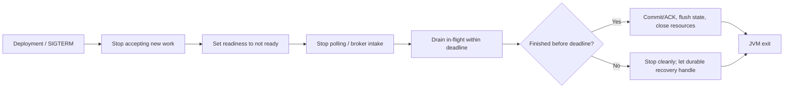
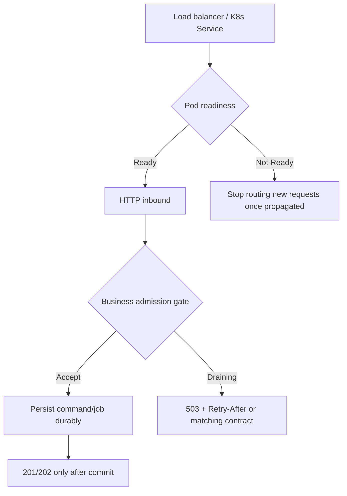
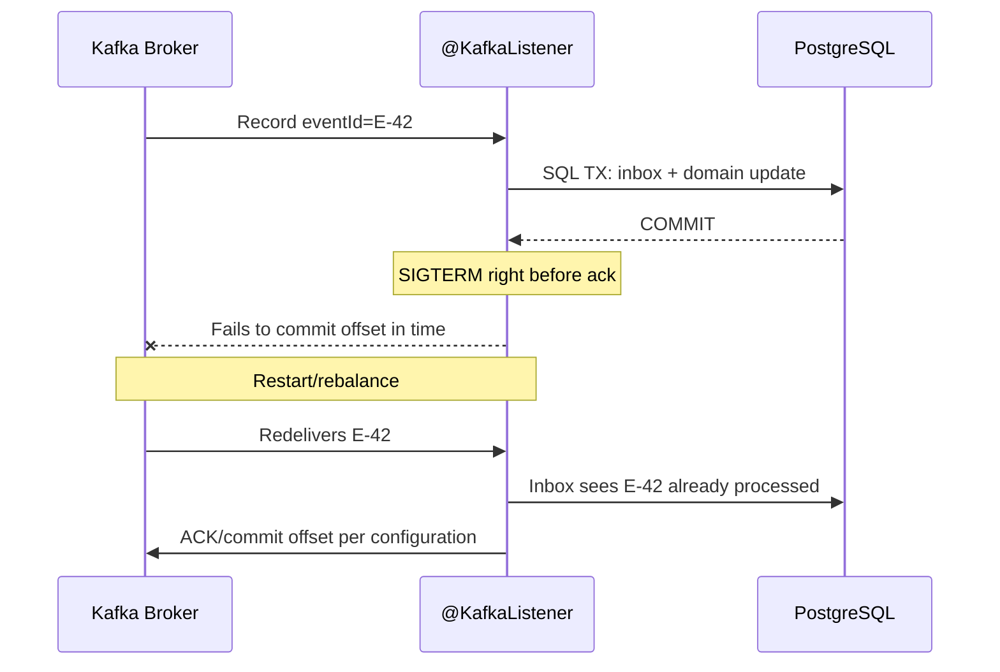
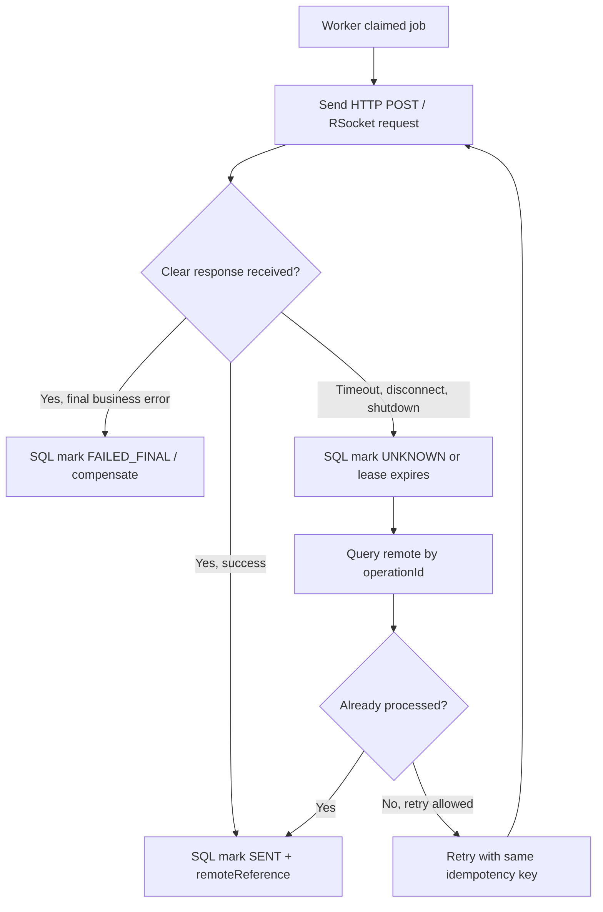
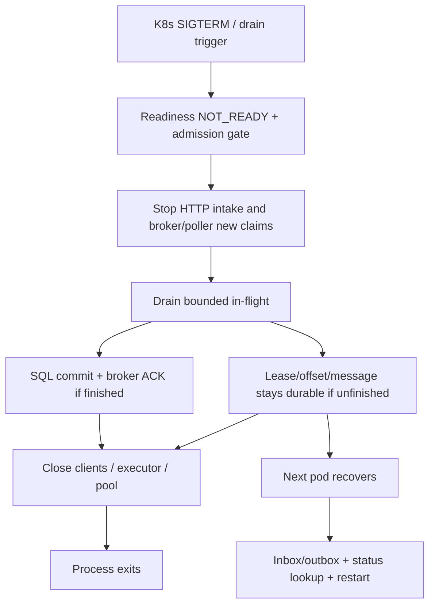

# Graceful Shutdown with In-Flight Messages or Work

> **Chapter:** Integration Operations  
> **Scope:** Within the **SPRING_BOOT_INTEGRATION** module, Spring Boot integrates systems through HTTP clients, databases, caches, message brokers, and Spring Integration adapters. This lesson explains **graceful shutdown** when an application still has active HTTP requests, broker messages, batch jobs, pollers, message groups, or outbound partner calls in flight; focusing on transaction boundaries, receive/send acknowledgments, deduplication, recoverability, testing, and production observability.

## 1. Why Is Stopping a Process More Than Turning Off the Server?

An application receives messages from RabbitMQ, reads a PostgreSQL outbox, and calls a payment API. When Kubernetes replaces a pod during a rolling deployment, SIGTERM can arrive right when:

1. An API request is in progress and has not yet committed SQL.
2. A Kafka listener wrote to the DB but has not yet committed the offset.
3. A RabbitMQ consumer received a message but has not yet sent ACK.
4. An outbox worker sent an HTTP POST successfully but has not yet marked `SENT` in the DB.
5. A Spring Integration aggregator received two of three parts without releasing the result.
6. A Spring Batch Job committed several chunks but has not finished.

**Graceful shutdown** is a time-bounded effort to **stop accepting new work, let in-progress work finish, preserve state, and release resources in the right order**. It does not guarantee all work finishes before exit, nor does it replace recovery mechanisms for `SIGKILL`, power loss, or node crashes.



The order in the diagram is the **desired coordination model**; actual callback order depends on the web server, containers, Spring lifecycle phases, broker listeners, and deployment infrastructure. Several steps occur nearly simultaneously.

### Learning Objectives

After this lesson, you will be able to:

- Explain `SIGTERM`, shutdown grace periods, readiness, and **draining**.
- Use `server.shutdown=graceful` and configure per-phase timeouts in Spring Boot.
- Distinguish active HTTP requests, messages pulled from a broker, persisted jobs, and remote side effects with unknown outcomes.
- Place ACK/offset commits **after business commit** in idempotent consumers.
- Design proper shutdown for pollers, schedulers, workers, Spring Batch, and aggregators.
- Use `SmartLifecycle`, `ContextClosedEvent`, and executor shutdown accurately.
- Avoid premature ACKs, lost messages, duplicate writes, long transactions, and exceeding deadlines.
- Test both graceful shutdown and **forced termination**, not just Spring context close.

## 2. Three Layers of Assurance: Operations, Storage, and Business Logic

Proper shutdown separates:

| Layer | Question | Mechanism |
| --- | --- | --- |
| **Process orchestration** | When do we stop accepting new requests or messages? | Readiness, web server graceful stop, container listener stop, scheduler/poller stop |
| **State persistence** | Does in-progress work survive if the process dies? | Broker durable messages/offsets, SQL job/outbox/inbox, Spring Batch JobRepository, persistent MessageStore |
| **Business outcome** | Did the side effect commit, and can it be re-run safely? | Business transactions, unique constraints, idempotency keys, status lookup, reconciliation |

Example:

```text
Broker delivery received at 10:00:00
SQL business commit at 10:00:04
SIGTERM arrives at 10:00:05
Broker ACK scheduled for 10:00:06, but process is killed

After restart: the broker may redeliver the message.
Correct design: inbox/business key detects it already committed, returns ACK again.
Wrong design: assuming SIGTERM occurred so the message must be done.
```

**Graceful shutdown shrinks the probability of hitting failure windows; idempotency and durable recovery handle the consequences when those windows still occur.**

## 3. What Happens When Spring Boot Receives a Stop Signal?

In standard container environments, the orchestrator requests container termination; the Java process receives a normal termination signal (if the entrypoint forwards signals properly). The Spring application context closes, managing bean lifecycles and waiting on components that support graceful stop.

| Event | What Usually Happens | Limitation |
| --- | --- | --- |
| `SIGTERM` to JVM | Begins normal shutdown sequence | Not guaranteed on crashes, OOMs, or `SIGKILL` |
| `ContextClosedEvent` | Context notifies it is closing | Does not automatically wait for all business tasks to finish |
| `SmartLifecycle.stop(Runnable)` | Allows components to report stop completion via callback | Must invoke callback exactly when stopped; wrong phase/order causes races |
| Web server graceful shutdown | Stops or rejects new HTTP requests and finishes active ones per server | Behavior differs across Tomcat, Jetty, Reactor Netty, and Undertow |
| Listener container stop | Stops fetching/receiving new messages per container semantics | Active messages, prefetch, poll batches, and ACKs follow separate policies |
| Task executor/scheduler shutdown | Stops accepting new tasks, can await running tasks if configured | Custom executors do not automatically inherit Boot properties |
| `@PreDestroy`/bean destroy | Releases end-of-lifecycle resources | Unsuitable for running a long unbounded workflow |
| Grace deadline expires | Container/runtime may force-kill | Unfinished hooks/transactions can be interrupted |

**Never rely on vague callback ordering.** Read the lifecycle behavior of the actual beans involved (web server, Kafka container, Rabbit listener, JMS container, Integration endpoint, Batch launcher, scheduler), and coordinate via **ownership + phase + stop contract** where needed.

### 3.1. A Principle That Holds Across Frameworks

```text
ADMIT (accept new work)        → must have a stop policy
CLAIM (pick up stored work)    → must have a timeout/lease
EXECUTE (run business logic)   → must have a transaction and deadline
ACK (confirm to source)        → only after reaching the promised durability level
RECOVER (rerun after outage)   → must be idempotent
```

For example, returning HTTP `202 Accepted` when a job sits only in an in-JVM `LinkedBlockingQueue` is a **false promise** if clients will not resend. For durable 202 semantics, persist the job/outbox to SQL or a broker with appropriate guarantees **before returning HTTP success**.

## 4. Spring Boot Graceful Shutdown for HTTP

### 4.1. Basic Configuration

Example for Spring Boot 3.x:

```yaml
server:
  port: 8080
  shutdown: graceful

spring:
  lifecycle:
    timeout-per-shutdown-phase: 25s
```

`server.shutdown=graceful` instructs the web server to perform a graceful stop per its implementation. `spring.lifecycle.timeout-per-shutdown-phase` is the **limit Spring waits per shutdown phase**, not a process-wide deadline and **not a timeout on outbound HTTP clients**.

When the context closes, Spring Boot updates availability/readiness and initiates graceful web shutdown for supported servers. However:

- In-flight requests are not guaranteed to finish if they outlast the stop budget.
- New connections may be rejected/reset or handled differently depending on the web server.
- Long-lived HTTP streaming, SSE, WebSockets, or RSocket do not necessarily terminate like short MVC requests.
- Reverse proxies/load balancers have **endpoint propagation delay**: new requests can still hit the pod briefly after readiness changes.

**Editing YAML alone is insufficient** when the app also has schedulers, broker consumers, or unmanaged threads. Web graceful stop does not automatically halt other work sources.

### 4.2. Server Readiness vs. Business Admission

Readiness determines whether a pod should receive **new traffic**. An in-code admission gate determines whether a **new unit of business work is accepted** while draining. These two layers complement each other:



An admission gate protects during the **lag window** from when the pod begins draining until proxies stop sending requests, and when requests arrive over paths bypassing K8s readiness. It does not replace authentication, rate limits, or durability.

## 5. Using Drain State to Reject New Work

A simple gate for **synchronous requests** can share a lock to prevent races between accepting work and entering drain state.

### 5.1. Tracking Accepted In-Flight Requests

```java
package com.example.integration.operations;

import org.springframework.context.event.ContextClosedEvent;
import org.springframework.context.event.EventListener;
import org.springframework.stereotype.Component;

@Component
public final class WorkAdmissionGate {
    private boolean accepting = true;
    private int active = 0;

    public synchronized boolean tryEnter() {
        if (!accepting) {
            return false;
        }
        active++;
        return true;
    }

    public synchronized void leave() {
        if (active <= 0) {
            throw new IllegalStateException("Unbalanced work counter");
        }
        active--;
    }

    public synchronized int activeCount() {
        return active;
    }

    public synchronized boolean isAccepting() {
        return accepting;
    }

    @EventListener(ContextClosedEvent.class)
    public synchronized void stopAccepting() {
        accepting = false;
    }
}
```

This is an **admission/counter** for work passing through the gate; it does not intervene in the web server, message listeners, or schedulers, nor does it automatically wait for `activeCount()==0`. An HTTP request already accepted by the web server can still enter the controller after the gate closes and receive a contract-defined rejection.

To flip readiness before context close (e.g., via a protected internal drain endpoint), you can integrate with Spring Boot availability events. Never expose a drain endpoint to external callers or unprivileged users.

### 5.2. HTTP Boundary Returns 202 Only After Durable Persistence

```java
package com.example.integration.operations;

import org.springframework.http.HttpHeaders;
import org.springframework.http.HttpStatus;
import org.springframework.http.ResponseEntity;
import org.springframework.web.bind.annotation.PostMapping;
import org.springframework.web.bind.annotation.RequestBody;
import org.springframework.web.bind.annotation.RestController;

record CreateExportCommand(String operationId, String batchDate) {}
record AcceptedExport(String operationId, String state) {}

@RestController
class ExportRequestController {
    private final WorkAdmissionGate gate;
    private final ExportSubmissionService submissions;

    ExportRequestController(
            WorkAdmissionGate gate,
            ExportSubmissionService submissions) {
        this.gate = gate;
        this.submissions = submissions;
    }

    @PostMapping("/integration/exports")
    ResponseEntity<?> accept(@RequestBody CreateExportCommand command) {
        if (!gate.tryEnter()) {
            return ResponseEntity.status(HttpStatus.SERVICE_UNAVAILABLE)
                    .header(HttpHeaders.RETRY_AFTER, "10")
                    .body("instance is draining");
        }
        try {
            submissions.persistAccepted(command);
            return ResponseEntity.accepted()
                    .body(new AcceptedExport(
                            command.operationId(), "PENDING"));
        } finally {
            gate.leave();
        }
    }
}
```

`ExportSubmissionService.persistAccepted(...)` is a separate service implemented with **validation/authorization, business idempotency key, and SQL/broker transaction**. If persistence fails, the controller must map the exception to an error response and **never return 202**. In multi-tenant requests, never accept caller-supplied `operationId` values without tenant scoping and payload fingerprinting.

**Counter semantics:** here `activeCount` counts **in-progress intake calls**, not all background jobs already persisted and acknowledged with 202. Background jobs need a **separate tracker and stop/recovery policy**.

### 5.3. WebFlux and Async Servlets Require Different Tracking

A `try/finally` wrapping a method returning `Mono<?>` or `Callable/DeferredResult` can exit **before the request actually finishes**. For reactive pipelines, track active work via operators tied to **subscription termination/cancellation** (e.g., `doFinally`) or an appropriate `WebFilter`, rather than counting publisher assembly as completed handling.

Do not copy the synchronous MVC counter into WebFlux and assume draining is done while pipelines are still running.

## 6. Shutdown Order: Stop Admission → Stop Intake → Drain → Close

A target safe sequence:

| Stage | Action | Why |
| --- | --- | --- |
| 1. Quiesce | Flip readiness/admission to draining | Curb new incoming work |
| 2. Stop intake | Stop pollers, listeners, schedulers, upstream fetches | Stop growing in-flight backlog inside a stopping process |
| 3. Drain | Let current work finish within deadline | Minimize rollbacks and requeues |
| 4. Persist/ack | Commit SQL, record state, and ACK per contract | Never acknowledge before durability |
| 5. Close | Release HTTP clients, broker connections, DataSource, executors, file streams | Avoid resource leaks |
| 6. Exit | JVM exits, or runtime force-kills on expiry | Recovery handles anything unfinished |

With `SmartLifecycle`, higher-**phase beans typically start later and stop earlier** than lower-phase beans. That helps coordinate **stopping producers/intake before consumers/resources**. However, default phases for framework-created components can differ across versions; never assume an arbitrary huge number is "guaranteed to stop first."

### 6.1. Why `@PreDestroy` Cannot Replace `SmartLifecycle`

`@PreDestroy` is good for closing resources owned by a bean, but waiting 90 seconds inside it for workers is problematic because:

- It may run **after** some stop phases have already closed dependencies.
- It easily blocks the context-closing thread without a clear phase deadline.
- It lacks an asynchronous completion callback like `SmartLifecycle.stop(Runnable)`.

When coordinating long-running worker shutdown, use a lifecycle component with clear ownership/phases and a **callback invoked strictly upon stop completion**. Keep destructors strictly for bean-owned resources.

## 7. Example `SmartLifecycle` Coordinating a Worker

The snippet below illustrates **stop requests and callbacks**, not a complete worker system:

```java
package com.example.integration.operations;

import java.util.concurrent.atomic.AtomicBoolean;

import org.springframework.context.SmartLifecycle;
import org.springframework.stereotype.Component;

@Component
public final class OutboxIntakeLifecycle implements SmartLifecycle {
    private final AtomicBoolean running = new AtomicBoolean(false);

    @Override
    public void start() {
        running.set(true);
    }

    @Override
    public void stop() {
        running.set(false);
    }

    @Override
    public void stop(Runnable callback) {
        // Signals we STOPPED claiming new batches; in-flight work is
        // managed by a separate executor/worker owner.
        running.set(false);
        callback.run();
    }

    @Override
    public boolean isRunning() {
        return running.get();
    }

    @Override
    public int getPhase() {
        return 100;
    }

    public boolean canClaimNextJob() {
        return running.get();
    }
}
```

**Intentional limitation:** this bean only **closes the gate for claiming new work**; it does not await running jobs. Invoking the callback immediately is valid only for that narrow responsibility. If the same owner must also drain an executor, invoke the callback **after draining truly completes** or after timeout/abort policy runs—never invoke the callback right away and claim "drained."

Do not treat `getPhase()=100` as a magic constant for every project. Inspect phases of schedulers, listener containers, DataSources, and dependent resources. If an owner has multiple dependencies, choose phases so **workers stop before DataSources/broker connections close**.

### 7.1. Async Stop and Callback

A component with long-running drains can stop asynchronously:

```java
@Override
public void stop(Runnable callback) {
    accepting.set(false);
    executor.execute(() -> {
        try {
            drainOrAbortWithinDeadline();
        } finally {
            callback.run();
        }
    });
}
```

This is **design pseudocode** requiring implementations for `accepting`, `executor`, and `drainOrAbortWithinDeadline()`. Ensure the executor is **still alive when the callback is scheduled**; if the executor itself has already shut down or rejects the task, the callback may never run and the lifecycle phase will stall until timeout. In real code, handle rejections/fallbacks so the stop callback always completes per contract, without signaling done while resources remain unreleased.

## 8. Schedulers and Spring Integration Pollers

### 8.1. Configuring Auto-Configured Executors/Schedulers

Spring Boot 3.x provides properties controlling shutdown for **Boot auto-configured** executors/schedulers:

```yaml
spring:
  task:
    execution:
      shutdown:
        await-termination: true
        await-termination-period: 20s
    scheduling:
      shutdown:
        await-termination: true
        await-termination-period: 20s
```

This can let running tasks finish when the executor/scheduler shuts down, yet does not automatically coordinate **stopping new intake and draining** to match every business deadline.

If the app declares custom `ThreadPoolTaskExecutor`, `TaskScheduler`, or `ScheduledExecutorService` beans, configure shutdown/await-termination on **those exact beans**. Manually created `new Thread(...)` threads are not Spring-managed tasks.

### 8.2. Pollers Can Keep Fetching Messages During Drain

In Spring Integration:

```java
@Bean
IntegrationFlow pendingOutboxFlow(
        OutboxHandler handler) {
    return IntegrationFlow.from(
            "outboxQueue",
            endpoint -> endpoint.poller(
                    Pollers.fixedDelay(500)
                            .maxMessagesPerPoll(10)))
            .handle(handler, "handle")
            .get();
}
```

This snippet assumes a defined `PollableChannel` named `outboxQueue` and an application-implemented handler. At shutdown, know whether this endpoint/poller is managed by Spring lifecycle and stops in the proper phase. `maxMessagesPerPoll(10)` limits messages per poll cycle, **not total in-flight work** if separate concurrency/executors are attached.

**Rule:** stop fetching new messages when remaining time is insufficient for normal processing. With durable queues, leave unclaimed messages for other instances instead of stuffing them into a local executor that is about to stop.

### 8.3. In-RAM `QueueChannel` vs. Persistent Channels

| Source | Sensible Shutdown Behavior |
| --- | --- |
| In-memory `QueueChannel` | Pending messages may be lost on stop/crash; use only if loss is acceptable or upstream replays |
| JDBC-backed `QueueChannel` via `JdbcChannelMessageStore` | Stop poller; committed pending rows remain for subsequent instances |
| Broker queue/topic | Stop consumer; broker retains/rewinds per configured ack/offset and retention |
| SQL outbox table | Stop claiming; `PENDING/RETRY_WAIT` jobs get picked up by other workers |

**Never call `queue.clear()` for a "clean shutdown"** if the queue holds business obligations. Purging RAM or store state loses work; clean up only after confirmed processing state/evidence.

## 9. Kafka Consumers: Offsets Must Follow Business Commit

Kafka retains data in logs per retention rules, and consumer groups track progress via offsets. When stopping a consumer, already-polled but unfinished records must follow **ack mode, offset commit, and error handler** rules.



### 9.1. Manual Acknowledgment Example

```yaml
spring:
  kafka:
    consumer:
      enable-auto-commit: false
      group-id: inventory-projection
    listener:
      ack-mode: manual_immediate
```

```java
package com.example.integration.operations;

import org.apache.kafka.clients.consumer.ConsumerRecord;
import org.springframework.kafka.annotation.KafkaListener;
import org.springframework.kafka.support.Acknowledgment;
import org.springframework.stereotype.Component;

@Component
public class OrderEventListener {
    private final OrderEventService service;

    public OrderEventListener(OrderEventService service) {
        this.service = service;
    }

    @KafkaListener(
        topics = "orders.confirmed.v1",
        groupId = "inventory-projection")
    public void onRecord(
            ConsumerRecord<String, String> record,
            Acknowledgment acknowledgment) {
        service.processOnce(record.value()); // transaction must commit before method returns
        acknowledgment.acknowledge();
    }
}
```

`OrderEventService.processOnce(...)` is an application service implementing schema validation, business event ID extraction, and **SQL transaction inbox + side effects**. Ack must happen after the service transaction has committed. If the service throws, do not ack; Spring Kafka's error handler/retry/DLT governs next steps. **Never combine auto-commit with manual ack and assume you get desired semantics.**

**Limitations to keep in mind:**

- `acknowledgment.acknowledge()` requests an offset commit per container policy; commit durability/synchronicity depends on configuration.
- Containers may process multiple records from one poll or run concurrent container threads; shutdown may not slice cleanly right after the current single record.
- Rebalances and lost ACKs still produce redeliveries.
- Kafka transactions/"exactly-once" within Kafka do not extend automatically to PostgreSQL, HTTP POSTs, or SFTP.

### 9.2. Stopping/Pausing the Container vs. Completing Business Logic

Spring Kafka listener containers are lifecycle-managed and controllable via `KafkaListenerEndpointRegistry`. **Pause** keeps the consumer alive while temporarily suspending fetch/delivery per container mechanics; **stop** ends the processing loop per configured semantics and deadlines. During rolling deploys, prefer letting Spring coordinate shutdown and letting the consumer group rebalance cleanly.

Never call `System.exit(0)` inside a listener upon SIGTERM, and never commit offsets for an entire polled batch when only half was processed. Settings like immediate stop (current record vs. remaining records) must be verified against your **actual Spring Kafka version** and tested with a controlled slow handler.

## 10. RabbitMQ/AMQP: Unacked Deliveries and Prefetch

With RabbitMQ, consumers receive deliveries and confirm them with ACK (per acknowledge mode). If a connection/channel closes before ACK, **unacked messages can be requeued/redelivered** by the broker when durable queues, persistence, and consumer setup align. Producer publish guarantees and queue persistence are separate concerns from consumer ACKs.

### 10.1. Consumer Logic

```text
RabbitMQ delivery
  -> validate envelope/schema
  -> SQL transaction: insert unique inbox + business write
  -> COMMIT
  -> ACK broker

On failure before SQL commit:
  -> no ACK; retry/requeue/DLQ per policy

When SQL committed but app dies before ACK:
  -> broker redelivers; inbox no-ops/reconciles; ACK again
```

Manual ACK configuration example:

```yaml
spring:
  rabbitmq:
    listener:
      simple:
        acknowledge-mode: manual
        prefetch: 20
        concurrency: 2
        max-concurrency: 4
```

`prefetch=20` describes how many unacked deliveries the broker lets the client hold per QoS scope; in practice multiple containers/consumers may exist. **In-flight messages on one pod can exceed one**, so never assume a tiny grace period suffices for every delivery.

When using manual ACK:

- ACK **after** durable side effects commit, using the right delivery tag/channel.
- On permanent failure, use reject/nack/DLQ strategies—never infinite requeue.
- Distinguish **consumer ACK** from **publisher confirm**: one confirms consumption, the other confirms publishing.
- At shutdown, listener containers and channels may close after timeout; handlers must tolerate redelivery.

**Stopping a Rabbit listener does not drain the entire queue.** The goal is to stop accepting new deliveries and finish granted ones within the deadline; remaining broker backlog belongs to subsequent instances.

### 10.2. Why Auto-Ack Is Dangerous for Critical Flows

If a path acknowledges delivery before SQL commits, a crash can drop the message from the consumer group without retry. Choose acknowledge modes aligned with framework/broker semantics and test failure paths; manual mode is **not automatically safe** if code acks too early either.

## 11. JMS: Session Transactions and Redelivery

With JMS/Artemis/ActiveMQ:

- `@JmsListener` usually runs in a Spring-managed listener container with lifecycle stop.
- A transacted JMS session coordinates receive/ack within a JMS session transaction; rollback can trigger redelivery.
- **A JMS local transaction is not automatically one SQL transaction** with PostgreSQL.
- XA/JTA may exist in certain architectures, but requires evaluating infrastructure, overhead, and recovery; never assume Spring Boot enables distributed transactions automatically.

For a JMS → SQL flow:

```text
Receive JMS message
  → SQL TX: unique inbox + business effect
  → SQL COMMIT
  → JMS ACK/SESSION COMMIT
```

If the app dies between the two commits, the message can reappear. Hence **inbox idempotency** remains an essential line of defense.

**Never treat a "JMS listener returned" log as proof the broker committed the session** while transaction/error handlers are still executing.

## 12. Outbound HTTP, RSocket, and Unknown Remote State

An in-flight HTTP POST or RSocket request–response can trigger side effects in an **external system**. When shutdown hits, there are three possibilities:

1. Remote returns a clear confirmation before the deadline.
2. Request was never sent; work can safely return to retryable state.
3. Request may have reached remote, but response was lost or deadline expired: **UNKNOWN outcome**.



**Never conclude "the remote did nothing" just because the client threw `CancellationException` or timed out.** Canceling a subscription or closing an HTTP client socket does not roll back a payment, order, or message already committed by a partner.

### 12.1. Long-Lived RSocket Streams

RSocket `request-stream` or `request-channel` can hold connections and many logical streams open long-term. On shutdown:

- Stop opening new streams and send completion/cancel signals per protocol where appropriate.
- Persist separate checkpoints/sequence markers if business logic needs to resume.
- Dispose the requester **via its owner** once streams drain or the deadline expires.
- Never dispose a shared requester inside an individual request's `doFinally`, as that breaks other callers' streams.

RSocket **resumption** is an optional protocol feature relying on configuration and buffers, not enabled by default; it does not replace a durable outbox or broker log.

### 12.2. HTTP Client Timeouts Must Be Shorter Than Remaining Deadline

Suppose total shutdown budget remaining is 15 seconds while outbound read timeout is 60 seconds: the worker may be killed before the client finishes. Before shutdown, set **end-to-end deadlines** and SLA-aligned connect/response timeouts; while draining, do not start new remote side effects if insufficient time remains for reasonable completion/reconciliation.

**Never hold an SQL transaction open while waiting on HTTP/RSocket** to "ensure clean shutdown." SQL rollback cannot undo remote side effects, while long transactions hold connections and locks.

## 13. SQL Outbox: A Favorable Model for Graceful and Crash Recovery

A **transactional outbox** ensures outbound work exists durably in the DB before any worker picks it up.

### 13.1. Job/Outbox Table with Explicit Statuses

```sql
CREATE TABLE integration_outbox (
    job_id UUID PRIMARY KEY,
    tenant_id VARCHAR(80) NOT NULL,
    operation_type VARCHAR(80) NOT NULL,
    payload_json JSONB NOT NULL,
    payload_sha256 VARCHAR(64) NOT NULL,
    status VARCHAR(24) NOT NULL,
    attempt_count INT NOT NULL DEFAULT 0,
    next_attempt_at TIMESTAMPTZ,
    lease_token UUID,
    lease_until TIMESTAMPTZ,
    remote_reference VARCHAR(180),
    updated_at TIMESTAMPTZ NOT NULL DEFAULT CURRENT_TIMESTAMP
);

CREATE INDEX idx_outbox_ready
    ON integration_outbox(status, next_attempt_at);
```

Example statuses:

| Status | Meaning |
| --- | --- |
| `PENDING` | Work durably persisted, unclaimed |
| `IN_FLIGHT` | Worker holds a lease and is processing |
| `RETRY_WAIT` | Transient failure, awaiting retry schedule |
| `SENT` | Evidence of send/remote confirmation per contract |
| `UNKNOWN` | Remote may have processed; needs reconciliation |
| `FAILED_FINAL` | Terminal business failure or retries exhausted; requires explicit handling |

### 13.2. Lease-Based Claiming—Never Hold Row Locks Across HTTP

A typical safe flow:

1. Short transaction **claims** a batch of jobs, setting `lease_token` and `lease_until`.
2. **Commit** the claim, releasing SQL row locks.
3. Call HTTP/broker outside any transaction.
4. Short transaction writes the outcome, verifying current `lease_token` and status/attempt.
5. On shutdown, stop claiming new jobs and let active sends finish within deadline.
6. Jobs with expired leases undergo **reconciliation** before reclaiming per policy; never blindly POST again when outcome is `UNKNOWN`.

**A lease token alone cannot prevent remote side effects from a stale worker**: a worker may wake up after lease expiry due to GC pauses or network stalls. To prevent stale DB overwrites, use compare-and-set on token/generation in SQL updates; for remote writes, use idempotency/fencing or status lookups.

### 13.3. Why "Wait Until the Queue Is Empty" Can Be Wrong

A draining service does not need to process **millions** of outbox jobs by itself. The goals are:

- Stop accepting new work **into the stopping instance**.
- Give already-claimed work a fair chance to commit/record status.
- Never drop pending jobs.
- Let other workers or subsequent instances continue draining the backlog.

**Durability and distributability** matter more than forcing a queue down to 0 before the JVM exits.

## 14. `MessageStore` and Aggregators During Shutdown

Spring Integration includes stateful components such as `QueueChannel` and aggregators/resequencers:

| State | At Shutdown | What Must Be Guaranteed |
| --- | --- | --- |
| In-memory `QueueChannel` | Unread messages can be lost | Upstream replay or exclude durable jobs |
| JDBC-backed `QueueChannel` | Stop poller; committed messages stay in store | Transactions on send/dequeue, restart, and idempotency |
| In-memory aggregator | Accumulating groups can be lost | Use only if loss is acceptable or rebuildable from source |
| Persistent `MessageGroupStore` | Groups can be read back after restart | Serializer/schema, correlation key, release/expiry |
| `MessageGroupStoreReaper` | Cleanup running during stop can race with add/release | Expiry/ownership policies; no indiscriminate purging |

An aggregator that received parts 1 and 2 of 3 may **not need to finish before shutdown** if group state is persistent and the post-restart flow can resume when part 3 arrives. Yet if the group lives only in RAM, web server `graceful stop` will not save it.

### 14.1. Released Output Not Yet Durable

```text
Group reaches 3 parts
  → Aggregator releases output
  → Output traverses in-memory DirectChannel/ExecutorChannel
  → JVM is killed before downstream commits
```

A persistent group store preserves **parts prior to release**, but **does not automatically make post-release output durable**. For critical results, use proper transactions and persist **business result + outbox** or a durable downstream channel/queue.

**Do not just disable group cleanup and declare victory**: test crashing between release, output delivery, and business commit.

## 15. Spring Batch: Finish the Chunk or Let the Job Restart?

Spring Batch uses `JobRepository` and `ExecutionContext` to persist progress. At shutdown, a running Job can:

- Finish its current Step/Job within the grace period.
- Stop cleanly via `JobOperator`/`JobExecution` stop controls where supported.
- Be cut off mid-Step/chunk by a runtime kill.

**Never assume a Job cut short by `SIGKILL` automatically turns `FAILED` and restarts cleanly.** Metadata can remain stuck as `STARTED` or require intervention because the process died without updating it. Establish tested operator/automated recovery procedures rather than hacking metadata ad hoc.

### 15.1. Chunk Step

```text
Chunk 1 (items 1-200)   -> SQL COMMIT + checkpoint
Chunk 2 (201-400)       -> SQL COMMIT + checkpoint
Chunk 3 (401-600)       -> SIGTERM / possible force kill
Restart                 -> resumes from JobRepository/reader state
```

If the writer writes to the **same SQL resource** and checkpoints per contract, rollback/restart avoids state loss. If the writer calls HTTP or writes remote files, chunk retries can repeat side effects because remote targets do not join the JDBC transaction.

### 15.2. Tasklet Step

A Tasklet looping with `RepeatStatus.CONTINUABLE` can commit per invocation when the Step is configured transactionally. On shutdown, Tasklets must have **bounded stopping points**. Never block in a `while(true)` loop inside an open transaction until the whole Job ends.

### 15.3. `JobParameters` and Replay

Same `Job name + identifying JobParameters` defines the same `JobInstance`. Changing a random `runId` to bypass a stuck `JobInstance` creates a **new instance** instead of restarting, potentially regenerating files or duplicating payments.

For batch imports/exports, keep business IDs like `batchDate`, `tenantId`, `batchVersion`, and manifest checksums stable across retries; track partner file receipt in a dedicated business ledger rather than inferring it solely from `BatchStatus.COMPLETED`.

## 16. Readiness, Liveness, and Kubernetes Termination

### 16.1. Distinguishing Three Probes

| Signal | Purpose | During Shutdown |
| --- | --- | --- |
| **Readiness** | Should this pod receive new requests? | Transition to unready early, before destroying resources |
| **Liveness** | Is the process healthy or needing restart? | Never use brief downstream outages to repeatedly kill pods |
| **Startup** | Gives the app time to start and warm up | Does not replace drain at shutdown |

Spring Boot Actuator exposes `/actuator/health/readiness` and `/actuator/health/liveness` when probes are enabled and exposed. Configure container ports/paths accurately, and remember **HTTP readiness does not control broker traffic**: Kafka/RabbitMQ consumers keep running unless listeners are stopped.

### 16.2. Deployment Snippet

```yaml
apiVersion: apps/v1
kind: Deployment
metadata:
  name: orders-integration
spec:
  replicas: 3
  selector:
    matchLabels:
      app: orders-integration
  template:
    metadata:
      labels:
        app: orders-integration
    spec:
      terminationGracePeriodSeconds: 90
      containers:
        - name: app
          image: example/orders-integration:1.0.0
          ports:
            - containerPort: 8080
          readinessProbe:
            httpGet:
              path: /actuator/health/readiness
              port: 8080
            periodSeconds: 5
            failureThreshold: 1
          livenessProbe:
            httpGet:
              path: /actuator/health/liveness
              port: 8080
            periodSeconds: 10
            failureThreshold: 3
```

This is an illustrative snippet, **omitting** production resources, ServiceAccounts, secrets, NetworkPolicies, and rollout strategies. Health probes must be enabled in the Spring Boot app:

```yaml
management:
  endpoint:
    health:
      probes:
        enabled: true
```

**`terminationGracePeriodSeconds=90` is Kubernetes' total budget from the start of pod termination**, covering the `preStop` hook (if any), SIGTERM, JVM shutdown, and cleanup. It **does not** guarantee the application gets a full 90 seconds; runtime, container, or infrastructure issues can terminate earlier.

### 16.3. `preStop` Is Not a Guarantee for Graceful Shutdown

Some setups use a `preStop` hook like `sleep 5` to wait for load balancers to stop routing requests. This can reduce races in some environments, yet:

- The hook runs out of the **same termination grace period budget**; sleeping too long starves JVM drain time.
- `preStop` does not replace closing the admission gate or stopping broker consumers.
- Requests can still arrive from other proxies, long-lived connections, or direct calls.
- On node crashes/`SIGKILL`, `preStop` and shutdown hooks may not run at all.

If calling a drain endpoint in `preStop`, strictly guard access control and idempotency. **Never trigger new publishes or data deletions in a hook just to "flush."**

### 16.4. Rolling Deployment and Remaining Capacity

When one pod stops, remaining pods absorb extra HTTP requests and message partitions. If all pods drain simultaneously or rely on an already-saturated DB, per-pod graceful shutdown is not enough.

Account for:

- `maxUnavailable`, `maxSurge`, replica count, and `PodDisruptionBudget`.
- Kafka partition counts and consumer group rebalancing.
- RabbitMQ prefetch, consumer concurrency, and queue depth.
- Aggregate DB connection pool usage while old and new pods coexist.
- Outbox lease timeouts and reclaim rates.
- Enabling readiness only once required beans, connections, and contracts are truly ready.

## 17. Calculating Deadlines: Never Sum Timeouts Arbitrarily

Consider a pod with 90 seconds total grace:

```text
Kubernetes terminationGracePeriodSeconds      90s
  ├── preStop hook + routing propagation         ~5s (if used)
  ├── Web/Broker/Integration shutdown phases     depends on phases
  ├── Worker finalization                        depends on work
  ├── Database/executor/socket close             needs margin
  └── JVM exit                                   before forced kill
```

Never treat `spring.lifecycle.timeout-per-shutdown-phase=25s` as "all of Spring stops within 25 seconds." Multiple phases can wait sequentially, executor `await-termination` adds its own time, and custom beans can block.

### 17.1. A Better Way to Budget

1. Measure p95/p99 latency of **one claimed unit of work** plus commit/ACK time.
2. Cap in-flight work per instance.
3. Stop **new intake** before draining active work.
4. Set outbound HTTP, SQL, and broker timeouts from remaining deadline.
5. Reserve margin for closing resources and JVM exit.
6. Test timing when dependencies are slow, not only when healthy.

If a batch runs for 30 minutes and the pod has 90 seconds, you **cannot** guarantee "waiting for the batch to finish" by nudging bean timeouts by a few seconds. Design checkpointing and restarts, or use a worker/job scheduling architecture with an appropriate lifecycle.

### 17.2. Caller Deadlines Differ from Shutdown Deadlines

An HTTP caller might give up after 5 seconds while a worker is granted 60 seconds. For durable work, return `202 Accepted` with an operation ID and a status lookup API; if the API must be synchronous, define an explicit timeout policy. Shutdown does not magically convert synchronous requests into durable async jobs.

## 18. Duplicates and Exactly-Once: Post-Restart Failure Matrix

| Crash Window | Possible Outcome | Required Defense |
| --- | --- | --- |
| Before SQL commit persisting job | Job does not exist | Do not return 202/ACK success |
| After SQL commit of job, before HTTP 202 response | Caller times out and retries | Unique operation ID + response replay |
| After broker delivery, before business SQL commit | Message is redelivered | Transaction retry / idempotent handler |
| After SQL commit, before Kafka offset commit | Record is re-read | Inbox unique key, fingerprint check |
| After SQL commit, before Rabbit ACK | Delivery may be requeued | Inbox + ACK after confirmed processing |
| After remote HTTP POST succeeds, before local DONE | Local sees unknown outcome | Stable idempotency key + status lookup/reconcile |
| After file published, before Step COMPLETED | Restart may re-publish | Stable manifest/checksum and filenames |
| After aggregator release, before durable output | Output may be lost | Persist business result + outbox |
| During shutdown when lease expires | Two workers may think they own the job | Lease token/fencing + remote idempotency |

**At-least-once delivery** and **idempotent processing** are far more realistic than promising "exactly-once everywhere." An SQL transaction cannot simultaneously roll back Kafka ACK, HTTP charges, Redis writes, and SFTP uploads without specialized coordination protocols.

### 18.1. Idempotency Keys Differ from Trace IDs

- `eventId`: identifies a message/event to deduplicate.
- `operationId`: identifies a business command with side effects.
- `batchId`: identifies a file/manifest batch import/export.
- `traceId`: correlates logs/traces across services; **not a business key**.

All must be properly scoped by tenant, operation type, and request fingerprint. When callers retry the **same operation**, preserve the same key; if the same key arrives with a different payload, return a conflict rather than silently returning an incompatible result.

## 19. Graceful Shutdown Does Not Guarantee Resources Auto-Flush

### 19.1. Logging, Tracing, Metrics

Exporters often buffer data; if the app exits too fast, final telemetry can be dropped. Configure exporter shutdown/flush with bounded deadlines, but **never let telemetry block overall shutdown indefinitely**.

Never log raw payloads containing tokens or PII just to prove drain completed. Correlation and business IDs can be logged in systems with proper access control and retention.

### 19.2. Caches and Redis

Caffeine local caches normally need not be "flushed" into business stores; losing cache contents on restart is expected by design. Redis caches carry TTLs/evictions and should never be treated as a durable ledger merely because Redis runs outside the JVM.

**Never issue `FLUSHALL`/clear cache during shutdown** when multiple replicas share Redis or caches still serve live traffic: doing so triggers thundering herds and degrades healthy instances.

### 19.3. HTTP Clients / Connection Pools

`RestClient`/`WebClient`/`RSocketRequester` hold connection resources that must close per bean ownership once workers stop using them. Closing HTTP clients/pools too early turns draining requests into errors. Conversely, failing to close custom resources/executors can keep the JVM alive past the deadline.

**Ownership is key:** the bean creating the resource is responsible for disposing of it; callers borrowing the client never close it per request.

## 20. Shutdown Observability

It is hard to know whether shutdown is safe if logs only say "Application stopped."

| Signal | What to Observe |
| --- | --- |
| Drain started timestamp | Pinpoint when admission stopped |
| Readiness state | Confirm pod stopped receiving new HTTP traffic |
| Active HTTP requests/streams | How many requests remain in-flight over time |
| Active Kafka/Rabbit/JMS deliveries | How many messages are received but not yet committed/ACKed |
| In-flight outbox jobs | Whether any jobs have unrecorded statuses/leases |
| Pending outbox oldest age | Whether durable work has abnormal backlog |
| Integration poller active | Confirm poller stopped claiming new work during drain |
| Running Batch Jobs/Steps | Which jobs need stop/restart and where progress checkpoints stand |
| Per-component/phase shutdown duration | Which step is eating up the grace budget |
| Forced termination / `OOMKilled` | Whether any shutdown failed to run cleanly |
| Post-restart duplicates/reconciliation | Whether crash-window consequences are detected |

These metrics are **instrumentation recommendations**, not guaranteed default Spring Boot metric names. Combine Actuator/Micrometer, broker metrics, SQL metrics, Kubernetes events, and HTTP client tracing.

### 20.1. Sample Metrics and Logs

```text
event=drain_start component=orders-integration instance=pod-12
event=intake_stopped source=kafka active_deliveries=8
event=outbox_stop_claim pending_jobs=193 in_flight=4
event=drain_progress active_http=2 active_broker=3 active_outbox=1
event=shutdown_completed drain_ms=17800 unfinished_jobs=0
```

**Be cautious with `"unfinished_jobs=0"`**: it only means work **directly tracked by this instance** finished, not that cluster-wide broker/outbox backlogs hit zero or remote partners finished business processing.

### 20.2. Alerts Tied to Operational Goals

- Pods frequently hitting deadlines or forced kills during shutdown.
- In-flight counts failing to drop after admission closes.
- Pending/`UNKNOWN` outbox jobs spiking after rollouts.
- Sudden jumps in broker redeliveries and inbox deduplication.
- Batch job executions stuck `STARTED` after pod deaths.
- Aggregator groups growing after restarts or failing to release.
- HTTP 503 spikes outside rolling deployment windows.

Keep metric tags to bounded dimensions like component, operation, route template, and error class; never use event IDs, order IDs, tokens, or URLs containing sensitive data as labels.

## 21. Shutdown Test Matrix: Inject Faults at the Right Moments

| Test Case | Outcome to Prove |
| --- | --- |
| Short HTTP GET active on SIGTERM | Accepted request finishes; new requests stop entering |
| HTTP POST commits job right before SIGTERM | 202 returns only after commit; retry with same operation ID creates no duplicate |
| Broker consumer crashes before SQL commit | No ACK sent; message retries/redelivers per policy |
| SQL commits then ACK/offset is lost | Inbox handles replay with zero duplicate side effects |
| Outbox lease claimed, HTTP not yet sent | Job stays durable and is reclaimable after lease |
| Outbox remote POST succeeds, local DONE unwritten | Reconciliation or keyed retry avoids double-charging |
| In-memory Integration `QueueChannel` | Recognized as volatile; durability is not promised |
| Persistent `QueueChannel` | Committed messages survive process restart |
| Aggregator received 2/3 parts | Group recovers after restart when store is persistent |
| Group releases then output is not yet durable | Test catches output loss window and verifies design fix |
| Spring Batch mid-chunk | Checkpointing/restart works cleanly on stable source |
| Spring Batch after file publish before Step completed | Re-publish is idempotent via checksum/manifest |
| Custom scheduler not shut down | Test catches lingering threads or newly firing tasks |
| Grace deadline shorter than slow handler | Runtime force-kills; recovery still preserves correctness |
| Two pods rolling simultaneously | Readiness, broker assignments, and DB pools do not overload |
| Pod killed via OOM/`SIGKILL` | Shutdown hooks bypassed; data still recovers |

**Difference between context close tests and process kill tests:** `applicationContext.close()` executes lifecycle hooks. `SIGKILL`, OOMs, and host crashes bypass them. Designs that pass graceful close tests yet lose messages under hard kills **are not reliable enough** for critical jobs.

## 22. Testing HTTP Graceful Shutdown via Integration Tests

An integration test should run the **Spring Boot app in a separate process or container**:

1. Call an endpoint whose handler blocks on a latch to confirm the request is in flight.
2. Start a synchronous request and hold it active.
3. Send a normal stop signal to the process (e.g., `SIGTERM` in Linux/containers).
4. While draining, send a new request and observe rejection or routing to another pod per config.
5. Release the latch before the deadline; verify the in-flight request gets a valid response.
6. Verify process exit within the grace budget without leaking threads or connections.
7. Repeat with a handler exceeding the deadline and forced kill; verify committed work is not lost.

A pure `@SpringBootTest` can verify beans/lifecycles, but **cannot fully simulate reverse proxies and Kubernetes termination**. For real-process tests, isolate databases/environments, never hit production endpoints, and bound timeouts so CI cannot hang.

### 22.1. Admission Gate Test Example

```java
@Test
void drainRejectsNewWorkButLetsAcceptedWorkLeave() {
    WorkAdmissionGate gate = new WorkAdmissionGate();

    assertThat(gate.tryEnter()).isTrue(); // Work A accepted
    gate.stopAccepting();                  // Begin draining

    assertThat(gate.tryEnter()).isFalse(); // Work B rejected
    assertThat(gate.activeCount()).isEqualTo(1);

    gate.leave();                          // Work A finishes
    assertThat(gate.activeCount()).isZero();
}
```

This is a **unit test of gate logic**; it does not prove Spring event wiring, HTTP graceful stop, or broker ACKs. Combine it with real integration tests from the matrix above.

## 23. Testing Brokers and Outbox with Crash Injection

### 23.1. Kafka

1. Use Testcontainers or a reliable test broker with auto-commit disabled.
2. Consumer writes inbox/domain rows to PostgreSQL and commits.
3. Inject failure **before offset commit** or force-kill the process.
4. Start a consumer in the same group; verify redelivery (while offset is uncommitted) and confirm the DB contains only one business result.
5. Verify commits/rebalances drop zero events during rolling updates.

### 23.2. RabbitMQ/JMS

1. Send a message with a stable business `eventId`.
2. Stop the consumer before ACK/JMS session commit.
3. Verify redelivery per topology/ack settings.
4. Replaying the same event ID creates no second result.
5. Test poison messages/DLQs so malformed messages do not requeue forever.

### 23.3. Outbox

```text
T1: Worker A claims jobId=J-42, leaseToken=L1
T2: A sends POST to partner
T3: Partner commits result, but A loses the response
T4: A receives SIGTERM, fails to write SENT
T5: Lease L1 expires
T6: Worker B claims with token L2
T7: B queries partner status using J-42's operationId
T8: B confirms already processed and writes SENT, without unconditionally POSTing again
```

Tests must verify **fencing on lease token updates**: if A wakes up after a long pause and tries to update using L1, the DB must reject overwriting worker B's state. If the remote lacks status lookup/idempotency, document that consistency limit honestly instead of promising exactly-once.

## 24. Antipatterns to Avoid

1. **"Turning on `server.shutdown=graceful` means every message finishes."** False: the web server does not control brokers, pollers, or batch jobs.
2. **"`SIGTERM` always runs every shutdown hook completely."** False: `SIGKILL`, OOMs, power loss, and deadlines can cut them off.
3. **"ACKing the broker immediately upon receipt speeds up shutdown."** False: loses messages if SQL hasn't committed yet.
4. **"Once SQL commits, the broker definitely knows it was processed."** False: ACKs/offsets can still be lost.
5. **"Waiting for `QueueChannel.size()==0` is enough."** False: work may still be in flight, uncommitted at output, or `UNKNOWN` remotely.
6. **"Drain all millions of outbox jobs before shutting down."** False: durable backlogs can be handled by other workers.
7. **"Sleeping a minute inside `@PreDestroy` counts as draining."** False: lacks ownership, phases, deadlines, and clear ACK policy.
8. **"Kafka `pause` equals stop/rebalance."** False: pause and stop have distinct semantics.
9. **"Consumer ACK means the publisher guaranteed data persistence."** False: publisher confirms and consumer ACKs are separate boundaries.
10. **"Closing `RestClient`/`WebClient`/`RSocketRequester` before workers frees resources faster."** False: breaks active requests.
11. **"HTTP timeout/cancellation proves the remote never committed."** False: the outcome may be `UNKNOWN`.
12. **"After SQL commit, retrying POST with a new key is fine."** False: risks duplicate side effects.
13. **"Kubernetes `preStop sleep` guarantees old requests finish."** False: it only delays and eats into the grace deadline.
14. **"One `@Transactional` covers PostgreSQL, Kafka, Redis, and SFTP."** False without specialized coordination.
15. **"Spring Batch `STARTED` after a hard kill means the job is still running."** False: metadata may be stale and require recovery.
16. **"A persistent aggregator store automatically protects released outputs."** False: outputs need their own durability boundary.
17. **"Testing context close is sufficient."** False: must test forced kills and retry/reconciliation.
18. **"Graceful shutdown has nothing to do with security."** False: drain endpoints, logs, secrets, tenant scopes, and API traffic remain trust boundaries.

## 25. Practice Exercise: Rolling Deployment for an Order Integration Service

### Prompt

A Spring Boot service has:

- HTTP POST `/orders`, returning 202 after persisting a job/outbox record.
- Kafka listener processing `OrderConfirmed` with a PostgreSQL inbox.
- RabbitMQ listener receiving commands with manual ACK.
- Scheduler polling the outbox and calling a partner REST API.
- Spring Batch nightly file export.
- Three replicas on Kubernetes with daily rolling deployments.

Requirement: **Lose zero accepted jobs**, allow redelivery/retries with zero duplicate business side effects, and recover cleanly even if a pod is killed after 60 seconds.

### Suggested Design



### Acceptance Criteria

| Criterion | Required Evidence |
| --- | --- |
| Admission closes before process exit | New HTTP calls route to other pods or get controlled rejections |
| HTTP 202 never fires before commit | DB-down/rollback tests never return 202 |
| Safe Kafka replay | Crash injected after SQL commit before offset commit leaves one business result |
| Safe Rabbit redelivery | Manual ACK after DB commit, retries, and DLQ policy tested |
| Outbox claims preserved | Lease/attempt/payload survive kill; another worker reclaims cleanly |
| No duplicate remote writes | Stable operation key + reconciliation when responses drop |
| Batch emits no duplicate files | Manifest/checksum/JobInstance ID stay stable across restarts |
| Recovers from forced kills | `SIGKILL` or container kill before grace completion tested |
| Telemetry sufficient for investigation | In-flight/unfinished/`UNKNOWN`, duration, and broker replays logged/metered |

### Extension Exercises

1. Make a Kafka handler take 20 seconds and verify stop policy with 15 seconds of grace remaining.
2. Set Rabbit prefetch to 50 and evaluate whether active deliveries exceed the drain budget.
3. Pause an outbox worker past its lease, let it resume, and verify the fencing token rejects it.
4. Kill a Batch Job while writing chunk 4 on SIGTERM; restart with the same `JobParameters`.
5. Test a long RSocket stream and verify cancellation does not prematurely dispose a shared requester.
6. Measure p99 shutdown duration with 1, 3, and 10 pods during rolling deployments.

## 26. Production Checklist

1. **Lock down SLOs:** which work must be preserved, which may cancel, and what deadlines apply?
2. **Classify sources:** HTTP, Kafka, RabbitMQ/JMS, schedulers, Integration pollers, Batch, RSocket.
3. **Stop admission:** flip readiness/drain state and halt new work claims when stopping.
4. **Place ACKs accurately:** only after durable side effects, paired with redelivery/idempotency.
5. **Choose durable storage:** brokers, SQL outbox/inbox, persistent channel/group stores, Batch `JobRepository`.
6. **Verify transaction boundaries:** right DataSource/manager; never assume remotes join JDBC.
7. **Bound in-flight work:** concurrency, prefetch, `maxMessagesPerPoll`, HTTP timeouts, job leases.
8. **Set lifecycle ordering:** `SmartLifecycle`, container stop, and executor close aligned to dependencies.
9. **Align budgets:** `server.shutdown`, shutdown phases, executor await, Kubernetes grace, safety margin.
10. **Never treat `UNKNOWN` as `FAILED`:** use operation IDs and reconciliation.
11. **Security:** drain endpoints, credentials, payload logging, and tenant scoping.
12. **Observability:** drain duration, active work, ACK lag, queue/outbox backlog, forced kills.
13. **Testing:** graceful stop, hard kill, restarts, redeliveries, duplicates, slow dependencies, multi-pod rollouts.
14. **Runbook:** handling stale pending jobs, Kafka offsets, Rabbit DLQs, stale Batch `STARTED` runs, and group states.

### Self-Check Questions

1. How does graceful shutdown differ from crash recovery?
2. Why is enabling graceful HTTP shutdown insufficient to stop Kafka/Rabbit listeners or Spring Integration pollers?
3. Is `spring.lifecycle.timeout-per-shutdown-phase` a process-wide deadline?
4. When an HTTP POST persisted a job but lost its response due to SIGTERM, how must the client retry without creating duplicates?
5. Why must Kafka/Rabbit ACKs occur after business SQL commit under at-least-once delivery?
6. How does Spring Kafka `pause` differ from `stop`?
7. Why do RabbitMQ prefetch and concurrency affect in-flight volume at shutdown?
8. Does a JMS transacted session commit atomically with a PostgreSQL JDBC transaction?
9. For an outbox, why are lease tokens/fencing and status lookups required when a worker is killed?
10. Why do you not necessarily need to drain the entire outbox backlog before a pod exits?
11. Can an in-memory `QueueChannel` guarantee accepted work across `SIGKILL`?
12. If an aggregator uses a persistent `MessageGroupStore`, are post-release outputs automatically durable?
13. How should you recover a Spring Batch Job killed while metadata reads `STARTED`?
14. Why does `preStop sleep` not replace an admission gate and durability?
15. Which tests distinguish an app that "exits neatly" from one that "never loses data on power loss"?

## 27. References

- [Spring Boot — Graceful Shutdown](https://docs.spring.io/spring-boot/reference/web/graceful-shutdown.html): web server shutdown and shutdown phases.
- [Spring Framework — Lifecycle](https://docs.spring.io/spring-framework/reference/core/beans/factory-nature.html): `SmartLifecycle`, stop callbacks, and bean destruction.
- [Spring for Apache Kafka — Listener Containers](https://docs.spring.io/spring-kafka/reference/kafka/receiving-messages/message-listener-container.html): ack modes, stop, and listener behavior.
- [Spring AMQP — Listener Container](https://docs.spring.io/spring-amqp/reference/amqp/receiving-messages/async-consumer.html): Rabbit listener lifecycle, acknowledgment, concurrency, and prefetch.
- [Spring Integration — Message Store](https://docs.spring.io/spring-integration/reference/message-store.html): persistent channels and aggregator state.
- [Spring Batch — Reference](https://docs.spring.io/spring-batch/reference/): Job/Step metadata, checkpoints, restarts, and stops.
- [Kubernetes — Pod Termination](https://kubernetes.io/docs/concepts/workloads/pods/pod-lifecycle/#pod-termination): preStop, grace period, and SIGTERM.

**Key takeaway:** **Graceful shutdown** is a sequence of **stop admitting new work → drain within a deadline → commit/ACK at the right moment → close resources by ownership**. It reduces errors during rolling deployments, **yet never replaces durability and idempotency**. Across HTTP, brokers, Spring Integration, SQL outboxes, and Spring Batch, always design as if the JVM **could be killed on any line of code**. Whenever a message, job, or remote side effect has an uncertain outcome, rely on **durable state, controlled retries, and reconciliation** to continue safely rather than assuming shutdown handled everything.
