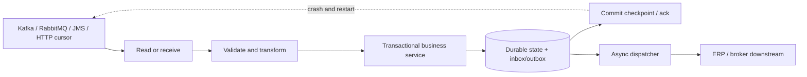
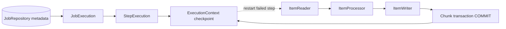
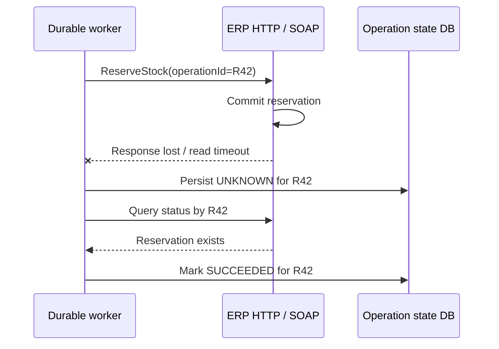

# Restarting After Failure and Resuming from a Valid Checkpoint

## 1. When an Integration Is Interrupted Mid-Flight, Where Must the System Resume?

A Spring Boot service consumes `OrderPaid` events from Kafka, updates PostgreSQL, writes a transactional outbox entry to emit `InventoryReservationRequested`, and calls an ERP system in another worker. At 10:15, the JVM crashes after updating the database but before committing the Kafka offset. On restart, the consumer may receive the exact same event again.

If the system merely checks logs saying "read offset 158" and resumes at offset 159, it can skip uncommitted work. If it blindly replays from the start without deduplication, a payment or ERP request can trigger duplicate side effects.

A **checkpoint** is durable information identifying **the point from which processing can resume safely**. That point must reflect committed effects, not merely data received or attempted. Upon restart, the runtime may replay work after that point; the application must tolerate duplicates and uncertain dependency outcomes.

Example:



The lesson **"Restarting After Failure and Resuming from a Valid Checkpoint"** belongs to the **"Integration Operations"** chapter of the **SPRING_BOOT_INTEGRATION** module. The module covers HTTP clients, databases, caches, brokers, and Spring Integration adapters, emphasizing configuration, data contracts, transactions, errors, deduplication, testing, and live observability.

After this lesson, you will know how to:

1. Define a valid checkpoint based on data sources and transaction boundaries.
2. Determine resume positions across Kafka offsets, AMQP/JMS deliveries, HTTP cursors, file pollers, and Spring Batch.
3. Coordinate inbox/outbox, leases, fencing tokens, idempotency, and ordering across crashes and replays.
4. Design restart, recovery, quarantine, and controlled replay runbooks.
5. Test failure windows with Testcontainers instead of testing only the happy path.

**Bottom line:** there is no automatic "global checkpoint" spanning PostgreSQL, Kafka, RabbitMQ, HTTP APIs, and ERPs. The system must explicitly pick the **progress source of truth** and durable confirmation point for each step.

## 2. Terms to Separate Before Talking About Restart

| Term | Meaning | Why Is It Different from a Checkpoint? |
|---|---|---|
| **Read position** | Position just read/received from the source. | Does not prove business work finished. |
| **Processed position** | Position where handler logic finished running. | If only in RAM/logs, lost on crash. |
| **Durable effect** | Database transaction, persistent job, or external effect confirmed per contract. | May commit before or after broker acknowledgment. |
| **Checkpoint** | Durably stored marker used to decide where to restart. | Must tie to durable effects, not merely last seen. |
| **Acknowledgment** | Signal to the broker that a message was handled per policy. | Does not mean business state committed if acked prematurely. |
| **Offset** | Position of a record within a Kafka partition. | Broker position, not a business event ID. |
| **Cursor/page token** | Position marker in an API or pagination feed. | May expire or not correspond to an immutable snapshot. |
| **Inbox marker** | Record that a logical event was processed in the consumer's database. | Meaningful only when committed alongside the protected effect. |
| **Outbox row** | Intent to emit an event saved within the business transaction. | Dispatcher must publish and track progress separately. |
| **Lease/fencing token** | Temporary ownership and generation number of a worker. | Stops stale workers from overwriting a newer worker's checkpoint. |
| **Watermark** | Time/ID boundary of processed or observed data. | Does not rule out late-arriving records unless guaranteed by source. |

One message can simultaneously carry `eventId=E42`, Kafka `partition=2, offset=158`, and workflow `operationId=R42`. These serve **three distinct identities**. Never use offsets as event IDs when events can be republished to different partitions/offsets; never use trace IDs as idempotency keys.

### 2.1. "Read" Does Not Mean "Processed"

```text
source record 158 read
  -> JSON parsed
  -> database update started
  -> JVM crash before COMMIT
```

If the checkpoint already advanced to 159 during parsing, record 158 gets skipped on restart even though the database never changed. A safe checkpoint advances **only after a clearly defined durable boundary**.

### 2.2. "Sent" Does Not Mean "Completed on the Other Side"

With an HTTP client or Kafka producer, a successful send may just be a client/broker milestone; it is not confirmation that inventory was deducted or the ERP committed. Separate `PUBLISHED`, `DELIVERED`, `CONSUMED`, and `BUSINESS_SUCCEEDED` in your state machine whenever the business needs visibility per milestone.

## 3. Criteria for a Valid Checkpoint

A trustworthy checkpoint must satisfy:

1. **Durable:** stored where it survives JVM restarts and pod reschedules, or durably tracked by the broker.
2. **Consistent:** never advances past committed business effects or confirmed durable handoffs.
3. **Scoped:** identifies the exact job, consumer group, partition, tenant, query, and version; never share one sequence counter across unrelated sources.
4. **Replayable:** the source still holds data after the checkpoint, or another mechanism can rebuild/reconcile.
5. **Unambiguous:** clearly specifies whether it means "last processed record" or "next record to start from."
6. **Gap-aware:** handles out-of-order completions; never store just a bare max ID.
7. **Ownership-safe:** an old worker cannot write checkpoints after losing its lease or after partition rebalance.
8. **Compatible:** schema, serializer, job parameters, and checkpoint interpretation remain valid after deployment.
9. **Observable:** exposes checkpoint age, lag, error, duplicate, and recovery metrics.
10. **Auditable:** manual resets, skips, replays, and advances record reason, authorization, and audit trails.

A numerically larger checkpoint **is not necessarily valid**. If a worker finishes offset 160 while 159 failed, committing 161 skips 159 in a Kafka consumer group, because Kafka's committed offset is the next position fetched on restart.

### 3.1. Scope of Guarantees

Document clearly in operational specs: is the system promising **at-least-once processing**, **at-most-once**, or narrowly scoped exactly-once? Kafka transactions provide exactly-once across properly configured Kafka-to-Kafka flows; a JDBC `@Transactional` does not magically make HTTP ERP + PostgreSQL + Kafka atomic.

In real-world integrations, the safest common baseline is **at-least-once delivery + idempotent processing + local transactions + durable retry/reconciliation**.

## 4. Two Classic Failure Windows: Lost Work vs. Duplicate Processing

Consider processing Kafka event E42 and updating PostgreSQL.

**Wrong order:**

```text
commit source offset
  -> update database
  -> crash between the two steps
  -> restart past the offset
  => LOST business effect
```

**Generally safer order:**

```text
BEGIN database transaction
  INSERT inbox marker
  UPDATE business state
  INSERT outbox event
COMMIT
  -> commit Kafka offset
  -> crash between COMMIT and offset
  -> restart, E42 arrives again
  -> inbox detects duplicate and applies no extra effect
```

```mermaid
sequenceDiagram
    participant K as Kafka
    participant C as Consumer
    participant D as PostgreSQL
    K->>C: Deliver E42, offset 158
    C->>D: BEGIN; inbox + business + outbox
    D-->>C: COMMIT success
    Note over C: Crash before offset commit
    K->>C: Redeliver E42 after restart
    C->>D: Check inbox E42
    D-->>C: Already committed / same payload
    C->>K: Commit next offset when safe
```

| DB Effect | Source Checkpoint/Ack | If Crash Follows | Expectation |
|---|---|---|---|
| Uncommitted | Unacked | Source redelivers. | Reprocessed normally. |
| Committed | Unacked | Source may redeliver. | Inbox/idempotency avoids duplicates. |
| Committed | Acked | Source moves forward. | Success if effect is correct and durable. |
| Uncommitted | Acked | Source may not redeliver. | **Lost work**; avoid this design. |
| Commit unknown due to network disconnect | Unacked | May redeliver. | Check key/inbox after reconnect; never mint a new intent ID. |

Even when the application observes "DB commit succeeded," another system may still be out of sync. Choose checkpoints at the **completion milestone required by the contract**, not an arbitrary log message.

## 5. Kafka Checkpoints: Committed Offset Is the Next Position

Kafka tracks progress per **consumer group and topic-partition**. If record at offset `158` succeeded, the committed offset is normally **`159`**, the next position a consumer starts reading upon assignment or restart.

```text
topic: orders.paid
partition: 2

offset   156   157   158   159   160   161
         [OK]  [OK]  [OK]  [? ]  [OK]  [ ?]
                          ^
                   safe next offset 159
```

Never store a single `lastOffset=160` variable across all partitions. Kafka has no global total order across a topic: each partition has its own sequence; events for the same aggregate should share a partition key if ordering matters.

### 5.1. Commit Position Is Not the Last Fetched Offset

A consumer `poll()` can return a batch of 100 records while only 20 have finished. Committing offsets for the whole batch before the remaining 80 complete risks losing work. Configure Spring Kafka ack modes and handler modes to match the intended commit boundary.

### 5.2. Retention Limits Replay

An old committed offset does not guarantee the broker still retains that record after retention or log truncation. If records have expired, rebuild from the source of truth, snapshot + changelog, or another recovery procedure. `auto-offset-reset=earliest` only jumps to the **earliest still-available offset** when no valid offset exists; it cannot resurrect deleted data.

## 6. Spring Kafka: Explicit Checkpoint and Ack Mode Configuration

Example with compatible Spring Boot/Spring Kafka:

```yaml
spring:
  kafka:
    bootstrap-servers: ${KAFKA_BOOTSTRAP_SERVERS}
    consumer:
      group-id: order-projection
      enable-auto-commit: false
      auto-offset-reset: earliest
      max-poll-records: 100
    listener:
      ack-mode: record
      concurrency: 3
```

`AckMode.RECORD` normally causes the container to process/commit progress per record after the listener method returns normally. It **does not** inspect your application's database transaction if the listener merely enqueues work in memory and returns.

Items to verify:

- `enable-auto-commit: false` so progress is controlled by the container/app policy.
- `ack-mode` actually applies to the **active listener container**. Custom factories or Integration adapters may not pick up every Boot property automatically.
- Concurrency does not exceed useful partitions or downstream DB/HTTP limits.
- `max.poll.interval.ms` and processing duration do not cause repeated rebalances.
- Error handlers, retries, DLTs, and commit-after-recovery behaviors are tested independently.

### 6.1. Kafka Ack After Database Commit

With manual acknowledgment listeners, make the ordering explicit:

```java
import org.apache.kafka.clients.consumer.ConsumerRecord;
import org.springframework.kafka.annotation.KafkaListener;
import org.springframework.kafka.support.Acknowledgment;
import org.springframework.stereotype.Component;

@Component
class OrderPaidKafkaListener {

    private final OrderPaidApplicationService service;
    private final OrderPaidJsonDecoder decoder;

    OrderPaidKafkaListener(
            OrderPaidApplicationService service,
            OrderPaidJsonDecoder decoder) {
        this.service = service;
        this.decoder = decoder;
    }

    @KafkaListener(
        topics = "orders.paid",
        groupId = "order-projection",
        containerFactory = "manualAckKafkaListenerFactory")
    public void handle(
            ConsumerRecord<String, String> record,
            Acknowledgment ack) {

        OrderPaidEvent event = decoder.decode(record.value());

        // @Transactional is on another bean service;
        // method return means the transaction ended normally.
        service.applyIdempotently(event);

        // Ack only after the durable business transaction completes.
        ack.acknowledge();
    }
}
```

`OrderPaidEvent` and `OrderPaidJsonDecoder` are application types. `applyIdempotently` must update the DB + inbox in one local transaction and throw if it fails to commit. If `decode` or the service throws, the method does not ack; the container error handler governs retry/seek/DLT.

A factory:

```java
import org.springframework.boot.autoconfigure.kafka.ConcurrentKafkaListenerContainerFactoryConfigurer;
import org.springframework.context.annotation.Bean;
import org.springframework.kafka.config.ConcurrentKafkaListenerContainerFactory;
import org.springframework.kafka.core.ConsumerFactory;
import org.springframework.kafka.listener.ContainerProperties;

@Bean("manualAckKafkaListenerFactory")
ConcurrentKafkaListenerContainerFactory<String, String>
manualAckKafkaListenerFactory(
        ConcurrentKafkaListenerContainerFactoryConfigurer configurer,
        ConsumerFactory<String, String> consumers) {

    var factory =
        new ConcurrentKafkaListenerContainerFactory<String, String>();
    configurer.configure(factory, consumers);
    factory.getContainerProperties()
        .setAckMode(ContainerProperties.AckMode.MANUAL_IMMEDIATE);
    return factory;
}
```

This bean assumes a Spring configuration class and a `ConsumerFactory` already configured with proper serializers, auth, and TLS. `MANUAL_IMMEDIATE` commits when acknowledgment is invoked on the consumer thread per container semantics; it does not make it atomic with the DB, nor should `Acknowledgment` be passed arbitrarily across threads.

## 7. Kafka Rebalances: Revoking a Partition Is an Ownership Boundary

During a consumer group rebalance, a partition can move from instance A to instance B. A handler on A might still be calling the ERP or holding a `CompletableFuture`; if A writes a late checkpoint after losing ownership, progress corrupts.

Design accordingly:

- Avoid long blocking work directly on the listener poll thread if it threatens `max.poll.interval.ms`.
- Complete synchronously or perform a **durable handoff** before acking.
- Never persist a Kafka `Acknowledgment` as a business task ID across restarts.
- For per-partition async processing, track gaps and commit **contiguous completed offsets**, never raw max offset.
- Stop new intake during shutdown/rebalance per container lifecycle; drain with a timeout.
- When using seek/rebalance listeners, never update offsets from arbitrary threads unsupported by the Kafka Consumer API.
- Measure rebalance counts and distinguish them from network/DB outages.

### 7.1. Offset Commits Do Not Guarantee In-Order Side Effects

A partition maintains record order in the log, yet parallel handler dispatch can finish offset 159 before 158. Committing 160 can skip 158 after a crash. You need a **completion bitmap / contiguous watermark** or sequential per-partition processing, paired with aggregate version guards.

## 8. Kafka Transactions and the Scope of Exactly-Once

Kafka producer transactions and `sendOffsetsToTransaction` can atomically couple output Kafka records with consumed offsets inside one Kafka transaction when properly configured. This is very effective for **Kafka → Kafka** pipelines.

However:

```text
Kafka consumer -> PostgreSQL update -> Kafka output
```

does not become a single atomic transaction merely by enabling a Kafka transaction manager. PostgreSQL has its own commit boundary; crashes between DB and Kafka still require idempotency/outbox. Likewise, Redis cache invalidation or SOAP/ERP calls are never rolled back by a Kafka transaction.

State the exact scope of "exactly-once" in your design: Kafka broker visibility and offset atomicity do not mean external side effects execute once.

## 9. Inbox: Business-Level Checkpoint Against Duplicate Delivery

A practical pattern is letting PostgreSQL own the **logical event processing checkpoint**:

```sql
CREATE TABLE consumed_events (
    consumer_name VARCHAR(80) NOT NULL,
    event_id UUID NOT NULL,
    payload_hash VARCHAR(64) NOT NULL,
    processed_at TIMESTAMPTZ NOT NULL DEFAULT now(),
    PRIMARY KEY (consumer_name, event_id)
);
```

Each event envelope carries a stable `eventId` and `aggregateVersion`. Inside one `@Transactional`:

1. Insert the inbox row with its unique key.
2. If the key exists, verify payload hash/outcome before treating it as an already-processed duplicate.
3. If the event is new, update business state/projection.
4. Write any downstream outbox event.
5. Commit; afterward, the Kafka listener acks/commits the offset.

Pseudocode:

```java
import org.springframework.jdbc.core.simple.JdbcClient;
import org.springframework.stereotype.Service;
import org.springframework.transaction.annotation.Transactional;

@Service
class OrderPaidApplicationService {

    private final JdbcClient jdbc;
    private final EventFingerprint fingerprint;

    OrderPaidApplicationService(
            JdbcClient jdbc, EventFingerprint fingerprint) {
        this.jdbc = jdbc;
        this.fingerprint = fingerprint;
    }

    @Transactional
    public void applyIdempotently(OrderPaidEvent event) {
        String hash = fingerprint.sha256Canonical(event);

        int inserted = jdbc.sql("""
            INSERT INTO consumed_events(
                consumer_name, event_id, payload_hash)
            VALUES ('order-projection', :id, :hash)
            ON CONFLICT (consumer_name, event_id) DO NOTHING
            """)
            .param("id", event.eventId())
            .param("hash", hash)
            .update();

        if (inserted == 0) {
            verifySameEventAndCommittedOutcome(event, hash);
            return;
        }

        applyBusinessProjection(event);
        // If emitting a new integration event:
        // outbox.insertInCurrentTransaction(...);
    }

    private void verifySameEventAndCommittedOutcome(
            OrderPaidEvent event, String hash) {
        // Query committed hash/outcome; same ID with different content => conflict.
    }

    private void applyBusinessProjection(OrderPaidEvent event) {
        // DB update respecting aggregateVersion and schema contract.
    }
}
```

`EventFingerprint`, `OrderPaidEvent`, and helper methods are abstractions to implement. Compute the hash from a trusted canonical payload rather than blindly trusting a sender-supplied hash field. This SQL uses PostgreSQL `ON CONFLICT` and is not portable verbatim to every RDBMS.

**Never persist the inbox marker in a separate transaction before updating the projection.** A crash between marker and effect causes redelivery to skip the update erroneously.

## 10. Source Checkpoint and Inbox: Complementary Layers, Not Rivals

Kafka committed offsets keep the consumer from **re-reading every record**, while the inbox prevents duplicates on redeliveries, replays, or republishes. A Kafka record might be sent to a retry topic with a brand-new offset while retaining its **original `eventId`**.

| Layer | Key/Marker | On Restart |
|---|---|---|
| Kafka group | Topic-partition + committed next offset. | Resumes fetching from broker-stored position. |
| Consumer inbox | `(consumerName, eventId)` + hash/outcome. | Detects duplicate logical events. |
| Domain projection | Aggregate ID + version/state. | Prevents backward state regression or out-of-order corruption. |
| Outbox dispatcher | Event ID + publish state/lease. | Resends unconfirmed events. |
| External ERP | Operation ID/idempotency key + remote outcome. | Reconciles side effects that may have committed. |

Never "reset offsets to latest" just to eliminate duplicates without verifying missing effects. That drops work, not recovers it.

## 11. RabbitMQ: Acknowledgments Track Delivery Progress, Not Consumer Offsets

RabbitMQ AMQP 0-9-1 queues use delivery acknowledgments rather than topic-partition committed offsets. The broker tracks ready/unacked messages; if a channel/connection closes before ack, unacked messages can be **redelivered** per broker semantics.

### 11.1. Safe Ack Boundary

```text
RabbitMQ delivery
  -> deserialize / validate
  -> DB transaction + inbox / durable job COMMIT
  -> basicAck(deliveryTag)
```

With manual acknowledgment in Spring AMQP:

```java
import com.rabbitmq.client.Channel;
import org.springframework.amqp.core.Message;
import org.springframework.amqp.rabbit.annotation.RabbitListener;
import org.springframework.stereotype.Component;

@Component
class OrderCommandRabbitListener {

    private final OrderCommandService service;
    private final OrderCommandDecoder decoder;

    OrderCommandRabbitListener(
            OrderCommandService service,
            OrderCommandDecoder decoder) {
        this.service = service;
        this.decoder = decoder;
    }

    @RabbitListener(
        queues = "orders.commands",
        ackMode = "MANUAL")
    public void handle(
            Message message, Channel channel) throws Exception {

        long tag = message.getMessageProperties().getDeliveryTag();

        try {
            OrderCommand command = decoder.decode(message.getBody());
            service.persistDurably(command);
            channel.basicAck(tag, false);
        } catch (InvalidOrderContractException ex) {
            // Only reject without requeue when DLX/quarantine is
            // configured and data-loss policy is verified.
            channel.basicReject(tag, false);
        }
        // Other transient errors propagate for container/broker recovery
        // per application policy.
    }
}
```

This is a **skeleton**: `OrderCommandService`/decoder/exceptions must be implemented, and DLX plus container error handlers must be tested to avoid double-ack/nack. Understand how container error handling behaves if a listener throws after ack/reject; production code should avoid uncontrolled catch-alls.

**A delivery tag is valid only on the channel that received it.** Never store delivery tags in the DB as durable checkpoints or reuse them across reconnects/restarts.

### 11.2. Can You Replay After Acking?

Once a queue acks and the broker drops the message normally, replay requires a DLQ, archive, source event store, or intentional producer republish. There is no Kafka-style `seek(offset=...)` on an already-acked RabbitMQ queue.

Hence **durable handoff before ack** is essential whenever Rabbit is the non-rebuildable source.

## 12. RabbitMQ Retries, DLX, and Poison Messages

When a malformed message fails repeatedly, continuous `basicNack(requeue=true)` creates a hot loop. A sound policy should:

- Classify transient, permanent-contract, business-rejected, and unknown-result failures.
- Use bounded retries/backoff; once exhausted, route to a **provisioned** DLX/DLQ/quarantine.
- If republishing manually, never ack the original merely because DLQ `send` returned without confirmed routing/publish outcome.
- Preserve `eventId`, operation ID, and allowed original routing metadata.
- Set retention and quarantine ownership so messages are not forgotten forever.
- Monitor unacked/ready counts and poison redelivery rates.

If DLX topology/broker policies drop messages to nowhere, rejecting with `requeue=false` loses data. Provision and test the real dead-letter route, not just `basicReject` in code.

## 13. JMS: Session Acknowledgment and Transactions Are Separate Checkpoints

JMS offers `Queue`, `Topic`, `JMSMessageID`, `JMSCorrelationID`, and several acknowledgment modes. Progress ties to **message delivery + JMS session/provider**, not an offset Spring Boot computes itself.

| Setting | Primary Meaning | What to Test |
|---|---|---|
| `AUTO_ACKNOWLEDGE` | Provider/container auto-acknowledges per listener semantics. | Does a business exception trigger redelivery? |
| `CLIENT_ACKNOWLEDGE` | Client acknowledges per session semantics. | One acknowledge can ack multiple messages in the session, unlike Rabbit tags. |
| `SESSION_TRANSACTED` or container `sessionTransacted` | Commits/rolls back the JMS session. | Redelivery on rollback and provider DLQ policy. |
| JTA/XA | Coordinates XA participants when genuinely configured. | Recovery logs, in-doubt transactions, deployment complexity. |

### 13.1. JMS Transacted Does Not Auto-Merge with JDBC

A JMS session commit and a PostgreSQL `@Transactional` are not automatically the same transaction. Using local JMS + local JDBC transactions still leaves a crash gap between commits. JTA/XA can be considered where truly needed and supported, though outbox/inbox + reconciliation is often easier to operate. HTTP ERPs generally do not participate in XA.

### 13.2. JMS Message ID vs. Business Replay

`JMSMessageID` can change when an app republishes, even for the same logical event. Deduplicate by stable business `eventId`/`operationId`, not only provider message IDs.

## 14. HTTP Pagination: Checkpoint Is a Cursor or Keyset, Not Page Numbers

A periodic integration job pulls invoices from an HTTP API:

```http
GET /v1/invoices?limit=100&cursor=eyJwb3MiOi...
```

The API returns:

```json
{
  "items": [
    {"invoiceId": "I-41", "updatedAt": "2026-11-21T02:00:01Z"},
    {"invoiceId": "I-42", "updatedAt": "2026-11-21T02:00:02Z"}
  ],
  "nextCursor": "eyJwb3MiOjEwMH0",
  "hasMore": true
}
```

Receiving the next cursor does **not mean current page items are finished**. A safe loop:

1. Read committed cursor `C` from the durable checkpoint store.
2. Call the API with `C`, receiving `items` and `nextCursor=N`.
3. Validate, normalize, and write the batch to the database idempotently.
4. **After committing the entire page or durable handoff**, persist checkpoint `N`.
5. On crash before step 4, re-fetch starting from `C` and deduplicate.

### 14.1. Opaque Cursors Can Expire or Shift Meaning

Not every API permits replaying the same cursor forever. Check the contract:

- Does the cursor have a TTL?
- Are results against a fixed snapshot or a live dataset?
- Is sort order stable across calls?
- Does the API support `updatedSince`, `asOf`, snapshot IDs, or keysets?
- Can records be deleted, updated, backfilled, or arrive late?
- What are the rate limits and 429 handling rules?

If a cursor expires after a long outage, **never jump to the end**. Resync from a safe timestamp/ID or perform a bounded-overlap full scan, then reconcile.

### 14.2. Avoid Offset Pagination on Mutating Datasets

`page=5&size=100` on a table with concurrent inserts/deletes can skip or duplicate records as positions shift. Keyset pagination over a deterministic total order like `(updated_at, id)` or snapshot cursors is far more reliable when upstream provides matching semantics.

## 15. High-Watermark by Timestamp and ID: Preventing Ties from Dropping Records

If an API/DB only supports querying by `updated_at`, storing `lastTimestamp` alone loses records when multiple rows share the exact same timestamp.

Example checkpoint:

```json
{
  "source": "erp-invoices",
  "tenantId": "tenant-1",
  "sort": "updatedAt,id",
  "lastUpdatedAt": "2026-11-21T02:00:02Z",
  "lastId": "I-42",
  "schemaVersion": 2
}
```

Keyset query when the source supports corresponding ordering:

```sql
SELECT invoice_id, updated_at, amount
FROM invoice_source
WHERE (updated_at, invoice_id) >
      (:lastUpdatedAt, :lastId)
ORDER BY updated_at, invoice_id
LIMIT :batchSize;
```

This **illustrates SQL against a table with consistent ordering**. For remote HTTP APIs, query syntax depends on the provider; do not assume tuple comparison or stable snapshots are supported.

### 15.1. Late-Arriving Updates and Overlap Windows

If data can be backdated or delayed by replication lag, a strict high-watermark can miss late records. You can use an overlap window—such as re-reading the last 10 minutes—and deduplicate by business key/version. Still, overlap **gives no absolute guarantee** if lateness exceeds 10 minutes or upstream breaks ordering. Define lateness SLAs, reconciliation/full rescans, and late-update metrics.

**Never use `MAX(updated_at)` of fetched rows as the checkpoint if gaps exist.** Advance only when all prior records per contract are processed or safely recoverable.

## 16. Spring Batch: `JobRepository` and `ExecutionContext` as Managed Checkpoints

Spring Batch fits file imports, batch HTTP syncs, DB readers/writers, and large jobs. It persists `JobInstance`, `JobExecution`, `StepExecution`, and `ExecutionContext` in `JobRepository`; `ItemStream` readers/writers update state for restarts.



A chunk step:

```java
import org.springframework.batch.core.Step;
import org.springframework.batch.core.repository.JobRepository;
import org.springframework.batch.core.step.builder.StepBuilder;
import org.springframework.context.annotation.Bean;
import org.springframework.transaction.PlatformTransactionManager;

@Bean
Step invoiceImportStep(
        JobRepository jobRepository,
        PlatformTransactionManager transactionManager,
        ItemReader<InvoiceSource> reader,
        ItemProcessor<InvoiceSource, InvoiceProjection> processor,
        ItemWriter<InvoiceProjection> writer) {

    return new StepBuilder("invoiceImportStep", jobRepository)
        .<InvoiceSource, InvoiceProjection>chunk(
                100, transactionManager)
        .reader(reader)
        .processor(processor)
        .writer(writer)
        .build();
}
```

`InvoiceSource`, `InvoiceProjection`, and reader/processor/writer beans must be implemented; imports for `ItemReader`, `ItemProcessor`, `ItemWriter` come from `org.springframework.batch.item.*`. Written in Spring Batch 5.x style; **not a complete job** as it omits the `Job` bean, metadata schema/migrations, and launcher.

### 16.1. Checkpoints and Chunk Commits

With a restartable reader implementing `ItemStream`/state saving, Spring Batch saves read positions in `ExecutionContext` per chunk/checkpoint cycle. **Critical condition:** `JobRepository` and business effects must have consistent transaction/ordering guarantees; if the writer calls a non-transactional HTTP ERP, restarting will not roll back remote side effects that already succeeded.

### 16.2. Never Use an In-Memory `JobRepository` When Restarting After Pod Crashes

If `JobRepository` metadata lives only in memory or an ephemeral pod DB, restarts lose prior `JobInstance`/`StepExecution` context. Use a persistent repository with backups/migrations, stable identifying job parameters, and proper deploy/retention policies.

## 17. Spring Batch `JobParameters` Decide Restart vs. New Job

A `JobInstance` is identified by **job name and identifying `JobParameters`**. Passing a random timestamp as an identifying parameter on every retry makes Spring Batch treat it as a **new job instance** rather than restarting the failed execution.

| Action | Condition |
|---|---|
| Restart failed execution | Launch job with the same identifying parameters, restartable steps, and intact metadata. |
| Run a new import batch | Intentionally supply a new input/window/run ID. |
| Re-run completed job | Completed instances do not restart by default; require deliberate job instance/replay design. |
| Change source schema/cursor format | Version/migrate checkpoints rather than misinterpreting old state. |

### 17.1. Does the Reader Actually Save State?

A custom `ItemReader` storing only `int index` in a field loses its position when the JVM dies. For Spring Batch restarts, readers normally implement `ItemStream.open/update/close` (or use a supporting base class) to read/persist index/cursor in `ExecutionContext`. `saveState` and reader settings must be enabled, and the underlying source order must be deterministic.

If an input file mutates between runs, checkpoint item index 500 may point to a completely different record on restart. Track file identity, size, hash, version, or a snapshot contract.

## 18. Spring Integration Pollers and `MetadataStore`: Recognizing Seen Sources

Spring Integration provides pollers for file/SFTP/FTP, JDBC, JMS, and other adapters. Persistent accept-once filters backed by `ConcurrentMetadataStore` record **seen files or keys**.

**Common misconception:** "file seen" does not mean "file processed and committed."

```text
poll SFTP /incoming/orders.csv
  -> persistent accept-once filter marks file as seen
  -> app crashes before parsing / database commit
  -> next poll skips file if marker remains
  => file may be LOST to business processing
```

A safer pattern:

1. Source publishes only **complete** files (atomic rename, ready marker, or manifest).
2. Poller records file identity with version/mtime/size/hash per contract.
3. Before considering it done, move the file into **durable staging/work queue** or persist processing state in the database.
4. Parser/worker commits rows with idempotency keys.
5. Transition to `SUCCEEDED`, then archive/move the file cleanly.
6. After a crash, query durable `PENDING/CLAIMED` entries for retry rather than relying solely on accept-once markers.

### 18.1. Choose `MetadataStore` for Durability Needs

In-memory metadata stores are inadequate for restart-critical checkpoints. You can use JDBC- or Redis-backed metadata stores depending on integration modules/versions, ensuring durability, TTL/eviction, and backups match needs. A Redis key subject to TTL or eviction **is not automatically a durable checkpoint**.

### 18.2. File Identity Must Avoid False Duplicates

`orders.csv` reused every day will skip new imports if deduplicated by filename alone. Checking only `mtime` can misclassify a replaced file that preserved timestamps. Build source identity from path + version/mtime+size/content hash per contract alongside a business run ID. For large downloads, stage under a temp name and atomically rename only after checksum/EOF verification.

## 19. `IntegrationFlow` and Async Channels: Where Is the Checkpoint?

A flow:

```text
Kafka inbound adapter
  -> DirectChannel
  -> validate
  -> ExecutorChannel (in-memory)
  -> HTTP ERP gateway
  -> DB update
```

If the inbound adapter returns success right after submitting to the executor, the container can commit offsets/acks before HTTP/DB finishes. After a JVM crash, the message is not refetched and the executor queue vanishes.

For asynchronous processing:

- Persist a **durable job** in the database before acking the source.
- Or let the consumer run synchronously to a durable boundary on `DirectChannel` before returning success.
- Or use a broker/persistent channel with verified transaction semantics, not just the word "queue" in its name.
- Separate `ACCEPTED`, `PROCESSING`, `UNKNOWN`, `SUCCEEDED`, and `QUARANTINED` stages.
- Use error channels for failure classification/routing, remembering an **in-memory `errorChannel` is not a durable DLQ**.

### 19.1. `RequestHandlerRetryAdvice` Does Not Make Offsets Atomic

Spring Integration retry advice re-invokes handlers on exceptions, yet cannot roll back Kafka acks, JDBC commits, and HTTP side effects together. If a handler already emitted an event or called the ERP and failed on a later step, retrying the whole handler repeats business effects. Scope retry boundaries to idempotent operations.

## 20. Transactional Outbox: Publisher Checkpoint After Business Commit

When an event is stored in `outbox_events` in the same DB business transaction:

```text
BEGIN
  UPDATE orders ...
  INSERT outbox_events(event_id=E42, status=PENDING)
COMMIT

dispatcher:
  CLAIM E42
  PUBLISH E42
  WAIT producer acknowledgment
  MARK PUBLISHED
```

If the dispatcher crashes after broker ack but before `MARK PUBLISHED`, the row stays retry-eligible and E42 can be emitted again. This achieves **at-least-once** dispatch when properly designed. A stable `eventId` lets consumers deduplicate.

### 20.1. PostgreSQL Claiming with Leases and Fencing

Illustrative schema:

```sql
CREATE TABLE outbox_events (
    event_id UUID PRIMARY KEY,
    event_type TEXT NOT NULL,
    aggregate_id TEXT NOT NULL,
    payload JSONB NOT NULL,
    status TEXT NOT NULL,
    available_at TIMESTAMPTZ NOT NULL DEFAULT now(),
    claimed_by TEXT,
    claimed_until TIMESTAMPTZ,
    claim_generation BIGINT NOT NULL DEFAULT 0,
    attempts INT NOT NULL DEFAULT 0,
    published_at TIMESTAMPTZ
);
```

An atomic claim transaction (PostgreSQL):

```sql
WITH chosen AS (
  SELECT event_id
  FROM outbox_events
  WHERE
    (status = 'PENDING' AND available_at <= now())
    OR (status = 'CLAIMED' AND claimed_until < now())
  ORDER BY available_at, event_id
  FOR UPDATE SKIP LOCKED
  LIMIT :batchSize
)
UPDATE outbox_events o
SET status = 'CLAIMED',
    claimed_by = :workerId,
    claimed_until =
        now() + (:leaseSeconds * INTERVAL '1 second'),
    claim_generation = claim_generation + 1,
    attempts = attempts + 1
FROM chosen
WHERE o.event_id = chosen.event_id
RETURNING o.event_id, o.payload, o.claim_generation;
```

Commit the **short claim transaction** before publishing over the network. Never hold DB row locks for tens of seconds waiting on the broker.

Fenced completion:

```sql
UPDATE outbox_events
SET status = 'PUBLISHED',
    published_at = now(),
    claimed_by = NULL,
    claimed_until = NULL
WHERE event_id = :eventId
  AND status = 'CLAIMED'
  AND claimed_by = :workerId
  AND claim_generation = :claimGeneration;
```

Check `updatedRows == 1`; if 0, lease ownership changed. Fencing protects **row state** from stale workers; it does **not** prevent two sends if a lease expires while the old worker is still publishing.

### 20.2. A Lease Is Temporary Ownership, Not a Final Checkpoint

A `CLAIMED` row is not finished. After restart, expired leases must be reclaimed. `PUBLISHED` is set only after producer acknowledgment/confirm per contract; it **does not** prove all downstream consumers have committed.

## 21. CDC and Debezium: Connector Offsets Differ from Business Checkpoints

With change data capture, Debezium reads the DB log (e.g., PostgreSQL WAL) and streams events to Kafka via Kafka Connect. The connector manages its own source positions/offsets/checkpoints.

- **DB commit** writes the transaction to the WAL.
- **Connector offset** records log progress checkpointed per policy.
- **Kafka record/consumer offset** is the broker event position.
- **Business inbox marker** proves a consumer processed the logical event.
- **Outbox published state** may not exist in CDC-only designs.

Crashing after connector publish but before checkpointing the source offset can produce duplicates under some paths/configurations. Never treat connector source offsets as proof downstream updated business projections.

### 21.1. CDC Restarts Risk WAL Retention Bloat

PostgreSQL replication slots retain WAL while a connector is down. If restarts take too long or WAL hits disk limits, the source database can lose resume capability or run out of disk. Monitor connector lag, slot retention, disk space, snapshot state, and recovery configs.

Never manually edit Kafka Connect offset stores or drop replication slots just to "get the connector running again" without a documented vendor recovery runbook, as you risk losing or duplicating events.

## 22. HTTP POST/ERP Timeouts: Checkpoints Need an `UNKNOWN` State

An ERP write command can succeed on the server while the response is lost.



Never mark a checkpoint "command never ran" just because the client timed out and then mint `operationId=R43` to retry. An HTTP command can be non-idempotent; you need:

- Stable operation ID / idempotency key before the first attempt.
- Remote API support for idempotency keys or query/reconciliation.
- Durable `PENDING`/`UNKNOWN`/`SUCCEEDED`/`REJECTED` states.
- Distinct retry rules for pre-send connect failures, post-send read timeouts, and business rejections.
- Compensation or manual review if the remote offers no query API and outcome stays ambiguous.

This is a **business** checkpoint, not a Kafka offset. Retrying cannot undo external side effects by rolling back PostgreSQL.

## 23. Multi-Stage Workflows: Every Step Needs Its Own Completion Milestone

Example saga:

```text
Step 1: OrderCreated
Step 2: ReserveStock at ERP
Step 3: CapturePayment at payment provider
Step 4: ArrangeShipping
Step 5: OrderCompleted event
```

Storing only `lastStep=3` is dangerous if step 3 timed out after the provider actually captured funds. Maintain a state machine recording **input ID, attempt, external operation ID, outcome, and timestamps** per step.

| State | Meaning and Restart Behavior |
|---|---|
| `PENDING` | Not started or durably queued; eligible for worker claim. |
| `CLAIMED` | Held by a worker lease; if expired, recovery re-evaluates. |
| `RETRY_WAIT` | Transient error within budget; awaits `availableAt`. |
| `UNKNOWN` | External write outcome uncertain; must reconcile before retry. |
| `SUCCEEDED` | Confirmed per business contract. |
| `REJECTED` | Definite business rejection; do not retry this step. |
| `COMPENSATING` | Executing compensation with its own operation ID. |
| `QUARANTINED` | Requires config/data fix or manual approval. |

State transitions must be **conditional** on version/owner so two workers never overwrite each other. Downstream step events need stable IDs and controlled at-least-once semantics.

## 24. Ordering, Gaps, and High-Watermarks Must Not Skip Failed Work

Suppose for the same order:

```text
aggregateVersion 7: Paid
aggregateVersion 8: Refunded
aggregateVersion 9: Closed
```

If version 8 arrives before 7, the consumer can:

- Buffer/park E8 and wait for E7 if step-by-step ordering is required.
- Rebuild state from the source of truth if the contract supports it.
- Apply only the highest version if the projection is a snapshot where intermediate transitions can be skipped by business rules.
- Quarantine/reconcile if missing predecessors persist.

```sql
UPDATE order_projection
SET state = :newState,
    aggregate_version = :incomingVersion
WHERE order_id = :orderId
  AND aggregate_version = :incomingVersion - 1;
```

This checks **contiguous versions** on an existing projection row; initial row creation and missing rows must be handled separately. `currentVersion < incomingVersion` only prevents regression—it does **not** stop skipping missing events.

### 24.1. Multiple Partitions Create Multiple Checkpoints

Kafka groups keep separate committed offsets per partition. If a job ingests multi-tenant or sharded data, scope checkpoints by shard/source too. Storing a single `maxOffset=5000` or global `maxTimestamp` across all shards can skip slower shards.

## 25. Handling Permanent Errors: "Skip" Requires a Durable Decision

An unparseable poison record should not stall an entire consumer group forever, yet "skip" must never mean silent data loss.

For Kafka:

- Use `ErrorHandlingDeserializer` and appropriate container error handlers to catch deserialization errors **before** the listener.
- Publish to a DLT carrying original topic/partition/offset and business ID if parseable.
- When recovery treats a record as handled, verify the DLT publish genuinely succeeded per policy.
- Maintain operators, retention, replay, and attempt caps.
- If business data is validly rejected, record `REJECTED` state and commit progress rather than retrying.

For RabbitMQ/JMS: provision DLX/DLQ/provider redelivery policies. Never route error messages to an in-RAM `errorChannel` and ack the source if crash recovery is needed.

### 25.1. Quarantine Is Another Business Checkpoint

If record E42 is persisted to a durable `quarantined_events` table with payload reference, error category, and recovery owner, policy may allow the source checkpoint to advance **because the work still lives in another recovery store**. If "quarantine" just writes a log line and drops the payload, advancing the checkpoint turns an error into data loss.

## 26. Restart Runbook: Verify Before Re-Enabling Traffic

Post-outage restart should follow a clear order:

1. **Scope:** which service, pod, job, or consumer group failed, since when, and from which source.
2. **Freeze risky actions:** pause manual replays, destructive cleanups, or double dispatches.
3. **Inspect sources of truth:** PostgreSQL state/inbox/outbox, Kafka offsets/retention, Rabbit queues/DLQ, JMS provider, Batch `JobRepository`, HTTP cursor store.
4. **Verify committed checkpoints** and last records with durable outcomes; never infer from `received` logs.
5. **Reconcile unknown outcomes:** remote HTTP/ERP write timeouts and payment/stock reservations needing reconciliation.
6. **Check schema/contract compatibility:** event versions, keyspaces, DB migrations, cursor formats, job metadata serializers.
7. **Check ownership:** lease expiry/fencing generation, Kafka partition assignments, stale workers, leader election.
8. **Pick recovery strategy:** restart from last safe checkpoint, replay bounded window, rebuild projection, or manual compensation.
9. **Throttle load:** reduce concurrency/rate while downstream is still fragile.
10. **Enable consumers/workers in a controlled way**, watching lag, duplicates, errors, and throughput.
11. **Reconcile** input counts, committed effects, inbox markers, and outbox deliveries—not just green health checks.
12. **Audit** who reset/replayed, reason, from/to positions, and outcome.

### 26.1. Never Reset Offsets Just Because "Consumers Are Stuck"

Kafka `auto-offset-reset` is a fallback when no valid offset exists, not a backlog fix. Consumer group offset resets must follow Kafka CLI/Admin procedures while consumers are stopped, after reviewing source retention and idempotency; target per-partition offsets and keep rollback/audit trails.

### 26.2. Being Ready Does Not Mean Caught Up

Readiness reflects dependency health and intake capability; **backlog catch-up** is a separate operational state. A pod can be healthy yet take hours to replay. Monitor oldest unprocessed age and business SLOs, not just Kubernetes `Running` status.

## 27. Checkpoint Compatibility Across Deploys, Migrations, and Topology Changes

Persisted checkpoints may be read by new code versions. Dangerous changes include:

- Changing event schemas, JSON field names, or ID formats.
- Changing query sort orders or cursor encodings.
- Changing partition keys or shard topology so old positions map to different scopes.
- Renaming Spring Batch readers or `ExecutionContext` keys.
- Changing identifying job parameters.
- Moving Kafka topics, renaming consumer groups, or changing partition counts.
- Changing outbox status semantics or inbox unique keys.
- Changing Java object serialization formats in persistent `MessageStore`s.
- Rotating permissions/tokens/TLS in ways that block worker resume.

### 27.1. Version the Checkpoint Envelope

A self-managed persistent checkpoint can store:

```json
{
  "checkpointSchemaVersion": 3,
  "sourceType": "http-api",
  "sourceId": "erp-invoices-v2",
  "tenantId": "tenant-1",
  "ordering": "updatedAt,id",
  "cursor": "opaque-provider-token",
  "completedThrough": "2026-11-21T03:00:00Z",
  "generation": 17,
  "updatedAt": "2026-11-21T03:01:00Z"
}
```

Never store raw bearer tokens or secrets inside checkpoints. Version migrations should fail fast if a checkpoint cannot be parsed or is invalid, rather than silently resetting to beginning or latest.

## 28. Crash/Restart Testing with Testcontainers: Hit Real Boundaries

Unit tests mocking `KafkaTemplate` cannot prove Kafka offset commits, Rabbit redelivery, PostgreSQL rollbacks, or Spring Batch `JobRepository` state. Integration tests should use real dependencies at critical boundaries:

| Dependency | Illustrative Tool | What Must Be Proven |
|---|---|---|
| PostgreSQL | `PostgreSQLContainer`. | Inbox/outbox + business updates commit/roll back atomically. |
| Kafka | `KafkaContainer`/`ConfluentKafkaContainer` per release. | Group offsets, redelivery, partition assignment, rebalance/replay. |
| RabbitMQ | `RabbitMQContainer`. | Ack/unacked redelivery, DLX routing, publisher confirms. |
| JMS | Artemis container/provider test setup. | Session commit/rollback, durable subscriptions, DLQ policy. |
| HTTP cursor/ERP | WireMock/MockWebServer or HTTP stub container. | Cursor pagination/restart, post-commit timeouts, idempotency queries. |
| Batch metadata | Persistent `JobRepository` + test transactions. | Failed job restarts with matching `JobInstance`/`ExecutionContext`. |
| SFTP/file input | Test SFTP server/container with atomic file publishing. | Accept-once metadata, durable staging, rename/replay. |

### 28.1. Test Plan Example for Kafka + PostgreSQL

```java
@SpringBootTest
@Testcontainers
class KafkaCheckpointRecoveryIT {

    @Container
    static PostgreSQLContainer<?> postgres =
            new PostgreSQLContainer<>("postgres:16-alpine");

    @Container
    static KafkaContainer kafka =
            new KafkaContainer(
                DockerImageName.parse("apache/kafka:3.8.0"));

    // @DynamicPropertySource or @ServiceConnection
    // wires app under test to these exact containers.
    //
    // 1. Produce E42.
    // 2. Listener writes business state + inbox, COMMIT.
    // 3. Inject failure before acknowledge/offset commit.
    // 4. Restart/recreate listener consumer with same group.
    // 5. Verify redelivery/replay and same eventId.
    // 6. Assert exactly one logical business effect.
    // 7. Assert committed offset progresses only after durable work.
}
```

This is a **skeleton**, not a complete test: add imports, Spring Boot Testcontainers dependencies/service connection setup, schema migrations, topic provisioning, failure injection, and assertions. Kafka container classes/packages/images vary by Testcontainers version; align with your BOM and modules.

### 28.2. Control Injection at Exact Points

Place hooks/test doubles at pre-designed boundaries:

- After DB transaction commit, before Kafka ack.
- After Rabbit delivery, before durable handoff.
- After outbox broker ack, before DB mark.
- After HTTP provider-side commit, before response.
- After Batch writer commit, before the next metadata update where architecture allows.
- After file accept-once marker, before business staging.

Merely throwing `new RuntimeException()` at the top of a handler leaves the hardest failure windows untested.

## 29. Checkpoint and Recovery Test Matrix

| Scenario | Critical Expectation |
|---|---|
| DB transaction fails before commit. | Source checkpoint does not advance; redelivery reprocesses. |
| DB commits then Kafka ack fails. | Redelivery occurs; inbox yields one business effect. |
| Kafka consumer rebalances mid-async tasks. | Never commits past contiguous completed offset. |
| Kafka offset deleted by retention. | Explicit fail/rebuild policy; never silently report caught up. |
| Rabbit consumer crashes before ack. | Message redelivered per broker/queue policy. |
| Rabbit acks then crashes before DB commit. | Test exposes **data-loss design** and rejects it. |
| JMS session rolls back. | Redelivery works per provider config. |
| HTTP cursor page crashes halfway through. | Re-reads page/overlap, deduplicates, drops zero items. |
| HTTP cursor expires. | Reconciles/resyncs; never skips ahead blindly. |
| Timestamp ties. | Never drops rows sharing timestamp with higher IDs. |
| Late events/updates. | Overlap/rebuild per lateness contract. |
| Batch chunk 3 completes, chunk 4 fails. | Restarts from post-chunk-3 checkpoint without duplicating effects. |
| Different Batch job parameters on restart. | Test highlights new instance creation vs. restart. |
| SFTP accept-once marker then process crash. | Durable staging/recovery still detects unprocessed file. |
| Outbox publish acks then DB mark fails. | Replays same `eventId`; subscribers deduplicate. |
| Lease expires, stale worker marks late. | Generation guard rejects stale update. |
| ERP POST commits, response lost. | `UNKNOWN` + query/reconciliation; never mints new intent. |
| Quarantine record and advance checkpoint. | Raw input/payload ref + owner/retention stay durable. |
| Checkpoint schema changes across deploy. | Migration/fail-fast; never resets silently. |
| Two replicas claim work simultaneously. | One valid ownership at claim; races remain duplicate-safe. |

Never use `Thread.sleep(2000)` to assert business completion; use bounded polling assertions checking DB/broker/metadata state, logging errors on timeout.

## 30. Observability: Know Whether Restart Is Catching Up or Dropping Data

Suggested metrics for **application instrumentation** (not guaranteed built-in Spring Boot names):

| Metric / Signal | Meaning |
|---|---|
| `integration.checkpoint.age.seconds` | Age of last durable checkpoint per source/job. |
| `integration.checkpoint.commit.failures` | Failures persisting/committing progress. |
| `integration.replay.records` | Records re-read due to restarts/retries. |
| `integration.inbox.duplicates` | Duplicates caught by `eventId`/hash. |
| `integration.outbox.oldest.pending.age` | Age of oldest unpublished business event. |
| `integration.worker.lease.expired` | Expired leases requiring recovery. |
| `integration.worker.fencing.rejected` | Stale workers blocked from writing completion. |
| `integration.reconciliation.unknown.count` | Remote writes currently `UNKNOWN`. |
| `integration.quarantine.oldest.age` | Failed work awaiting operator intervention. |
| Kafka consumer lag/rebalances | Group catch-up capability and stability. |
| Rabbit ready/unacked/DLQ depth | Gap between received and acknowledged messages. |
| JMS provider pending/redelivery/DLQ | Source message recovery status. |
| Spring Batch step read/write/skip/restart counts | Chunk progress and retries. |
| PostgreSQL pool/lock/query latency | Is DB bottlenecking checkpoint transactions? |

### 30.1. Measure Checkpoint Correctness, Not Just "Count Processed"

A dashboard showing 1,000 records/s consumer throughput can still be **wrong** if 1% were acked before DB commit. Compare input watermarks, inbox/business rows, pending outbox rows, and downstream outcomes. For countable/snapshot sources, run periodic reconciliation between sources of truth and projections.

### 30.2. Traces Split Across Restarts

An HTTP request has one trace; an outbox worker running an hour later has another. `eventId`/`operationId`/`jobExecutionId` link investigations durably. Never use `traceId` as a checkpoint key or high-cardinality Micrometer tag.

## 31. Securing Resets, Replays, and Checkpoint Stores

Replays can impact money, inventory, and customer data. A "reset checkpoint" endpoint must never be open to every admin dashboard or external caller.

Principles:

1. Only authorized operators may pause, reset, replay, or skip.
2. Provide a dry-run previewing source, scope, from/to positions, and estimated record counts where feasible.
3. Audit actor, reason, timestamp, approval, and outcome.
4. Protect checkpoint storage from unauthorized overwrites via encryption, ACLs, and backups matched to sensitivity.
5. Never store bearer tokens, client secrets, or unnecessary raw PII payloads inside checkpoints.
6. Isolate tenant/group/job IDs so wrong sources cannot be reset.
7. Never let untrusted input specify arbitrary Kafka topics/partitions/offsets or HTTP cursor endpoints.
8. Rate-limit and batch-cap replays to avoid overwhelming ERP/Kafka/DB.
9. For external writes, require idempotency/reconciliation before approving replays.
10. Keep adequate retention for DLQs/quarantines, event IDs, and audit history.

### 31.1. Manual "Advance Checkpoint" Is a Business Change

Skipping a failed record can mean losing an order. If the business decides to skip, persist a **decision** with status `REJECTED/QUARANTINED/COMPENSATED` and evidence before advancing—never just bump an offset to keep moving.

## 32. Performance: Too-Frequent or Too-Sparse Checkpoints Both Have a Cost

| Option | Benefit | Tradeoff |
|---|---|---|
| Commit every record | Tightest replay window. | More commit operations; throughput may drop. |
| Commit per chunk/batch | Higher throughput, lower overhead. | Crash replays the whole uncheckpointed chunk. |
| Poll/update checkpoint store per event | Fine-grained progress state. | DB write amplification and contention. |
| Batch checkpoint updates | Fewer DB writes. | Needs idempotency and contiguous-progress logic. |
| Large outbox claim batch | Fewer round trips. | Lease may expire before worker finishes the batch. |
| Large HTTP page | Fewer requests/token overhead. | Crash replays many items; higher memory/backpressure. |

Choose based on:

- Is the business effect idempotent?
- How long is the retention/replay window?
- Throughput, p99 downstream latency, and database contention?
- SLOs for oldest unprocessed age and recovery time?
- Clear ownership of retries/quarantine on crashes?

**Never pick "commit every 1,000 messages" as an absolute default.** Measure chunk sizes and commit intervals under real failure injection and backlog scenarios.

## 33. Antipatterns to Avoid

1. **Saving "last seen offset" as a checkpoint before business transactions commit.**
2. **Committing Kafka offsets right after submitting tasks to an in-memory executor.**
3. **Using a single offset for a multi-partition topic.**
4. **Committing max completed offset while lower offsets are still pending.**
5. **Treating Rabbit delivery tags as durable checkpoints across reconnects.**
6. **Treating JMS `CLIENT_ACKNOWLEDGE` like per-message Rabbit acks.**
7. **Believing JDBC `@Transactional` wraps Kafka/HTTP/JMS transactions.**
8. **Using Kafka exactly-once to claim the ERP is called only once.**
9. **Acking the broker before saving inbox/durable job state, then crashing.**
10. **Writing inbox markers and business effects in separate unrelated transactions.**
11. **Resetting Kafka offsets to `latest` to zero out lag without reconciling lost data.**
12. **Saving the next page cursor before committing the current page.**
13. **Offset/page-number pagination on live mutating data without snapshots.**
14. **Using timestamp-only watermarks, dropping ties or late arrivals.**
15. **Launching Spring Batch with random identifying parameters when intending to restart a failed job.**
16. **Assuming persistent accept-once file markers mean files processed successfully.**
17. **Storing checkpoints only in evictable/TTL Redis keys without recovery.**
18. **Using RAM `ExecutorChannel` and `QueueChannel` as durable job queues.**
19. **Marking outbox `PUBLISHED` before publisher confirmation.**
20. **Marking completion by event ID alone despite changed lease generations.**
21. **Retrying timed-out HTTP POSTs with brand-new operation IDs.**
22. **Using max aggregate version to skip events carrying mandatory step-by-step effects.**
23. **Routing poison records to RAM `errorChannel` and committing source progress.**
24. **Purging DLQ/quarantine records before replay or owner sign-off.**
25. **Ignoring checkpoint schema compatibility across deployments.**
26. **Testing crashes only before the business handler, skipping post-commit/pre-ack windows.**
27. **Putting `eventId`, `orderId`, or `traceId` in metric tags, exploding cardinality.**
28. **Letting any admin reset/replay without audit or dry-run.**
29. **Assuming green service health means the backlog is drained.**
30. **Lacking runbooks for unknown remote writes, WAL retention, and missing source records.**

## 34. Safe Restart Design and Operations Checklist

- [ ] Source, durable effect, checkpoint store, and recovery owner are defined for every flow.
- [ ] Every checkpoint scopes group/partition/job/tenant/query/version clearly.
- [ ] Last read, last committed, next offset, cursor, and event ID are strictly separated.
- [ ] Source checkpoints advance only after business commit or durable handoff per policy.
- [ ] Actual Kafka `enable-auto-commit`, listener ack modes, and consumer factories are verified.
- [ ] Kafka per-partition contiguous progress and rebalance/long-handler behavior are designed.
- [ ] Rabbit ack/nack and DLX are tested with a real broker; delivery tags are never persisted.
- [ ] JMS session transactions/ack/redelivery and provider DLQ semantics are explicit.
- [ ] PostgreSQL inbox marker + business effect + outbox live in one local transaction.
- [ ] Same logical events retain stable `eventId`/hash across retries, replays, and republishes.
- [ ] Aggregate version/order rules block stale events or skipped gaps from corrupting state.
- [ ] Outbox dispatchers use atomic claims, lease expiry, generation guards, and publisher acks.
- [ ] HTTP cursors/page tokens advance only after durable page processing.
- [ ] API late-arrival/snapshot/expiry/overlap policies have reconciliation.
- [ ] Spring Batch uses a persistent `JobRepository`, `ItemStream` state, and stable identifying `JobParameters`.
- [ ] Spring Integration file pollers never use seen markers as final processed checkpoints.
- [ ] Redis/metadata stores have durability/TTL/eviction/backups aligned to recovery targets.
- [ ] CDC connector offsets/WAL slots are monitored with vendor recovery runbooks.
- [ ] HTTP/ERP write timeouts have `UNKNOWN` state, idempotency keys, and query/reconciliation.
- [ ] Bounded retries, backoff/jitter, and quarantine owners exist; no silent skips.
- [ ] Reset/replay actions enforce authorization, dry-run, audit, and rate limiting.
- [ ] Checkpoint schema/serialization and source topology changes have tested migrations.
- [ ] Crash tests verify post-DB-commit/pre-broker-ack windows produce no duplicate side effects.
- [ ] Tests cover outbox publish ack before DB mark with stable `eventId` on retry.
- [ ] Tests cover Kafka rebalances, Rabbit redelivery, JMS rollback, and Batch chunk restarts.
- [ ] Tests cover mid-page HTTP cursors, expired cursors, late updates, and timestamp ties.
- [ ] Tests cover SFTP/file accept-once + crash before durable processing.
- [ ] Metrics track checkpoint age, consumer lag, oldest pending, duplicates/conflicts, and `UNKNOWN` age.
- [ ] Runbooks define who may restart/seek/rebuild/reconcile and how outcomes are verified.

## 35. Summary

**Restarting after failure is only sound when the checkpoint represents a durably confirmed milestone from which replay remains possible.** Kafka committed offsets, Rabbit/JMS acks, HTTP cursors, Spring Batch `ExecutionContext`, Spring Integration metadata markers, and outbox states **are not interchangeable**. Each source has distinct boundaries, scopes, lifespans, and semantics.

In Spring Boot, the most reliable common pattern is **writing business state + inbox/outbox in a single local database transaction, and only then acking/committing source progress**. If a crash strikes between database commit and ack, records may be redelivered; stable event IDs, unique constraints, conditional version updates, and idempotency protect outcomes. For outbound publishers, leases/fencing and producer acknowledgments govern progress; for remote HTTP/SOAP write timeouts, **`UNKNOWN` state and reconciliation** matter far more than any numeric checkpoint.

Within **SPRING_BOOT_INTEGRATION**, a checkpoint is not merely a configuration property—it is an **operational contract linking source data, business effects, and crash recovery**. Prove it with failure-injection tests targeting exact commit/ack boundaries, monitor backlogs and unknown outcomes, and run audited replays. That turns restarts into controlled continuation rather than a gamble between lost orders and double execution.
