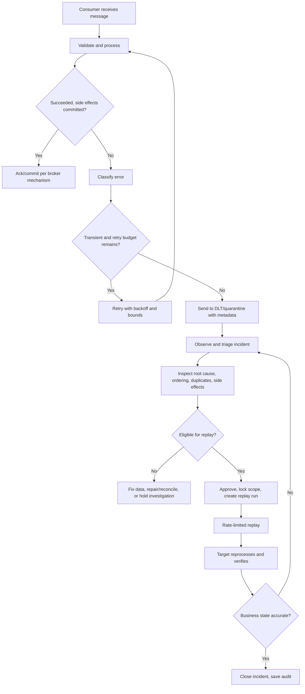

# Managing Dead Letters, Replays, and Recovery Operational Permissions

## 1. Why Are Dead Letters and Replays Part of Integration Operations?

A Spring Boot system integrating multiple services over HTTP, databases, Kafka, RabbitMQ, or Spring Integration adapters cannot assume every message succeeds on the first try. A record can fail because the database briefly went down, a partner API returned HTTP 503, a payload violated its schema, referenced data has not arrived yet, or consumer code has a bug. When that happens, the system must answer:

- **Is the error transient or unrecoverable on its own?** Should it retry immediately, retry later, or be isolated?
- **Where is the failed message?** Are the original payload, business key, failure reason, and broker position preserved?
- **Who has permission to inspect, update policies, approve, and execute replays?** Is every operational action audited?
- **Is replay safe?** Could the same message insert duplicate database rows, resend a payment, or revert business state to an older version?
- **When is recovery considered successful?** Re-publishing to a broker is only one step; the target must actually process and record the outcome.

This lesson belongs to the **Integration Operations** section of the `SPRING_BOOT_INTEGRATION` module. The focus is building a controllable incident-handling workflow end to end: intake, error classification, dead-lettering, investigation, approval, replay, business verification, and auditing.

**Core principle:** dead letters retain and isolate unprocessable messages; replay is an operational action **capable of creating additional side effects**. Both must be designed alongside idempotency, ordering policies, data contracts, and access control.

## 2. Distinguishing Retry, Dead-Letter, Quarantine, and Replay

| Concept | Purpose | Example |
| --- | --- | --- |
| **In-place retry (blocking retry)** | Retries when errors are likely to clear quickly, typically holding processing position | Retrying an HTTP call after backoff on 503 |
| **Delayed retry** | Defers processing to relieve load or wait for dependency recovery | Routing to a retry topic/queue scheduled for later |
| **Dead-letter queue/topic (DLQ/DLT)** | Routes messages that failed after applying the error policy | `orders.events.DLT` holding unprocessable events |
| **Quarantine** | Isolates for investigation, restricting automatic replay | An event violating the contract requiring source-team repair |
| **Replay / redrive** | Requests reprocessing of one or more stored messages | Re-injecting events from DLT back into the valid processing flow |
| **Reconciliation / repair** | Compares and fixes state from the source of truth | Reloading order state or rebuilding projections from source data |
| **Compensation** | Performs a compensating business action for a side effect that already occurred | Issuing a refund instead of re-running a debit command |

Dead-lettering **does not mean** the message was processed successfully. Replaying **does not guarantee** restoring accurate data: a replayed message may arrive after newer events, be rejected by the consumer, or have already executed partial side effects during its first failure.

Distinguish two categories inside a DLT:

1. **Technical-failure messages:** valid payloads where a dependency was temporarily unavailable; eligible for redrive once the dependency recovers.
2. **Data/business-failure messages:** invalid schemas, incompatible versions, or disallowed states; require fixing root causes and verifying replay preconditions before re-injection.

Never treat a DLT as permanent storage. Broker retention, TTLs, storage quotas, and purge policies can delete records before operations can handle them.

## 3. Recovery Lifecycle from Failure to Verification



A complete operational flow should carry an **incident ID**, a **replay run ID**, and **per-message statuses**. Operational statuses like `QUARANTINED`, `APPROVED`, `SUBMITTED`, `APPLIED`, and `REJECTED` track investigation and recovery progress; they **do not replace** Kafka offsets, RabbitMQ acks, or target database states.

Specifically, `SUBMITTED` means only that the replay emission was accepted based on current evidence. Only after the target consumer applies it successfully or reconciliation confirms the outcome should it be marked `APPLIED`.

## 4. Error Classification Policy Before Dead-Lettering

| Error Type | Indicator | Initial Action | Recovery Condition |
| --- | --- | --- | --- |
| Network, timeout, HTTP 429/503 | Dependency likely to recover | Bounded retries, exponential backoff, and jitter | Dependency stable, load limited |
| DB connection unavailable | Temporary connectivity issue | Thresholded retries, avoid connection storms | Health checks pass and transactions are safe |
| Un-deserializable payload | Bad JSON, unrecognized Avro/Protobuf schema | Quarantine early; do not retry indefinitely | Fixed parser/schema or source emits valid records |
| Business rule violation | Invalid state transition, missing referenced ID | Distinguish late-arriving data from permanent errors | Root cause and source state reconciled |
| Duplicate event | `eventId` already processed | Idempotent skip/ack once prior success is verified | No side-effect replay needed |
| Missing prior version | Received version 12 while target sits at version 10 | Park or block application; report gap | Version 11 applied, or rebuild policy applied |
| Consumer code bug | Multiple messages hitting the same stack trace after deploy | Isolate version, rollback/hotfix | Fix verified against copies of failing payloads |
| Revoked/expired credentials | Connector authentication failure | Halt auto-replay; fix secrets/permissions | Retry via controlled channel after auth recovers |

A **retry budget** must specify attempt count, total duration, backoff, timeouts, and stop rules. For example: 3 consumer attempts, then quarantine. This is a **policy example**, not a default for every service.

Some errors cannot be classified by HTTP status code alone. HTTP 409 might mean "already processed earlier" or "unresolved version conflict"; check the API contract and idempotency key. HTTP 400 can come from a buggy client serializer rather than bad source data.

If consumers continuously push thousands of records to the DLT, treat it as a broad outage. Letting the broker keep consuming rapidly can break business ordering and grow the investigation backlog out of control.

## 5. Metadata to Preserve Alongside Dead-Letter Messages

A DLT record needs enough context to reproduce the exact event and failure reason. Example investigation record kept separately from the raw payload record:

```json
{
  "deadLetterRecordId": "dlr-81452",
  "eventId": "evt-227ac9",
  "aggregateType": "Order",
  "aggregateId": "order-4711",
  "aggregateVersion": 17,
  "source": {
    "platform": "kafka",
    "topic": "orders.events",
    "partition": 4,
    "offset": 20987,
    "consumerGroup": "order-projection"
  },
  "failure": {
    "code": "DEPENDENCY_TIMEOUT",
    "classification": "TRANSIENT",
    "firstFailedAt": "2026-11-21T05:15:09Z",
    "lastFailedAt": "2026-11-21T05:16:20Z",
    "attemptCount": 3
  },
  "operations": {
    "status": "QUARANTINED",
    "incidentId": "INC-184",
    "replayRunId": null
  }
}
```

This is an **illustrative operational data model**, not a mandatory Kafka/RabbitMQ/SQS header format. You may store metadata in headers, an investigation table, or a separate event store, **provided you preserve a reference to the original payload** (raw bytes or a protected copy) and original key.

Minimum fields typically include:

- **Identity:** `eventId`, message ID, source system, message type/schema version, business key (aggregate ID).
- **Source location:** Kafka topic/partition/offset; RabbitMQ queue/exchange/routing key; SQS queue URL/ARN/relevant message attributes.
- **Failure:** controlled error code, first/last failure timestamps, attempt count, component name, app version; full stack traces stored in access-controlled logs.
- **Business semantics:** aggregate version/sequence, correlation ID, idempotency key, origin timestamp, and mutated entity.
- **Recovery trail:** requester, approver, scope, ticket, replay run ID, and target outcome.

Broker-generated headers differ across platforms. Spring Kafka adds original topic/partition/offset headers to DLT records; RabbitMQ adds dead-letter history headers; SQS exposes its own metadata. When building cross-broker operations tools, **normalize to a common model without deleting original metadata**.

Payloads often contain PII, customer identifiers, or financial details. Dashboards should show metadata and masked previews by default; only authorized investigators should view raw payloads. Never write tokens, passwords, or secrets into error headers or audit logs.

## 6. Spring Boot + Spring Kafka: Routing Failures to a DLT

### 6.1. Consumer Configuration

Suppose a consumer handles order update events on `orders.events` and quarantines failures to `orders.events.DLT`. Spring Boot 3.x and Spring Kafka 3.x example:

```yaml
spring:
  kafka:
    bootstrap-servers: ${KAFKA_BOOTSTRAP_SERVERS}
    consumer:
      group-id: order-projection
      enable-auto-commit: false
      key-deserializer: org.apache.kafka.common.serialization.StringDeserializer
      value-deserializer: org.apache.kafka.common.serialization.StringDeserializer
    listener:
      ack-mode: record
```

This example uses a `String` payload to focus on the error path. When deserializing JSON/Avro/Protobuf directly before the listener, errors can happen **before `@KafkaListener` is even invoked**; configure `ErrorHandlingDeserializer` and a matching DLT serializer/publisher path to preserve failing payloads. Do not assume `try/catch` inside the listener catches every exception.

### 6.2. Error Handler with Bounded Retries

```java
import org.apache.kafka.common.TopicPartition;
import org.springframework.context.annotation.Bean;
import org.springframework.context.annotation.Configuration;
import org.springframework.kafka.core.KafkaTemplate;
import org.springframework.kafka.listener.DeadLetterPublishingRecoverer;
import org.springframework.kafka.listener.DefaultErrorHandler;
import org.springframework.util.backoff.FixedBackOff;

@Configuration
public class DeadLetterConfiguration {

    @Bean
    DefaultErrorHandler kafkaErrorHandler(KafkaTemplate<Object, Object> template) {
        DeadLetterPublishingRecoverer recoverer =
                new DeadLetterPublishingRecoverer(
                        template,
                        (record, error) -> new TopicPartition(
                                record.topic() + ".DLT", -1));

        DefaultErrorHandler handler =
                new DefaultErrorHandler(recoverer, new FixedBackOff(1_000L, 2L));

        handler.addNotRetryableExceptions(PermanentEventException.class);
        return handler;
    }

    public static class PermanentEventException extends RuntimeException {
        public PermanentEventException(String message) {
            super(message);
        }
    }
}
```

In the example above:

- `FixedBackOff(1_000L, 2L)` runs two retries after the initial attempt, spaced 1 second apart.
- `PermanentEventException` is marked non-retryable so data errors route straight to the recoverer per policy.
- `DeadLetterPublishingRecoverer` sends failed records to the target topic; partition `-1` lets the producer choose the DLT partition. This **does not preserve the source topic's exact partition/ordering**.
- The DLT topic, key/value serializers, ACLs, and retention must be provisioned ahead of time. For un-deserializable payloads, the recoverer's serializer must handle failed payload types properly.
- Verify how **successful DLT delivery is confirmed** before the container treats the source record as recovered and commits its offset; test DLT-unavailable scenarios so messages aren't dropped in between.

This is a basic setup without multi-tier retry topics. Spring Kafka provides non-blocking retry topics depending on version/config; **moving to a retry topic allows newer records to be processed before failed ones**. When strict per-aggregate ordering is mandatory, use blocking retries or version-gating logic.

### 6.3. Listener and Transactions/Idempotency

```java
import org.apache.kafka.clients.consumer.ConsumerRecord;
import org.springframework.kafka.annotation.KafkaListener;
import org.springframework.stereotype.Component;

@Component
public class OrderProjectionListener {
    private final OrderProjectionService projectionService;
    private final OrderEventCodec codec;

    public OrderProjectionListener(
            OrderProjectionService projectionService,
            OrderEventCodec codec) {
        this.projectionService = projectionService;
        this.codec = codec;
    }

    @KafkaListener(topics = "orders.events")
    public void onRecord(ConsumerRecord<String, String> record) {
        OrderEvent event;
        try {
            event = codec.decode(record.value());
        } catch (InvalidEventSchemaException invalid) {
            throw new DeadLetterConfiguration.PermanentEventException(
                    "Event schema is invalid");
        }

        // Service handles DB transaction, duplicate check, and version guard.
        projectionService.applyIdempotently(event);
    }
}
```

`OrderEventCodec`, `OrderEvent`, `InvalidEventSchemaException`, and `OrderProjectionService` are illustrative business components to build in your project. If `applyIdempotently` commits the DB and the app dies before committing the Kafka offset, the record can be redelivered; the consumer must skip duplicates safely. Never ack early before transactions or async work complete.

Important note: the default error handler does not replace application policy for HTTP side effects. If a payment call went out to an API and then the DB update failed, retries/replays can fire that call again. Use idempotency keys on the receiving API or an outbox/reconciliation design.

## 7. RabbitMQ, SQS, and Spring Integration Adapters

### 7.1. RabbitMQ: Dead-Letter Exchanges and Negative Acknowledgments

In RabbitMQ, a source queue can bind a dead-letter exchange (DLX) so the broker routes messages rejected/nacked with `requeue=false`, expired via TTL, or exceeding queue limits to a dead-letter queue.

```text
Producer → exchange: orders.x → queue: orders.q
                                  │
                  reject/nack (requeue=false)
                                  ▼
                             DLX: orders.dlx
                                  │
                                  ▼
                         Queue: orders.dead
```

Simple Spring AMQP consumer configuration example:

```yaml
spring:
  rabbitmq:
    listener:
      simple:
        default-requeue-rejected: false
```

This prevents the container from requeueing by default when a listener fails per its mechanism. **The broker retains messages in the dead-letter queue only when DLX routing, bindings, target queue, and policies are properly provisioned.** Without a valid dead-letter path, messages can be dropped. Dead-letter routing is often configured via broker **policies** for operational flexibility; hard-coding `x-dead-letter-exchange` in queue arguments requires planning around queue lifecycles and updates.

Pair `default-requeue-rejected=false` with a retry strategy: retry interceptors, delayed retry queues, or other Spring AMQP/topology patterns. Unbounded requeue loops on a poison message rapidly overload CPU, network, and queues.

In RabbitMQ, competing consumers, prefetch, retries, and requeues affect processing order. Replaying a message from a dead-letter queue does not place it back in its **exact original position** in the source queue.

### 7.2. Amazon SQS: DLQ and Redrive Policies

SQS configures dead-letter queues, `maxReceiveCount` thresholds, and matching send/receive permissions. After repeated failed receives, the source queue moves the message to the DLQ per SQS rules.

- With **SQS Standard**, strict ordering is not guaranteed and duplicate deliveries can occur.
- With **SQS FIFO**, message groups preserve per-group ordering during normal flow. Moving a message to a DLQ and redriving it later can break application ordering assumptions if later messages in the same group already processed.
- Plan retention across both source queues and DLQs; never assume a message stays in a DLQ indefinitely.
- SQS redrive tooling has its own mechanics and permissions. Operators must verify source/destination queues, counts, and redrive rate limits matched to service capacity.

### 7.3. Spring Integration: Error Channels and Adapters

Spring Integration offers `errorChannel`, `ErrorMessage`, advice, and adapter flows. Synchronous or asynchronous flow errors can route to error channels depending on configuration. **Sending an `ErrorMessage` to an error channel does not automatically persist it to a durable DLQ.**

To recover across restarts, design the error flow to **persist payloads and required metadata to a durable store** such as a broker DLT or quarantine table. Verify where inbound adapter acknowledgments (Kafka, AMQP, JMS, HTTP, etc.) occur; an error flow that swallows exceptions and returns normally can trick the source into treating the record as processed.

### 7.4. Comparison Table of Recovery Operations

| Technology | Where Failed Records Live | Replay/Redrive Mechanism | Key Watchouts |
| --- | --- | --- | --- |
| Kafka | Dedicated DLT or quarantine topic | Consumer reads DLT and republishes to processing/replay topic; or group offset management | Offset reset is a broad partition/group operation, not single-event selection |
| RabbitMQ | Dead-letter queue via DLX | Controlled consumer reads dead queue and republishes to target exchange | Ack dead record only after publish confirm; requeue loses original position |
| SQS | DLQ attached to source queue | SQS redrive or controlled worker | Retention, rate limits, message groups, and IAM |
| Spring Integration | Error channel, store, or external broker | Application-designed recovery flow | In-memory error channels are not durable storage |

## 8. Choosing the Replay Method to Match Incident Scope

A single bad record and an outage affecting millions of records need different strategies.

### 8.1. Per-Message Replay

Suitable when errors hit only a few records. The operator selects by `eventId` or DLT ID, inspects metadata, verifies the aggregate's current state, and submits a targeted replay request. Enforce guards against replaying another customer's event or re-sending an already-succeeded side effect.

### 8.2. Filtered Batch Replay

Suitable for outages with a shared root cause. Filters should rely on verified criteria:

- Source topic/queue, consumer group, or integration flow name.
- Failure time window and specific `failureCode`.
- Fixed application version or schema version.
- Explicit set of approved event IDs or business keys.

Always require a **count preview**, max cap, rate limit, and stop capability. Avoid overly broad filters like "all DLT messages" unless you have proven every failure type is resolved.

### 8.3. Replaying by Resetting Kafka Consumer Offsets

Kafka stores offsets per **consumer group + topic + partition**. Resetting a group's offset causes consumers to re-read *the entire range* from the new offset, including records already processed. Useful for rebuilding projections, yet far broader than replaying one DLT message.

Before acting:

1. Identify the exact group, topic, partitions, target offsets, and start time.
2. Stop or coordinate group consumers to prevent new commits during offset changes.
3. Estimate re-read volume, write load, and duplicate exposure.
4. Ensure consumers are idempotent or target a separate rebuild group/topic/projection.
5. Save old offsets, rollback plans, approval evidence, and results.

**Never use an offset reset as a "quick fix" for one poison message** when bulk side-effect replays must be avoided. For targeted reprocessing, replay explicitly from DLT/quarantine—it is safer and easier to audit.

### 8.4. Repairing from the Source of Truth

Replaying old events is not always the right answer. If the latest state lives in a source database, you can reconcile or rebuild projections via versioned snapshots.

For instance, a projection is already at version 15 while version 11 sits in the DLT: replaying version 11 may rightly be rejected as stale. If current state is already accurate, mark it `SUPERSEDED` after reconciliation; if data is still missing, use snapshot/reconciliation to restore the right outcome. Because this mutates business state directly rather than just moving messages, it requires explicit approval.

## 9. Safe Replay Requires Idempotency, Transactions, and Version Guards

### 9.1. Design Replays Under At-Least-Once Assumptions

A replay workflow spans at least two systems: reading failed records and re-emitting them. If publishing succeeds yet the worker dies before saving audit state, a rerun can republish duplicates. This is a **dual-write** problem; simply setting `SENT` right after `send` does not solve it.

Minimum design:

1. Preserve the logical `eventId` and `aggregateId`; attach `replayRunId` in operational metadata.
2. Target consumers enforce **deduplication by event ID and consumer/side-effect name**, updating state inside a transaction.
3. For external HTTP calls, pass a stable idempotency key or coordinate side effects via an outbox.
4. Replay workers must tolerate duplicate publishes and reconcile records stuck in unknown outcome states.
5. Mark `APPLIED` only after evidence of target processing or verified state reconciliation.

Simplified PostgreSQL consumer idempotency table example:

```sql
CREATE TABLE processed_integration_event (
    consumer_name VARCHAR(80) NOT NULL,
    event_id VARCHAR(128) NOT NULL,
    processed_at TIMESTAMPTZ NOT NULL DEFAULT CURRENT_TIMESTAMP,
    PRIMARY KEY (consumer_name, event_id)
);
```

**Condition:** inserting the dedup marker and mutating business data must live in the **same DB transaction**. Inserting the marker first and failing on business logic causes future retries to falsely treat it as done. For external APIs, enforce API-side idempotency/reconciliation because a DB transaction cannot roll back an external service call.

### 9.2. Place Version Guards on Ordered Data

Suppose for the same `orderId`:

```text
OrderCreated      version=1  → APPLIED
OrderPaid         version=2  → DLT due to DB error
OrderShipped      version=3  → already processed or waiting
```

If `OrderShipped` already persisted, replaying `OrderPaid` without a version check could regress state back to `PAID` after `SHIPPED`. Choose one strategy:

- **Strict sequence:** apply only `version = lastAppliedVersion + 1`. Hold newer versions until the gap is resolved.
- **Monotonic projection:** never overwrite newer state with older events; handle superseded events explicitly.
- **Rebuild/reconciliation:** recompute state from the source of truth or full event history when causal restoration is needed.
- **Compensation:** if a wrong side effect already committed, emit a compensating action rather than re-running an old event.

A message re-injected from a DLT onto a Kafka topic receives a **new** offset; it cannot be squeezed back into its old offset. Keeping the key routes it by current partitioning, **not its original causal position**. If partition counts or partitioners changed, re-evaluate key mapping.

### 9.3. Distinguish Failed Records from Side Effects That Already Happened

Example payment worker:

1. Sent `capture` to the payment gateway.
2. Gateway succeeded.
3. Worker timed out before updating the DB and threw an exception.
4. Message entered the DLT.

Direct replay could **capture a second time**. Before replaying, query the gateway by payment ID/idempotency key and reconcile the ledger. If the gateway already succeeded, resume from checkpoint/repair state instead of re-issuing a fresh payment command.

## 10. Operational Permission Model: Who Can Do What?

Dead letters can contain sensitive data and replays can mutate live business state. Therefore **visibility, payload reading, request creation, approval, and execution permissions** must be separated.

| Role | View Metrics / DLT Counts | View Raw Payloads | Create Replay Request | Approve | Execute |
| --- | --- | --- | --- | --- | --- |
| Viewer / L1 On-call | Yes | Masked by default | May propose, cannot execute | No | No |
| Investigator / L2 On-call | Yes | Scoped access only | Yes | No, or low-risk policy only | No |
| Service owner | Yes | Per data ownership | Yes | Yes within owned service | Per approved policy |
| Independent approver | Yes | Need-to-know basis | Reviews requests | Yes | No for sensitive runs |
| Replay operator / Automation | Yes | Minimal fields needed to run | Receives approved requests | Never self-approves same request | Yes within granted scope |
| Security / Audit | Audit trails and permitted evidence | Separate controlled process | No by default | Policy oversight | No by default |

This table is a **reference model** to tailor to your organization and data policies. Small services might combine low-risk roles, whereas payments, accounts, customer data, or bulk mutations warrant **two-person approval** separating requester from executor.

Permission design principles:

- **Least privilege:** metrics-only accounts do not need `consume` on raw DLTs or `produce` on business topics.
- **Explicit scope:** restrict by environment (dev/staging/prod), namespace, cluster, topic/queue, event type, and max record count.
- **Time-bounded access:** emergency break-glass access carries expiration, justification, session auditing, and post-incident review.
- **Machine identity:** replay service accounts may read only required DLT sources and write only to approved target topics/queues.
- **No personal accounts in shared scripts:** actions must bind to managed identities and securely stored tokens/certificates.
- **Protect payloads:** mask sensitive fields in UIs/logs; grant raw payload access only for investigation and audit every view.
- **Deny by default:** replay endpoints enforce server-side authentication and authorization; never rely on a "disabled" UI button.

On brokers, combine app IAM/RBAC with Kafka ACLs, RabbitMQ permissions/vhosts, or AWS SQS IAM policies. **Securing only the API endpoint while the backend service account can write to every topic leaves a major gap**; enforce permissions at both broker and application layers.

## 11. Approval and Audit Workflow for a Replay Run

A replay run must capture **who**, **what**, **why**, **where**, **when**, and **what impact occurred**.

Example operational request:

```json
{
  "replayRunId": "replay-20261121-0042",
  "incidentId": "INC-184",
  "requestedBy": "operator-L2",
  "approvedBy": "service-owner",
  "reason": "Partner API restored after 503 outage",
  "source": "orders.events.DLT",
  "target": "orders.events",
  "selection": {
    "failureCode": "PARTNER_HTTP_503",
    "from": "2026-11-21T04:30:00Z",
    "to": "2026-11-21T05:00:00Z",
    "expectedCount": 120
  },
  "policy": {
    "maxMessages": 120,
    "maxPerSecond": 5,
    "stopOnErrorRatePercent": 10
  },
  "status": "APPROVED"
}
```

Identifiers, timestamps, and thresholds above are illustrative. Never accept a client-supplied `approvedBy` string as proof. Derive the approver identity from the authentication context, persist the **server-side approval decision**, and re-verify before execution.

Audit data should record:

1. **Request:** creator, timestamp, ticket, reason, selection criteria, expected count, hash/snapshot of record list.
2. **Review:** approver, timestamp, policy version, permitted scope, and thresholds.
3. **Execution:** executor identity, worker/job version, start/stop times, source/target, rate, sent count, and error count.
4. **Outcome:** confirmed applied count, skipped duplicates, stale/gap count, remaining failures, and reconciliation proof.
5. **Change history:** who canceled, paused, adjusted thresholds, or retried; any scope change requires fresh approval.

Execution may process only the **approved snapshot or ID list**. If the UI approved "120 HTTP 503 events" and the worker runs an unbounded query matching 10,000 new events, execution exceeded its approval scope.

## 12. Practical Runbook: Recovering a DLT Wave After an Outage

### Step 1 — Stop the Incident from Spreading

Confirm whether the root error is fixed. If consumers keep flooding the DLT, throttle intake, pause the consumer group, or filter out the failing event class per policy. Avoid shutting down the whole integration flow if doing so causes worse impact; isolate blast radius by business key or partition.

Capture a metric snapshot: DLT record count, growth rate, oldest record age, source topic/queue, and error rate. Record the incident ID and service version.

### Step 2 — Group and Investigate Data

Sample representative records by `failureCode`, schema version, consumer version, and failure window; view masked payloads first. Cross-check against the source of truth and logs/traces.

Never mix unrelated root-cause groups in one replay run. HTTP 503 failures may be replayable, while schema errors require a code fix or producer correction.

### Step 3 — Assess Replay Validity

Verify:

- Dependencies recovered, consumer bug is fixed, and schemas/adapters are compatible.
- Messages were not already completed via another path; idempotency keys remain valid.
- Current aggregate state allows re-application, or a repair/superseded strategy is ready.
- No partial payment, email, ledger, or webhook side effects occurred without reconciliation.
- Retention/TTL allows enough time and source payloads remain intact.
- DB, HTTP pools, broker, and consumers have headroom for the extra load.

If any question remains unanswered, keep them quarantined and investigate; do not rush to click replay.

### Step 4 — Draft Proposal and Obtain Approval

Lock the message ID set or fixed filter, source/target, total count, rate limit, owner, stop triggers, and completion criteria. Obtain approval from an authorized scope/environment owner, adding an independent reviewer for high-impact runs.

### Step 5 — Pilot a Small Batch

Run a representative subset in staging with protected data, or in production at tiny scale per policy. Confirm the fix resolves the root error without increasing duplicates or stale state. Watch real side effects when testing in production; never confuse a "dry run" (simulation only) with a "canary replay" (writes real data).

### Step 6 — Rate-Limited Batch Replay

Use a controlled replay worker with rate limits, batch sizes, backpressure, stop switches, and checkpoint-based resume. Record statuses per record and per run. Halt automatically if errors spike or data anomalies emerge.

### Step 7 — Verify Outcomes at the Target

Do not rely solely on successful publish counts. Reconcile `eventId`, aggregate versions, DB states, HTTP responses, outboxes, new DLT arrivals, and consumer lag. Records skipped as duplicates can be **valid outcomes** if already applied; stale/gap records need separate categorization.

### Step 8 — Close Incident and Improve

Archive evidence, tickets, verified counts, remaining failures, and closure sign-off. Update monitoring, contract/schema validation, retry policies, and runbooks if recurrence is possible.

## 13. Designing a Controlled Replay Worker

Suppose Spring Boot implements an **internal replay service** reading from DLT/quarantine and emitting approved runs back into processing. A control API might look like:

```text
POST /internal/replays             → create request, state DRAFT
POST /internal/replays/{id}/review  → approver approves, state APPROVED
POST /internal/replays/{id}/start   → executor begins run
POST /internal/replays/{id}/pause   → pause before processing next record
GET  /internal/replays/{id}         → progress, errors, applied count
```

These endpoints are **illustrative API design**. Real implementations need internal authentication, record/scope-level authorization, replay-request deduplication, auditing, and resource limits. For long runs, never hold a single HTTP request open for the whole execution.

Pseudocode for a replay job:

```text
run = loadApprovedReplayRun(runId)
authorizeExecutor(actor, run.environment, run.source, run.target)
assertApprovalStillValid(run)
assertSelectionMatchesApprovedSnapshot(run)
acquireLease(runId)

for record in approvedRecords(run):
    if runPausedOrCancelled(runId):
        break

    enforceRateLimit(run.maxPerSecond)
    state = inspectTargetState(record.aggregateId, record.version)

    if alreadyApplied(record.eventId) or supersededAccordingToPolicy(state, record):
        auditSkip(record, reason)
        continue

    ensureReplayPreconditions(record, state)
    publishWithOriginalKeyAndEventId(
        target=run.target,
        payload=record.originalPayload,
        headers={"replayRunId": runId, "replayAttemptId": stableAttemptId(record)}
    )
    awaitBrokerAcknowledgmentOrPublisherConfirm()
    auditSubmission(record)

releaseLease(runId)
verifyAppliedResultsAndReconcile(runId)
```

Real implementations must handle crashes between `publish` and `auditSubmission`. One approach writes a **replay outbox** and uses a state-driven worker, accepting possible duplicate publishes while idempotent consumers protect side effects. Support retries and reconciliation for attempts with unknown outcomes.

Never "edit the payload directly on the DLQ" and pretend it is still the original event. If schema transformation is required, create a derived record with `derivedFromEventId`, transformation version, and full audit—preserving the original payload for traceability.

## 14. Least-Privilege Execution and Infrastructure Controls

### 14.1. Kafka

A Kafka replay tool may need:

- `READ` access on the DLT topic and investigative/replay consumer group.
- `WRITE` access on the **specific approved target topic**.
- Minimal `DESCRIBE` access for inspection metadata.

Never grant cluster-admin or consumer-group offset-alter permissions just because a worker needs to publish a few events. Offset resets should be a separate operational privilege governed by dedicated runbooks and approvals.

Across multiple environments, isolate principals and broker ACLs between staging and production. Restrict network paths, certificates/tokens, and secret scopes of the replay worker.

### 14.2. RabbitMQ

Restrict vhosts, exchanges, and queues the tool can consume/publish. Never let the replay app create or delete arbitrary queues/exchanges unless truly needed and administratively approved. Wait for publisher confirms before acking/deleting DLQ records; on publish failures, retain the record for retry.

### 14.3. SQS

Separate IAM policies for reading the DLQ, sending to target queues, and running redrive management actions. With SQS-managed redrive, grant exact required permissions on source DLQ and destination queues per service docs. Never grant account-wide `sqs:*` wildcards just to redrive one queue.

### 14.4. Application and Platform

Use Spring Security roles/policies (or an equivalent IAM layer) to check action + resource + environment, re-validating right before execution. Rate limits, quotas, policy thresholds, and separation between approver and executor must be **enforced server-side**. Audit logs must reside in append-only or tamper-protected storage per organizational standards.

## 15. Dead-Letter Observability and Alerting

**DLT message count alone is insufficient.** Combine backlog, record age, and business outcome tracking.

| Metric | Meaning | Suggested Use |
| --- | --- | --- |
| Rate of new messages entering DLT | Whether failures are ongoing or stopped | Alert on spikes by rate and duration |
| DLT / quarantine backlog | Volume awaiting investigation | Capacity planning, recovery SLAs |
| Oldest record age | Risk of breaching processing/retention limits | Alert against business SLA deadlines |
| `failureCode` breakdown | Isolates dominant error causes | Route incidents to the right service owner |
| Retry attempts & exhausted retries | Whether retry policy is helping | Catch retry loops or prolonged outages |
| Replay submitted / applied / skipped / failed | Real recovery progress | Never confuse submitted with applied |
| Version gaps / stale / duplicates | Ordering and idempotency health | Catch data bugs even when lag is low |
| Consumer lag and DB/HTTP errors | Impact of replay on primary traffic | Tune rate limits; stop on overload |
| Replay actions by actor/environment | Operational permission anomalies | Security/audit investigations |

Micrometer, Spring Boot Actuator, structured logs, and distributed tracing can tie `correlationId`, `eventId`, and `replayRunId` end to end. However, `eventId`/`aggregateId` have very high cardinality: keep them in controlled logs/traces rather than standard Prometheus metric labels.

Tie alerts to realistic goals: "DLT growing steadily for 10 minutes," "queued records nearing business deadline," "replay re-triggering errors > threshold," or "DLT approaching retention expiry." Calibrate thresholds to your SLA, throughput, and operational response windows rather than using a universal constant.

## 16. Testing the Failure and Recovery Lifecycle

Production-like tests should run real brokers and databases via Testcontainers where suitable. For Kafka/Spring Kafka, test deserialization failure config, DLT publishing, consumer error handlers, and DB transactions; mocking `DefaultErrorHandler` alone does not prove messages land in the dead-letter topic.

| Scenario | Evidence to Collect |
| --- | --- |
| Consumer hits transient HTTP 503 | Bounded retries with backoff occur; never retries forever |
| Invalid schema payload | Routed to quarantine preserving raw payload and investigative metadata |
| DLT topic/queue unavailable | Source record is never acked/committed as recovered before durable dead-lettering |
| DB commit succeeds but ack/offset fails | Redelivery produces zero duplicate side effects |
| Same event replayed twice | Consumer dedup or reconciliation yields accurate result |
| Older event version replayed after newer version | Guard blocks regression or applies superseded policy cleanly |
| Batch replay exceeds approved limit | System rejects or halts with full audit |
| Unauthorized operator | Cannot view raw payloads or execute; cannot bypass via direct API calls |
| Self-approval of high-risk action | Policy enforces an independent approver |
| Replay worker crashes after publish | Resumes safely; audit records uncertain attempt for reconciliation |
| Broker backpressure or HTTP errors return | Rate limits and stop switches engage without amplifying load |
| Message nears retention expiry | Alerts and alternate recovery paths (snapshot/reconciliation) are clear |

Never stop at asserting "the consumer re-read the message." Critical tests must verify the **final state in target databases/APIs** and actual side-effect counts.

## 17. Synthesis Scenario: Recovering Payment Events After an Outage

Suppose `payment-service` emits `PaymentCaptured` to Kafka. A Spring Boot consumer `invoice-sync` calls an accounting API and records sync state in PostgreSQL. During an accounting API outage, 600 events land in `payments.captured.DLT` after bounded retries.

If operations immediately hits "Replay all," risks include:

- Some API calls succeeded before timing out on the client; replaying creates duplicate invoices.
- Old events relate to invoices already canceled or adjusted through another flow.
- Firing 600 requests at once overloads the accounting API again and refills the DLT.
- Operators lacking authorization handle financial payloads without proper audit trails.

Controlled procedure:

1. On-call opens an incident, confirms the accounting API is healthy, and verifies DLT inflow stopped.
2. Investigator inspects metadata, groups by error code, and reconciles invoice status at the target API via `invoiceId`/idempotency key.
3. Events already completed at accounting are resolved via reconciliation/marking applied—**never re-sending invoice creation commands**.
4. Remaining unapplied events are locked into a snapshot scoped by source, time window, and count.
5. Service owner approves scope and replay rate; the executor runs under a replay account restricted to reading the DLT and publishing to the target path.
6. Run a controlled canary, then rate-limited small batches watching API errors and DB outcomes; halt immediately if duplicates or unexpected states appear.
7. Reconcile totals: applied, valid duplicates, superseded, and remaining failures; retain per-record audits and close the incident once data is verified.

This scenario shows that replay is a **data recovery workflow**, not merely shuffling messages between queues or topics.

## 18. Operationalizing Dead-Letter and Replay Checklist

- [ ] Transient/permanent classification policy, retry budgets, and DLT triggers are defined.
- [ ] DLQ/DLT is provisioned with retention/TTL, quotas, permissions, and monitoring.
- [ ] Failed messages preserve original payload, key, source location, error code, event ID, schema version, and correlation ID.
- [ ] Ack/commit semantics when dead-lettering succeeds or fails are explicitly verified.
- [ ] Target consumers enforce idempotency, transactions, and ordering/version guards.
- [ ] Per-message replay, batch replay, offset reset, and repair/reconciliation are clearly separated.
- [ ] Separate roles govern viewing metadata, viewing raw payloads, requesting, approving, and executing.
- [ ] Approved snapshots, scope/rate caps, stop switches, and crash-resume support are implemented.
- [ ] External side effects (HTTP payments, emails, webhooks, DBs, brokers) are verified.
- [ ] Audits link incident, replay run, and message—recording actor, decision, attempts, and verified outcomes.
- [ ] Metrics cover new DLT arrivals, backlog, message age, retries, replay applied, duplicates, gaps, and recurring errors.
- [ ] Runbooks are rehearsed with simulated faults: poison messages, DLT outages, duplicate replays, crashes between publish and audit, and missing permissions.

**Expected outcome:** when an integration message cannot be processed, the team can explain exactly why it failed, preserve evidence, pick the right recovery strategy, constrain permissions and blast radius, and prove business state is accurate afterward. Dead-lettering, replay, idempotency, and auditing must be designed as one unified operational workflow.
