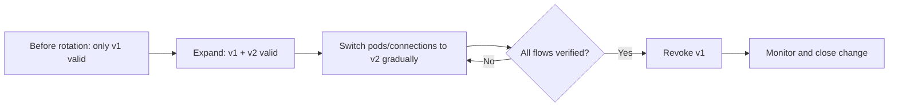
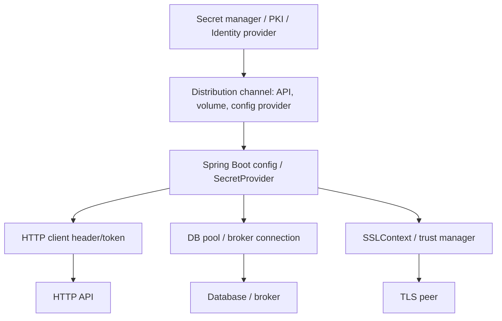
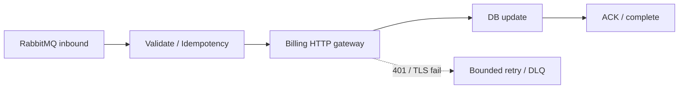
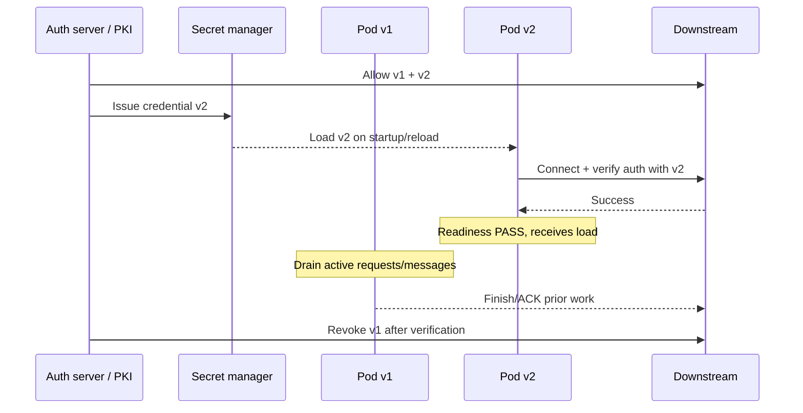

# Rotating Secrets, Keys, and Certificates Without Stopping the Entire Flow

## 1. Operational Problem: Changing Security Material While Systems Keep Exchanging Data

In **Spring Boot Integration**, a single application may simultaneously call HTTP APIs, access PostgreSQL or Redis, consume RabbitMQ/Kafka, and connect to LDAP. Each connection can depend on a **password**, **API token**, **signing/encryption key**, or **TLS certificate**. Those credentials must be rotated periodically, upon expiration, or immediately after a leak, while synchronous flows, event processing, and transactions must keep running.

Example: an order-processing service has four dependencies:

| Integration Flow | Credential to Rotate | Consequence of Rotating in the Wrong Order |
| --- | --- | --- |
| Calling Billing API over HTTP | API key or OAuth client secret | Starts returning `401/403`, retries spike, orders fail payment |
| Reading PostgreSQL via connection pool | DB account password | Existing connections stay alive while new ones fail; pool drains out |
| Consuming RabbitMQ and publishing results | Broker username/password or mTLS cert | Consumers disconnect, queue backlog grows, messages redeliver |
| Connecting to LDAP/HTTPS over TLS | Server certificate, trusted CA, or client certificate | TLS handshake fails, user auth and data sync break |

**The operational goal is not to avoid every connection close.** Changing credentials or certificates often requires opening new connections. The goal is maintaining **system processing capacity**, rolling out changes incrementally, and preserving data during retries or failover. If downstream infrastructure permits only one active credential at a time, plan around that constraint rather than claiming zero-disruption rotation everywhere.

### 1.1. Distinguishing Rotation Targets

| Target | What Changes? | Typical Operational Mechanism |
| --- | --- | --- |
| **Login secret** | DB password, API token, broker credential, OAuth client secret | Server accepts new credential; clients switch over; revoke old credential |
| **Encryption/signing key** | Symmetric key, private/public key, key encryption key | Attach key ID/version; retain old key to decrypt/verify historical data; create new data with new key |
| **TLS server certificate** | Certificate + private key on server/proxy | Issue new cert with valid SANs, deploy to servers, verify CA chain and hostname |
| **mTLS client certificate** | Client certificate + private key, possibly server truststore | Server trusts old/new clients; client loads new identity; test handshake then revoke old |
| **CA / trust anchor** | CA trusted by clients/servers | Distribute new CA first, maintain overlap trust window, remove old CA after all endpoints switch |

**Secret**, **private key**, and **certificate** are not synonymous. An X.509 certificate can be distributed publicly, while its accompanying **private key** must stay protected. For keys encrypting long-lived stored data, deleting the old key immediately upon rotating to a new one can make old data unreadable.

## 2. Core Principle: Expand Acceptance Before Contracting

In systems that support two valid credentials simultaneously, the safe strategy is **expand → switch → verify → contract**:

1. **Expand:** the verifier/server allows both **old and new** credentials or trust anchors during the transition window.
2. **Switch:** update credential consumers per group of instances, clients, or connections while keeping enough serving capacity during rollout.
3. **Verify:** verify new instances actually use the new version and business flows succeed—including fresh connections, retries, and message processing.
4. **Contract:** revoke/remove the old credential once no consumer depends on it, accounting for TTLs, caches, connection pools, and in-flight work.



This diagram **applies only when the target system supports parallel validity**: multiple API keys, two client identities, multiple signature-verification public keys, or both old and new CAs. Some databases allow only one password per principal and cannot hold two passwords simultaneously; in that case, create two service accounts with matching privileges and migrate gradually, or use the DBMS's native credential-rotation support while testing connection pool impact.

### 2.1. Four Delays to Include in the Transition Window

- **Propagation time:** the new secret is written to a secret manager, Kubernetes volume, or config provider, but instances do not receive it simultaneously.
- **Cache lifetime:** applications or SDKs may keep tokens, TLS contexts, DNS, certificates, or secrets in memory.
- **Connection lifetime:** DB connection pools, HTTP keep-alive, AMQP channels, or Kafka clients can hold existing connections/identities open.
- **Work duration:** unacked messages, active transactions, or long-running jobs must finish or resume safely.

Never equate "updated the Kubernetes Secret" with "every app is using the new secret." Whether the app actually uses it depends on **how the app reads and reloads** that value.

## 3. Preparation: Map Dependencies and Identify the Source of Truth

Before rotating, know **where the secret is used, who validates it, and how the app reloads it**. A useful inventory:

| Field to Record | Example | Why |
| --- | --- | --- |
| Logical integration | `billing-api`, `orders-db`, `rabbit-primary` | Pinpoint exact affected flows |
| Credential reference/version | `secret://billing/client-token#v12` | Track versions without recording sensitive values |
| Issuer and owner | Secret manager, PKI, DBA, broker admin | Know who can issue and revoke |
| How the app loads it | Env var, volume, secret manager API, SSLContext | Determine reload vs. rolling restart |
| Consumers | Pods, batch workers, cron jobs, CI tools | Avoid missing a consumer |
| Connection model | Per-request HTTP, DB pool, TLS, persistent AMQP | Know when new credentials take effect |
| Deadline and rollback | Expiry, grace period, recovery steps | Pick a safe rotation window |
| Success signals | `2xx` rate, DB connection success, consumer lag | Verify real operational impact |

Separate the **source of truth** from **in-memory copies**:



If Java code captures a password or certificate into a `final` field during bean construction, changing an external config file **will not update that bean**. If an SDK caches tokens until near expiry, know the SDK's refresh mechanics. If a certificate was loaded into `SSLContext` at HTTP client startup, updating a mounted volume file does not automatically switch new connections to the new key.

## 4. Secrets in Spring Boot: Refreshing Values and Refreshing Connections Are Two Separate Steps

Common configuration sources:

| Delivery Method | When Source Secret Changes | What the App Usually Needs |
| --- | --- | --- |
| Container environment variables | Env vars inside a running process **do not auto-update** | Rolling restart/rollout of containers with new config |
| Kubernetes Secret mounted as volume | Mounted files update **asynchronously**; `subPath` mounts never auto-update | Watch file changes and rebuild components using the secret, or rolling restart |
| Secret manager SDK | Can fetch new versions via API/SDK cache/TTL | Refresh cache, check multi-instance sync, and apply to clients |
| Standard Spring `@ConfigurationProperties` | Binds values on bean creation; does not auto-rebind just because source changed | Explicit refresh mechanism or bean recreation via rollout |
| JVM TLS key/truststores | `SSLContext`/trust managers may have loaded certs into memory | Recreate TLS contexts/connection pools or use verified reload features |

Plain Spring Boot **does not promise hot reload of every secret for every client**. Some Spring Cloud integrations or SDKs offer refresh mechanisms; verify against your exact version and real HTTP client/driver/broker behavior. "Refreshed properties" means little if a connection factory or TLS context still holds old credentials.

### 4.1. Example: HTTP Bearer Token Fetched per Request

When the target API accepts both old and new tokens, design a provider returning the current token. An interceptor reads the token on every outbound request rather than baking it permanently into the builder:

```java
import org.springframework.context.annotation.Bean;
import org.springframework.context.annotation.Configuration;
import org.springframework.web.client.RestClient;

public interface BillingTokenProvider {
    String currentToken(); // Retrieves active token from cache/secret manager.
}

@Configuration
public class BillingClientConfiguration {
    @Bean("billingClient")
    RestClient billingClient(
            RestClient.Builder builder,
            BillingTokenProvider tokenProvider) {
        return builder.clone()
                .baseUrl("https://billing.example.org")
                .requestInterceptor((request, body, execution) -> {
                    request.getHeaders().setBearerAuth(
                            tokenProvider.currentToken());
                    return execution.execute(request, body);
                })
                .build();
    }
}
```

`BillingTokenProvider` is an illustrative interface, **not** an out-of-the-box bean. Its implementation must account for TTL, refresh intervals, secret manager outages, retries/backoff, and secret permissions; cache safely in memory under controlled refresh rather than hitting the secret manager on every HTTP request. If the provider returns an expired token or fails to fetch a new one, enforce a clear policy: transient errors can use bounded timeout/retry; **never** fall back to untrusted tokens or log token values.

In this model, the token sent on new requests can rotate without recreating `RestClient`, **provided** authentication lives solely in the HTTP header and the client does not cache credentials lower down. For mTLS, connection-factory OAuth client auth, or HTTP pools bound to distinct TLS identities, handle rotation separately.

### 4.2. If Using OAuth 2.0 Instead of Static Tokens

OAuth client credentials can rotate at the identity provider while existing access tokens remain valid until expiry or revocation. Check:

1. Does the identity provider temporarily allow **two concurrent client secrets**?
2. When does `OAuth2AuthorizedClientManager` or the SDK fetch new tokens, where does it cache old ones, and does it refresh proactively ahead of expiry?
3. Once the client secret changes, do fresh token requests actually use the new secret?
4. `401` from expired access tokens, `invalid_client` from bad client secrets, and `403` from missing permissions are **three distinct causes**, needing distinct metrics and responses.

Do not retry `invalid_client` indefinitely: it usually indicates misconfiguration, revoked credentials, or wrong permissions. For side-effecting POSTs, never blindly replay on token/auth failures without idempotency.

## 5. Rotating Database Passwords and Connection Pools

Database connection pools like HikariCP usually authenticate **when creating connections**. Existing authenticated connections may keep working after a password change, though each DBMS has its own rules on keeping or terminating open sessions. Once the pool tries to open fresh connections with the old password, new connections fail and the service degrades gradually.

Procedure when the database supports two principals with identical privileges:

1. Provision `svc_orders_v2` with least-privilege permissions matching `svc_orders_v1`; verify access to the right database/schema.
2. Put the new credential into the secret manager and test a **fresh** monitored client connection.
3. Deploy one group of pods using the new datasource config; verify readiness and real queries/transactions.
4. Gradually shift pods to v2 while v1 pods continue serving requests.
5. Verify v1 connection pools have closed/drained and no jobs, instances, or tools still use the old account.
6. Revoke v1 within the change window; watch `authentication failed` logs, open connections, and business errors afterward.

If only **one principal and one password** are allowed, overlap may not exist. Use DBMS/identity-provider-specific mechanisms or create an alternate principal if policy allows. Never assume updating a secret file immediately swaps credentials inside an active connection pool.

### 5.1. Datasource Configuration in Spring Boot

```yaml
spring:
  datasource:
    url: ${ORDERS_JDBC_URL}
    username: ${ORDERS_DB_USER}
    password: ${ORDERS_DB_PASSWORD}
    hikari:
      maximum-pool-size: 12
      connection-timeout: 3000
```

Placeholders pull from environment/secrets injected at deployment. With environment variables, the simplest, most observable, and reliable rollout method is a **rolling rollout** so new pods read new credentials when building the datasource. Hikari's `connection-timeout` here is in **milliseconds**. Size pools against total replica count and database limits rather than copying sample numbers verbatim.

If writing custom dynamic password updates and soft-evicting Hikari connections, thoroughly test when the pool picks up new credentials, how in-flight transactions holding old connections behave, and how the server treats sessions after credential revocation. For many systems, pod-level rolling rollouts are safer to control than mutating live resources inside a request-serving JVM.

## 6. Brokers, Caches, and Consumers: Preserving Processing Progress

### 6.1. RabbitMQ / AMQP

RabbitMQ consumers keep long-lived connections and channels. When rotating broker passwords:

- Enable v2 credentials and permissions on the exact virtual host, exchanges, and queues before switching consumers.
- Confirm new-pod consumers connect, register listeners, and actively process messages.
- Drain/stop old consumers via container lifecycles so in-flight messages get ACKed or cleanly redelivered on disconnect.
- Monitor `messages_ready`, `messages_unacknowledged`, consumer count, `redeliver` rates, and DLQs.
- Never conclude "zero messages lost" merely because auto-reconnect works: already-processed messages whose ACKs missed the broker can redeliver, requiring idempotency.

For mTLS, rotate client certificates/private keys in the connection factory and confirm the broker trusts the new chain/certificate. Open connections keep using old identities until reconnected.

### 6.2. Kafka, Redis, and Long-Lived SDK Connections

Kafka clients maintain TCP/TLS connections and consumer group state; rotating SASL credentials or TLS materials requires supported reload mechanisms or client recreation. As consumer members stop and restart, groups may rebalance; monitor lag, rebalances, auth errors, and offset commits. The broker must trust the new identity and ACLs/topic permissions before revoking the old identity.

For Redis, ACL user/password rules and connection pool lifecycles dictate rotation behavior. Verify with your exact server and client version whether one ACL user accepts a single password or multiple passwords. Pools keep authenticated connections alive; invalid credentials surface only when opening new connections.

### 6.3. Impact on Spring Integration Flows

An integration flow may chain a RabbitMQ inbound adapter, transformer, outbound HTTP gateway, and DB write. If credential rotation breaks **one hop**, preceding hops do not roll back in a distributed transaction.



Rollout plans must specify ACK boundaries, timeouts, backoff, and where in-progress state lives. If a target API briefly rejects the new token, throttle hot retries and keep messages recoverable. For at-least-once flows, use event IDs / transaction IDs to avoid duplicate side effects on redelivery.

## 7. Rotating TLS Server Certificates

For HTTPS, LDAPS, and broker TLS, clients **verify the certificate chain and endpoint identity**. A new certificate must typically have:

- SANs matching the exact DNS names or IPs the application connects to.
- Signatures/CA chain trusted by clients and valid validity dates.
- Appropriate Key Usage / Extended Key Usage (e.g., `serverAuth` where enforced), algorithms, and TLS protocols per policy.
- All required intermediate certificates served by the endpoint or resolvable into a valid trust path.

### 7.1. When the Leaf Certificate Changes Under the Same CA

If the new server cert chains to a CA the client already trusts and carries valid SANs, many clients accept it on the next TLS handshake **without updating their truststores**. Still check endpoints behind load balancers, reverse proxies, and any un-updated nodes. Existing TLS connections stay alive until closed; that does not prove new handshakes succeed.

### 7.2. When Changing CAs / Trust Anchors: Use an Overlapping Trust Window

Rotating an internal CA requires **two-sided coordination**:

1. Distribute the **new CA** to client truststores while **keeping the old CA** until all servers switch.
2. Verify updated clients still connect to current endpoints.
3. Issue and deploy new server certificates signed by the new CA via rolling updates across nodes/proxies.
4. Test from **every client group**, including older JVM/OS images and special consumers.
5. Only after every server presents the new chain and nothing depends on the old CA, remove the old CA as planned.

```text
Phase A              Phase B                    Phase C
Client trust: CA1    Client trust: CA1 + CA2    Client trust: CA2
Server cert: CA1     Server cert: CA1 -> CA2    Server cert: CA2
                     ^   transition overlap   ^
```

If servers switch before clients trust the new CA, flows fail with `PKIX path building failed`. If clients drop the old CA before all servers update, connections to remaining old-cert nodes fail too.

### 7.3. Verifying the New Handshake

Run read-only verification commands from network locations equivalent to application pods/VMs:

```bash
openssl s_client \
  -connect billing.example.org:443 \
  -servername billing.example.org \
  -verify_hostname billing.example.org \
  -verify_return_error \
  -showcerts \
  -CAfile trusted-ca-bundle.pem

# Inspect validity dates and SANs from a source-verified cert file:
openssl x509 -in server-cert.pem -noout -dates -ext subjectAltName
```

`openssl s_client` uses different CAs, TLS settings, and policies than the JVM. It helps inspect server certificates, **yet does not replace** testing connections from the actual Java application with its real truststore and HTTP client. Never use `-k`/trust-all or disable hostname verification to "work around" rotation errors.

## 8. Rotating Client Certificates and mTLS

In mTLS, the **client also presents a certificate**. Distinguish:

- **Client KeyStore/identity:** private key and certificate chain presented by the client.
- **Client TrustStore:** CA used to verify the server.
- **Server TrustStore/ACL:** CA or identity allowed to authenticate clients.

Client certificate rotation steps:

1. Issue the new key/certificate pair via controlled PKI; protect the private key and verify `clientAuth`/SAN/identity mappings required by infrastructure.
2. Have the server accept **both old and new certificates/CAs** during transition where supported; update ACLs/permissions for the new identity.
3. Run a canary client with the new certificate; verify handshake, business permissions, and post-TLS flows.
4. Roll out across HTTP client / broker consumer instances, recreating TLS contexts and connection pools as needed.
5. Verify no connections or clients still need the old certificate before revoking it.

If the server matches exact **distinguished names** or thumbprints, a new cert fails even when signed by a trusted CA. Update server allowlists/mappings as part of the plan. Revoking old certs via CRL/OCSP or ACLs depends on what revocation checks are actually enforced; never assume every client/server performs live OCSP checks.

### 8.1. Inspecting a Java Truststore

```bash
keytool -list -v \
  -keystore /etc/app/certs/truststore.p12 \
  -storetype PKCS12
```

Supply truststore passwords securely; never commit literal passwords to Git or pass them on command lines visible in process lists or operational logs. When modifying JVM-wide `javax.net.ssl.trustStore`, updates affect **every TLS connection using the default `SSLContext`** across the app, not just one LDAP or HTTP client. Test other outbound integrations whenever updating CA bundles.

## 9. Rotating Signing and Data Encryption Keys

Rotating **cryptographic keys** differs from rotating login passwords. Data encrypted under key `K1` cannot automatically be decrypted with `K2`. Tokens or events signed by private key `K1` still require `K1`'s public key for verification until legacy payloads expire.

### 9.1. Use Key IDs and Versioning Instead of Guessing Keys

Encrypted records or envelopes normally carry non-sensitive key version metadata:

```json
{
  "keyId": "order-data-v2",
  "algorithm": "AES-256-GCM",
  "ciphertext": "<base64 ciphertext>",
  "nonce": "<base64 unique nonce>",
  "tag": "<base64 authentication tag>"
}
```

This is an **illustrative data shape**, not production crypto code. For AEAD modes like AES-GCM, nonces must remain unique per key rules and AAD/tags must be validated properly; rely on vetted libraries or a KMS instead of assembling primitives manually.

Rotation steps:

1. Distribute `K2` to **decryption/verification consumers** first while retaining `K1` read support.
2. Switch **writers/signers** to `K2` and tag records with `keyId=K2`.
3. Continue supporting reads/verifications under `K1` throughout the retention or migration window.
4. If policy requires, **re-encrypt** historical data in verified, recoverable batches; KMS envelope key wrapping/rewrapping can handle this.
5. Destroy `K1` only after proving no data, backups, events, tokens, or transactions still require it.

With asymmetrically signed JWTs, publishers emit `kid=v2` in the JOSE header while verifiers fetch public keys from a JWKS hosting both v1 and v2 during transition. Never use an untrusted `kid` value to fetch arbitrary URLs or load keys outside allowlisted issuers/JWKS endpoints.

### 9.2. Emergency Key Rotation After Compromise Is Different

If a private key or secret leaks, keeping the old credential valid too long increases exposure. Prioritize **immediate revocation/blocking proportional to incident severity**, accepting temporary service degradation to halt unauthorized access; then recover with new credentials and investigate impact. Overlap strategies apply only while **the old credential remains safe enough to trust** during transition.

For historical data encrypted with a compromised key, rotating keys only for new writes does not protect already-exfiltrated ciphertext. Assess re-encryption, blast radius, and incident response separately.

## 10. Rolling Rollout and Safe Conditions Before Revoking v1

For multi-pod Spring Boot deployments, rotate credentials via a controlled rolling update:



### 10.1. Preflight and Canary

Before proceeding with rollout, confirm:

- Secret v2 exists and service account permissions are valid; never print secret values to logs.
- The canary opens a fresh connection to the right server, holds proper permissions, and completes **one non-destructive business task** or controlled smoke test.
- Pod readiness probes reflect critical-flow health, not mistaking a bare TCP connect for successful authentication/transactions.
- Enough old replicas keep running to preserve capacity during replacement; configure `maxUnavailable`, `maxSurge`, and PDBs accordingly.
- In-flight messages ACK/NACK cleanly; DB transactions commit or recover idempotently if pods terminate.

You do not need to halt **all** integration flows just to rotate one HTTP credential. Pause or throttle concurrency **specifically on the affected dependency branch** while independent branches keep running. Still, if a shared central auth service or CA breaks across flows, blast radius can be broader.

### 10.2. Evidence-Based Revocation of Old Credentials

Before revoking v1, verify:

1. Inventories of pods, batch jobs, scheduled tasks, and ops tools show zero remaining `version=v1` users.
2. Zero fresh connections authenticate with v1; use server principal/key-version audit logs if supported.
3. Old connections have drained/reconnected or have safe reconnect handling when closed.
4. Error rates, auth failures, TLS handshake errors, DB pool waits, and queue lag stay within limits.
5. Rollback plan and halt triggers are ready if critical transactions fail.

Never treat **pod Ready** as sufficient proof. A pod can read Ready while throwing `401` on a rarely called Billing route, or before opening fresh DB connections while existing pool connections stay open.

## 11. Observability, Alerting, and Proof of Success

| Flow Type | Metrics/Signals to Monitor | Meaning During Rotation |
| --- | --- | --- |
| HTTP outbound | `401`, `403`, `invalid_client`, `5xx`, timeouts, per-integration success rate | Separates credential errors from target outages or network stalls |
| JDBC/R2DBC | Connection creation errors, pool wait, active/idle connections, SQL errors | Catches wrong new credentials when pools open fresh connections |
| RabbitMQ | Consumer count, unacked, redelivery, DLQ, reconnect/auth failures | Catches disconnected consumers or redelivery storms |
| Kafka | Auth errors, consumer lag, rebalances, producer delivery errors | Catches SASL/TLS mismatches and consumer group shifts |
| TLS/mTLS | Handshake failures, PKIX/hostname errors, cert expiry, client identity | Catches CA/cert mismatches |
| Business workflow | Completed orders, end-to-end latency, duplicates | Verifies real impact beyond basic health checks |

You may tag metrics/logs with **credential version IDs or aliases**, provided the ID itself is non-sensitive and cardinality stays bounded. **Never log** tokens, passwords, private keys, connection strings with passwords, `Authorization` headers, or certificate private key material.

### 11.1. High-Value Tests

1. **Parallel validity test:** test v1 and v2 from two separate clients, confirming equivalent permissions during overlap.
2. **Fresh-connection test:** close existing connections in staging and issue fresh requests/queries/consumers to prove v2 is actually used.
3. **Negative tests:** wrong SANs, untrusted CAs, or revoked credentials must fail hard—never fall back to plaintext or trust-all.
4. **Rollout test:** replace replicas gradually under live traffic/queue messages, monitoring errors, latency, redelivery, and idempotency.
5. **Rollback test:** before revoking v1, roll one instance group back to v1 and confirm processing continues; after v1 revocation, have an alternate recovery path.
6. **Expiry test:** confirm clients refresh tokens/secrets on schedule, not just right after deployment.

## 12. Common Mistakes When Rotating Security Material

| Mistake | Symptom | Prevention |
| --- | --- | --- |
| Revoking v1 before granting permissions and testing v2 | `401`, bind failures, disconnected consumers | Expand first, canary, verify, then revoke |
| Changing environment secrets without restarting the app | Keeps using old passwords/tokens | Rolling rollout or verified reload mechanism |
| Updating truststore file assuming `SSLContext` auto-reloads | New handshakes still use old CAs | Rebuild/reload TLS context and pools; test with real clients |
| Swapping server certs before clients trust the new CA | `PKIX path building failed` | Distribute new CA first, retain old CA during overlap |
| Baking static tokens into long-lived HTTP clients | Requests keep sending stale tokens | Per-request token provider or recreate clients |
| Rotating DB password before pools migrate | Old sessions run while new connections fail | Provision v2 principal, roll pools, drain v1 |
| Watching only generic health checks | Low-traffic jobs/consumers fail while pods report Ready | Per-integration and end-to-end metrics |
| Retrying `401`/`invalid_client` indefinitely | Amplifies load without fixing auth | Classify errors, fix credentials, cap retries |
| Rolling back after v1 was revoked | Old binary fails authentication | Define rollback window before revoke; prepare forward reissue |
| Deleting old decryption keys immediately on encryption rotation | Cannot read historical data or backups | Key IDs, retention periods, and re-encryption plan |
| Rotating key while reusing the same key ID | Cannot tell which key decrypts/verifies data | Version key IDs and manage key lifecycles |
| Enabling `trust-all` to bypass cert errors | Breaks endpoint verification, invites MITM | Fix chain, SANs, trust anchors, and TLS config |
| Forgetting tools, batch jobs, or infrequent cron pods | Failures erupt days after revocation | Inventory every consumer and test scheduled jobs |
| Rotation retries re-triggering event emission | Double charges / duplicate messages | Idempotency keys, outboxes, dedup, and recovery tests |

## 13. Illustrative Runbook: Rotating Billing API Key Without Stopping Order Processing

**Context:** six Spring Boot pods consume `OrderPaid` from RabbitMQ, call Billing API to verify payment, and update the database. Billing supports two parallel API keys. Each pod uses an HTTP client whose interceptor fetches the active token from a provider; updating the provider uses a verified refresh or rolling rollout.

| Stage | Action | Gate to Proceed |
| --- | --- | --- |
| **Prepare** | Inventory clients, consumers, secret aliases, response codes, dashboards; confirm v1 active | Baseline `401`, latency, queue lag, DB errors recorded |
| **Expand** | Generate key v2 in Billing, assign permissions, store in secret manager | Both v1 and v2 valid; v2 smoke test passes |
| **Canary** | Switch one pod to v2, open fresh connections, run test flow | Billing succeeds; DB updates and ACKs succeed |
| **Rollout** | Roll remaining pods sequentially, preserving queue consumer capacity | Error rates and backlog stay within thresholds |
| **Verify** | Check Billing key-version audit logs, request success, consumer stability, zero duplicate side effects | Zero consumers still require v1 |
| **Contract** | Revoke v1; keep watching auth errors and infrequent batch jobs | Zero valid requests fail due to v1 expiry |
| **Close** | Update inventory, next rotation date, test evidence, and runbook | Owner signs off completion |

If `401` errors occur during canary, halt rollout immediately. First inspect v2 permissions, token provider config, and actual outbound headers. To roll back while v1 remains valid, revert canary to v1. If v1 was already revoked, rollback must deploy a newly valid replacement credential per procedure—never restore a revoked secret.

### 13.1. Emergency Rotation After Secret Leak

The order changes completely: block or revoke the compromised secret immediately based on impact, issue fresh credentials over a trusted channel, pause **the affected integration branch** if safe authentication is impossible, and replay queued work afterward under idempotency/transactions. Safety and access containment outweigh keeping zero-minute interruption.

## 14. Pre-Production Rotation Checklist

1. Have you inventoried every HTTP client, DB pool, broker consumer, cache, LDAP, batch job, and certificate endpoint using this credential?
2. Does the verifier support two concurrent credentials/certs/CAs? If not, does the plan respect that limit?
3. Are new secrets issued and distributed securely—never committed to Git, printed in logs, baked into artifacts, or exposed in shell history?
4. Will the app **pick up new values** via provider refresh, pool/client recreation, or rolling restart? Were fresh connections tested?
5. Are the new certificate chain, SANs, TLS client identity, DB/broker permissions, and API scopes verified equivalent?
6. Have you defined how in-flight requests, transactions, consumers, scheduled jobs, and unacked messages drain before pod stops?
7. Have you tested timeouts, reconnects, retries, redeliveries, and duplicate prevention during mixed-version transition?
8. Do dashboards and alerts distinguish auth, TLS, pool, backlog, and business errors per integration?
9. Are rollout halt triggers, rollback windows, and the **cutover deadline for old credentials** communicated?
10. After revocation, did you verify zero v1 consumers remain and update the inventory and next rotation schedule?

**Conclusion:** Rotating secrets, keys, and certificates safely is a **coordinated process linking issuers, verifiers, Spring Boot apps, and downstream systems**. Enable acceptance of the new material first, migrate consumers incrementally, verify both fresh connections and business outcomes, and only then revoke the old material. Across database, HTTP, cache, and broker integrations, account for connection pools, TLS contexts, token lifetimes, transactions, retries, and idempotency so processing flows remain resilient throughout the transition.
