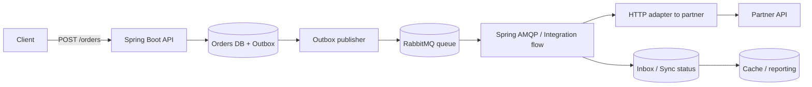
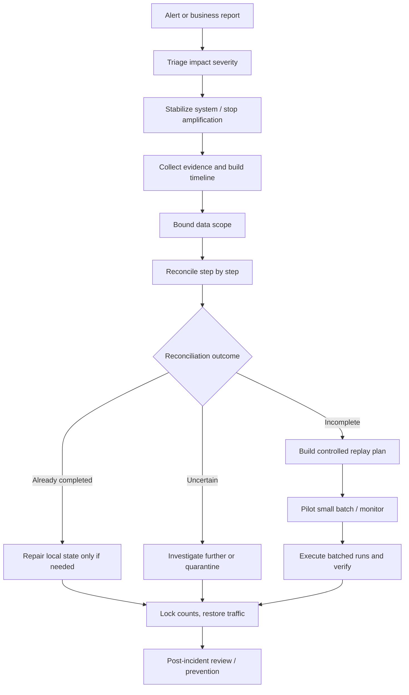

# Incident Handling, Data Reconciliation, and Partial Recovery Workflows in Spring Boot Integration

## 1. Why Must Integration Operations Go Beyond "Rerunning the Job"?

In the **SPRING_BOOT_INTEGRATION** module, data crosses multiple boundaries: HTTP clients, databases, caches, message brokers, and Spring Integration adapters. An order event may already be saved in PostgreSQL, accepted by RabbitMQ, not yet processed by the consumer, or sent to a partner whose HTTP response timed out. Simply reading an error log and clicking **retry** can cause duplicate sends, corrupt state, or lose records.

A sound operational workflow distinguishes:

1. **Incident response:** limit immediate blast radius, isolate the root cause, and preserve evidence.
2. **Data reconciliation:** determine precisely which records have or have not reached their expected business state across systems.
3. **Partial recovery:** replay or repair only missing, failed, or uncertain items under strict controls and duplicate protection.
4. **Outcome verification:** prove business invariants and latency returned to acceptable bounds—not merely seeing empty queues or HTTP 200.

### Running Scenario

The system accepts orders, saves them, publishes `OrderCreated`, and a consumer calls a shipping partner API before updating sync status.



At one point, the consumer's HTTP client times out. At least three possibilities exist:

- **A.** The partner never received the request; resending is needed.
- **B.** The partner created the shipment, yet the response dropped; resending without idempotency creates a second shipment.
- **C.** The request succeeded and the internal DB recorded status, yet the message wasn't acked; the broker may redeliver.

Thus **"timeout" is an uncertain remote outcome**, not proof of business failure. This lesson designs an operational workflow that handles all three cases safely.

## 2. Invariant Principles Before Taking Action

| Principle | Required Behavior |
|---|---|
| **Clear source of truth** | Identify which system owns each field—e.g., internal DB owns `orderId`; partner owns tracking code |
| **Do not turn transient errors into data loss** | Keep records, outboxes, messages, or checkpoints replayable until outcomes are verified |
| **Never reprocess blindly** | Before retrying a non-reversible side effect, check target state or pass an idempotency key |
| **Recover by bounded cohorts** | Scope by tenant, destination, time window, event ID, status, and evidence |
| **Separate detection from remediation** | Firing alerts never grant automatic permission to purge queues, reset offsets, or run compensations |
| **Authorization and audit trails** | Every replay/repair records reason, approver, scope, record count, execution ID, and result |
| **Respect bounded eventual consistency** | Reconcile against watermarks and latency budgets; never treat in-flight items as lost prematurely |
| **Recovery must be idempotent** | Re-running the same recovery plan creates zero extra business side effects |

**Critical operational assumption:** receiving, persisting, publishing, and processing are separate commits. Spring's `@Transactional` covers only resources governed by that transaction manager—it never forms one atomic transaction spanning databases, brokers, Redis, and HTTP.

## 3. Distinguishing Types of "Success" and Work States

Technical milestones and business state differ. Define measurable checkpoints explicitly:

| Milestone | Measurable Signal | What Is **Not** Yet Guaranteed |
|---|---|---|
| Request accepted | Spring Boot returns `202 Accepted` or `200 OK` | Outbox published or partner finished |
| Data persisted | Database commits order + outbox | Broker received message |
| Published | RabbitMQ publisher confirm or matching broker ack | Consumer ran; message routed cleanly unless verified |
| Delivered | Listener received message | Consumer succeeded, committed transaction, and acked |
| Processing committed | DB or inbox recorded post-processing state | Partner API succeeded if response/reconciliation unconfirmed |
| Business completed | Verified terminal state in data-owning system | All caches/reports instantly consistent |

Individual tables may use `RECEIVED`, `PENDING`, `PUBLISHED`, `PROCESSING`, `COMPLETED`, `FAILED`, and `UNKNOWN`. Still, a single global `status` column rarely captures multiple parallel branches cleanly. For critical flows, record **status per destination/step** along with timestamps.

Example record in `integration_delivery`:

```text
event_id          = 0f5b...      // immutable event identifier
aggregate_id      = ORDER-1042   // business identifier
destination       = shipping-api
payload_version   = 2
state             = UNKNOWN
last_attempt_at   = 2026-11-21T01:18:03Z
attempt_count     = 3
idempotency_key   = shipping:ORDER-1042:v1
remote_reference  = null
last_error_code   = HTTP_TIMEOUT
correlation_id    = trace-...
updated_at        = ...
```

`UNKNOWN` is vital when a call times out or disconnects after sending the payload. Never automatically flip it to `FAILED` and resend without checking target state.

## 4. Incident Response Workflow from Detection to Closure



### Step 1 — Triage Impact

Quickly answer: which systems, which business flows, which customers, when did it start, how many records are suspect, and what is the impact on revenue, data integrity, and availability?

Example tiers:

- **Critical:** lost or duplicated financial side effects, data exposure risk, widespread inability to complete transactions.
- **High:** widespread stuck orders/documents, backlog growing past capacity thresholds.
- **Medium:** one external destination failing, delayed sync while state remains recoverable, small scope.
- **Low:** few isolated failed records handleable via routine triage.

These are illustrative examples, not fixed presets. Base severity on real SLOs and business impact.

### Step 2 — Stabilize the System

Priority one is **stopping the incident from spreading**:

- If an external API fails broadly: open circuit breakers, cap concurrency, pause outbound workers, or park work in durable queues—never trigger retry storms.
- If a producer emits bad schemas: stop that producer version, retain failing payloads, and avoid pushing into incompatible consumers.
- If a consumer creates duplicate side effects: pause that consumer before redelivery multiplies; preserve DLQs and critical evidence.
- If a broker hits memory/disk limits: diagnose the load spike, throttle publish/consume rates, and avoid purging queues to "free space" without a backup/replay plan.
- If cache data is corrupted: route reads to trusted sources or perform scoped invalidation; never flush a shared Redis cluster without evaluating blast radius.

Pause at the **exact intake or egress boundary**. In Spring Integration, stopping an inbound endpoint does not mean running handlers finished. Account for in-flight work, executors, pollers, transactions, and ack boundaries before deploying or restarting.

### Step 3 — Preserve Evidence

Build a UTC timeline capturing state at incident time:

- Deployment versions, config versions, feature flags, infra/secret/certificate change timestamps.
- `trace_id`, `correlation_id`, `event_id`, `aggregate_id` or business keys; per-hop statuses.
- Publish/ack rates, `ready`/`unacked` queue counts, DLQs, consumer counts, broker alarms.
- HTTP statuses/timeouts, retry counts, p95/p99 latency, connection pools, thread pools, DB slow queries/locks.
- Outbox/inbox/checkpoint records, commit timestamps, failed transactions, partner lookup statuses if available.
- Audit logs of any manual interventions taken.

**Never paste credentials, sensitive payloads, or PII into public incident tickets.** Restrict evidence/log access; when sharing sample payloads for debugging, use aggregates or masked fields.

## 5. Isolating Failures Across Integration Boundaries

| Symptom | Common Hypothesis | Evidence to Inspect | Initial Action |
|---|---|---|---|
| HTTP API succeeds yet no message exists | Outbox publisher stalled, filter/routing bug | Outbox `NEW` rows, publish confirms, exchanges/bindings | Halt escalation; check publisher and routing |
| Queue `ready` grows | Missing/slow consumers, bad scaling | Consumer count, publish/ack rates, downstream latency | Check listeners, broker, pools, and load caps |
| `unacked` stays high | Slow handlers, oversized prefetch, missing acks | In-flight counts, thread dumps, query/API timeouts | Relieve bottleneck; review ack/retry logic |
| DLQ grows | Poison messages, schema incompatibility, unrecoverable errors | Converter errors, DLX headers, payload versions | Sample safely, fix mapping, prepare replay |
| HTTP 200 yet DB never updated | Transaction rollback, handler crashed post-call | Partner request ID, DB event timeline | Reconcile target state before retrying |
| HTTP timeout yet partner has record | Uncertain outcome on timeout | Target lookup API, idempotency key | Confirm and repair local state |
| DB updated yet cache is stale | Invalidation/TTL failure | Cache key version, DB row version, invalidation events | Selectively invalidate; measure cache lag |
| Message processed multiple times | Redelivery or app-level retry | Inbox keys, unique constraints, retry logs | Audit idempotency; preserve evidence |
| Inbound files stop progressing | File locks, FTP/SFTP sessions, stopped poller, stale markers | Endpoint lifecycle, session pools, staging files | Stop intake; inspect leases/checkpoints |
| Records vanish from reports | Broken paging/watermarks, overly broad dedup | Reconciliation queries, cursors, source IDs | Bounded full scan; fix cursor logic |

**Important:** zero queue depth does not prove integration success. Messages can be acked and still lose business effects due to post-ack errors or silent skips. Always verify against target data.

## 6. Designing Reconciliation: What to Compare and at What Cutoff?

### 6.1. Define the Business Invariant

For shipment syncing, an invariant might state:

> Every validly confirmed order must have **at most one** shipment at the partner per shipping request version and a matching internal sync status after the SLO window.

This states two guarantees:

1. **Completeness:** every valid work item eventually completes or sits in an actionable error/quarantine state.
2. **Uniqueness:** no work item creates duplicate side effects despite redeliveries.

Before writing queries, inventory sources of truth:

| Data | Canonical Source | Reconciliation Key | Update Cadence |
|---|---|---|---|
| Internal order | Orders DB | `order_id` | At API commit |
| Event emission intent | Transactional outbox | `event_id` | Same transaction as order |
| Consumer receipt | Broker + inbox/delivery log | `event_id` | Asynchronous |
| Partner shipment | Partner API/query/export | `idempotency_key` or `partner_ref` | Per API state |
| Internal sync status | `integration_delivery` | `event_id + destination` | Updated per attempt |
| Cache/reporting | Redis/read model | Business key + version | Eventual consistency |

If a partner lacks both a lookup API and stable keys, certain `UNKNOWN` records cannot safely auto-retry. Establish manual verification workflows or negotiate API contract additions.

### 6.2. Watermarks and Allowed Lag Windows

In async flows, a newly committed order missing at the target is **not yet an error**. Reconciliation should:

1. Select a closed time window—e.g., events created before `now - latency_budget`.
2. Include only source records whose status qualifies for synchronization.
3. Use UTC, durable keys, and high-watermarks/checkpoints—never just an unanchored relative offset.
4. For incremental scans, persist pagination positions and tie-breaking rules so rows sharing `updated_at` are never dropped.
5. Schedule periodic **full reconciliations** to catch missed deletes/updates or cursor boundary bugs.
6. Record schema version, time range, and source/target totals for every audit run.

For example, with a 5-minute sync SLO, a job running every 10 minutes checks orders older than at least 5 minutes, calibrating alert thresholds and valid windows to traffic, downtime windows, and business needs.

### 6.3. Classifying Reconciliation Outcomes

Never lump rows strictly into "OK" or "FAIL." Categorize explicitly:

| Category | Description | Safe to Auto-Replay? |
|---|---|---|
| `MATCHED` | Source and target match expected business outcome | Not needed |
| `SOURCE_ONLY` | Present in source, reliably proven absent at target | Potentially, after checking preconditions and idempotency |
| `TARGET_ONLY` | Present at target but missing from source scope | Investigate source or out-of-band mutations |
| `MISMATCHED` | Same key with differing status, amount, or version | Usually needs rule-based repair or approval |
| `DUPLICATED` | Multiple side effects for one business key | Never retry; apply dedicated compensation/reconciliation |
| `UNKNOWN` | Missing proof: timeouts, unreachable target API, extreme lag | Never blind-replay |
| `DEFERRED` | Inside lag/SLO watermark or legitimately in progress | Re-check on next cycle |

### 6.4. Illustrative Query Finding Overdue Work

PostgreSQL example using an application-defined schema:

```sql
-- Illustrative: fetches candidates, NOT an immediate replay command.
SELECT d.event_id,
       d.aggregate_id,
       d.destination,
       d.state,
       d.attempt_count,
       d.updated_at
FROM integration_delivery AS d
JOIN orders AS o
  ON o.id = d.aggregate_id
WHERE o.status = 'CONFIRMED'
  AND d.destination = 'shipping-api'
  AND d.state IN ('PENDING', 'FAILED', 'UNKNOWN')
  AND d.created_at < :cutoff_utc
ORDER BY d.created_at, d.event_id
LIMIT :batch_size;
```

`:cutoff_utc` and `:batch_size` are JDBC/JPA bind parameters, **not** literal SQL syntax for every CLI client. This produces **reconciliation candidates**, not an automatic replay list: `UNKNOWN` rows must query the partner first.

At scale, add indexes on `(destination, state, created_at)` plus join keys, and use keyset pagination so mutating tables don't skip or double-count candidates. Avoid unbounded full-table scans during peak hours.

## 7. Designing Recoverable Operational Data

To keep partial recovery auditable, separate three record types:

**1. Business record:** orders/shipments holding domain state.

**2. Delivery/outbox/inbox record:** emission intent and per-destination progress.

**3. Recovery record:** why a replay/repair was decided, who approved it, and how it executed.

Example data for a recovery plan:

```json
{
  "planId": "recovery-20261121-01",
  "incidentId": "INC-218",
  "destination": "shipping-api",
  "scope": {
    "fromUtc": "2026-11-21T00:00:00Z",
    "toUtc": "2026-11-21T01:00:00Z",
    "status": ["FAILED"]
  },
  "mode": "DRY_RUN",
  "candidateCount": 120,
  "approvedBy": null,
  "executionId": null
}
```

In practice, store a **snapshot of the exact candidate event IDs** (or an auditable manifest hash) post-reconciliation rather than only saving filter predicates. Re-running the same filter hours later can pull in new records outside the approved scope.

Never include sensitive payloads in public reports; recovery records can reference protected storage via checksums for authorized investigation.

## 8. Approved Partial Recovery Workflow

A recovery run needs clear stages:


### 8.1. Dry Run

A dry run must show:

- Manifest or list of business keys, event IDs, tenants, destinations, and payload versions.
- Items already completed remotely needing **local-only state repair**.
- Items confirmed missing and eligible for **safe replay**.
- `UNKNOWN` items held for manual verification.
- Estimated traffic, external impact, duration, and duplicate risk.
- Expected update counts and automatic stop triggers.

**Dry runs never call side-effecting APIs, commit database mutations, or ack/delete messages.** Implementing a "dry run" by executing real code and rolling back a JDBC transaction still leaks HTTP calls and broker messages; that is unsafe.

### 8.2. Minimal Intervention

Prefer the least invasive option in order:

1. **Sync local state only** when the partner already finished and proof exists.
2. **Replay only the incomplete step** rather than re-running from the original intake request.
3. **Retry the full task** when downstream supports idempotency and steps cannot split safely.
4. **Compensate** when wrong or duplicate side effects already happened, per business rules and approvals.
5. **Quarantine manually** whenever outcomes remain uncertain.

For instance, if the partner already created the shipment yet our DB lacks `partner_ref`, update the tracking reference and mark complete in one audited transaction—**never re-send the shipment creation call**.

### 8.3. Claiming and Fencing Against Concurrent Replays

Replay jobs must prevent two workers from grabbing the same event:

- Explicit transitions `APPROVED → QUEUED → IN_PROGRESS → VERIFIED` per recovery attempt.
- Conditional updates or row locks at claim time with `lease_owner`/`lease_until` and recovery tokens.
- Unique constraints on `(event_id, destination, operation_version)` or matching business idempotency keys.
- If a lease expires while an old worker stalls, enforce **fencing tokens** or token checks on outcome updates so stale workers cannot overwrite newer workers' progress.
- Never rely on standalone Redis locks or in-JVM `synchronized` across distributed services, especially across restarts or network partitions.

If a recovery job crashes mid-run, persist enough state to inspect and resume cleanly.

## 9. Example: Enqueueing an Approved Candidate into a Recovery Outbox

To prevent emitting broker events before state commits, place the **recovery enqueue update** and **outbox insert** in the same DB transaction. Example using `JdbcTemplate`, PostgreSQL, and an application-defined schema:

```java
@Service
public class RecoveryCommandService {

    private final JdbcTemplate jdbc;

    public RecoveryCommandService(JdbcTemplate jdbc) {
        this.jdbc = jdbc;
    }

    @Transactional
    public boolean enqueueApprovedEvent(
            UUID eventId, String destination, UUID recoveryToken) {

        int changed = jdbc.update("""
            UPDATE integration_delivery
               SET recovery_state = 'QUEUED',
                   recovery_token = ?,
                   updated_at = CURRENT_TIMESTAMP
             WHERE event_id = ?
               AND destination = ?
               AND recovery_state = 'APPROVED'
            """, recoveryToken, eventId, destination);

        if (changed != 1) {
            return false; // Not approved or already claimed by another worker.
        }

        // Insert into outbox in the same transaction.
        // Message references durable event without copying secrets.
        jdbc.update("""
            INSERT INTO integration_outbox
                (id, event_id, destination, event_type, status, created_at)
            VALUES (?, ?, ?, 'REPLAY_REQUESTED', 'NEW', CURRENT_TIMESTAMP)
            """, recoveryToken, eventId, destination);

        return true;
    }
}
```

**Mandatory assumptions for safety:** `integration_delivery` has a unique key on `(event_id, destination)`, `integration_outbox.id` has a unique/primary key, the method runs only after reconciliation + approval, and insert errors roll back the update. Add project-specific JDBC, transaction, `UUID`, and Spring stereotype imports.

This is only one piece, **not a complete recovery engine**. Outbox dispatchers need retries, backoff, publisher confirms, and safe `status` updates. If the broker receives the message before the outbox status update persists, republishing can happen; consumers must remain idempotent. When retrying after verified failures, mint a fresh recovery token with clear version/approval tracking without breaking unique business invariants.

Never call partner HTTP inside the enqueue transaction; the transaction locks in **recovery intent**, while network calls execute post-commit via rate-limited workers.

## 10. Idempotency at Consumers and Outbound HTTP

### 10.1. Deduplication at Consumer Boundaries

Brokers like RabbitMQ and Kafka redeliver after crashes, rebalances, nacks, or timeouts. Listener invocation count does not equal business execution count.

A common pattern is an **inbox** backed by a unique constraint:

```sql
-- Example schema; adapt names/types to your application database.
CREATE TABLE integration_inbox (
    consumer_name  VARCHAR(100) NOT NULL,
    event_id       UUID NOT NULL,
    processed_at   TIMESTAMP WITH TIME ZONE NOT NULL,
    PRIMARY KEY (consumer_name, event_id)
);
```

When business side effects live **in the same database**, insert the idempotency marker and apply business mutations inside one transaction. On unique conflict, skip duplicate work and ack per design. When handlers call **external HTTP APIs**, a DB transaction cannot make the remote HTTP call atomic; enforce external idempotency keys and reconcile uncertain outcomes.

**Never mark an inbox entry completed before required side effects have verifiable proof**, unless you durably saved another work item guaranteeing the next step executes.

### 10.2. HTTP Idempotency Keys

For shipment creation, keep one stable key per business intent—such as `shipping:ORDER-1042:v1`—saved in the delivery record. On retries, transmit **the exact same key and logical payload**, never generating a fresh key per attempt.

```http
POST /shipments HTTP/1.1
Content-Type: application/json
Idempotency-Key: shipping:ORDER-1042:v1

{"orderId":"ORDER-1042","addressCode":"ADDR-7"}
```

This works only if the **partner API supports and documents idempotency semantics**; header names, key TTLs, and payload-mismatch handling follow the real contract. If unsupported, use a business-key lookup API or alternate domain check before retrying.

On HTTP timeouts, follow this workflow:

1. Persist `UNKNOWN` along with the idempotency key / request ID.
2. Query target status by key if possible.
3. If the right outcome already exists: repair local state and do not resend creation calls.
4. If confirmed absent and idempotency allows: retry with bounded backoff.
5. If unverifiable: quarantine for manual reconciliation rather than risking duplicates without evidence.

### 10.3. Handling Out-of-Order Events

`OrderUpdated(v3)` can arrive ahead of `OrderUpdated(v2)` over channels lacking global ordering. Recovery must never overwrite newer state with older versions. Enforce `aggregate_version`, sequences, or conditional guards—e.g., updating only when `incoming_version > stored_version`. When versions are absent, define explicit reconciliation and conflict-resolution rules.

## 11. Recovery by Integration Technology

| Component | Data to Verify | Safer Recovery Action | What to Avoid |
|---|---|---|---|
| Spring Boot HTTP client | Request ID, responses, real target status | GET/query status, retry with idempotency key | Repeating creation POSTs while outcome is `UNKNOWN` |
| JDBC/database | Transaction commits, outbox/inbox, unique keys | Audited transactional state repair; outbox replay | Broad `UPDATE`s missing `WHERE` clauses or limits |
| Redis/cache | Canonical source, keys, versions, TTLs | Selective key invalidation, re-warm from DB | Running `FLUSHALL` on shared caches for one bad event |
| RabbitMQ | Exchanges/bindings, publisher confirms, ready/unacked, DLQ | Fix root cause, batch-republish selected DLQ items | Purging whole queues, bulk nack/infinite requeue loops |
| Kafka | Topic-partition-offsets, consumer groups, target state | Replay to dedicated recovery group/verified path | Bulk-resetting prod group offsets without impact analysis |
| Spring Integration file/SFTP | Local/remote files, checksums, filter metadata, checkpoints | Reclaim unprocessed files, retain staging/originals | Deleting remote/source files merely after download |
| Schedulers/pollers | Last valid checkpoint, in-flight tasks, job execution IDs | Rerun missing windows by durable cursor | Triggering overlapping duplicate jobs |
| DLQ/poison messages | Payload version, exceptions, retry history | Fix schema/handlers, batch-replay after testing | Unconditionally redriving the entire DLQ |

**RabbitMQ:** publisher confirms prove the broker handled the publish per confirm rules; also monitor routing/returns to know whether messages reached queues. Consumer `ack` tells the broker delivery succeeded, not that external HTTP side effects finished.

**Kafka:** offsets record a consumer group's read position, not business state. `commit offset` does not mean DB transactions or partner APIs succeeded. To replay a subset of events, build controlled reprocessing paths rather than resetting offsets across an entire consumer group and re-triggering thousands of unrelated messages.

**Spring Integration:** across `ExecutorChannel`, `QueueChannel`, splitters/aggregators, and pollers, verify whether messages live in RAM or persistent stores. Process restarts lose RAM-only messages. Rely on durable checkpoints, persistent message stores, and idempotency for recovery.

## 12. Sample Runbook for Shipment-Sync Timeouts

### Phase A — Contain

**Assumptions:** between 09:00 and 09:20 UTC, `shipping-api` experiences elevated timeouts; internal orders still save and queues lose zero messages, yet `integration_delivery` accumulates 600 `UNKNOWN` records.

Record:

- Incident ID, UTC timestamps, app version, and partner API contract version.
- Total `UNKNOWN=600` is a candidate count, not a resend count.
- Consumer states, retries/circuit breakers, DLQs, and outboxes.
- Evidence showing timeouts without proof whether partner writes committed.

**Action:** pause duplicate-risking retries and throttle outbound sends to safe partner limits while keeping requests durably persisted so nothing is lost.

### Phase B — Reconcile

Across the 600 events, query the partner API by idempotency key/reference within allowed rate limits. **Hypothetical** example results:

| Outcome | Count | Action |
|---|---:|---|
| Partner created shipment accurately | 410 | Update local `COMPLETED` + partner ref |
| Partner confirms absent | 150 | Propose for batched replay |
| Partner returns conflicting data | 10 | Quarantine for business inspection |
| Partner unreachable / unqueryable | 30 | Keep `UNKNOWN`, do not auto-retry |

Total 410 + 150 + 10 + 30 = **600**, letting operators verify batch completeness. Numbers are illustrative only to explain the workflow, not live system measurements.

### Phase C — Recover

1. Snapshot the 150 `SOURCE_ONLY` events and plan ID.
2. Dry run: verify current DB state, confirm no duplicate business keys, and confirm no overlapping in-flight tasks.
3. Obtain risk-appropriate approval; pick a 5–10 event canary.
4. Enqueue via transaction/outbox and run rate-limited with identical idempotency keys.
5. Watch responses, completions, retries, latency, duplicate detections, and new `UNKNOWN`s.
6. Once canary looks solid, run small batches; halt immediately on duplicates/conflicts or threshold breaches.
7. Reconcile all 600 records—410 repaired, 150 replayed, 10 conflicts, 30 uncertain—assigning final states and owners per group.

### Phase D — Close Incident

Declare recovery done only when:

- Zero unintended losses or duplicate side effects remain; conflicts/duplicates follow formal resolution.
- All incident-scoped records hold terminal states or tracked backlog states with clear owners and deadlines.
- Source, target, outbox, inbox, and DB totals reconcile across identical keys and time windows.
- Consumer throughput, backlogs, HTTP latency, error rates, and business outcomes return within SLOs.
- Audits record dry run, approvals, replay batches, repairs, and verification proof.
- A postmortem documents root cause, monitoring gaps, and preventive actions.

Never treat "replayed 150 events" as finished without verifying target outcomes.

## 13. Technical State Machine for Batch Recovery

| Stage | Entry Condition | Exit Condition and Evidence |
|---|---|---|
| `DISCOVERED` | Reconciliation job identifies candidate | Has event ID, destination, watermark, evidence |
| `CLASSIFIED` | Source–target comparison completed | Explicit `MATCHED`/`MISSING`/`UNKNOWN`/`CONFLICT` |
| `APPROVED` | Manifest locked and scope approved | Audits approver, batch size, expiry, policy |
| `QUEUED` | Conditional claim + transactional outbox commit | Has recovery token and outbox row |
| `IN_PROGRESS` | Worker claims with lease/fencing token | Verified owner; timers and attempts started |
| `VERIFIED` | Destination confirms outcome or invariant holds | Stores remote reference/version and proof |
| `FAILED_RECOVERABLE` | Transient error, incomplete | Backoff, retry budget, checkpoint intact |
| `NEEDS_REVIEW` | Missing proof or conflict | Blocked from auto-retry; assigned owner |
| `CLOSED` | Batch fully reconciled | Summary counts + audit links retained |

Persist states via **conditional transitions**—e.g., `APPROVED → QUEUED` succeeds only while still approved, and stale workers cannot mark `VERIFIED` once another attempt rotated the recovery token.

Every batch should enforce:

- Event count and total payload caps.
- Concurrency limits, rate limits, timeouts, and retry budgets.
- Circuit breakers halting on widespread errors.
- Pause/resume and kill switches.
- Tracking `processed/succeeded/failed/unknown/skipped` summing accurately to candidate total.
- Idempotent re-execution of the same manifest without duplicating side effects.

## 14. Observability, Alerting, and Decision Signals

An operational dashboard should display both **technical health** and **business accuracy**.

| Layer | Suggested SLI or Metric | Meaning |
|---|---|---|
| Ingress | Event acceptance rate, validation failures | Is intake accepting and rejecting accurately? |
| Database/outbox | Outbox oldest age, `NEW` count, publish-confirm failures | Is committed work stalled ahead of the broker? |
| Broker | Ready/unacked, publish/ack/redelivery, DLQ counts | Are backlogs, retry loops, or missing consumers building? |
| Adapter/HTTP | Request latency p95/p99, timeouts, status codes, breaker state | Where is the bottleneck? |
| Consumer | Processing duration, in-flight, retries, attempt outcomes | Are handlers finishing or hanging? |
| Reconciliation | Source-only, target-only, mismatched, unknown, last clean run | Are business discrepancies appearing? |
| Recovery | Eligible, queued, verified, needs review, recovery oldest age | Is recovery advancing or stalled? |
| Business | On-time SLO completion rate, duplicate side effects, stale data | What are real customer outcomes? |

These are **suggested metric categories**, not all pre-built in Spring Boot/Micrometer. Verify exact meter names, labels, exporter behavior, and cardinality bounds per version.

Never put `order_id`, `event_id`, usernames, dynamic HTTP paths, or payloads in metric tags. Use bounded labels such as `flow=shipping-sync`, `destination=shipping-api`, and `outcome=success|unknown|failure`, keeping event-level lookups in access-controlled logs, traces, and audits.

### Actionable Alerts

- **Outbox oldest age breaches SLO:** inspect publishers and brokers; never re-emit already-published DB rows without checking confirms/dedup.
- **`UNKNOWN` count climbs rapidly:** check networks/partners, pause duplicate-risking retries, and trigger reconciliation.
- **DLQ grows:** classify contract errors and group failures before requeueing.
- **Reconciliation stops running on schedule:** alert proactively even when HTTP/broker metrics look green.
- **Duplicate side effects > 0:** escalate immediately, pause duplicating path, and run compensations.
- **Recovery stuck:** expired leases, stagnant verified counts, recurring errors; inspect owners and checkpoints.

Calibrate durations and thresholds to real SLOs and traffic. An empty queue during quiet hours means something completely different from an empty queue caused by consumers acking early and dropping work.

## 15. Security and Permissions for Data Repair

Partial recovery **can trigger real side effects**, so enforce at minimum:

1. **Separated roles:** investigators view data; planners prepare dry runs; approvers and executors hold distinct permissions scaled to risk.
2. **Never use production credentials in test environments.** Test/canary logic against sandboxes, replaying real targets only after approval.
3. **Immutable audits:** actor, incident ID, plan version, manifest hash, counts, timestamps, reason, and outcomes.
4. **Admin API guardrails:** batch limits, required `WHERE` scopes, destination/environment confirmation, idempotency keys, and approval expiry checks.
5. **Never log PII indiscriminately.** Store evidence securely under retention policies.
6. **Revoke elevated access post-incident:** remove temporary permissions, disable bypass flags, and verify security configs.

Especially for payments, money transfers, inventory, customer records, or irreversible actions: require two-person approval, provider status lookups, or formal business compensation—never let admin scripts blindly replay by `status='FAILED'`.

## 16. Testing Workflows Ahead of Real Incidents

Integration suites should combine Spring Boot Test with real test databases/brokers (e.g., Testcontainers) and HTTP stubs to test both normal paths and uncertain failure windows.

| Scenario | Fault Injection | Invariant to Assert |
|---|---|---|
| DB commits, publish never happens | Stop outbox publisher right after DB transaction | Outbox persists and publishes cleanly on restart |
| Publish succeeds, confirm lost | Drop connection after broker accepts | Republish occurs cleanly; consumer stays idempotent |
| Consumer finishes, ack lost | Close channel before ack | Redelivery creates zero duplicate side effects |
| HTTP times out after target commits | Stub records state then drops response | Reconciliation detects completion; avoids duplicate POST |
| Retry when target never received | Stub initially absent, later succeeds | Identical idempotency key produces one execution |
| Missing/invalid schema | Incompatible payload version | Classified as poison message; routed to DLQ/quarantine |
| Two recovery workers claim simultaneously | Concurrent claim on same event | Exactly one recovery intent succeeds |
| Worker crashes mid-batch | Kill halfway through events | Remainder replays without redoing verified events |
| Out-of-order arrivals | Deliver newer version ahead of older | Newer state is never overwritten by older payload |
| Reconciliation paging bug | Mutate rows mid-scan | Drops zero items and mislabels zero deletions |
| Cache invalidation fails | Make Redis unavailable after DB commit | Retries/refreshes cleanly while DB stays accurate |
| Dry-run | Execute recovery plan in preview mode | Zero side effects on DB, broker, or API |

Tests should compare **the final state across all systems** rather than just `verify(mock)`. Use bounded-deadline waits for async flows, isolated test data, network isolation, and assertions on emitted/processed event counts. Never test poison messages or load spikes on production queues.

## 17. Operations and Handoff Checklist

### Before Opening a Recovery Plan

- [ ] Incident ID, owner, severity, customer/impact scope, and deadline are recorded.
- [ ] Business invariants and per-field sources of truth are defined.
- [ ] `FAILED`, `UNKNOWN`, `MISMATCHED`, and `DEFERRED` are separated cleanly.
- [ ] Reconciliation ran with explicit watermarks and saved an event ID manifest.
- [ ] Missing target outcome is confirmed before re-emitting side effects.
- [ ] Idempotency keys or reliable verification/compensation paths are ready.
- [ ] Side-effect-free dry run was reviewed and approved.
- [ ] Batch sizes, rate limits, kill switches, rollback/compensation plans, and audits are in place.

### Before Closing an Incident

- [ ] Counts balance strictly: `candidate = matched + repaired + replayed_verified + needs_review + deferred` without overlap.
- [ ] Zero unowned items remain in `UNKNOWN` or `NEEDS_REVIEW`.
- [ ] Outbox/inbox, queues/DLQs, DBs, and partner states are re-reconciled.
- [ ] Unintended duplicates/side effects are resolved or formally handed off.
- [ ] Normal traffic is restored, emergency overrides disabled, and SLOs verified.
- [ ] Timeline, root cause, reproduction tests, and preventive actions are documented.
- [ ] Evidence is retained per security and retention policies.

## 18. Common Operational Mistakes

**"HTTP timeout means the request never ran."** False. Outcome is uncertain once the partner may have received the call. Reconcile or use contracted idempotency.

**"Reconciliation just compares row counts between two tables."** False. Both sides can hold 1,000 rows with different business keys or wrong values. Reconcile by keys, versions, and business invariants.

**"The queue is empty, so data loss isn't an issue."** Uncertain. Messages may have been acked, dead-lettered, policy-dropped, or misprocessed. Verify final state in the owning system.

**"Reset Kafka offsets or requeue the whole DLQ for a quick fix."** Dangerous. Can replay thousands of already-completed messages, duplicating side effects and overloading targets. Recover scoped subsets via manifests, dedup, and rate limits.

**"We have `@Transactional`, so outbox, broker, and HTTP are atomic."** False. JDBC transactions never guarantee simultaneous commits across external systems; design explicit boundaries and reconciliation.

**"Just rerun `FAILED` records."** Insufficient. Some `UNKNOWN` items succeeded remotely, while some local `COMPLETED` items rolled back or diverged downstream. Base reconciliation on multi-system evidence.

**"Just patch the production DB with one `UPDATE` statement."** Inadequate when brokers, caches, audit trails, and partners have diverged. Repairs need transactions, versioning, guards, audits, and verification.

**"Once recovered, we don't need a postmortem."** False. Leaving idempotency gaps, missing checkpoints, or depth-only monitoring guarantees repeat incidents.

## 19. Conclusion

Within the **Integration Operations** chapter of **SPRING_BOOT_INTEGRATION**, incident handling does not stop at restarting a service or retrying messages. A reliable Spring Boot integration system **contains blast radius first**, **reconciles against sources of truth and business keys**, **separates certain from uncertain outcomes**, and **recovers only verified gaps in controlled batches**. Outbox/inbox patterns, idempotency keys, checkpoints, conditional transitions, metrics, audits, and fault testing equip teams to survive failures across databases, caches, brokers, HTTP clients, and Spring Integration adapters at any point in execution. Only once business outcomes are verified, backlogs return within SLOs, and every residual item has an explicit owner should an incident be declared safely closed.
