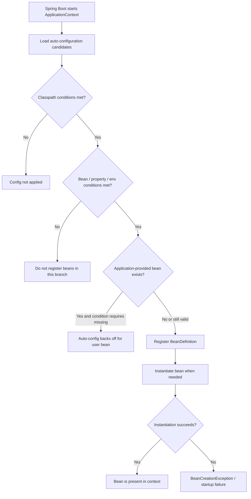
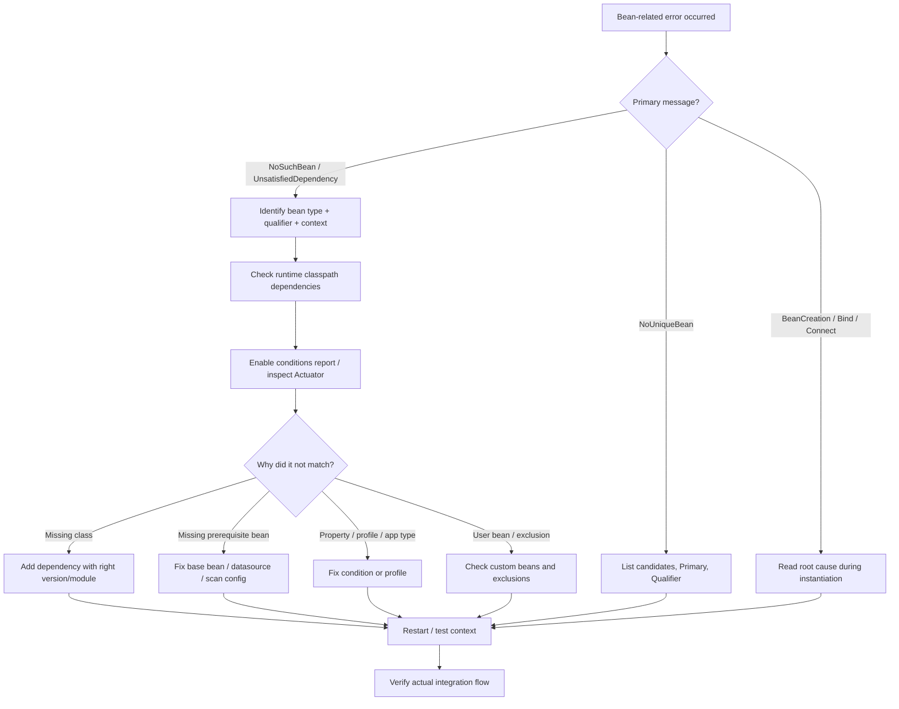
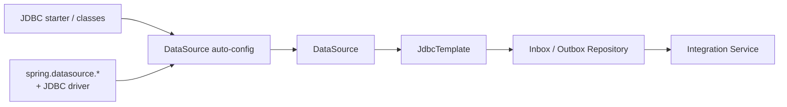

# Bean Not Created Due to Missing Starter or Auto-Configuration Conditions

## 1. Context: What Does a "Missing Bean" Mean in Spring Boot Integration?

A Spring Boot integration service typically depends on Spring-managed objects such as `RestClient.Builder`, `WebClient.Builder`, `DataSource`, `JdbcTemplate`, `RabbitTemplate`, `RedisConnectionFactory`, `CacheManager`, `KafkaTemplate`, message channels, or Spring Integration adapters. When a bean does not appear in the `ApplicationContext`, HTTP calling, state persistence, caching, or message delivery flows can fail right at startup.

For example, a service that needs to publish events via RabbitMQ:

```java
import org.springframework.amqp.rabbit.core.RabbitTemplate;
import org.springframework.stereotype.Service;

@Service
public class OrderEventPublisher {
    private final RabbitTemplate rabbitTemplate;

    public OrderEventPublisher(RabbitTemplate rabbitTemplate) {
        this.rabbitTemplate = rabbitTemplate;
    }
}
```

If the context does not have an injectable `RabbitTemplate` bean, Spring typically reports an error in this family:

```text
UnsatisfiedDependencyException:
  Error creating bean with name 'orderEventPublisher':
  Unsatisfied dependency expressed through constructor parameter 0
...
NoSuchBeanDefinitionException:
  No qualifying bean of type 'org.springframework.amqp.rabbit.core.RabbitTemplate'
  available
```

The message only confirms that **the dependency injection point is unsatisfied**. It does not yet prove that the root cause is a missing `spring-boot-starter-amqp`. The starter might be absent from the runtime classpath, auto-configuration conditions might not be met, the bean might be excluded, the active profile might be wrong, a user-defined configuration might be invalid, or the bean might have been created in a different context.

This lesson belongs to the **Troubleshooting and Upgrades** chapter of the **SPRING_BOOT_INTEGRATION** module. The goal is evidence-based diagnosis and fixing the true root cause across HTTP, database, cache, broker, and Spring Integration integrations. In particular, avoid "fixing just so the app starts" in ways that break transaction control, idempotency, retries, or the integration flow's data contract.

## 2. Distinguish Four Failure Types Before Changing Configuration

| Primary Symptom | Initial Conclusion You Can Draw | Next Verification Step |
| --- | --- | --- |
| `NoSuchBeanDefinitionException`, `No qualifying bean of type...` | No matching bean candidate of the expected type/qualifier was found at the injection point | Trace bean registration source, conditions report, component scan, and qualifiers |
| `NoUniqueBeanDefinitionException`, `expected single matching bean but found ...` | **Multiple** candidates exist and a single one cannot be selected | Check `@Qualifier`, `@Primary`, bean names, and datasources/connection factories |
| `BeanCreationException` with a configuration/connection error in `Caused by` | The bean definition may have been found, but instantiation failed | Read the deepest cause: properties, credentials, URL, DNS, TLS, schema, constructor |
| `ClassNotFoundException`, `NoClassDefFoundError` | A class is missing on the runtime classpath or there is a binary/version conflict | Compare dependency tree, scopes, exclusions, and library versions |

For example, `RabbitTemplate` existing yet failing to connect to RabbitMQ at publish time is a **runtime connection error**, which does not automatically mean auto-configuration failed to create the bean. A `JdbcTemplate` bean can be created even if SQL later fails due to a missing table. Proper classification prevents fixing the wrong layer.

In startup logs, read from the bottom up to find the `Caused by` chain, then go back to the first unsatisfied dependency. Do not treat the "APPLICATION FAILED TO START" line as the root cause; it is only the final outcome.

## 3. What Is a Starter, and Why Does a Missing Starter Prevent a Bean from Appearing?

A Spring Boot starter is a dependency bundle designed to pull in a functional library and its corresponding required components. **Auto-configuration** is Spring Boot's mechanism for inspecting the classpath, existing beans, properties, and environment to decide which beans are configured automatically. Starters and auto-configuration are closely related, but **not synonymous**:

- Adding a starter typically puts the required classes on the classpath and allows the corresponding auto-configuration to be evaluated.
- An auto-configuration only creates a bean when **all applicable conditions** are satisfied.
- A user-defined bean can cause auto-configuration to *back off* via `@ConditionalOnMissingBean`.
- A property in `application.yml` cannot materialize a missing class on its own; setting `spring.rabbitmq.host` cannot substitute for the AMQP dependency.
- Not every injectable object is created out of the box by a starter; some require explicit `@Bean`, `@Component`, `@Import`, or registration calls.

Some examples for checking dependencies by capability:

| Bean or Capability Needed | Typically Related Dependency | Additional Conditions to Inspect |
| --- | --- | --- |
| `RabbitTemplate`, Spring AMQP `ConnectionFactory` | `spring-boot-starter-amqp` | Rabbit auto-config conditions, connection factory bean, custom beans/exclusions |
| `JdbcTemplate`, `DataSource` | `spring-boot-starter-jdbc` or matching JDBC/JPA stack plus driver | URL/embedded DB, datasource, multiple candidates, JDBC conditions |
| `RedisConnectionFactory`, `RedisTemplate` | `spring-boot-starter-data-redis` | Redis client, custom connection factory, properties, and scope |
| `WebClient.Builder` | Spring WebFlux client classes; commonly via `spring-boot-starter-webflux` in appropriate projects | Builder auto-config conditions; a fully configured `WebClient` usually must be defined explicitly |
| `CacheManager` | `spring-boot-starter-cache` and corresponding provider | Caching infrastructure, `spring.cache.*`, application-provided beans |
| `KafkaTemplate` | Spring Kafka (`spring-kafka`) and Kafka configuration for the Spring Boot version | ProducerFactory, bootstrap servers, multiple templates/custom beans |
| Spring Integration adapters | Core Spring Integration and protocol-specific adapter modules | Adapter/protocol classpath, endpoint beans/flows, channels, bean scanning |

Starter names and module splits can change across Spring Boot generations, especially during major upgrades. This table is a diagnostic guide; **actual dependencies must be verified against the BOM and documentation for your project's exact version**. Avoid guessing a new starter name from the protocol name alone.

### Verify Dependencies in the Right Scope

Maven example adding AMQP with Spring Boot parent/BOM:

```xml
<dependency>
    <groupId>org.springframework.boot</groupId>
    <artifactId>spring-boot-starter-amqp</artifactId>
</dependency>
```

Gradle example:

```groovy
dependencies {
    implementation 'org.springframework.boot:spring-boot-starter-amqp'
}
```

Then inspect the dependency graph, not just a single line in `pom.xml` or `build.gradle`:

```bash
# Maven: actual dependency tree
./mvnw dependency:tree

# Gradle: application runtime classpath
./gradlew dependencies --configuration runtimeClasspath

# Gradle: trace where a specific dependency comes from
./gradlew dependencyInsight --dependency spring-rabbit --configuration runtimeClasspath
```

Read the output with specific questions in mind: is the starter actually included in the module being launched, was it transitively excluded, was it misplaced under `testImplementation`/`test` or `provided`, is there a version conflict, and does the packaged artifact contain the required classes? In multi-module projects, a dependency in another module does not automatically appear on the runtime classpath of the deployed module.

## 4. How Does Auto-Configuration Work?



This is a conceptual model; not every auto-configuration has the exact same order or list of conditions. The key point is to **separate "not registered" from "registered but failed to instantiate"**.

### Common Conditions

| Condition | Question the Condition Answers | Example Impact in Integrations |
| --- | --- | --- |
| `@ConditionalOnClass` | Are the required classes on the classpath? | Without RabbitMQ client / Spring AMQP classes, the related config does not match |
| `@ConditionalOnMissingClass` | Is a specific class absent? | A fallback branch applies only when another library is not present |
| `@ConditionalOnBean` | Is a bean of the required type/name in the context at evaluation time? | `JdbcTemplate` configuration requires an appropriate `DataSource` |
| `@ConditionalOnMissingBean` | Has no matching bean been provided by the user or another auto-config? | Boot skips creating the default template because a custom bean of the same type exists |
| `@ConditionalOnSingleCandidate` | Is there a single candidate or an identifiable primary candidate? | Auto-config needs to pick one `DataSource` among multiple datasources |
| `@ConditionalOnProperty` | Does a property have the required value? | Disabling an endpoint or adapter via a feature flag |
| `@ConditionalOnResource` | Is a required classpath resource or file present? | Config branch activates only if a specific script/metadata exists |
| `@ConditionalOnWebApplication` | Is the app running the required web application type? | Servlet configuration does not run in a reactive/non-web context |
| `@ConditionalOnNotWebApplication` | Is this a non-web application? | Dedicated configuration for non-web background workers |
| `@ConditionalOnExpression` or custom condition | Is custom logic satisfied? | Complex dependencies on feature flags/beans/environment |

Example of a property-based condition:

```java
import org.springframework.boot.autoconfigure.condition.ConditionalOnProperty;
import org.springframework.context.annotation.Bean;
import org.springframework.context.annotation.Configuration;

@Configuration(proxyBeanMethods = false)
class PartnerSyncConfiguration {

    @Bean
    @ConditionalOnProperty(
        prefix = "integration.partner-sync",
        name = "enabled",
        havingValue = "true"
    )
    PartnerSyncMarker partnerSyncMarker() {
        return new PartnerSyncMarker();
    }

    static class PartnerSyncMarker {}
}
```

In this example, if `integration.partner-sync.enabled=false` or **the property is omitted**, the bean is not registered. `@ConditionalOnProperty` can use `matchIfMissing = true` when an opt-out default is desired; this must be designed deliberately, especially for background jobs that can trigger side effects.

Subtle note: `@ConditionalOnBean` and `@ConditionalOnMissingBean` depend on bean definitions already processed at the moment the condition is evaluated. They are especially suited to auto-configuration where ordering is controlled; placing them arbitrarily on business configuration classes often produces unexpected results.

## 5. A Repeatable Diagnostic Workflow

Instead of adding `@Bean` definitions by trial and error, follow this workflow:



A proper investigation should record four pieces of evidence: **the required injectable bean name**, **the bean/auto-configuration expected to create it**, **the condition that decided registration or skipping**, and **the minimal verifiable change**. When multiple `ApplicationContext` instances exist (parent/child) or Spring test slices are used, also identify which context is being inspected.

## 6. Reading the Conditions Evaluation Report

Spring Boot provides a mechanism to summarize condition evaluation outcomes. You can enable debug mode at startup:

```bash
java -jar integration-service.jar --debug
```

Or in test configuration:

```properties
debug=true
```

Use debug mode selectively during investigation and avoid logging secrets. Depending on the version and logging setup, startup output includes a **CONDITIONS EVALUATION REPORT** section with groups such as positive matches, negative matches, unconditional classes, and exclusions.

Below is an **illustrative example of output format**, not verbatim logs copied from a specific Spring Boot version:

```text
Negative matches:
  RabbitAutoConfiguration:
    Did not match:
      - @ConditionalOnClass did not find required class
        'org.springframework.amqp.rabbit.core.RabbitTemplate'

Positive matches:
  DataSourceAutoConfiguration:
    Matched:
      - @ConditionalOnClass found required classes
```

From the illustrative report above, we can deduce:

1. The Rabbit auto-configuration branch did not apply because a required class is missing from the classpath.
2. The `DataSourceAutoConfiguration` branch matched at the top level, but that **does not prove** the `JdbcTemplate` bean instantiated successfully.
3. You need to inspect the detailed conditions of the exact auto-configuration, including nested configurations, `@Bean` methods, and remaining negative conditions.

When the report states `@ConditionalOnMissingBean did not match`, locate the **existing bean** that took precedence. Do not delete it hastily: it may be an intentional customization for a connection pool, transaction manager, or specialized `MessageConverter`.

### Actuator and Supporting Endpoints

If the application includes Spring Boot Actuator and permits appropriate access, the following endpoints are useful:

| Endpoint | Diagnostic Value |
| --- | --- |
| `/actuator/conditions` | Inspect current auto-configuration and condition evaluation outcomes |
| `/actuator/beans` | Inspect registered beans and dependencies in the context |
| `/actuator/configprops` | Verify bound configuration properties; sensitive values must be protected |
| `/actuator/env` | Inspect property sources and effective values according to security policy |

Example enabled only in an authenticated diagnostic environment:

```yaml
management:
  endpoints:
    web:
      exposure:
        include: health,info,conditions,beans
```

Endpoints may require explicit enabling/exposure depending on the version and security policy; adding the Actuator starter does not automatically expose every endpoint. **Do not broadly expose** `conditions`, `beans`, `env`, or `configprops` to the public internet, as they reveal internal structure, configuration, and component names. Prefer internal, audited access, and narrow exposure afterward.

## 7. Scenario 1: RabbitTemplate Is Missing Even Though spring.rabbitmq.* Is Configured

Suppose `application.yml` contains:

```yaml
spring:
  rabbitmq:
    host: rabbitmq.internal
    port: 5672
    username: ${RABBITMQ_USERNAME}
    password: ${RABBITMQ_PASSWORD}
```

Yet the application reports it cannot find `RabbitTemplate`. Check:

1. Does the runnable module have `spring-boot-starter-amqp` and the `RabbitTemplate` class on the **runtime classpath**?
2. Does `RabbitAutoConfiguration` appear in the conditions report? If excluded, why?
3. Is a `CachingConnectionFactory` or `ConnectionFactory` provided? Is there a custom bean?
4. Does the code use a `@Qualifier` or bean name that fails to match even though another `RabbitTemplate` exists?
5. Is the dependency between the producer module and the deployable module scoped as `test`/`provided` or excluded, causing missing runtime classes?

After fixing the dependency, verify with an integration test against a real RabbitMQ broker: publish a message, verify the exchange/queue/binding, and test ack/return handling. Having the bean appear is only the first step; routing key errors, broker authentication, or DLQ handling must be verified separately.

**Do not replace `RabbitTemplate` with a dummy/empty bean** just to make the app start. An object that cannot connect to the broker fails the publishing contract and can cause the application to report false-positive health.

## 8. Scenario 2: WebClient.Builder Exists, but WebClient Does Not

A common HTTP client misconception is that while Spring Boot can auto-configure `WebClient.Builder` when classpath conditions match, it **does not by default create a `WebClient` bound to a partner's base URL**.

Example failure:

```java
import org.springframework.stereotype.Service;
import org.springframework.web.reactive.function.client.WebClient;

@Service
public class PartnerApiClient {
    public PartnerApiClient(WebClient webClient) {
        // The application must provide a WebClient bean if injecting it directly.
    }
}
```

The fix is to declare a `WebClient` bean built from the Boot-managed builder, with the base URL and codec/timeout/certificate settings matching the project contract:

```java
import org.springframework.beans.factory.annotation.Value;
import org.springframework.beans.factory.annotation.Qualifier;
import org.springframework.context.annotation.Bean;
import org.springframework.context.annotation.Configuration;
import org.springframework.web.reactive.function.client.WebClient;

@Configuration(proxyBeanMethods = false)
public class PartnerHttpConfiguration {

    @Bean("partnerWebClient")
    WebClient partnerWebClient(
            WebClient.Builder builder,
            @Value("${integration.partner.base-url}") String baseUrl) {
        return builder.baseUrl(baseUrl).build();
    }
}
```

When injecting:

```java
import org.springframework.beans.factory.annotation.Qualifier;
import org.springframework.stereotype.Service;
import org.springframework.web.reactive.function.client.WebClient;

@Service
public class PartnerApiClient {
    private final WebClient client;

    public PartnerApiClient(
            @Qualifier("partnerWebClient") WebClient client) {
        this.client = client;
    }
}
```

If `WebClient.Builder` itself is missing, check the Spring WebFlux client dependencies and the corresponding auto-configuration conditions; if the builder exists but fails with `Could not resolve placeholder 'integration.partner.base-url'`, the cause is a **missing required property**, not a missing starter.

For `RestClient.Builder` or other HTTP clients, apply the same principle: distinguish the **framework-provided builder** from the **partner-specific client** that the application must configure. Note that `WebClient` can be used in a servlet application; adding the WebFlux client classpath does not necessarily require converting the entire server to reactive.

## 9. Scenario 3: Missing DataSource, JdbcTemplate, or Database-Related Beans

An integration flow often persists idempotency state, checkpoints, inbox/outbox records, or audit logs. When `JdbcTemplate` injection fails, trace the dependency chain:



PostgreSQL datasource example:

```yaml
spring:
  datasource:
    url: ${DB_URL}
    username: ${DB_USERNAME}
    password: ${DB_PASSWORD}
```

Troubleshooting path:

- Missing `JdbcTemplate` class: check `spring-boot-starter-jdbc` or the corresponding library on the classpath.
- Missing `DataSource` bean: check whether `DataSourceAutoConfiguration` matched, whether a custom datasource caused it to back off, and whether the JDBC driver/URL are present.
- **Two DataSources** exist and a single candidate cannot be chosen: use `@Primary`, `@Qualifier`, or declare a `JdbcTemplate` for the target datasource. This is a **multiple-candidate** problem, not a missing dependency.
- `DataSource` bean creation fails due to URL/credentials/driver: fix the configuration root cause; do not disable connectivity checks by removing the datasource.
- Custom repository bean lies outside component scan: check scan packages, `@Repository`, `@Import`, and JPA/repository configuration if applicable.

A dangerous mistake is accidentally injecting the Quartz scheduler datasource instead of the business datasource. Even if injection succeeds, the inbox/outbox flow can end up writing to the wrong database. You must verify the **bean identity and actual datasource** of each repository and transaction manager, especially in apps with separate databases for scheduler metadata, business state, and message stores.

## 10. Scenario 4: Missing RedisTemplate / CacheManager

When using Redis for caching, separate two layers:

1. **Redis data connectivity:** `RedisConnectionFactory`, `RedisTemplate`, `StringRedisTemplate`.
2. **Spring Cache abstraction:** `CacheManager`, annotations like `@Cacheable`, and enabling caching.

A Redis client setup might create `RedisTemplate` without producing a suitable `CacheManager` if caching infrastructure, provider settings, or conditions are unmet. Conversely, `CacheManager` might turn out to be an in-memory implementation instead of Redis if classpath and conditions select a different provider.

Example configuration selecting Redis cache:

```yaml
spring:
  cache:
    type: redis
  data:
    redis:
      host: ${REDIS_HOST}
      port: ${REDIS_PORT:6379}
```

You need the appropriate Redis dependency, caching support, deliberate caching configuration (commonly `@EnableCaching`), and a Redis connection factory. The `spring.data.redis.*` prefix reflects common modern Spring Boot versions; if upgrading from an older version using `spring.redis.*`, check the exact metadata and migration guide before drawing conclusions about properties.

Diagnosing with the report:

- Cache auto-configuration did not match: is the classpath or caching infrastructure missing?
- `RedisCacheConfiguration` did not match: is the Redis provider or connection factory unavailable? Does a custom `CacheManager` bean prevent Boot from creating the default?
- Bean exists but `@Cacheable` has no effect: check proxy invocation, same-bean self-calls, key/TTL/serialization, and caching activation; this is not necessarily a missing-bean error.

In production integrations, a cache cannot serve as the sole source of truth for delivery state. If using Redis to deduplicate messages, evaluate TTL, race conditions, and durability; having the bean present does not guarantee correctness of the idempotency key.

## 11. Scenario 5: Spring Integration Adapter Not Created

In Spring Integration, there is a distinction between the **protocol library**, the **channel bean**, and the **endpoint/flow** using that library.

For example:

- Having `spring-integration-core` does not automatically declare AMQP, JDBC, FTP, or HTTP adapters.
- Having `spring-boot-starter-amqp` for RabbitMQ does not mean an expected `AmqpInboundChannelAdapter` exists; the adapter/endpoint must be configured via Spring Integration with the matching integration module.
- Having the `IntegrationFlow` class on the classpath does not mean a flow named `partnerInboundFlow` was created.
- A `MessageChannel` name listed only in properties is not automatically registered as a bean.

Example creating an application-owned channel:

```java
import org.springframework.context.annotation.Bean;
import org.springframework.context.annotation.Configuration;
import org.springframework.integration.channel.DirectChannel;
import org.springframework.messaging.MessageChannel;

@Configuration(proxyBeanMethods = false)
public class IntegrationChannelsConfiguration {

    @Bean
    MessageChannel partnerInboundChannel() {
        return new DirectChannel();
    }
}
```

If an endpoint injects `@Qualifier("partnerInboundChannel") MessageChannel`, verify the exact bean name, scanned package, and target context. If the application fails at startup with `NoClassDefFoundError` for an adapter class, check the matching `spring-integration-<protocol>` module, dependency version, and runtime scope.

**Distinguish DI errors from runtime flow errors:** A created channel can still have no subscribers; sending to a `DirectChannel` with no handler can throw `MessageDeliveryException` at runtime. Fixing bean creation alone does not prove the flow processes messages.

## 12. Component Scan, @Profile, @Conditional, and Package Structure

Not every bean is generated by auto-configuration. Project-authored services, repositories, converters, jobs, endpoints, and adapters are usually discovered by component scanning or explicit `@Bean` declarations.

Example package tree:

```text
com.example.integration
  IntegrationApplication.java  (@SpringBootApplication)
  http/PartnerClient.java       (@Service)
  amqp/OrderPublisher.java      (@Component)
  config/PartnerConfig.java     (@Configuration)

com.example.external
  LegacyAdapter.java            (@Component)
```

If `IntegrationApplication` is in `com.example.integration`, default scanning typically covers that package and its subpackages. `LegacyAdapter` in `com.example.external` will not be scanned automatically. Adjust the package structure, scan scope, or use an intentional `@Import`.

Also check:

- Does the class actually have `@Component`, `@Service`, `@Repository`, `@Configuration`, or `@Bean`?
- Is `@Profile("prod")` on the bean while tests run under the `test` profile?
- Is `@ConditionalOnProperty` or a custom annotation blocking registration?
- Do the bean name and `@Qualifier` match exactly?
- Was the bean created in a different context (`@WebMvcTest`, child context, management context)?
- Was the bean excluded from component scanning by a filter or missing `@Import`?

Widening `scanBasePackages` from a narrow package to the entire application can pull in unwanted components, cause bean collisions, or activate adapters targeting the wrong environment. Prefer clear package boundaries and explicit imports.

## 13. Custom Beans Causing Auto-Configuration to "Back Off"

Suppose an application wants to provide its own `RabbitTemplate` to configure a message converter, correlation ID, or publisher callbacks. Many Boot auto-configurations use conditions like `@ConditionalOnMissingBean` so they do not create a default bean when the user already supplies one.

This leads to three cases:

1. **Valid custom bean exists:** Boot skips the default bean, and injection works unless there is a qualifier mismatch.
2. **Custom bean is misconfigured:** Boot sees the bean definition and skips the default; the custom bean may fail during instantiation.
3. **Multiple custom beans exist:** injection without a qualifier causes `NoUniqueBeanDefinitionException` or selects the wrong bean if `@Primary` is misused.

Do not work around this by blindly enabling `spring.main.allow-bean-definition-overriding=true`. Name-based bean overriding is different from type-based candidate selection; enabling it can mask duplicate definitions and unexpectedly alter behavior.

For integration flows, intentional customizations must be preserved: JSON converters, HTTP timeouts/TLS, publisher confirms, retries, circuit breakers, transaction managers, and cache serializers. A default bean "reappearing" after deleting custom configuration may not preserve the required business behavior.

## 14. Excluding Auto-Configuration and Changing Application Type

Spring Boot lets you exclude one or more auto-configurations via annotation or property, for example:

```java
import org.springframework.boot.SpringApplication;
import org.springframework.boot.autoconfigure.SpringBootApplication;
import org.springframework.boot.autoconfigure.jdbc.DataSourceAutoConfiguration;

@SpringBootApplication(exclude = DataSourceAutoConfiguration.class)
public class IntegrationApplication {

    public static void main(String[] args) {
        SpringApplication.run(IntegrationApplication.class, args);
    }
}
```

This example **intentionally disables** automatic datasource configuration. If a repository later requires `JdbcTemplate`, you cannot expect Boot to still create a `DataSource` as usual.

Or configured via properties:

```yaml
spring:
  autoconfigure:
    exclude:
      - org.springframework.boot.autoconfigure.jdbc.DataSourceAutoConfiguration
```

The fully qualified class name in this example corresponds to certain Spring Boot versions; during major upgrades, package or auto-configuration module names may change and must use valid names for the running version. If excluding an auto-configuration because a test environment lacks a database, ensure that configuration **does not accidentally leak into production**.

For web applications, inspect `spring.main.web-application-type` and servlet/reactive dependencies: an auto-configuration restricted to `SERVLET` cannot be expected to run when the app starts as `NONE` or `REACTIVE`. Many integration workers do not need a web server, nor should they inject beans that only exist in a servlet context.

## 15. Why Do Failures Often Appear Only in Tests?

Spring Boot test slices such as `@WebMvcTest`, `@DataJpaTest`, or `@JsonTest` intentionally construct a **partial** application context. Beans outside the test slice's scope may not be scanned or auto-configured even though production runs normally.

| Scenario | What to Understand |
| --- | --- |
| `@WebMvcTest` injects a controller needing an AMQP publishing service | The slice focuses on Web MVC; out-of-scope services/AMQP producers typically must be mocked or intentionally imported |
| `@DataJpaTest` tests a repository without HTTP clients | The slice targets JPA; it is not the full integration flow |
| `@SpringBootTest` starts a full context without DB/RabbitMQ | This may be a missing external dependency/configuration in test setup, not a missing bean |
| `@Profile("prod")` on a bean while test runs `test` | The bean is excluded by profile as designed |
| Test uses `@MockBean`/`@MockitoBean` depending on version | Tests may replace real beans with mocks; verify the mocking policy of the version in use |

When an error occurs only in tests, **do not automatically add starters to production** if production runtime is already correct. Confirm whether the test is verifying **unit/slice logic** or the **full integration flow**:

- For controller unit/web slice tests, mocking a publisher or service may be appropriate.
- For HTTP → database → RabbitMQ integration tests, use a full context and Testcontainers or a real database/broker to verify topology, transactions, retries, idempotency, and message delivery.
- For auto-configuration conditions provided by an internal team library, use `ApplicationContextRunner` to test classpath/bean/property combinations without booting the entire system.

### Testing Conditions with ApplicationContextRunner

Example testing that a bean appears only when a feature flag is enabled:

```java
import static org.assertj.core.api.Assertions.assertThat;

import org.junit.jupiter.api.Test;
import org.springframework.boot.test.context.runner.ApplicationContextRunner;

class PartnerSyncConfigurationTest {

    private final ApplicationContextRunner contextRunner =
        new ApplicationContextRunner()
            .withUserConfiguration(PartnerSyncConfiguration.class);

    @Test
    void disabledByDefault() {
        contextRunner.run(context ->
            assertThat(context).doesNotHaveBean(
                PartnerSyncConfiguration.PartnerSyncMarker.class
            )
        );
    }

    @Test
    void enabledWhenPropertyIsTrue() {
        contextRunner
            .withPropertyValues("integration.partner-sync.enabled=true")
            .run(context ->
                assertThat(context).hasSingleBean(
                    PartnerSyncConfiguration.PartnerSyncMarker.class
                )
            );
    }
}
```

This example assumes the test class can access `PartnerSyncConfiguration` from section 4 and has a version-compatible `spring-boot-starter-test` dependency. This test verifies the property condition on a specific bean; it does not replace connectivity tests for RabbitMQ, HTTP, or the database.

## 16. Upgrading Spring Boot: Classpath and Conditions Can Change

After upgrading Spring Boot, an application can encounter one of three types of changes:

1. **Dependency topology changes:** a class/client/adapter previously pulled in transitively now requires a different dependency, or starters were reorganized.
2. **API/package changes:** custom code imports classes or customizers from old packages; this can cause compile errors or `ClassNotFoundException` at runtime with incompatible artifacts.
3. **Auto-configuration condition/order changes:** a previously auto-created bean no longer appears, or now requires a more explicit bean or property.

To investigate, compare the **two actually deployed versions**, avoiding mixing old-version documentation with new dependencies.

| Before/After Comparison Item | Question to Answer |
| --- | --- |
| Java version and Spring Boot BOM | Does the runtime platform meet the new Boot version's requirements? |
| Runtime dependency tree | Which starters, drivers, adapters, or transitive libraries were added, removed, or changed version? |
| Conditions report | Which auto-configuration previously matched and now fails on which condition? |
| Custom `@Bean` | Is a new custom bean causing Boot to back off, or did a name/type change? |
| `application.yml` and env vars | Which properties were renamed, moved prefixes, removed, or changed defaults? |
| Bean types / packages | Are imports, constructors, `@Qualifier`, and `@Primary` still accurate? |
| Test context | Did test slices or mock/configuration annotations change behavior? |
| Runtime contracts | Are HTTP TLS, JSON converters, transactions, cache TTLs, and broker acks/retries still valid? |

In many modern Spring Boot versions, applications and frameworks register auto-configurations via `META-INF/spring/org.springframework.boot.autoconfigure.AutoConfiguration.imports`; older projects may use metadata such as `spring.factories`. When maintaining an **internal starter**, verify the auto-configuration registration mechanism supported by the target Boot version, along with `@ConditionalOnClass`, `@ConditionalOnBean`, and ordering annotations. A library present on the classpath whose auto-configuration class is not properly imported will not auto-create beans.

### Example: WebClient Disappears After an Upgrade

How to find the cause:

1. Confirm whether `WebClient` or `WebClient.Builder` is actually the missing type; they are two distinct types.
2. Check whether the Spring WebFlux client dependency is still on the runtime classpath.
3. Compare the conditions report for WebClient auto-configuration in the new version.
4. Check for custom beans or `spring.autoconfigure.exclude`.
5. If `WebClient` is missing because the app previously relied on a self-declared bean, add or restore the client `@Bean` configuration according to the URL, timeout, TLS, and converter contract.
6. Run HTTP adapter tests against a stub/mock server to verify request/response and error mapping before concluding the issue is resolved.

It is crucial to distinguish a **framework breaking change** from a **missing build dependency** and an **accidentally removed application configuration**. The three cases require three different fixes.

## 17. "Quick Fixes" That Easily Cause Deeper Failures

| Rash Fix | Why to Avoid It | Right Approach |
| --- | --- | --- |
| Creating `@Bean RabbitTemplate` without checking conditions | May bind the wrong connection factory/vhost or drop publisher confirms | Read the report, fix root dependency/bean, configure client per contract |
| Adding every seemingly related starter | Bloats classpath, triggers unintended auto-configs, can alter runtime behavior | Add only the exact dependencies required by the APIs and flows used |
| Enabling global bean overriding | Masks bean name collisions, makes results order-dependent | Define clear bean ownership, use qualifiers or customizers |
| Making `@Autowired(required = true)` optional and ignoring nulls | App may start yet silently fail to publish events | Use optional dependencies only when truly optional with a defined fallback |
| Catching all exceptions and returning success | Hides broker/DB write failures, may ack failed messages | Let errors propagate to the proper layer; apply retry/DLQ policy |
| Excluding `DataSourceAutoConfiguration` to dodge connection errors | Deprives repositories/inbox/outbox of their dependency | Fix datasource URL, permissions, driver, or migrations |
| Hardcoding credentials in `application.yml` | Leaks secrets and causes environment drift | Use a secret manager/env vars and redaction |
| Fixing tests with mocks only when production also fails | Tests pass while real DI error remains | Verify with a full integration context and production-like conditions |
| Removing `@ConditionalOnMissingBean` or profiles without understanding why | Can spawn multiple adapter instances consuming/publishing concurrently | Understand condition intent and manage bean ownership |

In integration systems, "the bean exists" does not mean the flow is correct: `RabbitTemplate` may publish to the wrong exchange, `JdbcTemplate` may connect to the wrong database, `CacheManager` may select the wrong provider, and `WebClient` may drop timeouts or TLS. After fixing DI, verify the **contract and behavior** of the adapter.

## 18. Post-Fix Verification: From Application Context to Integration Flow

Verify across three tiers, from fast to comprehensive:

**Tier 1 – Bean diagnostics.** The application starts with the intended profile and property sources; the conditions report shows the required branch matched; `/actuator/beans` or tests confirm bean types/names/qualifiers with no unintended multiple candidates.

**Tier 2 – Dependency configuration.** Clients point to the right URL/virtual host/database, credentials/TLS are valid, timeouts/retries follow the contract, converters/serializers are compatible, and migrations are complete. For datasources, verify the transaction manager matches the datasource; for RabbitMQ, verify exchange/queue/binding and publisher confirms; for Redis, verify TTL and serialization.

**Tier 3 – End-to-end testing.** A request or message travels through HTTP → DB → broker/cache/Spring Integration adapter with correlation IDs, error handling, retries, duplicate detection, and observable outcomes. Failure tests must prove there are no unintended side effects or show how the system recovers after failures.

Illustrative verification table:

| Component Fixed for Missing Bean | Required Smoke/Integration Test |
| --- | --- |
| `RabbitTemplate` | Publish to valid exchange, receive confirm/return as configured, verify DLQ when consumer fails |
| `WebClient` | Call stub server with base URL, headers, timeouts, and defined 4xx/5xx error mapping |
| `JdbcTemplate` | Read/write idempotency table using the exact datasource; verify transaction rollback |
| `RedisTemplate` / `CacheManager` | Set/get, TTL, serialization, cache hit/miss, and fallback per policy |
| Spring Integration `MessageChannel`/adapter | Flow has subscriber, payload/headers match, errors route to error channel or designed handler |
| `KafkaTemplate` | ProducerFactory/config, proper serialization, topic/partition/key correctness, and send confirmation per API |

## 19. Quick Field Checklist

1. Record the exact **exception**, deepest `Caused by`, required bean type, bean name, and qualifier.
2. Identify the Spring Boot version, Java version, profile, build module, and **actually running** artifact.
3. Verify the starter and required classes are on `runtimeClasspath`, not just test/compile.
4. Inspect the Conditions Evaluation Report or secured Actuator endpoint; record **which conditions matched or did not match**.
5. Check `@ConditionalOnMissingBean`, custom beans, `@Primary`, `@Qualifier`, bean names, and auto-configuration exclusions.
6. Check component scan, `@Profile`, `@ConditionalOnProperty`, web application type, and test slice scope.
7. If the bean definition exists but creation failed, focus on property binding, credentials, drivers, network, TLS, or schema; stop calling it a "missing bean".
8. Apply the **minimal change** to the dependency, property, bean configuration, or profile in the owning source.
9. Run application context tests with the target profile, followed by smoke/integration tests for HTTP, DB, cache, and broker.
10. Monitor startup/health logs, throughput, timeouts, retry counts, duplicate messages, and partner errors after deployment.

## 20. Self-Assessment Scenario

A Spring Boot service receives payment webhooks, writes to a `processed_event` table for deduplication, and publishes to RabbitMQ. After upgrading the Spring Boot version, the application fails to start with `No qualifying bean of type 'RabbitTemplate'`. Seeing that `spring.rabbitmq.host` is still set properly, the team decides to add a manual `@Bean RabbitTemplate`.

Before accepting that change, answer:

1. **Why isn't having the right property enough?** Because properties only supply configuration values; classpath, auto-configuration, and prerequisites still determine whether the bean is created.
2. **What evidence must be checked first?** Runtime dependency tree, Rabbit auto-configuration conditions report, custom connection factories/templates, exclusions, and qualifiers at injection points.
3. **When is adding `@Bean RabbitTemplate` appropriate?** When the application intentionally owns specialized template configuration (converters, publisher callbacks, etc.) and already has the right connection factory; never as a workaround to hide a missing starter.
4. **If the bean is fixed but no messages appear in the queue?** Check exchange, routing key, binding, mandatory returns, publisher confirms, credentials/vhost, and broker metrics; that is a delivery issue distinct from DI.
5. **What if one webhook produces two events after a reconnect?** Design for at-least-once delivery, idempotency keys, transactional inbox/outbox, and consumer deduplication; successful bean creation does not guarantee exactly-once.
6. **How do you confirm the upgrade is safe?** Run the app with the real profile in a test environment, compare conditions before/after, publish a valid event, replay a duplicate event, simulate broker disconnection, and inspect logs/metrics.

**Key takeaway:** In Spring Boot, **a starter puts capabilities on the classpath**, while **auto-configuration decides whether to create beans based on current conditions**. When facing a missing-bean error, classify the exception, read the conditions with evidence, fix the right dependency/configuration/context, and finally verify the entire integration flow: HTTP, database, cache, message broker, and Spring Integration adapters.
