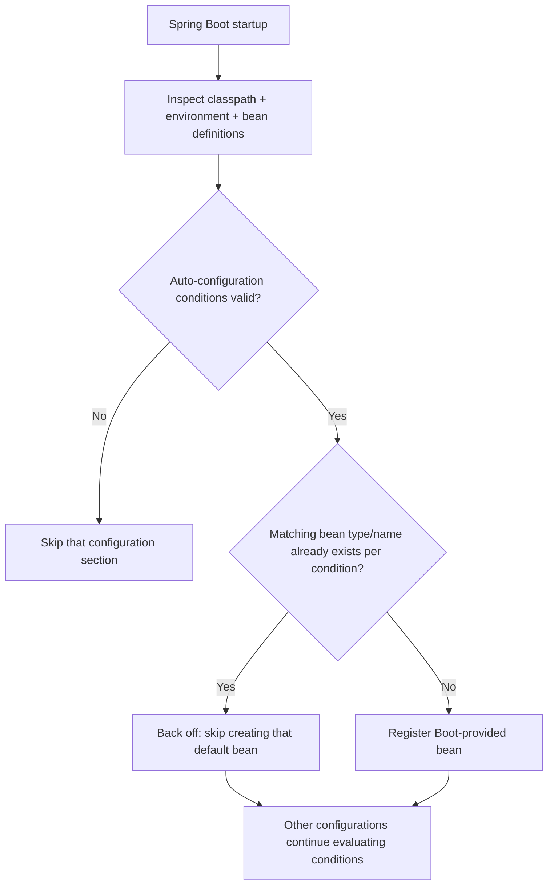
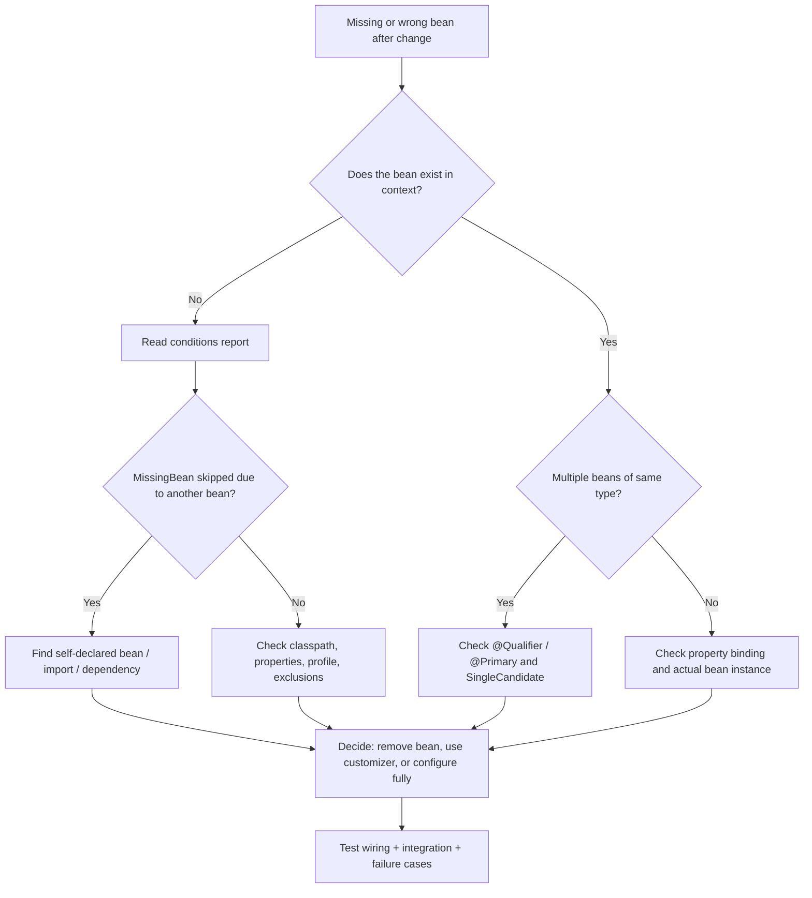
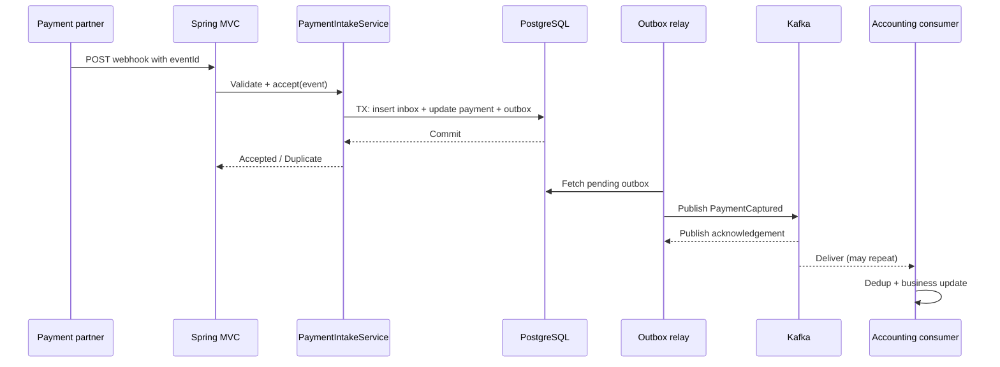

# Self-Declared Beans Causing Boot to Stop Providing Default Configuration

> **Chapter:** Troubleshooting and Upgrades  
> **Module:** `SPRING_BOOT_INTEGRATION` — structuring system integrations in Spring Boot across HTTP clients, databases, caches, message brokers, and Spring Integration adapters, focusing on configuration, data contracts, transactions, errors, deduplication, testing, and observability.
>
> **Scope:** This lesson describes Spring Boot's conditional mechanism and common scenarios in integration applications. Specific bean names, conditions, and APIs can change across Spring Boot versions; always inspect the Condition Evaluation Report and documentation for your deployed version when troubleshooting.

## 1. Scenario: Adding One Bean Suddenly Disables Old Configuration

A Spring Boot service receives webhooks from a payment partner, writes to PostgreSQL, and publishes events to Kafka. The application runs smoothly with `application.yml`:

```yaml
spring:
  datasource:
    url: ${DB_JDBC_URL}
    username: ${DB_USERNAME}
    password: ${DB_PASSWORD}
  kafka:
    bootstrap-servers: ${KAFKA_BOOTSTRAP_SERVERS}
```

After a refactor, a developer wants to "take control of the connection pool" and adds:

```java
import javax.sql.DataSource;
import com.zaxxer.hikari.HikariDataSource;
import org.springframework.context.annotation.Bean;
import org.springframework.context.annotation.Configuration;

@Configuration
public class DatabaseConfig {
    @Bean
    public DataSource dataSource() {
        return new HikariDataSource();
    }
}
```

The application may no longer connect to the database as before, even though the `spring.datasource.*` properties are intact. Why? A primary cause worth checking is that Spring Boot sees the application **already supplies a `DataSource` bean**, so the auto-configuration that originally created the default DataSource **stops creating that bean**.

The snippet above intentionally illustrates **misconfigured/incomplete setup**: `new HikariDataSource()` does not automatically pull URL, username, and password from YAML. Nor does it inherit all pool tuning that Boot previously applied through default auto-configuration.

Similar behavior can happen when manually declaring `KafkaTemplate`, `ObjectMapper`, `TaskExecutor`, a transaction manager, or an HTTP builder: another auto-configured bean stops being created, or no longer receives expected customizations. However, not every self-declared bean makes Boot "turn off all configuration"; the impact depends on the **exact conditions** on each auto-configuration and `@Bean`.

### Learning Objectives

After this lesson, you will be able to:

1. Explain **conditional auto-configuration** and **back-off** behavior.
2. Understand common conditions: `@ConditionalOnMissingBean`, `@ConditionalOnBean`, `@ConditionalOnSingleCandidate`, `@ConditionalOnClass`, and `@ConditionalOnProperty`.
3. Distinguish between **Boot not creating a bean** and **a bean being overridden/replaced by Spring**.
4. Find the exact root cause using the Condition Evaluation Report, Actuator, dependencies, and actual bean list.
5. Choose among property configuration, customizers, `@Primary`/`@Qualifier`, and self-managed beans.
6. Write regression tests for Boot upgrades or new integration libraries.

## 2. How Does Spring Boot Auto-Configuration Work?

Spring Framework provides the container, `@Configuration`, `@Bean`, dependency injection, and bean creation mechanisms. Spring Boot adds **auto-configuration**: configuration classes conditionally activated based on classpath, environment, existing bean definitions, and other conditions.

Conceptual flow:

1. The application has a JDBC dependency and driver.
2. Boot evaluates conditions to decide whether to create a default `DataSource`.
3. If the application already provides a matching `DataSource`, the "missing bean" condition no longer holds.
4. Boot **backs off** from creating the affected bean so the application retains configuration control.
5. **Other** auto-configurations can still run if their own conditions are satisfied.



This diagram is a conceptual model. At runtime, conditions are evaluated during configuration processing and bean registration, involving many condition types and interactions between auto-configurations. Do not treat it as a rigid step-by-step algorithm of "read YAML then overwrite beans."

### 2.1. What Does "Back Off" Mean?

**Back-off** is intentional behavior: auto-configuration **abstains from providing a bean** when the application already supplies an appropriate bean or conditions disallow creation. This reflects the principle that "the application author decides."

Illustrative example of an application or library auto-configuration:

```java
import org.springframework.boot.autoconfigure.AutoConfiguration;
import org.springframework.boot.autoconfigure.condition.ConditionalOnMissingBean;
import org.springframework.context.annotation.Bean;

// PartnerGateway and HttpPartnerGateway are project/library-defined types.
// Example only illustrates conditional declaration.
@AutoConfiguration
public class PartnerGatewayAutoConfiguration {

    @Bean
    @ConditionalOnMissingBean(PartnerGateway.class)
    PartnerGateway defaultPartnerGateway() {
        return new HttpPartnerGateway();
    }
}
```

When a `PartnerGateway` bean already exists in the context, the condition above may not match, so `defaultPartnerGateway` is not registered. For an auto-configuration in a **custom library** to be loaded by Boot, it also requires the auto-configuration registration mechanism matching the Boot version; merely putting `@AutoConfiguration` on an arbitrary class does not prove it was imported.

**Key point:** the application does not "delete" the default bean after Boot creates it; auto-configuration may simply **never register that bean in the first place**.

### 2.2. Not Every Auto-Configuration Uses the Same Conditions

Conditions can be placed:

- On the **auto-configuration class**: the entire group of configurations is skipped if the condition fails.
- On a **`@Bean` method**: only that specific bean is omitted.
- On a **nested configuration**: only one configuration branch is skipped.

One self-declared bean can affect several related beans through chained conditions, yet you should never claim "Spring Boot disabled Kafka" or "disabled JPA" without checking the report.

## 3. Essential Conditions to Read

| Condition | Common Meaning | Troubleshooting Clues |
|---|---|---|
| `@ConditionalOnClass` | Applies only when required classes/libraries are present | Missing dependency or version conflict |
| `@ConditionalOnMissingClass` | Applies only when a class is absent | Adding a starter altered an active config branch |
| `@ConditionalOnBean` | Applies only when a matching bean exists per condition | Prerequisite bean was not registered |
| `@ConditionalOnMissingBean` | Creates bean only if no matching bean exists | Self-declared bean caused Boot to back off |
| `@ConditionalOnSingleCandidate` | Requires a single matching candidate to inject/select | Multiple beans of same type without clear primary |
| `@ConditionalOnProperty` | Based on property existence/value condition | Wrong or missing property, or overridden by profile/env |
| `@ConditionalOnResource` | Based on a resource on the classpath | Missing file/resource |
| `@ConditionalOnWebApplication` | Distinguishes web application type | MVC/WebFlux/non-web differs from expectation |
| `@ConditionalOnExpression` or custom conditions | Evaluates other logic | Must inspect exact condition and library version |

These annotations live in Spring Boot's conditional infrastructure; they are not "all" possible conditions. Notably, Spring Boot can combine conditions across **classpath + beans + properties** before deciding whether to register a component.

### 3.1. @ConditionalOnMissingBean by Type and by Name

Example:

```java
@Bean
@ConditionalOnMissingBean(PartnerGateway.class)
PartnerGateway defaultGateway() {
    return new HttpPartnerGateway();
}
```

This checks **by type** `PartnerGateway`. If the app defines a bean named `specialGateway` implementing that interface, the condition will still not match because the bean name is not the criterion.

Another example:

```java
@Bean("defaultPartnerGateway")
@ConditionalOnMissingBean(name = "defaultPartnerGateway")
PartnerGateway defaultGateway() {
    return new HttpPartnerGateway();
}
```

This configuration checks **by name** as written. A bean of a different type with the same name can affect it, whereas a bean of the same type with a different name may not prevent the name-based condition from matching. Real auto-configurations may combine multiple attributes or use different conditions; always inspect the exact annotation.

### 3.2. Return Type of @Bean Affects Detection

Do not declare factory methods with overly generic return types just for "convenience":

```java
@Bean
Object partnerGateway() {
    return new HttpPartnerGateway();
}
```

Compared to:

```java
@Bean
PartnerGateway partnerGateway() {
    return new HttpPartnerGateway();
}
```

For certain type-based bean checks during configuration processing, the framework relies on **metadata/declared return type** of the factory method. Returning `Object` can cause detection before bean instantiation to behave unexpectedly. The safe approach is to return the concrete type or contract interface, especially when interacting with Boot's `@ConditionalOnMissingBean`.

### 3.3. Evaluation Order and Context Scope

A "missing bean" condition is evaluated against **the bean definitions known to the context at evaluation time**, not a prediction of every bean that might appear later. For this reason, such conditions are meant for auto-configurations—which Boot organizes to run after user configurations.

In addition, context hierarchies, parent contexts, bean definitions excluded by other conditions, and custom search rules can alter the outcome. For tricky issues, inspect the actual beans in **the exact ApplicationContext** rather than merely searching `@Bean` strings in source code.

## 4. Distinguishing Back-Off, Bean Overriding, and Injection Ambiguity

Three distinct mechanisms are often lumped together as "bean overridden," yet each requires a completely different fix.

| Phenomenon | What Happens? | Symptom |
|---|---|---|
| **Auto-configuration back-off** | Boot skips registering a default bean because a condition is unmet | Conditions report shows `@ConditionalOnMissingBean` did not match |
| **Bean definition overriding** | Two bean definitions compete for the same name and one replaces the other (if allowed) | Bean name conflict error or overriding log message |
| **Injection ambiguity** | Context has multiple beans of the same type and the injection point cannot pick one | `NoUniqueBeanDefinitionException` or `expected single matching bean` error |

### 4.1. @Primary Does Not "Re-Enable" Auto-Configuration

Suppose a user declares a `DataSource` bean annotated with `@Primary`. `@Primary` helps Spring pick a candidate when multiple beans of the same type exist at an injection point; **it does not make `@ConditionalOnMissingBean(DataSource.class)` evaluate to true**. Once a DataSource exists, Boot has no reason to create a "default DataSource" under that missing-bean condition.

`@Qualifier` likewise only selects a bean at injection time; it does not alter registration conditions for other beans.

### 4.2. Do Not Enable Bean Overriding to Fix Back-Off

Setting `spring.main.allow-bean-definition-overriding=true` can suppress name conflict errors and make wiring harder to diagnose. It **does not resolve** missing property binding, missing transaction managers, or misconfigured manual beans. Use this option only when you fully understand compatibility and definition ordering, never as a default fix.

## 5. Case 1: Self-Declaring a DataSource

### 5.1. Before the Change: Boot Creates the DataSource

When the application has JDBC/JPA dependencies, an appropriate driver, and valid `spring.datasource.*` properties, Boot can auto-configure a `DataSource` and related components conditionally.

```yaml
spring:
  datasource:
    url: ${DB_JDBC_URL}
    username: ${DB_USERNAME}
    password: ${DB_PASSWORD}
    hikari:
      maximum-pool-size: 12
      connection-timeout: 3000
```

If auto-configuration chooses HikariCP, the `spring.datasource.hikari.*` settings are applied to the resulting pool. Once a custom `@Bean DataSource` enters the context, the default DataSource creation branch may back off.

### 5.2. After the Change: Manual Declaration Forgets to Bind Properties

```java
@Configuration
public class ManualDataSourceConfig {
    @Bean
    DataSource dataSource() {
        return new HikariDataSource();
    }
}
```

This code tells Boot a `DataSource` has already been provided. The bean instantiated with `new` here has not received URL, credentials, or tuning. Therefore, reading YAML alone does not prove the live bean uses those settings.

**Common symptoms:** missing JDBC URL error, connecting to the wrong database, missing credentials, pool settings having no effect, `EntityManagerFactory`/transaction manager failing to initialize.

### 5.3. Preferred Fix: Do Not Create a Bean Just to Tune the Pool

If you only need to change HikariCP pool size or timeouts, **remove the self-declared bean** and use `spring.datasource.hikari.*` properties supported by your Boot version. This is the simplest choice, preserves auto-configuration, and reduces maintenance code.

### 5.4. When a Separate DataSource Is Truly Needed

If the application needs a distinct datasource with independent parameters, explicitly create `DataSourceProperties` and use the builder to map the URL and configuration properly. Example for **a custom reporting datasource**:

```java
import javax.sql.DataSource;
import com.zaxxer.hikari.HikariDataSource;
import org.springframework.boot.autoconfigure.jdbc.DataSourceProperties;
import org.springframework.boot.context.properties.ConfigurationProperties;
import org.springframework.beans.factory.annotation.Qualifier;
import org.springframework.context.annotation.Bean;
import org.springframework.context.annotation.Configuration;

@Configuration(proxyBeanMethods = false)
public class ReportingDataSourceConfig {

    @Bean
    @ConfigurationProperties("app.reporting.datasource")
    DataSourceProperties reportingDataSourceProperties() {
        return new DataSourceProperties();
    }

    @Bean("reportingDataSource")
    @ConfigurationProperties("app.reporting.datasource.configuration")
    HikariDataSource reportingDataSource(
            @Qualifier("reportingDataSourceProperties")
            DataSourceProperties reportingDataSourceProperties) {

        return reportingDataSourceProperties
            .initializeDataSourceBuilder()
            .type(HikariDataSource.class)
            .build();
    }
}
```

```yaml
app:
  reporting:
    datasource:
      url: ${REPORTING_JDBC_URL}
      username: ${REPORTING_DB_USERNAME}
      password: ${REPORTING_DB_PASSWORD}
      configuration:
        maximum-pool-size: 4
        connection-timeout: 3000
```

This example **binds properties for a manual bean**, but that is only part of the architecture. Once `reportingDataSource` appears with type `DataSource`, Boot may stop creating the default datasource due to `@ConditionalOnMissingBean`. If you genuinely need **two datasources**, you must actively configure both (or a proven compatible mechanism), along with `@Primary`/`@Qualifier`, corresponding EMF/transaction managers/repositories, and database-specific migrations. Never add a "secondary datasource" and silently assume Boot will still auto-create the primary one.

### 5.5. Cascading Impact on JPA, Spring Batch, and Transactions

A replaced datasource can alter:

- Where Spring Data JPA/Hibernate queries run: entities may map properly, yet the schema does not exist on the connected DB.
- Transaction managers: Spring selects a different candidate or lacks the expected bean.
- Spring Batch `JobRepository`: metadata may end up in an unintended database.
- Inbox/outbox: deduplication unique constraints and transactions may execute against the wrong data source.
- Hikari metrics, migrations, and health checks: the new bean may require different configuration or instrumentation.

Failures at those upper layers **do not prove** Boot disabled JPA/Batch altogether; they can be downstream consequences of replacing the foundational bean.

## 6. Case 2: Self-Declaring KafkaTemplate or ProducerFactory

In Spring Boot with Spring Kafka, auto-configuration can conditionally provide `ProducerFactory`, `KafkaTemplate`, and supporting beans. Application authors sometimes create a custom template:

```java
import org.springframework.context.annotation.Bean;
import org.springframework.context.annotation.Configuration;
import org.springframework.kafka.core.KafkaTemplate;
import org.springframework.kafka.core.ProducerFactory;

@Configuration(proxyBeanMethods = false)
class KafkaPublisherConfig {

    @Bean
    KafkaTemplate<String, String> kafkaTemplate(
            ProducerFactory<String, String> producerFactory) {
        return new KafkaTemplate<>(producerFactory);
    }
}
```

If Boot's condition checks for the absence of a matching `KafkaTemplate`, this bean causes Boot to **skip creating that default template**. The code above may still reuse the Boot-provided `ProducerFactory`, so **some** Kafka properties still take effect. However, do not assume every template customization, message converter, observation, transaction setting, or bean name matches the prior auto-configured path.

### 6.1. Distinguish Three Levels of Customization

| Goal | Preferred Approach |
|---|---|
| Only change bootstrap servers, serializers, acks, security, producer properties | Use `spring.kafka.*` and supported configuration |
| Need to send a specific payload with custom topic/key logic | Write a **publisher service** using the injected `KafkaTemplate` |
| Genuinely need to change how producer/template are built | Declare custom factory/template, then verify all beans/conditions/properties and run integration tests |

Example publisher that does not take over template creation:

```java
import java.util.concurrent.CompletableFuture;
import org.springframework.kafka.core.KafkaTemplate;
import org.springframework.kafka.support.SendResult;
import org.springframework.stereotype.Service;

@Service
public class OutboxEventPublisher {

    private final KafkaTemplate<String, String> kafkaTemplate;

    public OutboxEventPublisher(KafkaTemplate<String, String> kafkaTemplate) {
        this.kafkaTemplate = kafkaTemplate;
    }

    public CompletableFuture<SendResult<String, String>> publish(
            String topic, String aggregateId, String json) {

        return kafkaTemplate.send(topic, aggregateId, json);
    }
}
```

This **reuses the Boot-configured bean** while adding business rules in the service. `KafkaTemplate.send(...)` returns a future in modern Spring Kafka APIs; you must observe the publish outcome. A broker ACK **does not guarantee** the consumer processed the event; if the database commits before publishing, design an outbox to avoid losing events.

### 6.2. Why Can This Mistake Be Worse Than "Failing to Start"?

A manual template might send messages successfully locally yet use the wrong serializer or security config in production. With multiple clusters/topics, missing `@Qualifier` can route a publisher to the wrong destination. If the app replaces the producer factory, `spring.kafka.producer.*` properties may **not apply automatically** unless the code binds them properly.

Do not conclude "Boot Kafka is disabled"; inspect `KafkaAutoConfiguration` and its conditions **in your exact version**, which beans actually exist, the effective client configuration, and publish callbacks/metrics.

## 7. Case 3: ObjectMapper and JSON Configuration No Longer Behave the Same

When using Spring MVC/WebFlux and Jackson in a Spring Boot application, many serializers/converters are built from version-appropriate JSON configuration. A manual bean:

```java
import com.fasterxml.jackson.databind.ObjectMapper;
import org.springframework.context.annotation.Bean;
import org.springframework.context.annotation.Configuration;

@Configuration
class CustomJsonConfiguration {

    @Bean
    ObjectMapper objectMapper() {
        return new ObjectMapper();
    }
}
```

can cause Boot's default `ObjectMapper` creation in the corresponding Jackson configuration path to **back off**. `new ObjectMapper()` is a separate instance from Boot's customized one, potentially changing date/time, enum, null handling, modules, and app/library registrations.

For instance, when receiving webhooks with `occurredAt` of type `Instant`, different JSON module settings can change payload parsing. In Kafka flows, producers and consumers might end up using different mappers if beans and converters are wired separately.

**Version warning:** Jackson ecosystems and Boot customizer APIs evolve across releases; never copy a Jackson 2 example from Boot 3 and assume it applies verbatim to a newer Boot branch using a different Jackson generation.

### 7.1. How to Customize Serialization Safely

- Prefer JSON/Jackson properties **supported by your current Boot version**.
- If you need extra modules or rules, use version-appropriate **builders/modules/customizers** instead of replacing the entire `ObjectMapper` whenever possible.
- If intentionally providing a manual mapper, audit every module, converter, serializer, `TimeZone`, security rule, and schema contract.
- Test real JSON payloads for HTTP input/output and message producers/consumers; test missing fields, `null`, timestamps, new fields, and invalid data.

This scenario illustrates the risk where **the bean exists and the app runs, yet data semantics silently shift**. It is often harder to catch than a startup error.

## 8. Case 4: RestClient.Builder and HTTP Clients

`RestClient` is Spring Framework's synchronous HTTP API; Spring Boot can configure `RestClient.Builder` and related customizers/instrumentation depending on dependencies and version.

A manual configuration like:

```java
import org.springframework.context.annotation.Bean;
import org.springframework.context.annotation.Configuration;
import org.springframework.web.client.RestClient;

@Configuration
class ManualRestClientConfig {

    @Bean
    RestClient.Builder restClientBuilder() {
        return RestClient.builder();
    }
}
```

can make Boot's default builder branch back off or cause the application to use a builder missing expected customizations. Check the exact Boot version's conditions to know the scope of impact; **do not assume** every `RestClient` in the app is affected identically.

### 8.1. Preferred Pattern: Inject Boot's Configured Builder to Build Specific Clients

```java
import org.springframework.beans.factory.annotation.Qualifier;
import org.springframework.beans.factory.annotation.Value;
import org.springframework.context.annotation.Bean;
import org.springframework.context.annotation.Configuration;
import org.springframework.web.client.RestClient;

@Configuration(proxyBeanMethods = false)
public class ShippingHttpConfiguration {

    @Bean("shippingRestClient")
    RestClient shippingRestClient(
            RestClient.Builder builder,
            @Value("${integration.shipping.base-url}") String baseUrl) {

        return builder.baseUrl(baseUrl).build();
    }
}
```

```yaml
integration:
  shipping:
    base-url: ${SHIPPING_BASE_URL}
```

This **does not redefine `RestClient.Builder`**, so configurations and customizers applied by Boot to the builder can be inherited by the new client. If multiple `RestClient` beans exist, place `@Qualifier("shippingRestClient")` at injection points.

For production use, still configure appropriate timeouts, authentication, connection pooling, error handling, and retry policies. `integration.shipping.base-url` is an **application-defined property** and will not affect `RestClient` unless code binds it.

### 8.2. Custom Builder Is Not the Same as Custom Client

Building a dedicated `RestClient` from the provided builder differs from declaring your own **`RestClient.Builder` bean**. The first option preserves shared infrastructure far better. Apply the same thinking to `WebClient.Builder` in WebFlux: avoid accidentally bypassing configured codecs, connectors, filters, or observability.

## 9. Case 5: TaskExecutor and @Async Behave Unexpectedly

In Spring Boot applications, an executor can be auto-configured and used by `@Async`, MVC async, or background tasks depending on bean types, bean names, and Boot version.

Suppose the integration team adds a bean:

```java
import java.util.concurrent.Executor;
import java.util.concurrent.Executors;
import org.springframework.context.annotation.Bean;
import org.springframework.context.annotation.Configuration;

@Configuration
class ImportExecutorConfig {

    @Bean("importExecutor")
    Executor importExecutor() {
        return Executors.newFixedThreadPool(4);
    }
}
```

A self-declared `Executor` bean can alter default executor auto-configuration conditions or executor selection rules for other components **depending on version and setup**. This example also uses `Executors.newFixedThreadPool` with an unbounded queue by default, lacking instrumentation and explicit lifecycle management; do not use it as-is in production.

### 9.1. Designing Clear Responsibility

If you need a dedicated executor for partner integrations, configure a `ThreadPoolTaskExecutor` explicitly and target it in `@Async`:

```java
import java.util.concurrent.ThreadPoolExecutor;
import org.springframework.context.annotation.Bean;
import org.springframework.context.annotation.Configuration;
import org.springframework.scheduling.concurrent.ThreadPoolTaskExecutor;

@Configuration(proxyBeanMethods = false)
class IntegrationExecutorConfig {

    @Bean("integrationExecutor")
    ThreadPoolTaskExecutor integrationExecutor() {
        ThreadPoolTaskExecutor executor = new ThreadPoolTaskExecutor();
        executor.setCorePoolSize(4);
        executor.setMaxPoolSize(8);
        executor.setQueueCapacity(100);
        executor.setThreadNamePrefix("integration-");
        executor.setRejectedExecutionHandler(
            new ThreadPoolExecutor.AbortPolicy());
        executor.initialize();
        return executor;
    }
}
```

```java
@Async("integrationExecutor")
public CompletableFuture<Void> sendPartnerUpdate(String jobId) {
    // Business logic, timeouts, and error handling live in the adapter/service.
    return CompletableFuture.completedFuture(null);
}
```

The illustrative code assumes `@EnableAsync` is enabled, the method is invoked through a Spring proxy, and the bean is in the context. Production readiness also requires graceful shutdown, submission failure handling, queue saturation management, thread context propagation, and bounded concurrency.

**Note:** Even when naming a custom executor, check whether the rest of the application still expects a default executor. With multiple executors, test `@Qualifier`/name wiring and executor properties; never assume `@Primary` restores a bean that auto-configuration skipped creating.

## 10. One Bean Can Affect Multiple Other Auto-Configurations

A project may unintentionally register the following beans:

| Manual Bean | Auto-Configurations Potentially Affected | Consequences to Inspect |
|---|---|---|
| `DataSource` | Default datasource creation and single-datasource dependents | Different URL/pool; JPA/Batch/migrations hitting wrong DB |
| `KafkaTemplate` / `ProducerFactory` | Related Kafka templates/factories and wiring | Unexpected serializer, bootstrap, transaction, or observability |
| `ObjectMapper` | Version-specific Jackson infrastructure | Altered HTTP/JSON message contract |
| `RestClient.Builder` or `WebClient.Builder` | HTTP client builders/customizers | Dropped codecs, timeouts, or instrumentation |
| `Executor` / `TaskExecutor` | Task execution auto-config and async selection | Different pool, queue, thread naming, context propagation |
| `PlatformTransactionManager` | Transaction auto-config/selection and transaction consumers | Wrong DB selected; transactions bypassing intended manager |
| `CacheManager` | Cache auto-configuration | Different cache provider; TTL/serializer not applied |
| `MessageConverter` / infrastructure bean | Web/Kafka/AMQP adapters depending on bean wiring | Different serializer, header mapping, or schema |
| `MessageChannel` / Spring Integration infrastructure | Bean name/type conflicts or flow conditions | Handlers routing to wrong channel, unexpected pollers/error channels |

**This table does not guarantee every bean always forces Boot to back off.** Behavior depends on exact conditions, bean placement, autowiring rules, classpath, and version. Use the table as a **list of suspects to verify**, not a final diagnosis.

### 10.1. @Primary and @Qualifier Do Not Change Schema, Transactions, or Destinations

For instance, with two `KafkaTemplate` or two `DataSource` beans, `@Primary` tells Spring which candidate to inject when no qualifier is present; `@Qualifier` explicitly picks another bean. Neither guarantees the template/datasource has the right bound properties, nor creates a distributed transaction across two data stores. In **inbox + outbox** flows, both repositories must participate in the transaction of the **same database** to achieve atomic writes.

## 11. Why Do Failures Only Appear After Upgrading Spring Boot?

Upgrading Boot can simultaneously change:

- Versions of Spring Framework, Spring Data, Spring Kafka, Spring AMQP, Jackson, and their APIs.
- Names/types of default beans and `@ConditionalOnMissingBean` conditions.
- Property names, namespaces, deprecations, or default values.
- Auto-configured HTTP client, metrics/tracing, and task executor behavior.
- APIs/serialization or transaction infrastructure of a module.
- When and how beans created by other auto-configurations are detected.

A manual bean that previously **did not collide** with any condition may become a competing bean after libraries or auto-configurations change. Conversely, a new starter may introduce classpath types that trigger a different auto-configuration branch.

### 11.1. Upgrade Layer by Layer; Do Not Fix by Randomly Deleting Annotations

When upgrading from one version to another:

1. Record Boot, Java, Spring Framework, and related starter versions before and after.
2. Compare the build tool's dependency tree through an approved verification step in integration/testing.
3. Read the migration notes and update configuration for **the exact version pair**.
4. Compare the Condition Evaluation Report before and after.
5. List `DataSource`, `KafkaTemplate`, `TransactionManager`, `RestClient.Builder`, `ObjectMapper`, and `Executor` beans before and after.
6. Verify that used properties actually bind to the effective beans.
7. Run HTTP/message contract tests, database/broker integration tests, and retry/crash scenarios.

Be careful with specific auto-configuration classes and APIs: for example, Jackson 2 and Jackson 3 are not source-compatible branches; never copy type/bean configurations from a different major version's docs expecting identical behavior.

## 12. Diagnosing with the Condition Evaluation Report

When facing "Boot didn't create the bean," prioritize **runtime evidence** over guessing from starter names.

### 12.1. Enabling the Conditions Report at Startup

In an appropriate environment, enable debug mode:

```bash
java -jar integration-service.jar --debug
```

Spring Boot can print the **Condition Evaluation Report** showing which auto-configurations matched, which did not, and why. Illustrative excerpt:

```text
DataSourceAutoConfiguration matched:
  - @ConditionalOnClass found required JDBC/DataSource classes

DataSourceConfiguration.Hikari did not match:
  - @ConditionalOnMissingBean(DataSource) found bean 'dataSource'
```

This is **simulated output to demonstrate how to read it**, not a promise that exact auto-configuration names, nested class names, or lines will look identical in real versions.

**How to interpret:** the presence of JDBC dependencies satisfies the classpath condition, yet the DataSource-creating branch does not register because a manual bean already exists. Read **positive matches**, **negative matches**, and **unconditional classes/exclusions** when provided by the report.

### 12.2. Actuator Conditions Endpoint

If the application has Spring Boot Actuator with appropriate exposure and authorization, **`/actuator/conditions`** exposes condition results:

```yaml
management:
  endpoints:
    web:
      exposure:
        include: health,info,conditions
```

**Security:** do not expose detailed configuration/condition endpoints publicly on the internet. Use controlled environments, authentication/authorization, and appropriate network policies. Conditions reveal packages, classes, bean names, and properties; treat them as internal operational data.

The `conditions` endpoint is not `/actuator/beans`: one explains auto-configuration conditions; the other lets you inspect live beans. Depending on exposure permissions and version, use both together to avoid confusing "condition matched" with "bean injected in the right place."

### 12.3. Three Mandatory Questions When Reading the Report

1. **Which auto-config was supposed to provide the bean?** Identify the actual configuration class in the running version.
2. **Which condition failed to match?** If `@ConditionalOnMissingBean`, check which **type/name** it specifies and which bean already exists.
3. **Who registered the competing bean?** Search `@Bean`, `@Configuration`, `@Import`, third-party starters, test configurations, or context hierarchies.

You can use an IDE to search `@Bean` declarations by type, but prefer verifying the **actual bean name, class, and factory method** in the `ApplicationContext`. A bean of that type may come from another library's auto-configuration rather than your team's direct code.

## 13. A Repeatable Incident Investigation Process

### 13.1. Capture State Before Making Changes

Collect:

- Boot version and related dependencies.
- Original stack trace, including the final `Caused by` and failing bean name.
- Condition Evaluation Report.
- List of beans with matching types and names, and which bean is injected into the target service.
- Effective **non-sensitive** configuration values; never log secrets.
- Recent code and configuration changes around when the failure began.

### 13.2. Diagnostic Flowchart



### 13.3. Layered Symptom Mapping

| Symptom | Hypotheses to Check |
|---|---|
| `No qualifying bean of type DataSource` | Missing driver/config, auto-config excluded, conditional bean skipped, wrong context |
| `expected single matching bean but found 2` | Multiple beans of same type; missing qualifier/primary; auto-config needs single candidate |
| `BeanDefinitionOverrideException` | Duplicate bean definition name; not normal back-off |
| `NoUniqueBeanDefinitionException` | Ambiguous dependency selection; check names/types/primary |
| `NoSuchBeanDefinitionException` injecting `KafkaTemplate` | Module/auto-config inactive, manual bean excluded by condition/profile, generic/qualifier mismatch |
| `Failed to configure a DataSource` | Property/driver/connection error or Boot lacks config to build the bean |
| `Not a managed type` (JPA) | Entity scan/`EntityManagerFactory`/repository mapping, not necessarily Boot back-off |
| Timeout/JSON settings have no effect | Live bean does not use Boot-customized builder/configurer, or properties are unbound |
| Kafka listener fails to start | Check container factory, listener enablement, topic/group/security, bean selection, startup exceptions |
| Service runs but metrics are missing | Verify instrumentation/customizers on live instance and metric exposure/registry |

Do not fix every problem by adding `@ComponentScan` or `@SpringBootApplication(exclude=...)`. You must know the exact reason Boot skipped providing a bean and which components are genuinely affected.

## 14. Five Intervention Levels: Choose the Minimum Necessary

There is a spectrum from least intrusive to full manual ownership:

### 14.1. Level 1 — Use Boot Properties

For example, adjust Hikari pooling via `spring.datasource.hikari.maximum-pool-size`, producer settings via `spring.kafka.producer.*`, or caches via supported properties.

**Pros:** continues receiving auto-configuration bug fixes and compatible updates; minimal code.

**Limit:** not every specialized need has a corresponding property.

### 14.2. Level 2 — Use Customizers / Builders / Modules

When the framework exposes extension points such as builders or JSON/HTTP/tracing customizers, use them instead of redefining the foundational bean. Choose APIs compatible with your version.

**Example:** inject Boot's `RestClient.Builder` and build a dedicated `shippingRestClient` as shown in section 8.

### 14.3. Level 3 — Write Services / Adapters Using Existing Beans

Write an `OrderEventPublisher` using `KafkaTemplate`, `ShippingGateway` using `RestClient`, or a custom repository using `JdbcTemplate`/JPA without taking over core infrastructure creation.

This keeps a clean boundary between **business logic** and **connection plumbing**.

### 14.4. Level 4 — Intentionally Declare Infrastructure Beans

When you need multi-datasource, a separate Kafka cluster, HTTP clients with custom TLS/credentials, or a specialized cache manager, manual declaration is justified. Before doing so, inventory all affected beans/conditions, property bindings, naming, qualifiers, lifecycle, metrics, and transactions.

### 14.5. Level 5 — Replace or Exclude Auto-Configuration Altogether

Only exclude auto-configuration when you know its exact scope and provide replacement infrastructure:

```java
@SpringBootApplication(
    exclude = { /* appropriate AutoConfigurationClass */ }
)
public class IntegrationApplication {
}
```

This is a **conceptual skeleton**, not complete code: do not copy an empty `exclude` into a project as a solution. Excluding the wrong class can remove far more beans than intended. When exclusions are required, document the reason, test thoroughly, and re-evaluate on every upgrade.

**Rule:** change as little as possible while meeting requirements. Any self-declared bean must be treated as **platform configuration owned by the application team**, not a quick convenience snippet.

## 15. Testing to Catch Unintended Bean Back-Off

### 15.1. Testing That ApplicationContext Uses the Intended Bean

Simple example with `@SpringBootTest`:

```java
import static org.assertj.core.api.Assertions.assertThat;

import java.util.Map;
import javax.sql.DataSource;
import org.junit.jupiter.api.Test;
import org.springframework.beans.factory.annotation.Autowired;
import org.springframework.boot.test.context.SpringBootTest;
import org.springframework.context.ApplicationContext;

@SpringBootTest
class DataSourceWiringTest {

    @Autowired
    ApplicationContext context;

    @Test
    void hasTheExpectedDataSource() {
        Map<String, DataSource> sources =
            context.getBeansOfType(DataSource.class);

        assertThat(sources).containsKey("dataSource");
        assertThat(sources.get("dataSource")).isNotNull();
    }
}
```

This test only checks bean presence and name in the **test context**; it does not prove the URL, transaction manager, or target database is right. If the app uses custom bean names or multi-datasource, adjust assertions to match your design. You can also assert types, qualifiers, **non-sensitive** pool settings, and connectivity to a test database.

### 15.2. Using ApplicationContextRunner for Custom Auto-Configuration

When writing internal libraries/auto-configurations, `ApplicationContextRunner` from Spring Boot's test support verifies both "bean missing" and "user-supplied bean present" cases.

Assuming the illustrative `PartnerGatewayAutoConfiguration` from section 2:

```java
import static org.assertj.core.api.Assertions.assertThat;

import org.junit.jupiter.api.Test;
import org.springframework.boot.autoconfigure.AutoConfigurations;
import org.springframework.boot.test.context.runner.ApplicationContextRunner;

class PartnerGatewayAutoConfigurationTest {

    private final ApplicationContextRunner runner =
        new ApplicationContextRunner()
            .withConfiguration(
                AutoConfigurations.of(PartnerGatewayAutoConfiguration.class)
            );

    @Test
    void suppliesGatewayWhenMissing() {
        runner.run(context ->
            assertThat(context).hasSingleBean(PartnerGateway.class)
        );
    }

    @Test
    void backsOffWhenUserSuppliesGateway() {
        runner.withBean(
            PartnerGateway.class,
            () -> new CustomPartnerGateway()
        ).run(context -> {
            assertThat(context).hasSingleBean(PartnerGateway.class);
            assertThat(context.getBean(PartnerGateway.class))
                .isInstanceOf(CustomPartnerGateway.class);
        });
    }
}
```

`PartnerGateway`, `HttpPartnerGateway`, and `CustomPartnerGateway` are **illustrative project-defined types**. You must implement them and include the right test dependencies for the test to run. For real auto-configurations, also test properties, missing classes, multiple beans, and hierarchical context conditions if applicable.

### 15.3. Test Behavior, Not Just Bean Names

| Layer | Minimum Verification After Self-Declaring a Bean |
|---|---|
| DataSource/JPA | Connects to right DB/schema, transaction rollback, inbox unique constraint, outbox in same transaction |
| Kafka | Real template sends to right cluster/topic/key, serializer, publish callbacks, retry/DLT, consumer decodes schema |
| HTTP client | Base URL, auth, real timeouts, status/error mapping, tracing/correlation headers |
| JSON | Dates/times, enums, nulls, unknown/missing fields, HTTP and broker schema versions |
| Executor | Bounded pool/queue, rejection, `@Async` through proxy, shutdown, and MDC propagation |
| Cache | TTL, key serialization, cache invalidation matching data version |
| Spring Integration | Routing, transformers, channel subscribers, error channel, threads, and proper ACKs |
| Upgrades | Compare wiring before/after, migrate config, run integration tests against production-like DB/broker |

Testing network failures or crashes requires proper tools and environments. Within the scope of writing this lesson, code examples are not executed against a build/test runner; actual verification belongs to integration and QA phases.

## 16. Case Study: One Small Change Breaks the Webhook → DB → Broker Flow

The system receives `PaymentCaptured` events from a partner. Target flow:



After a refactor, the team adds a manual `DataSource` to "increase the pool" without properly binding `spring.datasource.*`. What can happen:

1. Default datasource auto-configuration stops creating the prior bean because it detects the manual bean.
2. JPA or the transaction manager picks a misconfigured/credential-less datasource, causing startup failure or connecting to the wrong environment.
3. If the datasource still connects somewhere else, unique constraints/inbox schemas differ, breaking deduplication.
4. The outbox relay uses a different connection and never sees pending rows, stalling event publication.
5. Operators see the Kafka consumer "receiving no events," while the root cause is the **database bean upstream of publishing**, not Kafka.

### 16.1. Evidence-Based Root Cause Investigation

- **Step A:** inspect recent commits/config changes and spot the new `@Bean DataSource`.
- **Step B:** check the Condition Evaluation Report to confirm the default DataSource branch was skipped due to this bean.
- **Step C:** check which actual datasource is injected into JPA/transaction manager and outbox writer/relay.
- **Step D:** measure `inbox.accepted`, pending outbox count, publish success, and consumer lag to pinpoint the break.
- **Step E:** if you only meant to tune the pool, delete the manual bean and return to Boot properties; if multiple DBs are truly required, configure each bean and transaction manager completely.
- **Step F:** run integration tests for duplicate webhooks, DB rollback, post-commit outbox publishing, repeated retries, and consumer deduplication.

Do not rush to add `@Retryable` to the Kafka consumer or increase thread counts when the producer never even created or published valid events.

## 17. PR Review Checklist for Infrastructure Bean Declarations

Before merging a PR that introduces a `@Bean` for a datasource, transaction manager, HTTP client builder, Kafka template, executor, cache, or converter, ask:

1. **Why is this bean needed?** Can the goal be achieved with properties, a customizer, or a dedicated adapter/service?
2. **What are the bean's type and name?** Does it match a type/name evaluated by auto-configuration?
3. **What are the conditions in the current Boot version?** Have you compared the Condition Evaluation Report before and after?
4. **Which default beans will no longer be created?** Is the impact at method level, nested config, or entire auto-configuration?
5. **Which properties must now be bound manually?** URL, credentials, serializers, timeouts, pooling, SSL, telemetry, transactions?
6. **Are there multiple beans of the same type?** Are `@Primary`, `@Qualifier`, and `@ConditionalOnSingleCandidate` consistent?
7. **If using two datasources or two clusters:** are repositories, transaction managers, job repositories, and listeners/publishers bound to the right target?
8. **Does this alter any data contract?** Did JSON/schema/headers or date/time formats change?
9. **Does this alter failure semantics?** Are timeouts, retries, dead-lettering, ACKs, idempotency, and outbox still sound?
10. **Is there test and metric evidence?** Startup, wiring, integration tests, traces, and backlog alerts?
11. **On future Boot upgrades, who owns the manual config?** Are there regression tests and documentation explaining why defaults were replaced?

### Quick Self-Check

**Q1:** Why can adding `@Bean DataSource` make `spring.datasource.url` "stop working"?  
**A1:** Boot can back off from creating the default DataSource; a manual bean does not receive URL/properties unless the application binds them explicitly.

**Q2:** Does `@Primary` make Boot continue creating an extra default `DataSource`?  
**A2:** No. `@Primary` selects among candidates at injection time; it does not make a missing-bean condition true.

**Q3:** Does a custom `KafkaTemplate` bean disable all Kafka auto-configuration?  
**A3:** No. You must inspect individual conditions. `ProducerFactory` or other components may still auto-configure while the default template backs off.

**Q4:** Why can `new ObjectMapper()` break integrations even though the app still runs?  
**A4:** It can lack JSON modules/settings present on Boot's customized bean, silently changing timestamp or schema serialization.

**Q5:** When building a partner-specific HTTP client, should you redefine `RestClient.Builder` or inject Boot's configured builder?  
**A5:** Usually prefer injecting Boot's builder and creating a dedicated `RestClient` bean, if it fits your requirements.

**Q6:** How do you verify for certain why an auto-configuration did not create a bean?  
**A6:** Read the Condition Evaluation Report for your exact version/context and inspect live bean definitions, rather than guessing from starter names.

---

In the **Troubleshooting and Upgrades** chapter of `SPRING_BOOT_INTEGRATION`, the core principle is: **Spring Boot auto-configuration is conditional; an application-declared bean can cause part of the default beans to back off, without meaning the entire auto-configuration system is turned off**. Across HTTP, database, cache, broker, and Spring Integration flows, verify conditions, inspect live beans, preserve transaction/idempotency boundaries, and prove behavior with tests and observability before upgrading or replacing default configurations.
