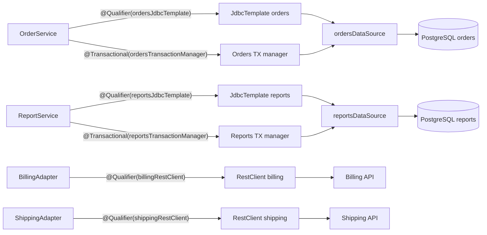

# Wrong Qualifier When Multiple DataSources, Clients, or Transaction Managers Exist

> **Chapter:** Troubleshooting and Upgrades  
> **Scope:** Within the **SPRING_BOOT_INTEGRATION** module, a Spring Boot application may connect to multiple SQL databases, HTTP services, caches, brokers, and Spring Integration adapters. This lesson focuses on **selecting the wrong bean** when multiple `DataSource`, HTTP client, or `PlatformTransactionManager`/`ReactiveTransactionManager` beans exist; using `@Qualifier`, `@Primary`, and bean names to pair resources accurately; catching misconfigurations before data is written to the wrong place; and strategies for testing, observability, and upgrades.

## 1. Scenario: The Application Runs Yet Writes to the Wrong Place

Suppose an integration service uses:

- PostgreSQL **orders** to store orders and outbox records.
- PostgreSQL **reports** to read reporting data.
- HTTP client **billing** to submit charge requests.
- HTTP client **shipping** to create shipment requests.

The team defines two `DataSource`s, two `JdbcTemplate`s, two `RestClient`s, and two transaction managers. Later, a service injects `JdbcTemplate` without specifying which database it belongs to, or adds `@Transactional` while letting Spring pick the default transaction manager.

Two failure categories emerge:

1. **Clear startup errors:** Spring cannot choose a single bean, a qualifier name does not exist, or auto-configuration conditions fail.
2. **Silent, far more dangerous failures:** a bean is selected successfully via `@Primary` or a matching name, yet queries hit the **wrong business database or client**; the transaction manages a different resource, so rollback fails to protect side effects.

Therefore, multi-resource debugging is not just "getting the application context to start"; it requires proving **the right bean, right endpoint, right transaction, and right data** in every flow.

### Diagram of a Multi-Resource Integration System



**Principle:** Name every resource explicitly and use **the matching DataSource–TransactionManager pair** whenever executing SQL transactions. `@Primary` only sets a default choice for unqualified injection points; it **does not** change the underlying resource.

## 2. How Does Spring Choose Which Bean to Inject?

Spring Dependency Injection selects beans by **required type**, then narrows candidates using qualifiers and candidate-selection rules. When multiple beans share a type without a single winner, the application can fail with `NoUniqueBeanDefinitionException` or an equivalent bean creation error.

| Mechanism | Role | Limitations to Remember |
| --- | --- | --- |
| **`@Qualifier("ordersDataSource")`** | Explicitly identifies qualifying bean(s) at the injection point | Name must match the real bean; does not automatically switch the transaction manager |
| **`@Primary`** | Prioritizes one bean when multiple candidates of the same type exist at a single injection point | Can mask wiring bugs: code starts cleanly yet hits an unintended resource |
| **Bean name** | Bean ID, e.g., `@Bean("ordersDataSource")` | Renaming the bean without updating qualifiers breaks dependencies |
| **Constructor parameter name** | Can participate in selection under compatible Spring/bytecode conditions | Do not rely on it as a safe contract when multiple databases exist |
| **Generic type** | Can distinguish certain `KafkaTemplate<K,V>` or typed repositories | Type erasure, broad generic declarations, and factories can make it insufficient |
| **`@Resource(name = "...")`** | Resource-name-oriented injection per its annotation semantics | Differs from `@Autowired` semantics; does not select transactions |
| **`@Transactional(transactionManager = "...")`** | Specifies **which transaction manager** to use | Does not choose which `JdbcTemplate`, repository, or HTTP client is called inside the method |

Example of unsafe injection when two `JdbcTemplate` beans exist:

```java
@Service
class UnsafeReportService {
    UnsafeReportService(JdbcTemplate jdbcTemplate) {
        // May be ambiguous; if ordersJdbcTemplate is @Primary,
        // this variable could silently point to the orders DB.
    }
}
```

Explicit injection:

```java
@Service
class ReportService {
    private final JdbcTemplate reports;

    ReportService(
            @Qualifier("reportsJdbcTemplate") JdbcTemplate reports) {
        this.reports = reports;
    }
}
```

**Note:** `@Qualifier` on a constructor parameter only resolves **that parameter's dependency**. A method in the class can still execute under the wrong transaction manager if `@Transactional` is misconfigured.

### 2.1. When Should `@Primary` Be Used?

In an application with one primary database and one secondary database, marking the primary beans with `@Primary` helps framework components that expect a single default bean. Even so, business code on specialized flows should still declare `@Qualifier` explicitly so reviewers can verify intent.

`@Primary` does not mean "the database with the right data" or "safe transaction." Accidentally putting `@Primary` on the reporting DataSource can route every unqualified injection to the reporting database while the application boots without complaint.

### 2.2. Do Not Rely on Variable Names as Configuration

Under certain compilation flags and Spring resolution rules, parameter or field names can narrow candidates. However, this behavior depends on compiler bytecode metadata and version-specific resolution rules. For critical resources like SQL write paths, **parameter names are no substitute for explicit qualifiers**.

## 3. Diagnose Symptoms Before Editing Code

| Symptom | Common Cause | First Check |
| --- | --- | --- |
| `NoUniqueBeanDefinitionException` for `DataSource`/`RestClient` | Two or more beans of the same type without a unique candidate | Bean names, `@Primary`, `@Qualifier` at injection points |
| `NoSuchBeanDefinitionException` with qualifier name | Bean renamed, configuration not scanned, or condition unmet | `@Bean` name, package scan, bean profiles, conditions report |
| Connects cleanly yet queries hit the wrong DB | Unqualified injection picked an unexpected `@Primary` | `JdbcTemplate.getDataSource()` in tests and database identity |
| `@Transactional` does not roll back data | Manager does not govern the actual `DataSource` used, or proxy was bypassed | Transaction manager bean, call path, Spring AOP/proxy |
| Service reports success yet calls the wrong partner | Two `RestClient` beans share type; injector picked default | Base URL, bean name, and real HTTP request tests |
| JPA repository uses another schema/DB | `entityManagerFactoryRef` or `transactionManagerRef` mispointed | `@EnableJpaRepositories`, entity scanning, EMF bean |
| Adding a second DataSource stops Boot from auto-creating prior beans | Conditional auto-configuration backed off | `@ConditionalOnMissingBean`, `@ConditionalOnSingleCandidate`, and dependency tree |
| Flyway runs against the wrong database | Migration tool picked the default datasource | Flyway datasource config and migration history in each DB |
| JDBC exists yet reactive transactions fail | Confusing `DataSource` with R2DBC `ConnectionFactory` | Transaction manager type and Reactor context |
| Fails only under the production profile | Profile overrides URL, changes bean definitions, or triggers conditions | Effective configuration and deployment environment |

**Do not fix by scattering `@Primary`.** Once startup exceptions disappear, verify every dependency actually points to the intended resource.

## 4. Complete Example: Two PostgreSQL DataSources in Spring Boot

This walkthrough uses **Spring Boot 3.x**, Java 17+, Spring JDBC, and HikariCP. Both databases have independent schemas and credentials:

- `ordersdb`: orders and transactional outbox; read/write access allowed.
- `reportsdb`: reporting data; application account needs read-only privileges.

### 4.1. Maven Dependencies

```xml
<dependencies>
    <dependency>
        <groupId>org.springframework.boot</groupId>
        <artifactId>spring-boot-starter-jdbc</artifactId>
    </dependency>
    <dependency>
        <groupId>org.postgresql</groupId>
        <artifactId>postgresql</artifactId>
        <scope>runtime</scope>
    </dependency>
    <dependency>
        <groupId>org.springframework.boot</groupId>
        <artifactId>spring-boot-starter-web</artifactId>
    </dependency>
</dependencies>
```

With `spring-boot-starter-jdbc`, HikariCP is typically included via Boot-managed dependencies. Inspect the runtime dependency tree before choosing another pool implementation.

### 4.2. Configuration with Separate Namespaces

```yaml
app:
  datasource:
    orders:
      url: ${ORDERS_DB_URL:jdbc:postgresql://localhost:5432/ordersdb}
      username: ${ORDERS_DB_USER:orders_app}
      password: ${ORDERS_DB_PASSWORD}
      driver-class-name: org.postgresql.Driver
      configuration:
        pool-name: orders-pool
        maximum-pool-size: 12
        minimum-idle: 2
    reports:
      url: ${REPORTS_DB_URL:jdbc:postgresql://localhost:5432/reportsdb}
      username: ${REPORTS_DB_USER:reports_app}
      password: ${REPORTS_DB_PASSWORD}
      driver-class-name: org.postgresql.Driver
      configuration:
        pool-name: reports-pool
        maximum-pool-size: 6
        minimum-idle: 1

partner:
  billing:
    base-url: ${BILLING_URL:http://localhost:8089}
  shipping:
    base-url: ${SHIPPING_URL:http://localhost:8090}
```

The `app.datasource.*` keys are **application-defined configuration**, not Spring Boot built-in properties that automatically spawn two `DataSource` beans. We bind them to dedicated beans next.

**Why not simply write two `spring.datasource.url` entries?** A single `spring.datasource.*` namespace describes one primary datasource. When two independent datasources are needed, create separate `DataSourceProperties`/`DataSource` beans or use deliberate multi-tenancy configuration. Separate namespaces make explicit which database reads which settings.

### 4.3. Creating Two DataSources, JdbcTemplates, and Transaction Managers

```java
package com.example.integration.config;

import javax.sql.DataSource;
import com.zaxxer.hikari.HikariDataSource;

import org.springframework.beans.factory.annotation.Qualifier;
import org.springframework.boot.autoconfigure.jdbc.DataSourceProperties;
import org.springframework.boot.context.properties.ConfigurationProperties;
import org.springframework.context.annotation.Bean;
import org.springframework.context.annotation.Configuration;
import org.springframework.context.annotation.Primary;
import org.springframework.jdbc.core.JdbcTemplate;
import org.springframework.jdbc.support.JdbcTransactionManager;
import org.springframework.transaction.PlatformTransactionManager;

@Configuration(proxyBeanMethods = false)
public class MultipleDatabaseConfiguration {

    @Bean("ordersDataSourceProperties")
    @Primary
    @ConfigurationProperties("app.datasource.orders")
    public DataSourceProperties ordersProperties() {
        return new DataSourceProperties();
    }

    @Bean("reportsDataSourceProperties")
    @ConfigurationProperties("app.datasource.reports")
    public DataSourceProperties reportsProperties() {
        return new DataSourceProperties();
    }

    @Bean("ordersDataSource")
    @Primary
    @ConfigurationProperties("app.datasource.orders.configuration")
    public HikariDataSource ordersDataSource(
            @Qualifier("ordersDataSourceProperties")
            DataSourceProperties properties) {
        return properties.initializeDataSourceBuilder()
                .type(HikariDataSource.class)
                .build();
    }

    @Bean("reportsDataSource")
    @ConfigurationProperties("app.datasource.reports.configuration")
    public HikariDataSource reportsDataSource(
            @Qualifier("reportsDataSourceProperties")
            DataSourceProperties properties) {
        return properties.initializeDataSourceBuilder()
                .type(HikariDataSource.class)
                .build();
    }

    @Bean("ordersJdbcTemplate")
    @Primary
    public JdbcTemplate ordersJdbcTemplate(
            @Qualifier("ordersDataSource") DataSource source) {
        return new JdbcTemplate(source);
    }

    @Bean("reportsJdbcTemplate")
    public JdbcTemplate reportsJdbcTemplate(
            @Qualifier("reportsDataSource") DataSource source) {
        return new JdbcTemplate(source);
    }

    @Bean("ordersTransactionManager")
    @Primary
    public PlatformTransactionManager ordersTransactionManager(
            @Qualifier("ordersDataSource") DataSource source) {
        return new JdbcTransactionManager(source);
    }

    @Bean("reportsTransactionManager")
    public PlatformTransactionManager reportsTransactionManager(
            @Qualifier("reportsDataSource") DataSource source) {
        return new JdbcTransactionManager(source);
    }
}
```

**Why are two `DataSourceProperties` beans needed?** Spring Boot uses `DataSourceProperties` to bind `url`/username/driver and build the appropriate pool. `HikariDataSource` exposes `jdbcUrl` rather than `url`; calling `initializeDataSourceBuilder()` avoids mapping errors when binding directly to `HikariDataSource` from an `url` field.

**Why place `@ConfigurationProperties` on the Hikari beans?** Hikari parameters such as `maximumPoolSize`, `minimumIdle`, and `poolName` bind from the separate `configuration` subtree. Verify applied values in integration tests rather than assuming correctness from YAML alone.

**Why mark `@Primary` on properties, datasource, template, and transaction manager?** It establishes a consistent default for unqualified injections and auto-configurations requiring a single candidate. Still, business code should specify beans explicitly, especially for the reports database or side-effecting flows.

In Java SE, `DataSource` remains in `javax.sql.DataSource` when running Spring Boot 3.x. Do not confuse this namespace with Jakarta EE APIs that moved from `javax.persistence` to `jakarta.persistence`.

### 4.4. Configuration Without `@Primary`

If all `@Primary` annotations are removed and a component injects `DataSource` without a qualifier, startup can fail with:

```text
No qualifying bean of type 'javax.sql.DataSource' available:
expected single matching bean but found 2:
ordersDataSource,reportsDataSource
```

This is an **illustrative message**; exact phrasing and bean names depend on Spring version. Do not put `@Primary` on `reports` just to silence the error if the default consumer needs `orders`; inspect the injection point and align configuration with intent.

## 5. Pairing the Right JdbcTemplate with the Right Service

The data layer must state clearly which database it targets:

```java
package com.example.integration.orders;

import java.util.UUID;
import org.springframework.beans.factory.annotation.Qualifier;
import org.springframework.jdbc.core.JdbcTemplate;
import org.springframework.stereotype.Service;
import org.springframework.transaction.annotation.Transactional;

@Service
public class OrderWriteService {
    private final JdbcTemplate orders;

    public OrderWriteService(
            @Qualifier("ordersJdbcTemplate") JdbcTemplate orders) {
        this.orders = orders;
    }

    @Transactional(transactionManager = "ordersTransactionManager")
    public void confirm(UUID orderId) {
        int changed = orders.update("""
                UPDATE orders
                   SET status = 'CONFIRMED'
                 WHERE id = ? AND status = 'NEW'
                """, orderId);
        if (changed != 1) {
            throw new IllegalStateException(
                    "Order missing or already confirmed");
        }
    }
}
```

In this example, `@Qualifier` resolves **the SQL target**, while `@Transactional(transactionManager = "ordersTransactionManager")` resolves **the transaction manager**. Both selections **must point to `ordersDataSource`**.

Corresponding reporting service:

```java
package com.example.integration.reports;

import org.springframework.beans.factory.annotation.Qualifier;
import org.springframework.jdbc.core.JdbcTemplate;
import org.springframework.stereotype.Service;
import org.springframework.transaction.annotation.Transactional;

@Service
public class ReportReadService {
    private final JdbcTemplate reports;

    public ReportReadService(
            @Qualifier("reportsJdbcTemplate") JdbcTemplate reports) {
        this.reports = reports;
    }

    @Transactional(
            transactionManager = "reportsTransactionManager",
            readOnly = true)
    public long countCompletedOrders() {
        Long count = reports.queryForObject(
                "SELECT COUNT(*) FROM order_report WHERE status = 'DONE'",
                Long.class);
        return count == null ? 0L : count;
    }
}
```

`readOnly = true` is a hint to transaction infrastructure and drivers and may be enforced differently across databases. It **does not replace SQL permissions**. The `reports_app` account should still have read-only privileges if reporting is read-only.

### 5.1. Bean Renames Must Be Checked Consistently

If `reportsJdbcTemplate` is renamed to `reportingJdbcTemplate` while `@Qualifier("reportsJdbcTemplate")` is overlooked, the application context fails. Because qualifiers use **string constants**, you can share bean name constants between bean definitions and injection annotations; many codebases keep literals directly, making a context-startup test essential.

Avoid relying on `@Bean` method names if method renaming is part of refactors. `@Bean("...")` keeps the bean name stable even when the factory method name changes.

## 6. Wrong Transaction Manager: Bugs That Do Not Surface Immediately

Consider this broken code:

```java
@Transactional(transactionManager = "ordersTransactionManager")
public void updateReportAndFail(UUID orderId) {
    reportsJdbcTemplate.update(
            "UPDATE order_report SET status = 'DONE' WHERE order_id = ?",
            orderId);
    throw new IllegalStateException("Simulated error");
}
```

Here `reportsJdbcTemplate` uses **reportsDataSource**, whereas the transaction manager governs **ordersDataSource**. Under standard JDBC wiring, statements on the reports datasource do not join the orders transaction and may execute in independent autocommit mode. When the exception is thrown, **the orders transaction rolls back while the reports update may already have committed**.

As a result, a test asserting only that "the exception was thrown" PASSES while real data is corrupted.

### 6.1. Comparison Table

| Code / Annotation | SQL DataSource | Transaction Manager | Assessment |
| --- | --- | --- | --- |
| `ordersJdbcTemplate` + `ordersTransactionManager` | orders | orders | **Correct pair** |
| `reportsJdbcTemplate` + `reportsTransactionManager` | reports | reports | **Correct pair** |
| `reportsJdbcTemplate` + `ordersTransactionManager` | reports | orders | **Wrong**: reports SQL is outside the orders transaction |
| `ordersJdbcTemplate` + `@Transactional` without manager | orders | Depends on default manager selection | **Ambiguous** when multiple managers exist |
| `ordersJdbcTemplate` + `reportsTransactionManager` | orders | reports | **Wrong**, even though bean names are valid |

**Recommendation:** with multiple transaction managers, **always set `transactionManager = "..."` on transactional boundaries**, or use a strictly tested standardized manager-selection mechanism. Manager names do not automatically "follow" `JdbcTemplate` names.

### 6.2. `@Primary` Does Not Create Distributed Transactions

When a single method updates **both the orders DB and the reports DB**, regardless of which transaction manager is `@Primary`, a local JDBC transaction **does not** guarantee atomic commit across both data stores.

Example:

```text
TX orders: update orders
Write reports DB: autocommit
TX orders: rollback

Result: orders rolls back while reports DB remains modified.
```

To synchronize data across two databases, choose an appropriate pattern such as:

1. **Transactional outbox:** commit domain data and an outbox record in the orders DB; a worker delivers updates idempotently to the reports DB.
2. **Saga/compensation:** when independent business steps require compensating actions.
3. **Distributed XA/JTA:** only when infrastructure and requirements truly demand it, all resource/transaction managers support it, and the team can operate and test it.

Never treat a single `@Transactional` as an "exactly-once" promise across HTTP, cache, brokers, and multiple databases.

### 6.3. TransactionalOperator / TransactionTemplate

When programmatic transaction boundaries are preferred, configure a `TransactionTemplate` bound to a specific manager:

```java
import org.springframework.beans.factory.annotation.Qualifier;
import org.springframework.transaction.PlatformTransactionManager;
import org.springframework.transaction.support.TransactionTemplate;

public class OrderTransactionRunner {
    private final TransactionTemplate ordersTx;

    public OrderTransactionRunner(
            @Qualifier("ordersTransactionManager")
            PlatformTransactionManager manager) {
        this.ordersTx = new TransactionTemplate(manager);
    }

    public void execute(Runnable task) {
        ordersTx.executeWithoutResult(status -> task.run());
    }
}
```

This works well when explicit programmatic boundaries are needed. `TransactionTemplate` still governs only resources managed by that specific manager; it does not enroll HTTP calls or message brokers into the same transaction.

## 7. Two RestClients of the Same Type: Qualifiers for HTTP Clients

With Spring Boot 3.2+ and `spring-boot-starter-web`, Boot can configure `RestClient.Builder` for building REST clients. When two partners require distinct base URLs, auth, timeouts, and retries, create **two independent client beans**.

```java
package com.example.integration.config;

import org.springframework.beans.factory.annotation.Value;
import org.springframework.context.annotation.Bean;
import org.springframework.context.annotation.Configuration;
import org.springframework.web.client.RestClient;

@Configuration(proxyBeanMethods = false)
public class PartnerClientConfiguration {

    @Bean("billingRestClient")
    public RestClient billingRestClient(
            RestClient.Builder builder,
            @Value("${partner.billing.base-url}") String baseUrl) {
        return builder.clone()
                .baseUrl(baseUrl)
                .build();
    }

    @Bean("shippingRestClient")
    public RestClient shippingRestClient(
            RestClient.Builder builder,
            @Value("${partner.shipping.base-url}") String baseUrl) {
        return builder.clone()
                .baseUrl(baseUrl)
                .build();
    }
}
```

`builder.clone()` lets each client bean start from the builder's baseline configuration without mutating shared builder state across two base URLs. In production, configure TLS, credentials, timeouts, connection pools, interceptors, and observability **per partner**.

Explicit injection:

```java
package com.example.integration.billing;

import java.util.UUID;
import org.springframework.beans.factory.annotation.Qualifier;
import org.springframework.stereotype.Service;
import org.springframework.web.client.RestClient;

@Service
public class BillingAdapter {
    private final RestClient client;

    public BillingAdapter(
            @Qualifier("billingRestClient") RestClient client) {
        this.client = client;
    }

    public BillingResult submit(UUID orderId, BillingCommand command) {
        return client.post()
                .uri("/v1/charges")
                .header("Idempotency-Key", orderId.toString())
                .body(command)
                .retrieve()
                .body(BillingResult.class);
    }
}

record BillingCommand(long amountMinor, String currency) {}
record BillingResult(String chargeId, String status) {}
```

The example assumes `BillingCommand`/`BillingResult` match the partner contract. Using `orderId` as the idempotency key here only illustrates one charge per order; if an order can legitimately have **multiple charge operations**, the key must include an independent **payment operation ID** rather than blocking subsequent charges.

### 7.1. Why Not Put `@Primary` on an Arbitrary Client?

Putting `@Primary` on `billingRestClient` could allow a shipping service lacking a qualifier to call the billing API while the application starts cleanly. The defect may surface only when real billing or shipping operations run.

For side-effecting clients, it is far safer to:

- Give bean names descriptive partner identifiers.
- Use `@Qualifier` in adapter constructors.
- Wrap clients in **typed adapters** such as `BillingAdapter` or `ShippingAdapter`; domain services depend on typed adapters, never a generic `RestClient`.
- Test target URLs, headers, authentication, and payloads using separate mock servers per partner.

**`WebClient`, `WebServiceTemplate`, `KafkaTemplate`, `RedisTemplate`, and broker clients** carry the same risk when multiple beans share a class. Never treat "same class" as "same purpose."

## 8. Other Multi-Client Scenarios

| Resource | How to Distinguish | Common Mistakes |
| --- | --- | --- |
| **`WebClient`** | `@Bean("inventoryWebClient")` and `@Qualifier`; clone builder | A service uses the wrong base URL or auth header |
| **`KafkaTemplate<String, Event>`** | Bean name, serializer/producer factory, and qualifier | Two templates target different clusters/topics/security yet get cross-injected |
| **`RabbitTemplate`** | ConnectionFactory, virtual host, exchange/routing config | Publishes to wrong vhost/cluster, missing destination queues |
| **`StringRedisTemplate`/`RedisTemplate`** | Template name and `RedisConnectionFactory` | Cache or idempotency keys written to the wrong Redis |
| **`JmsTemplate`** | ConnectionFactory, queue/topic, and message converter | Sends messages to unintended broker or destination |
| **`CacheManager`** | `@CacheConfig(cacheManager=...)`, `@Cacheable(cacheManager=...)` | Annotation uses default cache backend instead of intended one |
| **Spring Integration channel/handler** | Bean name, `@ServiceActivator(inputChannel=...)`, flow endpoint ID | Messages route to wrong handler or hit a channel with no subscriber |

Generic type arguments in `KafkaTemplate<String, Event>` can help distinguish some beans, yet **do not replace explicit cluster, security, and bean name configuration**, especially when multiple factories share identical generic types.

## 9. JPA: `EntityManagerFactory` and Transaction Manager Must Target the Same Database

With **Spring Data JPA**, multiple `DataSource`s also require strict boundaries for **`EntityManagerFactory`** and **repository scanning**. Never create two `DataSource`s and expect JPA repositories to infer which tables belong to which database.

Configuration skeleton for one repository group:

```java
@Configuration
@EnableJpaRepositories(
    basePackages = "com.example.integration.orders.jpa",
    entityManagerFactoryRef = "ordersEntityManagerFactory",
    transactionManagerRef = "ordersJpaTransactionManager")
class OrdersJpaRepositoryConfiguration {
    // Must define ordersEntityManagerFactory bound
    // to ordersDataSource and ordersJpaTransactionManager
    // bound to the corresponding EntityManagerFactory.
}
```

This is a **repository wiring skeleton**, not a standalone complete JPA setup. In a multi-database JPA application, you need:

1. An `ordersEntityManagerFactory` bean pointing to `ordersDataSource` and scanning **only the matching entities**.
2. An `ordersJpaTransactionManager` bean using `JpaTransactionManager` bound to that `EntityManagerFactory`.
3. `@EnableJpaRepositories` for orders referencing exact `entityManagerFactoryRef` and `transactionManagerRef` names.
4. Equivalent setup for reports JPA if used; ensure the two repository groups never accidentally scan overlapping packages.
5. Appropriate schema migrations and dialects per database; run real query and rollback tests.

If both `JdbcTransactionManager` and `JpaTransactionManager` exist for the same SQL source, define clearly which service uses which manager; do not assume JPA repositories behave properly inside a local JDBC transaction not bound to the `EntityManagerFactory`. Under certain conditions a `JpaTransactionManager` can coordinate JDBC access sharing the same `DataSource`, but verify combined behavior with integration tests before relying on it.

### 9.1. JPA Upgrade Pitfalls

When moving from Spring Boot 2.x to 3.x, many JPA annotations use `jakarta.persistence.*` instead of `javax.persistence.*`. Missing packages in entity scanning, wrong `EntityManagerFactory` refs, or incompatible legacy libraries can fail repository startup. Never "fix" this by widening `packagesToScan` to the entire codebase, as that can bind reporting entities to the orders DB.

## 10. R2DBC and JDBC: Correct Type Qualifiers Are Still Not Enough

An integration application may combine JDBC/JPA (blocking) with **R2DBC** (reactive). These two resource stacks use **different APIs and different transaction contexts**:

| Component | JDBC / JPA | R2DBC |
| --- | --- | --- |
| Connection | `javax.sql.DataSource` | `io.r2dbc.spi.ConnectionFactory` |
| Query API | `JdbcTemplate`, `EntityManager`, JPA repository | `DatabaseClient`, `R2dbcEntityTemplate` |
| Manager | `PlatformTransactionManager` | `ReactiveTransactionManager` |
| Context | Thread-bound transaction | Reactor context |
| Usage | Imperative / blocking | `Mono` / `Flux` |

Returning `Mono` from a method does not make `JdbcTemplate` reactive. Likewise, placing `@Transactional(transactionManager = "ordersTransactionManager")` pointing to a JDBC manager on a reactive pipeline does not enroll R2DBC SQL into the JDBC transaction.

When multiple reactive `ConnectionFactory` beans exist, qualify each `DatabaseClient`/`R2dbcEntityTemplate` and each reactive transaction manager. Build `TransactionalOperator` from the matching manager and keep SQL operations needing atomicity inside the same publisher transaction.

**Thread switching:** Spring Integration `ExecutorChannel` or `@Async` can hand work off to another thread; a thread-bound JDBC transaction on the prior thread **does not propagate** to the new thread. Place transaction boundaries on the method executing SQL on that worker thread, or use an outbox/inbox pattern.

## 11. Spring Boot Auto-Configuration: Why Adding One Bean Alters the Whole App

Spring Boot creates beans conditionally using `@ConditionalOnClass`, `@ConditionalOnMissingBean`, `@ConditionalOnBean`, or `@ConditionalOnSingleCandidate`. Adding a custom `DataSource` or HTTP client can alter default initialization.

For example:

- Defining a custom `DataSource` can cause Boot to stop auto-configuring a default datasource from `spring.datasource.*`.
- Some auto-configurations run only when a **single candidate** exists. Having two datasources without `@Primary` can cause downstream beans (templates, managers, initializers) to disappear rather than just throwing `NoUniqueBeanDefinitionException`.
- Defining a manual `JdbcTemplate` bean can trigger `@ConditionalOnMissingBean` and suppress Boot's default template.
- Renaming a `@Bean` or changing its profile can silently starve downstream components even when URLs and secrets remain valid.

Therefore, when bean errors appear after an upgrade or refactor, inspect **dependency trees, bean definitions, and the auto-configuration conditions report**, rather than blindly tweaking annotations in the failing service.

### 11.1. Debugging Tools

In development environments, you can enable:

```properties
debug=true
logging.level.org.springframework.transaction=TRACE
logging.level.org.springframework.jdbc.datasource=DEBUG
```

These are **diagnostic settings** and should not be left unrestricted in production due to performance overhead and risk of leaking transaction details. With Spring Boot Actuator and proper access controls, `/actuator/beans` shows registered beans and dependencies, while `/actuator/conditions` explains which auto-configurations matched or backed off. Never expose these internal endpoints publicly on the internet.

Note: **`/actuator/beans` shows bean definitions and wiring**, but does not directly prove which database received a SQL statement or which server received an HTTP POST. Pair it with integration tests at real boundaries.

## 12. Production Incident Investigation Workflow for Qualifier Bugs

When encountering "wrong database," "wrong partner," or "rollback didn't work," follow this order:

1. **Contain side effects:** pause workers/consumers at risk of writing to the wrong target, or disable the affected operation via approved operational controls.
2. **Identify the failing request and executing bean:** trace by trace ID, service name, handler, bean qualifier, and call path; never log plaintext credentials.
3. **Inspect the bean graph:** bean names, types, `@Primary`, constructor qualifiers, profiles, and auto-configurations.
4. **Verify actual target resources:** run a safe read-only SQL identity query; check the base URL/destination configured on the live bean.
5. **Confirm the transaction manager:** verify which manager wraps the method and which datasource each JDBC/JPA operation uses.
6. **Assess committed side effects:** which DB committed, which HTTP API executed, whether the broker acked; do not blindly retry operations with duplicate risk.
7. **Fix configuration and add regression tests:** test both success and rollback/exception paths, not only context startup.
8. **Recover safely:** reconcile data, run compensation/reconciliation if needed, and monitor metrics post-deploy.

Example read-only SQL to identify the target PostgreSQL database:

```sql
SELECT current_database() AS db_name,
       current_schema() AS schema_name,
       current_user AS db_user;
```

In tests, execute this query through **each injected `JdbcTemplate`**. If `reportsJdbcTemplate` returns `ordersdb`, the bug lies in URL binding or the bean graph—no need to wait for real business data to be corrupted.

## 13. Migrations, Flyway, and SQL Initialization with Multiple DataSources

A frequent surprise when adding a second datasource is migrations running against the wrong DB:

- Flyway/Liquibase or automatic SQL initializers typically target **a single selected datasource**; never assume they migrate every datasource appropriately.
- In certain setups, `@FlywayDataSource` designates which datasource Spring Boot's Flyway integration uses.
- If both databases require migrations, maintain **two versioned migration sets with explicit URLs, credentials, schemas, and schedules** via programmatic setup or deployment pipelines; prevent orders migrations from executing on reports.
- Never use a read-only runtime account to run DDL on the reports DB.
- With multiple `EntityManagerFactory` beans, `hibernate.hbm2ddl.auto`/`ddl-auto` does not replace controlled schema migrations.

Migration tests must confirm that **schema history tables and actual domain tables** appear in the right database. A pipeline reporting "Flyway success" while running only on `orders` does not prove `reports` is ready.

## 14. Testing: Catch Wiring Mistakes Before Touching Real Data

### 14.1. Context Test Verifying Bean Identity

With Spring Boot test dependencies, an application context test can check bean wiring identity:

```java
package com.example.integration.config;

import static org.assertj.core.api.Assertions.assertThat;
import javax.sql.DataSource;

import org.junit.jupiter.api.Test;
import org.springframework.beans.factory.annotation.Autowired;
import org.springframework.beans.factory.annotation.Qualifier;
import org.springframework.boot.test.context.SpringBootTest;
import org.springframework.jdbc.core.JdbcTemplate;
import org.springframework.transaction.PlatformTransactionManager;

@SpringBootTest
class MultiResourceWiringTest {
    @Autowired @Qualifier("ordersDataSource")
    DataSource ordersDataSource;

    @Autowired @Qualifier("reportsDataSource")
    DataSource reportsDataSource;

    @Autowired @Qualifier("ordersJdbcTemplate")
    JdbcTemplate ordersJdbcTemplate;

    @Autowired @Qualifier("reportsJdbcTemplate")
    JdbcTemplate reportsJdbcTemplate;

    @Autowired @Qualifier("ordersTransactionManager")
    PlatformTransactionManager ordersTransactionManager;

    @Autowired @Qualifier("reportsTransactionManager")
    PlatformTransactionManager reportsTransactionManager;

    @Test
    void templatesReferenceDifferentSources() {
        assertThat(ordersDataSource)
                .isNotSameAs(reportsDataSource);
        assertThat(ordersJdbcTemplate.getDataSource())
                .isSameAs(ordersDataSource);
        assertThat(reportsJdbcTemplate.getDataSource())
                .isSameAs(reportsDataSource);
        assertThat(ordersTransactionManager)
                .isNotSameAs(reportsTransactionManager);
    }
}
```

**Test limitation:** it proves object references are wired as configured, but **does not prove each DataSource's URL points to the right physical database**. When running `@SpringBootTest` with connection pools, the test environment must supply valid DB config or Testcontainers.

### 14.2. Integration Tests with Two Real Databases

Use two isolated PostgreSQL databases (or two containers) to verify:

| Test Case | Expected Behavior |
| --- | --- |
| `ordersJdbcTemplate` reads database identity | Connects to `ordersdb` with the right user/role |
| `reportsJdbcTemplate` reads database identity | Connects to `reportsdb` with the right user/role |
| Update orders succeeds | Only rows in `orders` DB change |
| Exception in `@Transactional(ordersTransactionManager)` | Orders SQL rolls back |
| Exception in `@Transactional(reportsTransactionManager)` | Reports SQL rolls back if method is valid and DB permits writes |
| Intentionally using wrong manager in an isolated test | Detects autocommit leak outside transaction (proves regression risk) |
| Orders transaction calling reports JDBC | **Must not** assert atomic rollback across both DBs |
| `BillingAdapter` sends POST | Only billing mock server receives the request |
| `ShippingAdapter` sends POST | Only shipping mock server receives the request |
| Switching profiles/env | Correct bean names and endpoints per environment |
| Flyway/migrations | Each schema migration executes against its target database |
| Broker retry/outbox | Duplicates never double-apply side effects despite independent local TX timing |

With Testcontainers, seed small test fixtures in both DBs and assert state **after the transaction ends**. Wrapping the test method itself in a shared test transaction can distort observations; configure transaction boundaries cleanly or assert via independent connections.

### 14.3. Testing Rollback with Real Failures

A strong regression test does more than check annotations exist. It:

1. Writes a row to the target database **through the `@Transactional` service**.
2. Throws an exception mid-transaction before the method returns.
3. After failure, opens a fresh connection or independent query to verify the row does not exist.
4. Repeats for each transaction manager/database pair.

Mocking `JdbcTemplate` proves nothing about transaction boundaries. Also remember **self-invocation**: calling another `@Transactional` method inside the same class bypasses the Spring proxy and is another common reason rollbacks silently fail.

## 15. Multi-Resource Observability and Security

**Metrics and traces must distinguish resources using low-cardinality identifiers**:

| Signal | Recommended Breakdown | Errors It Reveals |
| --- | --- | --- |
| Hikari pool active/idle/pending | `poolName=orders-pool/reports-pool` | Reports pool saturated while orders remains healthy |
| SQL query latency/errors | Datasource/operation name | Service hitting wrong database or slow queries |
| Transaction commit/rollback | Manager and service boundary | Rollback occurring on a manager other than the one guarding the target datasource |
| HTTP client request count/errors | Partner name (billing/shipping) | Requests routed to wrong partner or bad credentials |
| Outbox/inbox backlog | Database, destination | Local transaction committed while downstream delivery failed |
| Trace/log correlation | Request/operation ID | Linking HTTP → SQL → broker during investigations |

Exact metric names depend on Micrometer, Spring Boot, and active instrumentation. Never use `orderId`, `userId`, idempotency keys, or URLs with sensitive query strings as metric tags. Never emit passwords, JDBC URLs with embedded credentials, or bearer tokens in logs or Actuator.

**Least-privilege credentials per data source:** reporting users should be read-only; the orders account should access only required schemas; billing and shipping clients should use separate credentials. Least privilege reduces blast radius if the wrong bean is injected, though it **never replaces** qualifier testing.

## 16. Troubleshooting During Spring Boot Upgrades or Bean Refactors

When upgrading Spring Boot/Spring Framework or splitting modules, several issues can hit simultaneously:

1. **Moved packages or changed APIs:** Spring Boot 3.x uses `jakarta.persistence.*` and related Jakarta EE APIs; `javax.sql.DataSource` stays in Java SE.
2. **Adding a new starter:** auto-configuration and single-candidate conditions shift when a new bean type appears.
3. **Renaming `@Bean` methods:** without explicit bean names, string qualifiers can silently stop matching.
4. **Changed package scanning:** repository/adapter beans stop being scanned or get scanned by two configurations.
5. **Changed profiles/config locations:** a datasource picks up URLs from a new profile while services still use old qualifiers.
6. **Changed transaction stack:** migrating JDBC to JPA or R2DBC while code still references old managers.
7. **Adding Spring Cloud clients:** new clients/proxies/factories of the same type or name alter ambiguity and conditions.
8. **AOT/native image or compiler metadata:** never rely on parameter-name heuristics; use explicit qualifiers and context tests.

Safe upgrade sequence:

```text
Dependency tree + version matrix
        ↓
Verify bean graph in test context
        ↓
Verify datasource/client endpoint identity
        ↓
Run transaction rollback tests + contract tests
        ↓
Run integration tests with DB/broker/HTTP mocks
        ↓
Controlled deploy + monitor pool/transaction/client metrics
```

Never pin random versions of Spring Framework, Spring Data, HikariCP, or database drivers just to silence a wiring error whose true cause is a bean name/qualifier/manager mismatch.

## 17. Pre-Production Checklist for Multi-Resource Systems

1. **Build an inventory:** list every `DataSource`, `JdbcTemplate`, `EntityManagerFactory`, transaction manager, and HTTP/broker client.
2. **Use stable bean names:** e.g., `ordersDataSource`, `reportsDataSource`, `billingRestClient`; document each bean's purpose.
3. **Specify qualifiers at boundaries:** every service consuming a resource states explicitly which resource it expects.
4. **Use `@Primary` deliberately:** avoid letting a default cause silent writes to the wrong target when a qualifier is omitted.
5. **Match transaction manager to resource:** `@Transactional(transactionManager = "...")` per database; check AOP proxies and self-invocation.
6. **Handle cross-resource consistency properly:** use outbox/inbox, sagas/reconciliation, or designed XA—never assume shared ACID.
7. **Isolate secrets and roles:** separate least-privilege credentials/ACLs, TLS, and redacted logging for every DB and partner.
8. **Target migrations explicitly:** never leave Flyway/Liquibase on defaults without verifying which database runs them.
9. **Write integration tests:** verify real URL/DB/transaction behavior, crashes/timeouts, duplicates, rollbacks, and runtime bean graphs.
10. **Observe per source:** track pool names, partner names, transaction managers, outbox backlogs, and trace IDs.

### Self-Check Questions

1. How do `@Qualifier` and `@Primary` differ? Why can `@Primary` mask a severe bug?
2. With two `DataSource`s, what happens if a service injects `JdbcTemplate` without a qualifier?
3. Why won't `@Transactional(transactionManager = "ordersTransactionManager")` roll back a statement executed through `reportsJdbcTemplate`?
4. What issue does `DataSourceProperties.initializeDataSourceBuilder()` prevent when creating a `HikariDataSource` from config containing `url`?
5. Why should two HTTP clients of type `RestClient` be wrapped in separate domain-typed adapters?
6. In multi-database JPA, what do `entityManagerFactoryRef` and `transactionManagerRef` solve?
7. Why can manually adding a second `DataSource` stop Boot from creating other default beans?
8. If two datasources are wired to distinct beans yet point to the same JDBC URL, will a pure bean-identity context test catch it?
9. Why can `@Transactional` fail when a method is invoked internally within the same class?
10. When a Spring Integration worker switches to another thread, does a JDBC transaction on the prior thread follow automatically?

**Key takeaway:** With multiple **`DataSource`s, clients, and transaction managers**, the deadliest failures are not startup exceptions—they are **quietly selecting the wrong bean**. Use clear bean names, apply `@Qualifier` at injection points, pair each transaction manager with its exact datasource, restrict `@Primary` to intentional defaults, and test **actual databases, partners, and rollbacks**. Across SQL, HTTP, cache, and brokers, transaction boundaries remain independent; rely on outbox, idempotency, and reconciliation rather than expecting a qualifier or annotation to create system-wide atomicity.
