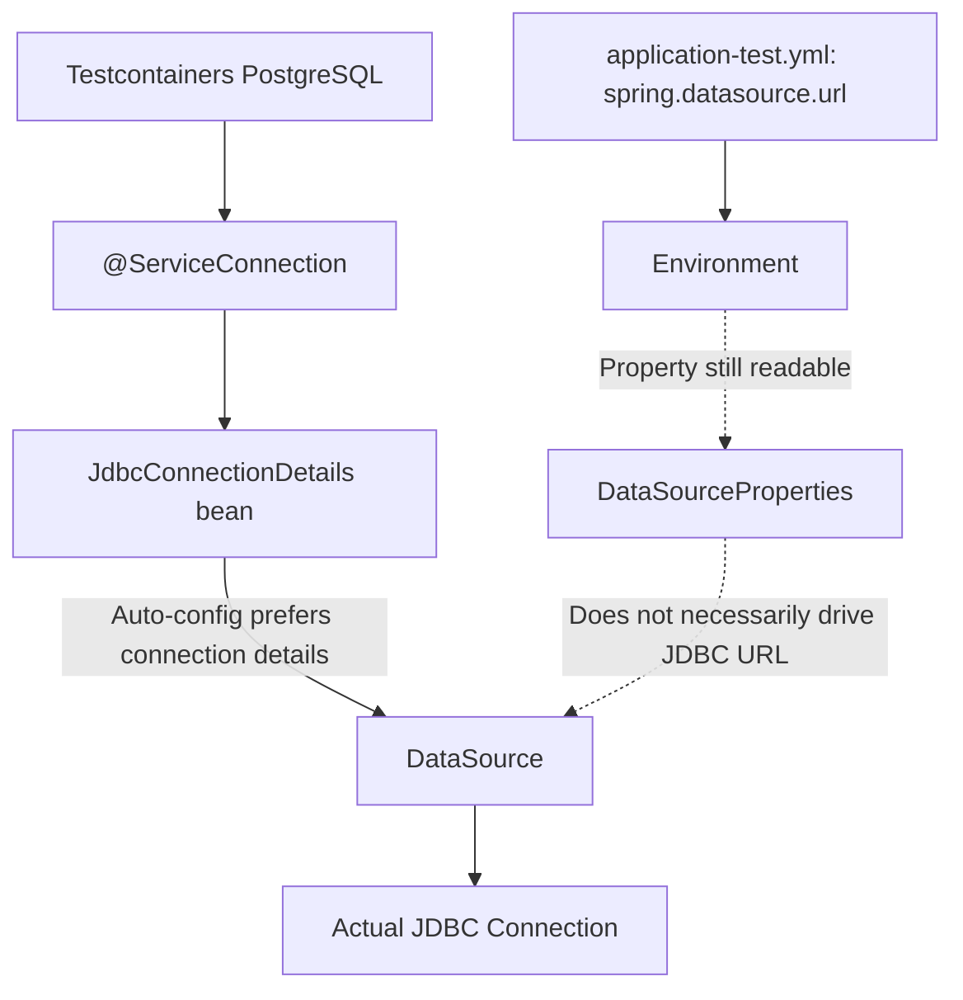
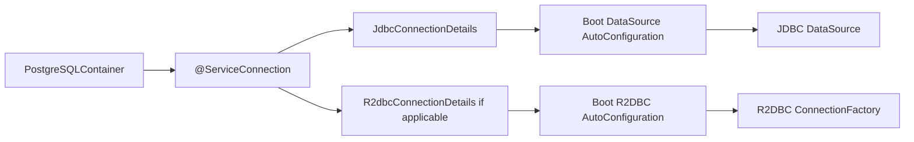
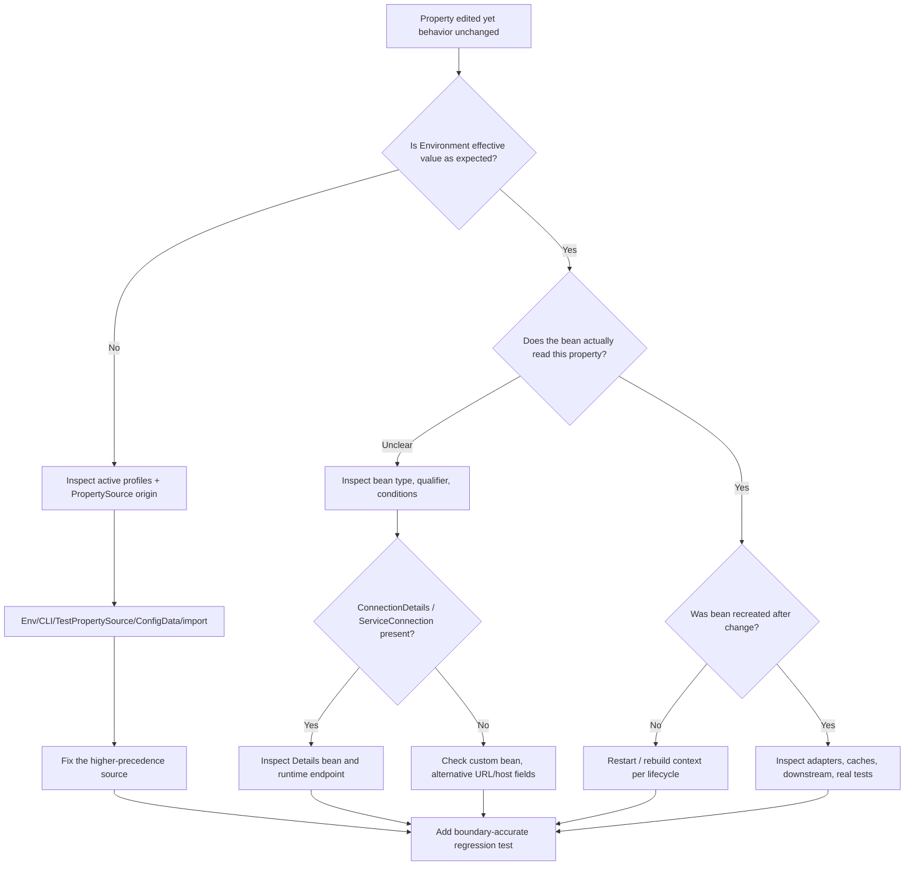

# Properties Having No Effect Due to ServiceConnection or Higher-Precedence Configuration

## 1. Identify the Symptom Accurately Before Editing Configuration

While developing or upgrading a Spring Boot application, you change `spring.datasource.url` in `application-test.yml` yet tests still connect to Testcontainers PostgreSQL; you update `spring.data.redis.host` yet the app talks to Redis from Docker Compose; or you edit `integration.inventory.base-url` while the HTTP client keeps calling the old endpoint. These symptoms are frequently misdiagnosed as "Spring Boot isn't reading YAML."

In reality, there are at least **two distinct classes of root causes**:

1. **The property value is overridden by a higher-precedence source.** `Environment` resolved a different value from the `PropertySource` hierarchy; `@ConfigurationProperties` or `@Value` simply receives that effective value.
2. **The property holds the expected value, yet the consuming component is constructed from another source.** In modern Spring Boot, a `ConnectionDetails` bean from `@ServiceConnection` or Docker Compose can supply endpoints and credentials directly to auto-configuration, so certain `spring.*` connection properties **no longer drive the live connection**.

Additional causes beyond pure precedence include manually defined beans, `@Primary`/`@Qualifier` picking another bean, inactive profiles, renamed properties after an upgrade, conflicting URL vs. host/port properties, or Spring Test context caching reusing an already-built bean.

This lesson belongs to the **Troubleshooting and Upgrades** chapter of **SPRING_BOOT_INTEGRATION**. The module organizes Spring Boot integrations across HTTP clients, databases, caches, message brokers, and Spring Integration adapters, emphasizing **configuration management, data contracts, transactions, failures, deduplication, testing, and observability** of real flows. Accordingly, the goal here is to trace **which value loaded, which source won, which bean was created, and which connection is actually used** before modifying config.

After this lesson, you will be able to:

- Distinguish `Environment`, `PropertySource`, `@ConfigurationProperties`, `ConnectionDetails`, and the constructed client/connection factory.
- Explain why `@ServiceConnection` and Spring Boot service-discovery integrations can prevent `spring.datasource.url` or `spring.r2dbc.url` from controlling the connection.
- Trace higher-precedence property overrides: profiles, config imports, environment variables, Java system properties, command-line args, test properties, and dynamic sources.
- Diagnose using `Environment`, secured Actuator `/env`/`/configprops`, the Condition Evaluation Report, and live connection checks.
- Fix the exact layer causing the issue without hardcoding credentials, disabling TLS, or blindly removing Testcontainers.
- Write regression tests protecting against upgrades to Spring Boot, Java, drivers, or deployment environments.

> **Version scope:** Examples target Java 17+, **Spring Boot 3.2+**, and Spring Framework 6.x. `@ServiceConnection` was introduced in Spring Boot 3.1; specific `ConnectionDetails`/Docker Compose behaviors, auto-configurations, and test precedence may vary by version. Code examples are illustrative, omit common imports, and do not assume a live database or broker is running.

### 1.1. Classic Example: Property Reads Right Yet Connection Differs

```yaml
# src/test/resources/application-test.yml
spring:
  datasource:
    url: jdbc:postgresql://localhost:5432/orders_test
    username: test_user
    password: test_password
```

The test defines a PostgreSQL container:

```java
@SpringBootTest
@ActiveProfiles("test")
@Testcontainers
class OrderRepositoryIT {
    @Container
    @ServiceConnection
    static PostgreSQLContainer<?> postgres =
            new PostgreSQLContainer<>("postgres:16-alpine");
}
```

In a supported environment, `@ServiceConnection` produces a `JdbcConnectionDetails` bean from the container. JDBC auto-configuration uses those connection details to build `DataSource`. Thus **`spring.datasource.url` in `Environment` may still read `localhost:5432/orders_test`**, while actual JDBC connections go to **the dynamic host/port mapped by Testcontainers**.

This is **not** an example of YAML being overridden by another `PropertySource`. It is an example of **a bean-layer connection source** taking precedence over property values.



**Better diagnostic question:** "Which bean or connection is hitting which endpoint, and who created it?" rather than merely "Does YAML contain the right URL?"

## 2. Four Configuration Layers to Distinguish

| Layer | Examples | Question to Answer |
|---|---|---|
| **Config source** | `application.yml`, env vars, `-D...`, CLI args, test properties | Which source provides the value? |
| **Resolved / bound value** | `Environment.getProperty(...)`, `DataSourceProperties`, custom `@ConfigurationProperties` | What is the effective value and its type? |
| **ConnectionDetails / bean selection** | `JdbcConnectionDetails`, `R2dbcConnectionDetails`, `RedisConnectionFactory`, custom `WebClient` | Where does auto-config get its endpoint, and which bean won? |
| **Actual connection** | JDBC metadata URL, Redis `INFO`/connection, HTTP request log on fake server | Which host/port/protocol/TLS was actually called at runtime? |

Do not conflate these four layers. `Environment` only models property resolution. A manually declared `DataSource` in `@Configuration` can hardcode a URL and ignore `spring.datasource.url`. Conversely, a `ConnectionDetails` bean can supply a Testcontainers URL without **rewriting** the property inside `Environment`.

### 2.1. PropertySource: Resolving Values by Precedence

`Environment` holds an ordered list of `PropertySource` entries. When resolving a property key, Spring searches in the context's precedence order; a higher-precedence source defining the same key determines the final scalar value, except where binders merge or replace complex structures per binding rules.

Suppose all three exist simultaneously:

```yaml
# application.yml
integration:
  inventory:
    base-url: https://inventory-default.example.org
```

```yaml
# application-prod.yml
integration:
  inventory:
    base-url: https://inventory-prod.example.org
```

```text
INTEGRATION_INVENTORY_BASEURL=https://inventory-from-env.example.org
```

If profile `prod` is active and the environment variable is visible and bound by the process, environment variables typically outrank config files, so the client uses the env URL. Editing `application-prod.yml` and restarting changes nothing while the deployment still injects the old environment variable.

### 2.2. ConfigurationProperties Is Not a Separate Config Source

`@ConfigurationProperties(prefix="integration.inventory")` groups and binds effective values onto a Java object. It **does not** grant `application.yml` higher precedence. Notice the distinction:

```java
@ConfigurationProperties(prefix = "integration.inventory")
public record InventoryProperties(
        URI baseUrl,
        Duration connectTimeout
) {}
```

If `baseUrl` comes from an environment variable, that is simply the binder reading the effective property from `Environment`. If an `InventoryGateway` was manually wired with another URL via `@Qualifier`, editing `InventoryProperties` may not affect the live gateway at all.

### 2.3. ConnectionDetails Is Bean-Level Connection Data, Not Just a Property

Spring Boot uses **connection details abstractions** across several auto-configurations, for example:

- `JdbcConnectionDetails` for JDBC `DataSource`.
- `R2dbcConnectionDetails` for R2DBC `ConnectionFactory`.
- `RedisConnectionDetails` for Redis (when supported by the integration/dependencies).
- `RabbitConnectionDetails` for RabbitMQ AMQP.
- `KafkaConnectionDetails` for Kafka.

These types live in their respective Spring Boot auto-configuration packages. This abstraction lets connection data originate from a live service or container without having to synthesize strings like `spring.datasource.url` or `spring.rabbitmq.host`.

**Be precise about scope:** `ConnectionDetails` affects only auto-configurations **designed to consume that type**. Never claim `@ServiceConnection` overrides every bean, connector, or property in the application. A custom HTTP `WebClient` using `baseUrl(...)` will not automatically consume `JdbcConnectionDetails`.

### 2.4. Actual Runtime Connection Is the Final Proof

A property can read "correctly" while being ignored by the active bean; a property can be overridden before binding; a bean can exist while the caller injects a different bean. Always verify with **runtime evidence**: JDBC metadata, R2DBC query targeting the test DB, Redis endpoint reached, fake HTTP server receiving requests, or messages appearing in the real test broker queue.

In production investigations, avoid retrieving or exposing credentials or internal hostnames publicly; capture only minimal safe metadata in access-controlled logs.

## 3. Configuration Sources That Commonly Override Properties

Spring Boot defines **externalized configuration** precedence. Across Boot 3.x applications, these source groups matter in practice:

| Source | Example | Common Misunderstanding |
|---|---|---|
| Default application properties | `application.yml` | Baseline only; easily overridden |
| Profile-specific config | `application-test.yml` or `application-prod.yml` | Requires matching `spring.profiles.active` and activation rules |
| Imported config | `spring.config.import` | Imported files, Config Server, or Vault can supply overriding values |
| Environment variables | `SPRING_DATASOURCE_URL` | Outranks files even though invisible in the Git repo |
| Java system properties | `-Dspring.datasource.url=...` | Distinct from OS environment variables and CLI args |
| `SPRING_APPLICATION_JSON` | JSON passed via env or args | Adds keys with higher precedence, easy to miss when reading YAML |
| Command-line arguments | `--spring.datasource.url=...` | Usually outranks files and environment variables |
| Test-specific config | `@SpringBootTest(properties=...)`, `@TestPropertySource` | Scoped to the matching test context |
| Dynamic test properties | `@DynamicPropertySource` | Supplied at runtime from containers or test fixtures |
| Custom `PropertySource`/initializer | App- or framework-added | Can alter ordering; must inspect live context |

Do not memorize a **single rigid order** for every Spring Boot/Test combination while ignoring programmatic property sources. Reliable diagnosis inspects **the effective value and its origin** in the live context. When comparing higher-precedence values in this lesson, we compare **the same key** across `PropertySource`s; `ConnectionDetails` is a separate mechanism.

### 3.1. Relaxed Binding: Same Key Written Differently

With `@ConfigurationProperties`, Spring Boot generally supports **relaxed binding** across forms such as:

```text
spring.datasource.url
SPRING_DATASOURCE_URL
spring.datasource-url
```

However, **environment variable naming rules** have important subtleties, especially around hyphens: typically dots become underscores, hyphens are removed, and letters are uppercased. For example:

```text
integration.inventory.base-url
        -> INTEGRATION_INVENTORY_BASEURL
```

Do not assume a variable like `INTEGRATION_INVENTORY_BASE_URL` maps identically across `@Value`, `Environment.getProperty`, and `@ConfigurationProperties`. Use canonical kebab-case property names in config files, test the actual binder, or specify explicit bindings where needed. With `@Value`, placeholder spelling also affects which relaxed aliases are considered.

### 3.2. ConfigData and Profiles: Existing Files Are Not Enough

`application-prod.yml` takes effect only when the profile and ConfigData loading match. Common pitfalls:

- The IDE activates `dev` while the developer edits `application-prod.yml`.
- Kubernetes/CI sets `SPRING_PROFILES_ACTIVE=test` plus `SPRING_CONFIG_LOCATION` or `SPRING_CONFIG_ADDITIONAL_LOCATION`, loading a different set of files.
- `spring.config.import` pulls settings from Config Server, Vault, or mounted files, introducing another source.
- Sections guarded by `spring.config.activate.on-profile` activate only when that profile is active.
- List and map properties follow different merge/replace rules than scalars, breaking intuitive expectations of per-field merging.

When debugging, first verify active profiles and loaded ConfigData files; never edit a file in Git and assume a running container picked it up. Most config changes require a restart; dynamic refresh exists only when explicitly integrated and supported.

### 3.3. A Different Key Can Supersede the Key You Edited

It is not always **the same key** being overridden. Several binders/connection setups accept alternative properties—for instance Redis `spring.data.redis.url` versus `host/port`, or RabbitMQ `spring.rabbitmq.addresses` versus `host/port`, depending on version and binding rules.

If you change `spring.data.redis.host` while `spring.data.redis.url` remains set, the URL may still dictate the live endpoint. Inspect **the entire related group of connection properties**, not a single field. Similarly, a `DataSource` may be governed by pool-specific settings or a manual bean instead of `spring.datasource.url`.

## 4. ServiceConnection in Spring Boot: A Special Case

### 4.1. What Is `@ServiceConnection`?

`@ServiceConnection` comes from `spring-boot-testcontainers`, allowing Spring Boot to derive connection information from supported Testcontainers beans. Rather than populating `Environment` with host/port/credentials, Spring Boot creates the corresponding `ConnectionDetails` beans.



Which `ConnectionDetails` Boot produces depends on container type, driver/test dependencies, and available connection-details factories. Never assume a single annotation automatically configures **every** JDBC and R2DBC connector on the classpath simultaneously.

### 4.2. Contrast with `@DynamicPropertySource`

Both approaches configure a PostgreSQL Testcontainers JDBC test, yet **via different mechanisms**:

**Approach A — ServiceConnection:**

```java
@Container
@ServiceConnection
static PostgreSQLContainer<?> postgres =
        new PostgreSQLContainer<>("postgres:16-alpine");
```

**Approach B — DynamicPropertySource:**

```java
@Container
static PostgreSQLContainer<?> postgres =
        new PostgreSQLContainer<>("postgres:16-alpine");

@DynamicPropertySource
static void databaseProps(DynamicPropertyRegistry registry) {
    registry.add(
            "spring.datasource.url", postgres::getJdbcUrl);
    registry.add(
            "spring.datasource.username", postgres::getUsername);
    registry.add(
            "spring.datasource.password", postgres::getPassword);
}
```

In **Approach B**, `Environment.getProperty("spring.datasource.url")` reflects the container URL added by the dynamic property source. In **Approach A**, that property can still return the YAML value while JDBC auto-configuration consumes the container's `JdbcConnectionDetails`.

**Avoid mixing both approaches for the same connection in standard tests.** Having two parallel paths complicates debugging and can hide config bugs. Combine them only when you have identified a specific consumer unsupported by one mechanism and verified it with tests.

### 4.3. Dependencies and Conditions for Creating Connection Details

Maven example for JDBC/PostgreSQL tests:

```xml
<dependencies>
    <dependency>
        <groupId>org.springframework.boot</groupId>
        <artifactId>spring-boot-starter-jdbc</artifactId>
    </dependency>
    <dependency>
        <groupId>org.postgresql</groupId>
        <artifactId>postgresql</artifactId>
        <scope>runtime</scope>
    </dependency>
    <dependency>
        <groupId>org.springframework.boot</groupId>
        <artifactId>spring-boot-starter-test</artifactId>
        <scope>test</scope>
    </dependency>
    <dependency>
        <groupId>org.springframework.boot</groupId>
        <artifactId>spring-boot-testcontainers</artifactId>
        <scope>test</scope>
    </dependency>
    <dependency>
        <groupId>org.testcontainers</groupId>
        <artifactId>junit-jupiter</artifactId>
        <scope>test</scope>
    </dependency>
    <dependency>
        <groupId>org.testcontainers</groupId>
        <artifactId>postgresql</artifactId>
        <scope>test</scope>
    </dependency>
</dependencies>
```

For R2DBC, you need `spring-boot-starter-data-r2dbc` and the R2DBC PostgreSQL driver—not the JDBC driver. For Redis/RabbitMQ, you need matching starters/clients and container types recognized by Boot's service-connection factories; `GenericContainer<?>` may require an explicit `name` on the annotation when Boot cannot infer the service from the type. Check support for your exact version rather than assuming every image auto-wires `@ServiceConnection`.

### 4.4. Docker Compose Can Also Supply ConnectionDetails

An application with `spring-boot-docker-compose` and a discovered Docker Compose service can receive connection details from running containers, depending on service type, version, and lifecycle config. This explains cases where **there is no `@ServiceConnection` in tests**, yet local development connects to a container instead of the host/port written in `application-local.yml`.

Check whether Docker Compose support is active, which services are discovered, actual host/port mappings, active dev profile, and whether auto-configurations consume those connection details. Do not disable Docker Compose integration globally across a project just to fix one test, as other workflows may depend on it.

## 5. Proving That ServiceConnection Is Being Used

### 5.1. Test with an Intentionally Unreachable Property That Still Connects via JDBC

One way to verify the cause is an **isolated** test with a PostgreSQL container, passing an unconnectable URL in `spring.datasource.url` and verifying `DataSource` still connects to the container. Do this only in **tests**; never place broken URLs in real configs.

```java
// JdbcServiceConnectionIT.java — abbreviated imports
@SpringBootTest(
        classes = JdbcServiceConnectionIT.TestApplication.class,
        webEnvironment = SpringBootTest.WebEnvironment.NONE,
        properties = {
            "spring.datasource.url=jdbc:postgresql://127.0.0.1:1/not-used",
            "spring.datasource.username=wrong",
            "spring.datasource.password=wrong"
        }
)
@Testcontainers
class JdbcServiceConnectionIT {

    @Container
    @ServiceConnection
    static PostgreSQLContainer<?> postgres =
            new PostgreSQLContainer<>("postgres:16-alpine");

    @SpringBootConfiguration
    @EnableAutoConfiguration
    static class TestApplication {}

    @Autowired
    Environment environment;

    @Autowired
    DataSource dataSource;

    @Autowired
    JdbcConnectionDetails connectionDetails;

    @Test
    void usesContainerEvenWhenEnvironmentHasDifferentJdbcUrl()
            throws SQLException {
        assertEquals(
                "jdbc:postgresql://127.0.0.1:1/not-used",
                environment.getProperty("spring.datasource.url"));

        assertEquals(
                postgres.getJdbcUrl(),
                connectionDetails.getJdbcUrl());

        try (Connection connection = dataSource.getConnection()) {
            String actualUrl =
                    connection.getMetaData().getURL();

            assertEquals(postgres.getJdbcUrl(), actualUrl);
            assertNotEquals(
                    environment.getProperty("spring.datasource.url"),
                    actualUrl);
        }
    }
}
```

**What this test proves:** in a context with Boot JDBC auto-configuration and supported `@ServiceConnection`, the endpoint used to construct `DataSource` comes from the container, **not** from `spring.datasource.url` in test properties. Reading `Connection.getMetaData().getURL()` provides evidence from a real JDBC connection.

**Limitations:** the test relies on Docker/container runtime, PostgreSQL driver, Boot version, and compatible connection-details factory. If the real application defines a custom `DataSource` or multiple `JdbcConnectionDetails`, behavior may differ; the isolated test avoids unrelated beans. Never assume every JDBC provider returns character-for-character identical URLs across all drivers; if a driver normalizes URLs, assert safely on host, port, database, or query params instead.

### 5.2. Why Asserting Environment Alone Is Insufficient

This check inspects only one layer:

```java
assertEquals(
        "jdbc:postgresql://127.0.0.1:1/not-used",
        environment.getProperty("spring.datasource.url"));
```

A **PASS** does not prove the app calls `127.0.0.1:1`. When `JdbcConnectionDetails` is present, auto-configuration can ignore that URL. When debugging, inspect both the **`ConnectionDetails` bean** and **`DataSource`** (or the corresponding client/connection factory).

### 5.3. What If JdbcConnectionDetails Does Not Exist in the Context?

Not every application has `JdbcConnectionDetails`, for example:

- Older Spring Boot versions without the corresponding `ServiceConnection` support.
- Missing `spring-boot-testcontainers`, or an unrecognized container/annotation.
- Excluded JDBC auto-configuration, missing JDBC driver, or a custom `DataSource`.
- R2DBC-only applications, where the relevant types are `R2dbcConnectionDetails` and `ConnectionFactory`, **not** JDBC.
- Redis, Kafka, or RabbitMQ connections use their own connection-details types when supported.

Therefore, do not inject `@Autowired JdbcConnectionDetails` into every test assuming its absence is a bug. First verify which connector and auto-configurations are active. If you only want to observe whether the bean exists, use `ObjectProvider<JdbcConnectionDetails>` or `ApplicationContext.getBeansOfType(...)` so the test does not fail immediately if absent.

## 6. Five-Step Debugging Method

This workflow applies across **JDBC, R2DBC, Redis, RabbitMQ, HTTP clients, caches, and Spring Integration adapters**, adjusting only the starting component per connector.

### Step 1 — Pin Down the Exact Property and Runtime Context

Record:

- Which service instance, pod, or test class is under investigation.
- Spring Boot version and key connectors (JDBC/R2DBC driver, Lettuce, RabbitMQ client).
- Active profiles, config locations, `spring.config.import`, and injected secret sources.
- The **canonical** property and expected value: e.g., `spring.datasource.url` or `integration.pricing.base-url`.
- The actual consuming component: `DataSource`, `ConnectionFactory`, `RedisConnectionFactory`, `RabbitTemplate`, or a `WebClient` bean.

**Useful incident summary example:**

```text
Symptom:
  OrderRepositoryIT reads data from Testcontainers PostgreSQL
  instead of localhost:5432/orders_test.
Expected property:
  spring.datasource.url=jdbc:postgresql://localhost:5432/orders_test
Actual Environment value:
  jdbc:postgresql://localhost:5432/orders_test
Actual JDBC endpoint:
  jdbc:postgresql://localhost:<dynamic-port>/test
ConnectionDetails beans:
  JdbcConnectionDetails from Testcontainers
Diagnosis:
  ServiceConnection supplies connection details at auto-configuration layer.
```

This is an **illustrative template**; actual host/port/database values depend on the container. Never treat `localhost` as proving two connections target the same database when ports differ.

### Step 2 — Inspect the Effective Value and PropertySource Origins

Only in **authorized debug/test environments**, inspect `ConfigurableEnvironment`:

```java
// Diagnostic helper: never write raw secrets to logs.
static List<String> findPropertySources(
        ConfigurableEnvironment env,
        String key
) {
    List<String> matching = new ArrayList<>();
    for (PropertySource<?> source : env.getPropertySources()) {
        if (source.containsProperty(key)) {
            matching.add(source.getName());
        }
    }
    return matching;
}
```

Usage:

```java
@Autowired
ConfigurableEnvironment environment;

@Test
void inspectDatasourceUrlSources() {
    String key = "spring.datasource.url";

    String effectiveValue = environment.getProperty(key);
    List<String> sources =
            findPropertySources(environment, key);

    assertNotNull(effectiveValue);
    assertFalse(sources.isEmpty());

    // Internal debug: inspect source names in precedence order
    // without logging credentials or dumping all property values.
}
```

**Note:** A `PropertySource` may supply values via relaxed binding, aliases, or origin metadata; calling `source.containsProperty(key)` with one exact spelling might miss equivalent environment variables. To trace **ConfigData origins**, inspect origin metadata via Spring Boot/Actuator rather than treating this loop as exhaustive across all binding styles.

If multiple sources return the same key, check resolution order in the context. Also verify that `spring.datasource.url` is truly the key consumed by the target bean.

### Step 3 — Inspect Related Beans and Auto-Configurations

```java
@Autowired
ApplicationContext context;

@Test
void inspectJdbcWiring() {
    Map<String, DataSource> sources =
            context.getBeansOfType(DataSource.class);
    Map<String, JdbcConnectionDetails> details =
            context.getBeansOfType(
                    JdbcConnectionDetails.class);

    assertFalse(sources.isEmpty());
    // Inspect bean types/names and @Qualifier in real tests.
    // With multiple DataSources, never assume the first entry
    // is the one used by repositories or JdbcTemplate.
}
```

For `DataSource`, verify bean count, which bean is `@Primary`, and which bean `JdbcTemplate`/JPA repositories/transaction managers use. For R2DBC, inspect `ConnectionFactory`, `R2dbcEntityTemplate`, and reactive transaction managers. For Redis/RabbitMQ/Kafka, inspect their connection details and client factories.

**Note on auto-configuration:** defining a custom `@Bean DataSource` can make Spring Boot **back off** from default DataSource auto-configuration. In that case, even if both `spring.datasource.url` and `JdbcConnectionDetails` exist, the live bean may still use hardcoded or custom-bound settings.

### Step 4 — Verify Actual Endpoints and Integration Behavior

Measure at the true boundary:

| Connector | Appropriate Runtime Evidence |
|---|---|
| JDBC | `DataSource.getConnection()` → metadata URL/database, `SELECT 1` query |
| R2DBC | Subscription to `ConnectionFactory` or `DatabaseClient`, query identifying test DB/schema |
| Redis | Namespaced test key, `PING`/read-write via the exact `RedisConnectionFactory` |
| RabbitMQ | Publish to test exchange, verify matching queue/binding/vhost |
| Kafka | Producer/consumer test with test topic, verify selected broker endpoint |
| HTTP client | Fake HTTP server receives request with valid host/port/TLS |
| Spring Integration | Message traverses real/stubbed flow + adapter, not merely bean presence |

Never probe production endpoints without authorization. In tests, use containers or stub servers and log only safe metadata.

### Step 5 — Fix the Right Layer and Add Regression Tests

Once root cause is known:

- If **a higher PropertySource** wins: fix or remove the override in env vars, test config, CLI args, or config import.
- If **ServiceConnection** wins intentionally: decide whether the test should use a container; if yes, **stop treating `spring.datasource.url` as connection proof**. If not, remove the unwanted connection-details source deliberately.
- If **a custom bean** wins: fix the bean factory, qualifiers, conditions, or remove the redundant bean.
- If **a property is no longer supported** after an upgrade: migrate to the current version's property key and update docs/migration notes.
- If **config reload / context caching** is the cause: verify bean creation timing and apply proper refresh or restart lifecycle.

Change configuration only after writing a test that **fails before and passes after** for the target behavior; avoid piling duplicate overrides into `application-test.yml` without knowing who reads them.

## 7. Spring Boot Observability Tools

### 7.1. Actuator `/env`: Which Property Won?

With Spring Boot Actuator enabled, `env` and `configprops` reveal property resolution and binding, while `conditions` reveals auto-configuration decisions.

```yaml
# Enable only in protected internal diagnostic environments.
management:
  endpoints:
    web:
      exposure:
        include: health,info,env,configprops,conditions
  endpoint:
    env:
      show-values: never
    configprops:
      show-values: never
```

Diagnostic queries once endpoints are secured:

```text
GET /actuator/env/spring.datasource.url
GET /actuator/env/spring.r2dbc.url
GET /actuator/env/integration.inventory.base-url
GET /actuator/configprops
GET /actuator/conditions
```

`/actuator/env/{name}` helps show the resolved value, origins (depending on version), and visibility settings. `/actuator/configprops` displays what `@ConfigurationProperties` beans bound. `/actuator/conditions` shows why auto-configurations matched or backed off.

**Critically important:** these endpoints can expose internal endpoints, bean names, settings, or secrets if raw values are enabled. Never expose them publicly on the internet, never disable security to debug, and never dump full outputs into CI logs. When troubleshooting secrets, verify **source/presence** and permissions without printing passwords or tokens.

### 7.2. Condition Evaluation Report and Startup Debug

Where appropriate, launch with `--debug` in a test/dev run so Spring Boot prints the Condition Evaluation Report, or inspect `/actuator/conditions` in a secured environment.

If DataSource auto-configuration did not produce the expected bean, check:

- Are the JDBC driver and `DataSource` classes present?
- Did a custom `DataSource` bean make auto-configuration back off?
- Which `JdbcConnectionDetails` or `R2dbcConnectionDetails` beans exist?
- Do multiple beans of the same type cause ambiguity or shift `@Primary` selection?
- Does a profile or `@ConditionalOnProperty` exclude the required config?

The conditions report explains **why auto-configuration ran or skipped**, not where live connections actually went. Pair it with Step 4 runtime checks.

### 7.3. `ApplicationContextRunner` to Isolate Root Cause

To test bean selection and configuration without booting the entire app, `ApplicationContextRunner` from `spring-boot-test` spins up a minimal context with only the properties and auto-configurations you specify. This cleanly verifies:

```text
Given: DataSourceAutoConfiguration + spring.datasource.url
When: No custom JdbcConnectionDetails exists
Then: Boot builds DataSource from properties

Given: Same auto-config + custom JdbcConnectionDetails bean
When: Valid connection details exist
Then: DataSource uses connection details per auto-config contract
```

To test hypotheses cleanly, specify exact dependencies/auto-configurations and omit unrelated beans. `ApplicationContextRunner` does not replace network or Testcontainers integration tests, but it quickly reveals whether bean selection changed after a Boot upgrade.

## 8. Failure Scenarios by Connector

| Symptom | Hypothesis to Test | Decisive Evidence |
|---|---|---|
| Changed `spring.datasource.url` yet JPA still uses container | `JdbcConnectionDetails` from `@ServiceConnection` | Details bean and live connection JDBC URL |
| Changed `spring.r2dbc.url` yet R2DBC is unchanged | `R2dbcConnectionDetails` or custom `ConnectionFactory` | Query through `ConnectionFactory`/reactive repository |
| Changed `spring.data.redis.host` yet app uses another Redis | Redis connection details, `spring.data.redis.url`, custom factory | Factory bean and test key on Redis fixture |
| Changed `spring.rabbitmq.host` yet publisher uses another broker | `RabbitConnectionDetails`, `addresses`, or custom factory | Target endpoint/vhost and test queue |
| Changed `spring.kafka.bootstrap-servers` yet app uses test broker | `KafkaConnectionDetails`, dynamic property/client override | Effective bootstrap config and topic on test broker |
| Changed `integration.inventory.base-url` yet client calls old host | Property override or custom `WebClient` | Injected bean and fake server receiving request |
| Cron or timeout unchanged after editing YAML | Bean already constructed, config overridden, job store kept old schedule | Effective settings at bean/runtime |
| Test behaves differently between IDE and CI | Profiles, env vars, Docker/Testcontainers, context cache | Compare effective values/origins and wiring in both environments |

### 8.1. JDBC and JPA

A JPA application has `DataSource`, `EntityManagerFactory`, and a transaction manager. In tests using `@ServiceConnection`, `JdbcConnectionDetails` supplies URL/username/password for Boot to build `DataSource`. `DataSourceProperties` or `Environment` still displays YAML values without driving the connection.

Check in order: (1) does a `JdbcConnectionDetails` bean exist; (2) was `DataSource` built by auto-config or custom code; (3) which `DataSource` do repositories/`JdbcTemplate` use; (4) what does connection metadata return; (5) with multiple sources, check `@Primary`, `@Qualifier`, and transaction managers.

If **you intend to use the container**, keep `@ServiceConnection`, verify the right test DB/schema, and remove misleading unused URL properties. If **you intend to use a test-supplied JDBC URL**, construct the context without conflicting connection details, provide explicit properties, and assert the runtime connection.

### 8.2. R2DBC: Distinguish JDBC Migrations from Reactive Runtime

R2DBC uses `io.r2dbc.spi.ConnectionFactory`, not JDBC `DataSource`. Common properties:

```yaml
spring:
  r2dbc:
    url: r2dbc:postgresql://localhost:5432/catalog
    username: catalog_user
    password: ${CATALOG_DB_PASSWORD}
```

Changing `spring.datasource.url` does not alter an `R2dbcEntityTemplate` connection; changing `spring.r2dbc.url` does not alter Flyway's JDBC connection. With Testcontainers and compatible starters/drivers, `R2dbcConnectionDetails` supplies the reactive endpoint. Verify via `DatabaseClient`/reactive repositories and real subscriptions, not `Environment.getProperty(...)` alone.

### 8.3. Redis: URL, Factory, Serializer, and Namespace

Redis has several failure modes that look like "host was ignored":

- `spring.data.redis.url` may take precedence over `host/port` depending on version semantics.
- Redis connection details from ServiceConnection or Docker Compose may be consumed by Boot.
- A manual `@Bean RedisConnectionFactory` may read `app.redis.host` or hardcode settings.
- `RedisTemplate` may be wired to another factory, DB index, key namespace, or serializer, causing **cache misses** even when the endpoint is right.

In tests, `PING` only proves *some* Redis endpoint answered. To confirm the right fixture, write and read a unique test key through the template/factory and verify namespace and serializer. Avoid `FLUSHALL` on shared Redis instances.

### 8.4. RabbitMQ: Endpoint and Topology Are Two Separate Problems

RabbitMQ involves host/port, username/password, `spring.rabbitmq.addresses`, virtual host, and TLS. `RabbitConnectionDetails` or a custom `CachingConnectionFactory` can determine the live endpoint.

After verifying the connection, check exchange/queue/binding/routing key. A producer connecting to the **right broker** while the queue stays empty can result from a mismatched binding or fast-acking consumer rather than an ignored host property. Test with an isolated broker/vhost/queue and verify the full publish → route → consume path.

### 8.5. Kafka: Bootstrap Server vs. Actual Broker Addresses

Kafka clients use `spring.kafka.bootstrap-servers`, connection details, or custom `ProducerFactory`/`ConsumerFactory` settings. After bootstrap, clients receive cluster metadata with broker advertised endpoints, which may differ from the bootstrap address in logs. Check:

- Whether `KafkaConnectionDetails` is supplied and consumed.
- Effective producer/consumer/admin configs, including overrides under `spring.kafka.producer.*` and `spring.kafka.consumer.*`.
- Topics, group IDs, ACLs, and consumer offsets; missing events can stem from group/offset rules rather than endpoint config.

In integration tests, create an isolated topic and both produce and consume a message on test Kafka rather than asserting YAML bootstrap strings.

### 8.6. HTTP Clients: Not Every Base URL Uses ServiceConnection

`RestClient`, `WebClient`, or HTTP interface proxies typically read application properties **only if written to do so**. Example bean hardcoding its URL:

```java
@Bean
WebClient pricingWebClient(WebClient.Builder builder) {
    return builder
            .baseUrl("https://pricing-fixed.example.org")
            .build();
}
```

Editing `integration.pricing.base-url` will have **no effect**. Build the bean using the bound value:

```java
@Bean
WebClient pricingWebClient(
        WebClient.Builder builder,
        @Value("${integration.pricing.base-url}") URI baseUrl
) {
    return builder.baseUrl(baseUrl.toString()).build();
}
```

Even then, verify callers inject the right bean via `@Qualifier`/interface. Having the right property and right bean still does not prove requests reach that endpoint; a fake HTTP server confirms the real path.

### 8.7. Spring Integration Adapters

Spring Integration flows can contain inbound HTTP adapters, JDBC polling adapters, AMQP/Kafka gateways, or outbound HTTP clients. If properties look right yet an adapter was built with another factory or belongs to an inactive flow, editing YAML changes nothing. Inspect bean names, channels, conditions/profiles, injected connection factories, and endpoint lifecycle; send a **test message** through the actual flow. Never infer successful integration simply because the context started.

## 9. Pitfalls Specific to Test Environments

### 9.1. `@SpringBootTest(properties=...)` Is Not Always the Final Authority

`@SpringBootTest(properties = "...")` injects properties into the test context and generally outranks ConfigData in `application-test.yml`. `@TestPropertySource` and `@DynamicPropertySource` have precedence rules managed by Spring Test and Boot. When combining annotations, verify the **effective value in the live context** rather than judging by source annotation order.

More importantly, **even when a test property wins in `Environment`, `ConnectionDetails` can still decide the real connection**. These two mechanisms are independent, so `@SpringBootTest(properties="spring.datasource.url=...")` does not necessarily disable `@ServiceConnection`.

### 9.2. Dynamic Properties Shine When Test Ports Are Random

```java
@DynamicPropertySource
static void httpProps(DynamicPropertyRegistry registry) {
    registry.add(
            "integration.inventory.base-url",
            () -> mockServer.url("/").toString());
}
```

Here `mockServer` must be declared, started, and lifecycle-managed by the test. `@DynamicPropertySource` supplies runtime properties into the test `Environment` via suppliers. This is well suited for a **custom HTTP base URL** lacking built-in `ConnectionDetails`. If the same key also appears in `@TestPropertySource`/`@SpringBootTest`, pick **one source** or write an explicit precedence test.

### 9.3. Context Caching and Bean Creation Timing

Spring Test caches `ApplicationContext` instances across tests sharing equivalent configurations. This speeds up suites but can make it look like "YAML didn't update" if:

- A singleton or mutable bean cached a configuration value and was not recreated.
- An earlier test mutated `System.setProperty`, a bean, or a connection factory without cleanup.
- A dynamic property supplier references a server/container whose lifecycle changed while the cached context was reused.
- Two tests share a Redis/DB/queue fixture and leftover state skews results.

**Proper fix:** isolate fixtures and profiles, reset data/mocks, avoid mutating global properties at runtime, and align context keys/lifecycles. Use `@DirtiesContext` only when a fresh context is truly necessary; overusing it slows suites and masks root causes.

### 9.4. Test Pattern with Too Many Conflicting Config Sources

```java
// Anti-pattern: three connection sources with no clear contract.
@SpringBootTest(properties =
        "spring.datasource.url=jdbc:postgresql://localhost:5432/a")
@TestPropertySource(properties =
        "spring.datasource.url=jdbc:postgresql://localhost:5432/b")
@Testcontainers
class ConfusingIT {
    @ServiceConnection
    @Container
    static PostgreSQLContainer<?> postgres =
            new PostgreSQLContainer<>("postgres:16-alpine");
}
```

Here you supply two different URL properties plus `JdbcConnectionDetails` from Testcontainers. When the goal is simply testing against a PostgreSQL container, stick to **one configuration path**, usually `@ServiceConnection` or `@DynamicPropertySource`. Only dedicated precedence tests should combine multiple sources **to prove precedence**, while asserting `Environment` and runtime connection separately.

### 9.5. Expecting a Fixed Port Is a Mistake

Testcontainers maps ports dynamically by default. `localhost:5432` in YAML need not match the port of `PostgreSQLContainer`. Dynamic ports enable parallel tests and prevent collisions with locally installed PostgreSQL. Never force every container onto fixed host ports just to satisfy a config assertion; read `postgres.getJdbcUrl()` or connection details and verify the actual database.

## 10. Upgrading Spring Boot: When Properties Actually Change Meaning

### 10.1. Properties Renamed or No Longer Bound to Old Types

Another post-upgrade failure mode is **property name migration**. For example, in Spring Boot 3.x, Redis settings typically live under `spring.data.redis.*`. If a project keeps legacy `spring.redis.*` keys without checking metadata for the running version, those properties may silently fail to bind as expected.

```yaml
# Use keys valid for the current version:
spring:
  data:
    redis:
      host: redis.internal.example.org
      port: 6379
```

Never "include both old and new keys" blindly to test: that causes conflicts and hides migration issues. Consult configuration metadata and changelogs **for your exact version** and migrate keys with tests. Spring Boot offers `spring-boot-properties-migrator` to flag renamed properties; treat it as a **temporary upgrade aid**, not a dependency to leave in production permanently without review.

### 10.2. `@ServiceConnection` Introduced After an Upgrade

Before adopting `ServiceConnection`, many Testcontainers suites configured endpoints via:

```java
@DynamicPropertySource
static void props(DynamicPropertyRegistry registry) {
    registry.add(
            "spring.datasource.url", postgres::getJdbcUrl);
    registry.add(
            "spring.datasource.username", postgres::getUsername);
    registry.add(
            "spring.datasource.password", postgres::getPassword);
}
```

Once `@ServiceConnection` is added, the dynamic property callback may become redundant for Boot-supported connections. Keeping both the callback and annotation can mislead someone inspecting `Environment` into believing **the dynamic property drives JDBC**, when auto-configuration actually reads `JdbcConnectionDetails`.

During upgrades:

1. Inventory tests using `@DynamicPropertySource` for DB, Redis, RabbitMQ, and Kafka.
2. Verify which `ServiceConnection`/`ConnectionDetails` integrations your target Boot version supports.
3. Choose **one mechanism** per connection type in tests, keeping dynamic properties for unsupported custom integrations.
4. Assert live connections and query/message contracts before deleting legacy callbacks.
5. Run tests locally and in CI inside controlled container environments without hardcoding ports.

### 10.3. Auto-Configuration or Bean Condition Changes

An upgrade can change whether an auto-configuration runs due to classpath, annotation, condition, or default changes. For instance, Spring Boot previously built `RedisConnectionFactory`, then an upgrade or new custom config caused Boot to back off, or two `DataSource`/`ConnectionFactory` beans shifted selection.

Investigate via `/actuator/conditions`, the Condition Evaluation Report, and runtime bean lists. Do not rewrite dozens of YAML lines when the true cause is a new `@Bean`, misplaced `@Primary`, or `@ConditionalOnMissingBean` switching branches.

### 10.4. Different Context/Lifecycles Across Local, CI, and Production

Combining `spring-boot-docker-compose` in local dev, Testcontainers in CI tests, and Config Server/Vault/Kubernetes secrets in production means **one repository has multiple configuration paths**. That is healthy if contracts are clear. Document them:

| Environment | Preferred Connection Source | Verification |
|---|---|---|
| Unit tests without network | Explicit mocks/fakes | Zero external connections opened |
| PostgreSQL integration tests | Testcontainers + `@ServiceConnection` or dynamic properties | Queries run on intended container/schema |
| Redis/AMQP integration tests | Dedicated test containers/fixtures | Right key/queue/vhost and cleanup |
| Local development | Docker Compose connection details **or** manual config | Right local service, port, and TLS |
| Staging / production | Secret manager, env/config service, deployment manifests | Right endpoint/account, TLS, privileges, and startup |

Never let a test profile accidentally fall back to a production database when container integration is missing. Tests must fail fast when test endpoints are unavailable rather than silently hitting sensitive data sources.

## 11. Controlled Fixes Matched to Each Root Cause

### 11.1. When a Higher PropertySource Overrides

Suppose `application-prod.yml` sets:

```yaml
integration:
  inventory:
    base-url: https://inventory-new.example.org
```

while the deployment still passes:

```text
INTEGRATION_INVENTORY_BASEURL=https://inventory-old.example.org
```

Fix or remove the environment override through the deployment pipeline—**do not** introduce an even higher-precedence override just to "counter-override" it. After redeploying/restarting as required, verify `Environment` and send a test HTTP request to a safe fake or staging endpoint.

### 11.2. When ServiceConnection Is Being Used Intentionally

If an integration test intentionally targets a container: **do not treat ignored YAML URLs as a bug**. Keep `ServiceConnection`, remove redundant connection URL properties, name tests clearly, and assert runtime endpoints, DB names, and queries. In application code, avoid reading `Environment.getProperty("spring.datasource.url")` to build a second connection manually, as it can diverge from Boot's configured `DataSource`.

### 11.3. When ServiceConnection Appears Unintentionally

Inspect Testcontainers/Docker Compose dependencies, annotations, service-connection declarations, and active profiles. Decide which containers each environment should use:

- To use a manual `spring.datasource.url` in one test, remove the service-connection annotation/declaration **in that test** and supply explicit properties; do not tear out the project's shared test infrastructure.
- To run locally without Docker Compose discovery, use Spring Boot's supported Docker Compose config/lifecycle options for that environment while checking impact on Redis or brokers.
- If multiple `ConnectionDetails` of the same type exist, redesign ownership/naming, inspect bean ambiguity, and check conditions rather than assuming a silent winner.

### 11.4. When a Manual Bean Ignores Properties

If a manual `@Bean DataSource`/`WebClient`/`LettuceConnectionFactory` invokes a constructor with a hardcoded host, fix **bean construction**, or revert to Boot auto-configuration where appropriate. Bind settings via `@ConfigurationProperties` with validation, or inject the appropriate `ConnectionDetails` when container integration is needed.

**Note:** adding `@Primary` to force one bean to win is valid only with clear multi-bean intent. Adding it haphazardly can hide duplicate configs and silently switch another repository or service onto the wrong datasource.

### 11.5. When a Property Changed or Was Not Activated

Verify active profiles, config imports, and version metadata, migrating keys per official upgrade guides. Afterward, add tests verifying the configured bean rather than asserting YAML file contents. If the app does not support hot reload, restart the process/container properly. Never call `System.setProperty` after context startup expecting singleton `@Bean`s to rebind automatically.

## 12. Decision Flow for Investigating an "Ineffective" Property



### 12.1. Chronological Investigation Walkthrough

Suppose after upgrading Spring Boot, `InventoryRepositoryIT` starts failing on CI because queried data differs from expectations.

**Systematic investigation:**

1. Read `@ActiveProfiles`, `@SpringBootTest` properties, and DB test config; confirm CI did not activate the wrong profile.
2. Check `Environment.getProperty("spring.datasource.url")`: it returns `jdbc:postgresql://localhost:5432/inventory_test`. This verifies only one config layer.
3. List `JdbcConnectionDetails` beans: see details coming from a `@ServiceConnection` `PostgreSQLContainer`.
4. Check JDBC metadata via `DataSource.getConnection()`: the URL uses Testcontainers' mapped port, not `5432`.
5. Inspect schema/fixtures in the container: data differs from the developer's local database because **the test is intentionally isolated**.
6. Fix fixtures/migrations and assertions on **the actual test database**, rather than removing `@ServiceConnection` just to hit the developer's local PostgreSQL.
7. Add tests verifying repository behavior and runtime endpoint identity without relying on hardcoded ports.

If Step 2 had shown `Environment` returning a URL from a Config Server, investigation would follow the **PropertySource origin** branch first rather than blaming `ServiceConnection` without proof.

### 12.2. When "Bad Config" Is Actually Stale Data

Suppose you change `spring.data.redis.host` and the app still returns old inventory counts. The factory may already be connected to the new Redis, yet:

- The new Redis holds restored cache keys from earlier snapshots;
- Another process writes keys in the same namespace;
- The service holds a local in-memory cache;
- `RedisTemplate` uses a different serializer or key prefix;
- The HTTP response is cached by a gateway/CDN rather than Redis.

Once properties and live connections are verified, pivot to **data flow and observability** instead of endlessly tweaking connection configs. A great test writes and reads a new unique key through the same template type, verifying serializer and TTL, then traces the service step by step.

### 12.3. When an Exception Looks Like a Wrong URL

| Exception / Symptom | Possible Cause | Avoid Jumping To |
|---|---|---|
| `Connection refused` | Wrong host/port, service down, network policy | "YAML wasn't read" |
| JDBC authentication failed | Credentials from another source, wrong user, DB grants | "Wrong host" |
| TLS handshake failure | CA/SAN, protocol, wrong TLS endpoint | "Must disable TLS" |
| Redis cache miss | Wrong key/serializer/DB index, or data unwritten | "ConnectionDetails overrode host" |
| RabbitMQ queue has no messages | Binding, vhost, consumer ack, publish returns | "Rabbit host has no effect" |
| Kafka consumer does not read | Offset/group/topic, listener startup, bootstrap vs. advertised endpoints | "Config was overridden" |
| WebClient 404 | Wrong path/version, base URL, gateway route | "Request definitely hit wrong host" |
| Bean does not exist | Component scan, profile, condition, missing dependency | "Property precedence is wrong" |

Follow **observed behavior** to pick the next check rather than letting a brief exception dictate the entire diagnosis.

## 13. Regression Testing for Configuration

### 13.1. Test Matrix by Configuration Layer

| Test Goal | Setup | Right Assertion |
|---|---|---|
| File/profile properties | Context with explicit profile | Effective value + bound bean properties match |
| Env/test property overrides | Two sources supplying the same key | Effective value/origin matches live context |
| ServiceConnection JDBC | `PostgreSQLContainer` + `@ServiceConnection` | `DataSource` uses container URL and executes queries |
| Dynamic property JDBC | `PostgreSQLContainer` + `@DynamicPropertySource` | Both `Environment` and live connection target container |
| R2DBC | Container, R2DBC driver, reactive repo | SQL executes against test DB without blocking event loop |
| Redis | Container, Redis template/factory | Unique test key round-trips with right namespace/TTL |
| AMQP | RabbitMQ test broker | Message routes through expected exchange/queue/vhost |
| HTTP client | MockWebServer/WireMock on dynamic port | Request hits fake server with right path/headers/status |
| Bean conditions | `ApplicationContextRunner` | Auto-config backs off or registers bean as designed |
| Docker Compose dev | Local services discovered intentionally | Real endpoints, TLS/auth, and lifecycle behave properly |
| Boot upgrade | Suite on target version with migrations | No legacy properties silently ignored |

### 13.2. Structuring Container Tests Without Hiding Conflicts

Split responsibilities cleanly across tests:

- **Test A — `@ServiceConnection` only:** omit arbitrary URL properties; assert live connection hits container.
- **Test B — `@DynamicPropertySource` only:** bind supplier from container; assert both `Environment` and runtime connection.
- **Test C — property precedence:** no container needed; supply two sources for one key and assert bound value.
- **Test D — custom bean:** intentionally supply custom bean; use `ApplicationContextRunner` to verify Boot auto-config/back-off.
- **Test E — full integration:** use real/stubbed DB/broker/API and verify business contracts, not just context load.

Each test answers **one question**. In Test A (`ServiceConnection`), asserting that `spring.datasource.url` equals the container URL tests the **wrong layer**. In Test C (precedence), adding `ServiceConnection` can make beans succeed even when the tested property is broken.

### 13.3. Verifying Changes Across Multiple Replicas

During multi-replica deployments, some pods may receive updated env vars/secrets while others run old revisions or haven't restarted. The same service name may temporarily connect to different brokers/DBs during rollout.

To validate rollout:

1. Emit safe deployment version and config revision metadata in telemetry.
2. Verify **each instance** reports the intended active profiles and connection details/beans.
3. Make health/readiness probes reflect critical dependencies without turning probes into production write operations.
4. Compare runtime endpoints using permitted non-secret metadata, never printing credentials.
5. Verify transaction boundaries, idempotency, and outbox safety while mixed instances share queues or datasources during rollout.
6. If config drift appears, pause rollout or roll back per runbook before inconsistent writes occur across backends.

### 13.4. Security Hygiene in Diagnostic Tools

Investigating precedence can tempt teams to log all of `System.getenv()`, `Environment`, or `/actuator/env`. Doing so can leak:

- `spring.datasource.password` and JDBC URLs with embedded credentials.
- Redis/RabbitMQ/Kafka usernames, passwords, or tokens.
- OAuth2 client secrets, API keys, keystore/truststore paths.
- Internal hostnames, logical tenant names, and config server metadata.

Log **property names**, **config sources**, and **bean types**; mask sensitive values or compare them inside assertions/secure diagnostics. Actuator `env`, `configprops`, and `conditions` must require authentication, authorization, and network restrictions. Never fix certificate errors by disabling hostname verification or placing secrets into public YAML files.

## 14. Diagnostic and Hands-On Checklist

### 14.1. 15-Point Checklist

- [ ] Am I inspecting the exact file, context, test class, and service instance?
- [ ] Have active profiles and `spring.config.import` been verified?
- [ ] Do property names match the **running Spring Boot version**?
- [ ] Is an env var, `-D` flag, CLI arg, or `SPRING_APPLICATION_JSON` overriding the file?
- [ ] Are test properties, `@TestPropertySource`, or `@DynamicPropertySource` setting the same key?
- [ ] What do `Environment.getProperty` and `@ConfigurationProperties` resolve to, and from which source?
- [ ] Are `@ServiceConnection` or Docker Compose creating `ConnectionDetails` beans?
- [ ] Which bean is consuming the connection details or property?
- [ ] Does a custom `@Bean` cause Boot auto-configuration to back off?
- [ ] Are there multiple beans of the same type with differing `@Primary`/`@Qualifier`?
- [ ] Is an alternative property like Redis `url`/`host` or RabbitMQ `addresses`/`host` set?
- [ ] Which live endpoint, database, vhost, or host does the runtime connection hit?
- [ ] Was the context/bean recreated after the property changed?
- [ ] Does the fix keep tests isolated from production resources and free of leaked credentials?
- [ ] Were integration/condition tests added to catch regressions on future upgrades?

### 14.2. Exercise A — PropertySource Outranking ConfigData

Given:

```yaml
# application.yml
integration:
  inventory:
    base-url: https://inventory-one.example.org
```

and the process environment defines:

```text
INTEGRATION_INVENTORY_BASEURL=https://inventory-two.example.org
```

Predict the value bound to `InventoryProperties` under proper relaxed binding, check the origin/effective value via `Environment` or secured Actuator, and verify which URL the live HTTP client calls. When removing the environment override in dev/staging, is a restart needed for the bean to rebuild?

### 14.3. Exercise B — ConnectionDetails Without Modifying Environment

Create a `@SpringBootTest` with PostgreSQL Testcontainers and `@ServiceConnection`, while also setting `spring.datasource.url` to an unusable test URL. Inspect both values:

```java
String configured =
        environment.getProperty("spring.datasource.url");
String actual =
        dataSource.getConnection().getMetaData().getURL();
```

In a complete test, the second block must manage/close `Connection` with try-with-resources. Explain why the two strings differ and why that **does not prove a YAML loading bug**.

### 14.4. Exercise C — Multi-Datasource

A service has `ordersDataSource` and `analyticsDataSource`. YAML updated the analytics URL, yet reports still query the orders DB. Verify `@Qualifier` on repositories/services, transaction managers, bean selection, and JDBC metadata for each `DataSource`. Why can't a single `JdbcConnectionDetails` bean replace explicit configuration for **two intentional datasources**?

### 14.5. Exercise D — Docker Compose + Redis

A development app uses `spring-boot-docker-compose` with a Redis Compose service, while `application-local.yml` lists a different Redis host. Determine whether Boot creates Redis connection details, which endpoint `RedisConnectionFactory` targets, and which Redis stores test keys. Propose a clean way to make connection ownership explicit without breaking Testcontainers PostgreSQL tests.

### 14.6. Self-Check Questions

1. Why doesn't a correct `Environment.getProperty("spring.datasource.url")` guarantee `DataSource` uses that URL?
2. At which architectural layer do `@ServiceConnection` and `@DynamicPropertySource` differ?
3. Which connectors do `JdbcConnectionDetails` and `R2dbcConnectionDetails` serve?
4. What can Spring Boot auto-configuration do when a custom `@Bean DataSource` already exists?
5. Why check active profiles, imported configs, and environment variables together when debugging?
6. Does `@SpringBootTest(properties=...)` necessarily disable `@ServiceConnection`? Why?
7. What signs indicate a Redis issue is serializer/key-prefix mismatch rather than the wrong endpoint?
8. After fixing `spring.rabbitmq.host`, queues still receive no messages: what else besides connection must be checked?
9. Which three distinct questions do `/actuator/env`, `/actuator/configprops`, and `/actuator/conditions` answer?
10. Why can changing a property used by a singleton bean require a restart or context recreation?
11. After an upgrade, how do you verify whether a property was renamed or dropped?
12. What test proves a live JDBC connection reaches the intended Testcontainers PostgreSQL?
13. Why avoid supplying the same endpoint simultaneously via `@DynamicPropertySource`, `@TestPropertySource`, and `@ServiceConnection` unless intentional?
14. When two `DataSource`s exist, how do `@Primary` and `@Qualifier` affect bean selection?
15. Why is dumping the entire `Environment` into logs an unsafe debugging habit?

**Key takeaway:** Whenever a Spring Boot property seems "ignored," separate **three questions**: (1) From which source is `Environment` resolving the property? (2) Was the bean actually built from **properties, `ConnectionDetails`, or custom code**? (3) Where are live connections/requests going? `@ServiceConnection`/Docker Compose can supply connection details without **overwriting** `Environment` values, whereas environment variables, test properties, and ConfigData compete for precedence **at the property layer**. Only fixing the true root layer, verifying with integration tests, and protecting secrets will keep fixes durable across upgrades.
