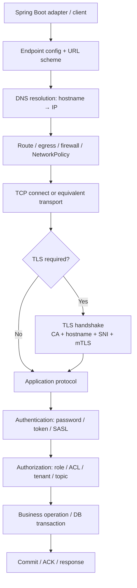
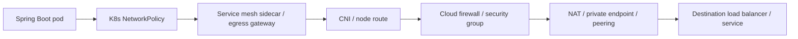
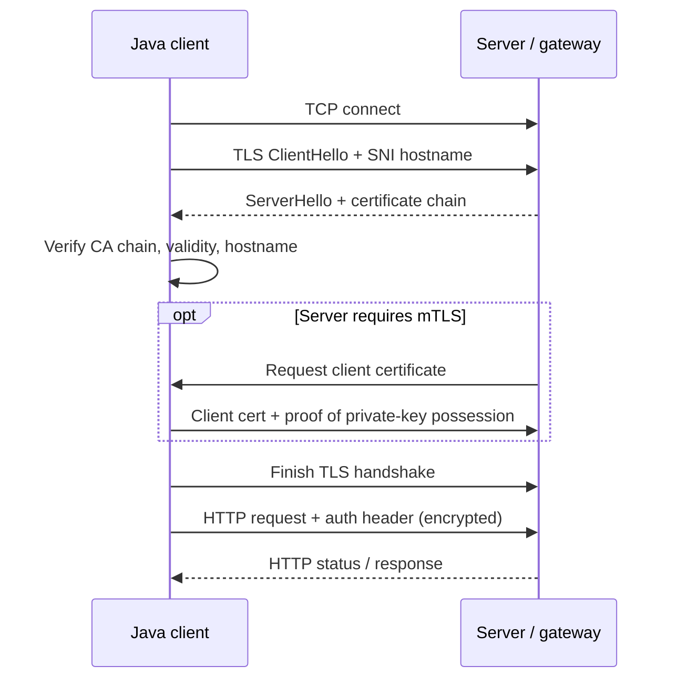
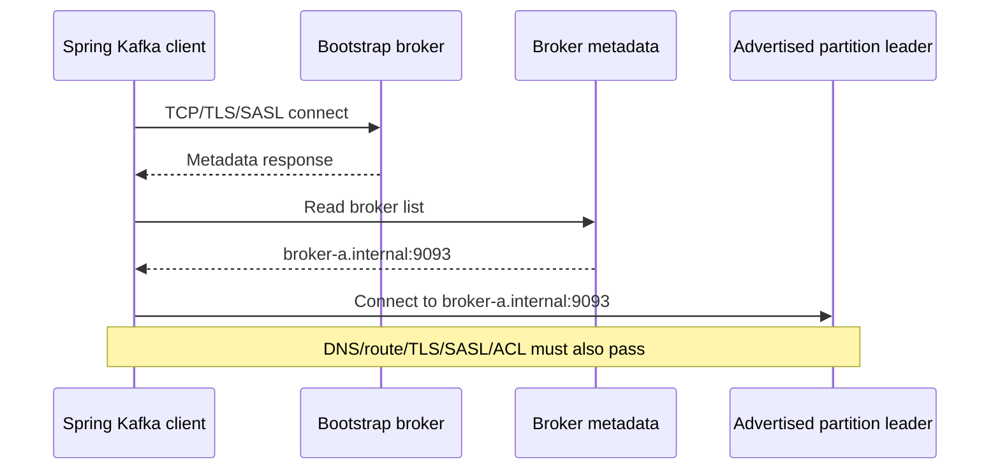
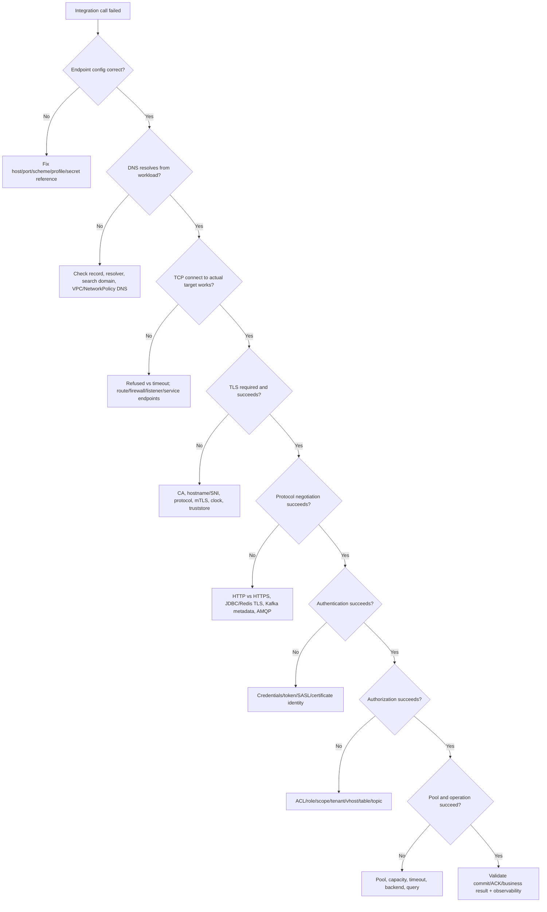

# Connection Failures Due to DNS, Ports, TLS, or Access Permissions

> **Chapter:** Troubleshooting and Upgrades  
> **Module:** `SPRING_BOOT_INTEGRATION` — organizing system integrations in Spring Boot across HTTP clients, databases, caches, message brokers, and Spring Integration adapters; focusing on configuration management, data contracts, transactions, failures, deduplication, testing, and observing real integration flows.
>
> **Scope:** Java 17+, Spring Boot 3.x, Spring Framework 6, and common HTTP/JDBC/Redis/Kafka/RabbitMQ/Pulsar clients. Property names and exceptions can vary across driver versions, Spring Boot releases, cloud providers, and brokers. Examples use hypothetical endpoints, **not production parameters**. Run network commands only in environments where you are authorized to diagnose; never copy credentials, tokens, or customer data into logs or tickets.

## 1. Real-World Scenario: The Application Starts Yet Cannot Communicate

An Order Service receives an HTTP request and must:

1. Call the Payment API over HTTPS.
2. Persist the order into PostgreSQL.
3. Evict or read the Redis cache.
4. Publish `OrderCreated` to Kafka.
5. Send a notification via SMTP or a Spring Integration adapter.

After promoting from local to Kubernetes, logs fill with:

```text
java.net.UnknownHostException: payment.internal.example
java.net.ConnectException: Connection refused
java.net.SocketTimeoutException: Connect timed out
javax.net.ssl.SSLHandshakeException: PKIX path building failed
org.postgresql.util.PSQLException: FATAL: password authentication failed
org.apache.kafka.common.errors.TimeoutException:
  Topic ... not present in metadata after ...
```

These failures **do not share a single root cause**. Changing a password will not fix DNS; fixing DNS will not fix an expired certificate; increasing timeouts will not fix a server refusing connections; adding retries will not grant missing ACL permissions.

**Lesson goal:** establish an evidence-based diagnostic process to pinpoint the exact failing layer before changing configuration, recover safely, and avoid creating duplicates or data corruption in integration flows.

### Expected Outcomes

After this lesson, you will be able to:

- Distinguish hostname resolution, TCP connect, TLS handshake, protocol negotiation, authentication, and authorization.
- Gather hostname/port/protocol, environment context, and root causes without leaking secrets.
- Test DNS from **where the process actually runs**: pod/container/VM, not just your laptop.
- Differentiate `Connection refused`, timeouts, `UnknownHostException`, PKIX errors, hostname mismatches, HTTP 401/403, and "pool exhausted."
- Diagnose `WebClient`/`RestClient`, PostgreSQL JDBC, Redis, Kafka, RabbitMQ, and Pulsar according to their specific mechanics.
- Operate CA/truststores, mTLS, certificate rotation, and secret rotation safely.
- Apply timeouts, retries, backoff, circuit breakers, idempotency, inbox/outbox, and observability.
- Author runbooks, regression tests, and rollout/rollback checklists for network/security changes.

## 2. Layered Model: Which Gates Does a Request Pass Through?



When an error occurs, mark the **last confirmed successful step**, and never assume subsequent steps succeeded. For instance:

- DNS returns an IP: does not prove a route or open port exists.
- TCP connection succeeds: does not prove TLS handshake or hostname matches.
- TLS handshake succeeds: does not prove the HTTP endpoint exists or permissions are valid.
- HTTP 401/403: usually proves traffic reached *a* server or proxy, not necessarily the intended upstream backend.
- Reaching a Kafka bootstrap host succeeds: does not prove the client can reach **all brokers returned in metadata**.
- PostgreSQL login succeeds: does not prove `SELECT/INSERT` privileges on tables or free connection slots under load.
- A message receives a broker ACK: does not prove downstream committed the business operation.

### 2.1. Symptom Identification by Layer

| Log / Symptom | First Suspected Layer | Do Not Jump To |
|---|---|---|
| `UnknownHostException` / `Name or service not known` | DNS or wrong hostname | "Server is dead" |
| `Connection refused` | IP is reachable yet no listener on port or actively rejected | "Wrong password" |
| `Connect timed out` | Routing, firewall, network policy, IP/port, network outage | "TLS certificate is broken" |
| `SSLHandshakeException: PKIX path building failed` | Trust chain / CA | "Changing DNS will fix it" |
| `No subject alternative DNS name matching` | TLS hostname verification | "Just enable trust-all" |
| TLS alert `bad_certificate` / `certificate_required` | mTLS or certificate policy | "SMTP/HTTP token is wrong" |
| HTTP `401 Unauthorized` | Authentication at server or proxy | "TCP isn't connected" |
| HTTP `403 Forbidden` | Authorization/policy or gateway | "Enabling retries will fix it" |
| PostgreSQL `28P01` | Wrong authentication credentials/policy | "Port 5432 is blocked" |
| Kafka topic metadata timeout | Bootstrap, advertised broker DNS, TLS/SASL, ACLs | "Topic has no data" |
| Hikari `Connection is not available, request timed out` | Pool failed to lease a connection | "DNS must be broken" |

Upper-layer exceptions often **wrap** lower-layer exceptions. When triaging, inspect the root cause and timing rather than reading only the framework wrapper like `ResourceAccessException` or `DataAccessException`.

## 3. Do Not Change Anything Before Capturing the Live Endpoint

Before toggling any TLS flag or timeout, collect:

| Attribute | Question |
|---|---|
| Service / instance | Which application, pod, node, container, and profile are failing? |
| Destination | Hostname, resolved IP if any, port, `http/https` scheme, JDBC URL, broker service URL? |
| Client | `RestClient`, `WebClient`, Apache HttpClient, PostgreSQL JDBC, Lettuce, `KafkaProducer`, RabbitMQ, Pulsar client? |
| Timing | Started after a deploy, certificate rotation, secret rotation, DNS change, or only under load? |
| Scope | All pods or one pod/namespace/AZ? One destination or every destination? |
| Error stage | DNS, TCP, TLS, AUTH, ACL, pool, request/response, or broker metadata? |
| Timeout | Fails immediately or only after 3, 5, or 30 seconds? |
| Recent changes | Endpoints, ports, routes, NetworkPolicies, proxies, truststores, credentials, drivers? |
| Business impact | Failed HTTP requests, rising message backlog, pending outbox, duplicate operations? |

**Take the endpoint from the failing instance's effective configuration**, not just `application.yml` in the repo. Spring Boot properties can be overridden via environment variables, CLI arguments, config servers, deployment manifests, or secrets.

Never print `spring.datasource.password`, `Authorization` headers, SASL JAAS configs, JWTs, private keys, or SMTP AUTH strings into tickets. Record hostname, port, secret type, and *config source*, never raw secret values.

### 3.1. Status Sheet to Avoid Laptop-Based Assumptions

```text
Incident: order-service -> payment.internal.example:443
Environment: production, namespace=orders, pod=order-7c...
Client: Spring WebClient / Reactor Netty
Started: 2026-11-21 10:20 +07
Root cause: java.net.UnknownHostException: ...
From pod DNS test: FAIL
From developer laptop DNS test: PASS
After change: DNS resolved, TCP connect PASS, TLS PASS, HTTP 401
New active issue: service token expired
```

An incident can have **chained failures across multiple layers**. Do not mark an incident resolved simply because the exception changed from DNS to 401.

## 4. Working "Outside-In" to Cut Investigation Time

Proceed in order, from the exact affected workload:

1. **Endpoint name:** correct DNS name, namespace, port, and scheme? Any trailing spaces or unexpanded placeholders?
2. **DNS:** which A/AAAA IP does the workload resolve?
3. **Network:** are the IP and port reachable? Any egress deny, routing, firewall, NAT, proxy, or service mesh?
4. **TLS:** does handshake succeed with the right CA/truststore, hostname, SNI, validity dates, and mTLS?
5. **Protocol:** do HTTP path, PostgreSQL SSL negotiation, Kafka metadata, Redis TLS, AMQP, or SMTP STARTTLS match?
6. **Authentication:** is the token/password/client certificate/SASL mechanism valid and accepted by the server?
7. **Authorization:** does the principal hold the required role/ACL/topic/database/schema/tenant/namespace permissions?
8. **Application:** connection pools, timeouts, retries, blocked threads, parsers, and health/readiness.
9. **Business outcome:** did transactions commit, brokers ACK, side effects succeed, and backlog/outbox/inbox remain consistent?

Advance to the next step only after gathering evidence for the current step; if step 2 fails, rotating an OAuth token is wasted noise.

### 4.1. One-Variable-at-a-Time Rule

When applying a fix:

- Record the old config, hypothesis, and verification check.
- Change **one** relevant variable, such as a DNS record or truststore.
- Retest from the exact affected pod/client.
- Observe metrics afterward: error rate, p95, pool pending, backlog.
- Keep a rollback plan; never simultaneously upgrade drivers, switch TLS, change proxies, and rotate credentials.

## 5. DNS: Where Is the Hostname Resolved?

DNS maps logical names to IP addresses (A/AAAA) or other records; Kubernetes clusters also use search domains and internal service discovery. Java may rely on JVM/OS resolvers and caches depending on the network stack.

For example, an app connects to:

```yaml
payment:
  client:
    base-url: https://payments.orders.svc.cluster.local
```

If the name is wrong, `WebClient` throws an `UnknownHostException`-like failure. Yet **a hostname can also resolve to the wrong IP**, such as a stale IP, split-horizon DNS mismatch, unlinked private DNS zone, or different VPN route.

### 5.1. Checking from the Exact Namespace / Pod

On Linux or inside a container with network tools:

```bash
# Inspect the workload's resolver and search domains.
cat /etc/resolv.conf

# The utilities below may be absent from minimal container images:
getent hosts payments.orders.svc.cluster.local
nslookup payments.orders.svc.cluster.local
dig payments.orders.svc.cluster.local A
dig payments.orders.svc.cluster.local AAAA
```

In Kubernetes (with operator authorization):

```bash
kubectl -n orders get pod
kubectl -n orders exec deploy/order-service -- cat /etc/resolv.conf
kubectl -n orders exec deploy/order-service -- \
  getent hosts payments.orders.svc.cluster.local
```

If the image lacks `getent`/`dig`, use an approved debug container or diagnostic workload **in the same namespace, network policy, and security context**. Never bloat production images just to install tools, and never test from an over-privileged debug pod assuming it mirrors the app.

### 5.2. Common DNS Failure Causes

- Wrong FQDN or wrong namespace (`payments.default.svc` instead of `payments.orders.svc`).
- Kubernetes Service does not exist, has no ready endpoints, or CoreDNS is unhealthy.
- `ndots`/search domains alter lookup order and add latency.
- Split-horizon DNS: different answers from a developer laptop or another VPC than from the pod.
- Private DNS zone not linked to the right VPC/virtual network.
- IPv6/AAAA records returned where IPv6 routing is broken.
- Record updated yet JVM/OS/client still caches the old answer.
- Egress to the DNS resolver (typically UDP/TCP 53) blocked by a NetworkPolicy or firewall.
- Broken CNAME chains, TTL handling, or stub resolver errors.
- Service mesh/proxy interception or misapplied custom DNS policy.

**DNS PASS only means the resolver returned an address**—not that a server at that IP is listening on the port.

## 6. JVM DNS Caching and Impact When Endpoints Change

A failure right after Redis/PostgreSQL failover often happens because **the DNS record updated while the Java process still connects to the old IP**.

Caching layers can include:

1. Authoritative DNS TTL.
2. Recursive resolver / NodeLocal DNS cache.
3. OS / stub resolver cache.
4. Java `InetAddress` address cache or a client library's own DNS cache.
5. Connection pools holding open sockets to the old IP.

Java security properties such as `networkaddress.cache.ttl` and `networkaddress.cache.negative.ttl` govern positive and negative address caching in corresponding JDKs/providers. **Never paste a global production setting blindly from an internet snippet**; the right setting depends on JDK version, historical security manager behavior, resolver architecture, and failover requirements.

### 6.1. Caching Symptoms vs. Live DNS Failure

```text
dig db.internal.example -> IP_NEW
Spring application still connects -> IP_OLD
Restart pod -> application connects -> IP_NEW
```

This **suggests** caching or connection reuse without immediately proving which layer holds the old IP. Next:

- Compare the IP logged safely in client telemetry against live DNS.
- Check connection pool lifetimes, stale connections, and Java/client DNS settings.
- Inspect the record's actual TTL and database/proxy failover behavior.
- Test rolling restarts or refresh mechanisms in staging.
- Never disable DNS caching globally without evaluating resolver query load.

### 6.2. Negative Caching

If the hostname did not exist on the first lookup, the resolver or JVM may cache the negative response for some interval; creating the DNS record immediately afterward may not fix the client instantly. Measure the delay between record creation and Java lookup success and inspect `negative.ttl`/client DNS settings for your version.

## 7. Docker and Kubernetes: `localhost` Is Not the Neighboring Service

In Docker and Kubernetes, `localhost` **refers to the container/pod's own network namespace**, not the host machine or another pod.

| Caller Location | Where Does `localhost:5432` Point? |
|---|---|
| Java app running on laptop | The laptop |
| Separate Java container on a Docker network | The Java container itself |
| Kubernetes pod | That pod's network namespace |
| Two containers in the same Kubernetes pod | Shared pod network namespace |
| App on another VM | That VM |

Common misconfiguration:

```yaml
spring:
  datasource:
    url: jdbc:postgresql://localhost:5432/orders
```

This works when PostgreSQL runs locally on the laptop, but breaks when the app moves into a pod and Postgres runs as a separate Kubernetes Service.

Service-discovery example:

```yaml
spring:
  datasource:
    url: jdbc:postgresql://postgres.orders.svc.cluster.local:5432/orders
```

This hostname is illustrative; verify the real Kubernetes Service, namespace, EndpointSlice, selector, readiness, and network policies.

### 7.1. Service Exists Yet Has No Endpoints

A Kubernetes Service having a `ClusterIP` does not mean backends are Ready. Check:

```bash
kubectl -n orders get svc postgres
kubectl -n orders get endpointslice -l kubernetes.io/service-name=postgres
kubectl -n orders describe svc postgres
```

If label selectors mismatch or pods fail readiness, DNS still returns the `ClusterIP` while connections time out or get refused. Inspect selectors, `port`/`targetPort`, and pod readiness before touching Java code.

### 7.2. Port Mapping in Docker

`-p 15432:5432` maps **host port 15432** to **container port 5432**. Containers sharing a Docker network generally talk via **container/service name + internal port**, not host-mapped ports.

Document `source → destination` and where port translation happens so you never test a host port from a laptop and assume pods can call the same URL.

## 8. TCP Connect: Distinguishing Refused from Timeout

After DNS resolves, the client establishes a connection to the IP and port. Two common failures:

### 8.1. Connection Refused

`java.net.ConnectException: Connection refused` typically means the target actively rejected the TCP connect (e.g., via TCP RST) or an intermediate network device sent a reject. Causes include:

- Server process is not running or has not bound the port.
- Server listens only on `127.0.0.1` instead of the required interface.
- Wrong port configured.
- Kubernetes Service `targetPort` or endpoint mismatch.
- Firewall returning active reject.
- TLS port and plaintext port swapped, where servers sometimes close immediately after connect instead of refusing.

**Diagnosis:** is a listener actually bound on the target IP/port? On the server host, check `ss -ltn` or equivalent if authorized.

### 8.2. Connect Timed Out

The connection could not be established before the deadline. Possible causes:

- Egress or ingress firewall silently dropping packets.
- Kubernetes NetworkPolicy blocking traffic.
- Routing, NAT, security groups, NACLs, or service mesh misconfiguration.
- Target IP is gone; DNS returned a stale address.
- Server/network overloaded, TCP SYN backlog full, or packet loss.
- Broken IPv6 path when the client tries IPv6 first.

A connect timeout does not prove "TLS handshake failed," because TCP never finished connecting. Raising timeouts can mask brief slowness, but **never fixes a deny policy or broken route**.

### 8.3. TCP Connection Reset After Connecting

`Connection reset by peer` can occur when a server or proxy closes the socket mid-handshake or protocol exchange, or when a pool reuses an idle connection already closed by the remote peer. Never assume "server is down"; check timing, TLS state, proxies, keep-alive, idle timeouts, and server logs.

## 9. TCP Diagnostic Commands: Right Host, Right Port, Right Source

Example in a Linux/macOS debug environment:

```bash
# Check TCP reachability only; does not test TLS or auth.
nc -vz -w 3 payments.internal.example 443
nc -vz -w 3 postgres.orders.svc.cluster.local 5432

# HTTP(S) protocol-level check with timeouts:
curl --connect-timeout 3 --max-time 10 -v \
  https://payments.internal.example/health
```

`nc` and `curl` may be absent from minimal images, and `-w` differs across `nc` implementations; run from an appropriate debug container. `curl -v` can print headers, proxy details, and auth metadata: use sanitized URLs/headers without secrets and store output securely.

On Windows when authorized to test a target host:

```powershell
Test-NetConnection payments.internal.example -Port 443
Resolve-DnsName payments.internal.example
```

**Never use a successful TCP connect to conclude authentication or mTLS succeeded.** It only narrows the failure to layers above TCP.

### 9.1. Do Not Test from the Wrong Network Path

- A laptop over VPN follows different routes than production pods.
- A bastion host has different security groups than the workload.
- A debug pod with `hostNetwork: true` bypasses regular pod networking.
- Node networking has different egress rules than pods under a NetworkPolicy.
- Inbound Kubernetes Ingress rules differ from outbound egress paths.

The best test reproduces the exact namespace, service account, proxy settings, network policies, and endpoint of the failing instance.

## 10. Routes, NAT, Firewalls, Security Groups, and NetworkPolicy

A pod's outbound path can traverse:



Common pitfalls:

- A new NetworkPolicy blocks egress to DNS or the destination port.
- Egress permits TCP/443 while the real service uses 5432 or 9093.
- Security groups allow an old subnet while new pod/node/NAT IPs fall outside the allowlist.
- Cloud NAT runs out of IPs or port allocations under peak load.
- VPC peering / PrivateLink / Private Endpoint routing or DNS changed.
- Service mesh enforces mTLS or authorization policies differing from client assumptions.
- Mandatory egress proxy exists, yet the client omits `HTTPS_PROXY`/connector proxy settings.
- IPv6 addresses are returned while end-to-end IPv6 routing is disabled.

### 10.1. Distinguish "DNS Returns Private IP" from "Route Exists to Private IP"

If `db.internal.example` resolves to `10.x.x.x`, the app can connect only if routes and egress policies allow reaching that network. Never switch sensitive traffic to a public IP as a workaround: that breaks private-access architecture and compliance.

### 10.2. Least-Privilege Policy

Never "fix" errors by opening `0.0.0.0/0` inbound on a database/broker or deleting all NetworkPolicies. Identify the exact **source workload identity/subnet → destination hostname/IP/port/protocol**, grant minimal access, and audit the change.

## 11. HTTPS/TLS Handshake: The Step After TCP

TLS secures the transport channel. For HTTPS, the basic sequence is:



An `SSLHandshakeException` can be caused by:

- Untrusted certificate chain.
- Hostname verification failing against SAN.
- Expired or not-yet-valid certificate.
- No overlapping TLS protocol versions or cipher suites.
- Server requesting a client certificate (mTLS) that the client lacks or misconfigured.
- Missing or wrong SNI causing the load balancer to return a different vhost's certificate.
- Wrong truststore/keystore password/type, unreadable file, or wrong path.
- TLS interception proxy presenting an internal CA not yet trusted.
- Skewed system clock invalidating certificate timestamps.

TLS failures are **security or configuration issues**—never downgrade to plaintext HTTP "just to keep testing."

## 12. Distinguish Truststore from Keystore

| Component | Contents | When Used? |
|---|---|---|
| **Truststore** | Trusted CAs / certificates | Client verifies the server certificate |
| **Keystore** | Client certificate and private key (depending on type) | Server requires mTLS |
| **Server certificate** | Public certificate bound to DNS/IP identity | Server proves its identity to client |
| **Private key** | Cryptographic secret | Must stay secret; never place in public truststores |
| **Certificate chain** | Leaf → intermediate → trusted root | Validator builds the trust path |
| **SAN** | Subject Alternative Name DNS/IP entries | Hostname verification |

**Having an HTTPS URL and the right server CA is insufficient when the server demands mTLS.** The client must also present an authorized client certificate and prove possession of its private key.

### 12.1. PKIX Path Building Failed

Example:

```text
javax.net.ssl.SSLHandshakeException:
  PKIX path building failed:
  sun.security.provider.certpath.SunCertPathBuilderException:
  unable to find valid certification path to requested target
```

Typically the client cannot build a chain to a trusted anchor. Check:

1. Does the server send the full intermediate certificate chain?
2. Was the new CA added to the JDK or custom truststore used by **that exact process**?
3. Is the app using a custom truststore that omits default system CAs?
4. Is an outbound proxy re-signing certificates with an internal CA?
5. Are truststore path, type, and password valid inside the container?
6. Did certificates rotate while pods have not reloaded their truststores?

Never "fix" this with `trustAll`, `ssl.trust=*`, or disabling hostname verification.

## 13. Hostname Verification, SAN, and SNI

A certificate with SAN `api.partner.example` validates when the client calls:

```text
https://api.partner.example
```

yet **fails** if the client switches the URL to:

```text
https://10.30.2.15
```

unless the certificate includes that exact IP SAN or another appropriate identity mechanism applies. IP reachability does not replace DNS identity verification.

**SNI** (*Server Name Indication*) lets the client specify the target hostname in TLS ClientHello. A multi-tenant load balancer returns the wrong certificate if SNI is missing or wrong.

### 13.1. Inspecting Server Certificates with OpenSSL

Where authorized and OpenSSL is available:

```bash
openssl s_client \
  -connect api.partner.example:443 \
  -servername api.partner.example \
  -verify_hostname api.partner.example \
  -verify_return_error
```

Inspect:

- Certificate subject/SAN and validity window.
- Intermediate chain.
- Negotiated TLS protocol and cipher.
- Verification result and exit status.
- SNI hostname matching the production URL.

**`openssl s_client` only validates TLS at the tested endpoint**; it does not verify HTTP authentication, business APIs, or the Java truststore. OpenSSL often uses a different CA bundle than Java, so "OpenSSL PASS, Java FAIL" happens whenever the JDK truststore lacks that CA.

### 13.2. Do Not Drop Hostnames to Test by IP

To isolate DNS while preserving hostname verification and SNI, override resolution temporarily via `curl --resolve`:

```bash
curl --resolve api.partner.example:443:10.30.2.15 \
  --connect-timeout 3 --max-time 10 \
  https://api.partner.example/health
```

Only test authorized infrastructure IPs. This keeps the logical Host/SNI intact and validates certificate hostnames while bypassing client DNS resolution. Never use `curl -k`/`--insecure` to "make tests pass" or carry insecure flags into application code.

## 14. TLS Protocols/Ciphers, Clocks, and Certificate Rotation

Upgrading the JDK, Spring Boot, OS base image, or load balancer can alter TLS behavior:

- Newer JDKs disable legacy protocols and weak ciphers.
- Servers drop TLS 1.0/1.1 and require TLS 1.2/1.3.
- CA bundles in JDK/container images change.
- Server certificates rotate to a new CA or intermediate.
- mTLS client certificates expire or mounted secrets change content.
- Load balancers serve different certs depending on SNI.
- Network appliances / TLS inspection proxies change chains.

Never downgrade TLS to weak protocols when handshakes fail. Compare your security baseline, JDK enabled protocols, and server capabilities; upgrade incompatible endpoints or clients properly.

### 14.1. Safe CA Rotation Procedure

A controlled transition strategy:

1. Build a truststore trusting **both old and new CAs** during the transition window if policy permits.
2. Roll out the updated truststore to clients before servers rotate certificates.
3. Rotate server certificates and verify SNI, hostname, and mTLS.
4. Verify traffic across all pods, AZs, and clusters.
5. After the transition window, remove the old CA per security policy.

When rotating mTLS client certificates, provision new keypairs/certificates, update server identity mappings/ACLs, and verify reloading. Many clients and connection pools **read keystores/truststores only at startup**, so updating a mounted secret file does not automatically update sockets; test reload/restart/rotation explicitly.

## 15. mTLS and Client Certificates: Different from Passwords or Tokens

Mutual TLS requires both sides to verify certificates. Under mTLS:

- The client verifies the server certificate and hostname.
- The server requests a client certificate.
- The client sends its certificate chain and proves private-key possession.
- The server validates CA trust, validity dates, identity, and permission mappings.

Some systems also require OAuth tokens or HTTP headers **after mTLS succeeds**. mTLS authentication and application authorization remain distinct layers.

### 15.1. Common Symptoms

```text
Received fatal alert: bad_certificate
Received fatal alert: certificate_required
Keystore was tampered with, or password was incorrect
Cannot recover key
No available authentication scheme
```

These indicate keystore type/password mismatches, incomplete client chains, signature algorithms, server trust CAs, or server request policies. Never share private keys or keystore passwords in chat or logs while debugging.

### 15.2. Identity Mapping Is Not Hostname Matching

A server can accept a valid certificate yet reject the request because the subject/SAN/URI identity lacks permissions for that tenant or topic. In that case TLS succeeded while **authorization failed**. Fix role/ACL mappings instead of modifying CAs once TLS is verified.

## 16. Java Truststores, SSLContext, and Spring Boot Configuration

Java clients verify certificate chains using JVM trust material or client-specific `SSLContext`s. Applications commonly use:

- The JDK default truststore.
- Custom PKCS#12/JKS truststores.
- Spring Boot SSL bundles, when **the specific client supports bundle integration** in that Boot version.
- Netty/Reactor Netty `SslContext`.
- Dedicated SSL configurations for Apache HttpClient, Kafka, Lettuce, PostgreSQL JDBC, or broker clients.

Never assume embedded Tomcat TLS settings (`server.ssl.*`) apply to outbound `WebClient`, JDBC, or Kafka. **Inbound TLS** and **outbound TLS** are configured separately.

### 16.1. JVM System Properties: Use Only When Scope Fits

A JVM on a VM might specify:

```text
-Djavax.net.ssl.trustStore=/secure/trust/app-truststore.p12
-Djavax.net.ssl.trustStoreType=PKCS12
-Djavax.net.ssl.trustStorePassword=<provided-as-secret>
```

This illustrates **property names**, not a recommendation to pass passwords on command lines where process listings or logs can expose them. Prefer secret injection and **per-client** TLS setup when integrating with multiple partners/CAs.

A JVM-wide custom truststore can drop default public CAs needed by other outbound calls unless explicitly included. Whenever changing a truststore, regression-test **every integration endpoint** relying on default JSSE trust.

### 16.2. Spring Boot SSL Bundles

Supported Spring Boot versions offer `spring.ssl.bundle.*` to centralize truststore/keystore definitions. However, **not every client automatically applies a bundle** merely because it appears in YAML. Verify driver/library support and wire the bundle explicitly into HTTP client, Redis, broker, JDBC, or mail beans.

Correct model:

```text
Managed trust/key material
   -> SSL bundle / SSLContext
   -> supported client-specific configuration
   -> actual outbound connection + integration test
```

Reading properties without attaching that `SSLContext` to the live client **does not enable TLS**.

## 17. Distinguishing TLS Failures from HTTP 401/403/407

Once HTTPS handshake succeeds, HTTP responses can return:

| HTTP Status | Common Meaning | Hint |
|---|---|---|
| `200/204` | Endpoint succeeded per API | Does not prove all async downstream steps finished |
| `301/302/307/308` | Redirect | Check destination host, auth header stripping, and new TLS |
| `400` | Request violates contract | Check body/schema/content type |
| `401` | Missing or invalid authentication | Token, scope, expiry, clock skew |
| `403` | Authenticated but unauthorized, or blocked by policy | Role/ACL/tenant/IP allowlist/WAF |
| `404` | Path/resource absent or hidden | Base URL/context path, API version |
| `407` | Proxy authentication required | Outbound HTTP proxy configuration |
| `429` | Rate limited | Backoff/`Retry-After`, capacity |
| `502/503/504` | Gateway/upstream unavailable or timed out | Identify whether proxy/gateway or backend failed |

HTTP 401/403 can originate from a **proxy or API gateway** rather than the backend application. Inspect `Server`/`Via`/request IDs and gateway logs per policy.

### 17.1. Invalid Token and Wrong DNS Are Different Layers

If a request receives HTTP 401, stop debugging `UnknownHostException` for **that** request: HTTP already reached an endpoint and returned a response. With multi-host setups or redirects, still verify the response came from the intended service.

### 17.2. Access Also Depends on Tenant and Resource

A valid token may lack the `orders:write` scope, or belong to `shop-a` while requesting `shop-b`. That is an authorization/domain policy error, not TLS. Never grant admin privileges temporarily and forget to revoke them.

## 18. Proxies, `NO_PROXY`, Service Mesh, and TLS Interception

An HTTP client may traverse:

```text
WebClient -> corporate proxy -> HTTPS target
          or
WebClient -> service mesh sidecar -> egress gateway -> target
```

Common traps:

- Shell `curl` honors `HTTPS_PROXY` while a Java client ignores it.
- Java client sends internal `*.svc.cluster.local` traffic through a global external proxy.
- Shell understands `NO_PROXY` while a Java HTTP library parses bypass rules differently.
- Proxy demands HTTP 407 authentication.
- TLS inspection proxy signs traffic with an internal CA not in the JDK truststore.
- Service mesh handles mTLS between sidecars/gateways rather than directly between Java and upstream.
- Upstream IP allowlists see the **NAT/proxy IP**, not the pod IP.

### 18.1. Inspect Effective Proxy Config Per HTTP Client

`RestClient`, `WebClient`, `java.net.http.HttpClient`, Apache HttpClient, and OkHttp have distinct proxy and SSL APIs. Never assume `-Dhttps.proxyHost` or `HTTPS_PROXY` works uniformly across all clients.

When debugging, record:

- Which client implementation/connector is used?
- Is explicit proxy configuration set?
- Where are proxy bypass rules defined?
- Was the observed server certificate signed by a proxy?
- Are internal service calls accidentally routed through an external proxy?

### 18.2. Never Disable TLS Verification to "Get Past a Proxy"

If an enterprise proxy is authorized to inspect TLS, install that organization's specific CA into a managed truststore with strict sensitive-data policies—never use `TrustAllStrategy`. If a proxy must not decrypt payment or DB traffic, adjust network routing or bypass policy rather than allowing interception.

## 19. Spring Boot HTTP Clients: Configure URL, Timeouts, and TLS Explicitly

Example `WebClient` with Reactor Netty base URL and timeouts:

```java
import io.netty.channel.ChannelOption;
import java.time.Duration;
import org.springframework.context.annotation.Bean;
import org.springframework.context.annotation.Configuration;
import org.springframework.http.client.reactive.ReactorClientHttpConnector;
import org.springframework.web.reactive.function.client.WebClient;
import reactor.netty.http.client.HttpClient;

@Configuration(proxyBeanMethods = false)
class PaymentHttpClientConfiguration {

    @Bean
    WebClient paymentWebClient(WebClient.Builder builder) {
        HttpClient client = HttpClient.create()
            .option(ChannelOption.CONNECT_TIMEOUT_MILLIS, 3000)
            .responseTimeout(Duration.ofSeconds(8));

        return builder
            .baseUrl("https://payments.internal.example")
            .clientConnector(new ReactorClientHttpConnector(client))
            .build();
    }
}
```

This configuration illustrates **connect timeout and response timeout** using default connector TLS. It does not configure custom mTLS/CA trust or retries, nor guarantee every DNS step has a separate timeout. When custom `SSLContext` is required, configure Reactor Netty SSL explicitly using platform-managed trust/key material.

### 19.1. What Timeouts Are Needed?

- **Connect timeout:** cap on waiting for TCP connect.
- **TLS handshake timeout:** may have a separate client setting.
- **Response/read timeout:** cap on waiting for HTTP response or I/O.
- **Total request deadline:** spans multiple steps and retries, managed at application level.
- **Connection pool acquire timeout:** cap on waiting for an idle socket from the pool.
- **DNS resolution timeout:** depends on resolver/client and may differ from connect timeout.

Do not raise `responseTimeout` to cure instant connection refusals. With retries enabled, calculate the **total time budget** across all attempts so a single request never stalls workers for minutes.

### 19.2. RestClient vs. WebClient

`RestClient` targets synchronous APIs; `WebClient` targets reactive pipelines. Both hit the same DNS/TCP/TLS/auth gates, yet **client factories and exception wrappers** differ:

- `RestClient` throws/wraps `ResourceAccessException` on I/O failures and `HttpClientErrorException` on 4xx via `retrieve()`.
- `WebClient` reports `WebClientRequestException` on request I/O failures and `WebClientResponseException` on error status responses via `retrieve()`.
- Underlying root causes include `UnknownHostException`, `ConnectException`, and `SSLHandshakeException`.

Preserve root-cause exceptions in logs, while redacting URL queries and headers that contain secrets.

### 19.3. Testing HTTPS to Confirm the Exact Layer

```bash
# Omit Authorization headers or secrets in example commands/logs.
curl --connect-timeout 3 --max-time 10 \
  --cacert /secure/trust/partner-ca.pem \
  -v https://payments.internal.example/health
```

Receiving 401 from a private endpoint proves TLS worked, yet **does not prove service credentials** are valid. To test auth, use an authorized test identity and never print raw bearer tokens.

## 20. PostgreSQL JDBC: Reaching the Port Does Not Mean Login Will Succeed

When Spring Boot uses HikariCP and the PostgreSQL JDBC driver, a URL typically looks like:

```text
jdbc:postgresql://postgres.orders.svc.cluster.local:5432/orders
```

Failure layers:

1. `postgres.orders.svc.cluster.local` fails to resolve.
2. Pod lacks route or egress permission to TCP 5432.
3. PostgreSQL is not listening on that address/port or the Kubernetes Service has no endpoints.
4. SSL/TLS negotiation fails on `sslmode` or CA/hostname validation.
5. Server rejects authentication: username/password, `pg_hba.conf`, SCRAM, or certificate auth.
6. Role logs in yet lacks database/schema/table privileges.
7. Hikari cannot lease connections due to pool exhaustion, leaks, or DB `max_connections`.
8. SQL runs yet hits transaction rollback, lock waits, or query timeouts.

### 20.1. Example JDBC Config with TLS Verification

```yaml
spring:
  datasource:
    url: "jdbc:postgresql://postgres.orders.svc.cluster.local:5432/orders?sslmode=verify-full&sslrootcert=/etc/certs/postgres-ca.crt&connectTimeout=3&socketTimeout=10"
    username: ${DB_USERNAME}
    password: ${DB_PASSWORD}
    hikari:
      maximum-pool-size: 12
      connection-timeout: 5000
      validation-timeout: 2000
```

Notes:

- `sslmode=verify-full` enforces certificate chain and hostname verification per driver behavior.
- `sslrootcert` points to a CA file readable inside **the running container**.
- `connectTimeout` and `socketTimeout` in PostgreSQL JDBC URLs are typically in **seconds**, whereas Hikari `connection-timeout` is in **milliseconds**. Never mix units.
- Hikari `connection-timeout` caps **waiting to borrow a connection from the pool**, not DNS/TCP/TLS deadlines.
- `maximum-pool-size` must be sized across **all replicas** against PostgreSQL's connection limit; never raise it blindly.
- Managed databases may use vendor CA bundles or proxy endpoints; use exact hostnames and root CAs provided by the vendor.

Keep passwords out of JDBC URLs whenever secret properties can supply them, since URLs frequently surface in logs, metrics, and exception messages.

### 20.2. SQLSTATE Separates Authentication from Network

| PostgreSQL Symptom | Error Category to Inspect |
|---|---|
| `08001` / `08006` (driver-dependent) | Connection / transport failure |
| `28P01` | Password authentication failed |
| `28000` | Invalid authorization specification / `pg_hba.conf` or related policy |
| `42501` | Insufficient privilege accessing object |
| `3D000` | Database does not exist |
| `53300` | Too many connections |
| Hikari connection acquisition timeout | Pool failed to lease a connection before deadline |

Exact SQLSTATE behavior depends on server and driver. Never classify solely by message text. With `SQLSTATE=42501`, changing hostnames or opening firewalls is pointless; inspect roles, grants, and row-level security.

### 20.3. `pg_isready` Alone Is Not Enough

`pg_isready` checks PostgreSQL server readiness, **not** valid user/password credentials, database grants, or certificate hostnames. To test end-to-end, connect with securely managed test credentials, execute `SELECT 1`, and verify required schema permissions if needed.

Never pass passwords on command lines saved to shell history, and never run health checks as a database superuser.

## 21. Redis/Lettuce: DNS, TLS, AUTH, ACLs, and Redis Topology

Redis may be deployed standalone, Sentinel, Cluster, or managed cloud. A Spring Boot connection can fail at:

- Wrong master/replica/cluster endpoint hostname or port.
- Security group or NetworkPolicy blocking TCP.
- Redis requiring TLS while the client speaks plaintext RESP.
- Client enabling TLS against a non-TLS endpoint.
- Invalid CA or hostname verification.
- Bad Redis ACL username/password or denied command/key pattern.
- Cluster returning node addresses pods cannot resolve or reach.
- Sentinel returning a private master address outside the workload's routes.
- Pool or command timeouts under Redis/network load.

### 21.1. Example Spring Boot Redis TLS Config

```yaml
spring:
  data:
    redis:
      host: ${REDIS_HOST}
      port: 6380
      username: ${REDIS_USERNAME}
      password: ${REDIS_PASSWORD}
      timeout: 2s
      ssl:
        enabled: true
```

Port `6380` is a common convention among cloud providers, yet **not every Redis TLS endpoint uses 6380**. Confirm exact ports and TLS modes from your deployment; some setups use `6379` with TLS or dedicated proxy ports.

Truststore/SSL bundle configuration depends on Spring Boot and Lettuce versions. Setting `ssl.enabled=true` does not mean custom CAs or hostname policies are configured; run an integration test **from the actual pod**.

### 21.2. TLS Succeeds Yet Redis Returns NOAUTH / NOPERM

| Redis Response | Typical Meaning |
|---|---|
| `NOAUTH Authentication required` | Client did not authenticate properly |
| `WRONGPASS invalid username-password pair` | Invalid credentials |
| `NOPERM this user has no permissions` | ACL forbids command or key pattern |
| `MOVED` / `ASK` | Cluster topology/routing; client must be cluster-aware |
| Timeout connecting to another node | Node advertisement / DNS / network issue |
| `READONLY You can't write against a read only replica` | Wrong role or failover/topology state |

`PING` returning `PONG` does not prove the app holds `GET`/`SET` permissions on business keyspaces. When Redis ACLs restrict key patterns, test a key **in an allowed namespace** with safe test data and cleanup.

### 21.3. Reactivity Does Not Fix Network Errors

`ReactiveRedisTemplate`/Lettuce uses non-blocking I/O, yet DNS, TCP, TLS, and auth must still succeed. Redis timeouts can stall many `Mono` pipelines and raise system load. Apply timeouts and fallbacks for cache-aside, but never swallow `WRONGPASS` or `NOPERM` as silent cache misses when they indicate broken configuration or permissions.

## 22. Kafka: Bootstrap Succeeds Yet Advertised Brokers Are Unreachable

Kafka differs critically from HTTP: clients first connect to `bootstrap.servers`, then fetch **cluster metadata** listing broker addresses, partitions, and leaders. Brokers advertise those endpoints via `advertised.listeners` on the Kafka cluster.



A successful TCP check to the bootstrap hostname **does not prove** pods can reach every advertised broker address.

### 22.1. Kafka Failure Categories

| Symptom | Suspect |
|---|---|
| `Bootstrap broker disconnected` | TCP / TLS / SASL / broker down |
| `Timed out waiting for a node assignment` | Metadata / controller / broker reachability |
| `Topic ... not present in metadata after ...` | Topic / ACL / metadata, advertised broker DNS, or unavailable broker |
| `SaslAuthenticationException` | JAAS, mechanism, token/password |
| `TopicAuthorizationException` | Topic / group ACL |
| `SSLHandshakeException` | CA / cert / SNI / mTLS / protocol |
| Metadata returns unresolvable internal names | `advertised.listeners` misconfigured for client network |
| Producer send timeout under load | Broker quotas, partitions, network, `acks`, buffer/pool |

### 22.2. Example `SASL_SSL` Configuration

```yaml
spring:
  kafka:
    bootstrap-servers: ${KAFKA_BOOTSTRAP_SERVERS}
    properties:
      "[security.protocol]": SASL_SSL
      "[sasl.mechanism]": SCRAM-SHA-512
      "[sasl.jaas.config]": ${KAFKA_SASL_JAAS_CONFIG}
```

`KAFKA_SASL_JAAS_CONFIG` holds a secret, must be injected via a secret manager per policy, and **must never be printed in diagnostics**. Clusters may use `SSL`, `SASL_SSL`, OAuth, mTLS, or custom mechanisms; never copy SCRAM settings blindly when cluster security differs.

For TLS with a custom CA, Kafka clients use their own truststore/keystore properties (such as `ssl.truststore.location`, type, and password per security baseline). Never assume Spring Boot `server.ssl.*` applies to Kafka producers.

### 22.3. Why Raising `request.timeout.ms` Cannot Fix Metadata

If `advertised.listeners` returns `broker-1.private:9093` while pods only resolve the bootstrap load balancer, clients will **never reach the partition leader** even with a one-minute timeout. Fix advertised broker addresses to match **producer/consumer network topology**, fix routes/DNS/TLS, and verify reachability to **every broker**.

Behind NAT or ingress, exposing a single TCP load balancer often fails because Kafka clients talk directly to individual advertised brokers. This is an infrastructure topology issue—not solved by refactoring listeners.

## 23. RabbitMQ/AMQP: Host, Vhost, Login, and Queue Permissions

RabbitMQ commonly uses AMQP on port `5672` (plaintext) or `5671` (TLS), depending on broker/provider setup. Clients can pass TCP/TLS yet fail to open an AMQP connection or channel.

```yaml
spring:
  rabbitmq:
    host: ${RABBITMQ_HOST}
    port: 5671
    username: ${RABBITMQ_USERNAME}
    password: ${RABBITMQ_PASSWORD}
    virtual-host: orders
    ssl:
      enabled: true
```

This example enables TLS; check truststore and hostname verification against your exact Spring AMQP client and version. If the broker uses a private CA or mTLS, provide matching trust/key material per provider instructions.

### 23.1. Common RabbitMQ Vhost and Permission Errors

| Symptom | Hypothesis |
|---|---|
| `ACCESS_REFUSED - Login was refused` | User/password, auth backend, or vhost access |
| `NOT_ALLOWED - vhost ... not found` | Wrong or unprovisioned virtual host |
| Channel `ACCESS_REFUSED` during declare/bind | Missing configure/read/write permissions on queue/exchange |
| Listener container starts yet queue is missing | Queue absent, wrong declaration/topology policy |
| TLS socket closes | CA, hostname, client cert, or protocol |
| Network timeout | Route/firewall/overloaded broker |

RabbitMQ enforces permissions per virtual host and resource pattern. An authenticated user can still lack `read` on a queue or `write` on an exchange. Never grant administrator privileges just to bypass a binding error.

### 23.2. TCP Checks Do Not Verify AMQP Negotiation

`nc host 5671` succeeding only proves a TCP listener exists. Verify the full path with an authorized Spring AMQP integration test or AMQP tool testing connection, channel, and queue operations in the right vhost with least-privilege ACLs on test resources.

## 24. Apache Pulsar: Service URL, TLS, and Subscription Permissions

Pulsar commonly uses a binary protocol on `pulsar://...:6650` and TLS on `pulsar+ssl://...:6651` when configured accordingly. These are **common conventions**, not universal rules across managed services.

```yaml
spring:
  pulsar:
    client:
      service-url: ${PULSAR_SERVICE_URL:pulsar+ssl://pulsar.internal.example:6651}
```

Key distinctions:

- `PulsarClient` `service-url` is the **binary broker protocol**, not the Pulsar Admin REST API URL.
- Admin API runs over HTTP/HTTPS on another port with separate auth/authorization.
- Clients may receive lookup redirects to serving brokers; DNS/routes/TLS must succeed to all of them.
- A token or client certificate can authenticate yet **lack consume/produce rights** on the tenant/namespace/topic.
- Subscription type, name, and namespace settings affect business flow yet **cannot fix TLS errors**.

If `NotAuthorizedException` occurs for a topic, verify tenant/namespace/topic ACLs and token principal. If TLS fails before any protocol response, adding namespace permissions will not help.

### 24.1. Topic Names Differ from Service URLs

A full topic identifier:

```text
persistent://shop/integration/order-events-v1
```

This is a Pulsar **topic name**, not a network URL for the Java client. Never put a topic name in `spring.pulsar.client.service-url`, and never swap `pulsar+ssl://` for `https://` expecting TLS—the protocols have distinct handshakes.

## 25. SMTP, SOAP, RSocket, SFTP, and Other Adapters: Same Model, Different Protocols

A Spring Boot Integration module may also connect to:

| Adapter / Protocol | Common Endpoint | Easy Mistake |
|---|---|---|
| SMTP submission | `587` STARTTLS, `465` implicit TLS | `AUTH` does not enable TLS; port alone does not secure it |
| SOAP over HTTPS | `https://host/path` | HTTP 404/401, WSDL endpoint differs from service endpoint, TLS/SNI |
| RSocket TCP/TLS | Server-defined host and port | Setup/route/auth occur after TLS, not HTTP GET |
| SFTP | SSH commonly on `22` | SSH host key verification, user key/password, remote path permissions |
| FTPS | FTP + TLS | Active/passive data ports/firewalls and TLS |
| LDAP / LDAPS | `ldap://` or `ldaps://` | STARTTLS vs. implicit TLS, bind DN/ACL |
| JDBC SQL Server / MySQL | DB-specific JDBC URL/port/TLS options | TLS verification flags differ from PostgreSQL |
| Spring Integration HTTP/Kafka adapters | Configured via underlying client | Channel error is not automatically a transport error |

### 25.1. SMTP STARTTLS vs. Implicit TLS

`mail.smtp.starttls.enable=true` only allows upgrading the connection. When policy requires encryption, also set `mail.smtp.starttls.required=true` and certificate hostname checks. Implicit TLS typically uses `mail.smtp.ssl.enable=true`; **do not mix both modes out of habit**.

### 25.2. SFTP Uses SSH Host Keys, Not X.509 CAs

`Host key verification failed` in SFTP is an **SSH host key trust** issue, unlike HTTPS `PKIX path building failed`. Never disable `StrictHostKeyChecking` in production; verify the host key fingerprint out-of-band and update `known_hosts` or host key policy.

### 25.3. Spring Integration Does Not Hide Underlying Network Errors

An `IntegrationFlow` passes through `MessageChannel`s and service activators into outbound adapters. When an outbound adapter fails on DNS/TLS/auth:

- With synchronous `DirectChannel`, the caller sees the exception.
- With `QueueChannel`/pollers, failures occur later on another thread and require error/retry handling.
- With async executors, errors reach `errorChannel` after the caller may have already returned.
- An in-memory channel is not a durable retry queue across restarts.

Therefore, runbooks must document **which adapter** owns the connection and **who** owns ACK/retry of the inbound message.

## 26. Access Control After Connecting: Authentication vs. Authorization

| Component | Authentication | Authorization |
|---|---|---|
| HTTP API | Bearer token, API key, mTLS identity | Role, scope, tenant, endpoint policy |
| PostgreSQL | DB username/password, certificate, IAM auth | Database/schema/table grants, RLS |
| Redis | AUTH/ACL username-password | Command, key pattern, pub/sub channel rules |
| Kafka | SASL/mTLS principal | Topic/group ACLs, transactional ID |
| RabbitMQ | User/password/certificate principal | Vhost, configure/read/write on queues/exchanges |
| Pulsar | Token/cert role | Tenant/namespace/topic consume/produce grants |
| SMTP | AUTH account/token/IP policy | Sender/domain/recipient/relay rules |

Distinguish:

1. **Authentication failure:** server did not verify client identity.
2. **Authorization failure:** identity verified, yet action/resource is denied.
3. **Network/TLS failure:** protocol never reached authentication.
4. **Business authorization failure:** invalid tenant, business state, or resource ownership despite passing infra ACLs.

### 26.1. Granting Access Safely

Never fix `403`, `NOPERM`, or `TopicAuthorizationException` by granting cluster admin rights. Identify the **actual application principal**, target resource, and exact action; grant minimal scope, document why, and retest after deploy.

### 26.2. Never Post Credentials as "Evidence"

You may log `principal=inventory-service` or `credential_version=2026-11` if allowed; never log Bearer tokens, SASL JAAS strings, private keys, connection URLs with passwords, cookies, or SMTP AUTH exchanges.

## 27. Connection Pools and Thread Exhaustion: Healthy Network Yet Failing Clients

DNS, TCP, and TLS can all pass while requests still fail because the app ran out of pooled connections or workers:

- **HikariCP:** connections held long by slow SQL/transactions; callers wait to borrow.
- **Reactor Netty / HTTP pool:** high pending acquires, stale idle connections, overloaded target.
- **Lettuce / Redis:** command queue grows as Redis slows; pool/command timeouts trip.
- **Kafka:** buffers and in-flight requests back up; metadata refresh stalls.
- **RabbitMQ:** connection/channel limits hit, or broker memory/disk alarms block connections.
- **SMTP:** worker threads stall on read timeouts or retry storms.

### 27.1. Hikari Timeout Is Not Always a TCP Timeout

`Connection is not available, request timed out after 3000ms` usually means a thread **could not borrow a connection from the pool in time**. Root causes include:

- Pool size 12 has all 12 connections held by slow SQL.
- DB refuses new connections due to overload or `max_connections`.
- DNS/TLS errors prevent the pool from refilling.
- Connection leaks or transactions held open across slow HTTP calls.
- Incoming thread concurrency exceeds DB capacity.

Inspect Hikari active/idle/pending metrics, SQL latency, DB connection counts, and thread dumps before raising `maximumPoolSize`.

### 27.2. Stale Pooled Connections After Failover

Pooled sockets opened prior to a load balancer or DB failover may still point to the old backend; reusing them yields `Connection reset` or query failures. Configure eviction, `maxLifetime`, validation, and transaction-safe retries. Never blindly retry a SQL write when commit outcome is unknown.

## 28. Timeouts, Retries, and Circuit Breakers: Classify Before Retrying

| Failure | Auto-Retry? | Why |
|---|---|---|
| `UnknownHostException` from misconfigured hostname | Usually **no**; fix config | Retrying won't create the missing DNS record |
| Transient DNS resolver failure | Bounded per SLA | Often recovers quickly |
| `Connection refused` while service starts | Backoff/budget during startup or outage | Avoid thundering herds |
| `Connect timed out` | Bounded if operation is idempotent | Unclear target health; inspect network |
| Expired TLS cert / hostname mismatch | **No** rapid retries | Requires fixing trust or identity |
| HTTP 401 invalid credentials | Do not retry same token | Refresh/rotate per policy |
| HTTP 403 unauthorized | Do not retry; fix ACL | Permission denial is persistent |
| HTTP 429 / 503 | Retry with backoff, honoring `Retry-After` when suitable | Rate limiting / outage |
| Transient network drop on JDBC `SELECT` | Bounded retry possible | Read-only and idempotent |
| Timeout on JDBC `INSERT` / `COMMIT` | Must determine outcome | May already have committed |
| Kafka publish timeout | Publish may have succeeded | Stable event ID + downstream deduplication |
| SMTP timeout after `DATA` | Mail may already be accepted | Resending can duplicate emails |

### 28.1. End-to-End Retry Budgets and Timeouts

Suppose:

```text
HTTP request deadline = 2s
HTTP client timeout = 5s
Retry 3 times, backoff = 2s each
```

This setup is incoherent: a single attempt exceeds the caller's deadline. Define an overall time budget and stop condition, with distinct timeouts for DNS, connect, handshake, read, and pool acquisition.

### 28.2. Configuration Errors Should Fail Fast or Degrade Explicitly

A dedicated Kafka consumer service with broken SASL credentials should report unhealthy/unready appropriately rather than showing green while processing zero events. An API capable of persisting inbox/outbox rows locally while a broker is down can run degraded **only if durable recovery is designed**. Never equate every dependency outage with shutting down the entire app—or vice versa.

### 28.3. Retries Can Duplicate Side Effects

```text
Client sends POST payment confirm
Gateway drops response
Client automatically retries POST
Server may have already charged on the first attempt
```

Use stable `Idempotency-Key`/business request IDs where supported, unique constraints/inbox tables, payment state machines, and reconciliation. For brokers, use stable event IDs and outbox/consumer deduplication. **Adding retries without idempotency turns a network blip into data corruption.**

## 29. Error Taxonomy: Record Failure Stage Instead of Raw Stack Traces Alone

A classification model can look like:

```java
public enum IntegrationFailureStage {
    CONFIGURATION,
    DNS,
    ROUTING_OR_FIREWALL,
    TCP_CONNECT,
    TLS_HANDSHAKE,
    AUTHENTICATION,
    AUTHORIZATION,
    PROTOCOL_NEGOTIATION,
    CONNECTION_POOL,
    REQUEST_OR_OPERATION,
    UNKNOWN_OUTCOME
}
```

Use this in adapters and observability to drive dashboards and runbooks, while **never relying solely on exception class names**. `SocketTimeoutException` can be connect or read; `SSLException` spans multiple handshake steps; frameworks wrap exceptions in multiple layers.

### 29.1. Log Safe Diagnostic Fields Without Leaking Secrets

Structured log example:

```text
integration=payment-api
operation=authorize
destinationHost=payments.internal.example
destinationPort=443
protocol=https
failureStage=TLS_HANDSHAKE
exceptionClass=SSLHandshakeException
instance=order-7c...
attempt=1
elapsedMs=238
correlationId=checkout-1024
```

Never log full URLs when query strings contain tokens, TLS private keys/secrets, or HTTP bodies containing PII. Never turn `orderId` or `eventId` into high-cardinality metric labels.

### 29.2. An Error Classifier Does Not Replace Root-Cause Analysis

`PKIX path building failed` can mean a missing CA in the truststore **or** a new proxy re-signing certificates. Classifiers route you to the right playbook, while certificate chain and network topology evidence determine the exact fix.

## 30. Spring Boot Actuator, Metrics, and Tracing for Outbound Connections

Track at least three signal groups:

| Layer | Suggested Metrics / Logs | Purpose |
|---|---|---|
| HTTP client | Connection errors, pending acquires, latency, 401/403/5xx counts | Separate network, auth, and downstream |
| JDBC / Hikari | Active/idle/pending connections, pool timeouts, SQL latency | Distinguish pool saturation from unreachable host |
| Redis | Command latency, connection failures, timeouts, hit/miss | Separate cache outage from cache misses |
| Kafka | Producer errors, metadata age, connection/auth failures, buffer waits | Spot advertised listener or ACL issues |
| RabbitMQ / Pulsar | Listener state, reconnects, backlog, unacked, auth errors | Separate broker availability from consumer progress |
| TLS / certificates | Cert expiration, handshake error rate, CA rollout version | Alert before expiry |
| DNS | Resolution error rate/time, resolver health if available | Separate DNS from TCP |
| Business | Outbox pending age, duplicate counts, exhausted retries | Measure true data impact |

Spring Boot Actuator and Micrometer provide parts of this instrumentation depending on starters, clients, and versions; never assume every metric is enabled out of the box. Every critical integration needs **business progress metrics** alongside "TCP ping healthy."

### 30.1. Never Expose Actuator Publicly

`/actuator/health` and `/actuator/metrics` can leak endpoints, infra state, or settings if authorization is misconfigured. Protect management ports/paths, restrict detail exposure, and keep secrets out of metric tags.

### 30.2. Propagate Trace IDs Across Adapters Properly

One HTTP request can hit the DB and publish events; trace/span propagation across executors or message headers requires proper instrumentation. Even when DNS/TLS fails **before an HTTP response exists**, log the correlation ID and destination identity.

## 31. Controlled TLS and Java Networking Debugging

JSSE supports TLS debugging via JVM system property:

```text
-Djavax.net.debug=ssl,handshake
```

Use only in controlled environments, briefly, and under security policy:

- Output is verbose and degrades performance.
- It can expose certificate metadata, hostnames, and session details.
- Broader debug flags expose even more sensitive data; never enable indiscriminately in production.
- Capture only enough to confirm negotiated protocol, SNI, CA chain, and handshake failure.
- Disable debug afterward and protect log storage/retention.

To inspect a certificate truststore (when authorized):

```bash
keytool -list -keystore /secure/trust/app-truststore.p12 \
  -storetype PKCS12
```

The tool prompts for passwords interactively. **Never pass passwords on the command line or share entire keystores** in tickets. `keytool -list` proves file contents and trust entries, not that **the active client uses that keystore**; verify `SSLContext` wiring and test live connections.

## 32. Automated Testing: From Unit Tests to Real Infrastructure

### 32.1. Unit Testing Error Classification

You can test a classifier function independently:

```java
import java.net.UnknownHostException;
import java.util.function.Function;
import org.junit.jupiter.api.Test;
import static org.assertj.core.api.Assertions.assertThat;

class ConnectionFailureClassifierTest {
    private final Function<Throwable, IntegrationFailureStage> classifier =
        error -> {
            Throwable current = error;
            while (current != null) {
                if (current instanceof UnknownHostException) {
                    return IntegrationFailureStage.DNS;
                }
                current = current.getCause();
            }
            return IntegrationFailureStage.UNKNOWN_OUTCOME;
        };

    @Test
    void detectsNestedDnsError() {
        Throwable wrapper = new IllegalStateException(
            "HTTP client failed",
            new UnknownHostException("payments.internal.example"));

        assertThat(classifier.apply(wrapper))
            .isEqualTo(IntegrationFailureStage.DNS);
    }
}
```

This unit-tests **one branch** in a demo classifier; it does not prove every `SSLException` or `ConnectTimeoutException` is classified accurately. Production classifiers require exception mappings tuned to exact driver/library versions, stages, timing, and tests with real root causes.

### 32.2. Network / TLS / Auth Integration Tests

| Test | Purpose |
|---|---|
| Fake HTTPS server with trusted CA | Client connects and validates hostname |
| HTTPS server with untrusted CA | Handshake fails closed |
| HTTPS server with hostname mismatch | Hostname verification blocks it |
| mTLS test server requiring client cert | Missing cert fails, valid cert passes |
| HTTP 401/403 from test gateway | Distinguishes auth from authorization |
| PostgreSQL Testcontainers + SSL | Validates JDBC URL, certs, credentials, and SQL privileges |
| Redis TLS test server | Validates Lettuce trust, ACLs, and command grants |
| Multi-broker Kafka cluster | Validates reachable advertised listeners, `SASL_SSL`, and topic ACLs |
| RabbitMQ test vhost/user/ACL | Validates connect and channel permissions |
| Pulsar test TLS/token/subscription | Validates service URL vs. admin URL and permissions |
| Proxy test environment | Validates proxy auth, bypass rules, and SNI |
| DNS / endpoint failover simulation | Validates TTL, stale pool eviction, and recovery |

You need not run every piece of infrastructure in one test class. Split suites by client and run complex scenarios in isolated staging environments.

### 32.3. Testing from a Pod Gives Production-Like Evidence

A unit test on a laptop lacks Kubernetes NetworkPolicies and VPC routing. For production-only failures, run a reproducible smoke test from **an equivalent namespace and workload identity**, with restricted privileges, test data, and platform-approved endpoints.

## 33. Failure Injection: Testing Disconnection Without Data Loss

Any critical integration flow should test at least:

1. DNS returning temporary NXDOMAIN or unavailable resolver.
2. Destination port closed / connection refused.
3. Firewall drop causing connect timeout.
4. Untrusted TLS certificate chain or wrong hostname.
5. Expired or missing mTLS client certificate.
6. Expired credentials or token.
7. ACL denying a resource after successful auth.
8. DB pool exhaustion and acquire timeout.
9. Redis TLS/ACL failure in cache-aside.
10. Kafka bootstrap OK yet advertised broker unreachable.
11. Broker ACK/publish response lost after server processed it.
12. App crash after DB commit but before broker ACK.
13. Outbox relay publishes successfully yet crashes before marking `PUBLISHED`.
14. Network recovers after outage; backlog retries do not cause a storm.

### 33.1. Expected Outcomes Go Beyond "Did Not Throw"

Every scenario must assert:

- Failure type and stage classified accurately.
- Zero secrets leaked in logs.
- HTTP responses, health, and readiness follow policy.
- Messages are never ACKed before durable outcomes when required.
- Retries are bounded with timeouts and backoff.
- Business idempotency prevents duplicate side effects.
- Outboxes and jobs recover cleanly after restart.
- Alerts and metrics reflect end-to-end impact.

## 34. Case Study 1: DNS Broken, Fixed Only to Hit TLS and 403

### 34.1. Context

After a deployment, `Order Service` calls `https://payments.internal.example` and all payments fail.

Initially:

```text
WebClientRequestException:
  java.net.UnknownHostException: payments.internal.example
```

**Hypothesis 1 — DNS:** hostname fails to resolve from namespace `orders`.

### 34.2. Evidence-Based Investigation

1. From a laptop, DNS returns a private IP; from the `orders` pod, lookup fails.
2. Inspect CoreDNS, search domains, and private DNS zone associations.
3. Verify the private zone is linked to the right VPC/namespace, and coordinate with the DNS owner to fix it.
4. After the fix, the pod resolves the name and TCP/443 connects.

Yet a new error surfaces:

```text
javax.net.ssl.SSLHandshakeException:
  PKIX path building failed
```

**Hypothesis 2 — trust chain:** the server certificate is signed by a new internal CA missing from the pod's Java truststore.

5. Use OpenSSL to inspect the server certificate and SNI on the authorized endpoint.
6. Inspect the JDK truststore/`SSLContext` used by `WebClient`, not the laptop's truststore.
7. Roll out the CA via managed secret/truststore and perform a rolling restart if the client does not hot-reload.

Next failure:

```text
HTTP 403 Forbidden
```

**Hypothesis 3 — permissions:** TLS passed; the service principal lacks a new scope or tenant permission.

8. Verify token issuer, audience, scopes, target tenant, and gateway policies.
9. Grant minimal required scopes rather than an admin token.
10. Send one test request using a test order; verify payment response and outbox/DB consistency.

### 34.3. Lesson Learned

This was **three root causes across three layers**, revealed sequentially. Stopping investigation as soon as the error message changed would have left the incident unresolved. Also audit business side effects and retries during the outage window: did any timeout trigger a duplicate charge?

## 35. Case Study 2: Kafka Bootstrap Reachable Yet Producer Times Out

### 35.1. Context

`spring.kafka.bootstrap-servers=bootstrap.kafka.internal:9093` with TLS/SASL configured; TCP checks from the pod pass, yet the producer fails with metadata timeout or fails to send records.

```text
Topic order-events-v1 not present in metadata after 60000 ms
Bootstrap connection succeeds
Follow-up broker connection fails
```

### 35.2. Root-Cause Investigation

1. Confirm bootstrap handshake/auth and inspect cluster metadata with an authorized tool.
2. Check advertised broker endpoints in metadata, e.g., `broker-a.private:9093` and `broker-b.private:9093`.
3. From the same pod, test DNS, TCP, and TLS to each advertised hostname.
4. One broker advertises an internal DNS name resolvable inside Kafka's network, **not from the app's Kubernetes network**.
5. Fix Kafka `advertised.listeners`, internal listener routing, or VPC/PrivateLink connectivity per cluster design—instead of tweaking producer timeouts.
6. Test publishing to partitions led across multiple brokers and verify topic ACLs.
7. Monitor producer retries, outbox backlog, and duplicate consumer events after recovery.

### 35.3. Lesson Learned

**Bootstrap PASS does not equal metadata/broker topology PASS.** This pattern is classic in distributed brokers; Pulsar lookup/redirects and Redis Cluster/Sentinel carry the same risk when servers advertise unreachable node addresses.

## 36. Incident Decision Runbook



### 36.1. First 10 Minutes Without Blind Changes

1. Confirm blast radius, start time, and recent changes.
2. Isolate one representative **destination and operation**.
3. Extract root cause, stage, and elapsed time from application logs.
4. Test DNS/TCP/TLS from the affected workload itself.
5. Test protocol/auth/ACL with a minimal test identity.
6. If pool/load-related, check active/pending counts, latency, and saturation.
7. Assess business state: pending outbox, broker ACKs, duplicates, unknown outcomes.
8. Form one targeted hypothesis, apply the change, and measure.
9. Document root cause and rollback path.
10. Once healthy, reconcile backlogs/retries and close the incident based on business state, not just green health checks.

## 37. Checklist Before Changing DNS, TLS, Drivers, or Credentials

1. **Endpoint inventory:** do you have a complete list of URLs, hosts, ports, and protocols for critical integrations?
2. **Effective config:** did you verify the failing pod's active config, profiles, env overrides, and secret versions?
3. **DNS:** have public/private zones, A/AAAA records, TTLs, resolvers, and Kubernetes search domains been checked?
4. **Network:** are egress/ingress, firewalls, SG/NACL, NAT, VPC routes, NetworkPolicies, and proxies configured with least privilege?
5. **Port / protocol:** are HTTPS vs. HTTP, PostgreSQL 5432, Redis TLS port, Kafka `SASL_SSL`, AMQP TLS, and Pulsar service URLs accurate?
6. **Certificates:** have SANs, validity, SNI, full chains, CA rotation, and active truststores been verified?
7. **mTLS:** are client certificates/keystores, private keys, identity mappings, and rotation mechanisms verified?
8. **Auth:** are tokens/passwords/SASL mechanisms, expirations, permissions, and secret management sound?
9. **ACLs:** database/schema/table, Redis key/command, topic/group, vhost/queue, tenant/namespace grants verified?
10. **Pools:** connection pool sizing, acquired/idle/pending counts, stale eviction, and DB/broker limits checked?
11. **Timeouts:** DNS/connect/TLS/read/pool deadlines aligned with total operation budgets?
12. **Retries:** permanent vs. transient vs. unknown outcomes classified with bounded backoff and max attempts?
13. **Idempotency:** API keys, DB unique constraints, inbox/outbox, and business version checks in place?
14. **Security:** TLS verification intact, no wide-open firewalls, zero credentials in logs?
15. **Deployment:** rolling updates, startup/readiness probes, dual-CA transitions, and rollback tested?
16. **Testing:** DNS failover, TLS mismatches, auth rejections, ACL denials, reconnects, broker topology, and crash-before-ACK covered?
17. **Observability:** stage-aware alerts, p95/p99, pool pending, outbox age, consumer lag, and duplicate counts active?
18. **Runbooks:** owners per system (network, platform, security, DB, broker, app) and escalation paths clear?
19. **Data reconciliation:** once recovered, were events/payments/emails with uncertain outcomes reconciled?
20. **Postmortem:** root cause, detection gaps, blast radius, and preventive actions documented?

## 38. Self-Check Questions

**Q1:** Does `UnknownHostException` prove the remote server is down?  
**A1:** No. It means the hostname failed to resolve in that resolver/client context. Test DNS from the affected workload before concluding anything about the server.

**Q2:** How does `Connection refused` differ from `Connect timed out`?  
**A2:** Refused usually indicates an immediate rejection; timeout means the connection did not complete before the deadline. Check listeners/ports vs. routes/firewalls respectively.

**Q3:** Why doesn't a successful TCP/443 check prove HTTPS works?  
**A3:** TCP is only the transport layer. TLS certificates/hostnames/SNI, HTTP protocol, authentication, and authorization can still fail.

**Q4:** Should `PKIX path building failed` be fixed with `trustAll`?  
**A4:** No. Locate the missing CA/intermediate/truststore or TLS inspection issue and ensure genuine server verification.

**Q5:** What error can occur when calling HTTPS by IP instead of hostname?  
**A5:** Hostname verification/SNI mismatch against the certificate SAN. If testing a specific IP, preserve logical hostname/SNI through supported mechanisms instead of disabling TLS verification.

**Q6:** Is HTTP 403 a DNS error or an authorization error?  
**A6:** Typically an authorization/policy or gateway rejection after receiving an HTTP response. Identify which server or proxy returned it.

**Q7:** If PostgreSQL reports `28P01`, should you open TCP 5432 to the internet?  
**A7:** No. That is an authentication failure; inspect user/password/auth policy rather than widening firewall exposure.

**Q8:** Does Redis `PING` returning `PONG` mean the app can `SET` any key?  
**A8:** No. Redis ACLs restrict commands and key patterns; test operations on keys within the intended scope.

**Q9:** If Kafka's bootstrap broker is reachable yet producers still time out, what can be wrong?  
**A9:** Metadata `advertised.listeners` may return unreachable/unresolvable broker addresses, or TLS/SASL/ACLs or topic availability may fail. Check individual broker endpoints.

**Q10:** If RabbitMQ login succeeds yet queue declaration fails, what should you inspect?  
**A10:** Virtual host, configure/read/write resource permissions, and channel exceptions.

**Q11:** Does JDBC `@Transactional` automatically roll back a Kafka publish if the network drops its ACK?  
**A11:** No. Use transactional outbox, stable event IDs, consumer idempotency, and reconciliation for unknown outcomes.

**Q12:** Why shouldn't Hikari pool timeouts be fixed immediately by raising `maximumPoolSize`?  
**A12:** Connections may be pinned by slow SQL, leaks, DB limits, or network errors blocking pool refills. Expanding the pool can overload the database.

**Q13:** After rotating a CA and updating the truststore file, why might TLS errors persist?  
**A13:** The client may not have reloaded its `SSLContext`, may read a different truststore, may hold stale pooled sockets, or some replicas may still mount the old secret.

**Q14:** Why shouldn't you retry a `POST` indefinitely after a timeout?  
**A14:** The server may have already committed the side effect; retrying without an idempotency key and reconciliation can duplicate payments or orders.

**Q15:** If a debug pod connects cleanly, does that prove the application pod can connect?  
**A15:** Not if namespace, workload identity, NetworkPolicy, service mesh, DNS, or proxy settings differ.

**Q16:** Does Spring Integration `errorChannel` replace a durable broker DLQ?  
**A16:** No. You need an actual adapter/store/recoverer persisting failures with confirmed recovery and an explicit ACK boundary.

### Official Documentation for Version Verification

- [Spring Boot — Externalized Configuration](https://docs.spring.io/spring-boot/reference/features/external-config.html).
- [Spring Boot — SSL Bundles](https://docs.spring.io/spring-boot/reference/features/ssl.html).
- [Spring Boot — Calling REST Services](https://docs.spring.io/spring-boot/reference/io/rest-client.html).
- [Spring Boot — SQL Databases](https://docs.spring.io/spring-boot/reference/data/sql.html).
- [Spring Boot — Redis](https://docs.spring.io/spring-boot/reference/data/nosql.html#data.nosql.redis).
- [Spring Kafka — Reference](https://docs.spring.io/spring-kafka/reference/).
- [Spring AMQP — Reference](https://docs.spring.io/spring-amqp/reference/).
- [Spring for Apache Pulsar — Reference](https://docs.spring.io/spring-pulsar/reference/).
- [Spring Integration — Reference](https://docs.spring.io/spring-integration/reference/).
- [PostgreSQL JDBC — SSL](https://jdbc.postgresql.org/documentation/ssl/).
- [Apache Kafka — Security](https://kafka.apache.org/documentation/#security).
- [Kubernetes — DNS for Services and Pods](https://kubernetes.io/docs/concepts/services-networking/dns-pod-service/).
- [Kubernetes — Network Policies](https://kubernetes.io/docs/concepts/services-networking/network-policies/).

Documentation varies across versions; pin references to your deployed Spring Boot, driver, broker, and Kubernetes releases. Never assume a documented setting is active until you verify **the live client, effective config, and real network path**.

---

In the **Troubleshooting and Upgrades** chapter of `SPRING_BOOT_INTEGRATION`, remember: **DNS identifies the address, TCP/routes open the path, TLS verifies and protects the channel, authentication confirms identity, authorization grants access, and connection pools plus application logic determine whether the operation finishes**. Diagnose step-by-step with evidence from the actual workload; never disable security or retry blindly. Once the network recovers, always reconcile **transactions, ACKs, inbox/outbox, idempotency, and uncertain outcomes**, because "connected" does not automatically mean "business state is consistent."
