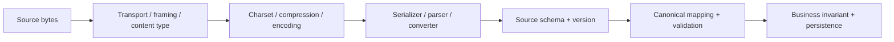
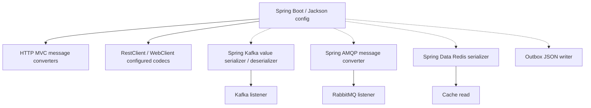
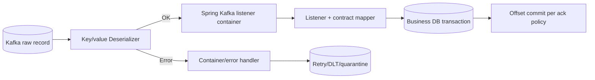
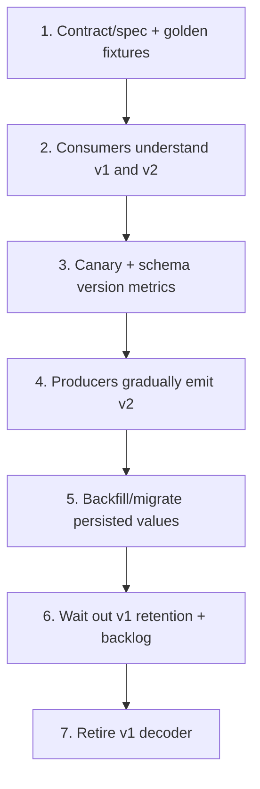
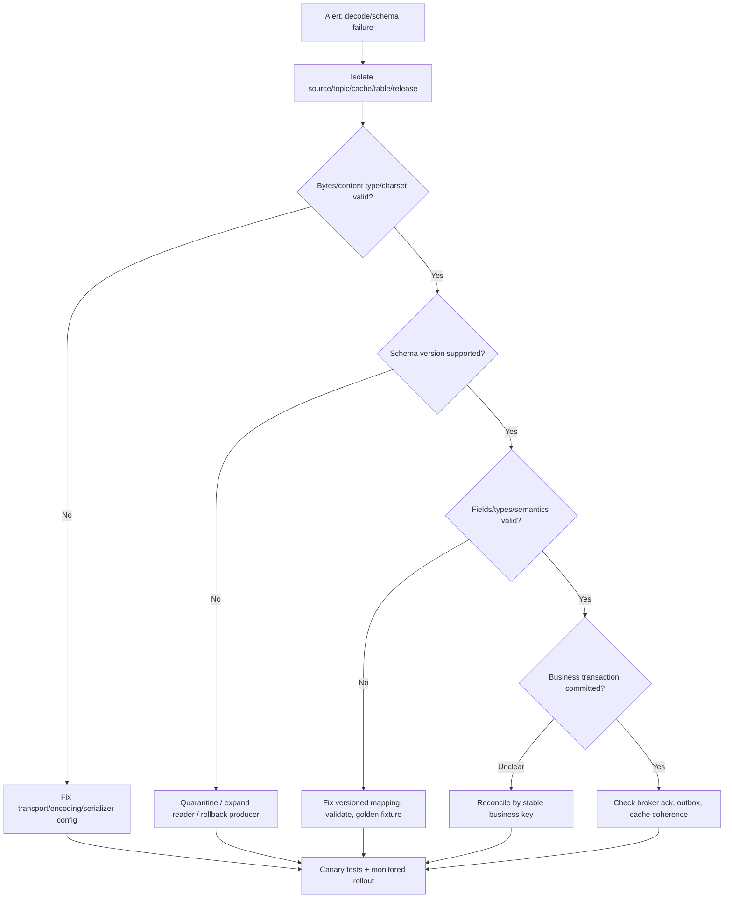

# Serializer Failures, Schema Drift, and Data Contract Incompatibility

A Spring Boot release can start cleanly, report a green health check, and still fail when reading data written by the previous version. A REST controller starts returning HTTP 400 because of a new JSON field; a Redis cache entry exists yet `@Cacheable` cannot read it; a Kafka consumer stalls at an offset because an older message embeds a deleted Java class name; or a PostgreSQL column type change breaks Hibernate mapping. These symptoms look unrelated, yet usually stem from the same source: **the data contract between writer and reader changed without a compatibility plan**.

This lesson belongs to the **Troubleshooting and Upgrades** chapter of **SPRING_BOOT_INTEGRATION**. In an integration system spanning HTTP clients, databases, caches, message brokers, and Spring Integration adapters, we must distinguish **bytes/encoding, serializer, schema, validation, and business semantics**, then handle failures at the right boundary. The goal is not "turn on ignore-unknown-fields so it runs again," but protecting data integrity, transactions, idempotency, replayability, and rollout/rollback safety when multiple versions coexist.

> Examples use Java 17+, Spring Boot 3.x, Spring Framework 6.x, Jackson 2.x, Spring Kafka/AMQP, Spring Data Redis, and Jakarta Bean Validation. Exact configuration and APIs depend on your running BOM and adapters; never copy property names from one library to another without verifying. Partner names, IDs, and payloads below are **illustrative fixtures**, not pre-existing production contracts.

## 1. Learning Objectives and Key Incident Questions

After this lesson, you will be able to:

1. Distinguish **transport, framing, encoding, deserialization, schema, validation, semantic mapping, and persistence** failures instead of lumping them all into "bad JSON."
2. Identify **producer, consumer, topic/cache/table, schema version, and deployment timestamp** to isolate faults across Spring Boot services.
3. Diagnose common Jackson errors: `MismatchedInputException`, `UnrecognizedPropertyException`, Java Time module issues, enums, `BigDecimal`, polymorphic typing, and DTO changes.
4. Spot schema/serializer failures across XML/SOAP, CSV, Kafka/RabbitMQ, Redis, JDBC/JPA/MongoDB, and Spring Integration message converters.
5. Design **versioned contracts, strict validation, upcasters, and fallbacks** for v1/v2 data without guessing values or causing silent corruption.
6. Classify which errors are **retryable**, which belong in dead-letter/quarantine, and when it is safe to ACK or commit offsets.
7. Apply **expand → migrate → contract**, rolling deployments, canaries, rollbacks, and reconciliation when producers and consumers upgrade out of lockstep.
8. Write golden contract tests, integration/fault-injection tests, and runbooks with metrics, traces, alerts, and sensitive-data isolation.

## 2. Five Compatibility Layers to Inspect Before Editing Code

"Readable" emerges from multiple layers—not merely JSON syntax or Java classes.



| Layer | Failure Example | Verification Method |
| --- | --- | --- |
| Transport / framing | HTTP sends `Content-Type: application/xml` with JSON body; miscompressed Kafka record; truncated CSV read | Check protocol headers, content length, compression, media type, and raw byte length. |
| Encoding / bytes | UTF-8 read under another charset; gzipped bytes parsed as JSON; Redis key JDK-serialized instead of UTF-8 | Inspect bytes/hex in a secure environment, charset/BOM, serializer, and Redis type. |
| Syntax / parser | JSON missing brace; malformed XML; unclosed CSV quote | Parser exception and offset/line/column; validate against golden fixtures. |
| Schema / types | Field renamed, string → object, new enum, incompatible Avro reader/writer schema | Schema version, field types, validation, and compatibility policy. |
| Business semantics | `amount` switched from decimal major units to integer minor units; `SETTLED` changed meaning; timestamp dropped timezone | Check source contract/spec, rule versions, and invariants—not just JSON syntax. |

**Note:** an object deserialized by Jackson without exceptions is **not guaranteed valid**. For instance, a v2 DTO may end up with `status=null` because the v1 payload used `state`. If the service defaults `null` to `NEW` or emits a "paid" event with the wrong monetary unit, the resulting corruption is far worse than HTTP 400.

### 2.1. Diagnose from Symptoms First, Not Assumptions

```text
HTTP request 400?
  -> check Content-Type -> bytes/charset -> JSON/XML parser
  -> DTO mapping -> Bean Validation -> domain validation

Kafka consumer keeps retrying the same record?
  -> serializer/header/schema registry -> deserializer before listener?
  -> listener mapping -> DB transaction -> ack/offset/error handler

Redis GET returns null even though CLI shows the key?
  -> same Redis logical DB/topology?
  -> right key bytes/key serializer?
  -> TTL/expiration/eviction? -> value deserializer?

JPA reports "column/type mismatch" after upgrade?
  -> actual DB migration -> schema/driver/dialect
  -> entity mapping/converter -> historical rows/nullability
```

A single `HttpMessageNotReadableException` does not prove the producer is at fault. The consumer may be on an old schema, `ObjectMapper` modules/settings may have changed, or a reverse proxy may have rewritten `Content-Type`. Capture **minimum evidence** before applying global "fixes."

## 3. Classify Errors by Symptom to Avoid Fixing the Wrong Layer

| Symptom | Common Error Class | What Not to Do |
| --- | --- | --- |
| `JsonParseException` or `JsonEOFException` | Malformed JSON syntax / truncated bytes | Infinitely retry the same broken/truncated payload. |
| `MismatchedInputException` | JSON token type does not match Java type | Enable blanket coercions turning objects/arrays into strings. |
| `UnrecognizedPropertyException` | Producer added a field; consumer is strict | Disable strictness globally without checking contracts. |
| `InvalidFormatException` on enum/time | Value outside accepted vocabulary or format | Map every unknown status to `PAID` or `NEW`. |
| `InvalidDefinitionException` | Java DTO/module/creator mismatch | Blame the producer when the app lacks a Jackson module. |
| `ClassCastException` / `LinkedHashMap cannot be cast` | Deserializer lost type info or fell back to generic map | Cast blindly without validating fields and identity. |
| `InvalidClassException` / `ClassNotFoundException` reading Redis | Legacy Java serialization coupled to class/package/`serialVersionUID` | Enable unrestricted Java deserialization for untrusted bytes. |
| Kafka `SerializationException` / `RecordDeserializationException` | Failure before listener receives payload | Wrap `@KafkaListener` body in `try/catch` hoping to catch it. |
| Rabbit message conversion failure | Content type, type header, or JSON mapper mismatch | Requeue poison messages in a tight loop. |
| Redis `WRONGTYPE` | Key holds String while code issues Hash/List/Stream ops | Force bytes through a JSON parser. |
| SQL `DataIntegrityViolationException` | Constraint/column/schema drift or business conflict | Retry blindly as transient without inspecting constraint names. |
| Consumer succeeds yet monetary amounts are wrong | Semantic contract mismatch despite clean parse | Assert only "deserializer returned non-null." |
| Sudden drop in cache hit rate after rollout | Key prefix/serializer changed; v2 cache is cold | Flush all of Redis or scale pools blindly. |

**Where the exception is thrown dictates recovery.** If it throws **before the Kafka listener**, a listener `try/catch` catches nothing; if it throws **after SQL commit yet before offset commit**, redelivery re-runs business logic and requires idempotency. If the failure is merely "unable to read old cache entries," policy may call for bounded DB refetch rather than failing the HTTP endpoint.

## 4. Running Scenario: One Order Across Three Versions

Suppose an application ingests partner events and normalizes them before persisting to PostgreSQL, Redis, and brokers.

**Producer JSON v1:**

```json
{
  "eventId": "evt-42",
  "orderId": "ORD-42",
  "state": "PAID",
  "total": "125.00",
  "currency": "USD",
  "occurredAt": "2026-11-20T10:30:00Z"
}
```

**Producer JSON v2:**

```json
{
  "schemaVersion": 2,
  "eventId": "evt-42",
  "orderId": "ORD-42",
  "status": "PAID",
  "amount": "125.00",
  "currency": "USD",
  "occurredAt": "2026-11-20T17:30:00+07:00"
}
```

**Producer JSON v3 — semantic shift:**

```json
{
  "schemaVersion": 3,
  "eventId": "evt-42",
  "orderId": "ORD-42",
  "status": "PAID",
  "amountMinor": 12500,
  "currency": "USD",
  "occurredAtEpochMillis": 1795170600000
}
```

In v1 and v2, `125.00 USD` represents the exact same amount, and the two ISO-8601 timestamps denote **the exact same instant**. In v3, `amountMinor=12500` represents 125 USD only when **the official source contract specifies minor units**. You cannot simply alias `amountMinor` to `amount`: confusing units multiplies the money by 100. Likewise, `occurredAtEpochMillis` can be parsed only when confirmed to be **milliseconds**, not seconds or local time.

### 4.1. Compatibility Matrix by Writer and Reader

| Writer | Reader | Readable? | Risk |
| --- | --- | --- | --- |
| v1 | v1 | Yes, with matching serializer | Missing `schemaVersion`; must isolate legacy keys/topics. |
| v1 | v2 | Only if v2 includes legacy parser/upcaster | `state`/`total` become null if mapped straight to v2 DTO. |
| v2 | v1 | Not by default | v1 does not recognize `status`/`amount` or new fields. |
| v2 | v2 | Yes, if schema/semantics hold | Must still validate money, time, and IDs. |
| v3 | v2 | **No** in this example | Units and time format changed. |
| v3 | v3 | Yes, per v3 contract | Still validate version, currency scale, and timestamp bounds. |

**Versionless v1 payloads** should be treated as v1 only when provenance from a specific topic, endpoint, Redis key prefix, or producer contract is **trustworthy**. Never route arbitrary versionless JSON into a v1 mapper on a shared multi-event channel.

### 4.2. Technical Error vs. Semantic Error

```java
public record OrderV2(
        int schemaVersion,
        String eventId,
        String orderId,
        String status,
        java.math.BigDecimal amount,
        String currency,
        java.time.Instant occurredAt) {}
```

Deserializing v1 JSON directly into `OrderV2` under lenient unknown/missing-field rules produces an instance with `schemaVersion=0`, `status=null`, `amount=null`. No exception means **the parser allowed defaults**, not that the event is valid. Always validate version and required fields rather than trusting record constructors.

## 5. Gathering Safe Evidence Before Fixing

In production incidents, capture enough context to reproduce the bug while **never dumping sensitive payloads into public logs**.

### 5.1. Minimum Evidence Set

| Item | Example | Why Needed |
| --- | --- | --- |
| Source and channel | `partner-A/http-orders`, Kafka topic, Redis keyspace | Identifies producer and serializer owner. |
| Producer / consumer release | `orders-ingestor 2.4` → `orders-projection 3.1` | Pinpoints deploy that changed the contract. |
| Contract / schema version | `orders-v2`, schema registry ID, XSD version | Selects right parser or upcaster. |
| Content type / encoding | `application/json; charset=UTF-8`, gzip, Avro header | Rules out bytes/transport bugs. |
| Failure and phase | `DECODE`, `VALIDATE`, `DB_COMMIT`, `PUBLISH` | Retry/ACK depends on failure point. |
| Message location | Kafka partition/offset, Rabbit delivery tag, file ID/line | Supports replay or quarantine at source. |
| Correlation / business event ID | `trace-123`, redacted `evt-42` per policy | Reconciles retries and duplicates. |
| Hash/checksum + secure payload ref | `sha256(...)`, access-controlled quarantine store | Reproduces exact bytes without logging raw PII. |

For HMAC-signed HTTP webhooks, preserve **raw body bytes to verify the signature before any normalization**; trimming whitespace, changing charset, or sorting JSON keys before verification breaks signatures. By contrast, a semantic checksum for idempotency can hash a versioned canonical representation—**the two hashes are not interchangeable**.

### 5.2. Structured Logging Without Leaking Data

```text
component=orders_ingestor
boundary=kafka_value_deserializer
source=partner-a
contract_version=2
error_category=SCHEMA_MISMATCH
error_code=EXPECTED_DECIMAL_STRING
topic=orders.inbound
partition=3
offset=9182
consumer_release=3.1
correlation_id=trace-123
payload_ref=secure-quarantine-item-392
```

Avoid logging raw JWTs, passwords, card numbers, emails, full request/XML/CSV bodies, or Kafka headers with tokens. In metrics, **never use offsets, order IDs, or event IDs as labels** due to high cardinality. When payloads must be kept for debugging, use an encrypted, access-controlled quarantine store with TTL/retention, auditing, and an approved redrive process.

### 5.3. Questions to Ask the Producer Before Changing Your Mapper

- Did the producer publish a **schema/version**? Are there contract tests or real samples?
- Is the new field optional or required? What does a default mean?
- Did a type change also change units, precision, or timezone?
- Will **two versions coexist** during a migration window?
- Does historical data still reside in Redis, Kafka retention, outboxes, or file archives?
- Can producer and consumer roll back independently?
- Are any fields covered by signatures or idempotency hashes that must not be normalized before verification?

Never "fix" things one-sidedly by forcing consumers to accept every new field and enum blindly. The producer may actually be violating its signed contract, or routing may have sent traffic to the wrong topic/endpoint.

## 6. Jackson in Spring Boot: One Serializer or Multiple Separate Paths?

Spring Boot manages several Jackson-backed components, yet **not every adapter shares the same `ObjectMapper`**. `MappingJackson2HttpMessageConverter` in Spring MVC, `RestClient`, `WebClient` codecs, Kafka `JsonDeserializer`, RabbitMQ `Jackson2JsonMessageConverter`, Redis `RedisSerializer`, and any `new ObjectMapper()` written by a developer can differ in **modules, naming strategy, date formatting, unknown-field rules, and polymorphic typing policy**.

### 6.1. Know Exactly Who Serializes and Deserializes



Dashed lines indicate that configuration inheritance is **conditional on Boot version and bean wiring**; never claim every Kafka/AMQP/Redis converter automatically uses the MVC Jackson mapper. Calling `new ObjectMapper()` skips Boot-managed `JavaTimeModule` and customizations. Conversely, altering a global mapper to accommodate one partner can unintentionally break other endpoints.

### 6.2. Four Common JSON Pitfalls

**A. Renamed field**

```json
{"state":"PAID","total":"125.00"}
```

DTO v2 expects `status` and `amount`. If unknown fields are ignored, `state`/`total` vanish and required fields become null. Fix via **version-aware mapping**, or `@JsonAlias` **only when** both names share exact semantics and caller/schema version is known—never alias carelessly.

**B. JSON token type changed**

```json
{"amount":{"value":"125.00","currency":"USD"}}
```

DTO expects `String amount`. `MismatchedInputException` signals a schema change—not something fixed by making `ObjectMapper` "more lenient."

**C. Java Time module / format**

```java
public record ScheduledOrder(
        String orderId,
        java.time.Instant occurredAt) {}
```

`Instant` requires the matching Jackson module/config in Jackson 2.x. Timestamps serialize as ISO-8601 strings or numeric values depending on settings. If a producer switches to numeric epoch seconds while the consumer expects milliseconds, parsing **throws no error yet shifts timestamps wildly**.

**D. New enum value**

```json
{"status":"PARTIALLY_PAID"}
```

A Java switch knowing only `NEW/PAID/CANCELLED` fails. Never map unknown enums to `PAID` or `NEW`. Depending on the contract: upgrade consumers before producers, quarantine/route to `UNSUPPORTED` with safe business behavior, or introduce event v2.

### 6.3. Jackson Annotations Do Not Replace Versioned Contracts

| Mechanism | Intended Use | Caution |
|---|---|---|
| `@JsonProperty("order_id")` | Fixed wire field name per contract | Changing it breaks JSON wire format. |
| `@JsonAlias({"order_id","orderId"})` | Accept **semantically identical aliases** under one policy | Does not handle unit or semantic changes. |
| `@JsonIgnoreProperties(ignoreUnknown = true)` | Tolerate additive fields | Can hide critical new fields or typos from producers. |
| `@JsonFormat` | Field-level date/time/shape formatting | Does not resolve missing timezones or DST ambiguity. |
| `@JsonCreator` / record constructor | Construct immutable DTOs | Does not replace Bean Validation or reject missing/null values. |
| `@JsonTypeInfo` | Controlled polymorphic contract | Never let untrusted input instantiate arbitrary Java classes. |

### 6.4. Configure Strictness Per Boundary, Not Globally

Example Boot configuration:

```yaml
spring:
  jackson:
    deserialization:
      fail-on-unknown-properties: true
    serialization:
      write-dates-as-timestamps: false
```

This is an **illustrative policy** for apps enforcing strict unknown fields. It affects components wired to Boot's configured mapper, not arbitrary custom adapters. If one partner allows additive fields, configure a **source-scoped DTO/`ObjectReader`** or endpoint schema validation rather than disabling strictness application-wide.

With Spring Boot 3.x, verify Jackson property keys and integrations against metadata/docs for your running version; never assume identical defaults across Spring MVC, WebFlux, Kafka, and Redis. Library upgrades can alter constructor/serializer APIs or defaults, requiring regression tests with **actual wire bytes**.

## 7. Designing a Version-Aware Decoder to Fix Schema Drift at the Root

We introduce a **canonical model** decoupled from source JSON v1/v2. The decoder processes an event only after the adapter **identifies the version from trusted contract metadata**; never try parsing multiple Java classes in a loop until one "happens to fit."

### 7.1. Canonical Model and Safe Contract Exception

```java
import java.math.BigDecimal;
import java.time.Instant;

public record CanonicalOrderEvent(
        String eventId,
        String orderId,
        String status,
        BigDecimal amount,
        String currency,
        Instant occurredAt
) {}
```

```java
public final class DataContractException
        extends RuntimeException {
    public DataContractException(String message) {
        super(message);
    }

    public DataContractException(
            String message, Throwable cause) {
        super(message, cause);
    }
}
```

Place each top-level `public` class or record in its own Java file. `DataContractException` carries only **safe error codes or sanitized messages**, never raw JSON/XML/CSV, emails, card numbers, or tokens. Larger systems can add an `ErrorCode` or `SourceContext` enum to distinguish schema errors from semantic errors.

### 7.2. Decoder Accepting v1/v2 While Rejecting v3 and Invalid Data

```java
import com.fasterxml.jackson.core.JsonProcessingException;
import com.fasterxml.jackson.databind.JsonNode;
import com.fasterxml.jackson.databind.ObjectMapper;
import java.math.BigDecimal;
import java.math.RoundingMode;
import java.time.OffsetDateTime;
import java.time.format.DateTimeParseException;
import java.util.Set;
import java.util.regex.Pattern;
import org.springframework.stereotype.Component;

@Component
public final class OrderEventDecoder {
    private static final Pattern ID =
            Pattern.compile("[A-Za-z0-9._:-]{1,128}");
    private static final Pattern AMOUNT =
            Pattern.compile("[0-9]{1,16}(?:\\.[0-9]{1,6})?");
    private static final Set<String> STATUSES =
            Set.of("NEW", "PAID", "CANCELLED");

    private final ObjectMapper mapper;

    public OrderEventDecoder(ObjectMapper mapper) {
        this.mapper = mapper;
    }

    public CanonicalOrderEvent decode(
            String json, int trustedContractVersion) {

        try {
            JsonNode root = mapper.readTree(json);
            if (root == null || !root.isObject()) {
                throw new DataContractException("ORDER_NOT_OBJECT");
            }

            String statusField;
            String amountField;
            switch (trustedContractVersion) {
                case 1 -> {
                    // Legacy v1 allowed only on confirmed channels.
                    if (root.has("schemaVersion")) {
                        throw new DataContractException(
                                "UNEXPECTED_V1_VERSION_FIELD");
                    }
                    statusField = "state";
                    amountField = "total";
                }
                case 2 -> {
                    JsonNode version = root.get("schemaVersion");
                    if (version == null || !version.isInt()
                            || version.intValue() != 2) {
                        throw new DataContractException(
                                "SCHEMA_VERSION_CONFLICT");
                    }
                    statusField = "status";
                    amountField = "amount";
                }
                default -> throw new DataContractException(
                        "UNSUPPORTED_CONTRACT_VERSION");
            }

            String status = requiredText(root, statusField);
            if (!STATUSES.contains(status)) {
                throw new DataContractException("UNKNOWN_ORDER_STATE");
            }

            String currency = requiredText(root, "currency");
            if (!"USD".equals(currency)) {
                // Lesson illustrates a USD contract only; other products
                // need a scale policy table per currency and use case.
                throw new DataContractException("UNSUPPORTED_CURRENCY");
            }

            String moneyText = requiredText(root, amountField);
            if (!AMOUNT.matcher(moneyText).matches()) {
                throw new DataContractException("INVALID_MONEY_FORMAT");
            }
            BigDecimal money = new BigDecimal(moneyText)
                    .setScale(2, RoundingMode.UNNECESSARY);
            if (money.signum() <= 0) {
                throw new DataContractException("INVALID_MONEY_VALUE");
            }

            var occurredAt = OffsetDateTime
                    .parse(requiredText(root, "occurredAt"))
                    .toInstant();

            return new CanonicalOrderEvent(
                    requiredId(root, "eventId"),
                    requiredId(root, "orderId"),
                    status, money, currency, occurredAt);

        } catch (JsonProcessingException
                | DateTimeParseException
                | ArithmeticException error) {
            throw new DataContractException(
                    "MALFORMED_ORDER_CONTRACT", error);
        }
    }

    private static String requiredText(JsonNode root, String field) {
        JsonNode node = root.get(field);
        if (node == null || !node.isTextual()
                || node.textValue().isBlank()) {
            throw new DataContractException(
                    "MISSING_OR_WRONG_TYPE_" + field);
        }
        return node.textValue();
    }

    private static String requiredId(JsonNode root, String field) {
        String value = requiredText(root, field);
        if (!ID.matcher(value).matches()) {
            throw new DataContractException(
                    "INVALID_ID_" + field);
        }
        return value;
    }
}
```

**Principles illustrated:**

- Version is a **source contract**, not merely a self-reported JSON field. Versionless v1 payloads route to `trustedContractVersion=1` only when topic/endpoint/key-prefix provenance is verified.
- `state` → `status` and `total` → `amount` work solely because **v1 and v2 share identical semantics**; v3 is excluded because v3 uses minor units and epoch milliseconds.
- `BigDecimal` is constructed directly from validated **decimal text**, never through `double` or `DoubleNode` which lose precision.
- The parser verifies exact token types, required fields, enums, currency, and timestamps with offsets. It never substitutes `Instant.now()` for a missing timestamp or defaults `null` to `NEW`.
- `ObjectMapper` is **injected**, never mutated globally at runtime. Boot's Jackson modules/config are reused via the configured bean.

**Example limitations:** the decoder validates required fields without rejecting unknown fields or duplicate JSON keys, enforces no max body/nesting limits, and uses no formal JSON Schema. Production deployments should add source-specific strict field sets (when contracted), duplicate-key parser settings, payload size/time limits, authentication, and validation integration tests. Never rely on `readTree` alone against untrusted or malformed payloads.

### 7.3. Upcasters Keep Legacy DTOs Out of the Domain

Place decoders at the integration adapter boundary, emitting **one** `CanonicalOrderEvent` to domain services. Once v1 ages out of broker retention/Redis TTL and all old producers stop:

1. Measure v1 traffic share and locate any remaining v1 emitters.
2. Confirm no archived replay schedules still need v1 (or maintain a dedicated migration job).
3. Retire the v1 decoder on schedule, retaining golden fixtures for historical audits.
4. Never delete v1 support just because "v2 shipped yesterday" while backlog or quarantine still holds old payloads.

When two versions differ semantically with no lossless upcast, **accept two distinct typed commands** at the application boundary or apply controlled enrichment rather than synthesizing fake default fields into one canonical event.

## 8. Post-Deserialization Validation: Missing, Null, Default, and Semantic Errors

Java records do not enforce non-null fields automatically. Jackson can accept missing or null fields per `ObjectMapper` settings and construct invalid instances. `@NotNull`/`@NotBlank` are **Bean Validation** constraints, not automatically triggered when calling `ObjectMapper.readValue`.

```java
import jakarta.validation.constraints.NotBlank;
import jakarta.validation.constraints.NotNull;
import jakarta.validation.constraints.Positive;
import java.math.BigDecimal;
import java.time.Instant;

public record ValidatedOrderCommand(
        @NotBlank String eventId,
        @NotBlank String orderId,
        @NotNull @Positive BigDecimal amount,
        @NotNull Instant occurredAt
) {}
```

Example invoking validation when consuming a message:

```java
import jakarta.validation.ConstraintViolation;
import jakarta.validation.Validator;
import java.util.Set;
import org.springframework.stereotype.Service;

@Service
public final class OrderCommandValidator {
    private final Validator validator;

    public OrderCommandValidator(Validator validator) {
        this.validator = validator;
    }

    public void requireValid(ValidatedOrderCommand command) {
        Set<ConstraintViolation<ValidatedOrderCommand>> errors =
                validator.validate(command);
        if (!errors.isEmpty()) {
            // Log field names/error codes safely;
            // never expose raw invalid values containing PII.
            throw new DataContractException("BEAN_VALIDATION_FAILED");
        }
    }
}
```

In Spring MVC, `@Valid @RequestBody` runs validation automatically when configured; in Kafka listeners, Redis caches, or file pollers, the framework **does not run MVC validation automatically**. Invoke validation explicitly at the adapter boundary or via configured method validation. Never slap annotations on DTOs and assume every adapter enforces them.

### 8.1. Missing vs. Explicit Null in PATCH

```json
{}
```

```json
{"shippingAddress":null}
```

In PATCH endpoints, an **absent** field typically means "leave unchanged," whereas explicit `null` means "clear." A `record Patch(String shippingAddress)` loses that distinction if both map to `null`. Use a field-presence model/`JsonNode`/wrapper tracking **ABSENT / PRESENT_NULL / PRESENT_VALUE** and test all three; never treat null identically to absent across APIs.

### 8.2. Silent Coercion Is Especially Dangerous for Money and Time

```text
amount="125.00"   -> decimal major units USD
amount=12500      -> possibly minor units, NOT equivalent
occurredAt=1795170600     -> possibly epoch seconds
occurredAt=1795170600000  -> possibly epoch milliseconds
occurredAt="2026-11-20 10:30" -> missing timezone
```

Never infer units from digit count unless the protocol mandates it; epoch numbers can look plausible at either scale, and systems legitimately handle historical or future dates. Parse strictly per **source contract**, require `Instant`/`OffsetDateTime` with explicit timezone/offset, validate bounds, and apply DST rules if a source sends local time.

### 8.3. Unknown Enum Values: Reject or Support?

If a contract explicitly allows newer consumers to ignore unrelated events, route them to **UNSUPPORTED/quarantine** or a distinct `UNKNOWN` state. For order payments, never treat `UNKNOWN` as `PAID` to ship goods. Before enabling `PARTIALLY_PAID` on producers, verify every consumer (analytics, order orchestration, refunds, caches). Enums are part of **contract semantics**, not merely JSON syntax.

## 9. XML/SOAP: Namespaces, XSD, Parser Security, and Mapping Errors

A SOAP integration can return HTTP 200 with a **SOAP Fault** body, or HTTP 500 with a structured Fault. Never treat every parseable XML document as a successful business response.

### 9.1. Common XML Failures During Upgrades

| Symptom | Cause | Proper Diagnosis |
|---|---|---|
| JAXB/Jackson XML field is `null` despite element present | Namespace URI/prefix or local name changed | Compare namespace URIs and XSDs, not just tag names in logs. |
| `UnmarshalException` | XSD/schema/class binding mismatch | Compare SOAP/WSDL/XSD versions with live partner XML. |
| SOAP Fault treated as success | Code parses payload body without checking Faults | Handle SOAP Faults explicitly; separate business vs. system faults. |
| Strange XML entity/DTD hits URLs or local files | DTD/external entity resolution left enabled | Disable XXE, verify parser provider, test malicious payloads. |
| WS-Security signature fails after middleware | Raw XML, namespaces, or canonicalization altered | Verify WS-Security signature before trusting payload. |
| JDK upgrade alters XML parser behavior | `XMLInputFactory`/JAXB impl or default limits changed | Pin compatible library/provider and run regression tests. |

Example of identical local name `OrderId` under different namespaces:

```xml
<a:OrderId xmlns:a="urn:partner:order:v1">ORD-42</a:OrderId>
```

```xml
<b:OrderId xmlns:b="urn:partner:order:v2">ORD-42</b:OrderId>
```

These are **two distinct qualified names** in XML; the prefix `a` or `b` itself does not matter, while the **namespace URI** can be a breaking contract change. Never disable namespace validation just to "parse any document," as that can misbind elements from the wrong XML block.

### 9.2. XML Parsers Must Defend Against External Entities / DTDs

When parsing untrusted XML, configure StAX factories securely before reading bytes:

```java
import javax.xml.stream.XMLInputFactory;

XMLInputFactory factory = XMLInputFactory.newFactory();
factory.setProperty(XMLInputFactory.SUPPORT_DTD, false);
factory.setProperty(
        XMLInputFactory.IS_SUPPORTING_EXTERNAL_ENTITIES, false);
```

Verify **actual properties supported** by your runtime parser provider; if security policies cannot be enforced, fail closed and switch to a compliant parser/provider. Also enforce byte size, nesting depth, entity expansion, node count, and parse-time limits. Use proper SOAP/Spring Web Services stacks to verify envelopes, namespaces, SOAP Headers, Faults, and WS-Security; Jackson's `XmlMapper` maps XML only and **does not verify SOAP signatures**.

### 9.3. Safe Process When XSD/WSDL Changes

1. Archive both old and new WSDL/XSD fixtures; diff namespaces, required/optional elements, `nillable`, enumerations, and type restrictions.
2. Generate versioned bindings when changes break compatibility; never overwrite old generated classes while v1 payloads remain in backlog.
3. Test `xsi:nil="true"`, missing elements, and empty elements—three states with potentially different meanings.
4. Verify security/trust/signatures before normalizing signed content.
5. Classify SOAP Faults (business rejection vs. transient unavailability); never retry blindly.
6. Maintain partner compatibility windows and retire legacy versions only after replay backlogs clear.

## 10. CSV and File Imports: Schema Includes Headers, Ordering, Charset, and Quoting

A CSV file can be syntactically valid yet **violate the data contract**. Legacy layout:

```csv
event_id,order_no,amount,currency,state
evt-42,ORD-42,125.00,USD,S
```

After an upgrade, the producer reorders columns:

```csv
order_no,event_id,currency,amount,state
ORD-42,evt-42,USD,125.00,S
```

If the consumer reads by **hardcoded column index** instead of validating headers, reordering silently swaps `orderId` and `eventId` with no exception. When headers identify columns by name, map by header name and reject duplicate, missing, or unknown headers per policy.

### 10.1. Never Use `split(",")` as a CSV Parser

```csv
event_id,order_no,customer_name,amount
evt-42,"ORD,42","Nguyễn Văn A",125.00
```

`"ORD,42"` is a single field. Commas or newlines inside quoted fields are valid in standard CSV dialects. Use Jackson CSV, Apache Commons CSV, or an equivalent parser with explicit delimiter, quote, escape, header, and charset configuration. If a source omits delimiter or decimal separator specs, **verify the contract** instead of guessing from server locale.

### 10.2. File Errors That Easily Turn into Silent Corruption

| Change | Failure Mode | Safeguard |
|---|---|---|
| UTF-8 → legacy encoding | Vietnamese characters garbled or replaced with replacement chars | Enforce contracted charset; reject invalid byte sequences when needed. |
| Decimal dot → comma | `125,50` split or misparsed | Contracted locale and explicit decimal text parser. |
| Added column `discount` | Positional column reads shift | Header schema/versioning and contract tests. |
| Duplicate header names | Map overwrites or keeps wrong column | Reject duplicate headers. |
| Stripped leading zeros | `00042` becomes `42` | Keep identifiers as text; never parse as numbers. |
| File uploaded twice | Rows double-processed | File ID/checksum + per-record inbox/business key. |
| Newlines/quotes inside fields | `split` breaks records mid-row | Real CSV parser and multiline test fixtures. |
| Spreadsheet exports with formulas | Cells starting with `=`/`+`/`-`/`@` execute on open | Export-specific formula escaping without corrupting canonical input. |

For large file imports, use streaming/chunking, enforce file/record/field size limits, and tie checkpoints to **committed transactions**. If row 42 fails parsing, record quarantine context (file ID, schema version, line number) rather than throwing raw `IndexOutOfBoundsException`; if crashing after row 41, replay must tolerate duplicates. Never fix file bugs by loading multi-GB files with `Files.readAllLines` or `collectList()`.

## 11. Avro, Protobuf, and Schema Registries: Valid Binary Still Fails If Misaligned

Not every payload is JSON text. Kafka, RabbitMQ, or object storage may use **Avro, Protobuf, JSON Schema, CBOR, or custom binary formats**. Binary schemas require coordinating **writer schema**, **reader schema**, schema IDs, and serializer framing bytes.

### 11.1. Avro Scenario

Producer v1:

```json
{
  "type": "record",
  "name": "OrderPaid",
  "namespace": "example.contracts",
  "fields": [
    {"name": "eventId", "type": "string"},
    {"name": "amount", "type": "string"}
  ]
}
```

Producer v2 adds a field:

```json
{"name":"currency","type":"string","default":"USD"}
```

Avro schema resolution and defaults permit certain directional evolution, **yet compatibility direction must be tested against actual reader/writer versions**. If v1 events lacked `currency`, defaulting to `USD` is valid only if the legacy business contract guaranteed *every* v1 order was USD. Otherwise, schemas are technically compatible while **semantics are corrupted**.

### 11.2. Protobuf: Field Numbers Are Part of the Contract

```protobuf
syntax = "proto3";

message OrderPaidV1 {
  string event_id = 1;
  string order_id = 2;
  string amount_decimal = 3;
}
```

Never reuse field number `3` for another type or meaning just because a Java property was renamed. When retiring fields, **reserve field numbers and names** per Protobuf rules; when adding enum values, verify how older consumers handle unknown enum values. Field presence and default rules in proto3 differ from JSON missing/null and evolve across editions/versions; keep golden binary fixtures rather than relying solely on Java object equality.

### 11.3. Registry Compatibility Does Not Replace Business Review

| Policy / Artifact | What It Guarantees Partially | What It Does Not Guarantee |
|---|---|---|
| Backward schema compatibility | Newer readers can parse certain older writer payloads | Unchanged money/time semantics. |
| Forward schema compatibility | Older readers can parse certain newer writer payloads | That unknown enums won't trigger unsafe logic. |
| Full compatibility | Bidirectional checks per registry rules | Correctness across historical data and downstream side effects. |
| Schema ID in message | Consumer fetches writer schema if registry/wire protocol matches | Authenticated producer or authorized content. |
| Semantic version in business event | Hints at contract version | Does not enforce validation or upcasting automatically. |

Registries vary in compatibility modes, transitivity, and subject naming strategies. Verify exact provider behavior, wire framing, serializer config, and subject/version policies. **Never map untrusted header schema IDs to arbitrary Java classes**, and never assume broker delivery means the consumer understands the bytes.

## 12. Redis: Key Serializers, Value Serializers, and Legacy Cache Schemas

Redis stores **raw bytes**, while Java apps rely on key/value codecs. When upgrading Spring Boot or Spring Data Redis, switching from `JdkSerializationRedisSerializer` to a typed JSON serializer does not re-encode existing Redis bytes. A new `RedisTemplate` config **does not** retroactively rewrite stored keys.

### 12.1. Symptoms to Distinguish

| Symptom | Likely Cause | How to Verify |
|---|---|---|
| App `GET` returns `null` while CLI shows key | Different key serializer, prefix/version/DB index changed, or key expired | Inspect raw key bytes, Redis logical DB, topology, and TTL. |
| Key found yet throws `SerializationException` | v1 JDK bytes vs. v2 JSON value, or unknown schema version | Inspect raw value format safely and codec version. |
| `InvalidClassException` | Java native serialization tied to class/`serialVersionUID` | Migrate only in trusted environments; never allow unsafe deserialization. |
| `ClassCastException LinkedHashMap` | Generic JSON type info lost or mismatched | Use typed DTO serializer / explicit mapping and round-trip tests. |
| `WRONGTYPE Operation against a key` | Key holds Hash/List/Stream while code runs String commands | Check Redis `TYPE` and key namespace/version. |
| `@Cacheable` writes different JSON than `RedisTemplate` | `RedisCacheManager` uses its own serialization config | Inspect `RedisCacheManager` and raw stored bytes. |
| Redis `INCR` fails | Counter written as JSON/JDK object instead of numeric string | Separate keyspaces and serializers for counters. |

### 12.2. Each Redis API Can Own Its Own Codec

A cache DTO exposing only contracted fields:

```java
import java.math.BigDecimal;
import java.time.Instant;

public record OrderCacheV2(
        int schemaVersion,
        String orderId,
        String status,
        BigDecimal amount,
        String currency,
        Instant updatedAt
) {}
```

Keep this DTO in `OrderCacheV2.java`, separate from persistence entities and HTTP DTOs.

```java
import org.springframework.data.redis.connection.RedisConnectionFactory;
import org.springframework.data.redis.core.RedisTemplate;
import org.springframework.data.redis.serializer.StringRedisSerializer;
import org.springframework.data.redis.serializer.Jackson2JsonRedisSerializer;
import org.springframework.context.annotation.Bean;
import org.springframework.context.annotation.Configuration;

@Configuration(proxyBeanMethods = false)
public class OrderRedisConfig {
    @Bean("orderV2Template")
    RedisTemplate<String, OrderCacheV2> orderV2Template(
            RedisConnectionFactory factory,
            com.fasterxml.jackson.databind.ObjectMapper mapper) {

        var text = new StringRedisSerializer();
        var json = new Jackson2JsonRedisSerializer<>(
                mapper, OrderCacheV2.class);

        RedisTemplate<String, OrderCacheV2> template =
                new RedisTemplate<>();
        template.setConnectionFactory(factory);
        template.setKeySerializer(text);
        template.setValueSerializer(json);
        template.setHashKeySerializer(text);
        template.setHashValueSerializer(json);
        template.afterPropertiesSet();
        return template;
    }
}
```

`OrderCacheV2` is an **application cache DTO** and still needs validation on `schemaVersion`, IDs, status, amount, and currency when read. Spring manages `OrderRedisConfig` as a configuration bean; place top-level public types in their own files. For Redis Hashes, field names and values have separate serializers; for `@Cacheable`, `RedisCacheManager` requires configuring **`RedisCacheConfiguration`**—it does not inherit serializers from the template above.

### 12.3. Safe Recovery from Legacy Cache Formats

Three options:

1. **Versioned key namespaces:** `cache:order:v1:...` and `cache:order:v2:...`. v2 apps read v2, refilling from DB on miss; safe when cache data is **recomputable**, provided cache stampedes are controlled.
2. **Dual-read + upcast:** v2 checks v2 key first, falls back to reading v1 with a bounded legacy codec, and maps to v2. Do not blindly copy nearly-expired v1 entries into v2 with extended TTLs.
3. **Offline migration:** run a dedicated migration job in a trusted environment for legacy binary/JDK payloads, write the new format, verify, and retire the old reader.

Never run `FLUSHDB`/`FLUSHALL` across Redis just to clear serializer mismatches—Redis may also store locks, sessions, rate limiters, or integration state for other services. In Redis Cluster, multi-key `SCAN`/migrations must account for shards and hash slots, and cross-slot Lua/transactions are not atomic.

**Redis cache is not a DB transaction log.** On replay, never use a short-TTL Redis `processed=true` flag as sole proof that a payment or order committed. Keep durable inbox tables or unique keys in the source-of-truth database.

## 13. Kafka: When Deserialization Fails Before `@KafkaListener`

A classic trap: a producer changes a `type` header, JSON schema, or Avro serializer; the broker accepts the record cleanly, yet the consumer cannot deserialize the value. The listener method is **never invoked**, so a `try/catch` inside `@KafkaListener` never executes.

### 13.1. Pipeline and Offset Commit Point



Distinct responsibilities often confused:

- **Kafka broker storage:** stores raw bytes; unaware of Java DTOs or business JSON schemas.
- **Consumer deserializer:** decodes bytes into an object, which still requires version and semantic validation.
- **Listener adapter / message converter:** may perform an extra conversion/validation step after the Kafka `Deserializer`.
- **Business transaction:** updates DB/inbox/outbox; not automatically atomic with Kafka offset commits.
- **Ack / offset:** records consumer read progress; does not guarantee downstream Redis, cache, or HTTP completed.

### 13.2. `ErrorHandlingDeserializer` and Poison Records

Spring Kafka provides `ErrorHandlingDeserializer` to route delegate deserialization failures into the listener container's error-handling path. Illustrative Kafka JSON value config:

```yaml
spring:
  kafka:
    consumer:
      key-deserializer: org.apache.kafka.common.serialization.StringDeserializer
      value-deserializer: org.springframework.kafka.support.serializer.ErrorHandlingDeserializer
      properties:
        spring.deserializer.value.delegate.class: org.springframework.kafka.support.serializer.JsonDeserializer
        spring.json.trusted.packages: com.example.integration.contracts
        spring.json.value.default.type: com.example.integration.contracts.OrderInboundEnvelopeV1
```

Package and type names above are **project placeholders** to be replaced with real DTOs compatible with your BOM/Kafka version. `trusted.packages` restricts **class resolution**, does not replace authentication or topic ACLs, and should never be set to `*` to silence invalid type headers. For multi-type or multi-version topics, avoid forcing one default Java type onto every record; inspect controlled envelopes/header discriminators or configure deserializers per topic/contract.

**Important:** `ErrorHandlingDeserializer` handles errors inside the **delegate deserializer** per Spring Kafka semantics; it does not automatically mark Bean Validation or domain errors as non-retryable. Depending on Spring Kafka version, container mode (record vs. batch), and error handler, failed values arrive with exception headers and raw bytes requiring a compatible DLT serializer. **Test with a real record containing corrupt bytes**, not merely a mocked listener throwing an exception.

### 13.3. DLT Publishing on Deserialization Failure and `KafkaTemplate` Serializers

When the original record is unparseable `byte[]`, the DLT publisher must know how to **serialize raw bytes intentionally**. A default producer expecting JSON DTOs can fail to forward raw corrupt bytes. With `DeadLetterPublishingRecoverer`, configure a byte-capable DLT producer (or routing template by payload type) and sanitize error headers so secrets are not leaked.

Pseudo-workflow:

```text
Record bytes -> EHD(delegate JSON) failure
  -> Container error handler
     -> classify: corrupt schema / transient downstream / unknown
     -> publish to DLT safely + wait for required confirmation
     -> commit/skip source offset only under configured success policy
```

Never commit the source offset and fire-and-forget DLT publishing if your SLA forbids data loss. Conversely, if the DLT itself is down, a poison record can stall the partition—so configure alerts, retry budgets, and parking-lot rules explicitly.

### 13.4. Business Consumers and Idempotency

Suppose the listener parses a valid event, commits PostgreSQL, and crashes **before committing the Kafka offset**. Kafka will redeliver the record. Therefore:

```text
eventId = evt-42
consumerScope = order-projection-v2
inbox key = (consumerScope, eventId)

BEGIN DB TRANSACTION
  INSERT inbox key ON CONFLICT DO NOTHING
  IF claim successful:
      validate state transition / version
      UPSERT projection
      INSERT outbox event if needed
COMMIT

Only then follow the configured ack/offset policy.
```

Kafka's `exactly_once_v2` / producer transactions (when enabled) apply **within Kafka itself**, and do not turn PostgreSQL transactions and Redis writes into one atomic commit. If a duplicate `eventId` arrives with a **different payload**, treat it as an identity contract conflict requiring audit/quarantine—not a harmless replay.

### 13.5. Schema Registry Migrations

When switching Avro/Protobuf serializers or subject naming strategies, consumers must align **framing bytes + schema ID resolution + compatibility rules**. "Unknown schema ID" often happens simply because the consumer points to **a different registry cluster or credential set**, even when the Avro payload is valid. Verify registry URL, auth, connectivity, and producer serializer version before rolling back schemas.

## 14. RabbitMQ/AMQP: Content Type, Type Headers, and Requeue Loops

In Spring AMQP, messages traverse a `MessageConverter` or listener adapter before entering `@RabbitListener`. A producer may send UTF-8 JSON with the wrong `contentType`, or the converter may resolve `__TypeId__` to a moved or deleted Java class.

### 14.1. Typical Failure Modes

| Symptom | Error Source | Remedy |
|---|---|---|
| `MessageConversionException` before listener | Converter rejects bytes, content type, or type metadata | Inspect producer headers, converter class, and trusted type mappings. |
| Listener parameter binding fails | DTO v1/v2 schema drift | Versioned DTO/mapper, validation, listener adapter config. |
| Poison message requeues infinitely | Unsuitable broker/container `requeueRejected` policy | Reject without requeue on permanent errors; route to DLX/parking lot. |
| Acked yet business DB rolled back | Premature ack or non-durable async handoff | Ack after durable business commit per container/ack mode. |
| Redelivered after DB commit | Crash/network failure before ack | Consumer inbox and idempotent writes. |
| New event schema lands in old queue | Producer rolled out ahead of consumer | Expand readers first; versioned contracts and DLX. |

### 14.2. Converter Ownership and Mapping Responsibility

A Spring AMQP app may define a Jackson JSON converter:

```java
import org.springframework.amqp.support.converter.Jackson2JsonMessageConverter;
import org.springframework.context.annotation.Bean;
import org.springframework.context.annotation.Configuration;

@Configuration(proxyBeanMethods = false)
public class AmqpContractConfiguration {
    @Bean
    Jackson2JsonMessageConverter orderMessageConverter() {
        // Spring AMQP version governs constructors,
        // type mappers, and ObjectMapper integration.
        return new Jackson2JsonMessageConverter();
    }
}
```

This snippet **only illustrates a converter bean** and is insufficient alone for production. Verify which listener containers and `RabbitTemplate` use it, lock down package/type-header mappings, and validate the wire JSON schema. Never allow unrestricted generic type mapping from untrusted producer headers to instantiate arbitrary classes.

For durable compatibility, have consumers read an envelope/version before mapping to explicit DTOs. On mixed-version queues, decode bytes into a JSON tree at the adapter layer, verify type and contract version, and delegate to `OrderEventDecoder` or a schema-specific mapper.

### 14.3. Do Not Confuse Broker Ack with Completed Processing

Containers ack, nack, or requeue according to `AcknowledgeMode` and error/retry config; never assume a Java method returning normally means external work committed if it fired reactive `subscribe()` or a `CompletableFuture` and returned early.

For permanent errors (broken contract, unknown enum), **never tight-loop requeue**; route safely to quarantine/DLX. For transient Redis outages or PostgreSQL timeouts, apply bounded backoff retries. For HTTP partner **UNKNOWN** outcomes, reconcile via idempotency keys before re-sending POSTs.

## 15. Databases and ORMs: Schema Drift Differs from Serializer Mismatch

Integration services commonly persist HTTP/broker DTOs to PostgreSQL/JPA or MongoDB. Database schema changes can break mappers **even when incoming JSON is 100% valid**.

### 15.1. SQL / JPA / JDBC Upgrade Failure Table

| Change | Symptom | Risk |
|---|---|---|
| Rename column `total_amount` → `amount` | SQL column not found; JDBC mapper returns null | Old pods and SQL jobs still query the old name. |
| `VARCHAR` → `NUMERIC` | SQL conversion / `DataIntegrityViolationException` | Historical rows fail conversion; money precision shifts. |
| Add `NOT NULL` column | Inserts fail from old consumers | Old writers do not supply the new field. |
| Switch enum storage `ORDINAL` ↔ `STRING` | Enums misread as integers/strings | Same DB value carries a different meaning. |
| Reorder enum under `@Enumerated(EnumType.ORDINAL)` | **Silent corruption** | Stored 0/1/2 now decodes to different statuses with zero exceptions. |
| Switch `TIMESTAMP` ↔ `TIMESTAMPTZ` | Timezone/offset shifts during mapping | Business event times silently skew. |
| Change `AttributeConverter` | Old and new rows hold different formats | Updates, rollbacks, and rolling reads break. |

An **expand → backfill → contract** migration for renaming a column:

```sql
-- Phase A: Expand. Keep old column for old readers/writers.
ALTER TABLE order_projection
    ADD COLUMN amount NUMERIC(19, 2);

-- Phase B: Conditional backfill after confirming total_amount
-- holds matching decimal major units.
UPDATE order_projection
   SET amount = total_amount
 WHERE amount IS NULL;

-- Phase C: Only after old writers/readers retire and data reconciles,
-- enforce constraints and drop total_amount in a separate migration.
```

This is **illustrative SQL**: it assumes `total_amount` is already numeric with identical semantics. Production migrations on large tables must plan locking, batched backfills, null/range/precision checks, temporary dual-writes or sync triggers, rollback windows, and metrics. Never execute a full-table `UPDATE` during peak traffic without evaluating locks and I/O.

### 15.2. JPA Schema Validation Does Not Replace Migrations

In production, prefer managed migrations (Flyway/Liquibase) paired with Hibernate validation:

```yaml
spring:
  jpa:
    hibernate:
      ddl-auto: validate
```

`validate` catches certain entity-to-schema mismatches at startup, **never creates or repairs schemas**, and does not prove historical rows are semantically valid. Also remember non-JPA adapters (`JdbcTemplate`, jOOQ, native SQL) feel schema changes differently from JPA entities.

If migrations succeeded yet Boot startup fails, inspect **schema, DB user, `search_path`, environment**, migration ordering, transaction support, and the actual database schema connected. Never disable validation just to boot if mappers could corrupt writes.

### 15.3. MongoDB / Document Stores and the Schema-Less Illusion

MongoDB allows heterogeneous document shapes in one collection. Changing `@Field("state")` to `@Field("status")` on a Spring Data MongoDB document silently reads `null` for historical documents even though the app starts normally.

```json
{"_id":"ORD-42","state":"PAID","total":"125.00"}
```

```json
{"_id":"ORD-42","status":"PAID","amount":"125.00","schemaVersion":2}
```

For document schema evolution: include `schemaVersion`/upcasters or backfill jobs, validate BSON types, distinguish missing vs. explicit null, test index/query paths, and enforce optimistic locking for concurrent writes. **Never** assume "NoSQL needs no migrations." In Neo4j graph projections, changing labels, relationship types, or property names likewise requires historical graph updates and index/constraint checks.

### 15.4. Transactional Outbox Rows Have Their Own Version

Outbox payloads serialize when the **business DB transaction commits**, yet may be read by a publisher after the next deploy. If a pending v1 outbox row sits in the table when the v2 publisher only understands a new Java DTO, publishing fails even though the business transaction succeeded. Therefore, store **`eventType`, `schemaVersion`, stable `eventId`, and serialized contract payload** in outbox rows; keep decoders in publishers and consumers until pending backlogs drain. Never delete old codecs while rows remain pending.

## 16. HTTP Client/Server and Spring Integration: Map Errors at the Right Boundary

An integration service has two HTTP faces:

- **Inbound** `@RestController` accepting JSON/XML from callers/partners via Spring MVC/WebFlux converters.
- **Outbound** `RestClient`/`WebClient` calling downstream APIs and parsing their response schemas.

Both sides may hold **distinct contracts**. Never share one Java DTO across inbound partner webhooks, internal HTTP responses, JPA entities, and Kafka events, because tweaking one Jackson annotation can break unrelated channels.

### 16.1. HTTP 400, 415, 422, and 5xx Carry Distinct Meanings

| HTTP Scenario | Typical Failure | Suggested Behavior |
|---|---|---|
| Unsupported media type | Caller sends XML to a JSON-only endpoint | `415 Unsupported Media Type`; do not guess media type. |
| Malformed JSON/XML | Unparseable request body | `400 Bad Request` with stable error code. |
| DTO type mismatch | `"amount":{}` instead of decimal string | `400` for contract mismatch. |
| Parses yet semantically invalid | Unknown state, unsupported currency | `422 Unprocessable Content` (if API policy uses it) or consistent `400`; avoid 500. |
| Business ID / payload conflict | Same idempotency key with different payload | `409 Conflict` per API contract. |
| Downstream timeout / unavailable | Transient partner HTTP/DB/Redis failure | `502/503/504` depending on gateway/failure layer, with retry budget. |
| Commit outcome UNKNOWN | Timeout after write request | Return lookup-able pending/unknown status + operation ID; never promise "not written." |

These status codes represent **a sensible API policy**, not universal law for every contract. Inbound caller mistakes must not return 500 just because code threw `IllegalArgumentException`. Conversely, malformed JSON returned by a downstream partner is a **downstream contract failure**, not an HTTP 400 fault of the original caller whose request was valid.

### 16.2. Stable Error Codes Using `ProblemDetail`

```java
import org.springframework.http.HttpStatus;
import org.springframework.http.ProblemDetail;
import org.springframework.http.converter.HttpMessageNotReadableException;
import org.springframework.web.bind.annotation.ExceptionHandler;
import org.springframework.web.bind.annotation.RestControllerAdvice;

@RestControllerAdvice
public final class ContractErrorAdvice {

    @ExceptionHandler(HttpMessageNotReadableException.class)
    public ProblemDetail malformedBody(
            HttpMessageNotReadableException error) {
        ProblemDetail detail = ProblemDetail.forStatusAndDetail(
                HttpStatus.BAD_REQUEST, "Invalid request body");
        detail.setTitle("Malformed request contract");
        detail.setProperty("code", "REQUEST_DECODE_ERROR");
        return detail;
    }

    @ExceptionHandler(DataContractException.class)
    public ProblemDetail invalidContract(
            DataContractException error) {
        ProblemDetail detail = ProblemDetail.forStatusAndDetail(
                HttpStatus.UNPROCESSABLE_ENTITY,
                "Request contract failed validation");
        detail.setTitle("Invalid data contract");
        detail.setProperty("code", "REQUEST_CONTRACT_VIOLATION");
        return detail;
    }
}
```

This example is **inbound REST-only**; if `DataContractException` is also thrown for **partner responses**, never route those through advice turning them into HTTP 422 to the caller. Define distinct exception types: `InboundContractException` (4xx), `DownstreamContractException` (5xx/alert), `PersistenceConflictException` (409), and `TransientIntegrationException` (retry policy). **Never expose raw exception messages, stack traces, or payloads** in public `ProblemDetail` responses; include a validated correlation ID from the request context.

### 16.3. Outbound Deserialization Failures Are Usually Not Retryable

`RestClient` or `WebClient` may receive HTTP 200 from a partner yet fail to deserialize because the partner shipped a new schema. Repeating the same GET with the same decoder won't fix it. On side-effecting POSTs, blind retries are worse because the remote operation may already have committed.

A client adapter should separate:

```text
HTTP_STATUS_FAILURE
  401/403 -> credentials/authorization; no tight-loop retry
  429/503 -> transient per Retry-After/backoff/deadline
  4xx contract reject -> business/permanent handling per contract

HTTP_BODY_DECODE_FAILURE
  malformed JSON / unsupported schema -> alert contract drift;
  quarantine sample per policy; no infinite retry

HTTP_BODY_VALIDATION_FAILURE
  parses OK yet misses required semantic field -> reject/alert

UNKNOWN_COMMIT_OUTCOME
  POST times out after sending -> query operation status/idempotency key
```

Never catch `Exception` and silently return `Collections.emptyList()`: "partner has zero orders" and "unable to deserialize response" are radically different outcomes—returning empty in a full-snapshot sync could wipe valid data.

### 16.4. Spring Integration Transformers and Error Channels

In Spring Integration, transforming raw messages to canonical models often occurs in `@Transformer`:

```java
import org.springframework.integration.annotation.Transformer;
import org.springframework.stereotype.Component;

public record InboundOrderEnvelope(
        String rawJson,
        int verifiedContractVersion,
        String sourceSystem
) {}

@Component
public final class OrderContractTransformer {
    private final OrderEventDecoder decoder;

    public OrderContractTransformer(OrderEventDecoder decoder) {
        this.decoder = decoder;
    }

    @Transformer(
        inputChannel = "orders.raw",
        outputChannel = "orders.canonical")
    public CanonicalOrderEvent normalize(
            InboundOrderEnvelope envelope) {
        // Envelope constructed by trusted adapter post-authentication.
        return decoder.decode(
                envelope.rawJson(),
                envelope.verifiedContractVersion());
    }
}
```

`InboundOrderEnvelope` and `OrderContractTransformer` are top-level public types, each in its own Java file. You must also wire `orders.raw`/`orders.canonical` channels, downstream endpoints, and error handling; copying the annotations alone does not build a runnable flow.

**Channel choice determines how failures propagate:**

| Channel / Adapter Type | Impact When Transformer Fails |
|---|---|
| Synchronous `DirectChannel` | Exceptions propagate to the sender on the same thread, governing adapter transactions/ACKs as configured. |
| Asynchronous `ExecutorChannel` | Errors route to `errorChannel`/error flow after caller may have returned; requires durable handoff to avoid data loss. |
| `Queue` / `PollableChannel` | Buffers messages; durability depends on `MessageStore`/poller/transactions, not durable automatically. |
| Kafka/Rabbit inbound adapters | Ack/offset mode, retries, and DLT are governed by adapter/container and flow—not equivalent to HTTP status codes. |

Never flip a synchronous flow to async just "for throughput" without defining ACK timing and durable storage. If an inbound broker ACKs **before** transformer/DB commit and the process crashes, messages are lost even when all schemas match.

### 16.5. Message Headers and Schema Identity

`contentType`, schema version, and type headers may be set by producers, yet they are **not authenticated trust assertions**. Never let untrusted Kafka type headers drive Java class loading, and never let an inbound HTTP header `X-Source-System` pick SQL tenants/databases or internal URLs. Map headers through **allowlists and authenticated channel configuration**, keep event IDs and correlation IDs separate, and never blindly forward all headers downstream.

## 17. What to Retry, What to Quarantine/DLT, and When to ACK

Once the failure phase is pinpointed, decide how to **avoid data loss and prevent duplicate side effects**. No single `retryCount = 3` fits every failure category.

### 17.1. Decision Matrix by Failure Category

| Category | Example | Retry? | Handling |
|---|---|---|---|
| `TRANSPORT_TRANSIENT` | TCP reset, HTTP 503, broker unavailable | Bounded with backoff/jitter if operation is safe | Circuit breaker/bulkhead/timeout; preserve durable work. |
| `DECODE_PERMANENT` | Non-JSON bytes, broken CSV quotes | Never retry infinitely | DLT/quarantine with source, version, and error code. |
| `SCHEMA_UNSUPPORTED` | Consumer v2 receives unsupported v3 event | Usually no until consumer upgrades | Parking lot/quarantine or retain durable backlog for replay. |
| `SEMANTIC_INVALID` | Unknown payment state, invalid currency/amount | Never repeat verbatim | Reject contract, alert producer, controlled/manual redrive. |
| `AUTH_FAILURE` | 401/403, bad secret, missing role | Never tight-loop | Fix credentials/grants/rotation per runbook. |
| `DB_TRANSIENT` | Deadlock, connection unavailable | Bounded if transaction/idempotency holds | Retry unit of work/transaction without repeating external side effects. |
| `IDENTITY_CONFLICT` | Same `eventId` with differing payload | Never treat as harmless duplicate | Conflict/quarantine/audit. |
| `COMMIT_OUTCOME_UNKNOWN` | Connection lost mid-DB/HTTP commit | Never blind-retry | Reconcile by operation ID, unique key, or status API. |
| `DUPLICATE_CONFIRMED` | Same `(source, eventId)` and matching payload already committed | No side effect needed | Idempotent success/ACK per contract. |

**Core distinction:** retries recover from **transient resource unavailability**, never from a payload with an unsupported schema version. Even for transient failures, transactional retry callbacks re-run from the start—never place non-rollbackable email, payment, or Kafka sends inside retryable DB blocks.

### 17.2. Storing Quarantine Records Safely

A structured failure record:

```json
{
  "sourceSystem": "partner-a",
  "sourceContract": "order-paid-v3",
  "errorCategory": "SCHEMA_UNSUPPORTED",
  "errorCode": "UNKNOWN_CONTRACT_VERSION",
  "firstSeenAt": "2026-11-21T10:30:00Z",
  "location": {
    "topic": "orders.inbound",
    "partition": 3,
    "offset": 9182
  },
  "payloadRef": "secure-quarantine-item-392",
  "retryable": false
}
```

Quarantine stores need **raw payload references/checksums**, source identity, schema version, adapter/container version, error code, and message location for accurate replay. Never place sensitive bytes into metric labels or unrestricted DLT headers. Quarantine data also requires retention limits, encryption, access control, auditing, and redrive approvals.

### 17.3. Redrive After Fixing the Decoder

Standard workflow:

1. Identify contract/schema root cause; update mapper/upcaster or restore a compliant producer.
2. Add a regression test using **the exact failing bytes/quarantine fixture**, with PII redacted per policy.
3. Deploy the compatible consumer; confirm canary metrics and ensure new errors do not spike.
4. Reconcile inbox/DB/outbox by **stable event/business ID** prior to redrive.
5. Redrive a small batch with rate limiting and audit, verifying domain invariants.
6. Scale up replay gradually while keeping a kill switch ready if conflicts or duplicates rise.

Never "fix" issues by resetting Kafka offsets or mass-deleting Redis inbox keys—that can replay thousands of already-committed side effects uncontrollably.

### 17.4. DLT Does Not Automatically Guarantee Durable Delivery

If a Kafka error handler tries sending a failed record to a DLT and the DLT producer fails, **the source offset is not safely handled** unless another durable sink is confirmed. In RabbitMQ, DLX routing, publisher confirms, and broker durability must be verified end-to-end; naming a queue `-dlq` does not guarantee zero loss under every failure.

In Spring Integration, `errorChannel` may be synchronous, async, or in-memory; **emitting an `ErrorMessage`** does not equate to durable quarantine. Verify transaction and ACK boundaries at every adapter.

## 18. Evolving Contracts Safely via Expand → Migrate → Contract

Most schema incidents happen because producers and consumers deploy independently. **Rolling deployments** mean v1 and v2 coexist for minutes, while Redis, Kafka, and outboxes retain payloads for days. Compatibility must cover **reading historical data and rolling back new releases**.

### 18.1. Four Categories of Changes

| Change | Assessment | Action |
|---|---|---|
| Add optional field without semantic change | Potentially additive | Verify strict unknown-field rules and forward tolerance. |
| Rename field with identical semantics | Breaking on wire name unless old consumers alias | Upcasters/dual-read, versioning/schema rules. |
| Change field type, units, or enum | Usually semantically breaking | Introduce v2/v3 event, proven migrations, never silent coercion. |
| Remove field or make new field required | Breaking for old writers/readers | Order reader/writer rollouts and plan backfills. |

Never declare a change "backward-compatible" solely because a JSON Schema or Avro registry permits it. Registries validate **structural schema parsing**—they cannot tell whether `12500` means 125 USD or 12,500 USD.

### 18.2. Safe Rollout Sequence for JSON v1 → v2



**Step 1 — Contract:** lock down field names, types, currency units, timestamp offsets, unknown enum policy, schema version, and ID identity. Document *incompatible* cases explicitly.

**Step 2 — Expand readers:** deploy consumers able to read both v1 and v2 alongside v1 producers. Never ship v2 producers before consumers are ready on the same topic, cache, or queue.

**Step 3 — Canary & metrics:** run canary consumers parsing v1/v2, tracking `decode_error_count`, `unsupported_schema_count`, `payload_validation_rate`, and business outcomes; optionally use shadow parsing **with zero side effects** to cross-check.

**Step 4 — Switch writers:** producers emit v2; while rolling old producers still emit v1, consumers retain the legacy path. Never write v2 payloads into v1 Redis keys or "downgrade" to fake v1 if semantic downcasting is lossy.

**Step 5 — Migrate data-at-rest:** use v2 Redis key prefixes with lazy refill/dual-read, schema-versioned outbox rows, expand/backfill SQL columns, and upcast/migrated Mongo documents.

**Step 6 — Verify legacy data drained:** check broker retention, backlogs, DLT/quarantine, file archives, scheduled replays, Redis TTLs, and straggler pods. Never judge solely by elapsed time since deploy.

**Step 7 — Contract:** remove v1 paths once verified; retain migration/recovery tools if legal or audit policies require archived replay.

### 18.3. Rollback Is Not Just Re-Running the Old Binary

If a v2 consumer wrote schema-v2 payloads into **the same key/table/topic** that v1 apps cannot read, rolling back binaries to v1 fails. Design **rollback compatibility** upfront:

- Versioned Redis keyspaces so v1 apps never read v2 bytes.
- Expand SQL migrations (keeping old columns during the compatibility window) rather than dropping fields immediately.
- Versioned events carrying `schemaVersion` alongside backward-compatible readers.
- Ability to **pause v2 producers** before rolling back consumers, or restore compatible readers.
- Never run destructive "down migrations" wiping business data just to simplify rollbacks.
- Maintain schema registry, backfill, and reader fixture tests across all active data shapes.

For semantic shifts that cannot be downcast, rollback may require **halting writes for that feature, keeping v2 consumers running, or intentionally reconciling/migrating data**, rather than simply redeploying v1.

### 18.4. Contract Ownership and Compatibility Budgets

Every event/DTO should document:

| Attribute | Example |
|---|---|
| Producer owner | Order ingestion team |
| Consumer inventory | Order projection, risk service, analytics, cache writer |
| Schema source | JSON Schema / Avro ID / XSD / Proto descriptor or versioned spec |
| Backward / forward policy | Consumers support v1/v2 for N days matching actual data retention |
| Normalization rules | Money scale/currency/timezone/ID/enum |
| Failure policy | Reject/quarantine, retry categories, DLT/ACK |
| Rollout order | Consumer first, producer second, data migration third |
| Rollback | Never write v2 into v1 keys; retain old DB columns until checkpoint |
| Golden fixtures | Byte-for-byte v1/v2/v3 samples, positive and negative |

"N days" is only an example; set windows based on **retention, backlogs, replay SLAs, legal requirements, and rollback windows**. A consumer with 7-day Kafka retention that shares decoding logic for replaying last year's CSVs cannot drop the v1 decoder after 7 days unless a migration path exists.

## 19. Regression Testing: Golden Bytes, Contract Tests, and Integration Failures

A lone `ObjectMapper.readValue` unit test proves nothing about cross-version wire compatibility. Verify **wire bytes**, framework serializer wiring, and historical data-at-rest written by earlier releases.

### 19.1. Golden Fixtures for v1/v2 and Negative Cases

Maintain at minimum:

```text
fixtures/
  order-paid-v1.json                  # missing schemaVersion, state/total
  order-paid-v2.json                  # schemaVersion=2, status/amount
  order-paid-v3-unsupported.json      # amountMinor, epoch millis
  order-paid-v2-missing-status.json
  order-paid-v2-unknown-status.json
  order-paid-v2-wrong-amount-type.json
  order-paid-v2-invalid-timestamp.json
  order-paid-v2-duplicate-key.json
  partner-soap-v1.xml
  partner-soap-v2-namespace.xml
  orders-csv-v1-with-quoted-comma.csv
  orders-csv-v2-broken-header.csv
```

This is a **recommended catalog**, not a requirement to create extra fixture files beyond the assigned Markdown files. In real projects, store fixtures in access-controlled test resources without committing real PII or secrets. Keep binary golden fixtures for Avro/Protobuf, legacy Redis JDK bytes in trusted test environments, and Kafka framing where protocols matter.

### 19.2. Testing Java/Jackson Decoders Per Contract

JUnit 5 + Spring Boot `@JsonTest` using the test context's Jackson configuration:

```java
import static org.junit.jupiter.api.Assertions.*;

import java.math.BigDecimal;
import java.time.Instant;
import org.junit.jupiter.api.Test;
import org.springframework.boot.test.autoconfigure.json.JsonTest;
import org.springframework.beans.factory.annotation.Autowired;
import org.springframework.context.annotation.Import;

@JsonTest
@Import(OrderEventDecoder.class)
class OrderEventDecoderJsonTest {

    @Autowired
    OrderEventDecoder decoder;

    @Test
    void v1AndV2AreSemanticallyEquivalentUnderContract() {
        String oldJson = """
                {
                  "eventId": "evt-42",
                  "orderId": "ORD-42",
                  "state": "PAID",
                  "total": "125.00",
                  "currency": "USD",
                  "occurredAt": "2026-11-20T10:30:00Z"
                }
                """;

        String newJson = """
                {
                  "schemaVersion": 2,
                  "eventId": "evt-42",
                  "orderId": "ORD-42",
                  "status": "PAID",
                  "amount": "125.00",
                  "currency": "USD",
                  "occurredAt": "2026-11-20T17:30:00+07:00"
                }
                """;

        CanonicalOrderEvent oldValue = decoder.decode(oldJson, 1);
        CanonicalOrderEvent newValue = decoder.decode(newJson, 2);

        assertEquals(oldValue, newValue);
        assertEquals(new BigDecimal("125.00"), newValue.amount());
        assertEquals(
                Instant.parse("2026-11-20T10:30:00Z"),
                newValue.occurredAt());
    }

    @Test
    void versionMismatchIsNotSilentlyDefaulted() {
        String payload = """
                {
                  "schemaVersion": 3,
                  "eventId": "evt-42",
                  "orderId": "ORD-42",
                  "status": "PAID",
                  "amountMinor": 12500
                }
                """;
        assertThrows(DataContractException.class,
                () -> decoder.decode(payload, 2));
    }

    @Test
    void wrongAmountTypeDoesNotBecomeDecimal() {
        String payload = """
                {
                  "schemaVersion": 2,
                  "eventId": "evt-42",
                  "orderId": "ORD-42",
                  "status": "PAID",
                  "amount": {"value":"125.00"},
                  "currency": "USD",
                  "occurredAt": "2026-11-20T10:30:00Z"
                }
                """;
        assertThrows(DataContractException.class,
                () -> decoder.decode(payload, 2));
    }

    @Test
    void unknownStateIsNeverTreatedAsPaid() {
        String payload = """
                {
                  "schemaVersion": 2,
                  "eventId": "evt-42",
                  "orderId": "ORD-42",
                  "status": "PARTIALLY_PAID",
                  "amount": "125.00",
                  "currency": "USD",
                  "occurredAt": "2026-11-20T10:30:00Z"
                }
                """;
        assertThrows(DataContractException.class,
                () -> decoder.decode(payload, 2));
    }

    @Test
    void missingTimestampIsNotReplacedWithCurrentTime() {
        String payload = """
                {
                  "schemaVersion": 2,
                  "eventId": "evt-42",
                  "orderId": "ORD-42",
                  "status": "PAID",
                  "amount": "125.00",
                  "currency": "USD"
                }
                """;
        assertThrows(DataContractException.class,
                () -> decoder.decode(payload, 2));
    }
}
```

Between JSON v1 and v2, `assertEquals(oldValue, newValue)` checks that canonical fields carry identical semantics. If two sources differ in tenant, event ID namespace, or policy, **never** equate events solely because their fields look alike.

### 19.3. Mapper Upgrades Must Test *Actual* Wire Bytes

Example testing serializer/deserializer via the real `ObjectMapper`:

```java
import static org.junit.jupiter.api.Assertions.*;
import com.fasterxml.jackson.databind.ObjectMapper;
import java.time.Instant;
import org.junit.jupiter.api.Test;
import org.springframework.beans.factory.annotation.Autowired;
import org.springframework.boot.test.autoconfigure.json.JsonTest;

@JsonTest
class OrderWireFormatTest {
    @Autowired
    ObjectMapper mapper;

    @Test
    void serializesExpectedWireNames() throws Exception {
        var order = new OrderV2(
                2, "evt-42", "ORD-42", "PAID",
                new java.math.BigDecimal("125.00"),
                "USD",
                Instant.parse("2026-11-20T10:30:00Z"));

        String json = mapper.writeValueAsString(order);
        assertTrue(json.contains("\"status\":\"PAID\""));
        assertTrue(json.contains("\"schemaVersion\":2"));
    }
}
```

**Note:** This test uses `@JsonTest` and `@Autowired` to obtain `ObjectMapper` from the Spring test context; JUnit does not inject `ObjectMapper` method parameters automatically without a resolver. In projects with custom Jackson configuration, verify those modules/configs are imported into the slice test, and add full integration tests whenever Kafka/Redis serializers do not share the MVC mapper.

### 19.4. Adapter Boundary Test Matrix

| Boundary | Recommended Test | Evidence to Verify |
|---|---|---|
| HTTP JSON | `MockMvc`/`WebTestClient` sending v1/v2 and invalid content types | 400/415/422/5xx per policy; `ProblemDetail` omits raw payload. |
| Outbound HTTP | MockWebServer/WireMock returning v2/v3 JSON, 429, timeouts | Contract drift never swallowed as empty data; bounded retries. |
| Jackson mapping | `@JsonTest` with Boot `ObjectMapper` | Date/time modules, `BigDecimal`, unknown fields, explicit null vs. missing. |
| XML / SOAP | WSDL/XSD fixtures and parser security tests | Namespaces, SOAP Faults, XXE blocked, WS-Security if used. |
| CSV | Quoted commas/newlines, charset/BOM, reordered headers | No column shifts; line numbers reported on failure. |
| Kafka | Embedded Kafka / Testcontainers + mock/test schema registry | Errors **before listener** hit error handler/DLT; right offset policy. |
| RabbitMQ | RabbitMQ Testcontainers with redelivery/DLX scenarios | Poison messages avoid tight-loop requeue; ack after durable commit. |
| Redis | Redis Testcontainers with raw v1/v2 key bytes/values and TTL | Key serializer, `CacheManager`, legacy fallback, no stale TTL extension. |
| PostgreSQL / JPA | PostgreSQL Testcontainers with old/new migrations | Backfill, `NOT NULL`, decimals, enum mapping, rollback/rolling reads. |
| MongoDB / document | Legacy v1 docs + v2 reader/writer | Field aliases, missing/null, `schemaVersion`, index/query compatibility. |
| Spring Integration | `IntegrationFlow`/transformer/`errorChannel` tests | Sync/async exception propagation, durable error flow, ACK boundaries. |
| Inbox / outbox | Duplicate delivery after DB commit before ACK | Single business effect; replaying same event ID creates zero duplicate side effects. |

### 19.5. Testing Rollback Consequences

A critical test too often skipped:

```text
1. Boot v1 writes payloads into Redis/outbox/old JDBC schema.
2. Boot v2 reads v1 and writes schema v2.
3. A v1 consumer starts again inside the compatibility window.
4. Verify v1 never misreads v2 schema in v1 namespaces,
   or follows clear fail-safe/migration rules.
5. Verify durable work still replays cleanly
   with zero duplicate business effects.
```

Never allow upgrade tests to run solely against **an empty database** or flushed Redis; production always holds historical data. Run canary/compatibility tests against redacted or synthetic historical fixtures, including backup/restore drills when migrations break backward compatibility.

### 19.6. CI Gates and Meaningful Failure Tests

A solid upgrade pipeline:

1. Build and test source contract DTOs.
2. Verify schema compatibility in registry / JSON Schema / XSD / Protobuf per owner.
3. Run golden fixtures across all supported versions.
4. Run negative tests **proving semantically invalid data is rejected**.
5. Run persistence/Redis/broker integration tests matching the changeset.
6. Run migration tests starting from **the prior schema + populated historical data**, not an empty DB.
7. Run rollback/dual-running tests for breaking changes.
8. Promote canary producers only after consumer readiness and telemetry pass.

**Never accept tests asserting only "no exception thrown."** Assert normalized values, event IDs, SQL state transitions, outbox row counts, TTL/freshness, and privacy boundaries. For payments, assert exact `BigDecimal` amounts and currency scales; for event times, compare `Instant` in UTC; for Kafka, verify offset commits/ACKs and redelivery rather than listener method invocation alone.

## 20. Operational Observability, Runbooks, and Pre-Upgrade Checklist

During serializer/schema failures, operations must distinguish **unreadable transport, schema mismatch, semantic error**, and **transient downstream failure**. Relying only on HTTP 500 counts and CPU lets silent corruption run undetected for hours.

### 20.1. Useful Metrics and Signals

| Metric / Trace | Useful Bounded Labels | What to Alert On |
|---|---|---|
| Decode failures | `source`, `format`, `contractVersion`, `errorCode` | Sudden spike right after producer or consumer deploy. |
| Unsupported schema versions | `consumer`, `eventType`, `observedVersion` | Producer emitting a version consumers do not support yet. |
| Validation rejects | Allowlisted `fieldName`, `reason` | Bad amounts/dates/enums or input poisoning. |
| Legacy upcast usage | `source`, `oldVersion` | v1 lingering past retention or rollback window. |
| Redis cache deserialization errors | `cacheName`, `codecVersion` | Key/value serializer shifted unexpectedly. |
| Cache miss + source fallback | `cacheName`, `downstream` | v2 rollout causing stampedes onto DB/HTTP APIs. |
| Kafka DLT / backlog / consumer lag | `topic`, `group`, `errorCategory` | Poison record blocking partition or stalled redrive. |
| Rabbit DLQ / requeue / retry | `queue`, `errorCategory` | Unbounded requeue loop or neglected DLQ messages. |
| Outbox / inbox age & duplicates | `eventType`, `consumerScope` | Schema drift stalling publishers or spiking replays. |
| DB constraint / migration errors | `tableGroup`, `errorCode` | Missing migration or old writer violating schema. |
| Canonical invariant mismatches | `operation`, `reason` | Parsed cleanly yet business values violate invariants. |
| Replay / redrive success rate | `source`, bounded internal `runId` | Codec fix failed to solve root cause. |

Never put `eventId`, Kafka offsets, raw customer IDs, or full URLs into metric tags—they create **high cardinality** and leak sensitive data. Keep correlation IDs and secure payload references in access-controlled logs/traces with retention policies. When exceptions embed raw payloads containing PII, redact both messages and `cause`/stack traces.

### 20.2. Ordered Runbook



1. **Scope the incident:** failing channel (HTTP/broker/Redis/DB), error rate, recent deploys, and active schema versions. On fresh rollouts, consider pausing v2 producers or routing to compatible consumers.
2. **Pinpoint the failing phase:** transport body, pre-listener decoder, canonical mapper, Bean Validation, SQL transaction, outbox publisher, or downstream consumer.
3. **Preserve safe evidence:** release IDs, schema ID, error category, secure payload ref/checksum, and broker coordinates; never paste raw PII into Slack or logs.
4. **Compare bytes and contract:** content type, charset, serializers/key prefixes/headers, Java DTO annotations, schema registry, and live DB migrations.
5. **Reproduce with golden fixtures:** test with production-equivalent `ObjectMapper`/`MessageConverter`/`RedisTemplate`/DB schema; mocking mappers is insufficient.
6. **Classify retryability:** malformed/unsupported → quarantine; transient resource → bounded retry; UNKNOWN commit → reconcile, never blind-repeat.
7. **Pick the lowest-risk fix:** expand reader/upcaster, restore compatible writer, migrate keyspace/data, selectively invalidate caches; never flip global JSON defaults carelessly.
8. **Canary and reconcile:** compare accepted/rejected/duplicate counts, money/time values, SQL/business states, DLT/outbox lag, and cache freshness.
9. **Controlled redrive:** reprocess only after checking inbox/idempotency/side effects, preserving original event/operation IDs.
10. **Protect rollback:** verify old readers won't misread new data, DB schema stays compatible, and running jobs/backlogs stay healthy.

### 20.3. Technical Checklist Before Enabling a New Producer or Schema

- [ ] Contract specifies **source owner**, schema/version, field types, enums, timezones, decimal units/precision, and compatibility policy.
- [ ] Full producer/consumer inventory covers HTTP, Kafka/RabbitMQ, Redis, SQL/NoSQL, outbox, and Spring Integration.
- [ ] Decoders/serializers are chosen explicitly per boundary—never assuming MVC `ObjectMapper` applies everywhere.
- [ ] Supported v1/v2/v3 paths and unknown-version rejections are tested with **real bytes/fixtures**.
- [ ] Missing, null, empty, wrong-type, duplicate-key, unknown-enum, and Java Time edge cases are tested.
- [ ] JSON/XML/CSV parsers enforce size/depth/charset limits and protect against XXE/polymorphic typing.
- [ ] Public DTOs, canonical events, persistence entities, Redis cache projections, and broker events remain decoupled.
- [ ] DB migrations use expand/backfill/contract supporting coexisting old/new writers; never rely on `ddl-auto=update` in production.
- [ ] Redis key/value/cache-manager serializers and TTL/versioning have explicit migration/fallbacks—never `FLUSHALL`.
- [ ] Kafka `ErrorHandlingDeserializer`/DLT and RabbitMQ converters/requeue policies catch failures **before the listener**.
- [ ] Poison payloads never tight-loop retry; quarantine stores metadata/redrive refs safely without leaking secrets.
- [ ] Business idempotency unique keys/inbox/outbox survive crashes **after DB commit yet before ACK**.
- [ ] Retries/backoff/deadlines distinguish permanent, transient, and UNKNOWN commits without duplicating external side effects.
- [ ] Canary + contract metrics track source/version, decode rates, validation, legacy usage, backlog, and stale caches.
- [ ] Migration tests run against historical DB rows/Redis bytes/outbox payloads, covering rollback and mixed-version producers/consumers.
- [ ] Runbooks name who pauses producers, fixes consumers, approves redrives, and reconciles business outcomes.

### 20.4. Things That Are **Not** Valid Fixes

| Hasty "Fix" | Why It Is Dangerous | Better Approach |
|---|---|---|
| Disabling `FAIL_ON_UNKNOWN_PROPERTIES` globally | Hides critical new fields or typos on strict channels | Boundary-specific compatibility policy + tests. |
| Mapping unknown payment enums to `PAID` | Produces corrupted financial outcomes | Reject/quarantine; upgrade consumers first. |
| Parsing money via `double` | Loses precision or confuses minor units | Decimal string → `BigDecimal` + currency/scale policy. |
| Wiping all of Redis | Destroys caches/locks/sessions/rate limits and triggers DB stampedes | Versioned keys, TTLs, targeted invalidation. |
| Resetting all Kafka offsets | Replays already-committed side effects | Inbox idempotency + bounded redrive by record key. |
| Raising retries to infinite | Poison events block partitions and overload downstream | Error taxonomy, DLT/parking lot, retry budgets. |
| Disabling JPA schema validation | App keeps running while reading/writing wrong columns/enums | Migrate schema, verify entities and historical rows. |
| Enabling Java polymorphic/default typing on raw JSON | Deserialization security vulnerabilities and tight class coupling | Typed DTOs / allowlisted versioned decoders. |
| Redeploying old binaries to roll back everything | Old app may fail on v2 Redis/DB/events already written | Compatibility windows + staged rollback/migration. |

**Key takeaway:** a post-upgrade integration failure is not automatically "a Jackson bug." Pinpoint **bytes, serializer, schema, version provenance, validation, and business semantics** at the exact boundary. A Spring Boot app can parse new JSON without errors while corrupting monetary values, and a Kafka record can be valid on the broker yet never enter the listener. Durable solutions rely on **versioned contracts, validated canonical mapping, golden fixtures, expand–migrate–contract rollouts, DLT/quarantine, business-key idempotency, and observability covering both parser errors and silent corruption**. Across HTTP, PostgreSQL/JPA, MongoDB, Redis, Kafka/RabbitMQ, and Spring Integration, troubleshooting aims not merely to "make the exception disappear," but to **restore accurate data, sound transactions, and controlled replay/rollback**.
