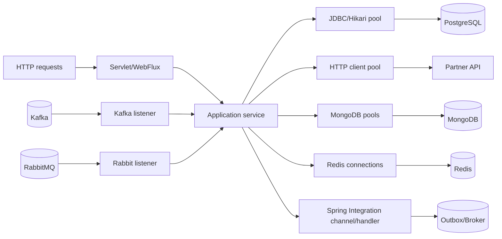
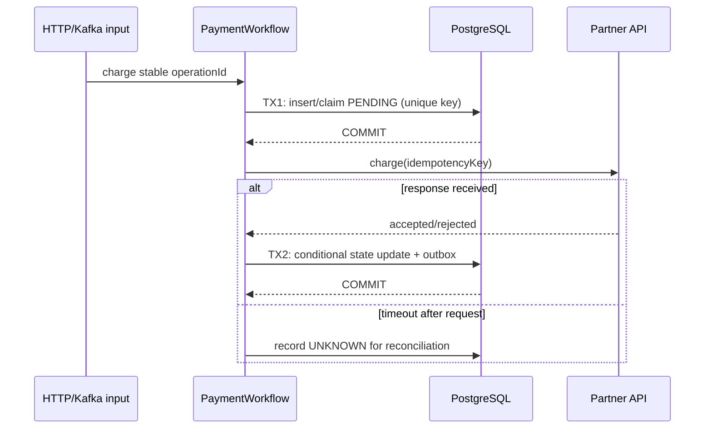
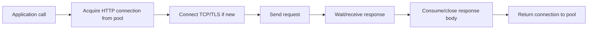
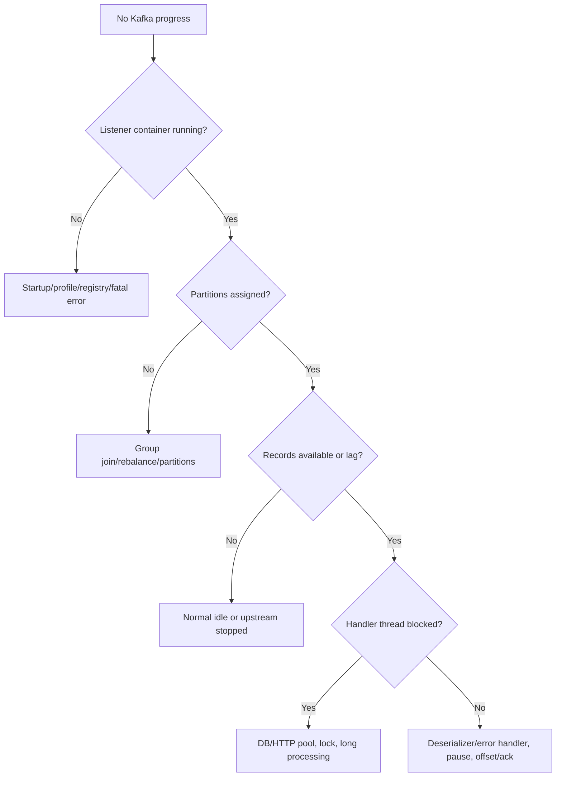
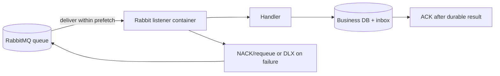
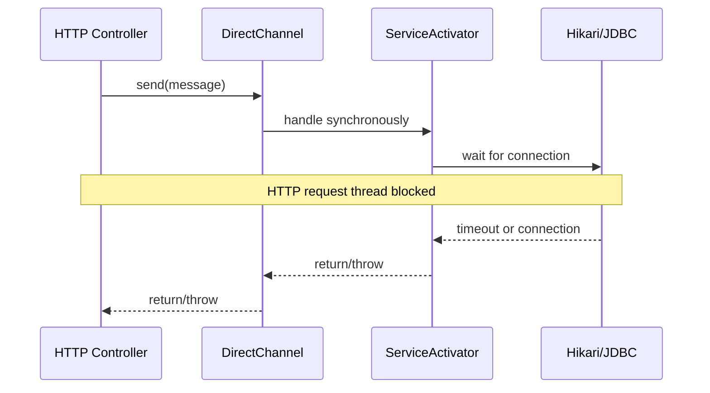
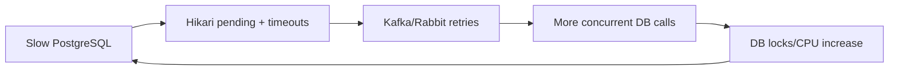
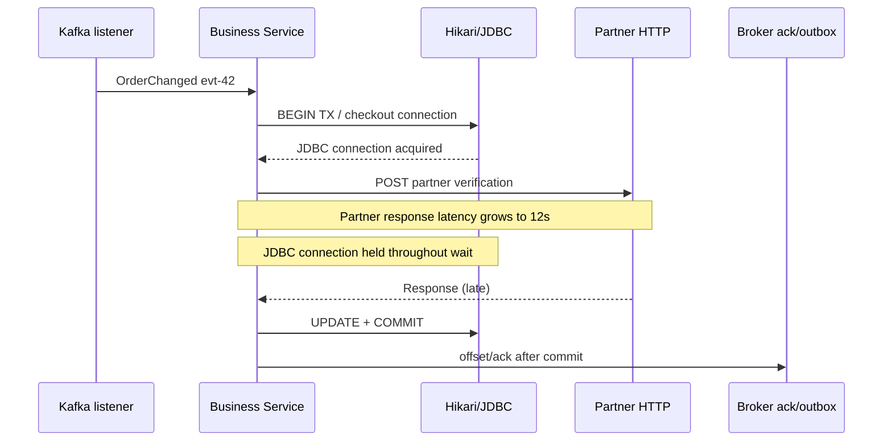
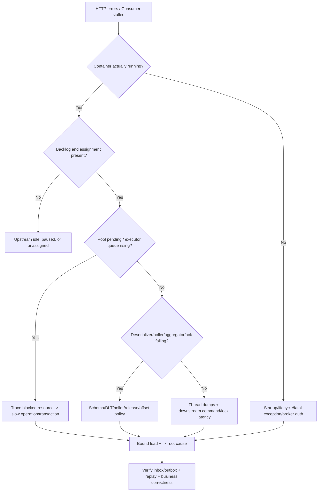
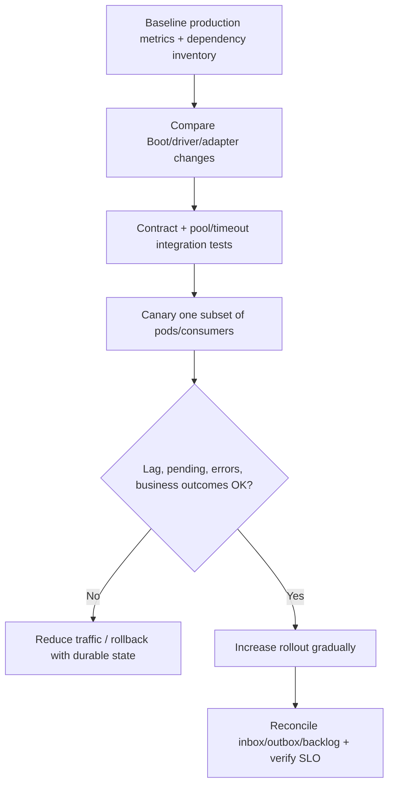

# Pool Exhaustion, Stalled Listeners, and Blocked Flows

A **SPRING_BOOT_INTEGRATION** application can return HTTP 503s, build Kafka consumer lag, pile up RabbitMQ queues, or emit zero output from a Spring Integration flow even while the JVM stays alive and health checks report `UP`. Three common symptoms are **pool exhaustion**, **listeners no longer receiving or processing messages**, and **flows blocked at a synchronous or asynchronous step**. They often form a causal chain: slow SQL holds connections too long → HTTP workers block waiting on HikariCP → Kafka listeners stall → partition ownership is lost on rebalance → messages redeliver → retries drive database load even higher.

This lesson belongs to the **Troubleshooting and Upgrades** chapter and presents an analytical method **from ingress to business impact** across Spring Boot HTTP clients, JDBC/JPA, Redis/MongoDB, Kafka/RabbitMQ, and Spring Integration. Rather than solving every outage by raising `maximumPoolSize`, `concurrency`, or `timeout`, we measure **queues, active/in-use counts, wait times, service times, timeouts, ACKs, and transaction boundaries** before tuning anything. Examples use **Java 17+, Spring Boot 3.x, Spring Framework 6.x**, and BOM-matched adapters; exact property names and APIs depend on versions, so verify with integration tests before production.

## 1. Learning Objectives

After this lesson, you will be able to:

1. Distinguish **pool exhaustion**, **thread starvation**, **stopped consumers**, **alive-but-stalled consumers**, **backpressure**, and **deadlocks** using evidence instead of guessing from one exception.
2. Identify which pool is exhausted: Hikari JDBC, HTTP clients, MongoDB, Redis/Jedis, or application executors—never confusing a **Kafka consumer group** with a JDBC connection pool.
3. Interpret `active`, `idle`, `pending`, `max`, `in-flight`, `queue depth`, `lag`, and checkout times to locate the true bottleneck.
4. Diagnose Kafka listeners stalled by deserializers/error handlers, rebalances, `max.poll.interval.ms`, lifecycle state, or network issues—and distinguish them from an idle empty partition.
5. Diagnose RabbitMQ consumers that stop receiving or fail to ACK, channel shutdowns, `prefetch`, poison-message requeue loops, and DLQs.
6. Pinpoint where Spring Integration `DirectChannel`, `ExecutorChannel`, `QueueChannel`, pollers, message stores, or aggregators are blocked.
7. Remediate safely via query/index tuning, bounded concurrency, bounded queues, time budgets, circuit breakers, idempotency, and durable handoffs.
8. Design load/fault-injection tests, alerts, runbooks, and rollback plans that **neither lose messages nor duplicate side effects**.

## 2. First Diagnosis: Which State Is "Not Running"?

"The listener isn't running" masks several distinct states requiring different fixes.

| Observation | Question to Ask | Example Evidence |
| --- | --- | --- |
| **Never started** | Was the container/poller created and `start()` called? | Lifecycle state, bean conditions, active profiles, `autoStartup=false`. |
| **Intentionally stopped** | Did an operator pause/stop it or is shutdown running? | Audit trail, deployment rollout, registry state. |
| **Failed and stopped** | Which exception stopped the container/adapter? | Error handler / container events, broker auth/network errors. |
| **Running yet not polling/receiving** | Does it hold partition/queue assignments, credit/prefetch, or pending tasks? | Kafka assigned partitions, Rabbit consumers/unacked, thread dumps. |
| **Received yet blocked before side effect** | Is the thread waiting on a connection, lock, HTTP response, or `Future`? | Thread states, Hikari pending, Mongo checkout, HTTP pending acquires. |
| **Processed yet not ACKed/committed** | Where are DB commit, broker ACK, transaction, and async completion? | Inbox/outbox, Kafka offsets, Rabbit unacked, retry logs. |
| **No messages arriving** | Is there actually a record or queue backlog? | Kafka end offset vs. committed offset; Rabbit ready/unacked. |
| **Flow stalled downstream of listener** | Which condition is the handler, transformer, router, or aggregator waiting on? | Spring Integration message history, channel metrics, group store. |

**Do not restart immediately before capturing diagnostics.** Restarting discards thread dumps, queue states, and counters, and can trigger Kafka/Rabbit redelivery of committed-yet-unacked work. If an urgent restart is required by SLA, capture a snapshot of metrics and logs first and reconcile by business key.

### 2.1. "Running Without Output Yet" Is Not "Stopped"

Suppose a Kafka listener receives an event and calls a partner HTTP API taking 40 seconds. Meanwhile logs show `Received event`, the thread blocks on socket read, and no `Completed` log appears. The listener container has not stopped; the partition stalls because its worker thread is occupied. If `max.poll.interval.ms` expires, the consumer triggers a rebalance and another node reprocesses the message. Always separate container **liveness**, message **progress**, and **committed business outcomes**.

### 2.2. Typical Bottleneck Topology



In this topology, **one slow dependency can pin multiple resource pools simultaneously**. Opening a JDBC `@Transactional` and calling a slow partner HTTP API inside it holds **both a JDBC connection and an HTTP connection** at once. Under concurrency, both pools exhaust and cascade waits upstream.

## 3. Resource Model: Pool, Queue, Worker, and Deadline

Every tier follows a common shape:

```text
incoming requests/messages
       |
       v
bounded/unbounded work queue
       |
       v
workers / reactor callbacks
       |
       v
connection checkout -> remote operation
       |
       v
release connection -> commit/ack/result
```

| Component | Limiting Unit | Queued Unit |
| --- | --- | --- |
| HikariCP | JDBC connections | Threads waiting on `getConnection()` up to `connectionTimeout`. |
| Apache HttpClient pooled manager | HTTP connections per route and total | Threads waiting for pool lease / connection request timeout. |
| Reactor Netty `ConnectionProvider` | Channels/connections and pending acquisitions | Subscribers awaiting pending acquire before getting a connection. |
| MongoDB Java driver | Connections per **server / pool / `MongoClient`** | Operations awaiting checkout; separate server-selection phase. |
| Redis Lettuce | Depends on sync/async/pooled connection model | Not every command requires a dedicated pooled socket by default. |
| Kafka listener | Consumer instances / partitions / processing threads | Consumer lag and record handling; Kafka does not use a JDBC pool. |
| Rabbit listener | Consumers, channels, prefetch/unacked | Broker delivers per credit and consumer ACKs. |
| Spring `ThreadPoolTaskExecutor` | Threads and task queue | Tasks awaiting a thread; large queues mask overload. |
| Spring Integration channel | Depends on `Direct`/`Executor`/`Queue`/`PublishSubscribe` | Senders block or messages wait for pollers/consumers. |

### 3.1. Using Little's Law for an Initial Hypothesis

\[
L \approx \lambda W
\]

In steady state, `L` is the average number of concurrent units in flight, `λ` is throughput per second, and `W` is the average resource hold time in seconds. For example, **one pod** executes 200 SQL operations/second with each operation holding a JDBC connection for 50 ms on average:

```text
L = 200 × 0.050 = 10 active connections on average
```

If query latency rises to 500 ms at the same rate, average demand jumps to **100 connections** even with flat traffic. `maximumPoolSize=20` will immediately spike pending checkouts. This is a preliminary back-of-the-envelope model, **not final pool sizing**: p99 tails, bursts, multi-statement transactions, replica counts, and DB server limits all matter.

### 3.2. An Unbounded Queue Creates Zero Extra Throughput

Wide queues absorb brief bursts; when arrival rate exceeds processing rate continuously, queues grow without bound. When a `ThreadPoolTaskExecutor` uses a huge `queueCapacity`, thread count stays capped while pending tasks pile up; the app looks alive while tail latency blows past SLA. Use **bounded admission**, timeouts, and backpressure-aware retries/durable queues instead of buffering infinitely in RAM.

### 3.3. Connection Count vs. Database Capacity

For example, 12 pods × Hikari max 40 = **up to 480 application JDBC connections** for that pool alone, excluding admin connections and other apps. The database may not serve 480 parallel queries efficiently. Before raising pool size, inspect **CPU, I/O, lock waits, query plans, and actual DB connection limits**; a connection is a transport pipe, not a capacity guarantee.

## 4. HikariCP Pool Exhaustion: Symptoms and Spring Boot Configuration

A familiar exception:

```text
java.sql.SQLTransientConnectionException:
HikariPool-1 - Connection is not available,
request timed out after 30000ms
```

This usually means **a thread could not check out a JDBC connection before the timeout**. It does not prove the database crashed; connections may be pinned by slow queries, long transactions, unclosed streams, or a traffic burst.

### 4.1. Relevant Properties

```yaml
spring:
  datasource:
    url: ${APP_JDBC_URL:jdbc:postgresql://localhost:5432/integration}
    username: ${APP_DB_USER}
    password: ${APP_DB_PASSWORD}
    hikari:
      pool-name: business-postgres
      maximum-pool-size: 20
      minimum-idle: 4
      connection-timeout: 1500
      validation-timeout: 500
      idle-timeout: 600000
      max-lifetime: 1800000
      leak-detection-threshold: 0
```

These Hikari timeout properties use **milliseconds** when bound to Hikari setters through Boot in this example; verify configuration metadata for your Boot version. `leak-detection-threshold=0` **disables leak detection**, avoiding noisy stack traces during normal operation. Enable it temporarily with a sensible threshold during incidents, while remembering not every reported stack trace is a true leak: legitimate long transactions also trigger it.

| Property | Role | What It Is Not |
| --- | --- | --- |
| `maximum-pool-size` | Max JDBC connections for one `HikariDataSource` | Total connection limit across the Kubernetes deployment. |
| `minimum-idle` | Target number of idle connections maintained | Guarantee that that many connections always exist in every state. |
| `connection-timeout` | Max wait to borrow a connection | JDBC statement execution timeout. |
| `validation-timeout` | Connection health check timeout | HTTP timeout or query SLA. |
| `idle-timeout` | Evicts idle connections per policy | Never terminates an active transaction. |
| `max-lifetime` | Max connection lifetime before retirement | Request or transaction deadline. |
| `leak-detection-threshold` | Logs stack traces for long-held connections | Never forcibly releases a held connection. |

### 4.2. Interpreting `active / idle / pending / total`

Example snapshot:

```text
hikaricp_connections_active{pool="business-postgres"}=20
hikaricp_connections_idle{pool="business-postgres"}=0
hikaricp_connections_pending{pool="business-postgres"}=37
hikaricp_connections_max{pool="business-postgres"}=20
```

**`active == max` + `idle == 0` + rising `pending`** signals pool saturation. Investigate **why connections are held**: capture thread dumps during the incident, inspect DB active queries and locks, measure transaction durations, check slow SQL, and check external calls made *inside* transactions. Conversely, if `active` is low while checkouts still fail, check pool initialization, connection validation, DB reachability, suspended/closed pools, or whether metrics come from a different instance.

### 4.3. Distinguishing Exhaustion from Connection Leaks

A `connection leak` occurs when a borrowed connection is never returned according to lifecycle rules. Common causes:

- Manual `DataSource.getConnection()` without `close()` in `finally` or `try-with-resources`.
- Unclosed JDBC `ResultSet`/`Statement` or long-lived streams pinning the underlying connection.
- Open transactions blocked indefinitely waiting on external HTTP calls or `Future`s.
- Streaming HTTP responses tied to open SQL cursors.

With Spring `JdbcTemplate`/Spring Data JPA and proper `@Transactional` usage, Spring manages resource acquisition and release; **never assume every saturated pool is a leak**. A pool of 20 fills up legitimately if 20 concurrent queries each take 10 seconds.

## 5. JDBC Pool Exhausted: Fix Long Transactions Before Increasing the Pool

Suppose an application service writes to PostgreSQL and calls a partner REST API:

```java
import org.springframework.stereotype.Service;
import org.springframework.transaction.annotation.Transactional;

@Service
public class PaymentServiceBad {
    private final PaymentRepository repository;
    private final PartnerPaymentClient partner;

    public PaymentServiceBad(
            PaymentRepository repository,
            PartnerPaymentClient partner) {
        this.repository = repository;
        this.partner = partner;
    }

    @Transactional
    public void charge(PaymentCommand command) {
        repository.insertPending(command);
        // Anti-pattern: network I/O inside an open transaction.
        partner.charge(command); // may stall for seconds
        repository.markAccepted(command.operationId());
    }
}
```

`PaymentRepository`, `PartnerPaymentClient`, and `PaymentCommand` are illustrative app types, not Spring classes. Because the Spring transaction holds a JDBC connection while `partner.charge` stalls, just 20 concurrent requests exhaust `maximumPoolSize=20`. Whenever the partner hangs, the Hikari pool saturates even though PostgreSQL **has zero errors of its own**.

### 5.1. Redesign Using Operation State and Short Transactions



Principles:

1. Claim the operation ID durably in the database using a **unique constraint** on `(partner, operationId)`.
2. **Commit Transaction 1** before invoking the partner HTTP API.
3. Reuse the same partner idempotency key across retries; never mint a new key for the same operation.
4. Persist `ACCEPTED`/`REJECTED`/`UNKNOWN` via **short transactions** and conditional state transitions.
5. Insert transactional outbox rows when Kafka/Rabbit events are needed; a separate worker publishes them.
6. If a crash happens after partner commit yet before local state update, reconciliation queries remote status instead of charging again.

With Spring `@Transactional`, beware **self-invocation** bypassing the AOP proxy: calling `this.beginTransaction()` inside the same object skips transactional advice. Separate transactional writers into distinct Spring beans, or use `TransactionTemplate` with an explicit manager. When multiple transaction managers exist (Mongo, JPA, R2DBC), qualify them explicitly so Spring never picks the wrong one.

### 5.2. Never Hold JDBC Connections Across Open Streams

When using raw JDBC:

```java
import java.sql.Connection;
import java.sql.PreparedStatement;
import java.sql.ResultSet;
import javax.sql.DataSource;

public final class SafeJdbcReader {
    private final DataSource source;

    public SafeJdbcReader(DataSource source) {
        this.source = source;
    }

    public long countUnsent() throws Exception {
        try (Connection conn = source.getConnection();
             PreparedStatement ps = conn.prepareStatement("""
                     SELECT COUNT(*)
                     FROM integration_outbox
                     WHERE state = 'PENDING'
                     """);
             ResultSet rs = ps.executeQuery()) {
            rs.next();
            return rs.getLong(1);
        }
    }
}
```

This is a minimal read example, not an outbox polling design; production needs indexes and transactional claim/dispatch. `try-with-resources` returns the connection via `close()` to Hikari. `JdbcTemplate` normally closes resources cleanly, whereas long `Stream<T>`/cursors (JPA/JDBC) must be closed explicitly per API and never streamed across HTTP responses without deadlines.

### 5.3. Server-Side Clues: Active Queries, Locks, Connection Counts

With PostgreSQL and authorized DBA diagnostics:

```sql
SELECT pid, state, wait_event_type, wait_event,
       clock_timestamp() - query_start AS running_for,
       left(query, 200) AS query_preview
FROM pg_stat_activity
WHERE datname = current_database()
ORDER BY running_for DESC NULLS LAST;
```

This is a **diagnostic read query**; restrict access and output exposure because SQL text may contain sensitive data. Prolonged `state = 'idle in transaction'` signals transaction-ownership bugs; lock waits pin connections even when DB CPU looks idle. Never kill backends randomly with `pg_terminate_backend` just to "free the pool," as it rolls back live business work; follow incident runbooks and verify side effects if intervention is mandatory.

### 5.4. When Is Raising `maximum-pool-size` Justified?

Only after observing that:

- Checkout waits/pending are high, **command durations stay flat**, and the DB server still has CPU, I/O, and connection headroom.
- The pool covers known peak concurrency without exceeding DB connection limits during autoscaling.
- Upstream concurrency and queues are bounded so traffic storms cannot multiply unboundedly.
- Load tests prove a larger pool improves **throughput and p95/p99** without worsening lock contention or DB latency.

If the database is already at 100% CPU or lock-contended, raising the pool merely **shifts the queue from the app into the DB**. The real fix is indexes, query plans, shorter transactions, DB scaling, or admission control.

## 6. HTTP Client Pool: Exhausted Connections or Slow Partner?

Spring Boot supports multiple HTTP client stacks: `RestClient`/`RestTemplate` backed by a request factory (JDK, Apache HttpClient 5, Reactor Netty depending on setup), or `WebClient` backed by Reactor Netty or another connector. **There is no single shared HTTP pool** across all clients. Inspect the **actual client implementation** in the `ApplicationContext` and trace which pool each endpoint uses.

### 6.1. Pool Lease vs. Connect vs. Response Timeout



| Timeout / Limit | Scope | Common Misconfiguration |
| --- | --- | --- |
| Connection lease / request timeout | Waiting to borrow a connection from pool | Confused with TCP connect timeout. |
| Connect timeout | Establishing TCP socket | Does not cap how long partner takes to respond. |
| TLS handshake timeout | TLS negotiation (transport/provider-dependent) | Does not replace certificate verification. |
| Response / read timeout | Waiting on response or network I/O per client semantics | Not an end-to-end deadline across workflows/retries. |
| Pool max total / per route | Socket limits total and per target host | Directs all traffic to one host constrained well below pool max. |
| Idle / TTL / eviction | Reusing or retiring idle sockets | Does not abort an active business call. |

### 6.2. Apache HttpClient 5 with Spring `RestClient`

An **explicit** configuration for synchronous HTTP:

```java
import org.apache.hc.client5.http.config.RequestConfig;
import org.apache.hc.client5.http.impl.classic.CloseableHttpClient;
import org.apache.hc.client5.http.impl.classic.HttpClients;
import org.apache.hc.client5.http.impl.io.PoolingHttpClientConnectionManager;
import org.apache.hc.core5.util.Timeout;
import org.springframework.context.annotation.Bean;
import org.springframework.context.annotation.Configuration;
import org.springframework.http.client.HttpComponentsClientHttpRequestFactory;
import org.springframework.web.client.RestClient;

@Configuration(proxyBeanMethods = false)
public class PartnerHttpClientConfiguration {
    @Bean(destroyMethod = "close")
    CloseableHttpClient partnerApacheClient() {
        var manager = new PoolingHttpClientConnectionManager();
        manager.setMaxTotal(40);
        manager.setDefaultMaxPerRoute(15);

        RequestConfig config = RequestConfig.custom()
                .setConnectionRequestTimeout(Timeout.ofMilliseconds(300))
                .setResponseTimeout(Timeout.ofSeconds(3))
                .build();

        return HttpClients.custom()
                .setConnectionManager(manager)
                .setDefaultRequestConfig(config)
                .build();
    }

    @Bean
    RestClient partnerRestClient(CloseableHttpClient partnerApacheClient) {
        var factory =
                new HttpComponentsClientHttpRequestFactory(
                        partnerApacheClient);
        factory.setConnectTimeout(2_000); // milliseconds
        return RestClient.builder()
                .requestFactory(factory)
                .baseUrl("https://partner.example.invalid")
                .build();
    }
}
```

This illustrates Apache HttpClient 5 + Spring 6.x; **do not call `example.invalid`**. Verify `HttpComponentsClientHttpRequestFactory` and Apache HttpClient overloads and timeout ownership in your actual Spring Framework/BOM version, as some `Timeout`/`TimeValue` methods shifted across releases. If clients use custom proxies or TLS, confirm live connection managers/sockets and lifecycle. Never assume `RestClient` uses the Apache pool simply because the jar is on the classpath.

**Important:** `maxTotal=40` with `defaultMaxPerRoute=15` caps **a single partner host/route** at 15 connections even while 25 pool slots remain idle for other routes. If one partner slows down, per-route leases queue up fast.

### 6.3. Response Bodies and Connection Release

When using HTTP clients properly, reading and closing the response body returns the socket to the pool. If streaming code leaves an `InputStream`/response unclosed, the pool lease stays pinned:

```java
// Responsibility flow for streaming HTTP APIs:
// acquire response
// try-with-resources / consume body with bounded size and deadline
// close response and stream
// connection becomes reusable under client policy
```

Do not buffer multi-GB bodies in RAM just to free sockets quickly: use **bounded streaming/chunking**, backpressure/timeouts, and `try-with-resources` across exception paths. An HTTP adapter that skips closing response bodies can mimic "pool exhaustion" even when the partner replies 200 in milliseconds.

### 6.4. Reactor Netty `ConnectionProvider` for `WebClient`

`WebClient` with Reactor Netty can configure:

```java
import java.time.Duration;
import reactor.netty.http.client.HttpClient;
import reactor.netty.resources.ConnectionProvider;
import org.springframework.context.annotation.Bean;
import org.springframework.context.annotation.Configuration;
import org.springframework.http.client.reactive.ReactorClientHttpConnector;
import org.springframework.web.reactive.function.client.WebClient;

@Configuration(proxyBeanMethods = false)
public class ReactivePartnerClientConfiguration {
    @Bean(destroyMethod = "dispose")
    ConnectionProvider partnerConnectionProvider() {
        return ConnectionProvider.builder("partner-api")
                .maxConnections(40)
                .pendingAcquireMaxCount(80)
                .pendingAcquireTimeout(Duration.ofMillis(350))
                .build();
    }

    @Bean
    WebClient partnerWebClient(ConnectionProvider pool) {
        HttpClient httpClient = HttpClient.create(pool)
                .responseTimeout(Duration.ofSeconds(3));
        return WebClient.builder()
                .baseUrl("https://partner.example.invalid")
                .clientConnector(
                        new ReactorClientHttpConnector(httpClient))
                .build();
    }
}
```

These APIs illustrate Reactor Netty in Spring Boot 3.x; naming the pool `partner-api` aids observability. `pendingAcquireMaxCount` caps **pending connection acquisitions**, not Reactor worker threads; add TCP connect timeout and TLS per transport version as needed. With multiple `WebClient` beans, verify whether they share or isolate `ConnectionProvider`s to avoid silently multiplying pools.

Calling `WebClient.builder()` without creating a dedicated `HttpClient.create(...)` typically shares framework-managed Reactor Netty resources. **Never count "one `WebClient` object = one isolated pool"** without inspecting the connector.

### 6.5. Distinguish HTTP Pool Errors from Unknown Commit Outcomes

`PendingAcquireTimeoutException` or Apache connection-request timeouts usually mean **the request never obtained a socket to send**. Conversely, a **read timeout after sending an HTTP POST** can happen after the partner **already committed**. Retry rules:

- Pool lease failure before send: bounded retry allowed if deadline budget remains.
- Clear TCP connect failure before request body: evaluate retry per operation/transport safety.
- Response/read timeout after send: **UNKNOWN outcome**—use idempotency keys or status queries.
- HTTP 429/503: retry per `Retry-After`/backoff if safe.
- HTTP 400/contract reject: permanent; never retry verbatim.

**Raising HTTP pool limits cannot fix partner SLA violations** when the partner is slow or rate-limiting. Larger pools just push more concurrent requests onto a struggling downstream and drag Hikari down with it.

## 7. MongoDB, Redis, and Pools Easy to Misdiagnose

HikariCP is a JDBC pool; other datastores use distinct pooling models. A dashboard showing `hikaricp.connections.active=5` says nothing about **MongoDB connection checkout** or **Redis clients**.

### 7.1. MongoDB Java Driver: Pool Per Server

One `MongoClient` maintains **a separate connection pool per server** in a replica set or sharded cluster. `maxPoolSize=40` typically means **up to 40 connections per server pool**, not 40 across the whole MongoDB cluster or deployment.

```text
pod A: MongoClient -> primary pool maxSize 40
pod B: MongoClient -> primary pool maxSize 40
pod C: MongoClient -> primary pool maxSize 40

Primary can receive up to ~120 pooled application
connections from three pods, plus monitoring/other clients.
```

Timeouts to separate:

| MongoDB Setting | When Relevant |
| --- | --- |
| `serverSelectionTimeoutMS` | No server matches read preference / primary unavailable. |
| `waitQueueTimeoutMS` | Waiting too long for MongoDB connection checkout. |
| `connectTimeoutMS` | TCP socket connection timeout. |
| `socketTimeoutMS` | Socket I/O wait (semantics vary by sync driver). |
| `maxTimeMS` on query | MongoDB server-side execution cap exceeded. |
| Client-side operation timeout | Overall operation deadline when supported by driver/version. |

**Never assume `MongoTimeoutException` means pool exhaustion.** Primary elections trigger server-selection timeouts even when pools have plenty of idle sockets. Use MongoDB driver `ConnectionPoolListener`, command monitoring, and topology state to confirm.

### 7.2. Redis Lettuce vs. Jedis Use Different Pooling Models

Spring Data Redis supports Lettuce or Jedis depending on starters, versions, and config. **Lettuce** multiplexes many operations over shared non-blocking native connections, so do not apply a mental model of "every `GET` checks out a dedicated socket." Redis **transactions, blocking commands, pub/sub, or dedicated connections** may behave differently depending on framework/client setup.

With **Jedis** or explicit Lettuce pooling, borrowed/idle/wait metrics matter—verify classpath, `RedisConnectionFactory`, and active pool configuration:

```yaml
# Illustrative only when pooling is intentionally enabled:
spring:
  data:
    redis:
      host: localhost
      port: 6379
      timeout: 2s
      connect-timeout: 1s
      lettuce:
        pool:
          enabled: true
          max-active: 20
          max-idle: 10
          min-idle: 2
          max-wait: 300ms
```

In Boot 3.x, `spring.data.redis.lettuce.pool.enabled` and pool settings are conditional on dependencies (often requiring Commons Pool 2); verify metadata, version, and live beans. Enabling Lettuce pooling **does not automatically increase throughput**: if Redis is CPU-bound, network latency is high, or `BLPOP` pins sockets, fix command patterns and concurrency.

### 7.3. Blocking Redis Commands and Spring Integration

An adapter polling a Redis List via blocking pop with a long timeout intentionally keeps a thread waiting in Redis; that is **expected consumer behavior**, not a leak. However, sharing a tiny pool between blocking consumers and cache operations starves cache `GET`/`SET` calls. Separate connection strategies or cap blocking consumers below Redis capacity.

Redis Pub/Sub **is not a durable queue**. If listeners disconnect, messages published during downtime are lost per Pub/Sub semantics; raising `max-active` cannot recover them. When durability and replay are required, use Redis Streams, Kafka/RabbitMQ, or database outbox/inbox with explicit ACKs/checkpoints.

### 7.4. Cross-Pool Exhaustion

Suppose a Kafka listener holds an open JDBC transaction while calling multiple dependencies:

```text
1. Checkout Hikari JDBC connection
2. HTTP GET partner (waits for Apache HTTP pool)
3. Write MongoDB projection (waits for Mongo pool)
4. Update Redis cache (waits on Redis blocking command)
5. JDBC COMMIT
6. Kafka offset commit
```

If steps 2, 3, or 4 stall, the JDBC connection stays pinned while waiting on **another pool**. Pending queues chain together; enlarging Hikari alone sends even more concurrent load into HTTP and Mongo, worsening the collapse. Fix via **short transactions, durable workflows, bounded external concurrency**, and layered timeouts.

## 8. Kafka Listener "Stopped": Stopped, Rebalancing, Paused, or Blocked?

With `@KafkaListener`, brokers hold records in partitions; consumers must be assigned partitions, poll records, process them, and commit offsets. **A running listener container does not guarantee forward progress.** Conversely, quiet logs on an empty topic do not indicate failure.

### 8.1. Ordered State Inspection

1. **Do the bean and container exist?** `@EnableKafka`/Boot auto-config, component scanning, `@KafkaListener` ID, container factory, profiles.
2. **Is it started?** `autoStartup`, `KafkaListenerEndpointRegistry`, operator pause, app shutdown.
3. **Are broker connection and authorization healthy?** Bootstrap DNS/TLS/SASL/ACL, topic metadata, group membership.
4. **Are partitions assigned?** Which node owns which partitions? If `concurrency` exceeds partition count, excess consumers sit idle normally.
5. **Are records or lag present?** End offsets, committed offsets, and consumer lag—not just app logs.
6. **Are polling and processing advancing?** Poll history, handler durations, `max.poll.interval.ms`, thread dumps, downstream pool waits.
7. **Are offsets committing?** Ack mode/transactions, errors, retry/DLT, listener container lifecycle.



### 8.2. `max.poll.interval.ms` vs. `session.timeout.ms`

Kafka's `max.poll.interval.ms` caps **how long a consumer can go between `poll()` calls**, detecting stalled processing. If a listener blocks too long before polling again, the group triggers a rebalance and revokes partitions; logs show max poll interval exceeded, partitions revoked, or commit failed. `session.timeout.ms` governs group-membership heartbeats, not individual SQL execution timeouts.

| Property | General Meaning | Risk When Misconfigured |
| --- | --- | --- |
| `max.poll.records` | Max records returned per `poll()` | Large batch × per-record latency exceeds poll interval. |
| `max.poll.interval.ms` | Max gap allowed between `poll()` calls | Setting too high delays detecting stuck consumers. |
| `session.timeout.ms` | Heartbeat-based membership timeout per protocol | Does not directly cure slow downstream JDBC/HTTP. |
| `heartbeat.interval.ms` | Heartbeat cadence in classic group protocol; semantics depend on client/protocol | Arbitrary tuning triggers rebalances without raising throughput. |
| Listener concurrency | Consumer instances/threads in app | Does not add Kafka partitions; multiplies DB/HTTP pressure. |
| `AckMode` | When offsets are ACKed/committed | Acking before durable processing loses work. |

**Never reduce Kafka polling semantics to a naive formula `max.poll.records × p99`**: Spring Kafka applies pausing, error-handler retries/backoffs, and version-specific container behavior. Still, it is a useful **risk estimate**: 500 records × 300 ms sequentially already takes 150 seconds before jitter, retries, and commits.

### 8.3. Bounded Starting Configuration for Investigation

```yaml
spring:
  kafka:
    bootstrap-servers: ${KAFKA_BOOTSTRAP_SERVERS:localhost:9092}
    consumer:
      group-id: order-projection-v1
      auto-offset-reset: earliest
      enable-auto-commit: false
      max-poll-records: 100
      properties:
        max.poll.interval.ms: 300000
    listener:
      concurrency: 3
      ack-mode: record
```

This is a **reference starting point**, not a recipe for exactly-once. `ack-mode: record` commits per-record per container behavior; when using async handlers/acks, DB transactions, or Kafka transactions, pick the matching mode and **test offset commits across crashes**. `auto-offset-reset: earliest` applies only when no valid committed offset exists; it will not "replay everything" for an existing group.

**Severe logic bug example:**

```java
@KafkaListener(topics = "orders.inbound")
public void receiveBad(OrderEvent event) {
    processAsync(event).subscribe(); // returns BEFORE completion
}
```

In many container configurations, returning from the listener signals success and advances offset commits while the reactive pipeline has barely started. If the process crashes before async completion, messages are lost per policy. Use async return/ack mechanisms **supported by your Spring Kafka version** or a durable handoff, and test end-to-end semantics. Never call `subscribe()` inside a listener to "unblock the thread."

### 8.4. Deserializers Failing Before the Listener

Corrupt JSON/Avro/Protobuf bytes fail **before `@KafkaListener` executes**. A `try/catch` inside the listener never catches them:

```java
try {
    handle(event);
} catch (Exception ex) {
    // never reached for a failure in the Kafka value deserializer
}
```

Spring Kafka offers `ErrorHandlingDeserializer` to route delegate deserializer errors into the container's error-handler path. Pair `DefaultErrorHandler`/`DeadLetterPublishingRecoverer` per version to apply bounded retries for **transient** errors and forward **poison records** to a DLT/quarantine using a raw-byte serializer. Permanent schema errors must never retry in a tight loop that blocks the partition.

**DLT does not guarantee durability if DLT publishing fails yet the source offset still commits.** Test DLT producer failures, callback/ack policies, and sanitized headers (keeping raw PII out of metrics/logs).

### 8.5. Inspecting Containers via `KafkaListenerEndpointRegistry`

```java
import org.springframework.kafka.config.KafkaListenerEndpointRegistry;
import org.springframework.stereotype.Component;

@Component
public final class KafkaListenerStateInspector {
    private final KafkaListenerEndpointRegistry registry;

    public KafkaListenerStateInspector(
            KafkaListenerEndpointRegistry registry) {
        this.registry = registry;
    }

    public String describe(String listenerId) {
        var container = registry.getListenerContainer(listenerId);
        if (container == null) {
            return "NOT_REGISTERED";
        }
        return "running=" + container.isRunning()
                + ", pauseRequested=" + container.isPauseRequested()
                + ", paused=" + container.isContainerPaused();
    }
}
```

This is an **internal diagnostic helper**, not a public HTTP control API allowing arbitrary callers to pass listener IDs. `isPauseRequested()` differs from `isContainerPaused()` because pausing takes effect at poll boundaries; verify exact APIs against your Spring Kafka BOM. Running/paused flags **do not** prove handler progress or partition assignment; combine them with consumer lag, thread dumps, and container event telemetry.

### 8.6. When Should You Restart Consumers?

Restarting helps after fixing credentials, certificates, configs, or fatal container states, provided you:

- Record group partitions, committed offsets, and in-flight business operations before restarting.
- Verify DB inbox/outbox/unique keys safely handle redeliveries.
- Never reset offsets just to "clear lag" when messages were not processed.
- Recognize that DB pool exhaustion will immediately recur on restart unless concurrency or slow queries are fixed.
- Recognize that poison records require fixing decoders, error handlers, or DLTs—restarting won't skip them safely.

## 9. RabbitMQ Listener: Stopped, Unacked, Prefetch, and Requeue Storms

RabbitMQ exposes different signals than Kafka: **queue ready** (awaiting delivery), **messages unacknowledged** (delivered, awaiting ACK), and **consumer count**. A queue with `ready=0` and `unacked=500` does not mean work is finished: consumers may be holding 500 messages while blocked on JDBC or HTTP.

### 9.1. Credit / Prefetch Diagram



In manual/container-managed ack mode, each consumer holds at most **prefetch** unacked deliveries per RabbitMQ/client rules. Four consumers × prefetch 25 allows **up to ~100 unacked deliveries** simultaneously under matching setup. If handlers stall on Hikari, the broker stops delivering new messages because prefetch is saturated; from the outside it looks like "listener stopped," when in reality it **prefetched too much work**.

### 9.2. Container Configuration Controlling Concurrency and Prefetch

```yaml
spring:
  rabbitmq:
    host: ${RABBIT_HOST:localhost}
    port: 5672
    listener:
      simple:
        concurrency: 2
        max-concurrency: 4
        prefetch: 10
        acknowledge-mode: auto
        default-requeue-rejected: false
```

This configures `SimpleRabbitListenerContainerFactory` in standard Spring Boot/Spring AMQP setups. When using `DirectRabbitListenerContainerFactory`, property prefixes differ (`spring.rabbitmq.listener.direct.*`) and concurrency semantics change. Here `acknowledge-mode: auto` **does not mean RabbitMQ protocol auto-ack**: the Spring listener container decides ACK/NACK from method completion/exceptions, unlike `AcknowledgeMode.NONE`. Confirm your active container factory type.

**Never equate `default-requeue-rejected=false` with "DLT works automatically"**: you must configure dead-letter exchanges/routing on the queue per broker policy and verify dead-lettering in integration tests. Without a valid DLX route, rejected messages can be silently dropped.

### 9.3. A `@RabbitListener` That Never Blocks Yet Loses Data

```java
@RabbitListener(queues = "order.requests")
public void receiveBad(OrderEvent value) {
    CompletableFuture.runAsync(() -> saveToDatabase(value));
    // Method returns before DB commit.
}
```

Under `AUTO` ack mode, returning early causes the container to ACK the message **before the DB write completes** unless your Spring AMQP version's async listener return support is properly configured. Use synchronous bounded execution, or a **durable handoff** to DB/broker before ACKing. When returning `CompletableFuture`/`Mono`, test exact container factory ACK behavior against your library version.

### 9.4. `consumerCount = 0` Does Not Mean the Queue Is Empty

Check systematically:

1. Did the listener container start (`autoStartup`, endpoint IDs, config)?
2. Do the queue, exchange, and binding exist in the right vhost with sufficient permissions?
3. Did TLS, auth, channel, or connection close due to broker policies or heartbeats?
4. Did `consumerCount` recover after reconnect; what do container recovery logs show?
5. Is `MessageConverter` throwing `MessageConversionException` before entering the listener?
6. Are prefetch slots/handler threads blocked on downstream pools or locks?
7. Are requeues tight-looping on a poison message?
8. Is DLX/quarantine routing working with publish/consume permissions?

A channel closed by the broker with **`PRECONDITION_FAILED`** (queue declaration mismatch on durability or arguments) will never be cured by enlarging Hikari. Reconcile broker topology vs. app declarations through controlled migration rather than deleting queues containing live data.

### 9.5. Manual Ack and Confirmation Timing

Manual ACK provides explicit control once persistence succeeds, with strict rules:

```text
Receive deliveryTag=42
Validate payload and business key
BEGIN DB TX
  Claim unique inbox key
  Apply state transition
  Insert outbox if needed
COMMIT
basicAck(deliveryTag)   // only on the same channel/valid context
```

If crashing **after commit yet before ACK**, the broker redelivers; inbox/idempotency handles the replay safely. If DB fails **before commit**, NACK/requeue or route to a delayed retry queue for transient errors. For permanent contract failures, infinite requeue causes a **poison loop**; route to quarantine/DLX. If the channel closed, ACK fails: never assume invoking `basicAck` in Java guarantees broker confirmation across network failures.

### 9.6. Stopping / Restarting Listeners Safely

Spring AMQP exposes listener endpoint registries and container lifecycle APIs; production endpoints exposing control require **authentication and auditing** plus awareness of factory/container types. Stopping a Rabbit listener preserves messages in properly configured durable queues, while **in-flight unacked deliveries** are requeued. Never delete queues just to clear unacked counts, and never assume `consumerCount=0` guarantees all in-flight operations returned cleanly under network partitions.

## 10. Spring Integration Flows: Blocked at Channel, Poller, or Handler?

Spring Integration moves `Message<?>` through channels, handlers, and adapters. A flow can stall **before invoking a handler**, inside downstream I/O within a handler, or inside an aggregator/barrier waiting on correlation conditions.

### 10.1. Channel Types and Where They Wait

| Component | Execution | When Does It Look "Stuck"? |
| --- | --- | --- |
| `DirectChannel` | Invokes subscriber on **sender's thread** per dispatch semantics | Slow/blocked handler stalls HTTP/Kafka/Rabbit sender too. |
| `ExecutorChannel` | Dispatches via `TaskExecutor` | Full/large task queue, executor starvation/rejections; sender may return early. |
| `QueueChannel` | Buffers messages in RAM or `MessageStore` per config | Missing poller/consumer, full queue, or slow poller. |
| `PublishSubscribeChannel` | Broadcasts to subscribers via sync or async executor | One slow subscriber stalls sync senders or hides async exceptions. |
| Polling consumer / `SourcePollingChannelAdapter` | Polls via trigger/scheduler, `maxMessagesPerPoll` | Stopped poller, busy scheduler pool, slow handler holding thread. |
| `Aggregator` / `Resequencer` | Waits on correlation group/sequence/`releaseStrategy` | Missing fragment, missing `groupTimeout`, or `MessageStore`/lock failure. |
| `ServiceActivator` / `Transformer` | Executes business/mapping logic | Blocked on JDBC/HTTP, dropped output from exception/filter/router/async boundary. |
| `errorChannel` | Error routing channel in message flow | Receiving `ErrorMessage` does not imply durability or recovery. |

### 10.2. `DirectChannel` Can Pin the Caller's Thread and Connection



When an HTTP controller calls `send()` on a `DirectChannel`, the handler executes on the same call stack. If Hikari exhausts, the HTTP endpoint times out waiting on `send()`. Switching to `ExecutorChannel` frees the HTTP thread sooner, yet **is safe only after a durable handoff**. If the executor queue lives only in RAM while the controller returns `202 Accepted`, crashing loses messages the client believes were accepted.

### 10.3. `ExecutorChannel` and Thread Pool Starvation

```java
import org.springframework.context.annotation.Bean;
import org.springframework.context.annotation.Configuration;
import org.springframework.integration.channel.ExecutorChannel;
import org.springframework.messaging.MessageChannel;
import org.springframework.scheduling.concurrent.ThreadPoolTaskExecutor;

@Configuration(proxyBeanMethods = false)
public class IntegrationExecutorConfiguration {
    @Bean("integrationWorkers")
    ThreadPoolTaskExecutor integrationWorkers() {
        var executor = new ThreadPoolTaskExecutor();
        executor.setCorePoolSize(4);
        executor.setMaxPoolSize(8);
        executor.setQueueCapacity(50);
        executor.setThreadNamePrefix("integration-worker-");
        executor.initialize();
        return executor;
    }

    @Bean("integrationAsyncChannel")
    MessageChannel integrationAsyncChannel(
            ThreadPoolTaskExecutor integrationWorkers) {
        return new ExecutorChannel(integrationWorkers);
    }
}
```

This illustrates a **bounded executor** for one flow. With multiple `ThreadPoolTaskExecutor` beans, add `@Qualifier("integrationWorkers")` on the channel factory method parameter to avoid injecting the wrong executor. Verify exception handling and rejection policies: when the queue fills, senders face `TaskRejectedException` or configured rejection behavior. **Never make the queue unbounded** just to hide rejections—that trades instant backpressure for memory exhaustion and catastrophic latency.

### 10.4. Pollers Stalled Because Scheduler Threads Are Busy

A `SourcePollingChannelAdapter` with a 1-second fixedDelay will not poll every second if the **task scheduler** has only one thread and another poller is stuck on a 60-second HTTP read timeout. Pollers starve one another across the shared scheduler.

```java
import org.springframework.context.annotation.Bean;
import org.springframework.context.annotation.Configuration;
import org.springframework.scheduling.concurrent.ThreadPoolTaskScheduler;

@Configuration(proxyBeanMethods = false)
public class IntegrationPollerSchedulerConfiguration {
    @Bean("integrationTaskScheduler")
    ThreadPoolTaskScheduler integrationTaskScheduler() {
        var scheduler = new ThreadPoolTaskScheduler();
        scheduler.setPoolSize(4);
        scheduler.setThreadNamePrefix("integration-poller-");
        scheduler.initialize();
        return scheduler;
    }
}
```

**Note:** defining a `ThreadPoolTaskScheduler` bean does not automatically bind every poller/scheduled task to it; wire it explicitly via poller specs, qualifiers, or Spring Integration scheduler infrastructure. Multiple schedulers may coexist (`@Scheduled`, Quartz, Spring Integration pollers), so inspect thread dumps and bean names to see which pool is blocked. Adding threads will not unstick a poller deadlocked on a DB lock or waiting forever on an aggregator group.

### 10.5. Aggregators / Resequencers Waiting Intentionally

Suppose an aggregator waits for 10 fragments before emitting a batch. If fragment 10 was filtered upstream or sent to a DLT, the aggregator holds 9 fragments indefinitely. Inspect:

- Are `correlationKey` and `sequenceNumber`/`sequenceSize` valid?
- Do `releaseStrategy` and `groupTimeout` handle missing fragments?
- Is `MessageStore` **in-memory or JDBC/Redis**, and how are transactions/locks handled?
- Did a message in the group hit a DLT or replay channel unknown to the aggregator?
- Must partially collected groups survive process restarts?

Never expand the JDBC pool to "unblock" an aggregator **waiting on its release condition**. If `groupTimeout` emits partial batches, confirm business contracts permit partial results rather than silently shipping 90%-complete data as success.

### 10.6. `errorChannel` Is Not a Durable Retry Queue by Default

When an async handler throws, Spring Integration can route an `ErrorMessage` to `errorChannel`. If the channel is in-memory and the error handler only logs, messages are already lost once upstream ACKs. Always:

1. Identify the message source and durable ACK point.
2. Design the error flow with retry taxonomy, DLT/quarantine, or durable DB work items.
3. Preserve original message identity and correlation IDs safely in audit logs.
4. Never catch errors and `return null` as if processing succeeded.
5. Test crashes after commit yet before ACK to prove inbox/outbox prevents duplicates.

## 11. Thread Starvation, Deadlocks, and "Alive Yet Frozen" Executors

Connection pools are only one resource. An executor can **run out of threads** while the DB pool sits mostly idle—or threads can block inside `HikariDataSource.getConnection()`, starving the executor; checking only one chart misses the causal link.

### 11.1. Three Distinct Failure Patterns

| Pattern | Thread Dump / Metric Signature | Remedy |
| --- | --- | --- |
| **Pool starvation** | Workers `WAITING`/`TIMED_WAITING` on Hikari/Apache pool lease/locks | Inspect in-use connections, slow queries/responses, and timeouts. |
| **Executor starvation** | All workers busy, queue depth growing, completion rate near 0 | Bound tasks, remove synchronous waits inside the same executor, tune concurrency or threads carefully. |
| **Deadlock** | Threads hold locks in a cycle waiting on each other; JVM detector flags monitor locks | Fix lock ordering, eliminate `Future.join` on the same pool, reduce shared synchronization. |

Not every `WAITING` stack is a bug: Kafka poll loops, Rabbit consumers, idle scheduler threads, Reactor selectors, and pool housekeepers wait legitimately. Compare **thread dumps + queue metrics + throughput** across multiple snapshots.

### 11.2. Self-Starvation When Tasks Await Child Tasks on the Same Executor

Suppose 2 worker threads run `outer()`, and each spawns a child task on **the exact same executor** and calls `join()`:

```java
import java.util.concurrent.CompletableFuture;
import java.util.concurrent.Executor;

public final class NestedExecutorWait {
    private final Executor sameExecutor;

    public NestedExecutorWait(Executor sameExecutor) {
        this.sameExecutor = sameExecutor;
    }

    public String bad() {
        CompletableFuture<String> child =
                CompletableFuture.supplyAsync(
                        () -> "result", sameExecutor);
        // If all workers are busy inside bad(), no worker
        // remains free to execute child.
        return child.join();
    }
}
```

With an executor of size 2, if both threads enter `bad()` while `child` sits in the queue, both wait forever **even though zero Java monitor deadlocks exist**. Fix with **non-blocking composition** (`thenCompose`/async completion instead of `join()` inside workers), separate bounded pools for nested blocking workloads, or inline execution when already in the proper context.

### 11.3. One Scheduler Pool Serving Too Many Tasks

Spring Boot applications may share a `TaskScheduler` across `@Scheduled`, pollers, heartbeats, retry timers, and app tasks. One slow synchronous HTTP call inside a scheduled task delays every other task sharing that scheduler pool. **Never claim "Kafka listeners stopped" because an unrelated scheduled poller stopped firing**: check **thread-name prefixes and bean wiring** per scheduler.

```yaml
spring:
  task:
    scheduling:
      pool:
        size: 4
      thread-name-prefix: app-scheduler-
    execution:
      pool:
        core-size: 8
        max-size: 16
        queue-capacity: 100
      thread-name-prefix: app-worker-
```

`spring.task.scheduling.*` and `spring.task.execution.*` govern Boot's auto-configured task pools where applicable; they **do not necessarily replace** thread pools inside Kafka listener containers, Quartz, RabbitMQ, or Apache HttpClient. If the app defines custom executor/scheduler beans, verify whether Boot backed off and which components bind which beans.

### 11.4. Thread Dumps: Compare Multiple Snapshots Over Time

A single thread dump is a **point-in-time snapshot**, not proof of a deadlock merely because threads show `WAITING`. Capture 2–3 snapshots spaced deliberately during an incident and compare:

```text
thread: http-nio-8080-exec-17
  at com.zaxxer.hikari.pool.HikariPool.getConnection(...)
  at ...PaymentRepository...

thread: integration-worker-3
  at java.util.concurrent.CompletableFuture.join(...)
  at ...NestedExecutorWait.bad(...)

thread: kafka-listener-0-C-1
  at ...SocketInputStream.read(...)
  at ...PartnerHttpClient.call(...)
```

These are **simulated frames**, not exact signatures across every JDK/library version. Classify:

- HTTP thread blocked acquiring a JDBC connection.
- Executor worker blocked awaiting a child task or lock.
- Kafka listener blocked on network read.

Correlate against **active/pending connections, HTTP pool waits, CPU, consumer lag, and queue depth** at the same timestamps. Raising JVM thread counts recklessly just drives more pressure onto already-saturated pools.

### 11.5. Virtual Threads Do Not Eliminate Physical Resource Limits

In environments supporting virtual threads, blocking I/O consumes far fewer OS carrier threads. Nevertheless, **JDBC connections, HTTP sockets, MongoDB connections, and DB locks remain physically bounded**. If 5,000 virtual threads wait on a 20-connection pool, 4,980 tasks still queue; you still need bounded admission, timeouts, and server capacity. Some synchronization/locking patterns also trigger carrier-thread pinning depending on JDK/library version—always measure under realistic load.

## 12. Reactor / WebFlux: Event-Loop Blocking vs. Connection Exhaustion

Spring WebFlux and Reactor Netty multiplex massive I/O concurrency onto small event-loop thread pools. A single blocking call on an event-loop thread stalls all requests sharing that loop **even when connection pools are nearly empty**.

### 12.1. Anti-Pattern: Calling `block()` on a Reactive Request Path

```java
import org.springframework.web.reactive.function.client.WebClient;
import org.springframework.web.bind.annotation.GetMapping;
import org.springframework.web.bind.annotation.RestController;

@RestController
public class BlockingOrderControllerBad {
    private final WebClient partnerClient;

    public BlockingOrderControllerBad(WebClient partnerClient) {
        this.partnerClient = partnerClient;
    }

    @GetMapping("/bad/orders")
    public String getOrderBad() {
        return partnerClient.get()
                .uri("/orders/ORD-42")
                .retrieve()
                .bodyToMono(String.class)
                .block(); // blocks caller, may fail on non-blocking thread
    }
}
```

On non-blocking WebFlux threads, Reactor throws an error forbidding `block()`; even where not flagged, blocking pins event-loop threads serving dozens of requests. Calling synchronous `JdbcTemplate` on an event loop is equally blocking.

### 12.2. Return the Publisher Instead of Blocking Synchronously

```java
import reactor.core.publisher.Mono;
import org.springframework.web.bind.annotation.GetMapping;
import org.springframework.web.bind.annotation.RestController;
import org.springframework.web.reactive.function.client.WebClient;

@RestController
public class ReactiveOrderController {
    private final WebClient partnerClient;

    public ReactiveOrderController(WebClient partnerClient) {
        this.partnerClient = partnerClient;
    }

    @GetMapping("/orders/current")
    public Mono<String> getCurrent() {
        return partnerClient.get()
                .uri("/orders/ORD-42")
                .retrieve()
                .bodyToMono(String.class)
                .timeout(java.time.Duration.ofSeconds(2));
    }
}
```

`Mono.timeout` caps subscription wait in Reactor—it **does not roll back a remote side effect on cancellation**. For a POST payment, timeout leaves an **UNKNOWN outcome**, still requiring a stable idempotency key.

### 12.3. Offload Blocking Adapters Until Fully Reactive

```java
import reactor.core.publisher.Mono;
import reactor.core.scheduler.Schedulers;
import org.springframework.jdbc.core.JdbcTemplate;

public final class ReactiveJdbcBridge {
    private final JdbcTemplate jdbc;

    public ReactiveJdbcBridge(JdbcTemplate jdbc) {
        this.jdbc = jdbc;
    }

    public Mono<Long> countPending() {
        return Mono.fromCallable(() ->
                jdbc.queryForObject(
                        "SELECT COUNT(*) FROM integration_outbox WHERE state = ?",
                        Long.class, "PENDING"))
                .subscribeOn(Schedulers.boundedElastic());
    }
}
```

`boundedElastic()` provides a bounded worker scheduler for blocking calls, yet **does not make JDBC non-blocking**. You still need sized JDBC pools, timeouts, and request concurrency limits so queued tasks do not flood `boundedElastic`. Use dedicated schedulers/bulkheads for isolated adapters so HTTP traffic cannot starve broker consumers.

### 12.4. `flatMap` Can Unboundedly Multiply In-Flight Work If Uncapped

In reactive Kafka/HTTP pipelines:

```java
Flux<OrderEvent> events = inboundEvents;

return events.flatMap(
        event -> mongoWriter.apply(event),
        8 // at most 8 concurrent inner publishers here
);
```

`inboundEvents` and `mongoWriter` are illustrative placeholders; this is a Reactor composition fragment, not a full method. Capping `flatMap(..., 8)` bounds concurrency **at this pipeline operator**, though other pods, subscribers, and flows still run concurrently. Never confuse Reactor backpressure with broker acknowledgement: tie ACKs/offsets strictly to durable completion signals.

### 12.5. Checklist for WebFlux Incidents

1. Are `reactor-http-nio-*` threads blocking on JDBC, sockets, files, or locks?
2. Is event-loop CPU pinned at 100% by heavy JSON/XML parsing or cryptography?
3. Are Reactor Netty pool pending acquires rising, or is remote response latency rising?
4. Are `publishOn`/`subscribeOn` placed accurately around blocking calls?
5. Does calling `subscribe()` inside a handler trigger premature completion or ACK?
6. Are streaming responses, cursors, or unbounded `collectList()` calls holding resources/memory?
7. Do Reactor `timeout`/`retryWhen` operators repeat non-idempotent remote side effects?

**Event-loop blocking** cannot be cured by enlarging Hikari if zero JDBC waits exist, and **pool exhaustion** cannot be cured by adding Reactor event-loop threads when MongoDB or HTTP downstream is overloaded.

## 13. Time Budgets: Aligning Timeouts Across Pools, Listeners, and Brokers

An integration call traverses nested timeouts:

```text
HTTP request timeout        2s
  -> Hikari checkout        1s
  -> SQL statement          1s
  -> partner HTTP checkout  1s
  -> partner response       5s
  -> Redis command          2s
  -> write outbox           1s
```

This configuration **violates the 2-second deadline** when steps run sequentially. Individual layer timeouts do not sum neatly inside a single SLA, and adding 3 retries multiplies tail latency even further.

### 13.1. Allocate Per-Step Budgets with Margin

Example operation with a 3-second total budget:

| Step | Example Budget | Mechanism |
| --- | --- | --- |
| Authenticate + validate | 150 ms | Input size/schema/CPU caps |
| JDBC claim / checkpoint | 400 ms | Pool checkout + statement timeouts |
| HTTP partner call | 1,400 ms | Connection acquire + connect/response timeout |
| DB state update / outbox | 400 ms | Short transaction |
| Serialization / ack margin | 250 ms | Broker/network/response |
| Jitter buffer | 400 ms | Overall deadline controller |

Total **3,000 ms** is illustrative only; tune to your SLA. If a partner legitimately needs 15 seconds, redesign the API as **`202 Accepted` + durable async workflow** with a status endpoint instead of pinning HTTP threads and JDBC transactions. An expired HTTP client request does not automatically abort work already submitted to DB or brokers.

### 13.2. Classify Timeouts by Phase

| Timeout | Can We Assume Request Reached Downstream? | Recovery |
| --- | --- | --- |
| HTTP/JDBC/Mongo pool checkout timeout before acquire | *That specific command* was not sent over the awaited socket | Bounded retry if budget/capacity allow; shed load. |
| Clear TCP connect failure before payload | Typically no business payload sent | Fix network/secrets and bounded retry. |
| Socket read timeout after sending | **Uncertain**; downstream may have committed | Reconcile using stable business ID. |
| SQL statement timeout | SQL may be canceled/rolled back per DB/TX semantics | Verify transaction outcome rather than guessing from Java exception. |
| Mongo write concern timeout | Write may be applied even though ACK timed out | Read back / transaction labels / idempotency. |
| Kafka `max.poll.interval.ms` exceeded | Consumer lost progress/assignment; DB may have committed | Inbox + offset reconciliation; cut handler latency. |
| Rabbit consumer ACK timeout / channel close | Message may be processed yet unacked | Idempotent replay; check broker policies. |

**Never let a Kafka listener block longer than consumer protocol limits carelessly.** If work is inherently slow, have the Kafka listener perform a fast durable enqueue into DB/outbox/jobs and ACK once persisted so background workers handle the long phase independently.

### 13.3. Circuit Breakers, Bulkheads, and Retries Are Not Interchangeable

- **Timeout:** caps wait duration; never rolls back remote commits.
- **Bulkhead / concurrency limit:** prevents one slow dependency from consuming all threads/connections needed by healthy flows.
- **Circuit breaker:** temporarily short-circuits calls to failing dependencies, failing fast per state.
- **Retry:** repeats transient failures safely **only when operations are idempotent or reconciled**.
- **Rate limiter:** caps average/burst rate sent to partners or databases.
- **Backpressure:** downstream signals upstream to slow down; broker consumers use pause/credit controls.
- **Durable queue / outbox:** survives restarts—unlike an in-JVM `ArrayBlockingQueue`.

When a dependency is already pool-exhausted, aggressive retries **amplify queues and prolong outages**. Pair backoff + jitter, retry budgets, circuit breakers, and concurrency caps—never "retry until it works."

## 14. Permanent, Transient, and UNKNOWN Failures: Deciding Retry and ACK

Pool exhaustion can be transient; a schema-invalid payload **never becomes valid by waiting for the pool**. Conversely, treating a SQL connection timeout like bad payload and committing the Kafka offset silently drops data.

### 14.1. Cross-System Error Classification Table

| Category | Examples | Retry? | ACK / Commit Rule |
| --- | --- | --- | --- |
| `POOL_EXHAUSTED` | Hikari checkout timeout, Apache lease timeout | Bounded after shedding load if budget/capacity remain | Keep durable record / pause / retry; never ACK uncommitted work. |
| `DOWNSTREAM_TRANSIENT` | HTTP 503, temporary Redis/Mongo outage | Bounded backoff/jitter + circuit breaker | ACK on success or durable handoff per contract. |
| `SCHEMA_PERMANENT` | Kafka deserializer version mismatch, malformed JSON/XML | Never retry verbatim forever | Persist to **durable** DLT/quarantine before advancing source offset. |
| `AUTH_CONFIG` | Rabbit channel 403, TLS trust error | Never tight-loop | Fix config/secrets while keeping backlog at durable source. |
| `BUSINESS_CONFLICT` | Same `eventId` with differing payload hash | Never treat as valid replay | Audit/quarantine; never overwrite existing records. |
| `DUPLICATE_CONFIRMED` | Same stable `eventId` + same canonical payload already committed | No side effect needed | Idempotent ACK / success. |
| `UNKNOWN_COMMIT_OUTCOME` | Timeout after HTTP POST or DB commit request | Never blind-replay | Query/checkpoint via stable `operationId`; reconcile first. |
| `PROCESSING_CANCELLED` | Container shutdown, executor interrupt | Depends on durable state | Never assume external I/O rolled back simply because a Java thread interrupted. |

**Timing changes how the same error is handled:** a Hikari timeout **before** `INSERT` means SQL never ran; a network drop mid-SQL/commit means UNKNOWN. Track **transaction boundaries**, not exception class names alone.

### 14.2. Inbox/Outbox to Survive Redeliveries

Sample SQL schema:

```sql
CREATE TABLE integration_inbox (
    source_system VARCHAR(64) NOT NULL,
    event_id VARCHAR(128) NOT NULL,
    payload_hash CHAR(64) NOT NULL,
    processed_at TIMESTAMPTZ NOT NULL,
    PRIMARY KEY (source_system, event_id)
);

CREATE TABLE integration_outbox (
    event_id VARCHAR(128) PRIMARY KEY,
    event_type VARCHAR(64) NOT NULL,
    schema_version INT NOT NULL,
    payload JSONB NOT NULL,
    state VARCHAR(20) NOT NULL,
    created_at TIMESTAMPTZ NOT NULL
);
```

Inside a short business transaction:

```text
BEGIN
  INSERT inbox(source,eventId,payloadHash)
    ON CONFLICT DO NOTHING;
  if newly claimed:
      validate business transition
      update order/projection with version check
      insert outbox with stable event ID
COMMIT

Only then acknowledge the consumed broker record
according to Kafka/Rabbit container policy.
```

If the key already exists, compare `payload_hash`: **matching hash** indicates safe replay; **different hash** signals an identity conflict. Never swallow a unique constraint violation on some other table as "already processed." Scope `eventId` by `source_system`, and compute hashes from a stable **canonical representation and contract version**.

### 14.3. Async Callback Success Does Not Mean Durable Business Persistence

Example:

```text
Kafka Listener returns
  -> async executor queue accepted (in RAM)
  -> Kafka offset commits
  -> process crashes
  -> queued task disappears
```

Once an offset is committed prior to durable handoff, **no Hikari pool size can rescue the lost message**. Whenever moving from synchronous execution to `ExecutorChannel` to eliminate blocking, prove **when the message is durably stored in DB or confirmed by another broker** before ACKing the source. An in-memory `QueueChannel` is **RAM buffering**, not durable persistence.

### 14.4. Retry Storms Become Positive Feedback Loops



When both brokers and HTTP layers retry calls hitting the same DB, 5 retries at **each layer** multiply attempts explosively. Establish a single retry owner, end-to-end budgets, and a stop threshold (quarantine/alert). This is vital when network failures create **unknown commit outcomes**: retries are not harmless no-ops.

## 15. Case Study: Listener Running Yet Orders Stop Updating

A service consumes `OrderChanged` from Kafka, updates PostgreSQL, calls a partner verification API, and writes outbox events—while simultaneously serving HTTP GET/POST traffic. After a release, HTTP 503s spike, Kafka consumer lag climbs, and RabbitMQ unacked counts swell.

### 15.1. Symptoms and Telemetry

Suppose 4 pods, per pod:

```text
Hikari maxPoolSize=20
Hikari active=20 / idle=0 / pending=50
SQL query p95: 40ms (barely changed)
Partner HTTP response p95: 12s (pre-release: 250ms)
Kafka concurrency: 12 per pod
Kafka consumer lag: rising
Rabbit prefetch: 50 per consumer, unacked rising
HTTP p99: >15s, errors=503
```

These are **hypothetical diagnostic figures**, not targets to copy. Initial suspect: the app holds JDBC connections **while waiting on the slow partner HTTP API**, rather than PostgreSQL itself slowing down.

### 15.2. Causal Timeline



With 12 Kafka listeners per pod plus HTTP requests, each pod easily pins all 20 JDBC connections as partner latency climbs. Incoming requests time out waiting to borrow from Hikari. Kafka listeners remain `running=true` while blocked on HTTP/JDBC; lag climbs and `max.poll.interval.ms` risks expiring. RabbitMQ unacked swells as prefetched messages wait in stalled handlers.

**Confirmation signal:** JDBC connection hold time / transaction duration rises in lockstep with partner response latency, while **SQL statement latency** stays flat. Thread dumps show `PartnerHttpClient.exchange` inside `@Transactional` call stacks. `Hikari active=20` alone would never tell you that.

### 15.3. Bad "Fixes" and Their Consequences

| Rash Action | Why It Fails |
| --- | --- |
| Raise Hikari 20 → 100/pod | Opens up to 320 extra connections across 4 pods; partner stays slow and DB risks overload. |
| Raise Kafka concurrency 12 → 30 | Drives even more concurrent partner calls and DB transactions, exploding pending queues. |
| Raise HTTP read timeout 15s → 120s | Holds DB connections even longer and worsens tail latency. |
| Retry all exceptions 10 times | Amplifies load and risks duplicate partner POST charges. |
| Restart all pods immediately | Erases diagnostic state and triggers broker redelivery after DB commits. |
| Mute Kafka lag alerts | Hides stalled business progress. |

### 15.4. Safe Remediation

1. **Shed incoming load** by tenant/operation and cap outbound concurrency, protecting the database first.
2. Capture Hikari/HTTP metrics, thread dumps, and partner latency confirming external calls happen **inside** JDBC transactions.
3. Split transactions: **durable claim → COMMIT → partner HTTP → short result transaction + outbox**.
4. Enforce **stable operation IDs** / partner idempotency keys and reconciliation for post-send timeouts.
5. Tune partner timeouts, bulkheads, and circuit breakers within deadlines rather than pinning workers indefinitely.
6. Cap Kafka listener concurrency and Rabbit prefetch to downstream capacity; use pause/backpressure rather than early ACKs.
7. Keep inbox/outbox for safe redelivery; verify duplicates/conflicts without replaying completed side effects.
8. Load-test a canary and roll out gradually, comparing Hikari pending, partner p95, Kafka lag slope, Rabbit unacked, and business completion rates.

If the partner is down, store a durable `PENDING` operation and return HTTP 202 per contract rather than pinning HTTP/JDBC threads. If the operation must be synchronous, return an error or unknown status with an operation ID for lookup—never fabricate success.

### 15.5. Post-Fix Verification Criteria

| Criterion | Check |
| --- | --- |
| Hikari pending stable/low | Gauge + checkout p95 under matching load. |
| Short JDBC transaction durations | Trace spans from TX start to commit exclude partner HTTP calls. |
| Bounded partner HTTP queues | In-flight and pending acquires stay within configured caps. |
| Kafka lag draining | `endOffset - committedOffset` drops steadily without resetting offsets. |
| Rabbit unacked dropping | ACKs occur after durable writes; DLQs handled separately. |
| Zero duplicate processing | Inbox unique keys, stable partner operation IDs, outbox stable events. |
| Zero data loss on pod kill | Fault-injection crashes after DB commit yet before ACK. |
| Zero silent corruption | Reconcile accepted/rejected/unknown order counts against source of truth. |

A dashboard showing "all pods `UP`" proves none of the above. **Recovery means accurate business progress**, not just low pool numbers.

## 16. Observability: Track Business Progress Alongside Technical Pools

Integration observability needs at least three telemetry tiers:

1. **Resource usage:** pool in-use/idle/pending, executor active/queue, JVM heap/GC, DB wait events.
2. **Message progress:** Kafka consumer lag/offset commits, RabbitMQ ready/unacked/consumers, Spring Integration channel/poller/aggregator metrics.
3. **Business completion:** committed operations, `UNKNOWN` counts, inbox duplicates/conflicts, outbox pending/age, and partner reconciliation outcomes.

Tracking only Tier 1 can report "pools look healthy" simply because listeners **stopped receiving messages**; tracking only Tier 2 can report `lag=0` because offsets committed prematurely while work was lost; tracking only Tier 3 detects impact without pinpointing the bottleneck quickly.

### 16.1. Metrics to Place on One Dashboard

| Metric / Signal | Bounded Tags | Interpretation |
| --- | --- | --- |
| Hikari active / idle / pending / max | `pool`, `application` | Connection checkout pressure. |
| Hikari acquisition time / errors | `pool`, `outcome` | Wait duration and checkout timeout counts. |
| HTTP client pool leased / available / pending | `clientName`, `routeGroup` | Pool exhaustion vs. slow remote responses. |
| Outbound HTTP p95 / p99 / status | `dependency`, `operation`, `statusFamily` | Partner latency and circuit breaker behavior. |
| MongoDB checked-out / checkout wait | `clientName`, `serverRole` | Mongo pool starvation vs. server selection. |
| Redis command latency / pool borrow wait | `operation`, `clientType` | Blocking Redis commands vs. shared connections. |
| `ThreadPoolTaskExecutor` active / queue / rejections | `executorName` | Executor starvation and backpressure. |
| Kafka consumer lag / assigned partitions | `group`, `topic` | Whether the group is polling and committing. |
| Kafka listener processing duration | `listenerId`, `result` | Slow or blocked handlers. |
| Rabbit ready / unacked / consumer count | `queue` | Queued, held in-flight, or unconsumed messages. |
| Rabbit DLT / requeue / error count | `queue`, `reason` | Poison messages or retry storms. |
| Spring Integration sent / received / errors | `flowName`, `componentType` | Pinpoints where flow stops advancing. |
| Spring Integration `QueueChannel` depth / group age | `channelName` | Stalled pollers or unreleased aggregator groups. |
| Inbox / outbox committed / age | `eventType`, `consumerScope` | Durable business progress past broker delivery. |
| Unknown outcome age | `workflowName` | Operations awaiting reconciliation or operator action. |

Exact metric names depend on Spring Boot Actuator/Micrometer binders, Mongo drivers, Reactor Netty, Kafka clients, and adapter versions. This table lists **quantities to measure**, not guaranteed out-of-the-box meter names. Separate Hikari pool stats from DB-side SQL latency, and ensure Kafka client lag metrics reflect the exact consumer group.

### 16.2. Spring Boot Actuator Helps Yet Does Not Secure Itself

```groovy
dependencies {
    implementation 'org.springframework.boot:spring-boot-starter-actuator'
}
```

```yaml
management:
  endpoints:
    web:
      exposure:
        include: health,info,metrics,prometheus
  endpoint:
    health:
      probes:
        enabled: true
```

This is **illustrative configuration**: `prometheus` requires a matching registry dependency plus network/security controls. Never expose `/actuator/metrics`, `/actuator/prometheus`, `/actuator/threaddump`, or JMX publicly on the internet. During incidents, thread dumps and Hikari leak traces can expose SQL class names, stacks, and correlation fields; restrict access and retention.

**Liveness and readiness differ from business progress.** Failing liveness forces orchestrators to restart pods; failing readiness halts inbound HTTP traffic while Kafka listeners may keep running depending on lifecycle. Never wire "Kafka lag > 0" into liveness probes or Kubernetes will crash-loop pods. Brief DB outages usually call for readiness/admission control rather than restart storms; tune per app and infrastructure.

### 16.3. Correlate Thread Dumps with Timelines

During JVM incidents with operator privileges, capture snapshots using JDK tools such as:

```bash
jcmd <PID> Thread.print -l
```

Replace `<PID>` with the actual process ID—do not run literally. Inside containers/Kubernetes, target the PID in **the right process namespace**, enforce authorization, and avoid hammering heavy commands repeatedly under load. Two or three spaced snapshots distinguish momentary waits from **zero forward progress**.

Look for signatures:

```text
HikariPool.getConnection          -> JDBC checkout wait
Apache/HttpClient pool lease     -> HTTP pool wait
SocketInputStream/read           -> remote I/O wait
CompletableFuture.join/get       -> nested wait / starvation
LockSupport.park / AQS           -> queue/condition wait; check stack context
MongoDB connection checkout      -> Mongo pool wait
Reactor event-loop + blocking    -> event-loop interference
Kafka listener + partner call    -> handler occupied, poll interval risk
Rabbit listener + DB transaction -> unacked held until commit/ack
```

These are **reading hints**, not exact frame names across all JDK/library versions. A thread in `LockSupport.park` can be completely healthy and idle; conclude starvation only when pending work piles up, progress stalls, and workers block or wait on one another.

### 16.4. Structured Event Logs Without High-Cardinality Tags

```text
component=order-projection
boundary=kafka-listener
listener_id=orders-v2
operation=apply_order_event
outcome=retryable_failure
error_category=JDBC_POOL_CHECKOUT_TIMEOUT
dependency=business-postgres
elapsed_ms=1560
db_pool_active=20
db_pool_pending=37
correlation_id=trace-123
event_ref=redacted
```

Never put `eventId`, customer IDs, order IDs, raw partner URLs, SQL bind parameters, JWTs, or Kafka offsets into **metric tags**, which blow up cardinality. Keep offsets/trace IDs in **access-controlled structured logs/traces** under privacy/retention rules; never log raw Kafka/Rabbit payloads, full HTTP responses, DB credentials, or Redis keys containing PII.

### 16.5. Alert on Trends, Not Single Raw Thresholds

Meaningful alerts:

- Hikari `pending > 0` **sustained** alongside rising checkout p95—not a single 50 ms blip.
- Kafka lag growing steadily **while input rate is stable** and business completion drops.
- RabbitMQ unacked approaching `prefetch × consumers` while ready count stays flat.
- Executor queue depth climbing while completion throughput flattens and rejections occur.
- HTTP pending acquires climbing alongside partner p95 and open circuit breakers.
- Spring Integration `QueueChannel` depth rising while poller receive rate drops near zero.
- Outbox oldest pending age rising even though Kafka consumer lag reads zero.
- Rising count of business operations stuck in `UNKNOWN` after side-effecting timeouts.

Calibrate thresholds, hold windows, and routing against baselines, release schedules, and SLOs—**never copy universal magic numbers** across environments.

## 17. Remediation Runbook: Ordered Triage to Prevent Data Loss

### 17.1. First Minutes of Triage

1. **Confirm scope:** how many pods/instances, regions, releases, services, tenants, or operations are impacted? Did it align with a deploy, traffic surge, or dependency outage?
2. **Confirm user-visible symptoms:** HTTP timeouts/503s, Kafka lag, Rabbit ready/unacked, Spring Integration flow output, business completions.
3. **Verify process state:** process alive, readiness/liveness, Kafka/Rabbit listener registry/container states, poller status.
4. **Capture telemetry snapshot:** active/idle/pending pools, HTTP pending acquires, executor queues, thread dumps, downstream latencies, DB waits.
5. **Find the first blocking point:** are threads blocked on pool checkout or remote I/O? Are locks or transactions pinning resources?
6. **Classify in-flight data:** which operations committed, which messages remain unacked, are there `UNKNOWN` outcomes or poison records?
7. **Contain blast radius:** shed load, pause consumers cleanly, engage circuit breakers/rate limits, protect source-of-truth stores.
8. **Fix root cause:** queries/indexes, transaction boundaries, pool/timeouts, schema decoders, broker auth, or scheduler wiring.
9. **Recover in order:** resume consumers/pollers within rate budgets, redrive quarantined items by business ID, monitor lag and duplicates.
10. **Post-check:** reconcile committed business operations against inputs, outboxes, ACKs, and offsets; add regression tests and alerts.

### 17.2. Decision Tree



Never assume **`pending=0` means pools are healthy**: pools can block upstream before metrics update, exporters may watch a different pool, or traffic already stopped arriving. Never assume **`consumer lag=0` means zero lost messages** if offsets committed before durable handoff.

### 17.3. When Should Consumers Be Paused?

Pausing Kafka/Rabbit inbound consumption eases DB pressure during pool exhaustion, provided:

- Broker/queue retention and disk have headroom to buffer the backlog.
- You inventory which listeners are active and which records are already fetched/unacked.
- Unfinished operations are never ACKed/committed.
- Resume criteria and rate limits are defined based on DB latency and queue capacity.
- Pause uses native client/container pause controls keeping heartbeats alive—never inject `Thread.sleep(10m)` inside a Kafka listener as a makeshift pause.

**Do not shut down the entire HTTP service** if only one partner flow is degraded. Use bulkheads to isolate adapters while keeping healthy source-of-truth read paths online. Still, if DB integrity is threatened, broader readiness/admission throttling may be required depending on severity.

### 17.4. Recovery: Never Use Restarts as a Business Reset

After killing or redeploying pods:

```text
Kafka       -> may redeliver uncommitted offsets
RabbitMQ    -> may redeliver unacked deliveries
Outbox      -> pending events may be republished
Spring QueueChannel in RAM -> queued tasks may disappear
Redis Pub/Sub -> missed messages not automatically replayed
SQL/Mongo DB -> committed writes may remain
Partner HTTP POST -> remote side effect may already exist
```

Runbooks must therefore define **sources of truth and idempotency/reconciliation keys**. Never "fix" incidents by truncating inbox tables, resetting Kafka group offsets, or purging Rabbit queues just to turn dashboards green. For any `UNKNOWN` operation, query partner operation status or durable DB keys before re-executing.

### 17.5. Action Table After Gathering Evidence

| Confirmed Root Cause | Preferred Action | Avoid |
| --- | --- | --- |
| Query missing index | Controlled index/migration, query tuning | Raising Hikari before measuring DB. |
| Transaction holds connection during HTTP | Split transactions; saga/outbox/idempotency | Merely raising `connectionTimeout`. |
| HTTP per-route pool too small while server healthy | Tune per-route/total + load test | Instantiating a new `HttpClient` per request. |
| Partner API slow / rate-limiting | Bulkhead/circuit breaker/backoff/rate limit | Raising concurrency and retries infinitely. |
| Kafka deserializer poison record | Versioned codec + error handler + DLT | Wrapping listener in `try/catch` or skipping offsets blindly. |
| Kafka `max.poll.interval` from blocked handler | Cut processing/handoff latency; reduce poll batch | Setting huge intervals while holding long transactions. |
| Rabbit unacked near prefetch | Lower prefetch/concurrency; fix downstream stall | Requeuing immediately with zero backoff. |
| Spring Integration poller pinned | Separate scheduler, shorten handler, inspect `MessageStore` | Simply adding an in-memory `QueueChannel`. |
| Executor self-starvation | Remove `join` on same pool; async composition | Making queues unbounded. |
| Redis blocking consumers share cache pool | Separate connection strategy / cap blocking consumers | Treating every Lettuce command as needing a pooled connection. |
| Mongo primary election | Topology/network/failover + bounded retries | Raising `maxPoolSize` expecting to "create a primary." |

## 18. Deliberate Testing: Reproducing Pool Exhaustion and Blocked Flows

An integration test returning HTTP 200 or consuming one Kafka message does not prove resilience under **pool exhaustion, broker redelivery, full executor queues**, and **container stops/restarts**. Test across layers:

1. **Unit / contract tests** for retry classifiers, timeout budgets, idempotency keys, and poison payloads.
2. **Resource tests** with tiny bounded pools producing deterministic checkout timeouts.
3. **Integration tests** against PostgreSQL, Kafka/RabbitMQ, and MongoDB/Redis/HTTP stubs per adapter.
4. **Fault-injection tests:** kill after DB commit before ACK, drop sockets after HTTP POST, stall DB queries, stop/restart listeners.
5. **Canary load tests:** production-like traffic watching active/pending/lag/business progress—not just "tests green."

### 18.1. Real Hikari Checkout Timeout Test with PostgreSQL Testcontainers

This test **deliberately holds the single JDBC connection** in a 1-slot pool, then requests a second connection. It proves `connectionTimeout` governs **checkout wait**, not query timeout.

```java
import static org.junit.jupiter.api.Assertions.*;

import com.zaxxer.hikari.HikariConfig;
import com.zaxxer.hikari.HikariDataSource;
import java.sql.Connection;
import java.sql.SQLTransientConnectionException;
import org.junit.jupiter.api.Test;
import org.testcontainers.containers.PostgreSQLContainer;
import org.testcontainers.junit.jupiter.Container;
import org.testcontainers.junit.jupiter.Testcontainers;

@Testcontainers
class HikariCheckoutTimeoutIT {
    @Container
    static final PostgreSQLContainer<?> postgres =
            new PostgreSQLContainer<>("postgres:16-alpine");

    @Test
    void secondCheckoutTimesOutWhileOnlyConnectionIsHeld()
            throws Exception {
        var config = new HikariConfig();
        config.setJdbcUrl(postgres.getJdbcUrl());
        config.setUsername(postgres.getUsername());
        config.setPassword(postgres.getPassword());
        config.setMaximumPoolSize(1);
        config.setMinimumIdle(0);
        config.setConnectionTimeout(300); // ms: Hikari min >= 250 ms
        config.setPoolName("test-one-slot");

        try (HikariDataSource source = new HikariDataSource(config);
             Connection first = source.getConnection()) {

            assertEquals(1, source.getHikariPoolMXBean()
                    .getActiveConnections());

            assertThrows(SQLTransientConnectionException.class,
                    source::getConnection);
            // After this block closes first, a new checkout can succeed.
        }
    }
}
```

Dependencies: Spring Boot test, PostgreSQL driver, HikariCP, and Testcontainers `postgresql`/`junit-jupiter`. The test uses a **temporary database container**, never tuning app-wide pools or locking production rows. HikariCP enforces a minimum `connectionTimeout` and throws version-specific exception subclasses; match assertions to your BOM. Holding a connection in Java proves **deterministic checkout saturation**, not that production has a leak.

**Recommended follow-up check:** after closing `first`, call `getConnection()` again and assert success; otherwise the pool may be broken or the DB unreachable rather than merely saturated. In multi-threaded load tests, keep all waits **bounded** and collect Hikari active/pending gauges so suites never hang.

### 18.2. Testing That `DirectChannel` Blocks the Sender Thread

In Spring Integration, test `DirectChannel` semantics directly:

```java
import static org.junit.jupiter.api.Assertions.*;

import java.util.concurrent.CountDownLatch;
import java.util.concurrent.Executors;
import java.util.concurrent.TimeUnit;
import org.junit.jupiter.api.Test;
import org.springframework.integration.channel.DirectChannel;
import org.springframework.messaging.support.MessageBuilder;

class IntegrationDirectChannelBlockingTest {
    @Test
    void senderWaitsForSynchronousHandler() throws Exception {
        var entered = new CountDownLatch(1);
        var release = new CountDownLatch(1);
        var channel = new DirectChannel();

        channel.subscribe(message -> {
            entered.countDown();
            try {
                if (!release.await(5, TimeUnit.SECONDS)) {
                    throw new IllegalStateException("Test handler timeout");
                }
            } catch (InterruptedException interrupted) {
                Thread.currentThread().interrupt();
                throw new IllegalStateException(interrupted);
            }
        });

        var worker = Executors.newSingleThreadExecutor();
        try {
            var sending = worker.submit(() ->
                    channel.send(MessageBuilder
                            .withPayload("evt-42").build()));

            assertTrue(entered.await(2, TimeUnit.SECONDS));
            assertFalse(sending.isDone(),
                    "DirectChannel sender is blocked by handler");

            release.countDown();
            assertTrue(sending.get(2, TimeUnit.SECONDS));
        } finally {
            release.countDown();
            worker.shutdownNow();
        }
    }
}
```

This tests **`DirectChannel` semantics**, not broker durability. With `ExecutorChannel`, the sender returns early while the **RAM task queue** remains non-durable. Always test crashes, restarts, and durable handoffs before returning `202 Accepted` from HTTP endpoints.

### 18.3. Testing Kafka Listeners Stopped or Stalled

With Kafka Testcontainers or Embedded Kafka:

```text
Given: listener group G, topic with partitions, valid records
And: downstream fake DB/client can block with a bounded latch

Case A:
  Send record -> listener processes -> inbox committed
  -> offset eventually committed per ack policy

Case B:
  Block handler beyond a controlled threshold
  -> observe processing lag + poll/rebalance behavior
  -> unblock, verify no duplicate business effect

Case C:
  Inject invalid JSON/Avro bytes before listener
  -> ErrorHandlingDeserializer + configured handler/DLT
  -> listener body is NOT expected to catch raw deserialize error

Case D:
  Stop/pause via registry under test control
  -> verify progress stops without losing committed data
  -> resume and verify backlog is processed exactly once at business level
```

Do not tie tests to Kafka rebalancing after **an exact hardcoded millisecond** on busy CI runners. Use latches, small batches, test-scoped consumer intervals, container event listeners, and bounded eventual assertions. Because Kafka delivery to external DBs is **at-least-once**, assert **unique business outcomes**, not that the listener method executed only once.

### 18.4. Testing RabbitMQ Prefetch, Unacked, and Requeue

With RabbitMQ Testcontainers, declare temporary queues/exchanges/DLXs:

```text
Given: one consumer, prefetch=1, durable queue
1. Publish two messages.
2. Handler receives message 1, blocked controllably before ack.
3. Assert broker unacked=1, message 2 remains ready
   under the test's topology and ack mode.
4. Release handler, commit DB, then ack message 1.
5. Assert message 2 is delivered and processed.
6. Throw permanent schema error:
   assert no hot-loop requeue; message routes to DLQ/parking lot.
7. Kill/restart consumer after DB commit before ack:
   verify redelivery + inbox prevents duplicate processing.
```

Tests must use **real acknowledgement modes**, listener container factories, and production-like broker topology. Broker `queueDepth` fluctuates asynchronously during delivery and recovery, so use bounded eventual assertions instead of long brittle `Thread.sleep` calls. Without a configured DLX, rejected messages may be discarded rather than routed to a DLQ.

### 18.5. Testing HTTP Pools Against a Slow Stub Server

Use WireMock, MockWebServer, or a controlled HTTP stub:

| Scenario | What to Prove |
| --- | --- |
| Per-route max = 1 while one streaming response stays open | Second request waits on pool lease or times out within budget. |
| Slow partner response while pool still has capacity | Separates remote latency from pool pending acquires. |
| HTTP 429 / 503 + `Retry-After` | Backoff/rate limiting and retry budgets prevent storms. |
| HTTP POST commits server-side then closes socket | Client enters `UNKNOWN`, queries status by stable ID rather than minting new POST ID. |
| Response body left unclosed | Exposes unreturned pool lease and verifies resource cleanup fix. |
| TLS / cert failure | Fails closed with zero infinite retries and no disabled verification. |

A mocked `RestClient` throwing `SocketTimeoutException` **never tests real pool lease timeouts**. Testing Apache or Reactor Netty pooling requires real clients talking to transport stubs while inspecting pool metrics/events.

### 18.6. Testing MongoDB / Redis and Resource Multiplication

With MongoDB Testcontainers, verify `ConnectionPoolListener` and checkout timeouts using test-only `maxPoolSize=1`, plus `serverSelectionTimeout` on mismatched topology; never treat a **single-node Mongo container** as testing replica-set primary elections. For Redis, verify client behavior:

- Non-pooled Lettuce multiplexing vs. Jedis pooled borrows.
- Whether blocking Redis commands hold dedicated connections.
- Whether cache operations share pools/starve alongside Redis Streams or `BLPOP` consumers.
- Whether Redis outages cause infinite Rabbit/Kafka requeues or route through bounded error flows.

If a release creates a separate `MongoClient`, `DataSource`, or `ConnectionProvider` **per handler**, load tests will reveal socket counts multiplying by workload. Track metrics and bean inventories rather than reading `maximumPoolSize` on **one** client.

### 18.7. Fault Injection Along Commit Boundaries

```text
INPUT MESSAGE
  -> claim inbox/work item (business DB)
  -> partner HTTP call (maybe commits remotely)
  -> business DB commit + outbox
  -> broker offset/ACK
```

Inject kills/restarts at every boundary:

1. Before claim: message redelivers with zero side effects.
2. After claim/`PENDING` before partner call: workflow resumes cleanly.
3. After partner commit before HTTP response: **`UNKNOWN`**, reconcile safely.
4. After DB commit before ACK: redelivery stays idempotent.
5. After ACK before outbox publish: outbox remains pending for publisher.
6. After publish before marking outbox sent: duplicate broker event handled idempotently by downstream consumers.

This verifies **data correctness** when pools or listeners fail—not just exception handling.

## 19. Upgrading Spring Boot, Drivers, and Adapters Without Introducing New Bottlenecks

An upgrade can change **transport implementations, auto-configuration conditions, property namespaces, thread/connection pool defaults, exception types, or lifecycles**. Without touching business code, "stalled listeners" can appear simply because a client or consumer container was wired differently.

### 19.1. Inventory Effective Configuration Before and After

| Component | Changes to Compare | Verification |
| --- | --- | --- |
| Spring Boot / DataSource / HikariCP | `maximumPoolSize`, `minimumIdle`, timeouts, bean counts, lifecycle | Actuator metrics, live `HikariConfigMXBean`/pool MXBeans, load tests. |
| Spring HTTP client | Request factory/connector, pooled impl, max per route, timeouts | Dependency tree, bean wiring, connection provider metrics, transport tests. |
| Reactor Netty | Shared vs. dedicated connection resources, pending acquire, event-loop config | Live `ConnectionProvider`/metrics, blocked-loop checks. |
| Kafka client / Spring Kafka | Consumer group protocol/settings, listener ACK mode, error handler, concurrency/`autoStartup` | Broker group state, registry/container state, DLT/rebalance tests. |
| Spring AMQP / RabbitMQ | Simple vs. Direct listener factory, prefetch, requeue defaults, async ACK behavior | Broker consumer counts/unacked, container factory beans, redelivery tests. |
| Spring Integration | Channel/endpoint `autoStartup`, poller schedulers, executors, `errorChannel` | Flow component registry, channel/queue metrics, lifecycle tests. |
| Spring Data MongoDB | Sync/reactive client counts, pool and timeout semantics | Driver client/command/pool listeners, Testcontainers. |
| Spring Data Redis | Lettuce/Jedis clients and pooling, Redis Streams/PubSub adapter lifecycle | Connection factory inventory, client metrics, reconnect tests. |
| JDK / virtual threads | Thread scheduling and blocking/cancellation behavior | Thread dumps, load tests, executor/config reviews. |

**Note:** a new release with identical YAML can resolve different auto-configurations due to classpath changes. Adding `spring-boot-starter-webflux` shifts available HTTP connectors, and adding a custom `DataSource` bean disables default DataSource creation. Never assume "having the same starter guarantees the same pool" without checking live runtime state.

### 19.2. Verified Upgrade Process



1. **Baseline:** capture p50/p95/p99 for JDBC checkout, HTTP responses, Mongo commands, Kafka lag, Rabbit unacked, executor queues, and business completions pre-upgrade.
2. **Inventory:** list live pool, consumer container, and executor beans per capability; compute total instances × max connections.
3. **Compatibility:** compare timeout/pool properties, exception taxonomies, ACK/error handlers, and wire serializers in the new BOM.
4. **Regression tests:** run Hikari/HTTP/Mongo/Redis resource tests, Kafka/Rabbit redeliveries, and Spring Integration sync/async channel tests.
5. **Canary:** roll out selectively, monitoring **error rates and forward progress**, not only startup.
6. **Scale gradually:** as canary holds, ramp traffic/replicas while watching total DB connections and deployment-wide concurrency.
7. **Rollback plan:** preserve bidirectional data readability, inspect in-flight transactions/offsets and outstanding partner operations.
8. **Post-deploy reconciliation:** check queue backlogs, oldest outbox age, duplicates/conflicts, `UNKNOWN` operations, and true business throughput.

### 19.3. Rolling Deployments Can Double Resource Demand

Suppose 8 old pods and 8 new pods run simultaneously during rollout. If each pod has `maximumPoolSize=30`, **theoretical application connections jump from 240 to 480** during the overlap window. Meanwhile, Kafka group rebalances create temporary replay/in-flight spikes. Size capacity for **peak rollout overlap**, not steady-state replica counts alone.

Likewise, if old and new schedulers run a Quartz or Spring Integration polling job concurrently without coordination, batches duplicate. Spring `@Scheduled` provides no distributed lock; use durable unique keys/leader control or properly configured Quartz JDBC clusters and test concurrency.

### 19.4. Rolling Back with In-Flight Messages and Data-at-Rest

Rolling back binaries **does not** automatically roll back durable state:

```text
new pods may have:
  - committed Kafka offsets
  - acknowledged Rabbit deliveries
  - written Mongo/JDBC schema v2
  - inserted outbox rows
  - triggered partner HTTP side effects
  - created Redis keys with new serializer

old pods must be able to:
  - read/replay compatible data
  - avoid duplicate business effects
  - resume listeners/pollers without losing work
```

Never treat deleting pods or rolling back a Helm release as a complete recovery plan. If the new release committed orders or partner operations, rely on stable IDs and reconciliation rather than re-running a "fresh operation" simply because the app version rolled back.

### 19.5. Define Clear Rollout Stop Gates

Halt or roll back a release on pre-defined signals:

- Sustained Hikari pending/checkout errors paired with falling business throughput.
- Rising HTTP connection pending acquires or partner p99 breaching operation deadlines.
- Rising Kafka lag slope, abnormal rebalance churn, or unexpected listener container stops.
- Rising Rabbit unacked/ready counts uncorrelated with traffic bursts, DLT spikes, or poison loops.
- Rising Spring Integration `QueueChannel`/aggregator group ages; stalled poller progress.
- Rising inbox duplicate conflicts, aging outboxes, or unreconciled `UNKNOWN` partner operations.

**Never roll back on a single transient blip** matching normal baseline bursts, yet never wait until queues overflow or databases exhaust connections either. Choose **error budgets, hold windows, and business-correctness gates** aligned with SLOs.

## 20. Checklist to Prevent Pool Exhaustion, Stalled Listeners, and Blocked Flows

Before promoting a Spring Boot integration workload to production or upgrading:

1. **Ingress inventory:** map HTTP, Kafka, Rabbit, Quartz, and Spring Integration pollers generating work, peak rates, and ACK/deadline rules.
2. **Pool inventory:** list every `HikariDataSource`, Apache/Reactor HTTP pool, `MongoClient`, Redis connection factory, and per-route/per-server limit.
3. **Pod multiplication:** compute total connections/threads across autoscaling and rolling-deploy overlap.
4. **Right telemetry:** track active/idle/pending/max and acquire latency **per individual pool**, not just JVM-wide aggregates.
5. **JDBC lifecycle:** close connections, result sets, cursors, and streams; verify `@Transactional` proxies and keep HTTP calls out of DB transactions.
6. **Database capacity:** check queries, indexes, locks, CPU, and I/O before increasing JDBC pool sizes.
7. **HTTP clients:** confirm active request factory/connector, max per route, pending acquires, connect/read/response timeouts, and response body closing.
8. **MongoDB:** separate server selection, pool checkout, connect/socket/`maxTime`; account for per-server/per-client/per-pod pools and primary elections.
9. **Redis:** know Lettuce multiplexing vs. Jedis pooling; verify dedicated connections/ACKs/retention for blocking consumers, Streams, and Pub/Sub.
10. **Executors:** bound `ThreadPoolTaskExecutor` and schedulers with explicit rejection/backpressure, thread names, and zero nested `join` self-starvation.
11. **Reactive:** never block Reactor event loops; offload/bulkhead blocking adapters; never call `subscribe()` so brokers ACK early.
12. **Kafka lifecycle:** monitor listener registry running/paused state, partition assignments, consumer lag, max poll interval, processing duration, and offset commits.
13. **Kafka errors:** handle **pre-listener** errors with `ErrorHandlingDeserializer`/error handlers/DLTs and raw-byte serializers—zero infinite poison retries.
14. **Rabbit lifecycle:** monitor consumer counts, ready/unacked/prefetch/channel errors; know Simple vs. Direct factories and `AUTO`/`MANUAL` ACK semantics.
15. **Rabbit failures:** test real requeue/DLX topology, never ACK before durable business completion, and verify redelivery idempotency.
16. **Spring Integration:** verify channel types, poller schedulers, `errorChannel`, `QueueChannel` storage, and aggregator release/timeouts.
17. **Durable handoffs:** return HTTP 202 or broker ACK only after work persists durably per contract, never on RAM queue acceptance alone.
18. **Timeouts:** separate and align pool checkout, TCP/TLS connect, response/socket read, SQL statements, broker polls, and overall deadlines.
19. **Admission control:** apply bulkheads, bounded queues, concurrency caps, circuit breakers/rate limiters, and retry budgets when dependencies slow down.
20. **Transactions:** separate claim, partner HTTP, and result updates into short transactions; never assume DB + HTTP/Kafka/Redis share atomicity.
21. **Idempotency:** test unique business keys, inbox/outbox, stable partner request IDs, same-ID/different-payload conflicts, and out-of-order revisions.
22. **Unknown outcomes:** reconcile write/POST network drops via stable IDs rather than retrying blindly with fresh identifiers.
23. **Testing:** include Hikari 1-slot checkout, slow-server HTTP pool leases, Kafka pause/poison/rebalance, Rabbit prefetch/DLQ, and Spring Integration Direct/Executor/Queue tests.
24. **Fault injection:** run crash after DB commit before ACK, partner commit before timeout, pool starvation, and rollout overlap using safe fixtures.
25. **Observability:** capture thread dumps, per-pool/client/listener/flow metrics, redacted structured logs, and completed/inbox/outbox/`UNKNOWN` counters.
26. **Alerts:** alert on sustained pending + latency + business progress rather than `UP` liveness or instantaneous lag alone.
27. **Security:** protect Actuator/JMX/thread-dump endpoints, exclude secrets/payloads from metrics/logs, and enforce debug retention policies.
28. **Incident runbooks:** define owners for pausing/resuming consumers, tuning pools/DB capacity, reconciling with partners, and approving redrives.
29. **Upgrade gates:** diff defaults/bean ownership across BOM versions, run gradual canaries, and enforce stop gates on backlog/pending spikes.
30. **Rollbacks:** protect committed offsets, queues, outboxes, data/schema/cache versions, and remote side effects after rolling back binaries.

### 20.1. Three Priority Rules

**Rule 1 — Find the first point of waiting.** Pending pool counts alone do not justify enlarging a pool; check who holds connections, where threads block, and whether downstream actually has capacity.

**Rule 2 — Separate lifecycle from progress.** A listener with `running=true` can still be stalled; a queue with `ready=0` can still hold hundreds of `unacked` messages; low Kafka lag can mask premature offset commits. Measure **business commits and ACKs** alongside technical gauges.

**Rule 3 — Recovery must preserve data integrity.** Timeouts, restarts, pauses, and rollbacks trigger redeliveries. Keep **idempotent operation IDs, unique inbox keys, transactional outboxes, and reconciliation** in place before retrying non-rollbackable side effects.

**Key takeaway:** **pool exhaustion, stalled listeners, and blocked flows** often link into a single feedback loop. Fixing them rarely means blindly raising connection counts, threads, or timeouts: find the **true bottleneck**, bound concurrency, shorten transactions, close resources, align ACKs and retries with durable boundaries, and verify with metrics, thread dumps, and fault-injection tests. In Spring Boot Integration, availability of HTTP clients, PostgreSQL/MongoDB/Redis, Kafka/RabbitMQ, and Spring Integration matters only when **business work continues progressing accurately, recovers safely, and avoids unintended duplicates**.
