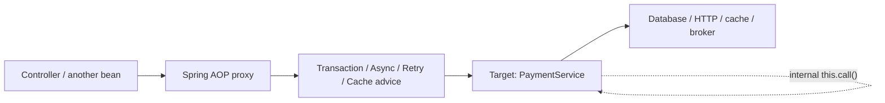
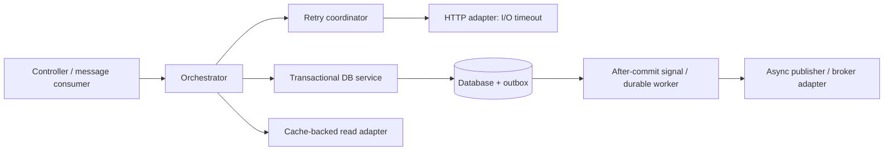

# AOP Proxy Failures with @Transactional, @Async, @Retryable, or @Cacheable

In Spring Boot, the four annotations `@Transactional`, `@Async`, `@Retryable`, and `@Cacheable` appear constantly across HTTP, database, cache, broker, and Spring Integration flows. A common misconception is that placing an annotation on a method **guarantees** its behavior will always apply. Under Spring AOP's default **proxy** model, calls must pass through the Spring-created proxy object for the corresponding advice to execute.

A method can compile cleanly and pass happy-path tests while silently **opening no transaction**, **never switching to a background thread**, **never retrying**, or **skipping the cache**. Bugs surface only during database rollbacks, upstream timeouts, message redeliveries, or high load. This lesson provides diagnostic models, fixes, and test strategies for **SPRING_BOOT_INTEGRATION** systems.

## 1. Objectives and a Sample Failure

After this lesson, you will be able to:

- Explain proxies, targets, advisors, and how Spring AOP intercepts method calls.
- Spot self-invocation, `private`/`final` methods, non-Spring-managed instances, JDK proxies, and CGLIB proxies.
- Verify the activation prerequisites for transactions, async execution, retries, and caching.
- Analyze thread boundaries, rollbacks, advice ordering, cache timing, and idempotency.
- Split services cleanly by responsibility to establish explicit transaction/retry/async boundaries.
- Design tests that genuinely verify advice execution, including Spring Integration flows and HTTP/message consumers.
- Investigate regressions that commonly appear after upgrading Spring Boot, Spring Framework, or Spring Retry.

Consider the following code:

```java
@Service
public class PaymentService {

    public void process(String paymentId) {
        saveStatus(paymentId);
        sendToPartner(paymentId);
    }

    @Transactional
    public void saveStatus(String paymentId) {
        // Write to PostgreSQL.
    }

    @Retryable(retryFor = TemporaryPartnerException.class)
    public void sendToPartner(String paymentId) {
        // HTTP call; may time out or return 503.
    }
}
```

When a controller calls `paymentService.process(id)`, both `saveStatus()` and `sendToPartner()` are invoked **on the target instance itself** via `this`. With standard Spring proxy AOP, those internal calls **bypass the proxy**, so `@Transactional` and `@Retryable` on both methods can silently fail to take effect. Having annotations in source code proves nothing about runtime behavior.

## 2. The Spring AOP Proxy Model

When Spring detects a bean requiring advice, it wraps the real bean inside a proxy:



Calls entering through the proxy pass through the advice chain. By contrast, calls from one method on the target to another method on **the same target** generally do not re-enter the proxy.

Key terms:

| Concept | Meaning | How to Recognize |
|---|---|---|
| **Target** | Object holding actual business logic | Application class such as `OrderService` |
| **Proxy** | Spring-generated wrapper intercepting eligible calls | Injected bean is a JDK dynamic proxy or CGLIB subclass |
| **Advisor / advice** | Cross-cutting logic around calls: TX start/commit, async scheduling, retries, cache lookup | Spring transaction interceptor, retry interceptor, cache interceptor, etc. |
| **Pointcut / eligibility** | Rules matching which methods receive advice | Annotations, AOP config, proxy type, method modifiers |
| **Invocation boundary** | Call boundary crossing the proxy | Controller → service bean, Bean A → Bean B |
| **Self-invocation** | Method inside target calling another method on the same target | `this.save()` or unqualified `save()` |

This is **proxy-based AOP**, not bytecode rewriting of every internal call. AspectJ weaving is a separate mechanism capable of advising self-invocation when configured intentionally; never assume Spring Boot's default proxy behaves like AspectJ weaving.

### 2.1. General Prerequisites for Annotations to Take Effect

1. The object is Spring-managed and callers invoke the injected bean/proxy. Objects instantiated via `new` outside the container receive zero advice.
2. Required infrastructure is active: transaction manager, async processing, retry aspect, or cache manager.
3. Calls pass through the proxy without self-invocation.
4. The method can be proxied/advised under the active proxy strategy.
5. With multiple advices, their execution order matches business semantics.

**Important:** an annotation can fail for several reasons simultaneously. Fixing self-invocation without `@EnableCaching`, for example, still leaves caching inactive.

## 3. Activation Prerequisites for All Four Annotations

| Annotation | Prerequisites Beyond the Annotation | Expected Behavior | Symptom When Advice Does Not Run |
|---|---|---|---|
| `@Transactional` | Spring transaction infrastructure and matching `PlatformTransactionManager` or reactive TX manager | Opens/joins TX, commits/rolls back | Partial DB writes, no rollback, `TransactionSynchronizationManager` shows no active TX |
| `@Async` | `@EnableAsync` or equivalent setup plus suitable executor | Dispatches eligible calls onto executor thread | Method executes synchronously on caller's thread |
| `@Retryable` | Spring Retry library, `@EnableRetry`, and matching AOP components | Retries on matching exceptions | First failure returns immediately; attempt counter stays at 1 |
| `@Cacheable` | `@EnableCaching` or equivalent setup, `CacheManager`, and key generator/resolver | Checks cache before running method, stores results per policy | Every invocation hits downstream DB or API |

Modules must align with your Spring Boot BOM. In a Spring Boot 3.x / Spring Framework 6 application, typical dependencies look like:

```groovy
dependencies {
    implementation 'org.springframework.boot:spring-boot-starter-aop'
    implementation 'org.springframework.boot:spring-boot-starter-cache'
    implementation 'org.springframework.retry:spring-retry'

    // Choose a data access starter matching your application:
    implementation 'org.springframework.boot:spring-boot-starter-data-jpa'
    // Or JDBC/MongoDB/... matching your actual transaction manager.
}
```

`@Transactional` belongs to Spring's transaction infrastructure; with a matching data starter, Boot typically auto-configures transaction management when conditions hold. `@Async` and `@Cacheable` usually require explicit activation annotations, and Spring Retry requires enabling retry advice. Never assume adding `spring-boot-starter-aop` activates all four annotations automatically.

Illustrative infrastructure config:

```java
import org.springframework.cache.annotation.EnableCaching;
import org.springframework.context.annotation.Configuration;
import org.springframework.retry.annotation.EnableRetry;
import org.springframework.scheduling.annotation.EnableAsync;
import org.springframework.transaction.annotation.EnableTransactionManagement;

@Configuration
@EnableTransactionManagement
@EnableAsync
@EnableRetry
@EnableCaching
public class IntegrationAopConfiguration {
}
```

This only turns on annotation processing; you still need the matching **transaction manager**, `CacheManager`, executor, and supporting beans. When multiple transaction or cache managers exist, select the intended one explicitly rather than relying on ambiguous defaults.

## 4. Self-Invocation: The Most Common Culprit

These two snippets look nearly identical yet behave very differently.

### 4.1. Wrong: Calling Internally Within the Same Bean

```java
@Service
class OrderService {

    public void placeOrder(String orderId) {
        persistOrder(orderId);        // this.persistOrder(...)
    }

    @Transactional
    public void persistOrder(String orderId) {
        // Repository save and data processing.
    }
}
```

If `placeOrder()` has no active transaction, the internal call skips `persistOrder()`'s transactional advice. Similarly:

```java
public void refresh(String id) {
    loadCached(id);                  // @Cacheable may be bypassed
    notifyAsync(id);                // @Async may be bypassed
    callWithRetry(id);              // @Retryable may be bypassed
}
```

### 4.2. Right: Separate Beans So Calls Cross the Proxy

```java
@Service
class OrderWorkflow {

    private final OrderPersistence persistence;

    OrderWorkflow(OrderPersistence persistence) {
        this.persistence = persistence;
    }

    public void placeOrder(String orderId) {
        persistence.persistOrder(orderId);
    }
}

@Service
class OrderPersistence {

    private final OrderRepository repository;

    OrderPersistence(OrderRepository repository) {
        this.repository = repository;
    }

    @Transactional
    public void persistOrder(String orderId) {
        repository.save(new OrderEntity(orderId));
    }
}
```

`OrderEntity` and `OrderRepository` represent project domain types. The key change is that `OrderWorkflow` calls **another Spring bean**, receiving the Spring proxy wrapping `OrderPersistence`.

Alternatively, place `@Transactional` on the external **entry-point method** (`placeOrder()`). This fits when the entire flow shares one transaction without slow HTTP or broker side effects. Never split beans mechanically if transaction semantics stay identical; pick boundaries matching real business responsibilities.

### 4.3. Avoid Abusing Self-Injection

Tricks like injecting a bean into itself, calling `AopContext.currentProxy()`, or setting `exposeProxy=true` force internal calls through the proxy, yet couple business code tightly to AOP runtime internals and complicate bean lifecycles. Separating orchestration from adapters and transactional services produces cleaner, far more testable code.

If a codebase deliberately configures AspectJ weaving, self-invocation can be advised; verify weaving config, AspectJ dependencies, and runtime behavior rather than assuming standard proxy limits apply blindly.

## 5. JDK Proxies, CGLIB, Visibility, and `final`

Spring creates proxies using two strategies:

| Property | JDK Dynamic Proxy | CGLIB Class-Based Proxy |
|---|---|---|
| Mechanism | Generates proxy implementing interfaces | Generates subclass of target class |
| Exposed methods | Primarily methods on proxied interfaces | Overridable methods on target class |
| `final` class | Proxiable via interface if applicable | Cannot subclass a `final` class |
| `final` method | Depends on interface call vs. target/advice | Cannot override `final` method to apply advice |
| Self-invocation | Still bypassed | Still bypassed |
| Injection type | Injecting via interface fits cleanly | Can inject via concrete class |

Never attempt to fix self-invocation by switching from JDK proxies to CGLIB: both bypass advice on internal `this` calls.

### 5.1. Interface vs. Concrete Class Injection

With JDK dynamic proxies, the proxy bean may **not be assignable** to the concrete implementation class when an injection point requests the class directly:

```java
public interface PartnerClient {
    PartnerResult fetch(String id);
}

@Service
public class PartnerClientImpl implements PartnerClient {
    // Implementation methods and annotations.
}
```

Under JDK dynamic proxies, consumers should inject `PartnerClient` instead of `PartnerClientImpl`. When forcing class-based proxies, ensure classes and advised methods allow subclassing.

Spring Boot exposes proxy settings such as `spring.aop.proxy-target-class`, though defaults and interactions across AOP-enabled starters should be checked against your actual Boot/Spring release.

### 5.2. Visibility: Do Not Generalize Every Annotation Identically

- `private` methods cannot be overridden, so standard class-based proxies cannot advise them.
- `final` classes or methods block subclass proxies. In Kotlin, verify the `kotlin-spring`/`all-open` compiler plugin keeps Spring classes and methods open.
- In Spring Framework 6, `@Transactional` broadened support for `protected` and package-private methods on **class-based proxies** depending on setup; with interface proxies, non-interface methods are not exposed like public interface methods.
- `@Async`, `@Retryable`, and `@Cacheable` have their own proxy requirements/constraints; to minimize surprises in integration code, prefer **`public`, non-`final` methods on Spring beans** invoked from another bean.

Whenever an annotation appears ignored, check **proxy type and actual call path** before concluding Spring "didn't see the annotation."

## 6. `@Transactional`: Misunderstood Transaction Boundaries and Rollbacks

Besides self-invocation, three frequent bugs are un-advised methods, wrong transaction managers, and misunderstood rollback rules.

### 6.1. Checking Whether a Transaction Is Active

In scoped diagnostic tests:

```java
import org.springframework.transaction.support.TransactionSynchronizationManager;

boolean actualTx =
        TransactionSynchronizationManager.isActualTransactionActive();
boolean syncActive =
        TransactionSynchronizationManager.isSynchronizationActive();
```

`isActualTransactionActive()` indicates a real transaction bound to the current imperative thread. `isSynchronizationActive()` reflects synchronization registration only and does not prove a DB operation joined the intended transaction.

If `actualTx=false` where you expected an open transaction, inspect proxy invocation, transaction manager wiring, exception/rollback rules, and thread boundaries.

### 6.2. Rollback Rules Do Not Depend Solely on Proxies

In standard declarative Spring transactions, unchecked exceptions (`RuntimeException`) and `Error` trigger rollback by default, whereas checked exceptions do not unless specified:

```java
@Transactional(rollbackFor = IOException.class)
public void importFile(Path file) throws IOException {
    // Writes database and may throw IOException.
}
```

Even with valid annotations and proxy calls, catching an exception and returning normally **lets the transaction commit** because the interceptor never sees the failure. To roll back, propagate the error per contract, mark rollback-only intentionally, or record an explicit error state inside the transaction.

With `@Transactional(propagation = REQUIRES_NEW)`, self-invocation bypassing the proxy means **no new transaction is created**. That is especially dangerous in outbox workers or post-commit file processors assuming each status update commits independently.

### 6.3. Transactions Do Not Span External Resources

JDBC/JPA transactions do not automatically wrap HTTP calls, Redis, Kafka/JMS sends, filesystems, or object storage. If an upstream HTTP call succeeds and the database rolls back, no Spring AOP proxy can automatically "undo" that upstream HTTP call.

For "save DB → publish event," prefer transactional outbox + idempotent consumers. For quick post-commit triggers, `@TransactionalEventListener(phase = AFTER_COMMIT)` helps, yet in-memory events do not survive JVM crashes—durable outbox/reconciliation polling is required for recovery.

## 7. `@Async`: Separate Threads, Contexts, and Commit Timing

Placing `@Async` on a method tells Spring to submit the call to an executor—not that business work "finished" when the method returns.

### 7.1. Example Executor Configuration

```java
import java.util.concurrent.ThreadPoolExecutor;
import org.springframework.context.annotation.Bean;
import org.springframework.context.annotation.Configuration;
import org.springframework.scheduling.annotation.EnableAsync;
import org.springframework.scheduling.concurrent.ThreadPoolTaskExecutor;

@Configuration
@EnableAsync
class AsyncConfiguration {

    @Bean("integrationExecutor")
    ThreadPoolTaskExecutor integrationExecutor() {
        ThreadPoolTaskExecutor executor = new ThreadPoolTaskExecutor();
        executor.setCorePoolSize(4);
        executor.setMaxPoolSize(8);
        executor.setQueueCapacity(100);
        executor.setThreadNamePrefix("integration-");
        executor.setRejectedExecutionHandler(
                new ThreadPoolExecutor.AbortPolicy()
        );
        return executor;
    }
}
```

Size pools, queue capacities, rejection policies, and graceful shutdown for real load. When the queue fills, async submissions get rejected; treat that as an error to handle rather than assuming tasks always run.

### 7.2. Separating Async and Transactional Beans

```java
import java.util.concurrent.CompletableFuture;
import org.springframework.scheduling.annotation.Async;
import org.springframework.stereotype.Service;
import org.springframework.transaction.annotation.Transactional;

@Service
class AsyncDispatchService {

    private final DispatchStateService stateService;

    AsyncDispatchService(DispatchStateService stateService) {
        this.stateService = stateService;
    }

    @Async("integrationExecutor")
    public CompletableFuture<Void> dispatch(String eventId) {
        stateService.recordStarted(eventId);
        // Execute integration step eligible to run once data is ready.
        return CompletableFuture.completedFuture(null);
    }
}

@Service
class DispatchStateService {

    private final DispatchRepository repository;

    DispatchStateService(DispatchRepository repository) {
        this.repository = repository;
    }

    @Transactional
    public void recordStarted(String eventId) {
        repository.markStarted(eventId);
    }
}
```

`DispatchRepository` is an illustrative domain repository. When another bean calls `AsyncDispatchService.dispatch()` through its proxy, execution moves to the executor; inside it, calling `DispatchStateService` crosses its own transactional proxy and opens a transaction on **the worker thread**.

**Never expect a controller's thread-local transaction to carry into `@Async`.** If the controller fires `@Async` before committing its own transaction, the worker can run before rows commit, missing records or hitting race conditions.

A safer pattern is **commit state and outbox first**, letting async workers read committed work. `@TransactionalEventListener(AFTER_COMMIT)` can dispatch fast while durable job/outbox scans recover after crashes.

### 7.3. `@Async` and `@Transactional` on the Same Method

Combining both on one method makes semantics sensitive to proxy config, advice order, and where execution occurs. Never assume "the caller's transaction flows into the new thread." For correctness-critical flows, **split async orchestration and transactional persistence into separate Spring beans** and test real threads and transactions.

Use `CompletableFuture<T>` or `Future<T>` when callers need to observe outcomes. With `void` return types, exceptions never reach the caller; configure `AsyncUncaughtExceptionHandler` or log/persist errors inside workers so failures never vanish silently. `ThreadLocal`, MDC/correlation IDs, and security contexts do not cross executors automatically; configure propagation deliberately while keeping access tokens out of logs/baggage.

## 8. `@Retryable`: Retries Must Wrap the Right Invocation

Spring Retry normally requires `@EnableRetry` and retry advice. If the method is self-invoked or the bean lacks a proxy, failures never retry.

```java
import org.springframework.retry.annotation.Backoff;
import org.springframework.retry.annotation.Retryable;
import org.springframework.stereotype.Service;

@Service
class PartnerAdapter {

    @Retryable(
            retryFor = TemporaryPartnerException.class,
            maxAttempts = 3,
            backoff = @Backoff(delay = 200, multiplier = 2)
    )
    public PartnerResponse fetch(String id) {
        return callHttpPartnerOnce(id);
    }
}
```

This assumes `TemporaryPartnerException` and `callHttpPartnerOnce` are project-defined. Verify:

- Callers invoke `PartnerAdapter.fetch()` on the injected bean, never `this.fetch()`.
- The thrown exception matches `retryFor`; wrapping it in another exception type can defeat matching.
- `maxAttempts` includes the initial attempt in standard Spring Retry semantics.
- Lower HTTP/driver layers are not quietly multiplying retries outside the total budget.
- Each attempt enforces explicit network timeouts, and writes/events tolerate uncertain outcomes.

### 8.1. Retrying Inside a Transaction: The Rollback-Only Trap

A JDBC/JPA transaction already marked rollback-only cannot be "reset" merely by catching an exception and calling the repository again inside that same transaction. If retry advice executes **inside an already-open transaction**, subsequent attempts inherit the rollback-only state or final commit throws `UnexpectedRollbackException`.

For transient database errors, you normally want to **retry the entire transactional unit**, giving **each attempt a fresh transaction**. Enforce this via advice ordering or explicit bean separation:

```java
@Service
class OrderRetryCoordinator {

    private final OrderTransactionalWriter writer;

    OrderRetryCoordinator(OrderTransactionalWriter writer) {
        this.writer = writer;
    }

    @Retryable(
            retryFor = TransientOrderDatabaseException.class,
            maxAttempts = 3
    )
    public void writeWithRetry(OrderCommand command) {
        writer.write(command); // Calls through another bean's proxy.
    }
}

@Service
class OrderTransactionalWriter {

    @Transactional
    public void write(OrderCommand command) {
        // Every coordinator retry enters a fresh transactional proxy call.
        // Writes must remain idempotent by business key.
    }
}
```

`OrderCommand` and the transient exception are illustrative. In real systems, Spring translates database faults into `TransientDataAccessException` subclasses; specify truly transient failures rather than blindly retrying all `DataAccessException`s.

### 8.2. Using `@Recover`

`@Recover` provides a fallback or error mapping after exhausting retries. Fallbacks must never mask failures as fake success—especially in payments, orders, or broker publishing.

If a broker redelivers messages on handler failure while the handler also uses `@Retryable`, attempts multiply. Assign one clear retry owner per I/O path and enforce durable idempotency keys across redeliveries.

## 9. `@Cacheable`: Cache Lookups Skipped or Firing at the Wrong Time

`@Cacheable` requires active cache advice around the call—typically `@EnableCaching`, a matching `CacheManager`, and a valid cache name.

```java
import org.springframework.cache.annotation.Cacheable;
import org.springframework.stereotype.Service;

@Service
class ProductCatalogAdapter {

    private final CatalogHttpClient client;

    ProductCatalogAdapter(CatalogHttpClient client) {
        this.client = client;
    }

    @Cacheable(cacheNames = "productCatalog", key = "#sku")
    public ProductDetails load(String sku) {
        return client.fetch(sku);
    }
}
```

`CatalogHttpClient` and `ProductDetails` are illustrative. When external beans call `load(sku)` twice through the proxy under valid config, the second call returns the cached entry. If another method inside `ProductCatalogAdapter` calls `load(sku)` internally, cache advice is bypassed.

### 9.1. Cache Bugs Outside Proxies

- **Wrong key:** omitting tenant, locale, or schema version serves another tenant's or stale data.
- **Wrong cache manager:** a `CacheManager` exists yet isn't the intended backend (e.g., local `ConcurrentMapCacheManager` instead of Redis).
- **Missing TTL / invalidation:** stale entries persist after database updates.
- **Nulls / exceptions:** confirm whether null values or failures are cached per provider and configuration.
- **Multi-pod divergence:** in-memory local caches diverge across replicas; only shared backends like Redis keep keys shared by namespace.
- **Combined advices:** cache vs. retry order determines whether cache hits bypass retry/circuit-breaker wrappers; verify with integration tests.

### 9.2. Caches and Transaction Commit Timing

Suppose a `@Transactional` method updates product prices and triggers `@CacheEvict`. If the cache evicts **before** DB commit, a concurrent reader immediately reloads the old pre-commit price back into cache. Likewise, `@CachePut` before commit leaks uncommitted state.

Wrappers such as `TransactionAwareCacheManagerProxy` or transaction-aware cache decorators can defer eligible cache writes/evictions until after commit when transaction synchronization is active. **Never assume every cache provider, operation, or annotation variant behaves post-commit automatically**; test it in integration tests. Making a cache transaction-aware also does not turn cache + DB into an atomic distributed transaction.

For critical business mutations, pair post-commit invalidation/refresh with reconciliation or event-driven invalidation against lost updates. Never rely on evictable/TTL caches for message consumer deduplication—keep idempotency in durable database constraints.

## 10. Combining Annotations: Advice Order Dictates the Outcome

When one method stacks multiple annotations:

```java
@Retryable(retryFor = TransientPartnerException.class)
@CircuitBreaker(name = "partner")
@Transactional
@Cacheable(cacheNames = "partnerData", key = "#id")
public PartnerData read(String id) { /* ... */ }
```

The call passes through multiple interceptors, yet **source annotation order does not determine runtime order**. Actual order depends on `Ordered`, advisor precedence, and infrastructure versions across Spring, Spring Retry, and Resilience4j.

Compare two structures:

```text
Structure A:
Retry (outer)
  -> Transaction (inner)
      -> business method

Each retry enters an independent transaction invocation.

Structure B:
Transaction (outer)
  -> Retry (inner)
      -> business method

All retries share one transaction;
a DB error on attempt 1 can mark the transaction rollback-only.
```

With `@Async`, check **which thread runs** before the transaction interceptor enters. With `@Cacheable`, a cache hit short-circuits downstream interceptors and the target method depending on order.

### Predictable Design Pattern

Separate responsibilities with distinct lifecycles:



This layout makes bean boundaries explicit, letting you count retry attempts, see transaction start/commit, trace cache fills, and observe broker publishes without piling all four annotations onto one business method.

## 11. Spring Integration: Proxy Boundaries Meet Thread and Message Boundaries

A Spring Integration flow moves messages from HTTP/JMS/Kafka inbound adapters through channels, transformers, service activators, filters, routers, splitters, and outbound adapters. AOP annotations on beans called by the flow follow standard proxy rules.

### 11.1. `DirectChannel` vs. `ExecutorChannel`

- On `DirectChannel`, handlers typically run on the sender's thread; thread-bound transactions stay active across synchronous calls.
- On `ExecutorChannel` or async channels, messages dispatch to executor workers; the sender's thread-local transaction **does not propagate** to the new thread.
- On inbound broker listeners, container transactions/ACKs tie to the listener thread; calling an async bean lets the listener return early, shifting ACK/commit timing.
- Handler or poller advice (e.g., retry advice) stacks separately from `@Retryable` on services; configuring both multiplies total retries.
- Exceptions routed to `errorChannel` without propagating back to the transaction boundary can cause transactions to commit instead of rolling back.

Example flow comparison:

```text
JMS inbound adapter
   -> DirectChannel
   -> @ServiceActivator bean
        -> @Transactional DB writer

JMS inbound adapter
   -> ExecutorChannel
   -> @ServiceActivator bean
        -> @Transactional DB writer
```

In the second branch, the listener container transaction cannot guard the DB writer on the executor thread. The DB writer opens its **own** transaction via Spring proxy; JMS ACK and DB commit happen at separate times.

When business rules require "JMS ACK only after DB commit," coordinate ACK/callback boundaries across broker and channel explicitly, or use outbox/idempotent consumers since broker and DB do not share one atomic transaction.

### 11.2. `@Async` Risk Inside Message Consumers

```java
@JmsListener(destination = "orders.events")
public void receive(OrderEvent event) {
    asyncProcessor.process(event); // @Async returns immediately.
    // Listener may finish before worker commits DB.
}
```

If the container treats listener return as success and ACKs/commits, worker failures occur **after the message is already confirmed**, losing natural broker redelivery. For durable async processing, persist a durable job/outbox before ACKing, or use acknowledged worker queues with independent retries—never treat `@Async` as a substitute for broker delivery guarantees.

### 11.3. Caching in Integration Flows

A cache-backed `@Cacheable` adapter cuts outbound HTTP volume, provided tenant namespaces, TTLs, invalidation, and local vs. distributed scope are right. Internal calls from a transformer to a helper on the same bean still bypass cache advice. For personal data payloads, avoid caching raw access tokens or sensitive fields without strict data-protection policies.

## 12. Symptom-Driven Diagnostic Workflow for AOP Proxies

When an annotation appears inactive, avoid guessing configuration changes. Follow these steps:

1. **Trace the real call site.** Who calls the method? Through a Spring bean or `new`? Is there self-invocation, a static helper, or a `private`/`final` method?
2. **Verify infrastructure activation.** Are `@EnableAsync`, `@EnableCaching`, `@EnableRetry`, transaction manager, executor, and cache manager active?
3. **Verify proxy strategy.** JDK or CGLIB? Is injection via interface or implementation? Is the method eligible for advising?
4. **Measure runtime behavior, not annotations.** Safely record attempt counts, thread names, active transactions, and cache hits/misses.
5. **Check advice order and transaction boundaries.** Is retry outside or inside the transaction? Which thread executes async work? When does cache read/evict happen?
6. **Check downstream and external semantics.** HTTP timeouts, broker ACKs, DB rollbacks, Redis TTLs, or DLQs can mimic AOP bugs.
7. **Lock in regression tests.** Reproduce the real failure and assert outcomes and side-effect boundaries.

### 12.1. Checking Whether a Bean Is a Proxy

Diagnostic check for tests:

```java
import org.springframework.aop.support.AopUtils;

Object bean = applicationContext.getBean("orderPersistence");

boolean isProxy = AopUtils.isAopProxy(bean);
boolean jdkProxy = AopUtils.isJdkDynamicProxy(bean);
boolean cglibProxy = AopUtils.isCglibProxy(bean);
```

Seeing `isProxy == true` **does not prove** a specific method received the target advice; the bean could be proxied for a different annotation, so verify advisors/invocations as needed. Never dump `bean.toString()` or method arguments containing sensitive data to logs.

You can enable temporary diagnostic logging in test environments for transaction/AOP/cache/retry packages with tight scope and scrubbing. Beware that SQL bind values, HTTP payloads, or upstream exceptions can expose tokens and PII.

### 12.2. Quick Lookup Table

| Symptom | Common AOP Cause | Verification |
|---|---|---|
| `@Transactional` fails to roll back | Self-invocation, bypassed proxy, wrong TX manager, checked exception, swallowed error | Assert DB state after exception; inspect active TX and rollback rules |
| `@Async` blocks the caller | Self-invocation, missing `@EnableAsync`, non-proxiable method, saturated executor | Check thread names, caller latency, and executor metrics |
| `@Retryable` runs only once | Bypassed proxy, missing retry infrastructure, unmatched exception type | Count real attempts under deterministic failures |
| `@Cacheable` always hits repository | Self-invocation, wrong cache name/key/manager, caching disabled | Count downstream calls; inspect keys and cache entries |
| `final` method skips advice | CGLIB cannot override `final` | Check `final` modifiers and active proxy strategy |
| Bean injection fails once proxies activate | JDK proxy cannot assign to concrete class | Inject via interface or adjust proxy strategy |
| Retry runs yet final commit throws rollback-only | Retry inside TX or mishandled exception | Inspect advice order and TX boundaries per attempt |
| Async worker misses fresh DB rows | Ran before commit or lacked transaction | Use after-commit signals/outbox; assert committed state |
| JMS ACKs before DB write finishes | Listener called `@Async` and returned early | Verify ACK boundaries and durable job persistence |
| Cache holds stale data after commit | Evict/put timed pre-commit, multi-pod drift, missing invalidation | Run concurrent tests and inspect TTL/refresh behavior |

## 13. Writing Tests That Actually Catch Proxy Failures

Tests checking only return values miss AOP bugs completely. Assert the cross-cutting behavior itself.

### 13.1. Transactions: Rollback Through the Proxy

Invoke the live Spring-managed bean from the context, insert rows, and throw `RuntimeException`:

```java
@SpringBootTest
class OrderTransactionIT {

    @Autowired OrderPersistence persistence;
    @Autowired OrderRepository repository;

    @Test
    void rollsBackWhenServiceFails() {
        String id = UUID.randomUUID().toString();

        assertThatThrownBy(() -> persistence.saveThenFail(id))
                .isInstanceOf(IllegalStateException.class);

        assertThat(repository.findById(id)).isEmpty();
    }
}
```

`saveThenFail()` is an illustrative `@Transactional` service method throwing `IllegalStateException` **after writing**. Never put `@Transactional` on the test method itself and assume rollback proves service proxying: Spring Test's own test transaction rolls back after the test and hides a broken service proxy.

### 13.2. Retries: Count Actual Invocations

Use a fake HTTP adapter that tracks call counts and throws transient errors on the first two attempts. Call the retrying service through its injected bean and assert both call counts and final response. Also test non-retryable exceptions to confirm filtering. If Spring Integration and brokers also apply retries, test end-to-end attempt totals.

### 13.3. Async: Never Rely on `Thread.sleep`

To verify `@Async`, use `CountDownLatch`/`CompletableFuture` or a controlled executor. Assert the task executes on a different thread when intended and completes within a bounded test timeout. Avoid timing-based `Thread.sleep` checks that flake under CI load.

### 13.4. Caching: Count Queries and Verify Invalidation

Invoke a `@Cacheable` service twice with the same key and assert the repository/HTTP stub ran only once under valid cache state; change the key and assert a new call occurs. On business updates, assert cached values update **after commit**. For distributed Redis caches, test across two application contexts/instances sharing Redis rather than testing only `ConcurrentMapCacheManager`.

### 13.5. Verifying Stacked Advices

For retry-around-transaction: force attempt 1 to fail in the DB and attempt 2 to succeed, asserting attempt 2 runs in a fresh valid transaction rather than reusing a rollback-only one. For async + brokers: prove ACKs/commits never occur before durable persistence per contract. Behavioral tests like these matter far more than counting annotations.

## 14. Upgrading Spring Boot, Spring Framework, and AOP Libraries

Proxy bugs frequently surface or become visible across major upgrades. Review:

- **Jakarta namespace:** Spring Boot 3.x moves Servlet/JPA/JMS APIs from `javax.*` to `jakarta.*`, though package updates alone never fix proxy/self-invocation bugs.
- **Method proxy eligibility:** Spring Framework 6 altered visibility support for `@Transactional` on class-based proxies; identical annotations can behave differently across versions.
- **Spring Retry:** check APIs, enabling annotations, starter/module versions, TX advice order, and Spring Framework compatibility.
- **Proxy strategy:** switching between JDK and CGLIB proxies impacts interface injection, `final` classes, and Kotlin classes.
- **Async executors:** default executors and thread pools can shift across configs, changing rejection and observability behavior.
- **Cache managers:** auto-configuration or local/Redis defaults can alter cache keys, serialization, and TTLs.
- **Spring Integration:** channel executor/poller changes can move transaction boundaries and alter error channel / redelivery behavior.

### 14.1. Verifying Dependencies and Configuration

For Gradle projects:

```bash
./gradlew dependencies --configuration runtimeClasspath
./gradlew dependencyInsight --dependency spring-aop --configuration runtimeClasspath
./gradlew dependencyInsight --dependency spring-tx --configuration runtimeClasspath
./gradlew dependencyInsight --dependency spring-retry --configuration runtimeClasspath
./gradlew dependencyInsight --dependency spring-context --configuration runtimeClasspath
```

For Maven:

```bash
mvn dependency:tree
```

These commands are diagnostic suggestions when investigating, not commands required when authoring lessons. Keep Spring Boot, Spring Framework, Spring Cloud, Resilience4j, and Spring Retry aligned on one BOM rather than forcing single Spring modules ahead of the rest.

Post-upgrade, run smoke tests through **live Spring beans**, asserting actual transaction, async, retry, and caching behavior alongside proxy types and method visibility. Never treat a clean compile or passing context-load test as proof.

## 15. Hands-On Exercises

### Exercise A: Fixing Self-Invocation

Given `OrderFacade.create()` calling `this.save()` annotated `@Transactional`, extract `save()` into `OrderPersistenceService` and write a test throwing an exception between two inserts, asserting zero rows remain after rollback.

**Explain:** why setting `proxyTargetClass=true` does not fix self-invocation.

### Exercise B: Retries Outside the Transaction

A service stacks `@Retryable` and `@Transactional` on the same method and hits `UnexpectedRollbackException` on DB deadlocks. Split `RetryCoordinator` and `TransactionalWriter` so every attempt enters the transactional proxy cleanly with the same business idempotency key. Write a fail-once-then-succeed test.

**Explain:** why retrying inside one rollback-only transaction differs from opening a fresh transaction.

### Exercise C: JMS + `@Async`

A `@JmsListener` calls an `@Async` method to persist to the database and returns immediately. Redesign so the listener ACKs only after durable persistence, workers run via durable jobs/outbox, and consumers remain idempotent on redeliveries.

**Explain:** how Spring proxies can execute `@Async` properly while still breaking business guarantees if ACKs fire before DB commits.

### Exercise D: Multi-Tenant Caching

A `@Cacheable(cacheNames="prices", key="#productId")` method serves multiple tenants. Update the key to include an authenticated tenant ID, enforce post-commit eviction, and test that two tenants querying the same `productId` never see each other's data.

**Explain:** how technically working cache advice can still break data contracts when keys or invalidation timing are wrong.

## 16. Pre-Release Checklist

- [ ] Annotated beans are Spring-managed and callers invoke the Spring proxy rather than `new` instances.
- [ ] Advised calls avoid self-invocation (unless AspectJ weaving is intentionally configured and verified).
- [ ] Class and method visibility/finality match active JDK/CGLIB proxy rules in Java/Kotlin.
- [ ] `@Transactional` uses the right transaction manager, rollback rules, and external proxy boundaries.
- [ ] `@Async` has `@EnableAsync`/executor configured, handles rejections and uncaught exceptions, and propagates needed context intentionally.
- [ ] `@Retryable` has retry AOP enabled with bounded attempts/backoff/exception filters and no infinite nested retries.
- [ ] `@Cacheable` has caching enabled, right `CacheManager`, tenant-safe keys, TTLs, and post-commit invalidation.
- [ ] Stacked retry/TX/cache/async advice ordering is verified by behavior tests rather than source declaration order.
- [ ] HTTP/DB/broker side effects enforce timeouts and idempotency; DB transactions are not mistaken for distributed transactions.
- [ ] Spring Integration channels, pollers, listeners, and error channels preserve transaction and ACK boundaries under async flows.
- [ ] Live-bean integration tests verify rollbacks, attempt counts, async completion, cache hits/misses, and multi-tenant invalidation.
- [ ] Post-upgrade reviews cover BOM alignment, proxy strategies, visibility rules, executors, and transaction boundaries.

**Key takeaway:** when a Spring annotation "does nothing," trace **the live call path through the proxy**, infrastructure activation, proxy type, executing threads, and advice ordering. Fixing boundaries cleanly between services and asserting real runtime behavior beats tweaking annotations or cranking up log levels. Across integration flows, transactions, retries, async execution, and caching must work hand-in-hand with **idempotency, durable state, and recovery mechanisms**, because a working proxy alone never guarantees consistency across multiple external systems.
