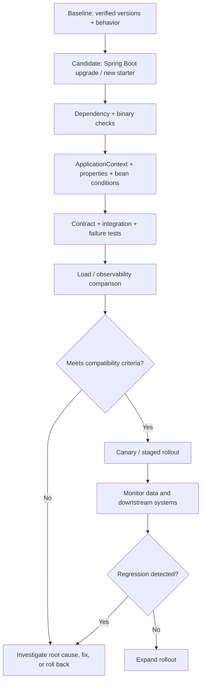

# Compatibility Testing When Upgrading Spring Boot or Adding a Third-Party Starter

## 1. Why Can an App Start Cleanly Yet Still Be Incompatible?

In the **SPRING_BOOT_INTEGRATION** module, a Spring Boot application receives HTTP requests, calls partner systems, writes databases or caches, publishes messages to brokers, and wires Spring Integration adapters. Upgrading Spring Boot or adding a *third-party starter* can alter dependencies, auto-configured beans, error handling, timeouts, data conversion, or transaction behavior without touching a single line of business code.

For instance, a team adds a vendor starter to integrate a broker. The build passes, `ApplicationContext` boots cleanly, and the health endpoint reports `UP`. Yet that starter registers an extra message converter that serializes date fields differently, breaking downstream consumers. Or an auto-configuration builds a new HTTP client with altered timeouts and pools, spiking retries whenever partners slow down.

Consequently, **compatibility** must be verified across multiple layers—from dependency resolution to live end-to-end integration outcomes. That is why every upgrade requires a baseline, targeted regression tests, observable evidence, and a rollback plan.

After this lesson, learners will be able to:

- Distinguish **build/binary**, **auto-configuration**, **data contract**, **infrastructure/protocol**, and **operational behavior** compatibility.
- Detect changes introduced by the Spring Boot BOM, Spring Framework, Spring Data, Spring Integration, drivers/SDKs, and transitive dependencies of new starters.
- Verify beans, auto-configuration ordering, property bindings, live clients, and `@Conditional...` evaluations.
- Design test suites covering HTTP, databases/caches, brokers, Spring Integration, failures, retries, idempotency, and transactions.
- Decide to proceed, roll out progressively, or roll back based on technical evidence and business metrics.

## 2. Five Compatibility Layers to Distinguish

| Layer | Verification Question | Failure Symptoms |
|---|---|---|
| **1. Build and binary** | Are Java/Gradle/Maven supported? Are classes, methods, annotations, modules, and libraries compatible? | Compile failures, `ClassNotFoundException`, `NoSuchMethodError`, `NoClassDefFoundError`, `LinkageError` at runtime. |
| **2. Beans and configuration** | Which beans were created or replaced? Do legacy properties still bind? Which factory/client is actually used? | `NoSuchBeanDefinitionException`, duplicate beans, circular dependencies, ignored properties, unexpected defaults. |
| **3. Integration contracts** | Do payloads, headers, encodings, schemas, endpoints, HTTP statuses, and event formats stay compatible? | Consumer deserialization failures; null/enum/date drift; wrong HTTP retries due to status changes. |
| **4. Infrastructure and semantics** | Do drivers, protocols, transactions, broker ACKs, ordering, timeouts, and idempotency preserve behavior? | Partial commits, lost messages, duplicate processing, pool exhaustion, infinite retries. |
| **5. Operations and observability** | Do latency, throughput, queue lag, error rates, memory, and traces remain stable? | App reports `UP` while backlogs climb, p99 degrades, or DLQs/duplicates spike. |

No standalone `@SpringBootTest` asserting only `contextLoads()` can validate all five layers. It is a **useful smoke test**, whereas compatibility testing selects checks targeting the exact risks of the change.



## 3. Lock Down a Baseline Before Changing Dependencies

A baseline is more than a version number. It includes **resolved dependency graphs**, **effective configurations**, **data paths**, and **accepted runtime behaviors**.

A baseline sheet for an integration application typically records:

| Component | What to Capture |
|---|---|
| JDK / toolchain | Java runtime/compiler versions, Gradle wrapper or Maven version, compiler flags. |
| Spring ecosystem | Spring Boot plugin/BOM, Spring Framework, Spring Data, Spring Integration, Spring Security, Micrometer, Spring Cloud if used. |
| HTTP | `RestClient`, `RestTemplate`, `WebClient` or adapters used; request factories/connectors, TLS, timeouts, pooling, error mapping. |
| Database / cache | JDBC/NoSQL drivers, transaction managers, serializers, schemas/migrations, Redis clients and TTL semantics. |
| Brokers | Spring Kafka/AMQP/JMS, Kafka/RabbitMQ/client versions, message converters, listener ACKs, retry/DLQ, transactional producers if used. |
| Spring Integration | Channel/endpoint IDs, converters, gateway timeouts, error channels, retry advice, polling, lifecycle. |
| External starters | Artifact coordinates, versions, authors, compatibility docs, auto-configs/beans/properties introduced. |
| Contracts and ops | JSON/Avro/Protobuf schemas, API statuses, idempotency keys, event headers, p95/p99, consumer lag, error rates, throughput baseline. |

Whenever possible, capture dependency locks or resolved dependency reports for both baseline and candidate. **Identical declared versions** do not guarantee **identical resolved versions**: BOMs, constraints, and conflict resolution can pick different transitive versions.

### Commands to Inspect Dependencies

With Gradle, for example:

```powershell
./gradlew dependencies --configuration runtimeClasspath
./gradlew dependencyInsight --dependency spring-integration-core --configuration runtimeClasspath
./gradlew dependencyInsight --dependency jackson-databind --configuration runtimeClasspath
./gradlew dependencyInsight --dependency httpclient5 --configuration runtimeClasspath
```

With Maven:

```bash
./mvnw dependency:tree
./mvnw dependency:tree -Dincludes=org.springframework.integration
./mvnw dependency:tree -Dincludes=com.fasterxml.jackson.core
```

These are illustrative commands for learners to run in their projects—**not captured execution output**. Exact artifact and group IDs depend on your project. Save resolved reports alongside candidate configs so if `NoSuchMethodError` or JSON format changes appear, you can immediately see which jar shifted.

## 4. What Does a Spring Boot Upgrade Impact?

Spring Boot's BOM manages versions across dozens of foundational libraries. Upgrading Boot changes many components even without touching direct dependencies:

- Spring Framework and web, lifecycle, conversion, and transaction APIs.
- Spring Data, database drivers, Redis clients, mapping/serialization, and transaction boundaries.
- Spring Integration adapters, channels, handlers, and auto-configuration conditions.
- Spring Kafka, AMQP, JMS, HTTP clients, Micrometer, logging, Actuator, and other BOM-managed jars.
- Security settings, validation, Jakarta APIs, and minimum Java/toolchain requirements across major versions.

**Never assume every dependency is managed by Boot's BOM.** Third-party starters, SDKs, and specialized HTTP/integration libraries often maintain separate BOMs or versions. When using Spring Cloud, verify its **release-train compatibility matrix** against your target Boot version.

Major upgrades can require source package or API changes. Moving from **Spring Boot 2.x to 3.x**, for example, relocated many Java EE APIs to **`jakarta.*`** and raised the minimum Java baseline. Verify such changes against the exact upgrade path chosen rather than projecting them blindly onto future Boot releases.

Always rely on release notes, migration guides, and dependency metadata for **your exact target version**. A snippet valid on Boot 3.x does not automatically hold for older or newer major versions.

## 5. How Can Adding a Third-Party Starter Alter the Context?

A starter bundles dependencies and auto-configurations. Once placed on the classpath, auto-configuration can create clients, connection factories, serializers, schedulers, listeners, health indicators, or customizers.

Common conditional annotations to check:

| Condition / Mechanism | What to Verify | Risk When Adding a Starter |
|---|---|---|
| `@ConditionalOnClass` | Activates only when specific classes/libraries exist on the classpath. | New jar causes a previously inactive auto-configuration to turn on. |
| `@ConditionalOnMissingBean` | Typically yields to app-declared beans; exact scope, name, and type matter. | Custom bean forces starter to back off, or starter registers a bean before another config runs. |
| `@ConditionalOnBean` | Requires a target bean to exist at condition evaluation time. | Declaration/auto-config ordering prevents a module from initializing as expected. |
| `@ConditionalOnProperty` | Toggles behavior by property presence/value, optionally with `matchIfMissing`. | Changed starter defaults or renamed properties silently activate features. |
| `@AutoConfiguration` / ordering | Sequences auto-configs and their conditions. | Injects beans/initializers, shifts config sources, causes circular deps, or overrides unexpectedly. |
| `BeanPostProcessor`, `Customizer`, interceptors | Modify already-created objects. | Adds no new client bean yet changes serializers, HTTP headers, retries, or observations. |

Auto-configuration registration also evolved across Spring Boot generations. In Boot 3.x, libraries register auto-configurations via `META-INF/spring/org.springframework.boot.autoconfigure.AutoConfiguration.imports`; older libraries may rely on legacy registration mechanisms. Follow the starter's compatibility documentation instead of copying legacy wiring.

### Example: Two Clients Existing Does Not Mean the Right One Was Picked

Suppose an app defines a partner `RestClient` with custom mTLS and connection pooling. A new starter adds a `RestTemplateBuilder` customizer, interceptor, or default `RestClient` bean. The app starts cleanly yet an adapter injects the wrong bean, leading to:

- Missing custom auth headers or mTLS client certificates.
- Different timeouts, proxies, pools, retries, and tracing than baseline.
- Altered downstream headers breaking contract tests.

Therefore, inspect **the final bean injected into each caller**, not merely whether "some `RestClient` exists in the context."

## 6. Verifying Auto-Configuration and Property Binding

For any candidate build, inspect runtime condition evaluations. Standard tools:

1. Start in a dev environment with `--debug` to inspect the **Condition Evaluation Report**.
2. With Spring Boot Actuator secured appropriately, inspect `/actuator/conditions`, `/actuator/beans`, and `/actuator/configprops`. Never expose internal beans or configuration publicly on the internet.
3. Diff bean types/names/qualifiers, matched/unmatched auto-configurations, property origins, and custom beans before vs. after.
4. Confirm properties still bind—especially renamed or removed keys, new defaults, profiles, and environment variables.
5. Check application order of `Customizer`s, `BeanPostProcessor`s, converters, and listener container factories modified by the starter.

Illustrative application configuration:

```yaml
integration:
  partner:
    enabled: true
    base-url: https://api.partner.example
    connect-timeout: 2s
    read-timeout: 3s
    retry:
      max-attempts: 2
```

When upgrading a starter, separate **app-owned properties** from starter-supported properties. If a starter renames `integration.partner.read-timeout` while tolerating unknown fields, the app silently falls back to the **default timeout** with zero startup errors. Verify bound runtime values in tests and consider strict configuration property validation.

### Testing Auto-Configuration Conditions

`ApplicationContextRunner` in `spring-boot-test` builds lightweight contexts to test auto-configuration without booting the full app. **Illustrative** example using `PartnerClient` and `PartnerClientAutoConfiguration` provided by your project or starter:

```java
import org.junit.jupiter.api.Test;
import org.springframework.boot.autoconfigure.AutoConfigurations;
import org.springframework.boot.test.context.runner.ApplicationContextRunner;

import static org.assertj.core.api.Assertions.assertThat;

class PartnerAutoConfigurationTest {

    private final ApplicationContextRunner runner =
            new ApplicationContextRunner()
                    .withConfiguration(AutoConfigurations.of(
                            PartnerClientAutoConfiguration.class));

    @Test
    void createsClientOnlyWhenEnabled() {
        runner.withPropertyValues(
                        "integration.partner.enabled=true",
                        "integration.partner.base-url=https://api.partner.example")
                .run(context -> {
                    assertThat(context).hasSingleBean(PartnerClient.class);
                    PartnerClient client = context.getBean(PartnerClient.class);
                    assertThat(client.baseUrl())
                            .isEqualTo("https://api.partner.example");
                });
    }

    @Test
    void backsOffWhenDisabled() {
        runner.withPropertyValues("integration.partner.enabled=false")
                .run(context ->
                        assertThat(context).doesNotHaveBean(PartnerClient.class));
    }
}
```

This test applies only if the starter's auto-configuration **actually** implements that toggle condition; replace class names and accessors with your real APIs. Never assume every starter honors an `enabled` flag. When `@ConditionalOnMissingBean` is used, test that custom beans win without creating duplicates; when `@ConditionalOnClass` is used, test filtered classpaths via the runner.

**Limits of `ApplicationContextRunner`:** it verifies conditions, wiring, and binding in an isolated mini-context. It **never** validates real servers, TLS, network retries, transactions, or downstream event schemas—those require integration tests.

## 7. Design a Compatibility Matrix Before Touching Code

You cannot test infinite combinations. Pick the baseline and high-risk candidate slices covering critical business flows:

| Matrix | Configuration | What Must Be Proven |
|---|---|---|
| **A. Baseline** | Current Boot + current starters + verified infra. | Existing tests and metrics form the reference; known quirks documented. |
| **B. Boot upgrade** | Target Boot + BOM-aligned deps, without new starter yet. | Isolates regressions caused by Boot and aligned libraries. |
| **C. Add starter** | Current Boot + new starter (if supported). | Exposes beans, properties, converters, or retries altered by the starter alone. |
| **D. Combined** | Target Boot + new starter with compatible versions. | Verifies the exact deployable combination rather than inferring from B or C. |
| **E. Mixed system** | Producers and consumers on differing versions during rollout. | Forward/backward message and API compatibility without big-bang deploys. |
| **F. Fallback / rollback** | Candidate writes data, then rolls back to prior release. | Schemas, events, and migrations still allow old versions to read/write within contract. |

For larger systems, add axes for **JDK**, **profiles**, **database/broker server versions**, **OS/CPU architecture**, and **replica count** when relevant. Maintain reproducible version pins and a mandatory "must-pass" suite per risk area.

In actual test reports, record **exact versions**, such as `Boot 3.x.y → 3.x.z` and `starter 1.a → 1.b`. Symbolic placeholders here are illustrative, not specific version recommendations.

## 8. Data Contract Testing: Compatibility Beyond the Spring Context

Treat HTTP requests/responses, database schemas, and broker messages as **contracts between independent systems**. Jackson serialization, Spring Messaging converters, or schema-registry libraries can change behavior across dependency bumps.

Example shared event consumed by two services:

```json
{
  "eventId": "evt-203",
  "eventType": "ORDER_ACCEPTED",
  "schemaVersion": 2,
  "occurredAt": "2026-11-21T08:00:00Z",
  "order": {
    "id": "ord-203",
    "amountMinor": 125000,
    "currency": "VND"
  }
}
```

When upgrading Boot or starters, avoid brittle byte-for-byte JSON string equality if field ordering is uncontracted; verify instead:

- Field names and types, required fields, enums/unknown values, nulls, and defaults.
- Timestamp formats, timezones, precision, decimals/money, and large-number handling.
- `Content-Type`, charsets, tracing/correlation headers, and schema/version headers.
- Handling of newly added fields, dropped fields, and delayed messages from older versions.
- Validation rules and error mappings when payloads violate contracts.

### Forward / Backward Compatibility

| Rollout Scenario | What to Verify |
|---|---|
| New consumer reads old messages | Reader still accepts historical records sitting in topics/DLQs. |
| Old consumer reads new messages | New producer avoids emitting fields/types that break old consumers during mixed rollout. |
| Old API client calls new server | HTTP endpoints, statuses, auth, media types, and error shapes remain compatible. |
| Old app runs after rollback | DB migrations do not break old readers/writers unless an explicit data rollback plan exists. |

Not all schema changes are compatible. With Avro, Protobuf, or JSON Schema, actual compatibility depends on schema-registry rules and wire formats—verify with real contract tests rather than guessing from field ordering.

### HTTP Contract Tests

For HTTP adapters, run a controllable mock server like MockWebServer or WireMock. Inspect both real outbound requests and response/error handling:

```text
Given downstream returns HTTP 429 + Retry-After
When  order adapter calls API using candidate client
Then  adapter classifies "rate_limited"
And   retries respect bounded attempts and deadline
And   never creates a second order under the same idempotency key

Given downstream accepts request yet closes connection before responding
When  client retries
Then  system records uncertain outcome
And   never assumes the initial POST did not execute
```

Assert the exact requests and headers captured by the mock server. Mocking repository/service methods to return DTOs skips testing transport, serializers, interceptors, and timeouts altered by a new starter.

## 9. Integration Tests with Databases, Caches, and Brokers

These tiers need real or faithful services to test protocols, transactions, and redelivery. Testcontainers or isolated test environments work well, configured via `@ServiceConnection` or `@DynamicPropertySource` depending on Boot version and container setup.

| Stage | Happy Path | Negative / Failure Path | Evidence to Observe |
|---|---|---|---|
| **HTTP client** | Status codes, bodies/headers, configured timeouts. | DNS/TLS/auth, 429/503, connect/read timeouts, pool exhaustion. | Actual wire requests, latency, retry counts, idempotency headers. |
| **JDBC / JPA** | Reads/writes, commits, mappers, migrations. | Constraint conflicts, rollbacks, deadlocks/timeouts, pool exhaustion. | Final DB rows, transaction boundaries, connection counts. |
| **NoSQL** | Document/key mapping, TTLs, query compatibility. | Conditional write conflicts, codec errors, reconnects, consistency shifts. | Live documents, dedup keys, retries/timeouts. |
| **Redis cache** | Keys/values/serializers, TTLs, invalidation. | Redis restart, miss storms, stale data, unreadable legacy bytes. | Byte formats, TTLs, hit/miss rates, fallback correctness. |
| **Kafka / RabbitMQ / JMS** | Publish, deserialize/ACK, scoped ordering. | Consumer exceptions, retries/redeliveries, DLQs, broker disconnects, rebalances. | Final events, offsets/ACKs, DLQs, side-effect counts. |
| **Spring Integration** | Gateway → channel → handler → adapter routing. | Error channels, async exceptions, poller restarts, duplicate messages. | Message history, endpoint IDs, completion state, correlation. |

**Assert business outcomes:** if a message is published twice under at-least-once semantics, verify **controlled side effects** rather than counting handler invocations. Database updates and broker publishes inside the same `@Transactional` method are not automatically atomic.

### Example Idempotency Test Across Redelivery

Behavioral pseudo-test (exact APIs depend on your test harness):

```java
@Test
void redeliveryDoesNotDuplicateOrderEffect() {
    String eventId = "evt-203";
    OrderAccepted event = new OrderAccepted(eventId, "ord-203");

    testBroker.publish("orders.accepted", event);
    testBroker.publish("orders.accepted", event); // Intentional duplicate

    await().untilAsserted(() -> {
        assertThat(orderRepository.countByEventId(eventId)).isEqualTo(1);
        assertThat(paymentGatewayTestDouble.countCharges(eventId)).isEqualTo(1);
    });
}
```

`testBroker`, `orderRepository`, and `paymentGatewayTestDouble` are illustrative fixtures; swap in your real test harness. A test double alone does not prove external payment gateway behavior—here it verifies **the app's deduplication guard** before issuing side effects. Without idempotency keys or unique constraints, merely checking distinct message IDs can still double-process work.

### Data Migrations and Rollbacks

When upgrading drivers or Spring Data, test reading records **written by the previous release**, not only newly inserted records. For rolling updates, use *expand–migrate–contract*: add compatible structures, migrate data/traffic, and drop old structures only once rollback windows expire. Never assume applied migrations can always be reversed cleanly without data loss.

## 10. Testing Configuration and Lifecycles Across Profiles

A candidate passing in `dev` can fail in `test` or `prod` due to profiles, secrets, service discovery, and `ConnectionDetails` differences.

Examples:

| Environment Difference | Risk |
|---|---|
| Local uses Docker Compose/Testcontainers; prod uses managed DBs. | URLs, credentials, TLS, client timeouts, and pools differ. |
| Dev uses single-node broker; prod uses multi-partition/multi-consumer clusters. | Ordering, rebalances, concurrency, duplicates, and DLQs behave differently. |
| Tests auto-generate schemas; prod runs Flyway/Liquibase. | Missing migrations or unindexed queries appear only in prod. |
| Prod enforces proxies/mTLS; dev connects directly. | Starter-created default clients drop proxy/TLS config. |
| Replicas run mixed versions during rollout. | Producer/consumer schemas and cache keys diverge. |

Verify:

1. **Resolved configuration:** do env vars, YAML, secret managers, and overrides reach target beans without logging passwords/tokens?
2. **Bean lifecycles:** do listeners, pollers, schedulers, HTTP clients, and pools start and shut down cleanly?
3. **Readiness:** context refresh or liveness `UP` does not guarantee listeners are consuming, DB schemas are ready, or broker topics exist.
4. **Graceful shutdown:** during rolling updates, when are in-flight messages ACKed/committed, and do workers finish or retry safely?
5. **Resource ownership:** are dev/test containers managed by Docker Compose, Testcontainers, or external processes? Closing an app context does not automatically reset external DB/broker state.

With Spring Test context caching, a cached context can outlive a JUnit-managed container and fail with `Connection refused`. Distinguish **test harness lifecycle** bugs from real Boot/driver incompatibilities.

## 11. Measuring Errors, Latency, and Queue Lag During Upgrades

A green functional suite can still hide performance regressions under load. Compare baseline and candidate under matching workloads:

| Signal | How to Use It | Regressions It Reveals |
|---|---|---|
| Outbound HTTP / DB / broker p50/p95/p99 | Measure per downstream/operation under matching payload & load. | Altered client transport, pooling, or retries after upgrade. |
| Active / idle / pending connections | Compare against pool size and replica count. | Pool exhaustion, unclosed responses, changed per-route limits. |
| Error rates by category | Separate validation, 4xx/5xx, timeouts, broker nacks, serialization, TX conflicts. | Starter changed exception mapping or error handlers. |
| Consumer lag / queue age / DLQ | Measure intake rate vs. completion rate. | Altered listener concurrency/ACKs; rising DLQ traffic. |
| Retry counts, duplicates / conflicts | Track both attempts and business outcomes. | Non-idempotent retries or altered default retry policies. |
| Heap, threads, CPU, GC | Compare under sustained load after warm-up. | Memory leaks, thread bloat, heavier serialization. |
| Completion latency / outbox backlog | Measure time from event intake to final downstream confirmation. | App ingests fast while stalling downstream writes. |

Spring Boot Actuator, Micrometer, and Observation provide auto-instrumentation, yet **meter names, tags, and coverage vary by version, dependency, and config**. During upgrades, verify dashboards and alerts still match live meters rather than relying blindly on legacy metric names.

For valid comparisons, hold constant:

- Requests/sec, read/write mix, payload sizes, and downstream fault rates.
- Instance/thread counts, DB connection limits, and broker partitions/consumer groups.
- Seed data, cache warm-up, measurement windows, and percentile calculation.

Never compare low-load baseline p99 against high-load candidate p99 and blame Spring Boot.

## 12. Case Study: Adding a Starter Breaks a Message Converter

Suppose the app publishes `OrderAccepted` events to Kafka:

```json
{
  "eventId": "evt-203",
  "occurredAt": "2026-11-21T08:00:00Z",
  "orderId": "ord-203"
}
```

After adding a third-party tracing/serialization starter, a legacy consumer starts failing deserialization. Ordered investigation:

1. **Capture evidence:** inspect a real message in a test broker; compare raw payload bytes, `Content-Type`/type headers, and schema version against baseline.
2. **Diff dependency graphs:** inspect resolved Jackson, Spring Kafka/Spring Messaging, and new serializer jars.
3. **Inspect `ApplicationContext`:** verify which `KafkaTemplate`, `ProducerFactory`, `ConsumerFactory`, `RecordMessageConverter`, and customizers are injected.
4. **Inspect conditions:** which auto-configurations did the new starter enable, and did app-declared converter beans stop applying?
5. **Run bidirectional contract tests:** new producer → old consumer and old producer → new consumer, including existing topic/DLQ backlog.
6. **Fix the right layer:** restore contracted converter/header formats or configure the starter explicitly rather than altering consumers ad hoc.
7. **Test failure paths:** invalid payloads, missing fields, retries/DLQs, and duplicate-free redeliveries.

The root cause is **not necessarily the Kafka broker**—the broker faithfully delivered the bytes the producer emitted. Switching client serializers happens inside `ApplicationContext` even when network and broker stay untouched.

### Why Rolling Back a Starter Still Requires Testing

If a candidate emitted new-format events or wrote new DB schemas, rolling back producer code **does not erase already-published events**. Old consumers can still pull "new" messages from topics on restart. Always verify backward compatibility or data remediation when rolling back.

## 13. Case Study: Boot Upgrade Alters HTTP Retries and Timeouts

A service calls a payment API via `RestClient`. After upgrading Boot and HTTP client dependencies, p99 spikes sharply while overall HTTP success rate stays flat. Steps:

1. Identify the **exact live request factory/connector** and whether it changed from baseline to candidate.
2. Compare connection-request timeout, connect timeout, response/read timeout, max total/per-route pool limits, and keep-alive.
3. Point the client at a stub returning `429`, `503`, slow responses, and mid-response socket drops.
4. Log all requests arriving at the mock server; count attempts and check `Idempotency-Key` headers.
5. For timeouts after sending POSTs, never assume the server skipped execution—require reconciliation/idempotency.
6. Measure leased/available/pending pool gauges and executor queues under concurrency exceeding pool limits.
7. Tune factory timeouts/retries explicitly and re-test against exact deployable dependencies.

**Never "fix" HTTP pool acquisition waits by raising connect timeout.** Acquisition timeout, connect timeout, and read/response timeout govern distinct stages and depend on the HTTP transport version.

## 14. Troubleshooting Failed Tests Layer by Layer

| Symptom | First Check | Next Hypothesis |
|---|---|---|
| Build error `cannot find symbol` | API/namespace changes, source compatibility, Java toolchain. | Starter compiled against a different Spring version. |
| Runtime `NoSuchMethodError` | Resolved jar version containing the class/method. | BOM skew or forced dependency version override. |
| Context fails with duplicate beans | Conditions report, `@Primary`/`@Qualifier`, bean names/types. | Starter added a competing bean or custom bean stopped backing off. |
| Context boots yet property ignored | Property name, source precedence, validation, `/actuator/configprops`. | Starter renamed/dropped key or wrong profile active. |
| HTTP 401/403 or TLS failure | Credentials, request factory, proxy/mTLS, headers. | Starter/new client dropped customizers. |
| JSON/Avro/Protobuf error | Wire payload/headers, schemas, and converters. | Jackson/serialization version or defaults shifted. |
| Database reads/writes wrong | Migrations, transaction managers, dialects, timezones, mappings. | Spring Data, driver, or server behavior shifted. |
| Broker lag / DLQ rises | Consumer ACKs, retries, listener lifecycle, converters. | Starter altered container factory or concurrency. |
| Single test passes, full suite fails | Context caching, static container lifecycles, shared data/ports. | Tests inadvertently share stateful infrastructure. |
| Fails only during rolling update | Mixed-version contracts, cache schemas, DB migrations. | New producer and old consumer incompatible. |

Where practical, vary **one major axis at a time**: baseline → Boot upgrade only → starter only → combined. Always finish by testing the **exact deployable combination**, since interactions appear only when everything combines.

## 15. Defining "Compatible Enough" Before Rollout

Set acceptance criteria **before** running candidate suites so tight deadlines never normalize subtle regressions:

| Category | Example Pass Criteria |
|---|---|
| Build & dependencies | Clean compile/test runtime with zero linkage errors; dependency tree/BOM audited; target Java/toolchain verified. |
| Wiring | Key beans and runtime configs match design; zero unintended beans, converters, or transaction managers. |
| API / events | Forward/backward contract tests pass across old/new versions with zero unexpected format drift. |
| Transactions / idempotency | Retry, crash, redelivery, duplicate, and rollback tests preserve exact business effects. |
| Infrastructure | Tests against real/stubbed DB, cache, broker, and HTTP include timeouts, rejections, and restarts. |
| Operations | p95/p99, error rates, retries, pools, lag, DLQs, and resource usage stay within agreed thresholds. |
| Rollback | Verified downgrade path confirmed compatible with schemas and events created by the candidate. |

In real rollout plans, write concrete numbers—such as "p99 at load X stays under Y ms," "zero duplicate charges for identical event IDs," or "lag drains below N after downstream recovers"—rather than vague "good performance."

### Rollout and Post-Deploy Monitoring

1. Freeze tested candidate versions and configs; promote the identical build artifact across environments.
2. Deploy via canary or phased service groups where architecture permits.
3. Monitor both ingress and **completions**: accepted events, commits/publishes, queue lag, DLQs, retries, and final outcomes.
4. Watch mixed-version compatibility continuously while legacy instances remain online.
5. On regressions, halt expansion and roll back per runbook, checking candidate-written schemas/messages before old instances process them.
6. Declare complete only once latency and error rates hold steady across a representative traffic cycle.

Never substitute `/actuator/health = UP` for end-to-end health. A healthy `ApplicationContext` with an ever-growing pending outbox is still a live business outage.

## 16. Common Mistakes

| Mistake | Consequence | Right Practice |
|---|---|---|
| "Build and `contextLoads` passed, so the upgrade is safe." | Misses schema, timeout, transaction, error-path, and lag bugs. | Test across all layers, including contracts and integration/failure paths. |
| Forcing one dependency newer than the BOM blindly. | Binary errors or subtle skew bugs. | Audit compatibility matrices, resolved graphs, and test exact artifacts. |
| Adding a starter without reading the conditions report. | Unintended beans or customizers activate silently. | Check conditions, live beans, bound properties, and final injected clients. |
| Running only happy paths with mocked repositories. | Misses protocol, codec, SQL, broker ACK, and TLS bugs. | Use Testcontainers/real stubs with negative-path suites. |
| Testing only new-to-new versions. | Breaks when producers and consumers roll out independently. | Run forward/backward contract tests against legacy-generated data. |
| Altering schemas without a rollback plan. | Old binaries fail on candidate-written data. | Use expand–migrate–contract and test real rollbacks. |
| Skipping idempotency because the library handles retries. | Duplicate side effects after timeouts or redeliveries. | Enforce business keys, conditional writes/constraints, and failure taxonomy. |
| Watching only ingress throughput. | Backlogs swell silently behind HTTP 200s. | Track completion latency, backlogs, lag, and DLQs. |
| Sharing mutable test data/containers carelessly across suites. | Flaky tests, order sensitivity, or false positives. | Isolate fixtures, manage container/context lifecycles, and clean up. |
| Comparing metrics across mismatched profiles or loads. | False performance conclusions. | Fix workloads, environments, warm-up, and metric definitions. |
| Rolling back code while ignoring newly published events. | Old consumers keep choking on new events in topics. | Pair code rollbacks with schema/event compatibility plans. |

## 17. Upgrade Pull Request Checklist

- [ ] Documented baseline and candidate: Spring Boot, Java, plugins, BOM, starters, and resolved dependency diffs.
- [ ] Reviewed release notes, migration guides, and compatibility matrices for exact target versions and third-party starters.
- [ ] Audited transitive dependencies; removed redundant or conflicting version overrides.
- [ ] Verified auto-configuration conditions, final injected beans, property binding, profiles, defaults, and customizers.
- [ ] Added context/wiring tests for feature toggles, custom beans, and missing config.
- [ ] Ran HTTP contract tests covering statuses, headers, JSON, timeouts, retries, and uncertain outcomes.
- [ ] Ran DB/cache/broker integration tests covering schemas, migrations, serialization, ACKs, redeliveries, and DLQs.
- [ ] Tested Spring Integration error channels, lifecycles, correlation, and completion states for async flows.
- [ ] Verified idempotency, transaction boundaries, rollbacks, and crash/restart recovery.
- [ ] Tested producer/consumer cross-version compatibility and reading legacy-version data/events.
- [ ] Ran load/latency comparisons under defined workloads tracking p95/p99, pools, retries, lag, resources, and business metrics.
- [ ] Confirmed Actuator, configs, and secrets are never exposed via debug endpoints or logs.
- [ ] Prepared canary rollout, stop signals, and rollback runbooks covering candidate-written data and schemas.
- [ ] Archived test evidence, versions/configs, and untested boundaries so reviewers can make an informed decision.

**Key takeaway:** Upgrading Spring Boot or adding a starter can change **what loads**, **which beans are created**, **which clients execute**, and **how systems exchange data**. Compatibility is proven only when the exact target version honors every contract, preserves error/transaction/idempotency safety, and keeps business completion metrics within accepted bounds.
