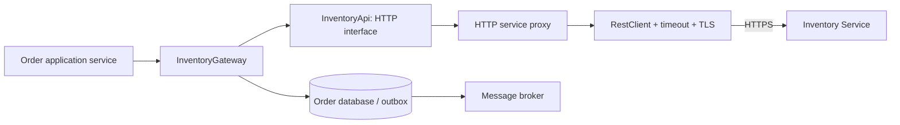
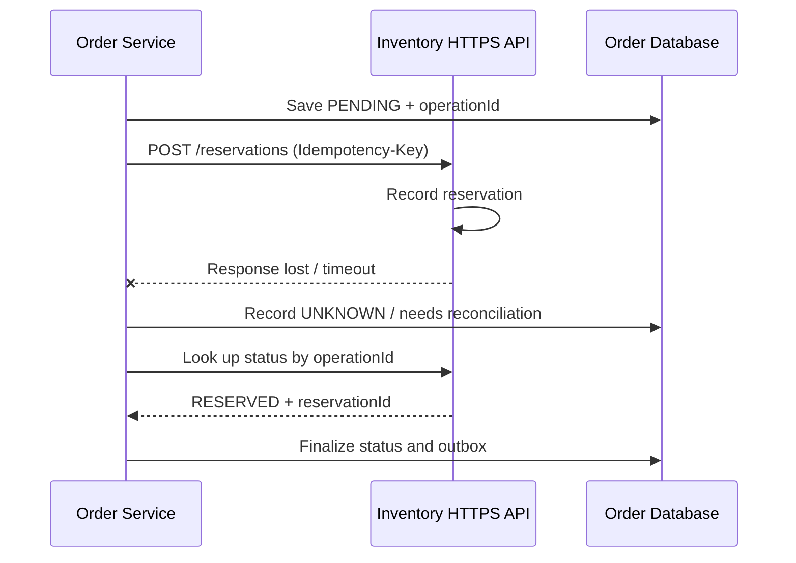
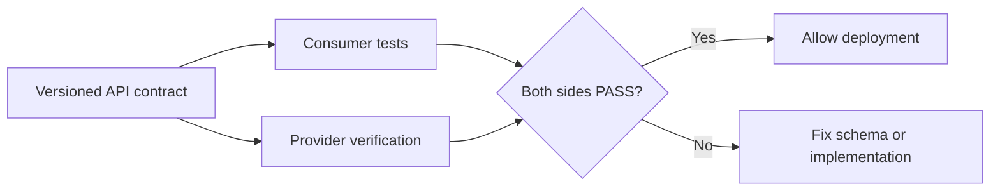

# Building a Declarative HTTP Client with Timeouts, TLS, and Contract Testing

## 1. Objectives and Practice Problem

In Spring Boot applications, HTTP calls to other services frequently appear across many business flows: checking inventory, fetching exchange rates, confirming payments, synchronizing customer profiles, or sending commands to partner systems. If you assemble URLs, build requests, handle status codes, and configure security manually in each service, small inconsistencies between call sites can easily introduce hard-to-detect bugs.

This practice lesson belongs to the **Comprehensive Practice** chapter of the **SPRING_BOOT_INTEGRATION** module. The module focuses on organizing system integration via HTTP clients, databases, caches, message brokers, and Spring Integration adapters; emphasizing **configuration management, data contracts, transactions, errors, duplicate handling, testing, and observability**. Here, we build a **declarative** HTTP client: describing endpoints using a Java interface while the framework generates the request-sending code.

**Expected outcomes:**

- Declare remote APIs using `@HttpExchange`, `@GetExchange`, and `@PostExchange`; create proxies via `HttpServiceProxyFactory`.
- Configure endpoints, timeouts, TLS, and truststores in environment configuration; reuse transport and HTTP clients.
- Separate the HTTP contract from the business integration gateway, validate returned data, and classify errors.
- Write consumer contract tests for URI, HTTP method, headers, JSON, and status; identify what requires provider verification.
- Plan real tests for TLS, timeouts, retries, and uncertain outcomes after a write request.

> **Version scope:** Examples use **Java 17+, Spring Boot 3.2+, and Spring Framework 6.1+**, with a synchronous model on Spring MVC and `RestClient`. Spring Framework has included HTTP interfaces since 6.0; `RestClient` and its corresponding adapter appeared in 6.1. APIs and configuration may change in other version lines. Code examples are split by file and omit common `import` statements to focus on integration.

### 1.1. Scenario: Order Service Calls Inventory Service

Order Service needs to check stock availability and ask Inventory Service to reserve items when a customer confirms an order. Inventory is an internal HTTPS API using certificates issued by the organization's private CA.

| Contract | Request | Success Response | Error Scenarios |
|---|---|---|---|
| Stock lookup | `GET /v1/stocks/{sku}` | `200`, JSON `{"sku":"SKU-42","available":8,"version":17}` | `404` SKU does not exist, `429` too many requests, `503` temporary error |
| Stock reservation | `POST /v1/reservations` with JSON and `Idempotency-Key` header | `201`, JSON `{"reservationId":"R-99","status":"RESERVED"}` | `409` conflict, `422` invalid data, `503` temporary error |

Reservation creation payload:

```json
{
  "orderId": "O-1001",
  "sku": "SKU-42",
  "quantity": 2
}
```

Operational requirements:

1. Only call Inventory's exact hostname over **HTTPS with certificate and hostname verification**.
2. Never wait indefinitely for connections or responses; timeouts are configured per environment.
3. Map HTTP and network errors into meaningful integration outcomes rather than silently returning default data.
4. For reservation commands, use an **idempotency key** managed by Order Service; never blindly resend requests after a timeout.
5. Consumer and provider must align on URLs, headers, JSON schemas, status codes, and error semantics through contract testing.



## 2. Understanding Declarative HTTP Clients

In the imperative style, we call `restClient.get().uri(...).retrieve().body(...)` for each endpoint. With a **Spring HTTP Interface**, a Java interface carries the request metadata; a proxy translates method calls into HTTP requests.

```java
@HttpExchange(accept = MediaType.APPLICATION_JSON_VALUE)
public interface InventoryApi {

    @GetExchange("/v1/stocks/{sku}")
    StockView getStock(@PathVariable("sku") String sku);

    @PostExchange(
            url = "/v1/reservations",
            contentType = MediaType.APPLICATION_JSON_VALUE
    )
    ReservationView reserve(
            @RequestHeader("Idempotency-Key") String operationId,
            @RequestBody ReservationRequest request
    );
}
```

This is a **client-side contract** and does not by itself guarantee that the API server implements it correctly. Annotations describe the path, HTTP method, how URL variables are passed, headers, and body. The framework does not require a hand-written `InventoryApiImpl` class.

| Component | Role |
|---|---|
| `@HttpExchange` | Shared HTTP attributes for the interface, such as `Accept` |
| `@GetExchange` / `@PostExchange` | Method and URL of each endpoint |
| `@PathVariable` | Binds Java variables into the URI template, avoiding manual URL string concatenation |
| `@RequestHeader` | Declares headers per the contract |
| `@RequestBody` | Serializes DTO into the request body |
| `HttpServiceProxyFactory` | Creates an object implementing the interface at runtime |
| `RestClientAdapter` | Configures the proxy to use `RestClient` as the HTTP transport |

You can use `WebClientAdapter` if the project uses WebFlux and wants to return `Mono`/`Flux`. This lesson chooses `RestClient` because Order Service uses a synchronous flow; switching to a declarative proxy does not make a request non-blocking.

## 3. Preparing Dependencies and Configuration

### 3.1. Maven

With Spring Boot and dependency management from the corresponding parent/BOM, the core dependencies can use:

```xml
<dependencies>
    <dependency>
        <groupId>org.springframework.boot</groupId>
        <artifactId>spring-boot-starter-web</artifactId>
    </dependency>
    <dependency>
        <groupId>org.springframework.boot</groupId>
        <artifactId>spring-boot-starter-actuator</artifactId>
    </dependency>
    <dependency>
        <groupId>org.springframework.boot</groupId>
        <artifactId>spring-boot-starter-test</artifactId>
        <scope>test</scope>
    </dependency>
</dependencies>
```

`spring-boot-starter-web` provides Spring Web, the HTTP client, and JSON serialization needed when Jackson is present. `spring-boot-starter-test` provides Spring Test and JUnit. `spring-boot-starter-actuator` is useful for observing health/metrics; actual metric/tracing export configuration depends on your system.

### 3.2. Separating Application Configuration from Java Code

```yaml
# application.yml
integration:
  inventory:
    base-url: ${INVENTORY_BASE_URL}
    connect-timeout: ${INVENTORY_CONNECT_TIMEOUT:2s}
    read-timeout: ${INVENTORY_READ_TIMEOUT:3s}

spring:
  ssl:
    bundle:
      jks:
        inventory:
          truststore:
            location: ${INVENTORY_TRUSTSTORE_LOCATION}
            password: ${INVENTORY_TRUSTSTORE_PASSWORD}
            type: PKCS12
```

In a real environment, `INVENTORY_BASE_URL` must be a valid HTTPS URL, such as `https://inventory.internal.example`; the PKCS#12 truststore file must contain Inventory's trusted CA certificate or certificate chain. **Do not commit the truststore password to the repository**. Secret locations and provisioning mechanisms can come from your organization's secret store or deployment pipeline.

Define typed properties:

```java
// InventoryClientProperties.java
@ConfigurationProperties(prefix = "integration.inventory")
public record InventoryClientProperties(
        URI baseUrl,
        Duration connectTimeout,
        Duration readTimeout
) {}
```

The example above uses `java.net.URI` and `java.time.Duration`. You should add startup validation: fields must not be null, timeouts must be positive, and the base URL must have the `https` scheme and an allowed hostname. With multiple downstreams, use separate namespaces per client so you do not accidentally apply the same timeouts and truststore across all of them.

### 3.3. Preparing the TLS Truststore

The truststore defines **which server certificates/CAs the client trusts**. A truststore is distinct from a keystore, which holds the private key and client certificate used for **mutual TLS (mTLS)**.

Example of creating a truststore from a CA certificate issued and verified by an administrator:

```bash
keytool -importcert \
  -alias inventory-ca \
  -file inventory-ca.pem \
  -keystore inventory-truststore.p12 \
  -storetype PKCS12
```

The command will prompt to set/enter a password when needed. Only add trusted CAs; do not blindly download a certificate from a connection error and immediately trust it. Verify that the URL's hostname matches the Subject Alternative Name (SAN) on the server certificate. For mTLS, you also need to configure `spring.ssl.bundle.jks.inventory.keystore` with appropriate key/certificate details, and the server side must trust the CA that issued the client certificate.

## 4. Implementing the Declarative Client

### 4.1. DTOs Independent of the Database Model

```java
// StockView.java
public record StockView(String sku, int available, long version) {}

// ReservationRequest.java
public record ReservationRequest(String orderId, String sku, int quantity) {}

// ReservationView.java
public record ReservationView(String reservationId, String status) {}
```

DTOs reflect the **HTTP wire contract**. If Order Service has JPA entities `Order` or `OrderLine`, do not pass entities directly to Inventory. This prevents database schema changes from causing unintended API changes, while also providing a place to validate returned data.

In a real project, validate that `sku` is non-empty, `quantity` is positive, and response fields adhere to the contract. For extensible statuses, consider enums with a strategy for handling new values to avoid unexpected application failures.

### 4.2. Using a TLS Bundle to Configure the HTTP Transport

The following example builds a `RestClient` from the `RestClient.Builder` provided by Spring Boot; uses `SslBundles` to create an `SSLContext`, and attaches it to the JDK `HttpClient`. This keeps a clear link between the truststore and the transport actually used for requests.

```java
// InventoryClientConfiguration.java (imports abbreviated)
@Configuration(proxyBeanMethods = false)
@EnableConfigurationProperties(InventoryClientProperties.class)
public class InventoryClientConfiguration {

    @Bean
    InventoryApi inventoryApi(
            RestClient.Builder builder,
            InventoryClientProperties properties,
            SslBundles sslBundles
    ) {
        if (properties.baseUrl() == null
                || !"https".equalsIgnoreCase(properties.baseUrl().getScheme())) {
            throw new IllegalArgumentException(
                    "Inventory base-url must use HTTPS");
        }
        if (properties.connectTimeout() == null
                || properties.connectTimeout().isZero()
                || properties.connectTimeout().isNegative()
                || properties.readTimeout() == null
                || properties.readTimeout().isZero()
                || properties.readTimeout().isNegative()) {
            throw new IllegalArgumentException(
                    "Inventory timeouts must be positive");
        }

        SSLContext sslContext = sslBundles.getBundle("inventory")
                .createSslContext();

        java.net.http.HttpClient jdkHttpClient =
                java.net.http.HttpClient.newBuilder()
                        .sslContext(sslContext)
                        .connectTimeout(properties.connectTimeout())
                        .followRedirects(
                                java.net.http.HttpClient.Redirect.NEVER)
                        .build();

        JdkClientHttpRequestFactory requestFactory =
                new JdkClientHttpRequestFactory(jdkHttpClient);
        requestFactory.setReadTimeout(properties.readTimeout());

        RestClient restClient = builder
                .baseUrl(properties.baseUrl().toString())
                .requestFactory(requestFactory)
                .defaultHeader(
                        HttpHeaders.ACCEPT,
                        MediaType.APPLICATION_JSON_VALUE)
                .build();

        HttpServiceProxyFactory proxyFactory =
                HttpServiceProxyFactory
                        .builderFor(RestClientAdapter.create(restClient))
                        .build();

        return proxyFactory.createClient(InventoryApi.class);
    }
}
```

The main classes belong to the following packages:

| Type | Package |
|---|---|
| `@ConfigurationProperties`, `@EnableConfigurationProperties` | `org.springframework.boot.context.properties` |
| `SslBundles` | `org.springframework.boot.ssl` |
| `RestClient` | `org.springframework.web.client` |
| `JdkClientHttpRequestFactory` | `org.springframework.http.client` |
| `HttpServiceProxyFactory` | `org.springframework.web.service.invoker` |
| `RestClientAdapter` | `org.springframework.web.client.support` |
| `@HttpExchange`, `@GetExchange`, `@PostExchange` | `org.springframework.web.service.annotation` |

In Spring Boot, using the container-provided builder ensures registered customizers are applied, such as observation when observability infrastructure is configured. Because the request factory is **explicitly specified** in the example, the application's TLS/timeout configuration resides in this JDK transport; do not expect another request factory to automatically override security on your behalf.

**Why not create a client on every call?** `HttpClient` and `RestClient` are reused via beans; repeatedly creating new transports consumes connections and makes resource control difficult. Under high request volume, evaluate connection limits, backpressure/thread pools, and downstream SLAs. The JDK HttpClient manages its own connections; if fine-grained pooling configuration is required, you can choose another transport, provided you attach TLS/timeouts and retest thoroughly.

### 4.3. Making HTTP Calls Through the Declared Interface

The application simply injects `InventoryApi`:

```java
@Service
public class InventoryGateway {
    private final InventoryApi api;

    public InventoryGateway(InventoryApi api) {
        this.api = api;
    }

    public StockView getStock(String sku) {
        try {
            StockView stock = api.getStock(sku);
            if (stock == null || stock.sku() == null
                    || !stock.sku().equals(sku)
                    || stock.available() < 0) {
                throw new IllegalStateException(
                        "Inventory returned invalid stock data");
            }
            return stock;
        } catch (HttpClientErrorException.NotFound ex) {
            throw new UnknownSkuException(sku, ex);
        } catch (RestClientResponseException ex) {
            throw new InventoryIntegrationException(
                    "Inventory returned HTTP " + ex.getStatusCode().value(), ex);
        } catch (ResourceAccessException ex) {
            throw new InventoryIntegrationException(
                    "Inventory unreachable or timed out",
                    ex);
        }
    }

    public ReservationView reserve(
            String operationId,
            ReservationRequest request
    ) {
        if (operationId == null || operationId.isBlank()) {
            throw new IllegalArgumentException(
                    "Missing idempotency key");
        }
        try {
            ReservationView response = api.reserve(operationId, request);
            if (response == null || response.reservationId() == null) {
                throw new IllegalStateException(
                        "Inventory returned incomplete reservation response");
            }
            return response;
        } catch (ResourceAccessException ex) {
            throw new ReservationOutcomeUnknownException(
                    "Unable to determine whether Inventory reserved stock", ex);
        }
    }
}
```

Application exceptions can be placed in their own classes:

```java
public class UnknownSkuException extends RuntimeException {
    public UnknownSkuException(String sku, Throwable cause) {
        super("SKU does not exist: " + sku, cause);
    }
}

public class InventoryIntegrationException extends RuntimeException {
    public InventoryIntegrationException(String message, Throwable cause) {
        super(message, cause);
    }
}

public class ReservationOutcomeUnknownException extends RuntimeException {
    public ReservationOutcomeUnknownException(
            String message, Throwable cause) {
        super(message, cause);
    }
}
```

When handling `POST`, HTTP `409`, `422`, `429`, and `5xx` must also be classified according to their specific contract. The example only highlights the **timeout with unknown outcome** branch; a production application needs a complete mapping layer (including status codes and error codes), without exposing raw exceptions containing sensitive bodies to public APIs.

### 4.4. Role of Spring Security and Outbound Authentication

TLS authenticates the endpoint's identity and protects data in transit, but does not inherently grant authorization to call the API. Inventory may require OAuth2 client credentials, short-lived tokens, API keys, mTLS, or a combination of mechanisms. Attach credentials via an interceptor/filter or dedicated outbound client configuration; avoid hardcoding tokens into the interface or logging them.

If there are multiple outbound clients, isolate each system's credentials and truststore. Authenticating **incoming requests to Order Service** and authenticating **Order Service when calling Inventory** are two independent directions.

## 5. Designing Timeouts and Error Handling Based on Time Budgets

Timeout is not a single number. Its exact semantics depend on the transport and processing phase:

| Limit | What It Protects | Applied in Example |
|---|---|---|
| Connect timeout | Waiting to open a connection to the endpoint | `HttpClient.Builder.connectTimeout` |
| Read/request timeout | Limits waiting time for a response per request factory and transport | `JdkClientHttpRequestFactory.setReadTimeout` |
| Overall deadline | Maximum time for the entire operation, including DNS, resource acquisition, multiple requests/retries | Must be designed at the caller/orchestration layer, not just from the two properties above |
| Resource limits | Number of connections, pending requests, threads, and memory | Configured/measured at the transport and infrastructure layers |

In the JDK HTTP client, how read timeout is mapped can depend on the request factory implementation and version; do not assume every transport counts time identically. Timeouts must be tested against a **real HTTP server** that responds slowly or drops connections. Setting a `2s` connect timeout and a `3s` read timeout also does **not** prove the entire business operation completes within `5s`, especially with retries, DNS, database locks, or multiple downstreams.

For example, if a customer API request only has a `4s` budget, Order Service might need to allocate around `2s` for Inventory and the remainder for database/response work. If multiple retries accumulate past the deadline, the system still fails even though each individual call has a timeout configured.

### 5.1. Status Code Classification

| Outcome | Interpretation | Reference Policy |
|---|---|---|
| `200` with valid JSON | Lookup succeeded | Validate and map to domain |
| `201` with reservation ID | Reservation succeeded | Persist result linked to operation ID |
| `404` for SKU | Resource not found | Business error, usually do not retry |
| `400` / `422` | Invalid request | Fix data/contract, do not retry the same request |
| `401` / `403` | Authn/authz failed | Review token/permissions, alert appropriately |
| `409` | Business conflict | Follow contract: reconcile or notify, do not retry indefinitely |
| `429` | Rate limit | Respect `Retry-After` when present, bound retries/backoff |
| `502` / `503` / `504` | Potentially transient dependency error | Consider bounded retries for safe operations |
| Timeout or connection reset | May be unknown whether server processed it | For write commands, reconcile status/idempotency before retrying |
| `2xx` with empty/malformed body | Data contract violation | Report integration error, do not treat as success |

Do not catch every exception and return `null`, `0`, or a fake `200` response. Doing so hides incidents and can cause Order Service to oversell actual inventory.

### 5.2. Retries, Idempotency, and Transactions

Stock lookups via `GET` can usually be retried a few times on transient I/O errors or `503`, with backoff and jitter. For `POST /v1/reservations`, if Inventory already recorded the reservation but the response was lost, a client timeout does not prove the operation failed.

**A safer workflow:**

1. Order Service generates a stable `operationId` for **one logical reservation command** and persists it with the order in the `PENDING` state.
2. When calling Inventory, send the same `Idempotency-Key` on every retry attempt of that command.
3. Inventory **must commit** to handling the idempotency key per the contract: check for duplicates, return the previous result, or provide a status lookup API.
4. On timeout, record `UNKNOWN`/`PENDING_RECONCILIATION`; reconcile instead of generating a new key and calling repeatedly.
5. After determining the outcome, update the order status and emit events via outbox/broker according to application design.



The current contract does not define a lookup endpoint by `operationId`; the diagram illustrates **a capability that must be agreed upon with the provider**, not an already available endpoint. If the provider does not support lookup/idempotency, do not assume a write operation can be safely retried.

An Order Service database `@Transactional` does not make an HTTP request participate in the same ACID transaction. Avoid holding SQL transactions and locks while waiting on the network; for multi-system workflows, consider intermediate states, compensation, outbox, and idempotent message consumers. Spring Integration can orchestrate the flow, while the HTTP client must still honor the error contract and deadline.

## 6. Writing Consumer Contract Tests

Tests here must catch cases where the Java interface is modified with the wrong URL, method, header, or DTO, even when business unit tests stay green. Spring Test's `MockRestServiceServer` can bind to `RestClient.Builder` to verify requests and simulate responses **without opening real network connections**.

### 6.1. Test Fixture Building the Proxy

```java
// InventoryApiContractTest.java (imports and static imports abbreviated)
class InventoryApiContractTest {
    private MockRestServiceServer server;
    private InventoryApi api;

    @BeforeEach
    void setUp() {
        RestClient.Builder builder = RestClient.builder()
                .baseUrl("https://inventory.test");
        server = MockRestServiceServer.bindTo(builder).build();

        api = HttpServiceProxyFactory
                .builderFor(RestClientAdapter.create(builder.build()))
                .build()
                .createClient(InventoryApi.class);
    }

    @AfterEach
    void verifyRequests() {
        server.verify();
    }

    @Test
    void getStockMapsSuccessfulJsonResponse() {
        server.expect(requestTo(
                        "https://inventory.test/v1/stocks/SKU-42"))
                .andExpect(method(HttpMethod.GET))
                .andExpect(header(HttpHeaders.ACCEPT,
                        MediaType.APPLICATION_JSON_VALUE))
                .andRespond(withSuccess(
                        "{\"sku\":\"SKU-42\",\"available\":8,\"version\":17}",
                        MediaType.APPLICATION_JSON));

        StockView response = api.getStock("SKU-42");

        assertEquals("SKU-42", response.sku());
        assertEquals(8, response.available());
        assertEquals(17L, response.version());
    }

    @Test
    void reserveSendsIdempotencyKeyAndJsonBody() {
        server.expect(requestTo(
                        "https://inventory.test/v1/reservations"))
                .andExpect(method(HttpMethod.POST))
                .andExpect(header("Idempotency-Key",
                        "reserve-O-1001"))
                .andExpect(content().json(
                        "{\"orderId\":\"O-1001\","
                        + "\"sku\":\"SKU-42\",\"quantity\":2}"))
                .andRespond(withStatus(HttpStatus.CREATED)
                        .contentType(MediaType.APPLICATION_JSON)
                        .body("{\"reservationId\":\"R-99\","
                                + "\"status\":\"RESERVED\"}"));

        ReservationView response = api.reserve(
                "reserve-O-1001",
                new ReservationRequest("O-1001", "SKU-42", 2));

        assertEquals("R-99", response.reservationId());
        assertEquals("RESERVED", response.status());
    }

    @Test
    void missingSkuProducesHttp404Error() {
        server.expect(requestTo(
                        "https://inventory.test/v1/stocks/UNKNOWN"))
                .andRespond(withStatus(HttpStatus.NOT_FOUND)
                        .contentType(MediaType.APPLICATION_JSON)
                        .body("{\"code\":\"SKU_NOT_FOUND\"}"));

        assertThrows(
                HttpClientErrorException.NotFound.class,
                () -> api.getStock("UNKNOWN"));
    }
}
```

Common static imports: `MockRestRequestMatchers.requestTo`, `method`, `header`, `content`; `MockRestResponseCreators.withSuccess`, `withStatus`; and JUnit 5 `Assertions.assertEquals`/`assertThrows`. JSON tests use semantic matching so they do not depend on field order.

These three cases prove **the client sends requests matching consumer expectations** and decodes responses in the agreed format. They do not prove that the real Inventory server accepts those contracts. The tests also do not verify that `InventoryGateway` translates `404` into `UnknownSkuException`; that requires additional unit/integration tests at the gateway layer.

### 6.2. Making the Contract a Shared Asset

So consumer tests do not merely verify expectations invented by one team, lock down the contract with the Inventory team. At minimum, the contract must specify:

| Item | Must Be Agreed Upon |
|---|---|
| URL, method | `/v1` versioning, slashes, path variables, query encoding |
| Headers | `Accept`, `Content-Type`, `Idempotency-Key`, authentication |
| Schema | Required/optional, data types, nullable, unknown fields, enums, value bounds |
| Status codes | `200`, `201`, `404`, `409`, `422`, `429`, `5xx`, and error bodies |
| Semantics | When a reservation succeeds, duplicate reservations, out of stock, timeouts |
| Security | CA/truststore, hostname, TLS version, token or mTLS |
| Changes | Versioning, backward compatibility, breaking-change notification process |

You can use **OpenAPI** as the contract source with validators/provider tests, or **Pact/Spring Cloud Contract** for consumer-driven contracts: the consumer publishes expectations and the provider verifies them against the real implementation in CI. Pin tool versions compatible with the project's Spring Boot version; do not treat one-sided consumer mock runs as provider verification.

A sensible contract pipeline:



### 6.3. Recommended Contract Test Matrix

| Case | Simulated Data | Main Assertion |
|---|---|---|
| Valid stock | `200` + complete JSON | Correct URI, `Accept`, deserialization |
| Stock not found | `404` + error code | Throws right HTTP error and gateway maps it properly |
| Reservation succeeded | `201` + JSON | `POST`, `Content-Type`, idempotency key, body |
| Repeated reservation with same key | Provider returns same reservation per contract | Does not create duplicate reservation record |
| Conflicting reservation | `409` + error code | Caller distinguishes business conflict from network error |
| Invalid input data | `422` | Do not retry invalid request as-is |
| Rate limit | `429` + `Retry-After` | Budgeted/bounded retry if enabled |
| Temporary error | `503` | Propagates error with status, does not return stock = 0 |
| Empty or wrong-typed body | `200` with invalid response | Gateway detects contract violation |
| New values | Optional field added | Evaluates backward compatibility policy |

A provider test can assert that the same key and same payload return consistent results; if the key is reused with a different payload, the behavior must be defined by Inventory (e.g., returning `409`). Do not make assumptions just because the client sends a header.

## 7. Testing TLS and Timeouts Over Real Connections

`MockRestServiceServer` operates before the network layer and therefore **does not test TLS handshakes, certificates, hostnames, DNS, connection pools, or socket timeouts**. For these properties, you need a real HTTPS test server that can control certificates and response timing, such as WireMock/MockWebServer running with TLS or a test environment provided by the infrastructure team.

| Experiment | Setup | Expected Result |
|---|---|---|
| Trusted CA | Server uses valid cert for test hostname, truststore contains CA | HTTPS connection succeeds |
| Untrusted CA | Server uses cert from another CA | Handshake fails, no application data sent |
| Wrong hostname | SAN does not match URL hostname | Client rejects certificate |
| Expired certificate | Cert is outside validity window | Client refuses connection |
| mTLS missing client cert | Server requires client authentication | Handshake/authentication step fails |
| Slow connection | Server/network delays connection setup | Connect timeout takes effect |
| Slow response | Server accepts connection then holds response | Request/read timeout takes effect |
| Body truncated mid-stream | Server sends partial response then disconnects | I/O/decoding error is clearly propagated |
| Service temporarily failing | Server returns `503` then recovers | Retry respects condition, deadline, and max attempts |

**Practical TLS verification procedure:**

1. Prepare an HTTPS test server with a certificate whose SAN matches the simulated hostname (e.g., an internal name mapped in the test environment); issue it using a dedicated test CA.
2. Create a truststore containing only the test CA, pass its path/password via environment variables, and run the corresponding production client configuration.
3. Verify that a real request succeeds with the correct truststore.
4. Swap in a wrong CA and wrong hostname one at a time, confirming **the client rejects the connection**; never disable hostname verification or use trust-all just to make tests pass.
5. Run slow-response and timeout tests, measuring actual elapsed time and the status returned to the caller.

TLS failure cases should be tested in an isolated environment with test certificates, never by manipulating production CAs/truststores. If `SslBundles` reports a missing bundle or truststore, the application should fail at startup rather than silently falling back to unverified TLS connections.

**Practical testing note:** The URL `https://inventory.test` in `MockRestServiceServer` does not perform TLS itself; the domain is only used to match requests. Therefore, never treat passing mock tests as proof that production certificates are configured properly.

## 8. Ensuring the Integration Flow Aligns with Database, Cache, and Broker

At the **SPRING_BOOT_INTEGRATION** module level, an HTTP client is one adapter in the overall business flow. Critical decisions often sit at the boundaries between systems:

### 8.1. Database and Outbox

When placing an order, you can persist `PENDING` with the operation ID first, call Inventory outside a long transaction, and then update the status and write an outbox event in the same database transaction. An outbox worker publishes the event to the broker, and consumers must handle duplicates. If Inventory and Order DB get out of sync, use reconciliation/compensation states rather than expecting `@Transactional` to span HTTP.

### 8.2. Inventory Cache

Caching reduces load on lookup requests, but inventory changes rapidly. Do not rely on a stale cache to guarantee order placement succeeds. Using a cache with a short TTL for estimate displays may be reasonable; reservation decisions must rely on concurrency-controlled commands to Inventory. During failover, do not treat a timeout as `available = 0` or `available = ∞`.

### 8.3. Broker and Multi-Layer Retries

Order Service may be invoked directly via HTTP or from an event broker. If the broker consumer retries, the service retries, and the HTTP adapter also retries, actual requests can multiply. Define **one coordinated policy** for attempt counts, backoff, idempotency, and deadlines across the entire processing path. Ensure the same operation ID is preserved across redeliveries.

### 8.4. Observability

With Spring Boot Actuator/Micrometer and tracing properly configured, monitor:

- Call rate, response latency (p95/p99), and errors by HTTP status and downstream name.
- Timeouts/connection failures, `429`, `503`, retries, circuit breakers, and load on thread/connection pools.
- Reservation creation count and count of unknown-outcome reconciliations after timeouts.
- Correlation ID/trace ID across steps; if adding a request ID header, align with the provider.

Do not use SKU, order ID, idempotency key, or dynamic URLs as metric tags: cardinality will grow unbounded and may leak data. Logs should only contain operation type, endpoint template, status, duration, and correlation IDs; never log bearer tokens, private keys, truststore passwords, cookies, or full sensitive payloads.

## 9. Practice Acceptance Checklist

| Category | Passing Criteria |
|---|---|
| API declaration | `InventoryApi` has typed methods with correct paths/methods/headers/bodies |
| Configuration management | URL, connect timeout, read timeout, and TLS bundle come from environment configuration |
| TLS | Server certificate/hostname verified; wrong CA and wrong hostname cases fail as expected |
| Timeouts | Tested slow connections and slow responses over real transport; never hangs indefinitely |
| Contracts | Consumer tests verify serialization/deserialization, status codes, and headers; provider verification agreed in CI |
| Errors | `404`, `409`, `429`, `503`, I/O, and malformed bodies have explicit handling |
| Duplicates | `POST` uses a stable key; provider has an idempotency/reconciliation policy |
| Transactions | Does not assume SQL rollback undoes HTTP; has compensation/reconciliation states |
| Observability | Measures latency/errors/timeouts and proper correlation, does not log secrets |

### Common Mistakes to Avoid

1. **Setting socket timeouts without checking overall business duration:** retries can push total time past the SLA.
2. **Using a trust-all SSLContext or disabling hostname verification:** masks certificate errors and defeats TLS protection.
3. **Running mock tests and claiming TLS is verified:** mock HTTP does not perform real handshakes.
4. **Treating `404` as a network error or returning stock = 0 on all errors:** loses semantics and causes wrong business decisions.
5. **Generating a new idempotency key on every retry:** can create multiple reservations after a timeout.
6. **Using HTTP DTOs as JPA entities:** couples API schemas and domain/database schemas unintentionally.
7. **Testing only consumer contracts and skipping provider verification:** tests can stay green while the two systems are incompatible.
8. **Making outbound HTTP calls inside a long-running SQL transaction:** increases lock hold times and does not provide distributed transactions.

### Self-Check Questions

1. What does `HttpServiceProxyFactory` do? Why can an interface with only annotations execute HTTP calls?
2. How does `@GetExchange` differ from `@PostExchange`, and why should `Idempotency-Key` appear in the write contract?
3. How do a truststore and a keystore differ? When is mTLS needed?
4. Do connect timeout and request/read timeout automatically guarantee an overall deadline? Why or why not?
5. Why is `MockRestServiceServer` insufficient to prove TLS handshakes and timeouts work?
6. Which different risks do consumer contract tests and provider verification address?
7. When `POST /v1/reservations` times out, what state should be persisted to preserve reconciliation capability?
8. How do you avoid multi-layer retries across broker, service, and HTTP client?
9. Why does a `@Transactional` in Order Service not guarantee rolling back a reservation in Inventory?
10. What data must not be placed in logs or metric tags of an outbound HTTP client?

**Summary:** A declarative HTTP client consolidates the contract into an interface, making downstream call code clearer and easier to test. A reliable Spring Boot integration must combine **verified TLS, budgeted timeouts, semantically accurate error handling, contract testing on both consumer and provider sides, idempotency for write operations, transaction reconciliation, and operational observability**.
