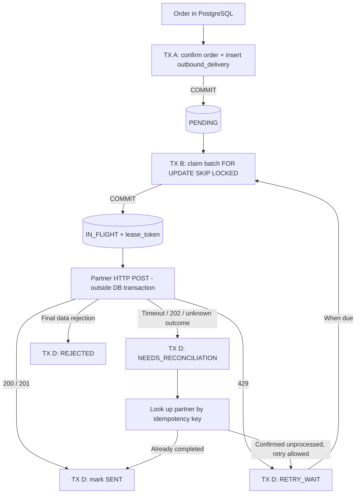
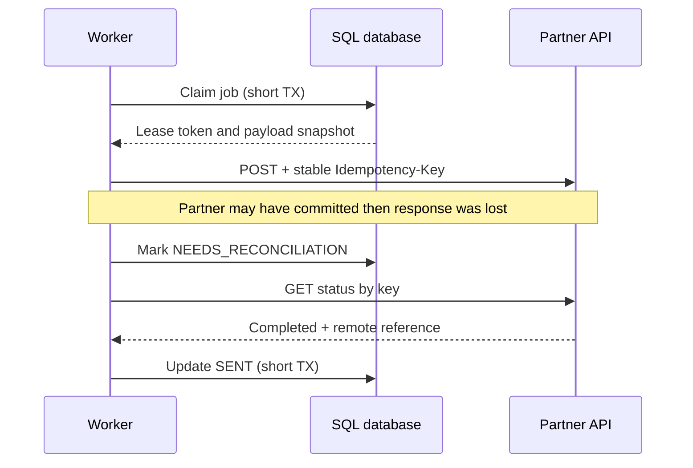

# Reading Data from SQL and Sending to an External Service with Clear Transaction Boundaries

> **Chapter:** Comprehensive Practice  
> **Context:** The **SPRING_BOOT_INTEGRATION** module organizes system connectivity in Spring Boot across HTTP clients, databases, caches, message brokers, and Spring Integration adapters. This practice combines **reading data from PostgreSQL**, building a durable outbound record, **calling a partner HTTP API**, and updating state using short transactions. The focus is on data contracts, transactions, errors, duplicate handling, testing, and observability.

## 1. Problem Statement and Required Outcomes

An order management service stores data in PostgreSQL. When an order is confirmed, the system must send the order information to a partner's API:

```http
POST /v1/orders HTTP/1.1
Content-Type: application/json
Idempotency-Key: 4a7598e6-c4d6-4d11-9acc-17237f61c8cf

{"orderId":"b47a765b-a870-4d36-b243-4eae42fcd405","amountMinor":125000,"currency":"VND"}
```

The partner specifies `200 OK` or `201 Created` as a completed result; `202 Accepted` means the request was only **accepted for later processing**. The partner also supports looking up status by idempotency key to reconcile after a lost connection. These are **practice contract assumptions** that must be replaced with the actual specifications of the target integration system.

The application must satisfy:

1. No lost send commands if the application crashes after confirming the order in SQL.
2. Do not hold DB transactions or locks during the HTTP call.
3. Two concurrently running workers must not claim the same record at the same normal point in time.
4. Retries use the same identifier and same payload; never create a second order on the partner side.
5. If the partner outcome is unknown (timeout, lost response, `202`), do not mark it as succeeded.
6. Every record can be tracked, retried, reconciled, or investigated individually.

**There is no single shared ACID transaction** spanning PostgreSQL and the partner HTTP API. This lesson uses a **durable outbound work table** (a form of transactional outbox for HTTP delivery) to narrow data-loss windows.

## 2. Two Approaches and Why the Work Table Approach Is Chosen

### 2.1. Easy to Write, Problematic in Practice

```java
@Transactional
public void exportOrders() {
    List<Order> orders = repository.findByStatus("CONFIRMED");
    for (Order order : orders) {
        restClient.post()
                .uri("/v1/orders")
                .body(toPartnerDto(order))
                .retrieve()
                .toBodilessEntity();
        order.markExported();
    }
}
```

The code above only illustrates **a design to avoid**. If HTTP is slow, the DB transaction holds resources for a long time. If the partner already processed an order but updating `EXPORTED` rolls back, the next run may resend the same order. If two instances read `CONFIRMED` without atomic claiming, both may call HTTP.

### 2.2. Recommended Design

Split into boundaries with distinct responsibilities:

| Boundary | Inside SQL Transaction? | Responsibility |
| --- | --- | --- |
| **A. Confirm order and enqueue** | **Yes** | Update order and insert outbound delivery record in the same transaction |
| **B. Claim pending records** | **Yes, very short** | Select work with lock, attach lease token, and commit |
| **C. Call HTTP API** | **No** | Send snapshot payload with fixed idempotency key |
| **D. Record outcome** | **Yes, very short** | Transition state after HTTP; use lease token to prevent stale workers from overwriting |



**Key learning point:** reading data from SQL and sending it out **does not have to** occur inside the same transaction. What must be ensured is that each **SQL state transition decision** is stored atomically, while external outcomes are reconciled when uncertain.

## 3. Minimal Technology Stack and Configuration

The example targets **Spring Boot 3.2+**, Java 17+, PostgreSQL, Spring JDBC, and Spring Framework's `RestClient`. Use versions managed by the Spring Boot parent/BOM; example Maven dependencies:

```xml
<dependencies>
    <dependency>
        <groupId>org.springframework.boot</groupId>
        <artifactId>spring-boot-starter-jdbc</artifactId>
    </dependency>
    <dependency>
        <groupId>org.springframework.boot</groupId>
        <artifactId>spring-boot-starter-web</artifactId>
    </dependency>
    <dependency>
        <groupId>org.postgresql</groupId>
        <artifactId>postgresql</artifactId>
        <scope>runtime</scope>
    </dependency>
</dependencies>
```

Example `application.yml`:

```yaml
spring:
  datasource:
    url: ${DB_URL:jdbc:postgresql://localhost:5432/integration}
    username: ${DB_USER:integration}
    password: ${DB_PASSWORD}
    hikari:
      maximum-pool-size: 10

partner:
  base-url: ${PARTNER_BASE_URL:http://localhost:8089}

integration:
  delivery:
    poll-delay-ms: 3000
```

**Do not put real credentials** in Git; the example relies on environment variables. Use Flyway/Liquibase or a versioned migration tool to create the schema. Connection count and poll delay must be tuned from real measurements rather than example values.

### 3.1. Bounding HTTP Calls and Creating RestClient

To prevent workers from hanging indefinitely, set connect/read timeouts. `SimpleClientHttpRequestFactory` below suffices for demonstration; in production, use an HTTP client with appropriate connection pooling, TLS, proxy, authentication, and metrics.

```java
package com.example.integration.delivery;

import org.springframework.beans.factory.annotation.Value;
import org.springframework.context.annotation.Bean;
import org.springframework.context.annotation.Configuration;
import org.springframework.http.client.SimpleClientHttpRequestFactory;
import org.springframework.scheduling.annotation.EnableScheduling;
import org.springframework.web.client.RestClient;

@Configuration
@EnableScheduling
public class DeliveryConfiguration {
    @Bean
    RestClient partnerRestClient(
            RestClient.Builder builder,
            @Value("${partner.base-url}") String baseUrl) {
        SimpleClientHttpRequestFactory factory =
                new SimpleClientHttpRequestFactory();
        factory.setConnectTimeout(2_000);
        factory.setReadTimeout(5_000);

        return builder
                .baseUrl(baseUrl)
                .requestFactory(factory)
                .build();
    }
}
```

**A client timeout does not confirm that the partner rolled back the transaction.** The partner server may have committed while the response was lost. Therefore, the recovery workflow needs a stable idempotency key and a status lookup API.

## 4. SQL Schema Design

The `orders` table holds source data. The `outbound_delivery` table stores a **snapshot payload** to send, along with operational status and lease token:

```sql
CREATE TABLE orders (
    id UUID PRIMARY KEY,
    tenant_id VARCHAR(64) NOT NULL,
    amount_minor BIGINT NOT NULL CHECK (amount_minor >= 0),
    currency VARCHAR(3) NOT NULL,
    status VARCHAR(20) NOT NULL
        CHECK (status IN ('NEW', 'CONFIRMED'))
);

CREATE TABLE outbound_delivery (
    id UUID PRIMARY KEY,
    tenant_id VARCHAR(64) NOT NULL,
    order_id UUID NOT NULL REFERENCES orders(id),
    destination VARCHAR(80) NOT NULL,
    payload_json JSONB NOT NULL,
    status VARCHAR(32) NOT NULL DEFAULT 'PENDING'
        CHECK (status IN (
            'PENDING', 'IN_FLIGHT', 'RETRY_WAIT',
            'SENT', 'NEEDS_RECONCILIATION',
            'REJECTED', 'FAILED_REVIEW'
        )),
    attempt_count INTEGER NOT NULL DEFAULT 0
        CHECK (attempt_count >= 0),
    next_attempt_at TIMESTAMPTZ NOT NULL DEFAULT CURRENT_TIMESTAMP,
    lease_token UUID,
    leased_until TIMESTAMPTZ,
    last_error_code VARCHAR(80),
    sent_at TIMESTAMPTZ,
    created_at TIMESTAMPTZ NOT NULL DEFAULT CURRENT_TIMESTAMP,
    updated_at TIMESTAMPTZ NOT NULL DEFAULT CURRENT_TIMESTAMP,
    CONSTRAINT uk_delivery_order_target
        UNIQUE (tenant_id, order_id, destination)
);

CREATE INDEX idx_delivery_poll
    ON outbound_delivery (status, next_attempt_at, created_at);
```

| Column | Meaning |
| --- | --- |
| `id` | **Stable Delivery ID**, also sent to the partner as the idempotency key |
| `payload_json` | Canonical snapshot content, unchanged across retries |
| `tenant_id, order_id, destination` | Natural key preventing duplicate jobs for the same target and order |
| `status` | Delivery progress, final outcome, or state requiring reconciliation |
| `attempt_count` | Number of times a worker claimed an attempt; supports retry limits |
| `lease_token, leased_until` | Identifies the worker holding the claim and lease expiration |
| `next_attempt_at` | Schedules retries without sleeping inside a DB transaction |
| `last_error_code` | Safe error classification for operations |

Because `payload_json` is a snapshot, if the order is modified after confirmation, the old delivery **still carries the locked-in content**. If business rules require emitting a new version, create a new operation/event version with its own identifier; do not mutate the payload of a delivery being retried under the same idempotency key.

### 4.1. States Are Not a Distributed Transaction

- `PENDING`: committed to SQL, not yet sent.
- `IN_FLIGHT`: claimed by a worker; an HTTP command may or may not have run.
- `RETRY_WAIT`: eligible for retry under the agreed policy.
- `SENT`: received completion response per the partner contract.
- `NEEDS_RECONCILIATION`: unclear whether partner executed it; requires lookup, do not blindly retry.
- `REJECTED`: partner permanently rejected the data (e.g., contract defines 400/422 as non-recoverable errors).
- `FAILED_REVIEW`: exceeded retry threshold or requires operator intervention.

These are **application-designed states**; Spring Boot does not generate them automatically.

## 5. Transaction A: Read SQL Order and Create Outbound Job

When an order transitions from `NEW` to `CONFIRMED`, both the order status and the outbound delivery record must be written **in the same SQL transaction**. Do not call the partner inside this method.

```java
package com.example.integration.delivery;

import java.util.UUID;
import org.springframework.jdbc.core.JdbcTemplate;
import org.springframework.stereotype.Service;
import org.springframework.transaction.annotation.Transactional;

@Service
public class OrderConfirmationService {
    private final JdbcTemplate jdbc;

    public OrderConfirmationService(JdbcTemplate jdbc) {
        this.jdbc = jdbc;
    }

    @Transactional
    public void confirmAndEnqueue(UUID orderId) {
        int confirmed = jdbc.update("""
            UPDATE orders SET status = 'CONFIRMED'
             WHERE id = ? AND status = 'NEW'
            """, orderId);

        if (confirmed != 1) {
            throw new IllegalStateException(
                    "Order missing or no longer NEW"
            );
        }

        int enqueued = jdbc.update("""
            INSERT INTO outbound_delivery (
                id, tenant_id, order_id,
                destination, payload_json
            )
            SELECT ?, o.tenant_id, o.id,
                   'partner-orders',
                   jsonb_build_object(
                       'orderId', o.id::text,
                       'amountMinor', o.amount_minor,
                       'currency', o.currency
                   )
              FROM orders o
             WHERE o.id = ? AND o.status = 'CONFIRMED'
            ON CONFLICT (tenant_id, order_id, destination)
            DO NOTHING
            """,
            UUID.randomUUID(), orderId
        );

        if (enqueued != 1) {
            throw new IllegalStateException(
                    "Delivery job was not inserted"
            );
        }
    }
}
```

Both statements execute on the **same DataSource/transaction manager**. If inserting the delivery fails or an exception escapes the method, the transaction rolls back the `orders` change as well. The call must go through the Spring proxy for `@Transactional` to take effect; self-invocation within the same object may not open a transaction as expected.

`UNIQUE (tenant_id, order_id, destination)` prevents duplicate enqueues if two processes race. It does not replace business-key constraints if the same logical order was created earlier with two different `orderId` values.

### 5.1. Backfilling Existing SQL Data

If the `orders` table already contains `CONFIRMED` orders before introducing the outbox, you can run a controlled backfill:

```sql
INSERT INTO outbound_delivery (
    id, tenant_id, order_id, destination, payload_json
)
SELECT gen_random_uuid(), o.tenant_id, o.id,
       'partner-orders',
       jsonb_build_object(
           'orderId', o.id::text,
           'amountMinor', o.amount_minor,
           'currency', o.currency
       )
  FROM orders o
 WHERE o.status = 'CONFIRMED'
ON CONFLICT (tenant_id, order_id, destination)
DO NOTHING;
```

The example uses `gen_random_uuid()` on PostgreSQL versions supporting this function; on other systems, UUIDs can be generated in the application. For large datasets, backfill in batches, establish scan checkpoints, measure row counts, and ensure new orders continue to be enqueued via **transaction A**. Periodic SQL polling alone without an atomic outbox can miss states or create gaps when workers and transactions update concurrently.

## 6. Transaction B: Claim SQL Rows in One Atomic Statement

If a worker only runs:

```text
SELECT * FROM outbound_delivery WHERE status = 'PENDING';
-- Then each worker runs UPDATE status = 'IN_FLIGHT'
```

two instances can read the same job before either updates it. You must **claim atomically**. PostgreSQL provides `FOR UPDATE SKIP LOCKED` so each worker picks rows not currently locked by another worker during the claim transaction.

### 6.1. One Claim Statement and Short Commit

```sql
WITH picked AS (
    SELECT id
      FROM outbound_delivery
     WHERE (
               status IN ('PENDING', 'RETRY_WAIT')
               AND next_attempt_at <= CURRENT_TIMESTAMP
           )
        OR (
               status = 'IN_FLIGHT'
               AND leased_until < CURRENT_TIMESTAMP
           )
     ORDER BY created_at, id
     FOR UPDATE SKIP LOCKED
     LIMIT :batch_size
)
UPDATE outbound_delivery d
   SET status = 'IN_FLIGHT',
       lease_token = :token,
       leased_until = CURRENT_TIMESTAMP + INTERVAL '2 minutes',
       attempt_count = attempt_count + 1,
       updated_at = CURRENT_TIMESTAMP
  FROM picked
 WHERE d.id = picked.id
RETURNING d.id, d.payload_json::text AS payload_json,
          d.lease_token, d.attempt_count;
```

`:batch_size` and `:token` in the SQL above are **illustrative parameter placeholders**. `JdbcTemplate` below uses JDBC `?` placeholders. The claim statement only touches the DB; the worker **commits immediately after claiming** and only then calls HTTP.

If the lease expires while a worker is still processing, another worker can reclaim the job. That is why you must use:

- **A stable idempotency key** on the partner side to prevent duplicate side effects.
- **A lease token** when finalizing so an older worker cannot overwrite a newer worker's outcome.
- Timeouts, batch size, and lease duration measured and tuned appropriately; the example uses a small batch.

### 6.2. Repository for Reading and Updating State

```java
package com.example.integration.delivery;

import java.util.List;
import java.util.UUID;
import org.springframework.jdbc.core.JdbcTemplate;
import org.springframework.stereotype.Repository;

record DeliveryJob(
        UUID id,
        String payloadJson,
        UUID leaseToken,
        int attemptCount) {}

@Repository
public class DeliveryStore {
    private final JdbcTemplate jdbc;

    public DeliveryStore(JdbcTemplate jdbc) {
        this.jdbc = jdbc;
    }

    public List<DeliveryJob> claim(int batchSize) {
        UUID token = UUID.randomUUID();
        return jdbc.query("""
            WITH picked AS (
                SELECT id FROM outbound_delivery
                 WHERE (
                           status IN ('PENDING', 'RETRY_WAIT')
                           AND next_attempt_at <= CURRENT_TIMESTAMP
                       )
                    OR (
                           status = 'IN_FLIGHT'
                           AND leased_until < CURRENT_TIMESTAMP
                       )
                 ORDER BY created_at, id
                 FOR UPDATE SKIP LOCKED
                 LIMIT ?
            )
            UPDATE outbound_delivery d
               SET status = 'IN_FLIGHT',
                   lease_token = ?,
                   leased_until = CURRENT_TIMESTAMP + INTERVAL '2 minutes',
                   attempt_count = attempt_count + 1,
                   updated_at = CURRENT_TIMESTAMP
              FROM picked
             WHERE d.id = picked.id
            RETURNING d.id, d.payload_json::text AS payload_json,
                      d.lease_token, d.attempt_count
            """,
            (rs, row) -> new DeliveryJob(
                    rs.getObject("id", UUID.class),
                    rs.getString("payload_json"),
                    rs.getObject("lease_token", UUID.class),
                    rs.getInt("attempt_count")
            ),
            batchSize, token
        );
    }

    public boolean transition(
            DeliveryJob job, String nextStatus, String errorCode) {
        // nextStatus only accepts values chosen by application code,
        // never pass raw strings from external requests.
        int changed = jdbc.update("""
            UPDATE outbound_delivery
               SET status = ?,
                   last_error_code = ?,
                   lease_token = NULL,
                   leased_until = NULL,
                   next_attempt_at = CASE
                       WHEN ? = 'RETRY_WAIT'
                       THEN CURRENT_TIMESTAMP + INTERVAL '2 minutes'
                       ELSE next_attempt_at END,
                   sent_at = CASE
                       WHEN ? = 'SENT'
                       THEN CURRENT_TIMESTAMP
                       ELSE sent_at END,
                   updated_at = CURRENT_TIMESTAMP
             WHERE id = ?
               AND status = 'IN_FLIGHT'
               AND lease_token = ?
               AND leased_until > CURRENT_TIMESTAMP
            """,
            nextStatus, errorCode, nextStatus, nextStatus,
            job.id(), job.leaseToken()
        );
        return changed == 1;
    }
}
```

**Why are `WHERE lease_token = ?` and expiration checks needed?** If worker A is slow enough that its lease expires and worker B reclaims the job, A must not overwrite B's state with `SENT` or `RETRY_WAIT`. When `transition()` returns `false`, emit a metric/alert; it does not mean you can update unconditionally. Worker A's remote request may still have occurred, so partner-side idempotency remains the other layer of defense.

Here `claim()` is **a single atomic SQL statement** and has no `@Transactional` wrapping the HTTP call. When each JDBC method executes one statement in normal autocommit mode, the claim completes and commits before `claim()` returns. If a caller or outer service opens a transaction spanning `claim()` and HTTP, the design loses the intended boundary; avoid doing that.

## 7. Calling the External Service and Finalizing in a Short Transaction

The worker must read `payload_json` stored in SQL and send the **same payload** and **same idempotency key** across every attempt. The partner is assumed to support this key and define response statuses as in section 1.

```java
package com.example.integration.delivery;

import org.slf4j.Logger;
import org.slf4j.LoggerFactory;
import org.springframework.beans.factory.annotation.Qualifier;
import org.springframework.scheduling.annotation.Scheduled;
import org.springframework.stereotype.Component;
import org.springframework.http.MediaType;
import org.springframework.web.client.ResourceAccessException;
import org.springframework.web.client.RestClient;
import org.springframework.web.client.RestClientResponseException;

@Component
public class DeliveryWorker {
    private static final Logger log =
            LoggerFactory.getLogger(DeliveryWorker.class);
    private final DeliveryStore store;
    private final RestClient client;

    public DeliveryWorker(
            DeliveryStore store,
            @Qualifier("partnerRestClient") RestClient client) {
        this.store = store;
        this.client = client;
    }

    @Scheduled(
        fixedDelayString = "${integration.delivery.poll-delay-ms:3000}")
    public void poll() {
        for (DeliveryJob job : store.claim(5)) {
            deliver(job);
        }
    }

    private void deliver(DeliveryJob job) {
        String nextStatus;
        String errorCode = null;

        try {
            var response = client.post()
                    .uri("/v1/orders")
                    .contentType(MediaType.APPLICATION_JSON)
                    .header("Idempotency-Key", job.id().toString())
                    .body(job.payloadJson())
                    .retrieve()
                    .toBodilessEntity();

            int status = response.getStatusCode().value();
            if (status == 200 || status == 201) {
                nextStatus = "SENT";
            } else {
                // 202 or a code not defined as terminal by contract
                // does not prove the operation completed.
                nextStatus = "NEEDS_RECONCILIATION";
                errorCode = "PARTNER_STATUS_" + status;
            }
        } catch (RestClientResponseException ex) {
            int code = ex.getStatusCode().value();
            errorCode = "HTTP_" + code;

            if (code == 429 && job.attemptCount() < 5) {
                nextStatus = "RETRY_WAIT";
            } else if (code == 400 || code == 422) {
                nextStatus = "REJECTED";
            } else if (code == 429) {
                nextStatus = "FAILED_REVIEW";
            } else {
                // 401/403/409/5xx... require investigation or reconciliation
                // per partner contract before resending.
                nextStatus = "NEEDS_RECONCILIATION";
            }
        } catch (ResourceAccessException ex) {
            // Timeout/connection loss: partner may have already committed.
            nextStatus = "NEEDS_RECONCILIATION";
            errorCode = "TRANSPORT_UNCERTAIN";
        }

        boolean updated =
                store.transition(job, nextStatus, errorCode);
        if (!updated) {
            log.warn("Could not finalize deliveryId={} (lease changed)",
                    job.id());
        }
    }
}
```

The example uses a `String` containing the JSON snapshot produced by PostgreSQL. With default client/message converters, a string body can be sent as JSON text under the declared Content-Type; in a real system, **test the transmitted bytes** with a mock HTTP server to avoid double-encoding or format changes when swapping libraries/codecs.

### 7.1. Do Not Mark `SENT` Just Because No Exception Was Thrown

`202 Accepted` usually means the partner has only recorded the task; do not treat it as a completed transaction unless the contract guarantees that. For `202`, the flow should save any lookup ID/`Location` provided and move to `NEEDS_RECONCILIATION` or another awaiting-confirmation state.

If the partner uses `204 No Content` to represent **completion**, add that code to the success branch **after verifying the contract**. In this lesson, only 200/201 mean completed.

`RestClient.retrieve()` throws `RestClientResponseException` by default for 4xx/5xx responses. `429` is retried within limits and according to delay policy; production code should inspect `Retry-After` and add backoff/jitter and circuit breakers as needed. `5xx` or `409` errors can be ambiguous regarding side effects, so this practice transitions them to reconciliation. Other application/codec errors also need an outer error boundary so they do not halt the scheduler or drop signals; see the testing and operations sections.

### 7.2. Lease Duration and Batch Limits

The example claims at most 5 jobs per cycle, with a 5-second read timeout per HTTP request and a 2-minute lease. These are **illustrative values only**. With large batches or parallel processing, design lease renewal, ownership tokens, concurrency limits, and appropriate timeouts. When a lease is lost, the worker may already have sent HTTP but no longer holds the right to finalize; the outcome must be reconciled or retried with the same key under the partner's idempotency guarantee.

## 8. Recovery: When You Do Not Know Whether the Partner Received It

`NEEDS_RECONCILIATION` is an intentional state, because an HTTP call can fail **after the partner has already executed it**.

A reconciler or operational procedure should:

1. Read deliveries with uncertain outcomes from SQL.
2. Query the partner API using **the idempotency key `outbound_delivery.id`** or `orderId` if the partner's lookup contract allows it.
3. If the partner confirms successful processing, update to `SENT` and store the remote reference in a short transaction.
4. If confirmed **not yet processed** and resending is permitted, transition to `RETRY_WAIT` with the same key/payload.
5. If status remains unknown, keep `NEEDS_RECONCILIATION`, alert, and schedule later reconciliation. Never delete the job to "let it retry from scratch."



If the partner **provides neither idempotency** nor status lookup capability, the system cannot strictly guarantee duplicate prevention when a response is lost. You must agree on a business key with a unique constraint on the partner side, establish a manual investigation workflow, or fix the contract before enabling automatic retries for operations with side effects.

### 8.1. Error Classification and Policies

| Situation | Handling |
| --- | --- |
| 200/201 per contract | `SENT`, store remote reference if provided |
| 202 asynchronous processing | Wait/look up status; do not mark `SENT` immediately |
| 400/422 terminal contract error | `REJECTED`; fix payload in a **new operation** with proper version/key if needed |
| 429 rate limit | Bounded `RETRY_WAIT`, backoff, and `Retry-After` if supported |
| 401/403 credentials or permissions | Operational alert and reconcile; do not retry aggressively |
| 409 conflict | Interpret per partner contract; may be valid duplicate or payload mismatch |
| 5xx, timeout, connection reset | Status may be unknown; look up before retrying side effect |
| Crash after DB claim before HTTP | Lease expires and job is reclaimed; same key/payload |
| Crash after remote success before `SENT` update | Replay after lease or reconciliation; remote idempotency protects side effect |

**Note on exceeding retry limits:** Never let an error loop infinitely, as it puts load on the partner system and fills the queue. Configure max attempts, a `FAILED_REVIEW` path, and properly authorized recovery actions.

## 9. Transaction Boundaries with Spring Integration, JPA, or Brokers

This pattern does not require Spring Integration; `@Scheduled` + Spring JDBC suffices for a simple worker. If the system already uses an Integration flow, you can replace the scheduler with a **JDBC polling inbound adapter** or message flow to structure reading and transformation. However, transaction boundaries must stay clear:

- DB poll/claim commits before calling the HTTP outbound gateway.
- The HTTP step must have its own timeout and outcome-verification rules.
- The status-update step must be an independent SQL transaction checking the lease token.
- `errorChannel` receives processing errors on endpoints with error publishing configured; it **does not automatically replace** durable jobs, retry tables, or broker DLQs.
- Across an `ExecutorChannel`/another thread, the previous thread's transaction context does not automatically propagate; place `@Transactional` on the service running on the thread that performs the DB update.

If using JPA instead of JDBC, avoid opening `@Transactional` across a method that "reads entities → calls HTTP → marks done." Split into a claim service and a finalize service with short transactions. Equivalent locking queries can vary by database and JPA provider; run integration tests on real PostgreSQL to verify `SKIP LOCKED` or another claim strategy.

### 9.1. If the Source Is a Message Broker Instead of SQL Polling

A Kafka/RabbitMQ consumer can receive an "order confirmed" event and enqueue a delivery into SQL. Once a durable record exists, the HTTP worker operates independently. **Broker ack/redelivery is a separate boundary**: if broker messages can arrive more than once, inserting the delivery needs a unique constraint or an inbox keyed by `producerId + eventId` to avoid duplicate enqueues.

If both the source data and outbox live in the same database, writing in the same DB transaction avoids losing commands between "change order state" and "create delivery." Across two separate DBs or a DB + broker, there is no default shared atomic commit; you need idempotency, replay, or reconciliation workflows.

## 10. Observability and Operations

A reliable worker must be able to answer: **how many orders are pending, which were sent, which have unknown outcomes, and why?**

| Recommended Metric/Log | Meaning |
| --- | --- |
| `delivery_pending_count` and `delivery_oldest_pending_age` | Is the SQL queue backing up? |
| `delivery_claim_total` and `delivery_claim_conflict_total` | Are workers claiming jobs and experiencing contention? |
| `delivery_send_latency` by destination/result | HTTP latency and outcome breakdown |
| `delivery_retry_total` / `delivery_reconciliation_count` | Error rate and backlog needing investigation |
| `delivery_lease_expired_total` | Are timeouts/worker pauses causing jobs to be reclaimed? |
| `delivery_finalize_stale_total` | Are stale workers losing authorization to update status? |
| `delivery_rejected_total` / `delivery_failed_review_total` | Contract errors or jobs requiring fixes |

These names are **custom metric proposals**, not metrics generated by Spring Boot out of the box. They can be exported via Micrometer/Actuator. Tag by normalized `destination`, `resultType`, and `errorClass`; do not put `orderId`, `deliveryId`, or payloads containing PII into metric tags because of very high cardinality.

Structured logs should include `deliveryId`, `correlationId`, `tenantGroup`, attempt, status, and latency, but should not log full JSON containing sensitive data, tokens, or credentials. TLS and partner authentication must be configured securely; the idempotency key itself is not an authentication credential.

### 10.1. Operational Support SQL Queries

Find backlogged jobs:

```sql
SELECT status,
       COUNT(*) AS total,
       MIN(created_at) AS oldest_created_at
  FROM outbound_delivery
 GROUP BY status
 ORDER BY status;

SELECT id, order_id, attempt_count, last_error_code,
       next_attempt_at, leased_until, updated_at
  FROM outbound_delivery
 WHERE status IN ('RETRY_WAIT', 'NEEDS_RECONCILIATION', 'FAILED_REVIEW')
 ORDER BY updated_at
 LIMIT 100;
```

Before "resetting" a job in production, verify its state with the partner. Changing `SENT` back to `PENDING` or deleting the delivery ID can create a new side effect if the partner system does not retain idempotency results long enough.

## 11. Integration Testing and Failure Scenarios

Unit-testing `deliver()` alone is not enough: the risk lies in **transaction boundaries, concurrency, uniqueness, timeouts, and lost responses**.

| Test Case | Outcome to Prove |
| --- | --- |
| Order confirmation succeeds | `orders.status=CONFIRMED` and one `PENDING` outbound delivery commit together |
| Delivery insert fails | Both order status and job roll back |
| Two workers claim concurrently | No two workers hold the same job under a valid claim at the same time |
| HTTP returns 201 | Job transitions to `SENT` once |
| HTTP returns 202 | Moves to reconciliation; does not mark `SENT` |
| HTTP returns 429 | Retries within limits and waits sufficiently |
| HTTP timeout after partner commit | Job is not treated as permanently failed; uses lookup/stable key to confirm |
| Worker crashes after claim | Once lease expires, job is reclaimed with the same delivery ID/payload |
| Worker A is slow, worker B acquires new lease | A's update is blocked by token/lease check |
| Broker redelivers order-confirmed event | Unique delivery/inbox blocks creating a duplicate job |
| Order edited after snapshot sent | Retries keep the agreed content or issue a new operation/version |
| Database or partner down | Metrics and states enable recovery without losing jobs |
| Payload contains sensitive info | Raw payload is not dumped into uncontrolled logs/DLQs |

Using **real PostgreSQL via Testcontainers** is recommended to test `FOR UPDATE SKIP LOCKED`, unique constraints, transaction commits/rollbacks, and leases. Use an HTTP mock server like WireMock/MockWebServer to control response codes, delays, dropped connections, and verify **Idempotency-Key** across attempts. Transaction tests must perform real commits/rollbacks; mocking JDBC does not prove atomicity.

### 11.1. Practicing Transaction Boundary Verification

You can attach metric/tracing spans around `confirmAndEnqueue()`, `claim()`, the HTTP call, and `transition()` and inspect logs:

```text
delivery=abc  phase=enqueue    db_tx=commit    duration_ms=12
delivery=abc  phase=claim      db_tx=commit    duration_ms=8
delivery=abc  phase=http      db_tx=none      duration_ms=190
delivery=abc  phase=finalize  db_tx=commit    duration_ms=6
```

These numbers are illustrative only, not a benchmark. What must be verified is that **the HTTP call does not occur while holding a DB transaction**, and the delivery record always retains enough information to recover if the process crashes.

## 12. Extension Exercises

1. **Add status lookup:** implement a reconciler calling a lookup API with `outbound_delivery.id` and moving `NEEDS_RECONCILIATION` to `SENT` or `RETRY_WAIT` once evidence is obtained.
2. **Realistic backoff:** replace the fixed two-minute retry with exponential backoff + jitter, respecting `Retry-After` and max attempts; avoid holding threads sleeping.
3. **Multi-destination:** send the same order to two independent systems. Explain why `(tenant_id, order_id, destination)` and one delivery ID per destination are necessary.
4. **Schema version:** add `payload_version` and handle evolution when the partner upgrades its contract. An already-claimed delivery must not change content under the same idempotency key.
5. **Data cleanup:** define retention periods for `SENT` and `REJECTED` based on replay SLAs, reconciliation needs, PII, and data policies. Never delete keys earlier than the window during which the partner might receive old retries.
6. **Harden the worker:** wrap unexpected errors per job, report metrics, renew leases during long processing, and bound concurrency/queue depth.

### Self-Check Questions

1. Why should an HTTP API not be called inside a `@Transactional` method that updates SQL?
2. Why does a simple `SELECT` followed by `UPDATE` easily lead to two workers sending duplicates?
3. What does `FOR UPDATE SKIP LOCKED` solve, and why is an idempotency key on the partner side still necessary?
4. If the partner already created the order but the response was lost, which state is more appropriate than `SENT` or `REJECTED`?
5. Why must the snapshot payload stay unchanged across retries of the same delivery ID?
6. When should an old outbound command be replaced by a new operation/version?
7. What does `lease_token` protect against when worker A is slow and worker B has already reclaimed?
8. Why can marking a job `SENT` in SQL and the partner processing the HTTP request not commit atomically in a standard JDBC transaction?
9. If the source is Kafka, what inbox/unique constraint policy is needed to avoid enqueuing two jobs for one event?
10. What tests prove that transactions are truly short and that the flow can recover after a crash?

**Takeaway:** For the **read SQL then send HTTP** problem, the reliable boundary structure is **source write + delivery job transaction**, **short DB claim**, **HTTP outside transactions**, and **short DB finalize**. Keep the payload/idempotency key stable, handle leases and unknown outcomes via reconciliation, and test crash points after commits and after side effects. The delivery table prevents losing send intent; final correctness still depends on the partner's idempotency contract and controlled observability and recovery.
