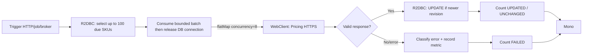
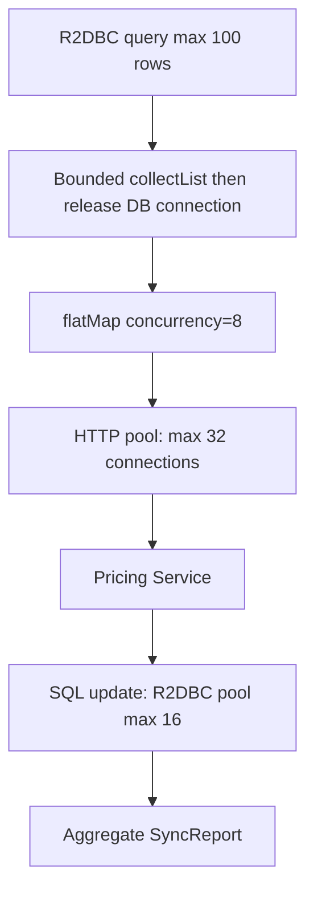
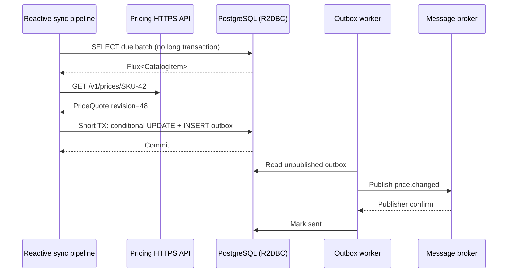

# Reactive Data Processing with R2DBC, WebClient, and Resource Limits

## 1. Objectives and Practice Scenario

In a data integration pipeline, an application often has to **read many records from a database**, call another service to enrich information, and then **update data or emit events**. Processed sequentially, total I/O wait time can become large. If thousands of concurrent requests are opened without bounds, the system can easily exhaust connection pools, memory, threads, partner rate limits, or database capacity.

**Spring Data R2DBC** provides reactive access to relational databases; **WebClient** provides reactive HTTP calls. Combining both technologies only pays off when the whole pipeline is well designed: **do not block the event loop, do not buffer unbounded data, do not open too many connections, do not swallow errors, and do not hold SQL transactions open while waiting on HTTP**.

This lesson belongs to the **Comprehensive Practice** chapter of the **SPRING_BOOT_INTEGRATION** module. The module covers organizing Spring Boot integrations via HTTP clients, databases, caches, message brokers, and Spring Integration adapters, emphasizing **configuration, data contracts, transactions, errors, duplicate handling, testing, and observability**. This exercise illustrates a realistic flow rather than demonstrating `Flux`/`Mono` in isolation.

After this lesson, you will be able to:

- Build a `Flux<CatalogItem>` pipeline from PostgreSQL via R2DBC → WebClient → PostgreSQL update.
- Distinguish **in-flight item concurrency**, **HTTP pool**, **R2DBC pool**, **timeouts**, and **memory limits**.
- Use bounded-concurrency `flatMap`, batched queries, per-item error isolation, and overall deadlines.
- Apply conditional SQL updates to prevent stale responses from overwriting newer data.
- Separate HTTP calls from reactive transactions and know when idempotency and transactional outbox are needed.
- Test the right boundaries: reactive logic, PostgreSQL/R2DBC, real HTTP, timeouts, rate limits, and backpressure.

> **Assumed versions:** Java 17+, Spring Boot 3.2+, Spring Framework 6.1+, and Reactor 3.6+ via your project's BOM/parent. Examples use Spring WebFlux/WebClient, Spring Data R2DBC, R2DBC PostgreSQL, and Reactor Netty. Option names or APIs may vary by version; do not arbitrarily pin incompatible Spring/Reactor/driver versions. Code is split by class and omits common `import` statements to focus on design; add actual packages/imports when integrating into a project.

### 1.1. Context: Product Price Synchronization

Inventory Service has a `catalog_item` table storing SKU, current price, source revision, and next refresh timestamp. Pricing Service is an HTTPS API returning the latest price and revision.

| Contract | Request/Source | Expected Data |
|---|---|---|
| Query due items | PostgreSQL `catalog_item` | Bounded list of N rows with `next_refresh_at <= now()` |
| Fetch remote price | `GET /v1/prices/{sku}` | `200` with `sku`, `priceCents`, and `revision` |
| Update price | SQL `UPDATE ... WHERE price_revision < :revision` | Accept only newer revisions, never regress revision |
| Schedule next check | `next_refresh_at` | Defer next check once a valid response is processed |

Example JSON from Pricing:

```json
{
  "sku": "SKU-42",
  "priceCents": 199900,
  "revision": 48
}
```

Assume `priceCents` is an integer in the smallest unit of the agreed currency; a production contract should add `currency` if multiple currencies exist and clearly define the source/semantics of revision. **Never use floating-point `double` to accumulate monetary amounts**.

Target pipeline:



**Critical boundary:** do not open a database transaction spanning the HTTP wait time; each SQL update is controlled independently. A single SKU failure should not cause the entire batch to lose its progress, nor should HTTP errors be converted into a price of 0.

### 1.2. Acceptance Criteria

1. Each run selects **at most 100–200 records** per configuration.
2. In-flight item concurrency is bounded, e.g., **8**, never unbounded `flatMap`.
3. WebClient bounds connection count, pending acquire count, connect timeout, response timeout, and body size.
4. R2DBC pool is sized appropriately across replicas; connections are not held while WebClient waits.
5. Responses with wrong `sku`, negative revision, or negative price are rejected; `404`, `429`, `503` are clearly classified.
6. Stale updates cannot overwrite newer revisions across concurrent workers.
7. Tests prove bounded concurrency, SQL compare-and-set, HTTP timeouts, and backend error scenarios.

## 2. Reactive Model: Non-Blocking Does Not Mean Unbounded

`Mono<T>` represents at most one element or an error/completion; `Flux<T>` represents 0 to many elements. A Reactor pipeline is typically **lazy**: it only executes upon subscription. In WebFlux, the framework subscribes at the HTTP boundary; in a scheduled job or message consumer, you must explicitly define where subscription/lifecycle is managed.

| Concept | Meaning in This Exercise |
|---|---|
| `Flux<CatalogItem>` | Stream of SKUs read from R2DBC and fed through the pipeline |
| `Mono<PriceQuote>` | Single response from the Pricing API |
| `Mono<Integer>` | Affected row count from an `UPDATE` statement |
| `flatMap(mapper, concurrency, prefetch)` | Allows concurrent inner Publishers with explicit bounds |
| Backpressure | Downstream signals demand per Reactive Streams; must align with source/driver |
| Connection pool | Limits connections to DB or HTTP downstream, **distinct** from in-flight Publisher count |
| `timeout` | Limits waiting for signals in a Publisher chain; does not roll back external effects |



**The three numbers 100, 8, and 32 are not equivalent:** 100 is the batch size; 8 is the number of items processed concurrently by one pipeline; 32 is the HTTP pool connection cap. Multiple batches can run concurrently across different requests/jobs, so total application HTTP concurrency can still exceed 8. You must control **both concurrent batch executions** and total resources.

### 2.1. Anti-Patterns to Recognize

```java
// Do not do this in WebFlux:
List<CatalogItem> all = repository.findAll().collectList().block();
for (CatalogItem item : all) {
    PriceQuote quote = pricingClient.getPrice(item.sku()).block();
    // update database with blocking calls...
}
```

The snippet above both blocks threads and risks loading the entire table into RAM. Swapping JDBC `findAll()` for R2DBC while still calling `.block()` on the event loop does not make the system reactive.

```java
// Also unsafe if record count is unbounded:
return repository.findAll()
        .flatMap(item -> pricingClient.getPrice(item.sku()));
```

`flatMap` specifies no explicit bound here; default concurrency depends on Reactor and may overwhelm rate limits or DB/HTTP pools. Never rely on defaults as a resource SLA. In production applications, specify **batch limit + concurrency + pool capacity + deadline + error policy**.

## 3. Dependencies and PostgreSQL/R2DBC Configuration

### 3.1. Maven

When the project uses the Spring Boot parent/BOM:

```xml
<dependencies>
    <dependency>
        <groupId>org.springframework.boot</groupId>
        <artifactId>spring-boot-starter-webflux</artifactId>
    </dependency>
    <dependency>
        <groupId>org.springframework.boot</groupId>
        <artifactId>spring-boot-starter-data-r2dbc</artifactId>
    </dependency>
    <dependency>
        <groupId>org.postgresql</groupId>
        <artifactId>r2dbc-postgresql</artifactId>
        <scope>runtime</scope>
    </dependency>
    <dependency>
        <groupId>org.springframework.boot</groupId>
        <artifactId>spring-boot-starter-actuator</artifactId>
    </dependency>
    <dependency>
        <groupId>org.springframework.boot</groupId>
        <artifactId>spring-boot-starter-test</artifactId>
        <scope>test</scope>
    </dependency>
    <dependency>
        <groupId>io.projectreactor</groupId>
        <artifactId>reactor-test</artifactId>
        <scope>test</scope>
    </dependency>
</dependencies>
```

- `spring-boot-starter-data-r2dbc` provides Spring Data R2DBC, but **still requires the R2DBC driver** for your database.
- `org.postgresql:r2dbc-postgresql` is the R2DBC driver; `org.postgresql:postgresql` is the JDBC driver—**they do not replace each other**.
- `spring-boot-starter-webflux` provides the reactive HTTP server and WebClient.
- `reactor-test` provides `StepVerifier` for testing reactive streams.

Add Testcontainers/PostgreSQL modules in test scope when a real database is needed. Do not pull in `spring-boot-starter-data-jpa` just because PostgreSQL is used: JPA relies on blocking JDBC and a different transaction manager.

### 3.2. SQL Schema

```sql
CREATE TABLE catalog_item (
    sku VARCHAR(80) PRIMARY KEY,
    price_cents BIGINT NOT NULL CHECK (price_cents >= 0),
    price_revision BIGINT NOT NULL DEFAULT 0,
    next_refresh_at TIMESTAMPTZ NOT NULL
);

CREATE INDEX idx_catalog_item_refresh
    ON catalog_item (next_refresh_at, sku);

INSERT INTO catalog_item
    (sku, price_cents, price_revision, next_refresh_at)
VALUES
    ('SKU-42', 180000, 47, TIMESTAMPTZ '2025-01-01 00:00:00+00'),
    ('SKU-43', 220000, 12, TIMESTAMPTZ '2025-01-01 00:00:00+00');
```

In production, schema must be managed via versioned migrations (Flyway/Liquibase or equivalent). Many migration tools use **JDBC** and a separate JDBC driver even when runtime queries use R2DBC; do not use unversioned `schema.sql` as a production migration strategy.

### 3.3. Connection Pool and Endpoint Configuration

```yaml
# application.yml — default values for local development only
spring:
  r2dbc:
    url: ${R2DBC_URL:r2dbc:postgresql://localhost:5432/catalog}
    username: ${R2DBC_USERNAME}
    password: ${R2DBC_PASSWORD}
    pool:
      enabled: true
      initial-size: 2
      max-size: 16
      max-acquire-time: 1s
      max-idle-time: 30m

integration:
  pricing:
    base-url: ${PRICING_BASE_URL:http://localhost:8089}
    max-batch-size: 100
    item-concurrency: 8
```

In production, `PRICING_BASE_URL` must be an **authorized HTTPS endpoint**, with CA and hostname verification plus proper tokens/permissions. The local URL `http://localhost:8089` is only for connecting to a fake Pricing API in this practice. Database passwords and tokens must never be placed directly in the repository; obtain them from a secret manager or deployment mechanism.

**Sizing pools across replicas:** 6 instances × R2DBC `max-size=16` can demand up to **96** database connections (excluding other services, migrations, and admin tasks). Pool limits only cap client-side connections; they do not substitute for SQL optimization, indexes, or workload control. `max-acquire-time=1s` bounds how long a caller waits to borrow a connection, **not** the timeout for the entire query.

## 4. HTTP Contract and Data Mapping

### 4.1. DTO for the Pricing API

```java
// PriceQuote.java
public record PriceQuote(
        String sku,
        long priceCents,
        long revision
) {}
```

The contract must clearly specify:

| Element | Rule |
|---|---|
| `GET /v1/prices/{sku}` | SKU is a path variable; URL must be encoded by the client |
| `200` | JSON has matching `sku`, `priceCents >= 0`, `revision >= 0` |
| `404` | SKU does not exist in Pricing; **never** convert to price 0 |
| `429` | Rate limited; read `Retry-After` when present and respect time budget |
| `502/503/504` | Potentially transient; bounded retries only when policy allows |
| `401/403` | Invalid credentials or permissions; do not retry indefinitely |
| Malformed/empty body | Contract violation; must be observed and isolated |

In real monetary systems, add currency and business rounding rules. `revision` must increase monotonically **per SKU** according to the provider contract; otherwise, the revision-comparison SQL in section 5 becomes meaningless.

### 4.2. R2DBC Entity Reflects the Schema, Not the HTTP DTO

```java
// CatalogItem.java
@Table("catalog_item")
public record CatalogItem(
        @Id String sku,
        @Column("price_cents") long priceCents,
        @Column("price_revision") long priceRevision,
        @Column("next_refresh_at") Instant nextRefreshAt
) {}
```

`@Table`/`@Column` are in `org.springframework.data.relational.core.mapping`; `@Id` is in `org.springframework.data.annotation`. Keep HTTP DTOs separate from database entities so Pricing API schema changes do not automatically force persistence structure changes.

## 5. Querying and Conditional Updates via R2DBC

### 5.1. Reactive Repository

```java
// CatalogRepository.java — imports abbreviated
public interface CatalogRepository
        extends ReactiveCrudRepository<CatalogItem, String> {

    @Query("""
        SELECT sku, price_cents, price_revision, next_refresh_at
          FROM catalog_item
         WHERE next_refresh_at <= CURRENT_TIMESTAMP
         ORDER BY next_refresh_at, sku
         LIMIT :limit
        """)
    Flux<CatalogItem> findDue(@Param("limit") int limit);

    @Modifying
    @Query("""
        UPDATE catalog_item
           SET price_cents = :priceCents,
               price_revision = :revision,
               next_refresh_at = :nextRefreshAt
         WHERE sku = :sku
           AND price_revision < :revision
        """)
    Mono<Integer> updateIfNewer(
            @Param("sku") String sku,
            @Param("priceCents") long priceCents,
            @Param("revision") long revision,
            @Param("nextRefreshAt") Instant nextRefreshAt
    );

    @Modifying
    @Query("""
        UPDATE catalog_item
           SET next_refresh_at = :nextRefreshAt
         WHERE sku = :sku
           AND next_refresh_at <= CURRENT_TIMESTAMP
        """)
    Mono<Integer> deferNextCheck(
            @Param("sku") String sku,
            @Param("nextRefreshAt") Instant nextRefreshAt
    );
}
```

`@Query`/`@Modifying` belong to `org.springframework.data.r2dbc.repository`; `@Param` belongs to `org.springframework.data.repository.query`. The repository returns `Flux`/`Mono`, so callers do not need `.block()` to compose it in a pipeline.

**Why does `LIMIT :limit` matter?** A bounded batch prevents accidentally pulling an entire table of millions of SKUs. On PostgreSQL, an index on `(next_refresh_at, sku)` helps due-time queries perform well under suitable data distributions and query plans. Choose the batch limit based on time budgets and downstream capacity.

**Why does `price_revision < :revision` matter?** If two workers request the same SKU and receive responses out of order, the older version must not overwrite the newer one. A conditional `UPDATE` is atomic at the database level, better than `SELECT`-ing revision followed by an unconditional update:

```text
Worker A reads revision=47, receives API revision=49.
Worker B reads revision=47, receives API revision=48.
A updates first -> DB revision=49.
B updates later -> UPDATE ... WHERE revision < 48 affects 0 rows.
DB result remains revision=49, never regresses to 48.
```

Zero affected rows is not necessarily a network error: another worker may have written a newer revision, the SKU may have been deleted, or the response was stale. This example groups these into **UNCHANGED**; if finer distinction is required, query the state and define a stricter contract.

`deferNextCheck` handles valid responses whose revision is not newer: it defers the next check when the row is still due. The `next_refresh_at <= CURRENT_TIMESTAMP` predicate reduces the chance of overwriting a future schedule just set by another worker. Still, in a multi-replica cluster, workers can **read and invoke HTTP redundantly** before updating; `UPDATE` protects final data integrity, not duplicate outbound traffic. Section 9 discusses claiming/leasing.

### 5.2. Avoid Transactions Spanning HTTP Requests

Do not open a reactive SQL transaction and call WebClient inside `flatMap` before committing:

```java
// Anti-pattern: DB transaction remains open while waiting on network.
@Transactional
public Mono<Void> refreshOneBad(String sku) {
    return repository.findById(sku)
            .flatMap(item -> pricingClient.getPrice(sku))
            .flatMap(quote -> repository.updateIfNewer(
                    sku, quote.priceCents(), quote.revision(),
                    Instant.now().plusSeconds(900)))
            .then();
}
```

A reactive transaction is bound to the chain's Reactor Context upon subscription, so it can hold the connection/transaction open while waiting on the Pricing API. That increases lock/connection occupancy and easily exhausts the pool. For a standalone atomic `UPDATE` like the example, no transaction spanning read + HTTP + write is needed.

If an update must also insert an outbox event in the **same** transaction, wrap only **the database update + outbox insert** using `TransactionalOperator` or `@Transactional` on a dedicated reactive method **after receiving the price** from HTTP. Section 8 illustrates this.

## 6. Configuring WebClient with Resource Limits

### 6.1. One Reusable Transport, Never Create a Client per SKU

In an application using Reactor Netty, create one bounded `ConnectionProvider` for the Pricing API and pass it to `WebClient` via `ReactorClientHttpConnector`. Do not instantiate `ConnectionProvider`/`WebClient` on each call; doing so causes connection explosions and resource leaks.

```java
// PricingHttpConfiguration.java — imports abbreviated
@Configuration(proxyBeanMethods = false)
public class PricingHttpConfiguration {

    @Bean(destroyMethod = "dispose")
    ConnectionProvider pricingConnectionProvider() {
        return ConnectionProvider.builder("pricing-pool")
                .maxConnections(32)
                .pendingAcquireMaxCount(64)
                .pendingAcquireTimeout(Duration.ofSeconds(1))
                .build();
    }

    @Bean
    WebClient pricingWebClient(
            WebClient.Builder builder,
            ConnectionProvider pricingConnectionProvider,
            @Value("${integration.pricing.base-url}") URI baseUri
    ) {
        HttpClient httpClient = HttpClient
                .create(pricingConnectionProvider)
                .option(ChannelOption.CONNECT_TIMEOUT_MILLIS, 1_000)
                .responseTimeout(Duration.ofSeconds(2))
                .followRedirect(false);

        return builder
                .baseUrl(baseUri.toString())
                .clientConnector(
                        new ReactorClientHttpConnector(httpClient))
                .codecs(configurer ->
                        configurer.defaultCodecs()
                                .maxInMemorySize(256 * 1024))
                .build();
    }
}
```

Commonly used classes:

| Type | Package |
|---|---|
| `WebClient` | `org.springframework.web.reactive.function.client` |
| `ReactorClientHttpConnector` | `org.springframework.http.client.reactive` |
| `HttpClient` | `reactor.netty.http.client` |
| `ConnectionProvider` | `reactor.netty.resources` |
| `ChannelOption` | `io.netty.channel` |
| `Duration` / `URI` | `java.time` / `java.net` |

**Meaning of each limit:**

| Setting | Example Value | What It Bounds |
|---|---:|---|
| `maxConnections` | 32 | Max concurrent connections in the provider for endpoints sharing the pool |
| `pendingAcquireMaxCount` | 64 | Number of requests allowed to wait for a connection when pool is full |
| `pendingAcquireTimeout` | 1 s | Wait timeout when acquiring a connection from the pool |
| `CONNECT_TIMEOUT_MILLIS` | 1 s | TCP connection establishment timeout |
| `responseTimeout` | 2 s | HTTP response timeout per Reactor Netty semantics |
| `maxInMemorySize` | 256 KiB | Buffer limit when a codec aggregates payload to decode |

These limits protect **different stages**. `maxConnections=32` does not mean only 32 `Mono` instances can wait; when the pool is full, requests queue up to the pending acquire limit. `maxInMemorySize` does not automatically cap all streaming modes or application-allocated memory buffers.

### 6.2. TLS, Redirects, and HTTP Connection Security

Reactor Netty handles HTTPS over TLS when the URL scheme is `https`, but production must still verify certificate chains/hostnames and trust material per policy. If Pricing uses an internal CA or mTLS, configure a dedicated SSL context/credentials for the client and test invalid certificate cases. Never use `InsecureTrustManagerFactory` or disable hostname verification to fix handshake errors.

`followRedirect(false)` avoids automatically forwarding requests containing auth headers to another host if Pricing returns a redirect. If the real contract requires redirects, define an allowlist and credential-stripping/preservation rules carefully. `baseUri` from configuration must be validated as a valid URI, HTTPS in production, and an allowed host; never let callers supply arbitrary URLs to prevent SSRF.

If using OAuth2 client credentials, add token acquisition/refresh and an appropriate filter to the outbound WebClient rather than hardcoding bearer tokens. Having a `WebClient` bean does not prove real requests use TLS: only tests against an HTTPS test server/certificate verify that.

### 6.3. WebClient Adapter with Selective Retries

```java
// PricingClient.java
public interface PricingClient {
    Mono<PriceQuote> getPrice(String sku);
}
```

```java
// WebClientPricingClient.java — imports abbreviated
@Service
public class WebClientPricingClient implements PricingClient {
    private final WebClient client;

    public WebClientPricingClient(
            @Qualifier("pricingWebClient") WebClient client
    ) {
        this.client = client;
    }

    @Override
    public Mono<PriceQuote> getPrice(String sku) {
        return client.get()
                .uri("/v1/prices/{sku}", sku)
                .accept(MediaType.APPLICATION_JSON)
                .retrieve()
                .bodyToMono(PriceQuote.class)
                .switchIfEmpty(Mono.error(
                        new IllegalStateException(
                                "Pricing returned an empty response")))
                .retryWhen(
                        Retry.backoff(2, Duration.ofMillis(200))
                                .maxBackoff(Duration.ofMillis(800))
                                .jitter(0.5)
                                .filter(this::retryable))
                .timeout(Duration.ofSeconds(4));
    }

    private boolean retryable(Throwable error) {
        if (!(error instanceof WebClientResponseException ex)) {
            return false;
        }
        int status = ex.getStatusCode().value();
        return status == 502 || status == 503 || status == 504;
    }
}
```

In this example:

- `retrieve()` turns HTTP `4xx/5xx` into `WebClientResponseException` by default; `bodyToMono` decodes JSON on success.
- Only specific transient `5xx` statuses are retried for **GET**, up to two additional attempts, with backoff/jitter. `401`, `403`, `404`, and malformed JSON are **not** retried.
- `429` is **propagated as an error for orchestration awareness**; a real policy should inspect `Retry-After`, apply shared rate limiting, and retry only within budget. Retrying `429` immediately can worsen the situation.
- `WebClientRequestException` can originate from DNS, TCP, timeouts, or TLS; the example **does not blindly retry all network errors** to avoid futile retries on wrong certificates/credentials. If retrying transient connect failures, filter by root cause and actual recoverability.
- `timeout(4s)` is placed after `retryWhen` to cap the duration of **the entire publisher including retries**. Actual elapsed time also depends on subscription/cancellation timing and server-side processing.

Under strict contracts, error bodies should contain structured error codes rather than relying on exception text or logging full responses containing sensitive data. Also never convert Pricing errors into `PriceQuote(priceCents=0)`: that could write bogus prices into the database.

## 7. Orchestrating the R2DBC → WebClient → R2DBC Pipeline

### 7.1. Defining Observable Batch Outcomes

```java
// SyncOutcome.java
public enum SyncOutcome {
    UPDATED,
    UNCHANGED,
    FAILED
}

// SyncReport.java
public record SyncReport(
        long updated,
        long unchanged,
        long failed
) {
    public static SyncReport empty() {
        return new SyncReport(0, 0, 0);
    }

    public SyncReport add(SyncOutcome outcome) {
        return switch (outcome) {
            case UPDATED ->
                    new SyncReport(updated + 1, unchanged, failed);
            case UNCHANGED ->
                    new SyncReport(updated, unchanged + 1, failed);
            case FAILED ->
                    new SyncReport(updated, unchanged, failed + 1);
        };
    }
}
```

`UPDATED` means the `UPDATE` wrote a newer revision; `UNCHANGED` means the returned revision was ineligible for update or the record no longer matched; `FAILED` is a **recorded** error, not "price equals 0." The report reflects only SKUs in the current batch and does not replace global metrics or error-handling runbooks.

### 7.2. Reactive Service with Controlled Concurrency

```java
// CatalogSyncService.java — imports abbreviated
@Service
public class CatalogSyncService {
    private static final Logger log =
            LoggerFactory.getLogger(CatalogSyncService.class);
    private static final int HARD_MAX_BATCH_SIZE = 200;
    private static final Duration NEXT_CHECK_DELAY =
            Duration.ofMinutes(15);

    private final CatalogRepository repository;
    private final PricingClient pricingClient;
    private final Clock clock;
    private final int maxBatchSize;
    private final int itemConcurrency;
    private final AtomicBoolean running = new AtomicBoolean();

    public CatalogSyncService(
            CatalogRepository repository,
            PricingClient pricingClient,
            Clock clock,
            @Value("${integration.pricing.max-batch-size:100}")
            int maxBatchSize,
            @Value("${integration.pricing.item-concurrency:8}")
            int itemConcurrency
    ) {
        if (maxBatchSize < 1
                || maxBatchSize > HARD_MAX_BATCH_SIZE
                || itemConcurrency < 1 || itemConcurrency > 32) {
            throw new IllegalArgumentException(
                    "Batch size/concurrency exceeds configured bounds");
        }
        this.repository = repository;
        this.pricingClient = pricingClient;
        this.clock = clock;
        this.maxBatchSize = maxBatchSize;
        this.itemConcurrency = itemConcurrency;
    }

    public Mono<SyncReport> refreshDue(int limit) {
        if (limit < 1 || limit > maxBatchSize) {
            return Mono.error(new IllegalArgumentException(
                    "Invalid batch size or exceeds configuration"));
        }

        // Mono.defer checks concurrency on subscription,
        // not merely when constructing the Publisher.
        return Mono.defer(() -> {
            if (!running.compareAndSet(false, true)) {
                return Mono.error(new IllegalStateException(
                        "A sync batch is already running on this instance"));
            }

            return repository.findDue(limit)
                    // SQL has LIMIT <= 200 rows. Finish query
                    // before waiting on HTTP; do not hold R2DBC connection
                    // across Pricing requests.
                    .collectList()
                    .flatMapMany(Flux::fromIterable)
                    .flatMap(item -> refreshOne(item)
                            .onErrorResume(error -> {
                                // Production: metric + log sampling,
                                // never log tokens or full payloads.
                                log.warn("Pricing sync failed: type={}",
                                        error.getClass().getSimpleName());
                                return Mono.just(SyncOutcome.FAILED);
                            }), itemConcurrency, 1)
                    .reduce(SyncReport.empty(), SyncReport::add)
                    .doFinally(signal -> running.set(false));
        });
    }

    private Mono<SyncOutcome> refreshOne(CatalogItem item) {
        Instant nextCheckAt =
                clock.instant().plus(NEXT_CHECK_DELAY);

        return pricingClient.getPrice(item.sku())
                .flatMap(quote -> {
                    if (quote.sku() == null
                            || !quote.sku().equals(item.sku())
                            || quote.priceCents() < 0
                            || quote.revision() < 0) {
                        return Mono.error(new IllegalStateException(
                                "Pricing response violated contract"));
                    }

                    return repository.updateIfNewer(
                                    item.sku(),
                                    quote.priceCents(),
                                    quote.revision(),
                                    nextCheckAt)
                            .flatMap(rows -> {
                                if (rows == 1) {
                                    return Mono.just(SyncOutcome.UPDATED);
                                }
                                return repository
                                        .deferNextCheck(
                                                item.sku(), nextCheckAt)
                                        .thenReturn(SyncOutcome.UNCHANGED);
                            });
                });
    }
}
```

Register `Clock` so timestamps can be tested deterministically:

```java
@Configuration(proxyBeanMethods = false)
class ClockConfiguration {
    @Bean
    Clock applicationClock() {
        return Clock.systemUTC();
    }
}
```

**Reading the execution chain in order:**

1. `refreshDue(limit)` validates the limit configured by `integration.pricing.max-batch-size`, with a hard cap of 200; the constructor also validates concurrency from 1 to 32.
2. `Mono.defer` + `AtomicBoolean` prevents two subscriptions from running **two batches simultaneously in one JVM**. `doFinally` releases the flag on completion, error, or cancellation.
3. `repository.findDue(limit)` returns at most N rows. `collectList()` is **safe here because SQL has LIMIT <= 200** and ensures the query finishes and releases the R2DBC connection before waiting on WebClient; then `Flux.fromIterable` processes the bounded list. This is completely different from `findAll().collectList()` over an entire table.
4. `flatMap(..., itemConcurrency, 1)` keeps at most the configured number of active inner Publishers (default 8); the last argument is prefetch for inner Publishers.
5. Each inner Publisher calls the Pricing API, validates the response, and executes the SQL update. If the revision is not newer, it defers the next check.
6. `onErrorResume` sits **inside each item**, so one failing item counts as `FAILED` while other items proceed; errors never become fake stock/price values.
7. `reduce` produces a `Mono<SyncReport>` with counts of updated, unchanged, and failed items.

Do not add `.subscribe()` inside `refreshOne` or call `.block()` within the pipeline. For a WebFlux HTTP controller, **the framework subscribes** to the returned result. For Quartz, schedulers, or imperative message consumers, you need an **application boundary adapter** that manages subscription and lifecycle rather than fire-and-forget without tracking errors or cancellation.

### 7.3. Example Internal Endpoint to Trigger a Batch

```java
// CatalogRefreshController.java
@RestController
@RequestMapping("/internal/catalog")
public class CatalogRefreshController {
    private final CatalogSyncService syncService;

    public CatalogRefreshController(CatalogSyncService syncService) {
        this.syncService = syncService;
    }

    @PostMapping("/refresh")
    public Mono<SyncReport> refresh(
            @RequestParam(defaultValue = "20") int limit
    ) {
        return syncService.refreshDue(limit);
    }
}
```

The sample endpoint returns the report **after the batch completes**. Never expose this endpoint to unauthorized users: protect it with authentication/authorization and rate limiting; in real systems, consider triggering the job asynchronously and returning `202 Accepted` with a job ID to avoid holding an HTTP request open across a long batch. Set inbound HTTP timeouts and proper cancellation handling: if the caller disconnects, some SQL updates may **already have committed** before the pipeline is canceled.

### 7.4. AtomicBoolean Only Protects a Single Instance

`AtomicBoolean` prevents two requests from running batches simultaneously in **one JVM**. It is **not a distributed lock**. With three replicas, each node has its own flag and can select `SKU-42` from the database at the same time.

Production options:

- **A single worker** coordinated by scheduler/leader election for this flow; only suitable if SLA and HA allow.
- **Database lease/claim:** lock/mark due rows in a short transaction so each worker receives a disjoint batch, with lease expiration for crash recovery.
- **Work queue:** distribute SKUs through a broker with idempotent keys; consumers bound concurrency and manage redelivery/DLQ.

Regardless of choice, `price_revision < :revision` still protects data against stale responses. But to avoid wasted requests or exceeding Pricing's rate limits, you must coordinate **batch inputs** cluster-wide, not just the database update.

## 8. Reactive Transactions, Errors, and Outbox Updates

### 8.1. Transactions Must Not Span HTTP

Spring Data R2DBC uses `R2dbcTransactionManager`/`ReactiveTransactionManager` and Reactor Context to manage transactions. Putting `@Transactional` on a method returning a Publisher applies a transaction on subscription, so if that method includes a WebClient request, the SQL transaction can hold a connection unnecessarily while waiting on the network.

**A cleaner boundary:**



The HTTP response from Pricing **is not inside the DB transaction**. The database transaction covers only SQL operations that must be atomic together. When events need to be emitted, write the outbox row inside that transaction; publish to the broker **after commit**. The outbox may publish more than once if the process crashes after broker confirmation but before marking sent, so consumers must still handle duplicate messages.

### 8.2. Illustrating `TransactionalOperator` for Update + Outbox

Assume an R2DBC-compatible `OutboxRepository`, an `OutboxEvent` carrying an operation ID with a unique constraint, and a `TransactionalOperator` configured with the reactive transaction manager.

```java
// Snippet inside an application service, after obtaining a valid quote:
Mono<SyncOutcome> commitPriceAndOutbox(
        CatalogItem item,
        PriceQuote quote,
        Instant nextCheckAt
) {
    Mono<SyncOutcome> databaseWork = repository.updateIfNewer(
                    item.sku(),
                    quote.priceCents(),
                    quote.revision(),
                    nextCheckAt)
            .flatMap(rows -> {
                if (rows == 0) {
                    return Mono.just(SyncOutcome.UNCHANGED);
                }
                OutboxEvent event = OutboxEvent.priceUpdated(
                        item.sku(), quote.revision(),
                        quote.priceCents());
                return outboxRepository.save(event)
                        .thenReturn(SyncOutcome.UPDATED);
            });

    return transactionalOperator.transactional(databaseWork);
}
```

This is an **extension skeleton**, not a complete class: you must define `OutboxEvent`, `OutboxRepository`, unique constraints, and collaborator injection. If replacing the handling in section 7, you must also handle the `UNCHANGED` branch and refresh scheduling, aligning on what SQL affected rows `0` means. Use this only with the same R2DBC database/connection factory and matching transaction manager; do not expect this method to be atomic with WebClient or the broker.

### 8.3. Per-Item Failure Handling

In `CatalogSyncService`, `onErrorResume` turns an item failure into `FAILED` so the batch continues. This **does not automatically create a retry job or dead-letter**: the failed row remains due and can be picked up again on the next run. If the scheduler runs too frequently during a Pricing outage, due rows may be retried continuously.

In production, add `next_attempt_at`, `last_error_code`, and `attempt_count` columns or a dedicated sync-attempts table with a backoff policy; store only safe error codes, never secret tokens/payloads. When a failure occurs:

1. Classify `404`/invalid schema as contract or data errors likely needing intervention.
2. Classify `503`/timeout/rate limit under a budgeted transient policy.
3. Defer the next attempt using a conditional SQL update and cap attempt counts.
4. Alert if a SKU fails repeatedly or the backlog grows steadily.

Never catch all exceptions and report `UPDATED` or assume price equals 0; that hides incidents and corrupts business data.

## 9. Resource Limits: Batch, Concurrency, Pool, Buffer, and Time

### 9.1. Each Limit Prevents a Different Kind of Overload

| Limit | Configuration/Location | If Missing |
|---|---|---|
| Batch size | SQL `LIMIT`, HTTP input validation | Reads uncontrollable volumes of data, runs too long |
| Item concurrency | `flatMap(..., 8, 1)` | Too many concurrent HTTP/DB operations, breaches downstream SLA |
| Batch concurrency | `AtomicBoolean` or cluster lease | Two triggers scan the same SKUs, duplicating requests |
| HTTP connections | `ConnectionProvider.maxConnections` | Too many TCP/TLS connections, exhausts downstream resources |
| HTTP acquire queue | `pendingAcquireMaxCount` / timeout | Hidden queue grows, requests stall or OOM |
| R2DBC connections | `spring.r2dbc.pool.max-size` | Database connection pressure or pool acquire timeouts |
| HTTP body memory | `maxInMemorySize` | Large JSON payloads exhaust memory while decoding |
| Deadline | Connect/response timeout + Reactor `timeout` | Requests/retry chains drag on without bound |
| Rate limit | Token bucket/quota per service and cluster-wide | HTTP `429` and retry storms overload partner |
| Buffers/caches | Bounded buffers, TTL/eviction | Unbounded backlog when consumer is slow or upstream is unthrottled |

Limits must **be calculated together**. If each batch has concurrency 8 and 10 batches run in parallel across nodes, active Pricing requests can reach around 80. An HTTP pool of 32 **per instance** across 3 replicas can allow more connections than downstream expects; to cap cluster-wide load, use distributed quota management or worker coordination.

### 9.2. Backpressure Does Not Replace Batch Limits

Reactive Streams enables downstream to request a number of items; when a pipeline subscribes to `repository.findDue(limit)` followed by `flatMap`, demand can help regulate flow. However:

1. SQL `LIMIT` is still necessary; never let an entire multi-million-row table become an unbounded stream for one request.
2. Drivers may fetch/buffer data at the protocol/implementation level; measure actual memory usage instead of assuming rows always sit in a buffer sized strictly to concurrency.
3. `flatMap` keeps up to the specified number of active inner Publishers, but Publishers can create internal queues/buffers; `prefetch` and other operators also affect buffering.
4. HTTP downstreams rate-limit per second, not only by concurrent connections. Reactor backpressure does not automatically honor `Retry-After` or organization-wide quotas.
5. When sources are Kafka, RabbitMQ, or Redis Streams, each adapter has its own demand/ack/backpressure rules; do not assume `Flux` propagates throttling all the way to the broker.

Do not use unbounded `onBackpressureBuffer()` or `collectList()` on unknown data volumes. For multi-row tasks, combine **keyset pagination**, bounded batches, and claim/scheduler mechanisms; bounding concurrency alone does not eliminate the risks of an unbounded query.

### 9.3. Choose Initial Parameters Then Measure Instead of Guessing

Example settings in this lesson:

- Max batch of `100` SKUs for a normal run (hard cap `200`).
- Pipeline concurrency `8`.
- HTTP pool `32` connections, max pending acquire `64`.
- R2DBC pool max `16` connections per service instance.
- Connect timeout `1s`, response timeout `2s`, overall WebClient publisher timeout `4s`.
- JSON decode limit `256 KiB` per response at the codec layer.

These are **illustrative values**, not universal optimal settings. With 100 SKUs and 8 concurrent requests, a batch needs multiple rounds, so a synchronous HTTP endpoint can run for tens of seconds if Pricing responds slowly. Measure throughput, p95/p99, retry rate, CPU, connection pool usage, and DB/HTTP latencies, then tune.

If the caller's deadline is only 5 seconds, do not assume a 100-SKU batch can finish just because each request has a 4-second timeout. For larger volumes, switch to **stateful jobs, small-batch streaming, and `202` responses**.

### 9.4. Multi-Worker Claim/Lease: Never Hold SQL Locks During HTTP Calls

An upgrade path for multiple replicas:

1. Add `claimed_by` and `lease_until` columns, or a dedicated `catalog_sync_task` table.
2. Inside **a short SQL transaction**, select due SKUs that are unclaimed or whose lease expired, e.g., `SELECT ... FOR UPDATE SKIP LOCKED` on PostgreSQL, and update the worker's lease.
3. Commit the claim transaction **before** calling the Pricing API; then process with WebClient using bounded concurrency.
4. When updating prices, check revision and lease state/owner per contract, then release or reschedule.
5. If a worker crashes, the lease expires so another worker can pick it up; duplicate processing must remain safe.

`FOR UPDATE SKIP LOCKED` is PostgreSQL syntax and should not be copied blindly to every database without verifying semantics. Also never keep a transaction holding `SELECT ... FOR UPDATE` open while waiting on HTTP: it locks rows and holds connections for a long time, causing bottlenecks during outages.

If using a message broker to distribute SKUs, design queues, ack/nack, retries, DLQs, and **idempotency by SKU + revision or operation ID**. Reactive code does not automatically provide exactly-once across systems.

### 9.5. Preventing Retry Cascades When Downstream Fails

A Pricing Service returning `503` for many SKUs can trigger all workers to retry simultaneously. Designs should combine:

- Retries **only** for potentially transient errors and safe operations, with bounded attempts and exponential backoff + jitter.
- A budget for the **entire request**, not just individual attempts.
- Global rate limits and concurrency caps if the provider enforces a shared quota.
- Circuit breakers or load shedding during prolonged outages; fail/defer to the next scan instead of opening more connections.
- Delays between job runs or `next_attempt_at` per failure state; avoid immediately re-scanning failing records.

Retries can create duplicates downstream for `POST`/write operations. In those cases, use idempotency keys and outcome reconciliation; do not copy this lesson's `GET` policy onto a write command.

## 10. Testing from Reactor to PostgreSQL and Real HTTP

### 10.1. Unit Testing the Pipeline with `StepVerifier`

Orchestration tests should verify that a valid `PriceQuote` triggers the right update, the report returns `UPDATED`, and there is no `.block()` in application code. Use Mockito or fakes to avoid depending on a database or Pricing network:

```java
// CatalogSyncServiceTest.java — imports/static imports abbreviated
@ExtendWith(MockitoExtension.class)
class CatalogSyncServiceTest {
    @Mock
    CatalogRepository repository;

    @Mock
    PricingClient pricingClient;

    @Test
    void updatesWhenPricingRevisionIsNewer() {
        CatalogItem item = new CatalogItem(
                "SKU-42", 180000, 47, Instant.EPOCH);
        Clock clock = Clock.fixed(
                Instant.parse("2026-11-21T00:00:00Z"),
                ZoneOffset.UTC);

        when(repository.findDue(1))
                .thenReturn(Flux.just(item));
        when(pricingClient.getPrice("SKU-42"))
                .thenReturn(Mono.just(
                        new PriceQuote("SKU-42", 199900, 48)));
        when(repository.updateIfNewer(
                eq("SKU-42"), eq(199900L), eq(48L),
                any(Instant.class)))
                .thenReturn(Mono.just(1));

        CatalogSyncService service =
                new CatalogSyncService(
                        repository, pricingClient, clock, 100, 8);

        StepVerifier.create(service.refreshDue(1))
                .expectNext(new SyncReport(1, 0, 0))
                .verifyComplete();

        verify(repository).updateIfNewer(
                eq("SKU-42"), eq(199900L), eq(48L),
                eq(Instant.parse("2026-11-21T00:15:00Z")));
    }
}
```

This test verifies orchestration logic with fake dependencies; it **does not prove** that the SQL update runs properly on PostgreSQL or that HTTP headers/TLS or pool sizes are applied. Separate tests are required for each boundary.

### 10.2. Testing Bounded Concurrency

You can build a fake `PricingClient` returning `Mono.delay(...)` to simulate async calls, while using `AtomicInteger` to track active tasks and peak concurrency:

```java
AtomicInteger inFlight = new AtomicInteger();
AtomicInteger peak = new AtomicInteger();

PricingClient delayedPricing = sku -> Mono.defer(() -> {
    int current = inFlight.incrementAndGet();
    peak.accumulateAndGet(current, Math::max);

    return Mono.delay(Duration.ofMillis(30))
            .map(ignored -> new PriceQuote(sku, 120000, 2))
            .doFinally(signal -> inFlight.decrementAndGet());
});

// In a complete test, fake repository returns ~40 due SKUs
// and updateIfNewer(...) returns Mono.just(1).
// After StepVerifier confirms the batch completes:
assertTrue(peak.get() <= 8);
```

This is an **illustrative test fragment**: you need to provide a fake repository, inject a clock, and wait for `refreshDue(40)` to complete before asserting. It tests the `flatMap` bound within **one subscription**, not total concurrency across multiple instances or across the whole service if other pipelines exist.

### 10.3. Testing the Repository with PostgreSQL Testcontainers

To test conditional SQL, you need real PostgreSQL or a database closely matching production. In-memory H2 does not reliably reflect PostgreSQL `TIMESTAMPTZ`, locking, indexes, expressions, and transaction semantics.

Maven test dependencies:

```xml
<dependency>
    <groupId>org.springframework.boot</groupId>
    <artifactId>spring-boot-testcontainers</artifactId>
    <scope>test</scope>
</dependency>
<dependency>
    <groupId>org.testcontainers</groupId>
    <artifactId>junit-jupiter</artifactId>
    <scope>test</scope>
</dependency>
<dependency>
    <groupId>org.testcontainers</groupId>
    <artifactId>postgresql</artifactId>
    <scope>test</scope>
</dependency>
```

Example test verifying an update with an older revision:

```java
// CatalogRepositoryIT.java — imports abbreviated
@DataR2dbcTest(properties = "spring.sql.init.mode=always")
@Testcontainers
class CatalogRepositoryIT {
    @Container
    @ServiceConnection
    static PostgreSQLContainer<?> postgres =
            new PostgreSQLContainer<>("postgres:16-alpine");

    @Autowired
    CatalogRepository repository;

    @Autowired
    DatabaseClient databaseClient;

    @Test
    void olderPriceCannotOverwriteNewRevision() {
        String sku = "IT-SKU-101";
        Mono<CatalogItem> operation = databaseClient
                .sql("""
                    INSERT INTO catalog_item
                        (sku, price_cents, price_revision,
                         next_refresh_at)
                    VALUES (:sku, 200000, 5, CURRENT_TIMESTAMP)
                    ON CONFLICT (sku)
                    DO UPDATE SET price_cents = 200000,
                                  price_revision = 5
                    """)
                .bind("sku", sku)
                .then()
                .then(repository.updateIfNewer(
                        sku, 99999, 4,
                        Instant.parse("2027-01-01T00:00:00Z")))
                .flatMap(rows -> {
                    assertEquals(0, rows);
                    return repository.findById(sku);
                });

        StepVerifier.create(operation)
                .assertNext(item -> {
                    assertEquals(5L, item.priceRevision());
                    assertEquals(200000L, item.priceCents());
                })
                .verifyComplete();
    }
}
```

The test needs the `catalog_item` table created beforehand, e.g., placing the SQL from section 3 into `src/test/resources/schema.sql` or running test migrations. `@ServiceConnection` with compatible dependencies can supply R2DBC connection details from the PostgreSQL container; if your Boot/test support version differs, use `@DynamicPropertySource` to configure `spring.r2dbc.url` and username/password from the container.

With `@DataR2dbcTest`, only a **reactive data slice** is loaded, not `CatalogSyncService` or `WebClient`. To run the full pipeline, use `@SpringBootTest` with both the database and an HTTP test server, controlling side effects from any background jobs/listeners.

### 10.4. Testing WebClient Against a Real HTTP Server

`MockWebServer` (OkHttp) or WireMock lets you spin up an HTTP test server, assert paths/headers, and return JSON/statuses/delayed responses. The example below assumes a compatible `MockWebServer` version added to `testImplementation`/`test` scope:

```java
// WebClientPricingClientTest.java — imports abbreviated
class WebClientPricingClientTest {

    @Test
    void deserializesPriceOverHttp() throws Exception {
        MockWebServer server = new MockWebServer();
        server.start();
        try {
            server.enqueue(new MockResponse()
                    .setResponseCode(200)
                    .addHeader("Content-Type", "application/json")
                    .setBody("""
                        {"sku":"SKU-42",
                         "priceCents":199900,
                         "revision":48}
                        """));

            WebClient client = WebClient.builder()
                    .baseUrl(server.url("/").toString())
                    .build();
            PricingClient pricingClient =
                    new WebClientPricingClient(client);

            StepVerifier.create(pricingClient.getPrice("SKU-42"))
                    .expectNext(
                            new PriceQuote("SKU-42", 199900, 48))
                    .verifyComplete();

            RecordedRequest request =
                    server.takeRequest(2, TimeUnit.SECONDS);
            assertNotNull(request);
            assertEquals("/v1/prices/SKU-42", request.getPath());
        } finally {
            server.shutdown();
        }
    }
}
```

This test uses a local HTTP socket, verifying that the adapter actually sends requests and decodes bodies. It **does not yet** use `PricingHttpConfiguration` with its dedicated `ConnectionProvider`, nor does it test pools/timeouts/TLS. To accept production configuration, start a Spring context with `@SpringBootTest` or test beans from the real configuration against a test server, verifying timeouts, connection pressure, TLS, and cleanup.

### 10.5. Testing HTTP Errors and Timeouts

Use a controllable test server to verify:

| Fake Pricing Scenario | Adapter Expectation | Batch Expectation |
|---|---|---|
| `200` + valid JSON | Produces `PriceQuote` | `UPDATED` or `UNCHANGED` per SQL |
| `200` + JSON missing required fields | Contract error or validation failure | `FAILED`, does not write bad price |
| `404` | No retry | Classifies missing SKU, records `FAILED`/quarantine |
| `401/403` | No blind retry | Alerts on credential/permission error, no DB write |
| `429` + `Retry-After` | Propagates error to rate-limit policy | Defers retry per budget; no retry storm |
| `503` then `200` | Retries up to configured cap with backoff | Succeeds if still within deadline |
| Continuous `503` | Stops after retries/deadline | Counts `FAILED`, does not block batch |
| Slow HTTP response | Response timeout or overall timeout | Item fails, pipeline releases processing slot |
| Oversized body | Codec exceeds `maxInMemorySize` | Clear error, does not buffer unbounded payload |
| Invalid TLS CA/hostname | Handshake rejected | Does not connect; verification remains enabled |
| Full pool | Bounded acquire wait | Observe acquire timeout, throttle concurrency/load |

Example with `MockWebServer` to simulate a slow response:

```java
server.enqueue(new MockResponse()
        .setResponseCode(200)
        .addHeader("Content-Type", "application/json")
        .setBody(
                "{\"sku\":\"SKU-42\",\"priceCents\":199900,"
                        + "\"revision\":48}")
        .setBodyDelay(3, TimeUnit.SECONDS));
```

However, this only sets up a **slow server**. To verify `responseTimeout=2s`, the test must construct `WebClient` using **the actual Reactor Netty connector/timeouts from `PricingHttpConfiguration`** and assert error type/timing with `StepVerifier`; the default `WebClient` in test 10.4 does not have the same limits. Avoid asserting exact millisecond timing in CI; verify bounded failure with enough scheduling slack.

TLS testing requires an HTTPS test server with a certificate SAN matching the hostname and valid trust material; test cases with another CA, expired certs, and mismatched hostnames must be rejected. `MockRestServiceServer` or Mockito mocks do not execute real TCP/TLS handshakes.

### 10.6. Testing Batch Isolation Against Cascading Failures

A scenario that should be in the test suite:

- SKU A returns `200` with newer revision → SQL affected rows `1`.
- SKU B returns `404` → no retry, reported `FAILED`.
- SKU C returns `200` with older revision → SQL affected rows `0` and rescheduled.
- SKU D returns `503` repeatedly → bounded retry, reported `FAILED`.

Expect `SyncReport(updated=1, unchanged=1, failed=2)`, with no price turned into 0. Because `flatMap` may complete inner Publishers **out of input order**, tests must not rely on SKU completion order unless business rules require it. If ordering must be preserved, consider `concatMap` or `flatMapSequential` along with their resource/latency trade-offs.

### 10.7. Testing Concurrency, Pools, and Transactions in a Production-Like Environment

The following **cannot be concluded from isolated `StepVerifier` unit tests**:

1. Does PostgreSQL actually stay within the calculated connection limit across all replicas?
2. Does WebClient open excessive sockets or build unintended pending queues?
3. When Pricing responds slowly, are R2DBC connections held open across HTTP calls due to a misplaced `@Transactional`?
4. If a worker is killed between the SQL update and outbox event, does data remain consistent?
5. When two workers pick up the same due SKU, does data preserve the highest revision?
6. When the caller cancels, are in-flight SQL statements, HTTP requests, and subscribers cleaned up properly?

To verify, set up test/staging with **real PostgreSQL + a latency-tunable fake Pricing server + bounded pool profiles**, run concurrent load, and monitor connection, memory, latency, cancellation, and retry metrics. Never test against production databases or queues.

## 11. Connecting HTTP, Database, Cache, Broker, and Spring Integration

### 11.1. Nature of Systems at Each Boundary

| Boundary | Behaviors to Control | Issues Not Solved Automatically |
|---|---|---|
| R2DBC/PostgreSQL | SQL, transactions, pools, locks, revisions | Does not manage HTTP transactions |
| WebClient/HTTP | URL, TLS, timeouts, status codes, codecs, retries | Does not guarantee provider won't process duplicate commands |
| Redis/cache | TTL, invalidation, tenant isolation | Cache never replaces the database source of truth |
| RabbitMQ/Kafka/JMS | Queues/topics, ack, redelivery, DLQ | Does not make SQL commit and publish atomic |
| Spring Integration | Channels, routers, transformers, adapters, and error flows | Does not create distributed transactions or end-to-end backpressure across all connectors |
| Scheduler/Quartz | Trigger schedule and schedule recovery | Does not guarantee exactly-once business effects |

When adding caching to a pricing pipeline, establish the data authority clearly: `CatalogItem.priceCents` is the most recently synced price, not necessarily a valid transactional checkout price. If a cache displays prices while checkout calls another Pricing API, the contract must specify freshness expectations and consistency guarantees.

### 11.2. Switching from an HTTP Trigger to a Message Broker

A `RefreshSkuRequested(operationId, sku)` message can be redelivered by the broker after a crash. The consumer should:

1. Validate payload/schema version and operation ID.
2. Bound concurrency **at the message consumer** and downstream pools.
3. Call WebClient and update SQL conditionally by revision.
4. Persist processed status by operation ID or appropriate idempotency key in the database.
5. Ack after the outcome is durably persisted per policy; on transient errors, use bounded retries and move to DLQ after thresholds.

Reactor backpressure does not mean the broker automatically delivers strictly per a `Flux`'s demand; configure prefetch/ack/concurrency on the adapter as well. With Spring Integration, define explicit error channels, retry advice, and real transaction boundaries; do not assume a channel-based flow automatically prevents duplicates.

### 11.3. Switching to Quartz/Scheduled Jobs

Quartz can trigger a `refreshDue(100)` batch on a schedule, but the scheduler does not automatically subscribe to a Publisher and wait for completion according to service semantics. Build a **boundary adapter responsible for managing completion/errors/cancellation**, limit concurrent batches, and never mark an execution successful right after calling `Mono.subscribe()` without observing completion.

In multi-instance deployments, in-memory schedulers on each node can trigger the same batch simultaneously; clustered JDBC JobStore or leader election only coordinates **schedule firing**, not duplicate side effects from retries or HTTP timeouts. Continue using database claims/leases and SQL revision checks.

## 12. Security and Observability

### 12.1. Minimum Signals

| Category | Recommended Metrics/Events |
|---|---|
| R2DBC | Active/idle/pending acquire, acquire timeouts, SQL latency, query errors |
| WebClient | HTTP status by downstream/route template, p95/p99 latency, connect/response timeouts |
| Resources | Item/batch concurrency, HTTP pool saturation, event-loop delay, heap/GC |
| Batch | Selected SKU count, UPDATED/UNCHANGED/FAILED, batch duration, batches rejected due to already running |
| Retries | Retry count by error type, retry exhaustion, `429` and `Retry-After` |
| Data consistency | Stale revisions, updates with 0 affected rows, duplicate work, overdue pending items |
| Integration | Backlog/outbox, broker publish/ack/DLQ when corresponding adapters exist |

Spring Boot Actuator, Micrometer, and configured instrumentation can expose some of these signals; do not assume all metrics appear automatically just by adding a starter. Define dashboards per service, downstream host, operation group, and concrete alert thresholds.

**Avoid high-cardinality labels:** never use SKU, order ID, token, operation ID, or URLs containing path variables as metric tags. Use route templates like `/v1/prices/{sku}`, error categories, HTTP status codes, and downstream names. If tracing a specific SKU during investigations, access-controlled logs can include correlation IDs or policy-permitted SKUs, without logging entire responses containing sensitive information.

### 12.2. Propagating Trace/Correlation Across Reactive Chains

Reactive operators can execute across multiple threads; do not rely on custom `ThreadLocal` variables to carry correlation IDs across every `flatMap`. Use the tracing/context propagation mechanisms supported by Spring/Micrometer and Reactor for your project version. When writing to outbox/brokers, explicitly define correlation headers, propagation, and limits on propagated data.

Calling `publishOn(Schedulers.boundedElastic())` or `subscribeOn(...)` is not a default fix for "slow" WebClient/R2DBC: they are already designed for reactive I/O. `boundedElastic` fits isolating legacy blocking APIs inside a bounded branch, but it does not turn blocking JDBC or HTTP into R2DBC/WebClient and still requires measuring thread/task queuing.

### 12.3. Data and Endpoint Security

- Connect to Pricing over HTTPS/TLS with hostname validation; obtain truststores/credentials from managed secret storage.
- Use least-privilege database roles; separate migration roles from runtime roles when appropriate.
- Internal batch-trigger endpoints must require authentication, authorization, and rate limiting; prevent arbitrary users from triggering large workloads.
- Whitelist allowed configured Pricing hosts; never take arbitrary URLs from payloads/parameters to prevent SSRF.
- Validate SKU inputs, JSON size, contract versions, batch counts, and retry caps.
- Enforce PII, GDPR/organizational data policies on logs/traces/caches; never record tokens, passwords, private keys, or sensitive error bodies.

## 13. Acceptance Checklist and Common Pitfalls

| Check | Expected Result |
|---|---|
| Starters and driver | WebFlux, Spring Data R2DBC, and PostgreSQL R2DBC compatible under same BOM |
| Database schema | `catalog_item` has indexes and constraints, managed by versioned migrations |
| Input query | Every batch uses `LIMIT` and deterministic ordering |
| WebClient | Reuses connections, production HTTPS, codec size limit, timeouts, no uncontrolled redirects |
| Pipeline | No `.block()`, no hidden `.subscribe()` in services, bounded `flatMap` concurrency |
| Batch concurrency | One JVM never runs two batches concurrently; distributed claim plan for clusters |
| Error policy | `404/429/503` and malformed bodies never become fake prices; bounded retries |
| Database update | Older revisions never overwrite newer ones; zero affected rows interpreted properly |
| Transactions | SQL transactions are never held open during HTTP calls; outbox atomic with SQL if emitting events |
| Testing | Includes StepVerifier, real HTTP socket tests, PostgreSQL integration tests, errors/timeouts/concurrency |
| Observability | Dashboards cover latency, pools, retries, failed items, stale revisions, and backlogs |
| Security | TLS, secrets, IAM/DB ACLs, rate limits, auditing, and non-leaking logs |

### Pitfalls to Avoid

1. **Assuming reactive means infinite resources:** failing to bound batches/concurrency overloads pools and downstreams.
2. **Using `collectList()` on an entire table:** spikes memory and defeats streaming/batching benefits.
3. **Blocking the event loop with `.block()`:** degrades throughput or triggers `Blocking call` errors.
4. **Wrapping WebClient inside `@Transactional`:** holds SQL connections/locks while waiting on HTTP.
5. **Setting HTTP timeouts without acquisition/overall deadlines:** hidden queues grow long under load spikes.
6. **Retrying `401`/`404`/TLS errors:** cannot fix permanent failures and can cause request storms.
7. **Writing price = 0 when Pricing fails to respond:** blurs the boundary between errors and valid data.
8. **Unconditional updates by SKU:** stale responses overwrite newer data.
9. **Assuming `AtomicBoolean` protects the entire cluster:** replicas can still select the same SKUs.
10. **Testing only with mocks and claiming TLS/R2DBC are verified:** mocks execute neither database protocols nor HTTPS handshakes.

### Extension Exercises

**Exercise A — Automatic error rescheduling:** add `next_attempt_at` and `attempt_count`, apply backoff for `429`/`503` without causing retry storms; write multi-run tests.

**Exercise B — Controlled concurrency tuning:** test levels `2, 4, 8, 16` in staging, measure p95/p99, CPU, HTTP pool wait, and R2DBC acquire; choose a level meeting SLAs without triggering `429`.

**Exercise C — Multi-replica:** design claim/lease using PostgreSQL `SKIP LOCKED` in a short transaction; kill a worker and verify lease expiration without overwriting newer revisions.

**Exercise D — Event-driven:** after each successful price update, record `price.changed` in an outbox inside the R2DBC transaction, publish via RabbitMQ/Kafka, and prove idempotent consumer handling for duplicate events.

### Self-Check Questions

1. How does R2DBC differ from JDBC? Is adding `spring-boot-starter-data-r2dbc` enough to connect to PostgreSQL?
2. Why does `findDue(limit)` still need `LIMIT` even though Reactor supports backpressure?
3. What does `flatMap(..., 8, 1)` bound, and what does it not bound across multiple requests/replicas?
4. Do the HTTP connection pool and R2DBC connection pool share resources or transactions?
5. How do connect timeout, response timeout, pending acquire timeout, and overall Publisher timeout differ?
6. Why does `maxInMemorySize` not guarantee the service's total heap stays within limits?
7. Why can retrying `GET` make sense on certain `503` errors while retrying `POST` after a timeout can be dangerous?
8. What race condition does `price_revision < :revision` prevent, and why doesn't it prevent two workers from making redundant HTTP calls?
9. Why should you not wrap WebClient and an R2DBC update in one reactive transaction?
10. When are transactional outbox and consumer idempotency needed in a price sync flow?
11. Does a `@DataR2dbcTest` prove HTTP timeouts or TLS work? Why or why not?
12. How do you measure and limit concurrency across multiple instances instead of within a single JVM?
13. If a user cancels the request after 70/100 SKUs have updated, how should batch state and per-item results be handled?

**Takeaway:** A reliable reactive pipeline needs **bounded R2DBC queries, WebClient with timeouts/connection pools, bounded-concurrency `flatMap`, atomic revision updates, per-item error isolation, and observable resources**. Reactive I/O uses threads efficiently while waiting on network, **not eliminating** limits of databases, HTTP providers, memory, or consistency requirements. As systems grow, add distributed claims, budgeted retries/backoff, short SQL transactions, outbox, real PostgreSQL/HTTP tests, and strict security policies.
