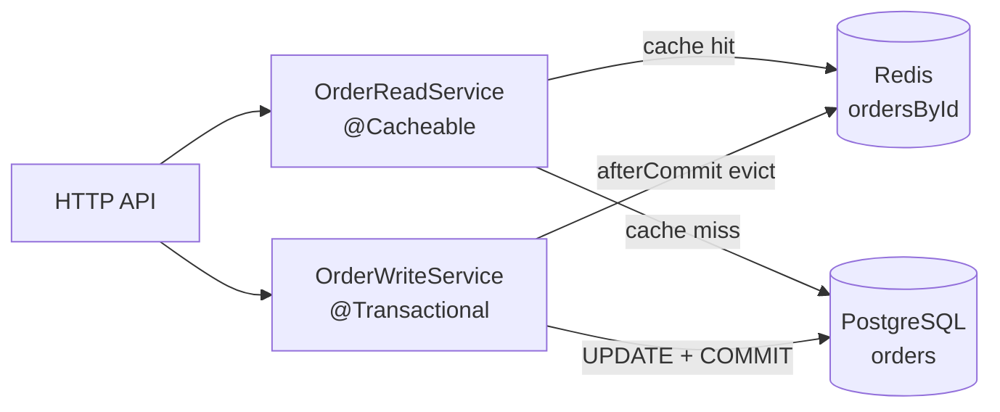
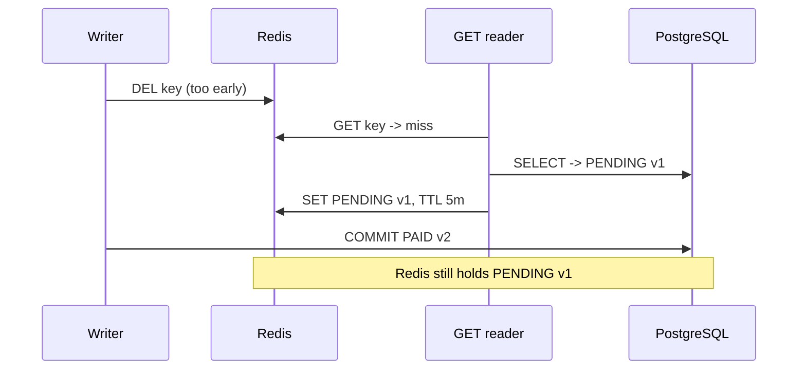
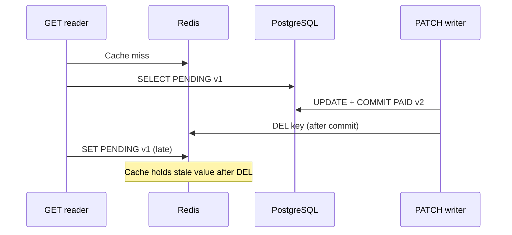
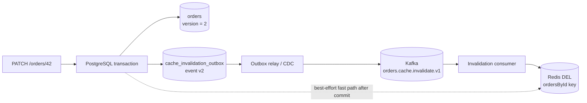

# Integrating Redis Cache with Post-Update Invalidation Policies

## 1. Practice Problem: Database Changed, Redis Still Returns Stale Data

Suppose a Spring Boot service reads orders from PostgreSQL and caches them in Redis to reduce latency. When a user updates the status, the system holds the same piece of truth in two places at different moments:

```text
GET   /api/orders/42         -> Order(status=PENDING, version=1)
PATCH /api/orders/42/status  -> updates to PAID, version=2
GET   /api/orders/42         -> expects PAID, but may still return PENDING
```

If you only add `@Cacheable` to the read method, stale responses keep coming from Redis until the TTL expires. If you delete the cache **before** the database transaction commits, a concurrent GET can refill the cache with old data. Even when deleting **after commit**, another race condition remains: a GET that read the old row before commit can write to the cache **after** the delete has already executed.

Therefore, a cache policy is not just configuring a Redis `DEL` command. It must explicitly define **which keys are deleted, when, how long staleness is acceptable, what happens when Redis is unavailable, and how to protect business side effects from stale data**.

This is a **Comprehensive Practice** lesson in the `SPRING_BOOT_INTEGRATION` module: organizing integrations in Spring Boot across HTTP clients, databases, caches, brokers, and Spring Integration adapters, emphasizing configuration, data contracts, transactions, errors, idempotency, testing, and operations.

**After this lesson, you will be able to:**

1. Design a **cache-aside** read flow with `@Cacheable` and Redis Cache Manager.
2. Update PostgreSQL with a version check and invalidate the corresponding cache **after commit**.
3. Configure TTL, serializers, tenant isolation, and consistent cache keys across pods.
4. Distinguish `@CacheEvict`, `@CachePut`, and a transaction-aware cache manager.
5. Recognize stale-refill races, DB commit success with failed Redis invalidation, and delayed invalidation events.
6. Design transactional outbox/Kafka when durable cross-service cache invalidation is required.
7. Test hit/miss, rollbacks, TTLs, Redis outages, concurrent requests, replays, and measure key metrics.

> **Versions:** Examples use Java 17+, Spring Boot 3.x, Spring Framework 6.x, Spring Data Redis 3.x, PostgreSQL, and Redis 7.x. For Spring Boot 4.x or other library versions, verify APIs/BOMs and auto-configuration before applying code verbatim. Code below is organized by file/class; place each public class/record in its own matching Java file.

## 2. Cache Is a Copy, Database Is the Source of Truth

Before coding, publish the data and consistency contract:

| Decision | Practice Policy |
| --- | --- |
| Source of truth | PostgreSQL, `orders` table. |
| Cached data | `OrderView` containing only readable fields: ID, tenant, status, version. |
| Cache identifier | `(tenantId, orderId)` pair; never use a bare order ID in a multi-tenant app. |
| Cache population | Cache miss → SELECT DB → Redis SET with TTL. |
| Data updates | DB UPDATE with optimistic version guard; Redis is never the business write store. |
| Invalidation timing | After DB transaction commits successfully. |
| TTL | Example 5 minutes to bound data age if invalidation is missed. |
| Non-existent state | Do not cache nulls in this example; 404 from DB. |
| Consistency level | **Eventual consistency** with cache-aside; critical write paths check DB directly. |
| Redis unavailable | GET can be designed to fall back to DB; invalidation errors after writes must be measured and recovered. |

Cache-aside helps when reads outnumber writes, temporary staleness within a window is acceptable, and Redis improves performance. It is **not** suitable as the final authority for deducting money, granting permissions, deducting inventory, checking transaction limits, or performing one-way state transitions. Those invariants must be verified at the source of truth inside a transaction/version guard.

### 2.1. GET and PATCH Flows



```text
GET:
  Redis GET key
    hit  -> return OrderView
    miss -> SELECT DB -> Redis SET key + TTL -> return OrderView

PATCH:
  BEGIN transaction
  UPDATE order WHERE id, tenant, expectedVersion, expectedStatus
  COMMIT transaction
  DEL matching cache key after commit
```

Redis Cache Manager enables Spring Cache annotations in Java code, but it **does not** create a distributed transaction between Redis and PostgreSQL. A crash after DB commit and before Redis DEL can still leave stale cache data. If you need deterministic recovery for that window, use the transactional outbox described later.

### 2.2. Two Definitions of Success

A PATCH request can end in `DB_COMMITTED` yet `CACHE_INVALIDATION_FAILED`. Do not describe this as "the database rolled back"; nor should you claim the cache was updated. The application needs logging, metrics, async retry or TTL fallback mechanisms, and clear response policies.

## 3. Data Schema and HTTP Contract

PostgreSQL table definition:

```sql
CREATE TABLE orders (
    id          BIGINT       NOT NULL,
    tenant_id   VARCHAR(80)  NOT NULL,
    status      VARCHAR(30)  NOT NULL,
    version     BIGINT       NOT NULL DEFAULT 0,
    updated_at  TIMESTAMPTZ  NOT NULL DEFAULT CURRENT_TIMESTAMP,
    PRIMARY KEY (tenant_id, id),
    CHECK (status IN ('PENDING', 'PAID', 'CANCELLED')),
    CHECK (version >= 0)
);

CREATE INDEX idx_orders_tenant_status ON orders(tenant_id, status);

INSERT INTO orders(id, tenant_id, status, version)
VALUES (42, 'tenant-a', 'PENDING', 1);
```

The `version` field increments on each status transition and acts as an optimistic concurrency condition. A composite primary key of tenant and ID helps prevent cross-tenant queries at the database layer. In authenticated systems, never accept an arbitrary tenant ID from a user header without authentication; identity/permissions must be verified at API and DAO layers.

DTO:

```java
// OrderView.java
package com.example.orders;

public record OrderView(
    long id,
    String tenantId,
    String status,
    long version
) {}
```

| Request | Expected Outcome |
| --- | --- |
| `GET /api/orders/42` | 200 + `OrderView` or 404. |
| `PATCH /api/orders/42/status` | 200 + new `OrderView` after commit. |
| PATCH with stale version | 409 Conflict (or 412 if API uses HTTP preconditions/ETag). |
| PATCH from invalid source status | 409 due to invalid business transition. |
| Redis fails during GET | DB fallback or error per defined SLO. |
| Redis fails after DB commit | DB remains committed; record invalidation failure for recovery. |

## 4. Dependencies and Application Configuration

Use an appropriate Spring Boot parent/BOM to manage versions:

```xml
<dependencies>
  <dependency>
    <groupId>org.springframework.boot</groupId>
    <artifactId>spring-boot-starter-web</artifactId>
  </dependency>
  <dependency>
    <groupId>org.springframework.boot</groupId>
    <artifactId>spring-boot-starter-jdbc</artifactId>
  </dependency>
  <dependency>
    <groupId>org.postgresql</groupId>
    <artifactId>postgresql</artifactId>
    <scope>runtime</scope>
  </dependency>
  <dependency>
    <groupId>org.springframework.boot</groupId>
    <artifactId>spring-boot-starter-data-redis</artifactId>
  </dependency>
  <dependency>
    <groupId>org.springframework.boot</groupId>
    <artifactId>spring-boot-starter-cache</artifactId>
  </dependency>
  <dependency>
    <groupId>org.springframework.boot</groupId>
    <artifactId>spring-boot-starter-test</artifactId>
    <scope>test</scope>
  </dependency>
</dependencies>
```

Development environment configuration example; never commit real secrets for environment variables:

```yaml
# application.yml
spring:
  datasource:
    url: ${JDBC_URL:jdbc:postgresql://localhost:5432/orders_db}
    username: ${DB_USERNAME:orders_app}
    password: ${DB_PASSWORD}
  data:
    redis:
      host: ${REDIS_HOST:localhost}
      port: ${REDIS_PORT:6379}
      username: ${REDIS_USERNAME:}
      password: ${REDIS_PASSWORD:}
      timeout: 2s
  cache:
    type: redis
```

In Spring Boot 3.x, Redis properties live under `spring.data.redis.*`; older `spring.redis.*` keys may not match the version. In production, enable TLS, verify certificates/hostnames, configure ACLs/secret managers, and set appropriate timeouts and pools. `RedisTemplate` is the direct Redis API; `RedisCacheManager` is the adapter for the Spring Cache abstraction.

**Migrations:** The `orders` table must be created with Flyway/Liquibase or your project's versioned schema process rather than ad-hoc creation/deletion during production startup. The SQL in this lesson only illustrates the required schema.

## 5. RedisCacheManager: TTL, Serialization, and Transaction Awareness

This is the central configuration:

```java
// RedisCachingConfiguration.java
package com.example.orders;

import java.time.Duration;
import org.springframework.cache.CacheManager;
import org.springframework.cache.annotation.EnableCaching;
import org.springframework.context.annotation.Bean;
import org.springframework.context.annotation.Configuration;
import org.springframework.data.redis.cache.RedisCacheConfiguration;
import org.springframework.data.redis.cache.RedisCacheManager;
import org.springframework.data.redis.connection.RedisConnectionFactory;
import org.springframework.data.redis.serializer.Jackson2JsonRedisSerializer;
import org.springframework.data.redis.serializer.RedisSerializationContext;

@Configuration(proxyBeanMethods = false)
@EnableCaching
public class RedisCachingConfiguration {

    @Bean
    CacheManager cacheManager(
        RedisConnectionFactory connectionFactory
    ) {
        var serializer =
            new Jackson2JsonRedisSerializer<>(OrderView.class);

        RedisCacheConfiguration config =
            RedisCacheConfiguration.defaultCacheConfig()
                .entryTtl(Duration.ofMinutes(5))
                .disableCachingNullValues()
                .serializeValuesWith(
                    RedisSerializationContext.SerializationPair
                        .fromSerializer(serializer)
                );

        return RedisCacheManager.builder(connectionFactory)
            .withCacheConfiguration("ordersById", config)
            .disableCreateOnMissingCache()
            .transactionAware()
            .build();
    }
}
```

**Breakdown of each option:**

- `@EnableCaching` enables Spring Cache interceptors. It is not a transaction configuration annotation.
- `ordersById` is a dedicated cache name for the `OrderView` type, allowing a matching typed JSON serializer. If adding caches holding other types, configure separate serializers for them.
- `entryTtl(5m)` sets retention duration from the time the entry is written. A normal GET hit does not automatically extend TTL via sliding expiration.
- `disableCachingNullValues()` prevents caching null values. Since our API throws NotFound instead of returning null, misses for missing orders continue checking the DB.
- `disableCreateOnMissingCache()` surfaces cache-name typos immediately rather than silently creating unconfigured caches without policies.
- **`transactionAware()`** synchronizes standard `put`/`evict`/`clear` cache operations with active Spring transactions: if transaction synchronization is active, operations are deferred until after commit; on rollback, they are skipped.

Spring Data Redis 3.x supports transaction-aware mode directly on the builder. Another option is wrapping a cache manager with `TransactionAwareCacheManagerProxy`. Do not stack wrappers arbitrarily; choose one approach and verify it with real integration tests.

**What is not guaranteed:** this is not a two-phase commit between PostgreSQL and Redis. If DEL after commit fails, PostgreSQL has still changed. Operations with immediate semantics like `Cache.evictIfPresent()` or `putIfAbsent()` must be understood individually; do not assume they become after-commit just because they come from the same manager bean.

### 5.1. Actual Key Names in Redis

Under typical Spring Data Redis configuration, the cache name acts as a prefix:

```text
ordersById::tenant-a:o:42
```

When a service calls `Cache.evict("tenant-a:o:42")` via the `ordersById` cache, the cache manager prepends the corresponding prefix. If another worker calls `StringRedisTemplate.delete("tenant-a:o:42")`, it may delete **the wrong key** due to the missing prefix. Go through the same cache abstraction and shared key builder, or version your key protocol if multiple applications manage keys.

Typed JSON caching is easy to inspect, but DTO evolution must be handled: changing fields/types can make old cached Redis entries fail deserialization. Use versioned cache namespaces, rollout-compatible serializers, or controlled eviction of old keys. Never enable broad polymorphic deserialization for untrusted data just to work around compatibility issues.

### 5.2. Key Builder Ensuring Tenant Isolation

```java
// OrderCacheKeys.java
package com.example.orders;

import org.springframework.stereotype.Component;

@Component("orderCacheKeys")
public class OrderCacheKeys {
    public String key(String tenantId, long orderId) {
        if (tenantId == null
            || !tenantId.matches("[A-Za-z0-9_-]{1,80}")
            || orderId <= 0) {
            throw new IllegalArgumentException(
                "Invalid tenant/order key"
            );
        }
        return tenantId + ":o:" + orderId;
    }
}
```

Canonical key rules must be identical across all pods, read sites, and invalidation sites. In production, `tenantId` must come from an authenticated identity; never trust a client-supplied HTTP header or query parameter. If tenant IDs allow other characters such as Unicode, choose a deterministic encoding and define collision rules instead of copying the demo regex blindly.

## 6. JDBC Repository: Data Source and Optimistic Version Guard

```java
// OrderJdbcRepository.java
package com.example.orders;

import java.util.List;
import java.util.Map;
import java.util.Optional;
import org.springframework.jdbc.core.namedparam.NamedParameterJdbcTemplate;
import org.springframework.stereotype.Repository;

@Repository
public class OrderJdbcRepository {
    private final NamedParameterJdbcTemplate jdbc;

    public OrderJdbcRepository(NamedParameterJdbcTemplate jdbc) {
        this.jdbc = jdbc;
    }

    public Optional<OrderView> find(
        String tenantId, long id
    ) {
        List<OrderView> rows = jdbc.query("""
            SELECT id, tenant_id, status, version
            FROM orders
            WHERE tenant_id = :tenantId AND id = :id
            """,
            Map.of("tenantId", tenantId, "id", id),
            (rs, row) -> new OrderView(
                rs.getLong("id"),
                rs.getString("tenant_id"),
                rs.getString("status"),
                rs.getLong("version")
            )
        );
        return rows.stream().findFirst();
    }

    public int updateStatus(
        String tenantId,
        long id,
        long expectedVersion,
        String newStatus
    ) {
        return jdbc.update("""
            UPDATE orders
            SET status = :newStatus,
                version = version + 1,
                updated_at = CURRENT_TIMESTAMP
            WHERE tenant_id = :tenantId
              AND id = :id
              AND version = :expectedVersion
              AND status = 'PENDING'
            """,
            Map.of(
                "newStatus", newStatus,
                "tenantId", tenantId,
                "id", id,
                "expectedVersion", expectedVersion
            )
        );
    }
}
```

`updateStatus` only updates when both the expected version and `PENDING` status match. This illustrates `PENDING → PAID` or `PENDING → CANCELLED` transitions. If row count is 0, the ID may not exist, the version may be stale, or the status may be invalid; classify according to the business contract rather than assuming a retry will succeed.

**Note:** `Map.of(...)` rejects null values; validate tenant ID/status at the API layer before entering the repository. SQL parameter binding prevents injection; never concatenate inputs into SQL strings.

## 7. Read Service with `@Cacheable`

```java
// OrderReadService.java
package com.example.orders;

import org.springframework.cache.annotation.Cacheable;
import org.springframework.stereotype.Service;

@Service
public class OrderReadService {
    private final OrderJdbcRepository orders;

    public OrderReadService(OrderJdbcRepository orders) {
        this.orders = orders;
    }

    @Cacheable(
        cacheNames = "ordersById",
        key = "@orderCacheKeys.key(#tenantId, #orderId)"
    )
    public OrderView get(String tenantId, long orderId) {
        return orders.find(tenantId, orderId)
            .orElseThrow(() -> new OrderNotFoundException(orderId));
    }
}
```

```java
// OrderNotFoundException.java
package com.example.orders;

public class OrderNotFoundException extends RuntimeException {
    public OrderNotFoundException(long id) {
        super("Order not found: " + id);
    }
}
```

When invoked through the Spring-managed proxy:

1. The cache interceptor computes the key via `@orderCacheKeys.key(...)`.
2. If the cache holds a value, it returns `OrderView` immediately; `get` does not execute.
3. On a cache miss, it invokes the method to read PostgreSQL.
4. If found, Spring Cache puts the value into Redis with the configured TTL.
5. If not found, an exception is thrown; no value is returned to cache.

**Easy-to-miss detail:** SpEL `#tenantId` and `#orderId` require parameter-name metadata to be preserved by the Java compiler, such as `-parameters`. Many Spring Boot parent projects enable this; if yours does not, use `#p0`/`#p1` or configure compiler flags. Always test the actual Redis keys so requests do not accidentally collide on a single key.

With `@Cacheable`, data may have been cached before the caller performs the next business step. Avoid relying on cached reads for operations that must verify the latest state at commit time; write flows below always enforce SQL version guards.

## 8. Write Service with `@Transactional` and `@CacheEvict`

```java
// OrderWriteService.java
package com.example.orders;

import java.util.Set;
import org.springframework.cache.annotation.CacheEvict;
import org.springframework.stereotype.Service;
import org.springframework.transaction.annotation.Transactional;

@Service
public class OrderWriteService {
    private final OrderJdbcRepository orders;

    public OrderWriteService(OrderJdbcRepository orders) {
        this.orders = orders;
    }

    @Transactional
    @CacheEvict(
        cacheNames = "ordersById",
        key = "@orderCacheKeys.key(#tenantId, #orderId)",
        beforeInvocation = false
    )
    public OrderView changeStatus(
        String tenantId,
        long orderId,
        long expectedVersion,
        String newStatus
    ) {
        if (!Set.of("PAID", "CANCELLED").contains(newStatus)) {
            throw new IllegalArgumentException(
                "Invalid target status"
            );
        }

        int updated = orders.updateStatus(
            tenantId, orderId, expectedVersion, newStatus
        );
        if (updated != 1) {
            throw new OrderVersionConflictException(orderId);
        }

        return orders.find(tenantId, orderId)
            .orElseThrow(() -> new IllegalStateException(
                "Order disappeared after update"
            ));
    }
}
```

```java
// OrderVersionConflictException.java
package com.example.orders;

public class OrderVersionConflictException
    extends RuntimeException {
    public OrderVersionConflictException(long id) {
        super("Order version/status conflict: " + id);
    }
}
```

Analysis:

- `@Transactional` wraps UPDATE and SELECT in one local JDBC transaction.
- `beforeInvocation=false` (default) evicts only after the method completes normally per cache advice.
- The cache manager has `transactionAware()` enabled, so if eviction executes inside an active transaction, Spring defers it until **after-commit**. If the transaction rolls back, the registered eviction does not run.
- If the cache advice runs outside the transaction advice, when it evicts the transaction has already committed; the ordering still works. However, verify real proxy/advice behavior through tests rather than deducing purely from annotation order.
- If UPDATE returns 0, the service throws a conflict; it neither evicts on the success path nor modifies the DB.

**Do not assume a transaction-aware cache manager brings Redis into the same transaction.** PostgreSQL commit can succeed while the subsequent Redis eviction fails. Exceptions at that point must be monitored rather than falsely reporting that the DB rolled back.

### 8.1. Why Avoid `beforeInvocation=true`?

If you delete Redis before the method updates and commits to the DB, an incoming GET in between can read the old DB version and repopulate the cache. If the transaction later rolls back, the deletion was wasted; if it commits, the stale entry may remain. Write-through or other proactive strategies may have specific reasons, but **that is not the policy chosen in this lesson**.

### 8.2. Why Not Use `@CachePut` by Habit?

`@CachePut` always runs the method and writes its return value into the cache. It can work when the return value is the exact cached representation, but carries risks:

- A subsequent update completes while an earlier update's cache write arrives late.
- The method returns only a status code or partial DTO that differs from the `OrderView` used by GET.
- The Redis write fails after DB commit.
- A single mutation affects multiple cache keys/lists/query pages rather than just one entity.

We choose **invalidate-on-write**: the next GET reads the DB as source of truth. If you need direct cache updates under concurrency, design atomic version comparisons; `@CachePut` alone is not a version guard.

### 8.3. Spring AOP Proxies and Self-Invocation

`@Cacheable`, `@CacheEvict`, and `@Transactional` are typically applied via Spring proxies. Calling `this.get(...)` inside the same class can bypass the cache interceptor; `this.changeStatus(...)` can bypass transaction/cache advice. Separate read and write services as shown, invoke public methods across Spring-managed beans, and write integration tests to catch miswiring.

## 9. HTTP Endpoints for Practice

An illustrative controller (assuming authentication already supplies the authorized tenant):

```java
// OrderController.java
package com.example.orders;

import org.springframework.http.ResponseEntity;
import org.springframework.web.bind.annotation.*;

@RestController
@RequestMapping("/api/orders")
public class OrderController {
    private final OrderReadService reads;
    private final OrderWriteService writes;
    private final TenantIdentity tenantIdentity;

    public OrderController(
        OrderReadService reads,
        OrderWriteService writes,
        TenantIdentity tenantIdentity
    ) {
        this.reads = reads;
        this.writes = writes;
        this.tenantIdentity = tenantIdentity;
    }

    @GetMapping("/{id}")
    public OrderView get(@PathVariable long id) {
        String tenant = tenantIdentity.currentTenant();
        return reads.get(tenant, id);
    }

    @PatchMapping("/{id}/status")
    public OrderView update(
        @PathVariable long id,
        @RequestBody ChangeStatusRequest request
    ) {
        String tenant = tenantIdentity.currentTenant();
        return writes.changeStatus(
            tenant, id,
            request.expectedVersion(),
            request.status()
        );
    }

    public record ChangeStatusRequest(
        String status,
        long expectedVersion
    ) {}
}
```

`TenantIdentity` is an **application-provided interface/adapter** that extracts the tenant from the Spring Security principal or trusted identity context, not a built-in Spring Boot class. Example:

```java
// TenantIdentity.java
package com.example.orders;

public interface TenantIdentity {
    String currentTenant();
}
```

In a real application, provide an implementation integrated with authentication, verify order authorization, and map NotFound → 404, Conflict → 409, and validation → 400 via `@RestControllerAdvice`. The controller intentionally avoids simulating authentication by trusting a client-sent `X-Tenant-Id`.

### 9.1. Manual Test Sequence

Assume the authenticated principal belongs to `tenant-a` and order 42 is seeded in the database:

```http
GET /api/orders/42 HTTP/1.1
Authorization: Bearer <token>
```

Response:

```json
{"id":42,"tenantId":"tenant-a","status":"PENDING","version":1}
```

Repeat the GET request: expected to serve from Redis (requires metrics/tests to prove, not just comparing responses).

```http
PATCH /api/orders/42/status HTTP/1.1
Authorization: Bearer <token>
Content-Type: application/json

{"status":"PAID","expectedVersion":1}
```

Response:

```json
{"id":42,"tenantId":"tenant-a","status":"PAID","version":2}
```

After the transaction commits, the cache key for order 42 is evicted. The next GET must read the updated DB **in normal sequential flow without a stale concurrent reader**, then cache the `PAID` value. Repeating PATCH with `expectedVersion: 1` will hit a conflict; supporting idempotent command-level retries requires a command ID or status lookup, not cache invalidation alone.

## 10. Failure Windows Around Commit and Stale Refill Races

### 10.1. Pre-Commit Eviction Causes Stale Cache



After-commit eviction reduces this risk: the entry is not proactively deleted before the new data is visible to readers. Nor does it evict cache entries when a transaction rolls back.

### 10.2. Post-Commit Eviction Still Has a Race



This is a **stale refill**: a reader fetched old data before the writer committed, then wrote to the cache after invalidation completed. Therefore:

- TTL bounds how long a stale entry survives, but does not prevent stale refills.
- `@Cacheable(sync=true)` can synchronize loading within the cache provider's capabilities, but does not create atomicity with the DB or eliminate every race across multiple pods of readers and writers.
- "Delayed double delete" is only a heuristic to lower probability; it gives no strict guarantee and can increase misses and load.
- If an operation requires true linearizability/read-your-writes, read PostgreSQL directly or implement a proven version-aware cache protocol.

**Never rely on cache to decide state transitions**: write code already checks `version` and `status` in PostgreSQL's UPDATE statement. This serves as the business safeguard even when GET returns stale data.

### 10.3. Failure States That Must Be Distinguished

| Where Did Failure Occur? | DB | Cache | Interpretation |
| --- | --- | --- | --- |
| Validation/SQL fails before commit | Rolled back. | Old key may still remain. | Do not evict; return input/conflict error. |
| Crash right after commit before DEL | Changed. | Old key remains. | TTL or durable invalidation event recovers. |
| Redis DEL timeout | Changed. | Unknown if key was deleted. | Retry DEL safely, measure unknown invalidation; no fake rollback. |
| Stale reader writes cache after DEL | Changed. | May hold stale value. | TTL/version guard/strict DB reads. |
| Redis restart or key evicted | Unchanged. | Miss. | DB fallback and stampede control. |
| Redis unavailable during GET | Unchanged. | Unreadable. | Can fall back to DB if policy/`CacheErrorHandler` permits. |

Deleting a Redis key is typically **idempotent with respect to deletion outcome**: repeating `DEL key` creates no new business side effect. Thus retrying invalidation is safer than retrying a `POST /payments`, provided you target the exact key/tenant/prefix and stay within a retry budget.

## 11. `@TransactionalEventListener(AFTER_COMMIT)`: An In-Process Option

If an update needs to evict multiple cache entries or signal components within the same application, you can publish a Spring application event inside the transaction and handle it after commit.

```java
// OrderChangedEvent.java
package com.example.orders;

public record OrderChangedEvent(
    String tenantId, long orderId, long version
) {}
```

Example publisher invoked from a `@Transactional` service:

```java
// Inside transactional method updating the order:
// OrderView saved = orders.find(...).orElseThrow(...);
events.publishEvent(
    new OrderChangedEvent(
        saved.tenantId(), saved.id(), saved.version()
    )
);
// Transaction commits outside the method.
```

Here `events` is an `ApplicationEventPublisher` injected from the Spring context. Listener:

```java
// OrderCacheEventListener.java
package com.example.orders;

import org.springframework.cache.Cache;
import org.springframework.cache.CacheManager;
import org.springframework.stereotype.Component;
import org.springframework.transaction.event.TransactionPhase;
import org.springframework.transaction.event.TransactionalEventListener;

@Component
public class OrderCacheEventListener {
    private final CacheManager caches;
    private final OrderCacheKeys keys;

    public OrderCacheEventListener(
        CacheManager caches, OrderCacheKeys keys
    ) {
        this.caches = caches;
        this.keys = keys;
    }

    @TransactionalEventListener(
        phase = TransactionPhase.AFTER_COMMIT
    )
    public void invalidate(OrderChangedEvent event) {
        Cache cache = caches.getCache("ordersById");
        if (cache == null) {
            throw new IllegalStateException("Missing ordersById cache");
        }
        cache.evict(keys.key(event.tenantId(), event.orderId()));
    }
}
```

**When choosing this approach**, remove duplicate `@CacheEvict` annotations in the same flow unless two eviction paths are intentional; keep one clear owner. `AFTER_COMMIT` prevents deleting on DB rollback, but **the event remains an in-process signal**:

- A process crash right after DB commit before the listener completes can drop invalidation.
- Throwing an exception in the after-commit listener **cannot roll back** the already-committed transaction.
- Marking the listener `@Async` does not create a durable queue; it only shifts the event-loss window elsewhere.
- If an event is published outside a transaction, `@TransactionalEventListener` by default will not run unless a deliberate fallback is configured.
- Do not perform new transactional DB writes in an after-commit callback without explicitly starting a new transaction. Additional business updates may require `REQUIRES_NEW`; here the listener only performs Redis DEL.

**When to use it?** A single application, shared Redis, short TTL, and tolerance for brief staleness if the process crashes. If you need crash-safe invalidation recovery or multi-service coordination, use the **transactional outbox** in the next section.

## 12. Durable Invalidation: Transactional Outbox + Kafka

A transaction-aware cache manager gets the **timing** right while the process is alive. However, DB and Redis do not commit atomically. To reduce the risk of losing invalidation after DB commit, persist the invalidation event in the **same PostgreSQL transaction** as the update.



**Invariant:** if the order update commits, the corresponding outbox event commits too. If the transaction rolls back, neither exists. The relay may republish the event after a crash; since deleting the same cache key is idempotent, replay is generally safe at the cache side-effect level.

### 12.1. Outbox Schema

```sql
CREATE TABLE cache_invalidation_outbox (
    event_id       VARCHAR(180) PRIMARY KEY,
    tenant_id      VARCHAR(80) NOT NULL,
    order_id       BIGINT NOT NULL,
    order_version  BIGINT NOT NULL,
    published      BOOLEAN NOT NULL DEFAULT FALSE,
    created_at     TIMESTAMPTZ NOT NULL DEFAULT CURRENT_TIMESTAMP,
    published_at   TIMESTAMPTZ
);

CREATE INDEX idx_cache_outbox_pending
    ON cache_invalidation_outbox(published, created_at);
```

Order update v2 produces a deterministic event ID, e.g., `invalidate:tenant-a:42:v2`. Never generate a new random event ID when the relay retries **the same outbox row**. The event contract should include tenant, order ID, version, and schema version if multiple consumers are involved.

### 12.2. Writing the Outbox Inside the Update Transaction

```java
// InvalidationOutboxRepository.java
package com.example.orders;

import java.util.Map;
import org.springframework.jdbc.core.namedparam.NamedParameterJdbcTemplate;
import org.springframework.stereotype.Repository;

@Repository
public class InvalidationOutboxRepository {
    private final NamedParameterJdbcTemplate jdbc;

    public InvalidationOutboxRepository(
        NamedParameterJdbcTemplate jdbc
    ) {
        this.jdbc = jdbc;
    }

    public void record(OrderView order) {
        String eventId = "invalidate:"
            + order.tenantId() + ":"
            + order.id() + ":v" + order.version();

        int inserted = jdbc.update("""
            INSERT INTO cache_invalidation_outbox
                (event_id, tenant_id, order_id, order_version)
            VALUES (:eventId, :tenantId, :orderId, :version)
            ON CONFLICT (event_id) DO NOTHING
            """,
            Map.of(
                "eventId", eventId,
                "tenantId", order.tenantId(),
                "orderId", order.id(),
                "version", order.version()
            )
        );
        if (inserted != 1) {
            throw new IllegalStateException(
                "Duplicate invalidation event identity"
            );
        }
    }
}
```

To enable durable invalidation, **extend `OrderWriteService`** from section 8:

```java
// Add dependency to constructor:
private final InvalidationOutboxRepository outbox;

// Inside the same @Transactional changeStatus(...) method,
// right after a successful UPDATE, replace the return block with:
OrderView saved = orders.find(tenantId, orderId)
    .orElseThrow(() -> new IllegalStateException(
        "Order disappeared after update"
    ));
outbox.record(saved);  // Same DB transaction as UPDATE.
return saved;
```

This is an **illustrative edit snippet** for the earlier method, not a standalone Java class. If `outbox.record(...)` fails, the update transaction also rolls back. You may keep after-commit `@CacheEvict` as a **fast path** and use outbox events as the recovery layer for crashes/Redis outages; thus there are two idempotent deletion paths with different purposes that should be measured separately.

If the application prefers one centralized policy instead of a fast path, it can rely solely on outbox events; however, invalidation becomes **asynchronous**, making staleness depend on relay and consumer lag. Do not describe that path as immediate read-after-write.

### 12.3. Relay Must Wait for Broker Acknowledgment

A relay/CDC worker reads events with `published=false`, sends messages using the tenant/order ID pair as the Kafka **record key**, and only marks `published=true` after broker acknowledgment:

```text
SELECT unpublished events (batched with lease/claim)
  -> Kafka send(topic, aggregateKey, eventJson)
  -> wait for broker acknowledgment
  -> UPDATE published=true, published_at=now()
```

Operational points:

- Multiple relay instances must claim/lease rows safely; do not simply SELECT all `published=false` rows and assume each row has one owner.
- Do not hold DB transactions open while waiting on Kafka; use leases and optimistic updates/fencing.
- A relay crashing **after broker ack but before UPDATE published** will republish. Consumers must tolerate duplicate events.
- If the outbox backlog grows indefinitely, the table/disk fills up; add quotas, cleanup/archival, retry budgets, and monitoring on oldest-unpublished age.
- When using Debezium/CDC, still configure routing/serialization and measure connector lag; an outbox does not guarantee business event ordering in every multi-relay design.

A Kafka transaction does not create an ACID transaction shared with PostgreSQL. The outbox is precisely how event emission is shifted into a replayable workflow.

### 12.4. Consumer Evicting the Cache

Spring Kafka consumer example with JSON event from the outbox:

```java
// OrderInvalidationEvent.java
package com.example.orders;

public record OrderInvalidationEvent(
    String eventId,
    String tenantId,
    long orderId,
    long orderVersion
) {}
```

```java
// OrderInvalidationConsumer.java
package com.example.orders;

import com.fasterxml.jackson.core.JsonProcessingException;
import com.fasterxml.jackson.databind.ObjectMapper;
import org.springframework.cache.Cache;
import org.springframework.cache.CacheManager;
import org.springframework.kafka.annotation.KafkaListener;
import org.springframework.stereotype.Component;

@Component
public class OrderInvalidationConsumer {
    private final ObjectMapper mapper;
    private final CacheManager caches;
    private final OrderCacheKeys keys;

    public OrderInvalidationConsumer(
        ObjectMapper mapper,
        CacheManager caches,
        OrderCacheKeys keys
    ) {
        this.mapper = mapper;
        this.caches = caches;
        this.keys = keys;
    }

    @KafkaListener(
        topics = "orders.cache.invalidate.v1",
        groupId = "shared-redis-cache-evictors"
    )
    public void invalidate(String json)
        throws JsonProcessingException {
        OrderInvalidationEvent event = mapper.readValue(
            json, OrderInvalidationEvent.class
        );

        Cache cache = caches.getCache("ordersById");
        if (cache == null) {
            throw new IllegalStateException("ordersById cache missing");
        }
        cache.evict(keys.key(event.tenantId(), event.orderId()));
    }
}
```

When Redis fails, the listener **must not swallow the error** and commit the Kafka offset as if invalidation succeeded. Configure error handlers/retries/backoff, DLT, or durable parking; match retry ownership and offset commit timing to your actual Spring Kafka container version.

**Topology note:** When all pods share **a single Redis cache**, having one consumer in a Kafka group execute DEL for the key suffices to update the shared cache. If each pod also keeps a **local L1 cache** (e.g., Caffeine), a single consumer group delivers each event to only one member and **does not broadcast to every instance**. To evict all L1 caches, use pub/sub/fanout or per-pod TTL/version checks; do not confuse Kafka consumer group assignment with broadcasting.

### 12.5. Duplicate, Delayed, and Out-of-Order Events

Running DEL on the same key twice is usually safe: the second delete just causes an extra cache miss if the entry was already repopulated. However, a delayed older event can delete a newer version value and increase DB load. Never use an old event to **overwrite with an old value** via `@CachePut`, as that causes data regression.

If you want to apply invalidation only when needed, you can store the cache entry along with its version and perform version comparison via a custom Lua script/Redis transaction; even then, prove that the race between DB reads and Redis writes is controlled. Never treat a separate GET–compare–SET sequence as atomic.

## 13. Redis Outage: Fail-Open or Fail-Closed?

Redis is a cache, yet Redis failures affect APIs along two distinct paths:

| Action | When Redis Is Unavailable | Policy Options |
| --- | --- | --- |
| GET cache | Cannot read cache. | Fall back to DB to preserve read availability if DB handles load; or fail if system cannot meet SLO. |
| PUT cache after DB read | Cannot store result. | Return DB data if cache misses are acceptable; track cache-write failures. |
| DEL cache after DB commit | Cannot invalidate entry. | Do not act as if DB rolled back; rely on TTL/outbox + alerts/retries. |
| Kafka invalidation listener | Cannot DEL. | Retry/delayed retry; do not falsely commit success. |
| Redis recovers after outage | Cache may be empty or stale. | Controlled refill without causing a DB stampede. |

### 13.1. `CacheErrorHandler`

Spring Cache provides `CacheErrorHandler` to customize behavior when cache reads/writes/evictions fail. A policy may allow **GET/PUT cache failures to degrade** to the DB, while **never silently ignoring evict failures** in a system requiring accurate invalidation.

Conceptual flow:

```text
cache get error -> metric + warning -> continue reading PostgreSQL
cache put error -> metric + warning -> return PostgreSQL result
cache evict error -> metric + alert -> durable retry via outbox
cache clear error -> metric + alert -> never fake success
```

Ignoring exceptions from `@CacheEvict` must be paired with a tested outbox/durable recovery path, not merely to keep HTTP endpoints returning 200. Also, not every Redis failure is a connection timeout: serializer/type-migration errors do not self-heal on reconnect; fix schemas or evict incompatible keys in a controlled manner.

### 13.2. Preventing Cache Stampedes

When Redis restarts or many keys share the same TTL and expire together, concurrent cache misses can simultaneously hit the DB for the same record:

```text
100 concurrent GETs -> simultaneous Redis miss
                    -> 100 PostgreSQL SELECTs
                    -> 100 cache SETs
```

Mitigations:

- Add jitter to TTLs to avoid synchronized expiration (design per-key TTL/expiration policy per stack).
- `@Cacheable(sync=true)` can cap concurrent loads within what the cache provider supports; verify actual behavior **across pods** rather than assuming automatic distributed single-flight.
- Bound active DB queries, add circuit breakers/bulkheads, and use appropriate request coalescing.
- For hot keys, apply safe warm-up or stale-while-revalidate with an explicit contract.
- Never cache sensitive data or missing resources just to shed load without evaluating TTLs and authorization.

### 13.3. Redis Is Not the Authority for Payment State

If you check cached order status before charging payment, a stale `PENDING` can trigger duplicate payment commands. In the database, enforce side effects with transactions and version/idempotency keys. Cache is a performance layer and must not be used as a concurrency lock or business uniqueness guarantee without proper atomic design and durability.

## 14. One Change Can Affect Multiple Cache Keys

So far the example has only cached `ordersById`. In practice, changing an order's status can also affect:

- `ordersByCustomer` — list of orders per customer.
- `orderSummaryByCustomer` — counts and totals by status.
- `pendingOrdersPage` — filtered/sorted list pages.
- `warehouseAvailability` — if the order alters inventory.

Deleting `ordersById::tenant-a:o:42` alone **does not** update those caches. Maintain a **dependency map** between mutations and affected caches:

| Mutation | Caches to Review | Approach |
| --- | --- | --- |
| Order status change | `ordersById` key by tenant/order | Evict key after commit. |
| Order status change | Tenant/customer summary | Evict specific summary key or version namespace. |
| Order status change | Multi-filter list/pagination | Short TTL, versioned query cache, or designed group invalidation. |
| Order deletion | By-ID cache and lists | Evict all representations that may contain the record. |
| Order creation | Lists/aggregates may miss new order | Invalidate affected query caches; not just the new order's key. |

Spring Cache provides `@Caching(evict = {...})` to evict multiple cache entries in one method, though **keys must be computed accurately** for each cache. `@CacheEvict(allEntries=true)` is tempting to write, but can wipe caches for **all tenants** and trigger a cache stampede. Never run `KEYS ordersById::*` followed by bulk DEL in production Redis as a primary invalidation mechanism: `KEYS` can block Redis when the keyspace is large.

When list/query caches have too many filter combinations to enumerate, practical options include:

1. Cache only by ID; serve list queries from DB/search indexes.
2. Give list caches a short TTL, accepting bounded staleness by contract.
3. Use a versioned namespace per tenant/customer to rotate keys on mutation, paired with cleanup of old keys.
4. Maintain an event-updated materialized view/read model with versioning and measurable freshness.

Do not add extra caching layers until invalidation correctness and operational cost are understood.

## 15. Integration Testing with Real PostgreSQL and Redis

Unit tests mocking `CacheManager` only prove the method called `evict`; they **do not** prove TTL, serializers, transaction synchronization, or Redis network behavior. An integration suite should use Testcontainers:

```xml
<!-- Testcontainers 1.x compatible with project BOM -->
<dependency>
  <groupId>org.testcontainers</groupId>
  <artifactId>testcontainers</artifactId>
  <scope>test</scope>
</dependency>
<dependency>
  <groupId>org.testcontainers</groupId>
  <artifactId>postgresql</artifactId>
  <scope>test</scope>
</dependency>
<dependency>
  <groupId>org.testcontainers</groupId>
  <artifactId>junit-jupiter</artifactId>
  <scope>test</scope>
</dependency>
```

If enabling outbox/Kafka from section 12, add `spring-kafka` at runtime and `spring-kafka-test` or Testcontainers Kafka for integration tests. Configure producer key/value serializers, consumer groups, deserializers, listener error handlers, topics, and brokers separately; these do not come from Redis auto-configuration.

### 15.1. Spring Boot Test with Both Containers

The JUnit 5 template below assumes the `orders` schema is created by test migrations/fixtures and `TenantIdentity` has an appropriate implementation (if the controller from section 9 is registered):

```java
// OrderRedisIntegrationTest.java
package com.example.orders;

import static org.junit.jupiter.api.Assertions.*;

import org.junit.jupiter.api.BeforeEach;
import org.junit.jupiter.api.Test;
import org.springframework.beans.factory.annotation.Autowired;
import org.springframework.boot.test.context.SpringBootTest;
import org.springframework.cache.Cache;
import org.springframework.cache.CacheManager;
import org.springframework.jdbc.core.JdbcTemplate;
import org.springframework.test.context.DynamicPropertyRegistry;
import org.springframework.test.context.DynamicPropertySource;
import org.testcontainers.containers.GenericContainer;
import org.testcontainers.containers.PostgreSQLContainer;
import org.testcontainers.junit.jupiter.Container;
import org.testcontainers.junit.jupiter.Testcontainers;

@SpringBootTest
@Testcontainers
class OrderRedisIntegrationTest {

    @Container
    static final PostgreSQLContainer<?> postgres =
        new PostgreSQLContainer<>("postgres:16-alpine");

    @Container
    static final GenericContainer<?> redis =
        new GenericContainer<>("redis:7.4-alpine")
            .withExposedPorts(6379);

    @DynamicPropertySource
    static void properties(DynamicPropertyRegistry registry) {
        registry.add(
            "spring.datasource.url", postgres::getJdbcUrl
        );
        registry.add(
            "spring.datasource.username", postgres::getUsername
        );
        registry.add(
            "spring.datasource.password", postgres::getPassword
        );
        registry.add("spring.data.redis.host", redis::getHost);
        registry.add("spring.data.redis.port",
            () -> redis.getMappedPort(6379));
    }

    @Autowired JdbcTemplate jdbc;
    @Autowired CacheManager cacheManager;
    @Autowired OrderCacheKeys keys;
    @Autowired OrderReadService reads;
    @Autowired OrderWriteService writes;

    private Cache orderCache() {
        Cache cache = cacheManager.getCache("ordersById");
        assertNotNull(cache);
        return cache;
    }

    @BeforeEach
    void seed() {
        jdbc.update("""
            INSERT INTO orders(id, tenant_id, status, version)
            VALUES (42, 'tenant-a', 'PENDING', 1)
            ON CONFLICT (tenant_id, id)
            DO UPDATE SET
                status = EXCLUDED.status,
                version = EXCLUDED.version
            """);
        orderCache().evict(keys.key("tenant-a", 42));
    }

    @Test
    void committedChangeEvictsCachedOrder() {
        String key = keys.key("tenant-a", 42);

        OrderView first = reads.get("tenant-a", 42);
        assertEquals("PENDING", first.status());
        assertNotNull(orderCache().get(key)); // Cache has been populated.

        OrderView updated =
            writes.changeStatus("tenant-a", 42, 1, "PAID");
        assertEquals("PAID", updated.status());
        assertEquals(2, updated.version());

        // After transaction commit, old key is deleted.
        assertNull(orderCache().get(key));

        OrderView after = reads.get("tenant-a", 42);
        assertEquals("PAID", after.status());
        assertEquals(2, after.version());
        assertNotNull(orderCache().get(key));
    }

    @Test
    void rejectedUpdateDoesNotInvalidateCache() {
        String key = keys.key("tenant-a", 42);
        reads.get("tenant-a", 42); // Cache PENDING v1.

        assertThrows(OrderVersionConflictException.class,
            () -> writes.changeStatus(
                "tenant-a", 42, 999, "PAID"
            )
        );

        assertNotNull(orderCache().get(key));
        String currentStatus = jdbc.queryForObject("""
            SELECT status FROM orders
            WHERE tenant_id = 'tenant-a' AND id = 42
            """, String.class);
        assertEquals("PENDING", currentStatus);
    }
}
```

This test runs two real containers without needing a standalone Redis server on the host. Prerequisites:

- Docker must be available with compatible images and dependencies in the test environment.
- Run the `orders` table migration and grant proper DB permissions; do not treat test DDL as a production solution.
- If `OrderController` requires `TenantIdentity`, provide an implementation in the app/test context; the sample code only defines the interface, so it is not yet a self-contained runnable app.
- If enabling the outbox from section 12, migrations must also create the outbox table.
- **Do not annotate the entire test method with `@Transactional`** when testing after-commit behavior; an outer test transaction has not committed at assertion time, altering eviction behavior.
- Isolate test fixtures so parallel tests do not mutate shared Redis keys.

### 15.2. Verifying Real TTL and Keys

After an initial GET:

```text
# Run in test/staging environment with appropriate redis-cli:
redis-cli --scan --pattern 'ordersById::*'
redis-cli TTL 'ordersById::tenant-a:o:42'
```

The TTL of a live key should be positive and not exceed the initial TTL under normal observation; when missing, Redis `TTL` returns negative sentinel codes. Do not assume a cache hit resets the TTL.

In production, never scan the entire keyspace continuously to measure cache hits. Use cache manager/Redis metrics and bounded sampling.

### 15.3. Testing Hit/Miss via DAO Invocation Counts

To prove `@Cacheable` skips the DB on a cache hit:

1. Evict the key via `CacheManager`.
2. Call `reads.get(...)` the first time and record `OrderJdbcRepository.find(...)` invocations or SQL SELECT counts via instrumentation.
3. Call again with the same tenant/id → no new SELECT executes.
4. Call with another tenant → must use a different cache key with proper authorization checks.
5. Call `writes.changeStatus(...)` then GET → new SELECT runs, returning the new version.

You can use a Mockito spy in the test context, a datasource proxy, or query metrics, choosing a method that does not alter transaction/proxy order semantics. Returning identical responses on two GET calls is **not enough** to prove the second was a cache hit.

### 15.4. Concurrency Test Reproducing Stale Refill

Use a barrier/`CountDownLatch` in a DAO test double or interceptor to orchestrate:

```text
Reader A: Redis MISS
Reader A: SELECT PENDING v1, pause before cache put
Writer B: UPDATE + COMMIT PAID v2
Writer B: DEL cache key
Reader A: resume, SET PENDING v1
Assert: stale cache can exist if using only cache-aside + DEL
```

This test demonstrates a **design limitation**, not a simple Spring bug. If the product requires completely preventing stale results, implement a verified version-checked/serialized cache-fill protocol or route critical reads straight to the DB.

### 15.5. Failure Injection and Outbox Replay Tests

| Scenario | Outcome to Verify |
| --- | --- |
| GET on Redis miss | SELECT DB then cache correct value. |
| Second GET | Cache hit, no second SELECT. |
| PATCH succeeds | DB version increments; cache key evicted after commit. |
| PATCH version conflict | DB unchanged, cache not evicted via success path. |
| DB rollback after UPDATE | No committed invalidation emitted, cache not deleted via transaction-aware path. |
| Redis crashes after DB commit before DEL | Outbox still holds event; listener/worker can recover. |
| Redis DEL timeout | Does not falsely report DB rollback; retries/alerts/durable record present. |
| Interleaved GET and PATCH | Can reproduce stale refill; consistency contract clear. |
| Redis restart/all keys miss | Does not exhaust DB connection pool under burst load. |
| Outbox relay publishes then crashes before mark sent | DEL replay is idempotent; event not lost. |
| Kafka listener hits Redis error | Offset/DLT/retry follows recovery policy, error not swallowed. |
| Multi-tenant with colliding order ID | Cache entries isolated and data not leaked. |
| DTO serializer changes | Key versioning or backward-compatible deserialization plan exists. |
| TTL expires | Next read calls DB and new value gets TTL. |

Unit tests mocking Redis alone do not prove outages, restarts, or transaction boundaries. Use fault injection with Testcontainers or a controlled isolated test environment to verify cache-event loss windows.

## 16. Monitoring and Operational Metrics

An invalidation policy only works if you can observe whether it is functioning:

| Metric | Operational Meaning |
| --- | --- |
| Cache hit/miss by cache name | Is Redis actually reducing DB reads? |
| Cache GET/SET/DEL latency and errors | Are there Redis network/serializer/TLS issues? |
| DB SELECT throughput, p95/p99, and pool utilization | Are cache misses overloading the DB? |
| Invalidation attempts, successes/failures | Are any keys failing to evict after writes? |
| DB commit → Redis eviction latency | Staleness window on the fast path. |
| Outbox unpublished count/oldest age | Is durable invalidation backing up? |
| Kafka consumer lag/DLT age | Are cache invalidation events being applied? |
| Cache value version vs DB version (sampling) | Detect stale values from races/missed events. |
| Redis evictions/memory/keyspace/TTL distribution | Is cache experiencing memory pressure or retention issues? |
| Business write conflicts/duplicate retries | Are out-of-order update commands occurring frequently? |

Spring Boot Actuator/Micrometer may expose some HTTP/JVM/Redis/cache metrics depending on version, instrumentation, and config. **Not all metrics above come out of the box:** notably oldest-outbox-age, business version mismatch, and lost invalidations require custom application instrumentation.

Spring Data Redis supports local cache statistics when enabled via the corresponding `RedisCacheManager` setting; these stats are per cache instance/process rather than a complete aggregate of a multi-pod Redis cluster. Identify metric sources before interpreting dashboards.

### 16.1. Metric Labels Must Have Bounded Cardinality

Good: `cacheName=ordersById`, `operation=evict`, `outcome=failed`, `errorCategory=REDIS_TIMEOUT`.

Avoid: turning every `orderId`/`tenantId`/full cache key into a metric tag. Those tags grow unbounded and can leak data. Business IDs belong in structured logs/traces with proper access controls and retention.

### 16.2. A Useful Alert

Example alert:

```text
invalidation_outbox_oldest_age_seconds > 60
AND invalidation_outbox_pending_count > 0
FOR 5 minutes
```

This is an **illustrative rule**, not a complete Prometheus configuration. Real thresholds must align with freshness SLOs; if maximum acceptable staleness is 30 seconds, neither a 5-minute TTL nor 60-second outbox lag meets the SLO.

## 17. Runbook When Redis Is Suspected of Serving Stale Data

1. **Check source of truth:** query the `orders` table directly by tenant/ID for status/version/updatedAt.
2. **Verify exact key:** use the same `OrderCacheKeys` and cache name/prefix rather than guessing key names.
3. **Inspect value and TTL safely:** check whether cached version is behind DB version; do not print sensitive data into public logs.
4. **Reconcile transaction:** did the DB UPDATE actually commit, or did it roll back?
5. **Check invalidation fast path:** was there a post-commit DEL, timeout, serializer error, or crash?
6. **Check outbox and Kafka:** did the event persist after commit, get published, remain pending/DLT, or lag at the consumer?
7. **Distinguish stale refill:** look for a GET trace that started before the PATCH and finished its cache put after DEL.
8. **Recover:** delete the exact key or safely replay the event; never run FLUSHALL/FLUSHDB or delete across all tenants.
9. **Assess blast radius:** if query caches/list pages depend on the order, verify they were invalidated too.
10. **Add tests and metrics:** update failure-injection tests and alerts to prevent recurrence.

**Never run `FLUSHALL` or mass-delete production keys just to fix one stale order.** A broad wipe can cause system-wide cache misses simultaneously and overload PostgreSQL.

## 18. Common Mistakes

| Mistake | Consequence | Fix |
| --- | --- | --- |
| Only `@Cacheable`, no eviction after write | Stale data until TTL. | Invalidate the exact key after commit. |
| Evicting before DB commit | Concurrent GET can refill stale value. | Transaction-aware after-commit. |
| Believing Redis DEL and DB UPDATE share an ACID transaction | Crash between systems leaves stale cache. | TTL + durable outbox when required. |
| Believing after-commit eliminates all stale races | Old readers can still refill late. | Version-aware protocol or strict DB reads. |
| Key uses only orderId in multi-tenant app | Serves one tenant's data to another. | Composite key with tenant from verified identity. |
| `@CacheEvict` and `@Cacheable` use different keys | Evicts wrong entry, stale cache stays. | Shared key builder and integration tests. |
| Using `StringRedisTemplate.delete(rawKey)` without prefix | Misses the Spring Cache key. | Go through `CacheManager.getCache(...).evict(key)`. |
| Self-invocation `this.changeStatus(...)` | Bypasses proxy/transaction/cache advice. | Cross Spring-managed bean boundary and test. |
| Letting `CacheErrorHandler` swallow all eviction errors | DB commits while staleness goes unseen/unrecovered. | Error metrics + outbox/durable retry. |
| Relying solely on Spring after-commit application events | Crash can lose event. | Transactional outbox for recovery. |
| Assuming Kafka consumer group broadcasts to all L1 caches | Only one instance receives the event. | Fanout/broadcast or TTL/version for L1. |
| Using `@CachePut` with response missing fields | Cache stores DTO violating contract. | Evict and read canonical representation. |
| Forgetting to invalidate list/summary caches | List API remains stale despite accurate detail. | Dependency map and TTL/query versioning. |
| Too many keys sharing identical TTL | Cache stampede upon synchronized expiration. | Jitter/concurrency limits, measure DB load. |
| Putting `@Transactional` on test method when asserting after-commit | Test transaction has not committed yet. | Non-transactional test or explicit commit control. |
| Using Redis as authority for payment/inventory checks | Stale read triggers invalid side effects. | Check DB/version/idempotency at commit time. |
| Wiping entire cache to fix one key | Spikes DB load and risks outage. | Controlled eviction by key/namespace. |

## 19. Production Deployment Checklist

1. **Choose cacheable data carefully:** never use Redis cache as the source of truth for critical invariants.
2. **Define freshness SLO:** specify max acceptable staleness and which APIs require direct DB reads.
3. **Design keys:** tenant + aggregate ID + namespace; verify serializers, permissions, and versioning.
4. **Configure Redis:** TLS/ACLs/secrets, timeouts, TTLs, value serializers, memory/eviction policies.
5. **Identify single mutation owner or list all writers:** any code updating the DB must invalidate dependent caches.
6. **Enable transaction-aware cache manager:** test eviction after commit and no eviction on rollback.
7. **Prevent lost updates:** use optimistic versioning/SQL conditions in DB; do not rely on cached GETs.
8. **Decide failure behavior:** whether Redis GET failures degrade to DB; how Redis evict failures recover.
9. **When durability is required:** persist outbox events inside DB transactions and publish/consume with acks and retries.
10. **Bound race windows:** document stale-refill possibilities; use version protocols or direct DB reads for strong consistency.
11. **Test against real Redis + PostgreSQL:** hit/miss, TTL, versioning, rollback, crashes, replay, multi-pod/tenant, and outages.
12. **Observe and operate:** track hit ratio, DEL failures, oldest outbox age, Redis memory, DB load, and maintain accurate runbooks.

**Self-Check Questions**

1. Why can `@Cacheable` without invalidation serve stale data after a DB commit?
2. What race condition does pre-commit eviction create?
3. What does `RedisCacheManager.transactionAware()` guarantee and **not** guarantee?
4. Why can a GET started before a PATCH write stale data to the cache **after** the PATCH evicts?
5. When two tenants both have order ID 42, what must the cache key contain?
6. When `@CacheEvict` fails after commit, has PostgreSQL rolled back?
7. Why is Redis TTL a last-resort safety net rather than a replacement for invalidation?
8. When is `@TransactionalEventListener(AFTER_COMMIT)` sufficient and when is a transactional outbox needed?
9. Relay publishes an event then crashes before marking published: what must the consumer guarantee?
10. Does a Kafka consumer group broadcast invalidations to every in-memory L1 cache instance?
11. Why can putting `@Transactional` on a test method break after-commit verification timing?
12. Which metrics help distinguish missed invalidation, stale refill, and normal Redis cache misses?

## 20. References

- [Spring Framework — Cache Abstraction](https://docs.spring.io/spring-framework/reference/integration/cache.html): `@Cacheable`, `@CacheEvict`, `@CachePut`, and key expressions.
- [Spring Data Redis — Redis Cache](https://docs.spring.io/spring-data/redis/reference/redis/redis-cache.html): `RedisCacheManager`, TTL, key prefix, cache statistics, and serializers.
- [Spring Framework — Transaction-aware Cache Decorator](https://docs.spring.io/spring-framework/docs/current/javadoc-api/org/springframework/cache/transaction/TransactionAwareCacheDecorator.html): after-commit semantics and differences from immediate cache operations.
- [Spring Framework — Transaction-bound Events](https://docs.spring.io/spring-framework/reference/data-access/transaction/event.html): `@TransactionalEventListener` and `AFTER_COMMIT`.
- [Spring Boot — Caching](https://docs.spring.io/spring-boot/reference/io/caching.html): cache provider auto-configuration and Redis cache configuration.
- [Spring Boot — Redis](https://docs.spring.io/spring-boot/reference/data/nosql.html#data.nosql.redis): Spring Data Redis and connection configuration.
- [Spring for Apache Kafka — Reference](https://docs.spring.io/spring-kafka/reference/): listener acknowledgments, retries, consumer groups, and DLT.
- [Redis — EXPIRE](https://redis.io/docs/latest/commands/expire/): key expiration and TTL.
- [Redis — DEL](https://redis.io/docs/latest/commands/del/): key deletion semantics.
- [Testcontainers — Java](https://java.testcontainers.org/): integration tests with PostgreSQL, Redis containers, and Docker.
