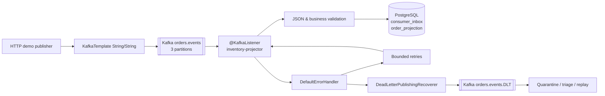
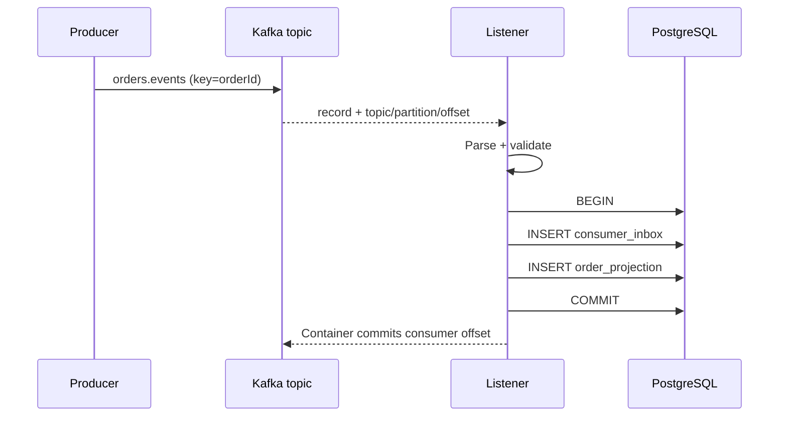
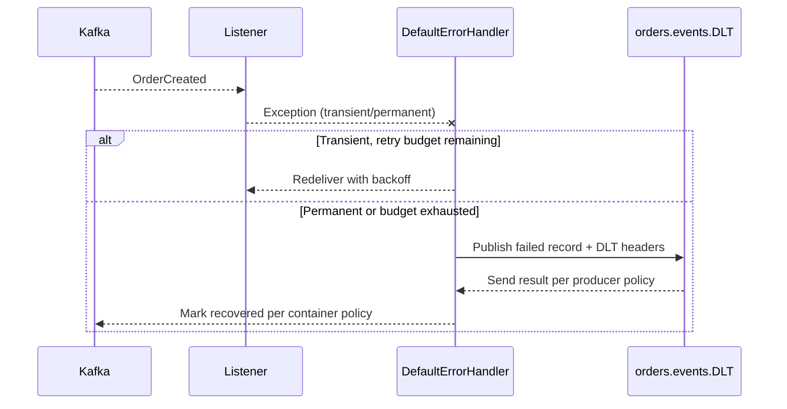
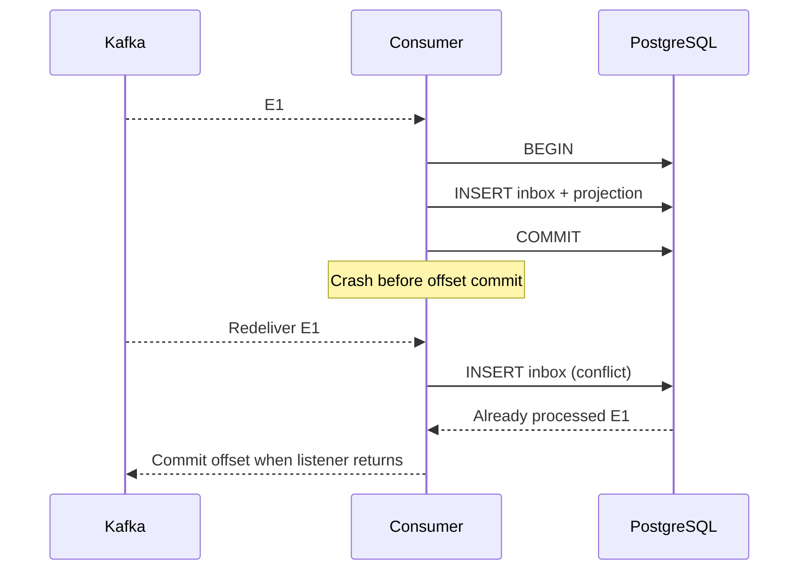
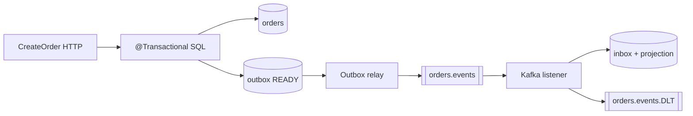
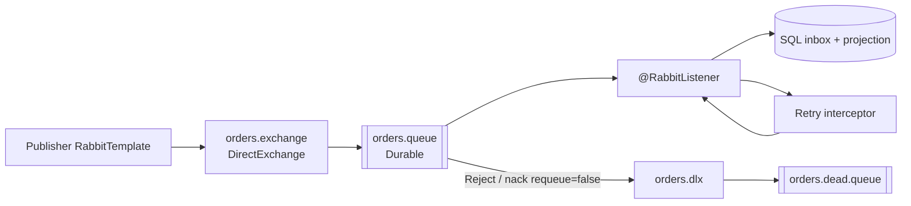

# Building a RabbitMQ or Kafka Flow with Retries and Dead-Lettering

A service consumes `OrderCreated` events from a message broker, persists results in PostgreSQL, and occasionally calls an external system. When SQL is temporarily unreachable, the consumer must **retry**; when a message contains malformed JSON or violates the data contract, retrying the exact same payload thousands of times only clogs the stream. Once retry attempts are exhausted, the message must be routed to a failure store that can be **observed, investigated, and replayed**—a *dead-letter queue/topic* (DLQ/DLT).

This practice lesson belongs to the **Comprehensive Practice** chapter of the **SPRING_BOOT_INTEGRATION** module, combining HTTP clients, databases, caches, message brokers, and Spring Integration adapters around **configuration, data contracts, transactions, errors, deduplication, testing, and observability**. We build a **Kafka** flow as the primary practice path—producer → topic → consumer → SQL inbox/projection → retry → dead-letter topic—while also explaining how to implement the equivalent architecture with **RabbitMQ**. You only need to pick one broker to complete the goal; you do not need to run both for the same lab.

> **Version scope:** Java 17+, Spring Boot **3.4/3.5**, Spring for Apache Kafka **3.x**, PostgreSQL 16, and Kafka 3.9.x serve as the reference stack. APIs/auto-configuration—especially for retries/DLT—may differ in Spring Boot 4.x/Spring Kafka 4.x. Settings such as three partitions, one replica, 1.5-second backoff, and a single Docker broker are **strictly for the lab environment**. Never assume these are fault-tolerant production settings.

## 1. End-of-Lesson Outcomes and Acceptance Criteria

After completing this practice, you will be able to:

1. Publish an `OrderCreated` event with an immutable `eventId`, `orderId` as the Kafka key, and JSON carrying `eventVersion`.
2. Consume messages via `@KafkaListener` and persist SQL state inside a single transaction.
3. Use a **SQL inbox with a unique constraint** so the same `eventId` never creates two side effects when Kafka redelivers.
4. Distinguish **transient** failures (SQL timeout/HTTP 503) from **permanent** failures (corrupt JSON/contract violations).
5. Configure `DefaultErrorHandler` with bounded attempts, backoff, and `DeadLetterPublishingRecoverer`.
6. Route unprocessable records to `orders.events.DLT`, preserving the payload and source metadata.
7. Inspect failed records and follow a **repair–replay–reconcile** runbook instead of letting the DLT grow forever.
8. Identify exactly when offsets commit and where duplicate or unknown outcomes can still occur.
9. Prove with Testcontainers the success, transient failure, permanent failure, DLT, and duplicate cases.
10. Translate the same architecture to RabbitMQ using queues, exchanges, acknowledgments, and a dead-letter exchange (DLX).

**Completion criteria:**

- Valid messages update the projection exactly once.
- Transiently failing messages are retried up to the configured limit.
- Permanently failing messages move to the DLT per policy without infinite retries.
- A failed DLT publish is never treated as successful error recovery.
- Restarts/replays never multiply SQL side effects.
- Operators know which event is stuck, why, and how to replay it safely.

## 2. Business Contract of the Example

The producer emits `OrderCreated` after an order is created. The target is a **read-model/projection** in PostgreSQL rather than a real inventory-deduction system. Modeling a projection keeps focus on how Kafka delivers messages and handles errors; when replacing it with real ordering, payments, or stock reservation, add idempotency to external APIs.

Payload:

```json
{
  "eventId": "c975e9a0-5416-450c-bf4f-d88d0769e2d6",
  "orderId": "cbf239e1-49fe-408f-b0da-a8eadfd97e8b",
  "tenantId": "tenant-a",
  "amountMinor": 125500,
  "currency": "VND",
  "eventVersion": 1,
  "aggregateVersion": 1
}
```

Field meanings:

| Field | Role |
| --- | --- |
| `eventId` | Business event identity for deduplication across emits, retries, and replays |
| `orderId` | Aggregate identity and Kafka message key |
| `tenantId` | Business partition/authorization scope; never trust blindly from external clients |
| `amountMinor` | Monetary amount in the currency's smallest unit; never use `double` |
| `currency` | ISO 4217; this lab only accepts `VND` |
| `eventVersion` | Event contract version, distinct from Kafka offset |
| `aggregateVersion` | Order's business mutation sequence, distinct from eventVersion |

This lab only handles `OrderCreated` with `aggregateVersion=1`, meaning each order has exactly one initial creation event. Multi-event streams like `OrderPaid`/`Cancelled` require sequence/gap checks as an extension.

### 2.1. Invariants to Uphold

- **I1:** A valid event is eventually processed or placed in an observable DLT.
- **I2:** After SQL commit, the broker may redeliver, but the same `eventId` never writes the projection again.
- **I3:** If SQL rolls back, **never** leave the inbox marked as processed.
- **I4:** Schema/semantic invalid messages must not retry indefinitely; they must be classified.
- **I5:** Moving to DLT does not mean business processing succeeded; a person or workflow must take ownership.
- **I6:** Producer, consumer, DLT publisher, and SQL database all have timeouts, metrics, and recovery paths.

**Important note:** At-least-once delivery is the target behavior for processing and redelivery. "One business effect" comes from the SQL transaction + unique constraint, **not** from setting Kafka `enable.idempotence=true` and assuming the whole system is exactly-once.

## 3. Architecture of the Kafka Practice



**Success path:**



**Failure path:**



**Boundary:** DLT publishing and consumer offset commit **are not automatically a single Kafka transaction** in this example configuration. If the process crashes between the two steps, duplicate DLT records can appear; that is why replay and triage must also rely on event identity.

## 4. Choosing a Retry Strategy Before Writing Code

Kafka and RabbitMQ differ in how they store messages and handle acknowledgments:

| Topic | Kafka | RabbitMQ |
| --- | --- | --- |
| Primary storage | Topic log with partitions/offsets | Queues receiving messages via exchanges/bindings |
| Consumer completion | Commit offset per consumer group | Ack delivery on channel |
| Short retries | `DefaultErrorHandler` redelivery/backoff | Listener retry or controlled nack/requeue |
| Long-delay retries | Retry topics such as `@RetryableTopic` | TTL retry queue + DLX or an appropriate delayed mechanism |
| Final failure area | Dead-letter **topic** (DLT) | Dead-letter **exchange/queue** (DLX/DLQ) |
| Can duplicates happen? | Yes | Yes |
| Ordering | Per partition, depends on retry strategy | Per queue/subscription semantics and requeue behavior |
| Permanent failure handling | Publish to DLT/quarantine | Dead-letter to DLQ/quarantine |

In the main lab we use **Spring Kafka's blocking retry** with `DefaultErrorHandler` and `FixedBackOff`. It is easy to verify, though backoff holds a record in the consumer/partition processing loop and can impact throughput. When delays of minutes or hours are needed, evaluate retry topics or a durable job scheduler—do not simply crank backoff from 1 second to 1 hour.

## 5. Lab Project Structure

Example package layout:

```text
spring-integration-kafka-lab/
  build.gradle
  src/main/resources/
    application.yml
    db/migration/
      V1__create_projection_and_inbox.sql
  src/main/java/com/example/practice/
    IntegrationPracticeApplication.java
    contract/OrderCreated.java
    api/PublishOrderRequest.java
    api/DemoPublishController.java
    kafka/KafkaTopicsConfiguration.java
    kafka/OrderEventPublisher.java
    kafka/OrderCreatedListener.java
    kafka/KafkaErrorConfiguration.java
    domain/InvalidEventException.java
    domain/OrderEventValidator.java
    persistence/ProjectionService.java
  src/test/java/com/example/practice/
    KafkaRetryAndDltIT.java
```

This is a **reference structure inside the lesson**, not a requirement to generate these files in the current repository. The Java snippets below can be placed into matching package files when building the lab yourself.

## 6. Dependencies and Managed Versions

Example Gradle Groovy DSL, assuming the project configures the Spring Boot 3.5.x plugin and corresponding dependency management:

```groovy
plugins {
    id 'java'
    id 'org.springframework.boot' version '3.5.7'
    id 'io.spring.dependency-management' version '1.1.7'
}

group = 'com.example'
version = '0.0.1-SNAPSHOT'

java {
    toolchain {
        languageVersion = JavaLanguageVersion.of(17)
    }
}

repositories { mavenCentral() }

dependencies {
    implementation 'org.springframework.boot:spring-boot-starter-web'
    implementation 'org.springframework.boot:spring-boot-starter-validation'
    implementation 'org.springframework.kafka:spring-kafka'
    implementation 'org.springframework.boot:spring-boot-starter-jdbc'
    implementation 'org.springframework.boot:spring-boot-starter-actuator'

    implementation 'org.flywaydb:flyway-core'
    runtimeOnly 'org.flywaydb:flyway-database-postgresql'
    runtimeOnly 'org.postgresql:postgresql'

    testImplementation 'org.springframework.boot:spring-boot-starter-test'
    testImplementation 'org.springframework.boot:spring-boot-testcontainers'
    testImplementation 'org.testcontainers:junit-jupiter'
    testImplementation 'org.testcontainers:kafka'
    testImplementation 'org.testcontainers:postgresql'
}

tasks.named('test') {
    useJUnitPlatform()
}
```

**Verify versions before copying:** Plugin versions here are **example pins for a Boot 3.5 lab**, not a "latest version" recommendation. Gradle 8.x/JDK, starter artifacts, Flyway database modules, and Testcontainers APIs must match your actual dependency BOM. If your project already uses a different parent/BOM, do not mix two independent version sets.

With **Spring Boot 3.x**, use `org.springframework.kafka:spring-kafka` managed by the Boot BOM; `org.springframework.boot:spring-boot-starter-kafka` is a starter introduced in **Boot 4.x**, so do not use those coordinates with Boot 3.5. Why use **String serializer** instead of Kafka's JSON serializer? To make retry/DLT behavior easy to observe: the exact same JSON string goes to the DLT, even when the JSON content is invalid. We parse JSON **inside the listener**, so decoding errors become exceptions handled directly by the error handler. When using a typed `JsonDeserializer`, you need `ErrorHandlingDeserializer` for pre-listener errors and a DLT producer with a serializer compatible with raw `byte[]`; an extension later discusses this.

## 7. Running Kafka and PostgreSQL Locally

A simple option from the Kafka 3.9 quickstart:

```bash
docker run -d --name kafka-lab \
  -p 9092:9092 apache/kafka:3.9.1

docker run -d --name postgres-lab \
  -e POSTGRES_DB=integration \
  -e POSTGRES_USER=integration \
  -e POSTGRES_PASSWORD=devonly \
  -p 5432:5432 postgres:16-alpine
```

These commands use Unix shell syntax; on PowerShell, put each command on one line or use PowerShell's line-continuation character. **The `devonly` password is strictly for local machines**, never production; ports 5432/9092 must be free.

The example Spring Boot application **runs on the host machine** and connects to `localhost:9092` / `localhost:5432`. If you run the app inside a Docker network, `localhost` inside a container refers to that container itself; configure an advertised listener for the internal network and matching bootstrap settings.

A more reliable approach for integration tests is **Testcontainers**, avoiding reliance on two manually pre-started containers. Section 23 shows how.

## 8. application.yml: Separating Runtime Config and Secrets

```yaml
server:
  port: 8081

spring:
  datasource:
    url: ${ORDERS_JDBC_URL:jdbc:postgresql://localhost:5432/integration}
    username: ${ORDERS_DB_USERNAME:integration}
    password: ${ORDERS_DB_PASSWORD:devonly}
    hikari:
      maximum-pool-size: 8
      connection-timeout: 3000  # HikariCP: milliseconds

  flyway:
    enabled: true
    locations: classpath:db/migration

  kafka:
    bootstrap-servers: ${KAFKA_BOOTSTRAP_SERVERS:localhost:9092}

    producer:
      key-serializer: org.apache.kafka.common.serialization.StringSerializer
      value-serializer: org.apache.kafka.common.serialization.StringSerializer
      acks: all
      properties:
        enable.idempotence: true

    consumer:
      group-id: inventory-projector
      auto-offset-reset: earliest
      enable-auto-commit: false
      key-deserializer: org.apache.kafka.common.serialization.StringDeserializer
      value-deserializer: org.apache.kafka.common.serialization.StringDeserializer

    listener:
      ack-mode: record
      concurrency: 3

management:
  endpoints:
    web:
      exposure:
        include: "health,info,metrics,prometheus"
```

Points to understand:

- `acks: all` and an idempotent producer improve **Kafka producer** reliability under broker/replication policies, but do not turn Kafka + PostgreSQL into a distributed transaction.
- `enable-auto-commit: false` prevents the Kafka client from committing offsets periodically outside the listener container's processing lifecycle.
- `ack-mode: record`: for a normal record listener, the container commits after each record succeeds or is recovered per policy. Retest if you use Kafka transactions, batch listeners, or custom acknowledgments.
- `concurrency: 3` pairs well with three partitions, but **does not imply global ordering across all aggregates**. You must use `orderId` as the key.
- `spring.datasource.hikari.connection-timeout` binds to HikariCP's long property in **milliseconds**; the example uses `3000` rather than a `3s` string for this long property. Configure JDBC driver/network timeouts separately when needed.
- Actuator endpoints must be secured per policy. `prometheus` requires the registry dependency to actually expose metrics; configuring exposure alone does not install the registry.

## 9. Creating the Main Topic and Dead-Letter Topic

In the lab, Spring Kafka admin can create topics from `NewTopic` beans:

```java
package com.example.practice.kafka;

import org.apache.kafka.clients.admin.NewTopic;
import org.springframework.context.annotation.Bean;
import org.springframework.context.annotation.Configuration;
import org.springframework.kafka.config.TopicBuilder;

@Configuration(proxyBeanMethods = false)
public class KafkaTopicsConfiguration {

    public static final String MAIN = "orders.events";
    public static final String DLT = "orders.events.DLT";

    @Bean
    NewTopic orderEventsTopic() {
        return TopicBuilder.name(MAIN)
                .partitions(3)
                .replicas(1)
                .build();
    }

    @Bean
    NewTopic orderEventsDeadLetterTopic() {
        return TopicBuilder.name(DLT)
                .partitions(3)
                .replicas(1)
                .build();
    }
}
```

**Why does the DLT have the same partition count?** This example's `DeadLetterPublishingRecoverer` preserves the failing record's partition when sending to the DLT. Thus the DLT must have the target partition; usually it should have at least as many partitions as the main topic.

**Lab only:** A single Kafka broker uses replication factor 1. Production needs managed topic provisioning, proper replication factor, min ISR, ACLs, retention, max message size, and controlled partition scaling policies. Never enable unrestricted topic auto-creation in production purely for demo convenience.

### 9.1. Inspecting Topics from the Container

```bash
docker exec kafka-lab \
  /opt/kafka/bin/kafka-topics.sh \
  --bootstrap-server localhost:9092 --list

docker exec kafka-lab \
  /opt/kafka/bin/kafka-topics.sh \
  --bootstrap-server localhost:9092 \
  --describe --topic orders.events.DLT
```

The script path and image layout match the sample Kafka 3.9 JVM image; verify paths in your actual image if you change versions.

## 10. DTO and Versioned Event Contract

```java
package com.example.practice.contract;

import java.util.UUID;

public record OrderCreated(
        UUID eventId,
        UUID orderId,
        String tenantId,
        long amountMinor,
        String currency,
        int eventVersion,
        long aggregateVersion
) {}
```

The DTO uses Jackson managed by `spring-boot-starter-web`. To prevent schema drift:

- Do not arbitrarily change `amountMinor` from a number to a string.
- Do not change the unit of amount while keeping the same field name.
- Do not redefine `eventId` to mean Kafka offset.
- When new fields are needed, preserve backward compatibility or bump `eventVersion` with contract tests.
- Never include passwords, bearer tokens, or unnecessary PII in events.
- If using Avro/Protobuf/schema registry, pick explicit encoding and compatibility policies; this lab uses JSON to keep failure behavior transparent.

### 10.1. Permanent and Transient Errors

```java
package com.example.practice.domain;

public class InvalidEventException extends RuntimeException {
    public InvalidEventException(String message) {
        super(message);
    }
    public InvalidEventException(String message, Throwable cause) {
        super(message, cause);
    }
}

public class TransientIntegrationException extends RuntimeException {
    public TransientIntegrationException(String message, Throwable cause) {
        super(message, cause);
    }
}
```

When copying into real Java source files, place **each public class in its own matching file** under package `com.example.practice.domain`; grouping them in one block here is only for contiguous reading. `InvalidEventException` is treated as **do not retry with the same payload**, while `TransientIntegrationException` is retryable within budget.

## 11. Validating Events Before Writing SQL

```java
package com.example.practice.domain;

import com.example.practice.contract.OrderCreated;
import org.springframework.stereotype.Component;

@Component
public class OrderEventValidator {

    public void validate(OrderCreated event) {
        if (event == null) {
            throw new InvalidEventException("Missing event");
        }
        if (event.eventId() == null || event.orderId() == null) {
            throw new InvalidEventException("Missing eventId/orderId");
        }
        if (event.tenantId() == null
                || event.tenantId().isBlank()) {
            throw new InvalidEventException("Missing tenantId");
        }
        if (event.amountMinor() < 0) {
            throw new InvalidEventException("Negative amountMinor");
        }
        if (!"VND".equals(event.currency())) {
            throw new InvalidEventException("Unsupported currency");
        }
        if (event.eventVersion() != 1
                || event.aggregateVersion() != 1) {
            throw new InvalidEventException(
                    "Unsupported event/aggregate version");
        }
    }
}
```

This validator enforces only the contract of this **single order-creation event lab**; it does not solve multi-tenant authorization. In production, bound `tenantId` length, validate source and version compatibility, and never treat a partner-supplied field as database authorization.

### 11.1. Distinguishing Business Errors from Infrastructure Errors

| Error | Group | Response |
| --- | --- | --- |
| Malformed JSON syntax | Permanent | Route to DLT/quarantine |
| `eventVersion` not yet supported by consumer | Permanent for running version, needs contract upgrade | DLT/parking lane |
| `amountMinor < 0` | Permanent | DLT, investigate producer |
| SQL connection unavailable | Transient | Backoff, bounded retries |
| SQL deadlock | Transient under appropriate conditions | Retry the entire business transaction |
| Duplicate `eventId` with same payload | Not an error | No-op, commit offset |
| Duplicate `eventId` with different payload | Contract violation | Roll back, DLT/alert |
| HTTP 503 from downstream | Transient if operation is idempotent | Retry within deadline |
| HTTP 400 from downstream | Usually permanent | DLT/manual remediation |
| Broker DLT publish failure | Recovery failure | **Never skip the original record** |

## 12. Creating the SQL Schema with Flyway

File `src/main/resources/db/migration/V1__create_projection_and_inbox.sql`:

```sql
CREATE TABLE consumer_inbox (
    source_topic   VARCHAR(200) NOT NULL,
    event_id       UUID NOT NULL,
    payload_sha256 CHAR(64) NOT NULL,
    processed_at   TIMESTAMPTZ NOT NULL DEFAULT now(),
    PRIMARY KEY (source_topic, event_id)
);

CREATE TABLE order_projection (
    order_id         UUID PRIMARY KEY,
    tenant_id        VARCHAR(64) NOT NULL,
    amount_minor     BIGINT NOT NULL
                     CHECK (amount_minor >= 0),
    currency         CHAR(3) NOT NULL,
    event_id         UUID NOT NULL UNIQUE,
    aggregate_version BIGINT NOT NULL,
    created_at       TIMESTAMPTZ NOT NULL DEFAULT now()
);

CREATE INDEX idx_order_projection_tenant_created
    ON order_projection (tenant_id, created_at);
```

**Why two tables?**

- `consumer_inbox` is the ledger recording **which events have been durably applied**.
- `order_projection` holds the business state.
- Both are written **in one SQL transaction**. If writing the projection fails, the inbox INSERT must roll back so subsequent Kafka redeliveries can still process it.
- `payload_sha256` distinguishes a faithful replay of an event ID from the same ID arriving with different payload bytes.

When a producer does not guarantee canonical JSON, identical content with different whitespace or field ordering produces a different hash; this lab intentionally treats **raw bytes** as the immutable contract. Production can hash canonicalized payloads/semantic fields per formal rules.

## 13. SQL Inbox + Projection: One Transaction per Event

```java
package com.example.practice.persistence;

import java.nio.charset.StandardCharsets;
import java.security.MessageDigest;
import java.security.NoSuchAlgorithmException;
import java.util.HexFormat;
import java.util.Objects;

import com.example.practice.contract.OrderCreated;
import com.example.practice.domain.InvalidEventException;
import org.springframework.jdbc.core.JdbcTemplate;
import org.springframework.stereotype.Service;
import org.springframework.transaction.annotation.Transactional;

@Service
public class ProjectionService {

    private final JdbcTemplate jdbc;

    public ProjectionService(JdbcTemplate jdbc) {
        this.jdbc = jdbc;
    }

    @Transactional
    public void apply(OrderCreated event, String rawJson) {
        String hash = sha256(rawJson);

        int firstSeen = jdbc.update("""
                INSERT INTO consumer_inbox (
                    source_topic, event_id, payload_sha256
                )
                VALUES ('orders.events', ?, ?)
                ON CONFLICT (source_topic, event_id)
                DO NOTHING
                """, event.eventId(), hash);

        if (firstSeen == 0) {
            String existing = jdbc.queryForObject("""
                    SELECT payload_sha256
                    FROM consumer_inbox
                    WHERE source_topic = 'orders.events'
                      AND event_id = ?
                    """, String.class, event.eventId());

            if (!Objects.equals(existing, hash)) {
                throw new InvalidEventException(
                        "Same eventId but different raw payload");
            }
            return; // Duplicate with same event/payload: no-op.
        }

        int inserted = jdbc.update("""
                INSERT INTO order_projection (
                    order_id, tenant_id, amount_minor, currency,
                    event_id, aggregate_version
                )
                VALUES (?, ?, ?, ?, ?, ?)
                ON CONFLICT (order_id) DO NOTHING
                """,
                event.orderId(), event.tenantId(),
                event.amountMinor(), event.currency(),
                event.eventId(), event.aggregateVersion());

        if (inserted == 0) {
            // Lab allows only one OrderCreated per order.
            throw new InvalidEventException(
                    "Order already has a projection from another event");
        }
    }

    private static String sha256(String value) {
        try {
            MessageDigest digest =
                    MessageDigest.getInstance("SHA-256");
            byte[] bytes = digest.digest(
                    value.getBytes(StandardCharsets.UTF_8));
            return HexFormat.of().formatHex(bytes);
        } catch (NoSuchAlgorithmException impossible) {
            throw new IllegalStateException(
                    "SHA-256 unavailable", impossible);
        }
    }
}
```

**Examine the transaction carefully:**

1. `@Transactional` wraps **inbox INSERT + projection INSERT** when both use the same `DataSource`/transaction manager and are invoked via the Spring proxy.
2. If `INSERT projection` fails, the transaction rolls back the inbox row too. Never "mark processed first, then fail business logic and still ack."
3. If two consumers process the same `eventId` concurrently, the unique constraint ensures only one transaction succeeds; the other waits/receives conflict per database isolation.
4. If the same `orderId` arrives under a different event when business rules permit only one creation event, the code throws a permanent error instead of silently overwriting.
5. When later handling `OrderPaid`, replace `INSERT ... DO NOTHING` with proper **state transitions + aggregate version guards**; do not reuse this single-event-per-order logic across an entire order lifecycle.
6. `ON CONFLICT`, `UUID`, and `TIMESTAMPTZ` are PostgreSQL syntax; adapt for other databases.

**Boundary:** PostgreSQL commit followed by Kafka offset commit can fail between steps. Kafka will redeliver the message, and the inbox turns the second delivery into a no-op. This provides an **effectively-once business effect** in SQL, not exactly-once transport.

## 14. Kafka Listener: Errors Must Propagate for Retry/DLT to Work

```java
package com.example.practice.kafka;

import com.example.practice.contract.OrderCreated;
import com.example.practice.domain.InvalidEventException;
import com.example.practice.domain.OrderEventValidator;
import com.example.practice.persistence.ProjectionService;
import com.fasterxml.jackson.core.JsonProcessingException;
import com.fasterxml.jackson.databind.ObjectMapper;

import org.apache.kafka.clients.consumer.ConsumerRecord;
import org.springframework.kafka.annotation.KafkaListener;
import org.springframework.stereotype.Component;

@Component
public class OrderCreatedListener {

    private final ObjectMapper mapper;
    private final OrderEventValidator validator;
    private final ProjectionService projection;

    public OrderCreatedListener(
            ObjectMapper mapper,
            OrderEventValidator validator,
            ProjectionService projection) {
        this.mapper = mapper;
        this.validator = validator;
        this.projection = projection;
    }

    @KafkaListener(
        topics = KafkaTopicsConfiguration.MAIN,
        groupId = "inventory-projector"
    )
    public void onMessage(ConsumerRecord<String, String> record) {
        OrderCreated event;
        try {
            event = mapper.readValue(
                    record.value(), OrderCreated.class);
        } catch (JsonProcessingException ex) {
            throw new InvalidEventException(
                    "Failed to decode OrderCreated JSON", ex);
        }

        validator.validate(event);
        projection.apply(event, record.value());
    }
}
```

**Crucial point:** The listener **does not** catch all exceptions and return normally. If SQL fails and the method returns, the container treats the record as handled and commits the offset; retry/DLT will never fire.

Contract errors are normalized into `InvalidEventException`. `DataAccessException` instances thrown by Spring JDBC propagate directly; the error handler applies a bounded retry policy to them. SQL constraint errors caused by invalid event data rather than transient faults should also be classified separately if possible to avoid futile retries.

### 14.1. Why Use ConsumerRecord?

We preserve:

- `record.topic()` and `record.partition()`.
- `record.offset()` for tracing.
- `record.key()` to verify against `event.orderId`.
- `record.headers()` such as traceId and contract metadata.

To enforce the key contract:

```java
if (record.key() == null
        || !record.key().equals(event.orderId().toString())) {
    throw new InvalidEventException(
            "Kafka key must equal orderId");
}
```

Place this check right after `validator.validate(event)` in the listener. Routing contracts matter for ordering. Never generate a random key per retry if the same aggregate must land in the same partition.

## 15. Publishing an Event to Test the Flow

The producer uses `KafkaTemplate<String, String>` and waits for the broker send result before returning the lab response.

```java
package com.example.practice.kafka;

import java.util.concurrent.ExecutionException;
import java.util.concurrent.TimeUnit;
import java.util.concurrent.TimeoutException;

import com.example.practice.contract.OrderCreated;
import com.fasterxml.jackson.core.JsonProcessingException;
import com.fasterxml.jackson.databind.ObjectMapper;

import org.springframework.kafka.core.KafkaTemplate;
import org.springframework.stereotype.Service;

@Service
public class OrderEventPublisher {

    private final KafkaTemplate<String, String> kafka;
    private final ObjectMapper mapper;

    public OrderEventPublisher(
            KafkaTemplate<String, String> kafka,
            ObjectMapper mapper) {
        this.kafka = kafka;
        this.mapper = mapper;
    }

    public void publish(OrderCreated event) {
        String json;
        try {
            json = mapper.writeValueAsString(event);
        } catch (JsonProcessingException ex) {
            throw new IllegalArgumentException(
                    "Failed to serialize event", ex);
        }

        try {
            kafka.send(
                    KafkaTopicsConfiguration.MAIN,
                    event.orderId().toString(),
                    json)
                 .get(5, TimeUnit.SECONDS);

        } catch (InterruptedException ex) {
            Thread.currentThread().interrupt();
            throw new IllegalStateException(
                    "Publish interrupted", ex);

        } catch (ExecutionException | TimeoutException ex) {
            // Timeout can represent an unknown outcome.
            throw new IllegalStateException(
                    "Could not confirm Kafka publish", ex);
        }
    }
}
```

**Do not misunderstand:** `get(5, TimeUnit.SECONDS)` bounds how long the caller waits; a timeout does not prove the broker failed to write the record. If the HTTP client retries, it must keep **the same `eventId`**, and the consumer inbox must tolerate duplicates.

In a real order-creation system, never publish directly after SQL commit and treat it as atomic; the outbox section later shows how to persist durable publish intent.

### 15.1. Demo REST API

```java
package com.example.practice.api;

import java.util.UUID;

import com.example.practice.contract.OrderCreated;
import com.example.practice.kafka.OrderEventPublisher;

import jakarta.validation.Valid;
import jakarta.validation.constraints.NotBlank;
import jakarta.validation.constraints.NotNull;
import jakarta.validation.constraints.PositiveOrZero;

import org.springframework.http.ResponseEntity;
import org.springframework.web.bind.annotation.*;

@RestController
@RequestMapping("/demo/events")
public class DemoPublishController {

    public record PublishOrderRequest(
            @NotNull UUID eventId,
            @NotNull UUID orderId,
            @NotBlank String tenantId,
            @PositiveOrZero long amountMinor,
            @NotBlank String currency
    ) {}

    private final OrderEventPublisher publisher;

    public DemoPublishController(OrderEventPublisher publisher) {
        this.publisher = publisher;
    }

    @PostMapping
    ResponseEntity<Void> publish(
            @Valid @RequestBody PublishOrderRequest request) {

        publisher.publish(new OrderCreated(
                request.eventId(), request.orderId(),
                request.tenantId(), request.amountMinor(),
                request.currency(), 1, 1));

        return ResponseEntity.accepted().build();
    }
}
```

**Endpoint scope:** This is a demo publisher that does not write business orders to SQL, so there is no dual-write between order SQL and Kafka here. When implementing a real `POST /orders` command, an outbox is the proper extension. Add `503/504` exception mapping, auth/rate limiting, API idempotency, and validation before production.

## 16. DefaultErrorHandler: Bounded Retries Then Dead-Letter

Spring Kafka supports `DefaultErrorHandler` and `DeadLetterPublishingRecoverer` for a **record listener**. Spring Boot can wire a `CommonErrorHandler` bean into the default auto-configured listener factory when no custom factory replaces it.

```java
package com.example.practice.kafka;

import java.time.Duration;

import com.example.practice.domain.InvalidEventException;

import org.apache.kafka.common.TopicPartition;
import org.springframework.context.annotation.Bean;
import org.springframework.context.annotation.Configuration;
import org.springframework.kafka.core.KafkaTemplate;
import org.springframework.kafka.listener.CommonErrorHandler;
import org.springframework.kafka.listener.DefaultErrorHandler;
import org.springframework.kafka.listener.DeadLetterPublishingRecoverer;
import org.springframework.util.backoff.FixedBackOff;

@Configuration(proxyBeanMethods = false)
public class KafkaErrorConfiguration {

    @Bean
    CommonErrorHandler orderErrorHandler(
            KafkaTemplate<String, String> kafkaTemplate) {

        DeadLetterPublishingRecoverer recoverer =
                new DeadLetterPublishingRecoverer(
                    kafkaTemplate,
                    (record, exception) -> new TopicPartition(
                        KafkaTopicsConfiguration.DLT,
                        record.partition()));

        // DLT publish failure must be treated as recovery failure.
        recoverer.setFailIfSendResultIsError(true);
        recoverer.setWaitForSendResultTimeout(
                Duration.ofSeconds(5));

        // 2 retries + initial attempt = max 3 attempts.
        DefaultErrorHandler handler =
                new DefaultErrorHandler(
                        recoverer,
                        new FixedBackOff(1500L, 2L));

        // Contract errors are not retried with the same payload.
        handler.addNotRetryableExceptions(
                InvalidEventException.class);

        return handler;
    }
}
```

### 16.1. Reading Retry Counts Correctly

`new FixedBackOff(1500L, 2L)` means **two retries after the initial attempt**, i.e., at most three listener invocations for a retryable failing record in one retry cycle. Never describe it as "three retries" and configure `2`, or accidentally multiply attempts across stacked retry layers.

### 16.2. When Do Errors Reach the DLT?

| Error | Retry? | What Happens |
| --- | --- | --- |
| `InvalidEventException` | No, per classifier above | Sent directly to DLT (once recoverer publish succeeds) |
| SQL connection timeout | Yes, if classified retryable | Retries twice; once budget exhausted, goes to DLT |
| HTTP 503 from integration step | Yes, if policy treats as transient | Retries twice, then DLT |
| DLT broker rejects/unavailable | Recovery failure | Handler must not treat record as recovered |
| Listener succeeds on 2nd attempt | Does not reach DLT | Writes projection, container commits offset |
| Listener commits SQL then crashes before offset commit | Kafka may redeliver | Inbox blocks duplicate side effect |

**Important limitation:** `DefaultErrorHandler` retries are in-memory/within the container processing loop, not durable scheduled retries persisted separately. After a restart/rebalance, the retry budget may reset depending on offset/progress. For long delays or retries that must survive restarts on a schedule, use retry topics or a job scheduler.

### 16.3. What Metadata Does a DLT Message Carry?

`DeadLetterPublishingRecoverer` normally preserves the record's value/key and adds headers such as:

- Original topic/partition/offset.
- Exception type/cause.
- Exception message/stack trace according to configuration.
- Diagnostic trace metadata for triage.

Each DLT record receives a **new** topic/partition/offset; never use the DLT offset as an event identity. `eventId` inside the payload remains the business key.

**Security:** Exception stack traces/headers can accidentally leak URLs, payloads, or PII. In production, sanitize/filter headers and restrict DLT subscription permissions.

### 16.4. What If a Custom Listener Factory Is Already Defined?

If the project defines its own `ConcurrentKafkaListenerContainerFactory`, do not assume Spring Boot will automatically attach `CommonErrorHandler` to it. Call `factory.setCommonErrorHandler(handler)` or use `ConcurrentKafkaListenerContainerFactoryConfigurer` properly and test the wiring. All examples in this lesson assume **Boot's auto-configured factory**.

## 17. Verifying the Happy Path Locally

Start the service once Kafka/PostgreSQL are up and Flyway has created the tables. Send an event over HTTP:

```bash
curl -X POST http://localhost:8081/demo/events \
  -H "Content-Type: application/json" \
  -d '{
    "eventId": "c975e9a0-5416-450c-bf4f-d88d0769e2d6",
    "orderId": "cbf239e1-49fe-408f-b0da-a8eadfd97e8b",
    "tenantId": "tenant-a",
    "amountMinor": 125500,
    "currency": "VND"
  }'
```

HTTP `202 Accepted` only indicates that **the demo producer received a Kafka ack per policy and the request completed**; the projection may still be processing.

Check SQL:

```bash
docker exec -it postgres-lab psql \
  -U integration -d integration \
  -c "SELECT event_id, source_topic FROM consumer_inbox;"

docker exec -it postgres-lab psql \
  -U integration -d integration \
  -c "SELECT order_id, amount_minor, currency FROM order_projection;"
```

Expectations:

- One row in `consumer_inbox` with `eventId`.
- One row in `order_projection` with `orderId` and `amountMinor=125500`.
- No corresponding new record in the DLT.

Send **the exact same JSON/same eventId a second time**: Kafka may hold two records and the listener is invoked twice, yet `consumer_inbox` and the projection do not duplicate. This directly validates **at-least-once transport + idempotent business effect**.

## 18. Testing a Permanent Error: Corrupt JSON Goes Straight to DLT

A non-JSON record causes `mapper.readValue(...)` to throw `JsonProcessingException`; the listener wraps it in `InvalidEventException`, which `DefaultErrorHandler` marks **not retryable**.

Use the Kafka CLI inside the container to inject an intentionally malformed payload:

```bash
printf 'this-is-not-json\n' |
  docker exec -i kafka-lab \
  /opt/kafka/bin/kafka-console-producer.sh \
  --bootstrap-server localhost:9092 \
  --topic orders.events
```

This sends a raw payload bypassing the HTTP demo controller/validator. Watch the application logs and inspect the DLT:

```bash
docker exec kafka-lab \
  /opt/kafka/bin/kafka-console-consumer.sh \
  --bootstrap-server localhost:9092 \
  --topic orders.events.DLT \
  --from-beginning \
  --property print.key=true \
  --property print.headers=true \
  --timeout-ms 10000
```

Expect a record containing `this-is-not-json` in the DLT along with error metadata added by the recoverer. The consumer CLI may print headers as raw bytes or strings depending on version and flags.

**Note:** The Kafka record sent by the console producer in this example has no business key. Because the listener fails right at JSON parsing, execution does not reach key validation; in production, publishers must always set the `orderId` key per contract.

### 18.1. Testing Valid JSON with Invalid Business Data

Use a parseable payload that violates validation:

```json
{
  "eventId": "814a9594-9b82-4891-a44c-a60f80b26844",
  "orderId": "f1b77271-82f4-40b3-997b-3c447b945719",
  "tenantId": "tenant-a",
  "amountMinor": -10,
  "currency": "VND",
  "eventVersion": 1,
  "aggregateVersion": 1
}
```

Publish it directly to `orders.events` using CLI/test producer; do not use the HTTP demo endpoint because `@PositiveOrZero` blocks it at the API. The handler must also route the record to the DLT **without writing any SQL projection**.

### 18.2. Be Careful with "I Saw the Record in the DLT"

Seeing a record in the DLT only proves the recoverer caught the error and published per policy. It does not prove:

- An operator has handled the incident.
- The event has been repaired.
- The business side effect completed.
- The main record wasn't redelivered due to a crash before offset commit.
- There are no duplicate DLT entries for the same `eventId`.

You need a runbook and dedicated triage tracking, especially for payments or shipping.

## 19. Testing Transient Errors and Retry Limits

### 19.1. Reproducing Locally

While the consumer is running, stop PostgreSQL to trigger SQL failures. Only do this in an isolated lab environment:

```bash
docker stop postgres-lab
```

Then publish a **new** event to Kafka via CLI or an independent producer. With the HTTP demo, the Kafka producer can still run while the DB is stopped, though the HTTP app itself might be affected if startup/health/lifecycle probes check SQL.

When the listener processes the new message:

1. JSON decoding succeeds.
2. Validator accepts it.
3. `ProjectionService.apply(...)` cannot obtain a connection.
4. Spring JDBC throws a `DataAccessException` or related exception.
5. `DefaultErrorHandler` retries per `FixedBackOff(1500L,2L)`.
6. If the DB is still down after three attempts, the recoverer sends the record to the DLT.
7. When the DB recovers, the event **does not automatically leave the DLT back to the main topic**; controlled replay is required.

Restart PostgreSQL:

```bash
docker start postgres-lab
```

**Never stop the DB in shared staging/production.** For automated tests, use an injectable test seam or mock collaborator to trigger transient failures instead of stopping a container shared by parallel tests.

### 19.2. If the DB Recovers Between Attempts

If the DB comes back before the retry budget is exhausted:

- The listener retry succeeds.
- The SQL transaction commits.
- The consumer offset is committed per container policy.
- No DLT record is produced for that failure cycle.

This is the purpose of **bounded short retries**: absorbing brief glitches without permanently stalling the main topic.

### 19.3. When Should an SQL Error Not Be Retried?

Some `DataAccessException` subclasses represent *permanent* errors: missing tables from unrun migrations, wrong column names, permission denied, or business contract constraint violations. Never treat **every SQLException** as transient.

Production code should:

- Inspect SQLState/vendor error codes and Spring exception subtypes.
- Classify `CannotGetJdbcConnectionException` or transient resource errors appropriately.
- Escalate schema/permission errors to alerts and halt deployment if needed.
- Enforce a retry budget rather than infinite loops.
- Never dump a systemic infrastructure outage into the DLT millions of times and consider the system healthy.

## 20. Distinguishing Application, Listener, and Broker Retries

A record can be retried at multiple layers:

```text
HTTP client POST retry
        |
        v
Kafka producer retry/acks
        |
        v
Consumer DefaultErrorHandler retry
        |
        v
SQL JDBC transaction retry
        |
        v
DLT replay workflow
```

If each layer sets three attempts without a global budget, a single command can trigger dozens of executions. Response latency and downstream load escalate rapidly.

| Retry Layer | Managed By | What Must Stay Immutable |
| --- | --- | --- |
| HTTP request retry | API client/gateway | Idempotency key `eventId`/`operationId` |
| Kafka producer retry | Kafka producer config | Producer acks/delivery timeout, business eventId |
| Consumer retry | `DefaultErrorHandler` | Record value/key, retry budget, offset |
| SQL transaction retry | Application/transaction policy | Entire transaction, not a single SQL statement if logic depends on prior reads |
| DLT replay | Operations/job | Event identity, audit trail, and validation |

**Do not classify "retryable" purely by Java exception name** when an error represents an unknown outcome. For example, an HTTP timeout after a POST might mean the partner **already created the reservation** while the response was lost. Safe retries depend on the target API's idempotency.

## 21. A DLT Needs a Runbook, Not Just a Topic

Maintain triage states in a **dedicated** operational table/job rather than assuming DLT arrival means handled:

```text
NEW → INVESTIGATING → REPAIRED → REPLAY_REQUESTED
                     ↘  CANCELLED_WITH_REASON
REPLAY_REQUESTED → REPLAYED → VERIFIED
                          ↘ REPLAY_FAILED
```

At minimum, record:

- Original topic, partition, offset.
- DLT topic, partition, offset.
- Kafka key and business `eventId` if parseable.
- First-failure and last-observed timestamps.
- Error category: `INVALID_JSON`, `SCHEMA_VERSION`, `DB_UNAVAILABLE`, `HTTP_503`, etc.
- App/consumer build version that encountered the error.
- Owner, incident/ticket, decision to repair or discard.
- Who authorized replay, replay timestamp, and outcome.
- Correlation/trace ID and tenant within allowed visibility scope.

### 21.1. DLT Is Data, Not Permanent Immutable Logs

Kafka retention deletes records by time/size. If policy requires retaining DLT entries for 30 days, configure `retention.ms`/`retention.bytes` and provision storage accordingly; naming a topic DLT does not grant infinite retention.

Do not store secrets or unnecessary sensitive data in exception stacktrace headers. Enforce ACLs restricting who can subscribe, PII access controls, and purge policies.

### 21.2. A DLT Observer Is Not a DLT Processor

A consumer that simply reads the DLT and logs entries can commit its **observer group's** offset, but that does not resolve the event. To avoid confusion, separate roles:

- **Observer/alerting group:** reads to trigger incidents and track counts.
- **Triage workflow:** stores investigation decisions and repair states.
- **Replay worker:** republishes after approval, with auditing and idempotency.
- **Business projection:** main-topic consumer applies the event or confirms intentional discard per business decision.

Never attach `@KafkaListener(topics="orders.events.DLT")` and immediately republish verbatim to the main topic: if the permanent bug is unfixed, you create an **infinite DLT → main → DLT loop**.

## 22. Replaying from DLT: Right Conditions and Right Identity

A safe procedure:

1. Identify the root cause from DLT metadata + logs + SQL state.
2. Distinguish **genuinely failed records** from records **already applied to SQL whose offset/ack was lost**.
3. Verify source schema/version and confirm the current consumer can parse it.
4. If the payload is invalid, determine which contract owner must fix the issue.
5. Choose **verbatim payload replay** vs. **repaired event**, with an audit mapping.
6. Preserve the original `eventId` if it remains the same business event, understanding that the inbox rejects the same ID with a different payload.
7. Preserve the Kafka key by `orderId` when per-aggregate ordering matters.
8. Publish via a producer with broker acknowledgment and verify the send outcome.
9. Monitor the main-topic consumer and SQL inbox/projection.
10. Record `VERIFIED` or `REPLAY_FAILED`; never mark complete just because a publish future was created.

**Note on repaired events:** In this lab, the inbox stores the hash of the **raw payload**. If an event already committed SQL with old raw bytes and is replayed with edited bytes under the same `eventId`, the inbox raises a conflict—this is safe behavior that detects payload mutation under the same identity. If business rules genuinely need a corrective event, emit a **new compensating/correction event with a new ID** and a `correctsEventId` reference; never silently rewrite history.

### 22.1. Never Use Kafka Offset as a Business Idempotency Key

Offsets locate records within **one topic partition**. When replaying across topics or republishing after a crash, the same event gets a new offset. Therefore inbox keys must never rely solely on offsets.

### 22.2. Do Not Replay If the Source Problem Still Exists

With `amountMinor=-10` or `eventVersion=99`, verbatim replay only repeats the failure. Update the producer schema/consumer contract first, or issue a corrective event through an approved workflow.

## 23. Testing with Kafka/PostgreSQL Testcontainers

### 23.1. Distinguishing Unit Tests from Integration Tests

| Test | What It Proves |
| --- | --- |
| Validator unit test | Invalid fields throw `InvalidEventException` |
| ProjectionService SQL test | Inbox + projection commit/roll back together |
| Consumer integration test | Topic → listener → SQL succeeds |
| Error handler integration test | Real retry count and DLT routing |
| DLT publish failure test | Does not falsely recover when DLT is unavailable |
| Duplicate/redelivery test | Same `eventId` never creates a second projection |
| Contract test | Old/new JSON versions and business semantics |
| Fault injection | Crash between SQL commit and offset commit, broker outage |
| Performance test | Backpressure, lag, multiple partitions, and DB pool behavior |

To confirm the lab meets requirements, you need **real integration tests with Kafka and PostgreSQL**. Unit-testing `DefaultErrorHandler` with Mockito does not prove topics/partitions/offsets, serializers, or listener containers are wired properly.

### 23.2. Starting Both Containers in JUnit

With Boot 3.5 and Testcontainers 1.21.x:

```java
package com.example.practice;

import org.junit.jupiter.api.Test;
import org.springframework.boot.test.context.SpringBootTest;
import org.springframework.boot.testcontainers.service.connection.ServiceConnection;

import org.testcontainers.containers.PostgreSQLContainer;
import org.testcontainers.kafka.KafkaContainer;
import org.testcontainers.junit.jupiter.Container;
import org.testcontainers.junit.jupiter.Testcontainers;
import org.testcontainers.utility.DockerImageName;

@SpringBootTest
@Testcontainers
class KafkaRetryAndDltIT {

    @Container
    @ServiceConnection
    static PostgreSQLContainer<?> postgres =
            new PostgreSQLContainer<>("postgres:16-alpine");

    @Container
    @ServiceConnection
    static KafkaContainer kafka =
            new KafkaContainer(
                    DockerImageName.parse("apache/kafka:3.9.1"));

    @Test
    void contextStartsAndFlywayCanMigrate() {
        // Actual tests below use KafkaTemplate/JdbcTemplate.
    }
}
```

`@ServiceConnection` is supported by Spring Boot for matching container types, supplying connection details to auto-configured Kafka and JDBC/Flyway. If the app defines a custom `KafkaTemplate` or hardcodes a Flyway URL, verify they do not bypass Testcontainers connection details.

### 23.3. Testing a Successful Event

Add to the test class above, with `KafkaTemplate<String,String>`, `JdbcTemplate`, and `ObjectMapper` injected:

```java
@Autowired KafkaTemplate<String, String> kafkaTemplate;
@Autowired JdbcTemplate jdbc;
@Autowired ObjectMapper objectMapper;

@Test
void validEventIsPersisted() throws Exception {
    UUID eventId = UUID.randomUUID();
    UUID orderId = UUID.randomUUID();

    OrderCreated event = new OrderCreated(
            eventId, orderId, "tenant-a",
            125500, "VND", 1, 1);

    kafkaTemplate.send(
            "orders.events", orderId.toString(),
            objectMapper.writeValueAsString(event))
        .get(10, TimeUnit.SECONDS);

    await().atMost(Duration.ofSeconds(30))
        .untilAsserted(() -> {
            Long inboxCount = jdbc.queryForObject("""
                    SELECT COUNT(*) FROM consumer_inbox
                    WHERE event_id = ?
                    """, Long.class, eventId);

            Long projectionCount = jdbc.queryForObject("""
                    SELECT COUNT(*) FROM order_projection
                    WHERE order_id = ?
                    """, Long.class, orderId);

            assertEquals(1L, inboxCount);
            assertEquals(1L, projectionCount);
        });
}
```

Additional imports needed in the test:

```java
import static org.awaitility.Awaitility.await;
import static org.junit.jupiter.api.Assertions.assertEquals;

import java.time.Duration;
import java.util.UUID;
import java.util.concurrent.TimeUnit;

import com.example.practice.contract.OrderCreated;
import com.fasterxml.jackson.databind.ObjectMapper;
import org.springframework.beans.factory.annotation.Autowired;
import org.springframework.jdbc.core.JdbcTemplate;
import org.springframework.kafka.core.KafkaTemplate;
```

`Awaitility` is included in many Boot 3.5 `spring-boot-starter-test` setups; if absent, declare the matching test dependency per BOM. Never rely on `Thread.sleep(3000)` before asserting because Kafka/CI speeds fluctuate.

### 23.4. Testing Duplicate Delivery

```java
@Test
void sameEventTwiceChangesBusinessStateOnce()
        throws Exception {

    UUID eventId = UUID.randomUUID();
    UUID orderId = UUID.randomUUID();

    String json = objectMapper.writeValueAsString(
            new OrderCreated(
                    eventId, orderId, "tenant-a",
                    9900, "VND", 1, 1));

    kafkaTemplate.send(
            "orders.events", orderId.toString(), json)
        .get(10, TimeUnit.SECONDS);

    kafkaTemplate.send(
            "orders.events", orderId.toString(), json)
        .get(10, TimeUnit.SECONDS);

    await().atMost(Duration.ofSeconds(30))
        .untilAsserted(() -> {
            Long count = jdbc.queryForObject("""
                    SELECT COUNT(*) FROM consumer_inbox
                    WHERE event_id = ?
                    """, Long.class, eventId);
            assertEquals(1L, count);
        });
}
```

To verify that **both records were consumed**, tests should observe consumer offsets/traces or instrument listener invocation counts by `eventId`; a SQL count of 1 alone does not prove the consumer processed the second duplicate record. You can inspect Kafka consumer group lag and wait for the group to catch up, or check a duplicate-received metric.

### 23.5. Testing Permanent Failures Reaching the DLT

Test approach in an isolated test with a **unique test ID**:

1. Send literal `not-json-<random-id>` to `orders.events`.
2. Open a test Kafka consumer in a **separate group** subscribed to `orders.events.DLT`.
3. Poll with a 30-second deadline, filtering records by the unique marker.
4. Assert the value matches the raw input.
5. Assert DLT source topic/metadata headers.
6. Confirm no SQL row exists for that marker.

Use a dedicated consumer rather than an automatic `@KafkaListener` on the DLT so you don't accidentally commit triage offsets. Under parallel tests, never assume the DLT contains only the current test's record; filter by a unique key/payload marker.

### 23.6. Testing Transient Failures Precisely with an Injected Fault

Not every test should stop the PostgreSQL container. You can introduce a **test-only adapter** between the listener and `ProjectionService`:

```java
public interface OrderProjectionPort {
    void apply(OrderCreated event, String rawJson);
}
```

In production code, `ProjectionService` implements the port; in the test context, a `@Primary` wrapper or test double throws `TransientIntegrationException` on the first two calls and delegates to the real service on the third.

**This is a test-seam refactoring pattern**, not a claim that the earlier snippets already include this interface. When implementing it, update the listener constructor to inject the port instead of the concrete service, then verify invocation counts with `AtomicInteger`/latches:

```text
attempt #1 -> transient exception
attempt #2 -> transient exception
attempt #3 -> success
expected:
  SQL projection = 1
  SQL inbox = 1
  DLT does not contain this event
```

Follow up with an adapter that always throws transient errors:

```text
attempt #1 -> failure
attempt #2 -> failure
attempt #3 -> failure
expected:
  DLT contains event
  SQL inbox did not commit event
```

If the recovery DLT producer is misconfigured, tests must catch that **the original record was not marked recovered**, rather than merely seeing a logged exception.

## 24. Failure Windows You Must Understand

### 24.1. Consumer Commits SQL Then Crashes Before Offset Commit



Because `consumer_inbox` committed alongside the projection, redelivery skips the side effect while still allowing the container to commit the offset. This is the concrete benefit of idempotency.

### 24.2. Consumer SQL Rolls Back Yet Offset Commits Incorrectly

If code catches all `DataAccessException` errors and returns normally, the Kafka container **can** commit the offset, silently losing the business event. **Never swallow exceptions** unless a durable handoff/recovery decision has been persisted.

### 24.3. DLT Publish Succeeds, Consumer Crashes Before Original Offset Commit

**Two DLT copies** of the same Kafka record can appear when the consumer restarts and re-runs recovery. Never assume exactly-once dead-lettering unless specialized Kafka transaction/offset coordination is engineered.

### 24.4. DLT Publish Fails Yet Handler Treats It as Recovered

This is a critical bug: the original offset advances while the DLT never retained the event. `setFailIfSendResultIsError(true)` makes the recoverer fail when sending to DLT fails under the producer send contract. Test timeouts, broker outages, and publisher completions; never treat a `send(...)` call returning a future as proof the DLT received the record.

### 24.5. Producer Times Out After Kafka Already Accepted It

The HTTP caller may retry, producing the same `eventId` again. The SQL inbox keeps projections from duplicating, though the Kafka topic still stores two records. This is normal and acceptable under at-least-once semantics.

## 25. Offsets, Acks, and Consumer Groups

### 25.1. An Offset Is a Read Position, Not an Event Identity

Kafka groups track progress by topic/partition/offset. A record may be re-read because:

- A consumer crashed before offset commit.
- A rebalance reassigned the partition to another consumer.
- A Kafka listener threw an exception and the error handler sought/replayed it.
- An operator reset group offsets.
- An event was republished from a DLT or source at a new offset.

That is why **`eventId` must live in the payload/header contract**, never derived from the offset.

### 25.2. RECORD Acknowledgment

In our example:

```yaml
spring:
  kafka:
    consumer:
      enable-auto-commit: false
    listener:
      ack-mode: record
```

Expected consequences:

- Listener succeeds → container advances offset per record.
- Listener throws → `DefaultErrorHandler` orchestrates retries.
- Recoverer publishes to DLT successfully → container treats record as recovered and may advance the offset per policy.
- Recoverer fails → record must be retried/recovered again, never arbitrarily skipped.

However, **exact physical offset commit timing** still depends on container settings, consumer state, and broker availability. Never treat an `onMessage finished` log line as proof the offset committed; test with consumer group metadata/lag.

### 25.3. MANUAL_IMMEDIATE Is Not Automatically Better

Manual ack can be configured for complex flows, but it adds responsibility: code must ack only after SQL commit and coordinate with error handlers and recovery; `DefaultErrorHandler.setCommitRecovered(true)` only behaves as expected under matching ack-mode conditions.

**In this lab, keep RECORD ack** so one clear owner manages offsets. Do not mix manual acknowledgment into the code just to feel "safer."

### 25.4. Kafka Transactions Do Not Enlist SQL Transactions

Kafka producer transactions and read-process-write consumers provide strong guarantees for **Kafka → Kafka** flows, but do not by default include PostgreSQL commits. When an app writes SQL and emits to Kafka, use a transactional outbox or suitable distributed coordination/reconciliation.

## 26. Retry Backoff, Ordering, and Throughput

### 26.1. Blocking Retries and Partition-Stall Risk

`FixedBackOff(1500L, 2L)` holds a record inside the container's error loop; while waiting, subsequent records in the same partition are delayed. Under repeated poison events, consumer lag and oldest unprocessed age climb.

With three partitions simultaneously:

- Consumer instance A may stall on partition 0.
- Partitions 1/2 may continue depending on assignment and concurrency.
- An order key must map consistently to the same partition when **per-key ordering** is required.
- Changing partition counts or key serialization can disrupt aggregate routing and ordering over time.

### 26.2. Non-Blocking Retries via Retry Topics

Spring Kafka also supports `@RetryableTopic` in compatible versions. Conceptual flow:

```text
orders.events
     |
     +-- failed → orders.events-retry-1000
     |                   |
     |                   +-- failed → orders.events-retry-2000
     |                                        |
     |                                        +-- failed → orders.events-dlt
     |
     +-- success → SQL projection
```

Benefit: avoids blocking the main partition during long backoffs. Trade-offs:

- A message can leave the main topic and return after later messages.
- **Loses strict main-topic ordering** for keys retried this way.
- Multiplies topics/consumer groups/offsets to operate.
- Do not enable `@RetryableTopic` alongside the same global DLT handler for one flow without explicitly defining precedence and scope.

**Alternative option** example (do not enable simultaneously with the lab handler):

```java
@RetryableTopic(
        attempts = "4",
        backOff = @BackOff(delay = 2000, multiplier = 2.0)
)
@KafkaListener(
        topics = "orders.events",
        groupId = "inventory-projector")
public void receive(String json) {
    // Decode, validate, write SQL inbox/projection.
}
```

Imports are `org.springframework.kafka.annotation.RetryableTopic` and `org.springframework.retry.annotation.BackOff`. Ensure topic provisioning/retry infrastructure is permitted, handle DLT endpoints (`@DltHandler`) per policy, and write dedicated tests. In Spring Kafka 3.x, non-blocking retries do not combine arbitrarily with container Kafka transactions; check docs for your exact version.

### 26.3. Choosing a Strategy by SLA

| Requirement | Appropriate Approach |
| --- | --- |
| Transient 1–3s HTTP/SQL errors, moderate throughput | `DefaultErrorHandler` blocking retry |
| Retries needing minutes of delay without stalling main partition | Retry topics or durable jobs |
| Strict per-aggregate ordering | Avoid moving one event to a retry topic while processing later ones first; use aggregate state machines/gap guards |
| Unrecoverable errors | Route to DLT/quarantine immediately |
| Retry schedules that must survive restarts | Durable retry state, not purely in-memory backoff |
| External side effects that timed out with unknown outcome | Reconciliation + idempotency key before retrying |

## 27. SQL Producer and Transactional Outbox: Essential Production Extension

The HTTP demo in section 15 **does not** persist orders to SQL, so direct publishing works for a consumer retry/DLT lab. Real business flows usually need:

```text
POST /orders
  INSERT orders
  PRODUCE OrderCreated
```

If SQL commits and Kafka send fails/crashes, an order exists without an event. If Kafka sends before SQL commits, consumers receive an event for a non-existent order.

**Transactional Outbox** ensures send intent is never lost:



A minimal schema:

```sql
CREATE TABLE outbox (
    event_id UUID PRIMARY KEY,
    aggregate_id UUID NOT NULL,
    event_type VARCHAR(80) NOT NULL,
    payload_json JSONB NOT NULL,
    status VARCHAR(24) NOT NULL DEFAULT 'READY',
    attempt_count INTEGER NOT NULL DEFAULT 0,
    created_at TIMESTAMPTZ NOT NULL DEFAULT now(),
    published_at TIMESTAMPTZ
);
```

Inside **the same SQL transaction**:

```java
@Transactional
public void createOrder(CreateOrder command) {
    orderRepository.insert(command);
    outboxRepository.insert(
            stableEventId(command),
            serializeOrderCreated(command));
}
```

`CreateOrder`, `stableEventId`, and the repositories are domain ports you implement. After commit, a relay claims `READY` rows, publishes to Kafka, waits for producer ack, and marks `PUBLISHED` via CAS/lease.

**The duplicate window still exists:** Kafka acks, then the relay crashes before marking published → the relay resends the same `eventId`. This lab's inbox handles exactly that scenario. Outbox producer retries/DLT handling also need attention if the broker is completely down; never delete an outbox row after an uncertain publish error.

### 27.1. When the Consumer Calls an External HTTP API

A database inbox does not make external HTTP side effects atomic. If a consumer must call a payment/stock reservation API:

1. Store the operation intent/command outbox inside the SQL transaction alongside the inbox.
2. A worker calls the API with a stable idempotency key.
3. Record status per response/lookup for unknown outcomes.
4. Retry only when safe under the target API contract.
5. Reconcile/compensate if the operation succeeded remotely while the consumer/DB was unaware.

**Never put a non-idempotent HTTP side effect directly in a listener and rely on Kafka retries to "guarantee execution."**

## 28. RabbitMQ Alternative: Exchange → Queue → DLX/DLQ

When choosing RabbitMQ instead of Kafka, the use case remains:



### 28.1. Core Differences

- Kafka records live in topic logs tracked by group offsets.
- RabbitMQ queues deliver messages acked/nacked per channel.
- Rabbit dead-lettering relies on a **dead-letter exchange** and binding to route to an error queue.
- RabbitMQ dead-letters on consumer reject/nack with `requeue=false`, TTL expiration, queue length limits, or certain quorum queue delivery-limit rules.
- Rabbit listener retries in an interceptor can be in-memory; once exhausted, it must **reject without requeue** so the queue invokes the DLX.
- RabbitMQ broker redeliveries can still produce duplicates; the SQL inbox remains valuable.

### 28.2. RabbitMQ Dependencies

With Spring Boot 3.x:

```groovy
dependencies {
    implementation 'org.springframework.boot:spring-boot-starter-amqp'
    implementation 'org.springframework.retry:spring-retry'
    implementation 'org.springframework.boot:spring-boot-starter-jdbc'

    runtimeOnly 'org.postgresql:postgresql'

    testImplementation 'org.springframework.boot:spring-boot-starter-test'
    testImplementation 'org.springframework.boot:spring-boot-testcontainers'
    testImplementation 'org.testcontainers:rabbitmq'
    testImplementation 'org.testcontainers:postgresql'
    testImplementation 'org.testcontainers:junit-jupiter'
}
```

Use the Spring Boot BOM to manage versions. `spring-boot-starter-amqp` is the standard Spring AMQP starter in Boot 3.x.

### 28.3. Declaring the Exchange, Main Queue, and DLQ

```java
package com.example.practice.rabbit;

import org.springframework.amqp.core.*;
import org.springframework.beans.factory.annotation.Qualifier;
import org.springframework.context.annotation.Bean;
import org.springframework.context.annotation.Configuration;

@Configuration(proxyBeanMethods = false)
public class RabbitTopologyConfiguration {

    @Bean
    DirectExchange ordersExchange() {
        return new DirectExchange("orders.exchange", true, false);
    }

    @Bean
    DirectExchange ordersDlx() {
        return new DirectExchange("orders.dlx", true, false);
    }

    @Bean
    Queue ordersQueue() {
        return QueueBuilder.durable("orders.queue")
                .deadLetterExchange("orders.dlx")
                .deadLetterRoutingKey("orders.failed")
                .build();
    }

    @Bean
    Queue ordersDeadQueue() {
        return QueueBuilder.durable("orders.dead.queue").build();
    }

    @Bean
    Binding ordersBinding(
            @Qualifier("ordersQueue") Queue queue,
            @Qualifier("ordersExchange") DirectExchange exchange) {
        return BindingBuilder.bind(queue)
                .to(exchange).with("orders.created");
    }

    @Bean
    Binding ordersDeadBinding(
            @Qualifier("ordersDeadQueue") Queue queue,
            @Qualifier("ordersDlx") DirectExchange dlx) {
        return BindingBuilder.bind(queue)
                .to(dlx).with("orders.failed");
    }
}
```

**Lab setup:** Main queue sets `x-dead-letter-exchange=orders.dlx` and routing key `orders.failed`. When the consumer rejects without requeue, the broker routes through `orders.dlx` to `orders.dead.queue`.

Binding beans inject queues/exchanges via `@Qualifier` rather than directly invoking `@Bean` methods in a `proxyBeanMethods=false` configuration, ensuring they reference the Spring-managed beans.

**Caution when queues already exist in production:** RabbitMQ does not allow arbitrarily changing queue arguments once a queue exists; redeclaring with different arguments triggers `PRECONDITION_FAILED`. Consider RabbitMQ policies instead of hardcoded DLX queue arguments when operational flexibility is needed.

### 28.4. Bounded Retries Then Reject to Dead-Letter

With Spring AMQP 3.x and `SimpleRabbitListenerContainerFactory`:

```java
package com.example.practice.rabbit;

import org.springframework.amqp.rabbit.config.SimpleRabbitListenerContainerFactory;
import org.springframework.boot.autoconfigure.amqp.SimpleRabbitListenerContainerFactoryConfigurer;
import org.springframework.amqp.rabbit.connection.ConnectionFactory;
import org.springframework.amqp.rabbit.retry.RejectAndDontRequeueRecoverer;
import org.springframework.context.annotation.Bean;
import org.springframework.context.annotation.Configuration;
import org.springframework.amqp.rabbit.config.RetryInterceptorBuilder;

@Configuration(proxyBeanMethods = false)
public class RabbitRetryConfiguration {

    @Bean("retryingRabbitListenerContainerFactory")
    SimpleRabbitListenerContainerFactory factory(
            SimpleRabbitListenerContainerFactoryConfigurer configurer,
            ConnectionFactory connectionFactory) {

        var factory = new SimpleRabbitListenerContainerFactory();
        configurer.configure(factory, connectionFactory);

        factory.setDefaultRequeueRejected(false);
        factory.setAdviceChain(
                RetryInterceptorBuilder.stateless()
                        .maxAttempts(3)
                        .backOffOptions(1000L, 2.0, 5000L)
                        .recoverer(
                                new RejectAndDontRequeueRecoverer())
                        .build());

        return factory;
    }
}
```

Verify exact packages/methods of `RetryInterceptorBuilder` against your Spring AMQP version. **`maxAttempts(3)` includes the initial attempt**, unlike Kafka's `FixedBackOff(1500, 2)` which specifies two retries.

Illustrative listener:

```java
@Component
public class RabbitOrderListener {

    private final ObjectMapper mapper;
    private final OrderEventValidator validator;
    private final ProjectionService projection;

    public RabbitOrderListener(
            ObjectMapper mapper,
            OrderEventValidator validator,
            ProjectionService projection) {
        this.mapper = mapper;
        this.validator = validator;
        this.projection = projection;
    }

    @RabbitListener(
        queues = "orders.queue",
        containerFactory = "retryingRabbitListenerContainerFactory")
    public void handle(String payload) {
        try {
            OrderCreated event = mapper.readValue(
                    payload, OrderCreated.class);
            validator.validate(event);
            projection.apply(event, payload);
        } catch (JsonProcessingException ex) {
            throw new InvalidEventException("Malformed JSON", ex);
        }
    }
}
```

**Integration note:** `RabbitOrderListener` reuses `ProjectionService` from the Kafka section, which hardcoded `source_topic='orders.events'` for the Kafka inbox example. For a real RabbitMQ implementation, **update the service interface to accept an explicit `sourceName`/event source**, e.g., `rabbit:orders.queue`, rather than sharing the Kafka source name across brokers. Import classes from the Kafka packages plus `org.springframework.amqp.rabbit.annotation.RabbitListener`. This snippet illustrates **choosing RabbitMQ instead of Kafka**, not running both listeners concurrently in one lab service.

In the Rabbit configuration above, the sample retry interceptor retries **even permanent errors** up to three attempts because no custom classifier is attached. To skip retries on `InvalidEventException`, configure a `RetryPolicy` with `traverseCauses=true` to inspect the root cause inside `ListenerExecutionFailedException`, or use another explicit error/recovery policy; only enable it once tests confirm invalid payloads go straight to the DLQ.

### 28.5. Why Not `nack(requeue=true)` Indefinitely?

If the handler always throws and the container keeps requeuing immediately:

```text
receive → reject requeue=true → receive → reject → ...
```

The message spins continuously, causing a CPU/log storm with no delay or budget and starving other messages. Solutions need retry budgets, delayed retries, or a DLQ when unrecoverable.

### 28.6. Long-Delay Retries via TTL Queues + DLX

An advanced RabbitMQ pattern:

```text
orders.queue
  -- reject/retry route -->
orders.retry.30s (message TTL)
  -- expires / DLX -->
orders.queue
  -- retries exhausted -->
orders.dead.queue
```

Track **attempt counts** using broker `x-death` metadata or an application-owned counter, backed by consumer idempotency and proper topology. If you configure the main queue to DLX into a retry queue that expires back to the main queue without a **terminal path to a DLQ**, you create an infinite loop.

When ordering is required, use suitable queues/partitioning; TTL/backoff and requeuing can reorder messages. With quorum queues, the broker offers delivery limits and dead-letter safety behaviors differing from classic queues; verify your version and queue type.

### 28.7. Publisher Confirms and RabbitMQ DLX Durability

A successful call to `RabbitTemplate.convertAndSend` **does not mean** the message was routed to a durable queue. In production:

- Use publisher confirms and returns properly.
- Ensure exchange/queue durability + persistent delivery mode.
- Verify mandatory routing/bindings.
- Test broker restarts and dead-letter target outages.
- Know that RabbitMQ dead-lettering **is not automatically an atomic handoff** on all classic queues; quorum queues offer configurable safety improvements.
- Never ack the source before protected data reaches a durable store.

A RabbitMQ stack can achieve the same reliability goals as the Kafka lab, though **acknowledgment and dead-letter routing mechanisms are not interchangeable**.

## 29. Never Mix Two Brokers as Dual Owners of the Same Event

When migrating gradually from RabbitMQ to Kafka, avoid:

```text
Producer → RabbitMQ → Consumer A
         → Kafka    → Consumer A
```

without a deduplication/ownership strategy; Consumer A may process the same business event twice. If dual-publishing during migration:

1. Identify the source of truth and a shared `eventId`.
2. Track published sinks if using an outbox.
3. Measure event/lag discrepancies between brokers.
4. Deduplicate in the consumer inbox by `eventId`/source identity.
5. Define cutover/rollback ordering.
6. Shut down the old producer systematically rather than simply "turning off the topic" and assuming no backlog remains.

**Sharing one `eventId` across two brokers can be right or wrong** depending on whether it represents the same bridged business event or two distinct business events. Define the contract clearly upfront.

## 30. Observability: Seeing the Main Flow, Retries, and DLT

| Metric/Signal | Purpose |
| --- | --- |
| Producer send success/failure/timeout | Is Kafka/broker accepting messages? |
| Main consumer lag per group/partition | Is the consumer keeping up? |
| Oldest unprocessed event age | Is any record stuck for too long? |
| Retry attempt count | Are there transient outages/poison events? |
| Permanent validation failures | Is the producer violating the contract? |
| DLT publish success/failure | Is the recoverer actually persisting failed records? |
| DLT record count/age | Is there backlog needing operator action? |
| SQL inbox duplicate count | Are redeliveries/replays occurring? |
| Same-eventId payload conflicts | Are there contract violations or malicious replays? |
| SQL transaction rollback count | Is the database/batch unstable? |
| Listener processing duration | Do consumers need scaling? |
| Partition skew/key distribution | Is one key/partition unusually hot? |
| RabbitMQ ready/unacked/DLQ depth | If using Rabbit, are queues congested/poisoned? |
| Outbox oldest READY age | If SQL producer, are committed events stuck unpublished? |

Do not assume Spring Boot Actuator exposes all these metrics automatically. Combine Micrometer, Kafka client metrics, RabbitMQ management/Prometheus, database metrics, and application business counters.

### 30.1. Structured Logs

```text
service=inventory-projector
operation=kafka-consume
topic=orders.events
partition=1
offset=2071
eventId=c975e9a0-5416-450c-bf4f-d88d0769e2d6
eventVersion=1
attempt=3
outcome=DLT
errorCategory=DB_CONNECTION_TIMEOUT
elapsedMs=3200
traceId=t-b28e
```

- Log `eventId` in access-controlled logs/traces; never put high-cardinality IDs into metric labels.
- Never log raw PII/secrets/payment details from records or exception headers.
- `attempt` in logs must come from the configured retry mechanism; never guess it from the offset.
- Distinguish `DLT_PUBLISH_REQUESTED` from `DLT_PUBLISHED_CONFIRMED`.

### 30.2. Alert on Age, Not Just Total Count

A DLT containing **just one record** stuck for over 2 days can be more severe than 1,000 records that hit a brief glitch and recovered. Alert on:

- DLT oldest unresolved age.
- Steadily rising main consumer lag.
- DLT publish failure > 0 per business threshold.
- SQL inbox conflicts > 0 (usually critical).
- Poison event loops/retry storms.
- Outbox publish lag exceeding SLA.
- Consumer inactive despite green process health.

## 31. Security, Retention, and Sensitive Data

- Kafka topic ACLs: producer writes only `orders.events`; consumer reads only its group/topic; DLT publisher writes only `orders.events.DLT`; DLT readers have separate permissions.
- RabbitMQ vhost permissions: least privilege for producer/consumer/DLX operators; never use `guest` outside a local lab.
- Configure TLS/SASL or proper authentication in production; never use Docker demo `PLAINTEXT`.
- Never expose Actuator `/env`, `/configprops`, `/beans`, DLT payloads, or Kafka brokers publicly.
- DLT retention must cover replay windows without violating personal data policies.
- If payloads carry `tenantId`, verify tenant/source authentication; never blindly trust external partner fields.
- Block oversized payloads and invalid UTF-8/schema bombs with message size limits, parser bounds, and quotas.
- Apply backpressure/rate limits to prevent consumers from overwhelming DB pools/downstreams.
- Every replay must audit who triggered it, conditions, and operation ID.

Never embed secrets or unnecessary sensitive data in Kafka keys/`eventId`: metadata is often logged and inspected across infrastructure components.

## 32. Common Anti-Patterns

1. **Catching all exceptions in `@KafkaListener` and returning.** Offsets may commit even when SQL failed.
2. **Infinite retries with `FixedBackOff.UNLIMITED_ATTEMPTS`** on malformed JSON.
3. **Sending every SQL error straight to DLT**, including recoverable transient outages.
4. **Treating DLT as business-processed**, with no triage/replay runbook.
5. **Not waiting for the DLT producer send result** before marking a record recovered.
6. **DLT having fewer partitions than main** while the resolver forces the original partition.
7. **Using Kafka offset as an idempotency key** instead of `eventId`.
8. **Writing the inbox outside the business update SQL transaction**.
9. **Generating a new `eventId` on each retry**, defeating duplicate guards.
10. **Using retry topics with strict ordering requirements without analyzing reordering**.
11. **Failing to distinguish an HTTP POST timeout from an unsent POST**.
12. **Using `spring-boot-starter-kafka` in a Boot 3.5 project** instead of `org.springframework.kafka:spring-kafka`.
13. **Setting Hikari connection timeout to `3s` in a long pool property** without verifying binding.
14. **Enabling Kafka producer auto-retries without a producer acknowledgment policy**.
15. **Enabling listener auto-commit while assuming `ack-mode: record` semantics still hold**.
16. **Using StringDeserializer while assuming Kafka validates JSON schemas automatically**.
17. **Enabling `@RetryableTopic` alongside an uncoordinated global DLT handler**.
18. **Creating a Rabbit queue with DLX but no binding to a dead-letter queue**.
19. **Rabbit consumer endlessly setting `requeue=true`**, causing a hot loop.
20. **Rabbit listener exhausting retries and then acking or only logging**, dropping messages.
21. **Confusing Rabbit publisher confirms with consumer acknowledgments**.
22. **Using classic RabbitMQ queue DLX and claiming every dead-letter transfer is exactly-once**.
23. **Measuring only exception counts instead of lag/oldest age**.
24. **Testing only with mocks instead of real topics/queues, serializers, and SQL commits**.
25. **Immediately replaying every DLT record back to main**, causing an endless loop.
26. **Changing event JSON under the same `eventId` and ignoring payload-hash conflicts**.
27. **Handling DLT only via `logger.error`**, with no operational owner.
28. **Connecting both Kafka and Rabbit to the same listener without ownership/dedup**, causing double processing.
29. **Letting CI share production topics/consumer groups**, corrupting offsets and data.
30. **Stopping production PostgreSQL to demonstrate retries**, causing a real outage.

## 33. Lab Acceptance Checklist

- [ ] Spring Boot version and Kafka dependency are valid and managed by the right BOM.
- [ ] Isolated Kafka and PostgreSQL test environments exist.
- [ ] `orders.events` and `orders.events.DLT` have matching partition counts.
- [ ] Producer sends `orderId` as key and payloads adhering to contract version 1.
- [ ] Events carry a stable `eventId` across retries/replays.
- [ ] Invalid JSON and business-invalid events are classified as permanent.
- [ ] SQL network errors retry within policy bounds.
- [ ] `FixedBackOff(1500L,2L)` executes 3 total attempts.
- [ ] Recoverer publishes to the right DLT topic/partition with send-result checks.
- [ ] DLT publish failure never skips the original record.
- [ ] Listener never catches and acks SQL errors.
- [ ] SQL inbox has a unique constraint and shares the same transaction as the projection.
- [ ] Duplicate events with identical payloads produce no second side effect.
- [ ] Same `eventId` with different payload triggers a conflict.
- [ ] Offset/ack behavior is verified in integration tests.
- [ ] Retry counts are never derived from Kafka offsets.
- [ ] Tests cover permanent errors going to DLT and transient errors eventually succeeding.
- [ ] Tests cover retry exhaustion routing to DLT.
- [ ] Tests cover consumer crashing after SQL commit before offset commit.
- [ ] DLT triage/replay runbook exists with no blind infinite auto-replay.
- [ ] Outbox plan exists if the producer also writes SQL.
- [ ] Observability covers lag, retries, DLT age, and inbox duplicates.
- [ ] Broker auth/TLS, topic ACLs, and retention are controlled.
- [ ] For Rabbit alternative: exchange/binding/nack/requeue/DLX and publish confirms are tested.
- [ ] Lab single-broker/replication=1 settings are not copied to production.

## 34. Self-Check Questions

1. Why can a Kafka consumer retrying the same record execute SQL side effects twice without an inbox?
2. How does `eventId` differ from Kafka topic/partition/offset?
3. What does `ack-mode: record` combined with `enable-auto-commit=false` achieve?
4. How many total attempts does `FixedBackOff(1500L,2L)` produce?
5. Why should `InvalidEventException` be marked non-retryable?
6. When is `DataAccessException` retryable, and when is it permanent?
7. Why does using a JSON string serializer surface parsing errors inside the listener?
8. If using a real `JsonDeserializer`, what is needed to handle errors **before the listener**?
9. What is a DLT topic? How does it differ from RabbitMQ DLX/DLQ?
10. Why should the DLT have at least as many partitions as the main topic in this example?
11. When can `DeadLetterPublishingRecoverer` be considered to have published successfully?
12. If the DLT send fails, may the original record's offset advance?
13. What happens if SQL commits successfully and the consumer crashes before committing the offset?
14. Why does `@Transactional` not combine a PostgreSQL commit and a Kafka offset commit?
15. Does an incomplete `KafkaTemplate.send` future prove the broker did not receive the record?
16. When a producer times out, why can caller retries create duplicate Kafka records?
17. Why does hashing raw JSON in the SQL inbox detect the same ID with different bytes?
18. If two consumers receive the same `eventId` simultaneously, what protects against double processing?
19. What problem does `@RetryableTopic` solve and what ordering trade-off does it introduce?
20. Should `@RetryableTopic` and a global `DefaultErrorHandler` be enabled together without a routing policy?
21. Why can continuous RabbitMQ `nack(requeue=true)` cause a retry storm?
22. What causes a RabbitMQ message to be dead-lettered to a DLX?
23. What happens if a RabbitMQ queue has a DLX configured without a binding to a DLQ?
24. Do publisher confirms prove a Rabbit consumer has processed the message?
25. Why must DLT records adhere to retention and audit policies?
26. When is verbatim DLT replay safe? When is a corrective event needed?
27. Why does "moved to DLT" not mean business processing is complete?
28. If a producer writes orders to SQL and then sends directly to Kafka, what dual-write gap remains?
29. What invariants do outbox + inbox add on top of retries/DLT?
30. Which metric detects a single poison event stuck for a long time even when total DLT count is small?
31. Which test proves the inbox does not commit when the projection rolls back?
32. Why is running a single Kafka broker/replica in Docker only suitable locally?
33. If a v2 consumer receives `eventVersion=1` JSON from a backlog, what must be tested?
34. If one event fails inventory validation while later events for the same order arrive, how do you avoid inverting state order?
35. When a Kafka/Rabbit broker restarts while the recoverer publishes to DLT, how do you prove no events are lost?

### Extension Exercises

**Exercise A — Full Kafka flow:** Implement the snippets in matching packages, run topic/SQL migrations, publish 20 valid events, and inspect inbox/projection tables and Kafka consumer lag. Resend 10 events with the same `eventId` and verify SQL row counts.

**Exercise B — Transient fault:** Add a test seam throwing a transient exception twice then succeeding; record retry attempt metrics and verify no DLT entry. Next, make the adapter always throw; verify DLT arrival and that the inbox did not commit.

**Exercise C — Contract failure:** Send raw bytes `not-json` and JSON with a negative amount. Verify permanent error categorization and proper DLT routing. Confirm headers do not leak PII.

**Exercise D — Unknown outcome:** Have the producer succeed in sending to Kafka while the HTTP demo times out before returning. Client retries with the same `eventId`; SQL projection still contains one row.

**Exercise E — Outbox:** Add orders/outbox tables to the producer database; persist commands in one SQL transaction. Crash after SQL commit before publish, then restart the relay; verify no event is lost and the consumer processes idempotently.

**Exercise F — RabbitMQ:** Choose Rabbit over Kafka in a separate lab branch, creating a direct exchange, durable queue, and DLX/DLQ. Use a bounded retry interceptor, inject repeated errors, and confirm messages reach the DLQ once the budget is exhausted. Verify source headers/`x-death`, publisher confirms, and SQL inbox deduplication.

**Exercise G — Operations:** Build a dashboard showing producer errors, main lag, retry count, DLT oldest unresolved age, SQL rollbacks, and inbox duplicates/conflicts. Write an audited runbook for replay/cancel/compensate decisions.

## 35. Official References

1. [Spring Boot — Apache Kafka Support](https://docs.spring.io/spring-boot/reference/messaging/kafka.html)
2. [Spring for Apache Kafka — Handling Exceptions](https://docs.spring.io/spring-kafka/reference/kafka/annotation-error-handling.html)
3. [Spring for Apache Kafka — Non-Blocking Retries](https://docs.spring.io/spring-kafka/reference/retrytopic.html)
4. [Spring for Apache Kafka — How Retry Topics Work](https://docs.spring.io/spring-kafka/reference/retrytopic/how-the-pattern-works.html)
5. [Spring for Apache Kafka — Dead-Letter Publishing](https://docs.spring.io/spring-kafka/reference/kafka/annotation-error-handling.html#dead-letters)
6. [Apache Kafka 3.9 — Docker Quick Start](https://kafka.apache.org/39/getting-started/quickstart/)
7. [Testcontainers — Kafka Module](https://java.testcontainers.org/modules/kafka/)
8. [Spring Boot — Testcontainers](https://docs.spring.io/spring-boot/reference/testing/testcontainers.html)
9. [Spring AMQP — Exception Handling](https://docs.spring.io/spring-amqp/reference/amqp/exception-handling.html)
10. [Spring AMQP — Resilience and Recovering from Errors](https://docs.spring.io/spring-amqp/reference/amqp/resilience-recovering-from-errors-and-broker-failures.html)
11. [RabbitMQ — Dead Letter Exchanges](https://www.rabbitmq.com/docs/dlx)
12. [RabbitMQ — Consumer Acknowledgements and Publisher Confirms](https://www.rabbitmq.com/docs/confirms)
13. [Spring Framework — Declarative Transaction Management](https://docs.spring.io/spring-framework/reference/data-access/transaction/declarative.html)
14. [Spring Integration — Error Handling](https://docs.spring.io/spring-integration/reference/error-handling.html)

## 36. Takeaways and Conclusion

- **Bounded retries** handle transient faults; **DLT/DLQ** retains unprocessable messages for investigation.
- With Kafka, `DefaultErrorHandler` paired with `DeadLetterPublishingRecoverer` is a straightforward setup for record listeners; `FixedBackOff(1500,2)` means **one initial attempt + two retries**.
- With RabbitMQ, the equivalent mechanism relies on **retry interceptors/nack**, **DLX**, and a **dead-letter queue**, with acknowledgment semantics different from Kafka offsets.
- **DLT publishing must confirm success per producer policy** before the original record is considered recovered; if recovery fails, never skip the message.
- **Broker delivery and SQL transactions are not automatically atomic.** A SQL inbox + unique constraint inside the business update transaction keeps transport duplicates from doubling business effects.
- **Outbox** protects SQL writes and publish intent on the producer side; **inbox** protects the consumer side against redeliveries/replays.
- Retry topics, requeuing, TTL queues, and long backoffs all introduce **ordering, latency, and resource usage trade-offs**; choose based on SLAs.
- **Dead-lettering does not mean business completion.** You need triage, replay, retention, auditing, and an assigned owner.
- Testing **success, transient, permanent, duplicate, DLT publish failure, and crash windows** matters far more than merely seeing a message move from topic A to topic B.
- In **SPRING_BOOT_INTEGRATION**, reliable flows come from **data contracts + transaction boundaries + recovery mechanisms + observability**, not merely adding a retry annotation.

**Conclusion:** A RabbitMQ/Kafka flow with retries and dead-lettering is only complete when you understand where messages are acknowledged, when to retry, when to stop and isolate into an error store, and how to recover without multiplying side effects. The Kafka example in this lesson gives end-to-end visibility from producer through SQL inbox to DLT; the RabbitMQ alternative demonstrates the same principles with different ack/dead-letter mechanics. Combined with a producer outbox, clear JSON contracts, fault-injection tests, and a DLT runbook, a Spring Boot system can maintain business consistency even across HTTP, SQL, or broker disruptions.
