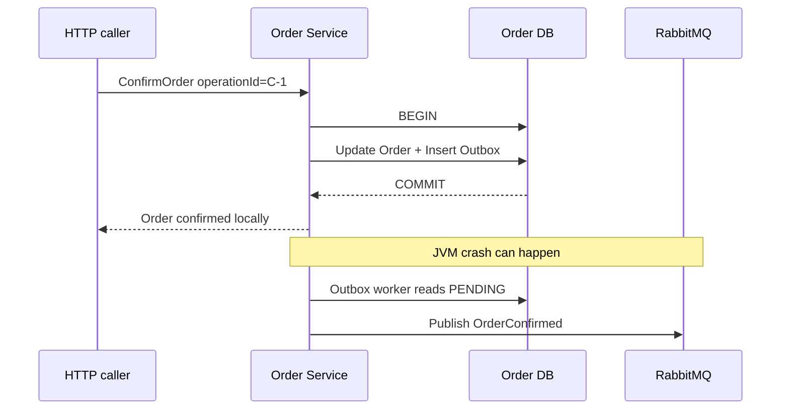
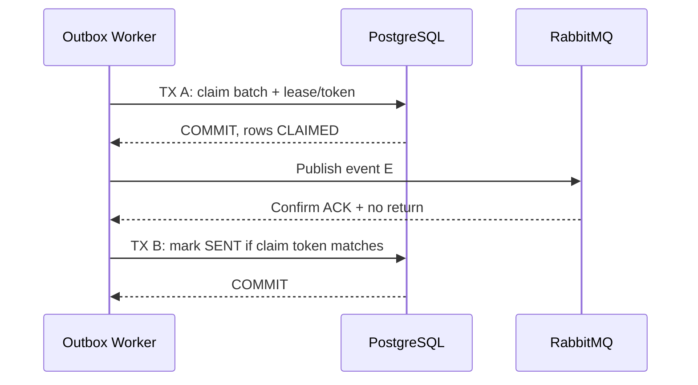
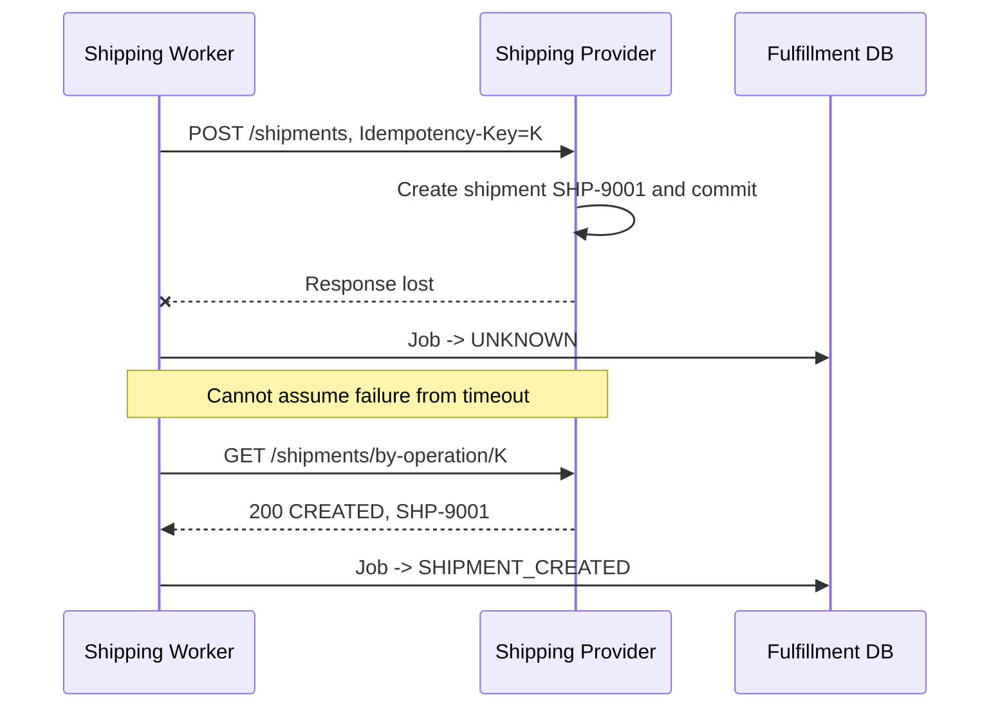
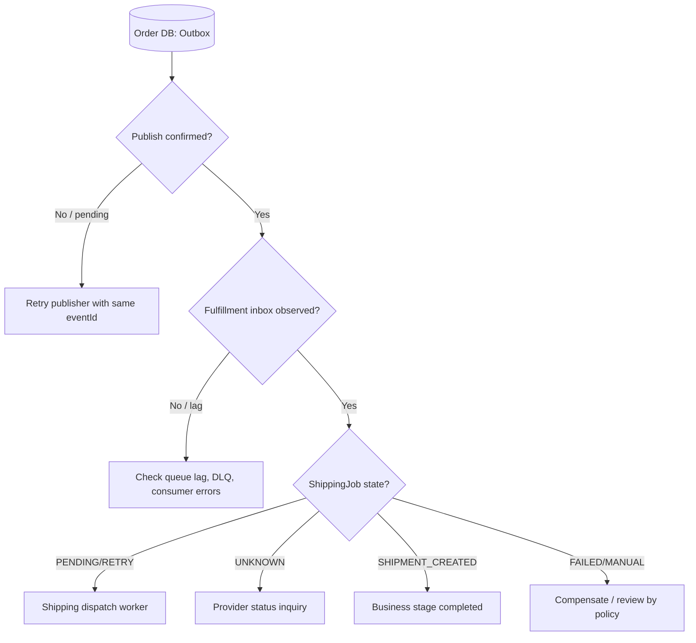
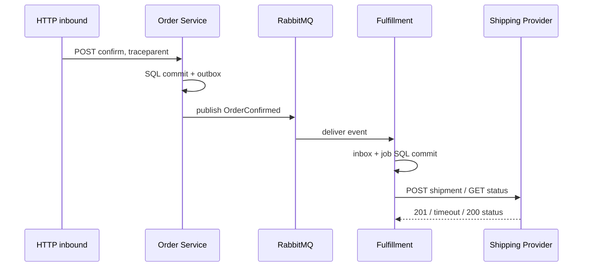

# Implementing Outbox, Idempotent Consumer, and Post-Failure Reconciliation

## 1. Practice Problem: One Order Confirmation, Multiple Commit Boundaries

Suppose an e-commerce platform has two Spring Boot applications:

- **Order Service** receives an order confirmation command, saves state in PostgreSQL, and publishes an `OrderConfirmed` event to RabbitMQ.
- **Fulfillment Service** consumes `OrderConfirmed`, creates a fulfillment job in its own PostgreSQL database, and then calls a Shipping Provider over HTTP to create a shipment.

In a normal run, the flow is simple: a user confirms an order, Order commits, the broker accepts the event, Fulfillment creates a shipment, and the Shipping Provider returns a tracking ID. In reality, however, systems can fail inside any gap between two commits.

Three questions this practice must solve:

1. **Outbox:** If Order commits but the broker is down or the JVM dies before publishing, how do we keep the event from disappearing?
2. **Idempotent consumer:** If the broker delivers the same event twice, how does Fulfillment avoid creating two shipment jobs?
3. **Post-failure reconciliation:** If the Shipping Provider creates a shipment but the HTTP response is lost, how do we avoid re-sending it as a brand-new command or falsely marking it failed?

This lesson is in the **Comprehensive Practice** chapter of the **SPRING_BOOT_INTEGRATION** module. The module focuses on Spring Boot integrations across HTTP clients, databases, caches, message brokers, and Spring Integration, emphasizing configuration, data contracts, transactions, errors, duplicate handling, testing, and observability. Thus the solution below cannot stop at "publish an event successfully"; it must specify the **source of truth**, **durable states**, **crash windows**, and **safe replay conditions**.

### 1.1. Required Outcomes

After this lesson, you will be able to:

- Precisely describe transaction boundaries across PostgreSQL, RabbitMQ publisher confirms, consumer acknowledgments, and HTTP side effects.
- Design an Order/outbox schema sharing one transaction with unique idempotency keys and event schema versions.
- Implement an outbox claim worker using `FOR UPDATE SKIP LOCKED`, leases, claim tokens, and conditional updates.
- Mark `SENT` only after proper publish confirmation; explain why publishers can still emit duplicates.
- Implement a consumer inbox with unique `(consumer_name, event_id)` and payload hashes; commit the inbox marker and business job in one local transaction.
- Decouple the HTTP shipping call from the consumer database transaction; transition POST timeouts to `UNKNOWN` instead of assuming failure.
- Write a reconciler that queries remote state using a stable operation ID, distinguishing reliable `NOT_FOUND` results from uncertain ones.
- Test happy paths, races, crashes after broker confirm, crashes after DB commit before ack, HTTP timeouts, and late responses.
- Build dashboards/runbooks around backlog, age, duplicates, DLQ, `UNKNOWN`, and actual business outcomes.

> **Versions and scope:** Examples target Java 17+, Spring Boot 3.2+, Spring AMQP, Spring JDBC, and PostgreSQL 15/16, using Spring Framework 6.x types. Java snippets omit imports and minor helpers to focus on transaction paths; topology config, migrations, dependencies, and test fixtures must be assembled completely in real projects. Never use production shipping/mail systems during exercises.

### 1.2. Signals You Must Never Conflate

| Observed Signal | What Is Proven | What Is **Not** Guaranteed |
|---|---|---|
| `@Transactional` returns normally | Local DB transaction completed per proxy/manager | RabbitMQ or Shipping processed it |
| `outbox.status=SENT` | Publisher received confirmation per contract | Fulfillment consumer committed |
| RabbitMQ publisher confirm ACK | Broker accepted the publish | Message routed if returns aren't checked; consumer committed |
| Consumer method returns in AUTO ack mode | Handler finished; container proceeds to ack per policy | HTTP shipping side effect completed |
| `inbox_event` contains event ID | Consumer persisted marker in DB transaction | All remote side effects finished |
| Shipping HTTP `201 Created` | Provider confirmed shipment creation per API | Package was delivered to customer |
| HTTP timeout after POST | Caller did not receive response | No proof provider did not create shipment |

**Target guarantee scope:** local atomic commit + durable intent + at-least-once handoff + idempotent local effect + reconciliation of remote side effects. Never promise **end-to-end exactly-once** across PostgreSQL–RabbitMQ–HTTP without specialized protocols and guarantees from every party.

## 2. Target Architecture and States

### 2.1. Normal Flow Diagram

```mermaid
flowchart LR
    U[POST /orders/{id}/confirm] --> OS[Order Application Service]
    OS --> ODB[(Order PostgreSQL)]
    ODB -->|Order CONFIRMED + Outbox PENDING| PUB[Outbox Publisher]
    PUB -->|publish + confirm| MQ[(RabbitMQ)]
    MQ -->|at-least-once delivery| CON[Order Event Consumer]
    CON --> FDB[(Fulfillment PostgreSQL)]
    FDB -->|Inbox + ShippingJob PENDING| W[Shipping Worker]
    W -->|POST Idempotency-Key| SH[Shipping HTTP API]
    SH -->|201 / 409 / timeout| W
    W --> FDB
    REC[Reconciliation Worker] --> FDB
    REC -->|GET by operation ID| SH
```

**No single transaction spans the entire diagram.** Each database commits independently, the broker has separate publish confirms and consumer acks, and the Shipping Provider has its own transactions. Recovery paths rely on durable records and stable business operation IDs.

### 2.2. Data Ownership and Responsibilities

| Component | Source of Truth | Ownership |
|---|---|---|
| Order Service | `order_record` and `outbox_event` | Order state; committed events awaiting emission |
| Order outbox worker | `outbox_event` | Claim, publish, retry, mark SENT |
| RabbitMQ | Exchanges, queues, delivery state | Handoff and redelivery; **does not** decide if Order is confirmed |
| Fulfillment consumer | `inbox_event` and `shipping_job` | Idempotent event acceptance |
| Shipping worker | `shipping_job` | Sends shipment creation command by operation ID |
| Shipping Provider | Shipment record in remote system | Authoritative state on whether shipment exists/was created |
| Reconciliation worker | `shipping_job` + provider status API | Resolves UNKNOWN/stuck jobs per contract |

In production, Order and Fulfillment should maintain **separate database ownership**. They can share a single PostgreSQL server in local tests, but never share a single database transaction to "fake" distributed consistency.

### 2.3. State Machines for Order, Outbox, and Shipping

```text
ORDER
  PENDING -> CONFIRMED

OUTBOX
  PENDING -> CLAIMED -> SENT
                |
                +-- lease expires -> CLAIMED by another worker
                +-- retryable failure -> PENDING / RETRY_SCHEDULED

SHIPPING JOB
  PENDING -> IN_FLIGHT -> SHIPMENT_CREATED
                   |
                   +-- response uncertain -> UNKNOWN
                   +-- known temporary failure -> RETRY_SCHEDULED
                   +-- known permanent rejection -> FAILED_PERMANENT

  UNKNOWN -> RECONCILING -> SHIPMENT_CREATED
                          -> RETRY_SCHEDULED (only if safe to retry)
                          -> MANUAL_REVIEW
```

Outbox `SENT` and ShippingJob `SHIPMENT_CREATED` describe two different milestones. `SENT` does not prove a shipment exists. `SHIPMENT_CREATED` is still distinct from `DELIVERED`.

### 2.4. IDs Must Stay Stable Across Every Attempt

Example:

```text
tenantId           = TENANT-A
orderId            = O-1001
confirmOperationId = b00c... (UUID)
eventId            = b00c... (stable UUID for this event)
shippingOperationId= ship:TENANT-A:O-1001:b00c...
traceId            = changes per execution/trace context
brokerDeliveryTag  = broker-local; changes per channel/delivery
```

Each serves a distinct purpose:

- `confirmOperationId` locks the confirmation command when retried by the HTTP caller.
- `eventId` locks a committed event and never regenerates on outbox publisher retries.
- `shippingOperationId` locks the logical create-shipment request at the Shipping Provider.
- `traceId` is only for correlation/observability, not a durable idempotency key.
- RabbitMQ delivery tags or Spring Message IDs do not replace business event IDs.

Every HTTP retry or broker redelivery must **preserve its corresponding business IDs**.

## 3. Setting Up the Practice Environment

### 3.1. Minimal Stack

Each application needs Spring Boot JDBC/JPA as chosen; this lesson uses JDBC to keep SQL crystal clear:

```xml
<dependencies>
  <dependency>
    <groupId>org.springframework.boot</groupId>
    <artifactId>spring-boot-starter-web</artifactId>
  </dependency>
  <dependency>
    <groupId>org.springframework.boot</groupId>
    <artifactId>spring-boot-starter-jdbc</artifactId>
  </dependency>
  <dependency>
    <groupId>org.springframework.boot</groupId>
    <artifactId>spring-boot-starter-amqp</artifactId>
  </dependency>
  <dependency>
    <groupId>org.flywaydb</groupId>
    <artifactId>flyway-core</artifactId>
  </dependency>
  <dependency>
    <groupId>org.postgresql</groupId>
    <artifactId>postgresql</artifactId>
    <scope>runtime</scope>
  </dependency>
  <dependency>
    <groupId>org.springframework.boot</groupId>
    <artifactId>spring-boot-starter-test</artifactId>
    <scope>test</scope>
  </dependency>
  <dependency>
    <groupId>org.springframework.boot</groupId>
    <artifactId>spring-boot-testcontainers</artifactId>
    <scope>test</scope>
  </dependency>
  <dependency>
    <groupId>org.testcontainers</groupId>
    <artifactId>junit-jupiter</artifactId>
    <scope>test</scope>
  </dependency>
  <dependency>
    <groupId>org.testcontainers</groupId>
    <artifactId>postgresql</artifactId>
    <scope>test</scope>
  </dependency>
  <dependency>
    <groupId>org.testcontainers</groupId>
    <artifactId>rabbitmq</artifactId>
    <scope>test</scope>
  </dependency>
</dependencies>
```

Maven example uses the Spring Boot parent/BOM. Depending on Spring Boot/Flyway/PostgreSQL versions, you may need a database-specific Flyway module per release notes; never use `ddl-auto=create` instead of migrations in production. Fulfillment's HTTP client uses `RestClient` from Spring Web. The HTTP mock server can be WireMock, MockWebServer, or a dedicated test container.

### 3.2. Local Compose (Demo Environment)

```yaml
# Illustrative compose.yaml — dev profile only
services:
  order-db:
    image: postgres:16-alpine
    environment:
      POSTGRES_DB: orders
      POSTGRES_USER: orders_user
      POSTGRES_PASSWORD: local-only-orders
    ports:
      - "127.0.0.1:15432:5432"

  fulfillment-db:
    image: postgres:16-alpine
    environment:
      POSTGRES_DB: fulfillment
      POSTGRES_USER: fulfillment_user
      POSTGRES_PASSWORD: local-only-fulfillment
    ports:
      - "127.0.0.1:25432:5432"

  rabbitmq:
    image: rabbitmq:3.13-management-alpine
    ports:
      - "127.0.0.1:5672:5672"
      - "127.0.0.1:15672:15672"
```

Credentials are strictly for local loopback use. Fixed host ports can collide with existing services; in CI, use Testcontainers dynamic mapped ports. Never expose databases or RabbitMQ management UI to the Internet, and never copy these credentials into real environments. Configure separate datasources for the two apps/schemas; never allow Fulfillment to directly modify Order tables.

### 3.3. Order Service Configuration

```yaml
spring:
  datasource:
    url: jdbc:postgresql://127.0.0.1:15432/orders
    username: orders_user
    password: ${ORDER_DB_PASSWORD:local-only-orders}
  rabbitmq:
    host: 127.0.0.1
    port: 5672
    publisher-confirm-type: correlated
    publisher-returns: true
    template:
      mandatory: true

integration:
  outbox:
    batch-size: 10
    lease: 90s
    confirm-timeout: 5s
    retry-delay: 15s
    poll-delay-ms: 1000
```

`spring.rabbitmq.publisher-confirm-type=correlated` enables correlated publisher confirms; `publisher-returns=true` with `template.mandatory=true` detects unroutable messages. Production requires TLS/vhosts/ACLs, cluster policies, clear topology ownership, and tested confirm handling. In production, use a secret manager instead of default credentials.

### 3.4. Fulfillment Service Configuration

```yaml
spring:
  datasource:
    url: jdbc:postgresql://127.0.0.1:25432/fulfillment
    username: fulfillment_user
    password: ${FULFILLMENT_DB_PASSWORD:local-only-fulfillment}
  rabbitmq:
    host: 127.0.0.1
    port: 5672
    listener:
      simple:
        acknowledge-mode: auto
        default-requeue-rejected: false

integration:
  shipping:
    base-url: http://127.0.0.1:18080
    connect-timeout: 2s
    read-timeout: 4s
    query-timeout: 3s
```

`default-requeue-rejected=false` is just an example to avoid infinite poison loops when no retry advice is configured. To retry transient errors, define explicit retry/backoff policies, DLX/DLQ, and error classification; do not silently drop all exceptions just by setting requeue to false. Avoid enabling service-wide default retries until business errors and acknowledgment semantics are defined.

### 3.5. Practicing in a Verifiable Sequence

```text
1. Migrate Order DB and Fulfillment DB.
2. Declare Rabbit exchange, queue, binding, DLQ.
3. Send ConfirmOrderCommand over HTTP.
4. Assert Order + Outbox commit atomically.
5. Run Outbox Publisher; verify confirm + SENT.
6. Consumer receives OrderConfirmed; assert Inbox + ShippingJob.
7. Shipping worker sends POST with stable operationId.
8. Fake provider creates shipment; responds with success or timeout.
9. Reconciler resolves UNKNOWN; assert no duplicate shipment created.
10. Inject crashes/redeliveries and verify invariants.
```

Never skip the final step: a passing "happy path" run does not prove the outbox, inbox, and reconciliation actually hold up under failure.

## 4. Order Service: Schema and Event Contract

### 4.1. Order Database Migration

Create Flyway migrations (illustrative content for your project—**this task edits Markdown only**):

```sql
CREATE TABLE order_record (
    tenant_id    VARCHAR(80) NOT NULL,
    order_id     VARCHAR(80) NOT NULL,
    status       VARCHAR(32) NOT NULL,
    version      BIGINT NOT NULL DEFAULT 0,
    updated_at   TIMESTAMPTZ NOT NULL DEFAULT CURRENT_TIMESTAMP,
    PRIMARY KEY (tenant_id, order_id),
    CONSTRAINT ck_order_status
      CHECK (status IN ('PENDING', 'CONFIRMED', 'CANCELLED'))
);

CREATE TABLE confirm_command (
    tenant_id     VARCHAR(80) NOT NULL,
    operation_id  UUID NOT NULL,
    order_id      VARCHAR(80) NOT NULL,
    processed_at  TIMESTAMPTZ NOT NULL DEFAULT CURRENT_TIMESTAMP,
    PRIMARY KEY (operation_id)
);

CREATE TABLE outbox_event (
    event_id         UUID PRIMARY KEY,
    tenant_id        VARCHAR(80) NOT NULL,
    aggregate_id     VARCHAR(80) NOT NULL,
    event_type       VARCHAR(80) NOT NULL,
    schema_version   INTEGER NOT NULL,
    payload_json     JSONB NOT NULL,
    status           VARCHAR(24) NOT NULL DEFAULT 'PENDING',
    claim_token      UUID,
    claimed_until    TIMESTAMPTZ,
    next_attempt_at  TIMESTAMPTZ NOT NULL DEFAULT CURRENT_TIMESTAMP,
    attempt_count    INTEGER NOT NULL DEFAULT 0,
    created_at       TIMESTAMPTZ NOT NULL DEFAULT CURRENT_TIMESTAMP,
    sent_at          TIMESTAMPTZ,
    last_error_class VARCHAR(80),
    CONSTRAINT ck_outbox_status CHECK (
      status IN ('PENDING', 'RETRY_SCHEDULED', 'CLAIMED', 'SENT')
    )
);

CREATE INDEX ix_outbox_ready
  ON outbox_event(status, next_attempt_at, claimed_until, created_at);
```

Key point: `order_record`, `confirm_command`, and `outbox_event` must live in the same datasource and managed local transaction. `confirm_command` prevents HTTP retries from creating another logical command under the same operation ID; `outbox_event` stores remaining publisher work. Use real unique constraints instead of `SELECT exists → INSERT`, which races when two requests arrive concurrently.

In multi-tenant systems, do not simply store `tenant_id` in a DTO and trust it: tenant comes from authentication/authorization, queries must enforce tenant predicates, and event emission rights must be controlled. Because event payloads may contain PII, minimize fields, encrypt per policy, and bound retention.

### 4.2. Versioned Event Schema

```java
// In a shared contract module (illustrative)
public record ConfirmOrderCommand(
        String tenantId,
        String orderId,
        UUID operationId
) {}

public record OrderConfirmedEvent(
        int schemaVersion,
        UUID eventId,
        String tenantId,
        String orderId,
        Instant occurredAt
) {}
```

`eventId` must be generated **once at the business command boundary**. In this example, one confirm command emits one event, so `eventId = operationId` works cleanly. If one command emits multiple events, assign distinct event IDs persisted inside the SQL transaction and keep them fixed across publisher retries.

`schemaVersion=1` lets consumers reject/quarantine incompatible events rather than silently mis-deserializing them. `occurredAt` is for auditing, never as a deduplication key because two events can share timestamps or clocks can skew across hosts.

### 4.3. HTTP Command Ingestion

```http
POST /api/v1/orders/O-1001/confirm
Idempotency-Key: 0c03e587-fbb2-4c8f-bcab-5d09f09e9301
Authorization: Bearer <trusted-session-token>
Content-Type: application/json

{}
```

The application extracts `tenantId` from the verified authenticated principal/claims. The order ID comes from the URL, and the operation ID comes from the validated header. Never trust an arbitrary `tenantId` in the request body. Repeating the request with the same tenant/order/key returns the prior outcome per contract; reusing the same key for a different order returns a conflict.

For the HTTP API, returning `200 OK` or `202 Accepted` must be documented accurately. Once SQL commits Order `CONFIRMED` and outbox `PENDING`, you can confirm the **Order's local business state**, without claiming Fulfillment has created a shipment. If confirmation is a multi-step async workflow, `202` with a tracking endpoint may be clearer.

## 5. Committing Order and Outbox in the Same Transaction

### 5.1. Application Service Using JDBC

```java
// OrderConfirmationService.java — imports omitted
@Service
public class OrderConfirmationService {
    private final JdbcTemplate jdbc;
    private final ObjectMapper mapper;

    public OrderConfirmationService(
            JdbcTemplate jdbc, ObjectMapper mapper) {
        this.jdbc = jdbc;
        this.mapper = mapper;
    }

    @Transactional
    public void confirm(ConfirmOrderCommand cmd) {
        validate(cmd);

        int first = jdbc.update("""
            INSERT INTO confirm_command(
                tenant_id, operation_id, order_id
            )
            VALUES (?, ?, ?)
            ON CONFLICT (operation_id) DO NOTHING
            """,
            cmd.tenantId(), cmd.operationId(), cmd.orderId());

        if (first == 0) {
            Map<String, Object> previous = jdbc.queryForMap("""
                SELECT tenant_id, order_id
                  FROM confirm_command
                 WHERE operation_id = ?
                """, cmd.operationId());

            if (!cmd.tenantId().equals(previous.get("tenant_id"))
                    || !cmd.orderId().equals(
                            previous.get("order_id"))) {
                throw new IllegalArgumentException(
                        "Idempotency-Key already used for another command");
            }
            return; // Previous command already committed.
        }

        int changed = jdbc.update("""
            UPDATE order_record
               SET status = 'CONFIRMED',
                   version = version + 1,
                   updated_at = CURRENT_TIMESTAMP
             WHERE tenant_id = ?
               AND order_id = ?
               AND status = 'PENDING'
            """, cmd.tenantId(), cmd.orderId());

        if (changed != 1) {
            throw new IllegalStateException(
                    "Order does not exist or cannot be confirmed");
        }

        OrderConfirmedEvent event = new OrderConfirmedEvent(
                1,
                cmd.operationId(),
                cmd.tenantId(),
                cmd.orderId(),
                Instant.now());

        String payload;
        try {
            payload = mapper.writeValueAsString(event);
        } catch (JsonProcessingException e) {
            throw new IllegalStateException(
                    "Failed to serialize event", e);
        }

        jdbc.update("""
            INSERT INTO outbox_event(
                event_id, tenant_id, aggregate_id,
                event_type, schema_version, payload_json
            )
            VALUES (?, ?, ?, 'ORDER_CONFIRMED', 1, CAST(? AS jsonb))
            """, event.eventId(), event.tenantId(),
                 event.orderId(), payload);
    }

    private static void validate(ConfirmOrderCommand cmd) {
        if (cmd == null || cmd.operationId() == null ||
            cmd.tenantId() == null ||
            !cmd.tenantId().matches("[A-Za-z0-9_-]{1,80}") ||
            cmd.orderId() == null ||
            !cmd.orderId().matches("[A-Za-z0-9_-]{1,80}")) {
            throw new IllegalArgumentException(
                    "Invalid ConfirmOrderCommand");
        }
    }
}
```

**Requirement:** the method must be invoked via a Spring transaction proxy and `JdbcTemplate` must use the same `DataSource`/`PlatformTransactionManager`. The SQL statements inside form **one** PostgreSQL commit. If the Order update or outbox insert fails, both `confirm_command` and business state roll back.

When two HTTP requests with the same operation ID arrive concurrently, the unique constraint forces one to wait/skip inserting; it cannot produce two outbox events. In the demo, `operation_id` is a **globally unique** key, aligning `eventId = operationId` with the outbox primary key on `event_id`. When a second call finds the committed marker, verify **both tenant and order**; reusing the same UUID across tenants is rejected without leaking the original tenant's info. If commands carry quantity, price, tenant-scoped claims, or additional semantic fields, also store a **canonical payload hash** in `confirm_command` and compare full semantics, not just `orderId`.

### 5.2. Eliminated Crash Windows and Remaining Windows



If the JVM crashes **after Order commits but before publishing**, `outbox_event.status=PENDING` survives and the publisher resumes after restart. If the JVM crashes before commit, both Order and outbox roll back—no "ghost event."

An application without an outbox that publishes via `@TransactionalEventListener(AFTER_COMMIT)` still has a crash window losing the event between DB commit and callback execution. Callbacks should only wake up a publisher when a durable outbox is the source.

### 5.3. Why Not Call RabbitTemplate Inside the Transaction?

Anti-pattern:

```java
@Transactional
public void confirmWrong(ConfirmOrderCommand command) {
    orderRepository.confirm(command.orderId());
    rabbitTemplate.convertAndSend(
            "orders.events.v1",
            "order.confirmed.v1",
            new OrderConfirmedEvent(...));
}
```

RabbitMQ has its own transaction/confirm domain; it **does not enlist** in PostgreSQL `@Transactional`. The broker can receive the event while the database commit subsequently fails. Publishing after commit in plain code still risks **losing the event** if the process dies before sending. The outbox durably persists publish intent.

### 5.4. Event Versioning and Ordering

If Order has multiple state transitions, an `ORDER_CONFIRMED` event should carry an `aggregateVersion`/sequence sourced from the database so consumers can tell old from new. Within a broker, routing/partitioning by `orderId` helps ordering, yet retries, DLQ redrives, and multi-consumer concurrency can still reorder deliveries.

This example uses a single `PENDING → CONFIRMED` transition to keep focus on outbox/inbox. When adding `CANCELLED`/`REFUNDED`, implement version-aware consumers and conditional state updates rather than relying solely on arrival order or event timestamps.

## 6. RabbitMQ Topology and Publish Contract

### 6.1. Exchange, Queue, Routing Key, and DLQ

Assume infrastructure defines:

```text
TopicExchange  orders.events.v1
Routing key    order.confirmed.v1
Queue          fulfillment.order-confirmed.v1

Dead-letter exchange    orders.dlx.v1
DLQ                     fulfillment.order-confirmed.dlq.v1
```

Sample Java configuration:

```java
@Configuration(proxyBeanMethods = false)
class OrderMessagingTopology {
    @Bean
    Declarables orderTopology() {
        TopicExchange events =
                ExchangeBuilder.topicExchange(
                        "orders.events.v1").durable(true).build();
        DirectExchange dlx =
                ExchangeBuilder.directExchange(
                        "orders.dlx.v1").durable(true).build();

        Queue consumerQueue = QueueBuilder
                .durable("fulfillment.order-confirmed.v1")
                .deadLetterExchange("orders.dlx.v1")
                .deadLetterRoutingKey(
                        "fulfillment.order-confirmed.dlq.v1")
                .build();
        Queue deadLetterQueue = QueueBuilder
                .durable("fulfillment.order-confirmed.dlq.v1")
                .build();

        return new Declarables(
                events, dlx, consumerQueue, deadLetterQueue,
                BindingBuilder.bind(consumerQueue)
                        .to(events).with("order.confirmed.v1"),
                BindingBuilder.bind(deadLetterQueue)
                        .to(dlx).with(
                            "fulfillment.order-confirmed.dlq.v1")
        );
    }
}
```

The example uses durable queues; message delivery persistence must also be configured explicitly. A DLQ does not automatically decide when messages are redriven or how poison events are resolved. Production should designate **a single topology owner** (deployment/IaC or an authorized service) so two apps do not redeclare queues with differing arguments and trigger `PRECONDITION_FAILED`.

For HA/replication needs, evaluate classic vs. quorum queues and broker policies for your RabbitMQ version; do not assume a durable queue on a single broker protects against complete node/disk loss.

### 6.2. Confirms and Returns Are Two Separate Signals

- **Publisher confirm ACK:** the broker accepted the publish under confirm mode; does not mean a consumer processed it.
- **Publisher return:** when a mandatory publish cannot be routed, the broker returns the message via the return callback.
- **Consumer ack:** the consumer container acknowledges delivery per ack policy; does not mean remote shipping succeeded.

For instance, if exchange `orders.events.v1` exists but the queue binding is wrong, a publish can be **ACKed by the broker** without reaching the intended queue. That is why the example enables `publisher-returns=true` and `template.mandatory=true`, checking both the confirm result and any returned message.

If an organization uses alternate exchanges, unroutable routing contracts differ; verify alternate-route/mandatory-return semantics instead of equating "ACK" with "delivered to recipient."

## 7. Outbox Publisher: Claim Then Send Outside Transactions

### 7.1. Never Wrap Network Publishing Inside an SQL Transaction

Anti-pattern:

```text
BEGIN PostgreSQL TX
SELECT outbox FOR UPDATE
SEND RabbitMQ + wait confirm 5 seconds
UPDATE outbox SENT
COMMIT PostgreSQL TX
```

Holding SQL row locks and connections across network I/O causes pool exhaustion when RabbitMQ degrades, **and still does not make broker and database commit atomically**. The publisher should use two short SQL transactions separated by the network call:



**Remaining failure window:** broker ACKs and the worker crashes before SQL TX B; the outbox row is not yet `SENT`, so after lease expiry another publisher can send E again. This is handled by **consumer idempotency**, and cannot be eliminated by a local boolean.

### 7.2. Record Mapping a Claimed Row

```java
public record OutboxClaim(
        UUID eventId,
        String tenantId,
        String aggregateId,
        String eventType,
        int schemaVersion,
        String payloadJson,
        UUID claimToken
) {}
```

`payloadJson` is the already-committed payload; never reconstruct the event DTO with a fresh `UUID.randomUUID()` on each send. Message content, event ID, version, and aggregate key must remain stable across retries.

### 7.3. Batch Claiming with PostgreSQL SKIP LOCKED

```sql
WITH candidates AS (
    SELECT event_id
      FROM outbox_event
     WHERE (
           status IN ('PENDING', 'RETRY_SCHEDULED')
           AND next_attempt_at <= CURRENT_TIMESTAMP
     ) OR (
           status = 'CLAIMED'
           AND claimed_until <= CURRENT_TIMESTAMP
     )
     ORDER BY created_at, event_id
     LIMIT :batch_size
     FOR UPDATE SKIP LOCKED
)
UPDATE outbox_event AS e
   SET status = 'CLAIMED',
       claim_token = :claim_token,
       claimed_until =
           CURRENT_TIMESTAMP + INTERVAL '90 seconds',
       attempt_count = attempt_count + 1
  FROM candidates AS c
 WHERE e.event_id = c.event_id
RETURNING e.event_id, e.tenant_id, e.aggregate_id,
          e.event_type, e.schema_version,
          e.payload_json, e.claim_token;
```

`FOR UPDATE SKIP LOCKED` prevents multiple workers from claiming rows already locked by another worker during **TX A**. A `claimed_until` lease recovers rows if a worker commits a claim and crashes before publishing. Assign a unique random `claim_token` per batch so an older worker cannot mark `SENT` on a claim reassigned to a new owner.

**Note:** this query does not guarantee global ordering. Multiple workers with `SKIP LOCKED` may publish E2 before E1 for the same order if E1 is locked or fails. For aggregates requiring strict order, add partitioning/sequencing logic or constrain per-aggregate concurrency.

### 7.4. Repository Splitting Short Transactions

```java
// OutboxStore.java — imports omitted
@Repository
public class OutboxStore {
    private final JdbcTemplate jdbc;

    public OutboxStore(JdbcTemplate jdbc) {
        this.jdbc = jdbc;
    }

    @Transactional
    public List<OutboxClaim> claimBatch(int batchSize) {
        UUID token = UUID.randomUUID();

        return jdbc.query("""
            WITH candidates AS (
                SELECT event_id
                  FROM outbox_event
                 WHERE (
                   status IN ('PENDING','RETRY_SCHEDULED')
                   AND next_attempt_at <= CURRENT_TIMESTAMP
                 ) OR (
                   status = 'CLAIMED'
                   AND claimed_until <= CURRENT_TIMESTAMP
                 )
                 ORDER BY created_at, event_id
                 LIMIT ?
                 FOR UPDATE SKIP LOCKED
            )
            UPDATE outbox_event AS e
               SET status='CLAIMED',
                   claim_token=?,
                   claimed_until =
                       CURRENT_TIMESTAMP + INTERVAL '90 seconds',
                   attempt_count=attempt_count+1
              FROM candidates AS c
             WHERE e.event_id = c.event_id
            RETURNING e.event_id, e.tenant_id,
                      e.aggregate_id, e.event_type,
                      e.schema_version, e.payload_json,
                      e.claim_token
            """,
            (rs, i) -> new OutboxClaim(
                    rs.getObject("event_id", UUID.class),
                    rs.getString("tenant_id"),
                    rs.getString("aggregate_id"),
                    rs.getString("event_type"),
                    rs.getInt("schema_version"),
                    rs.getString("payload_json"),
                    rs.getObject("claim_token", UUID.class)),
            batchSize, token);
    }

    @Transactional
    public boolean markSent(OutboxClaim claim) {
        int changed = jdbc.update("""
            UPDATE outbox_event
               SET status='SENT',
                   sent_at=CURRENT_TIMESTAMP,
                   claim_token=NULL,
                   claimed_until=NULL,
                   last_error_class=NULL
             WHERE event_id=?
               AND status='CLAIMED'
               AND claim_token=?
            """, claim.eventId(), claim.claimToken());
        return changed == 1;
    }

    @Transactional
    public boolean deferRetry(
            OutboxClaim claim, String errorClass) {
        int changed = jdbc.update("""
            UPDATE outbox_event
               SET status='RETRY_SCHEDULED',
                   next_attempt_at =
                      CURRENT_TIMESTAMP + INTERVAL '15 seconds',
                   claim_token=NULL,
                   claimed_until=NULL,
                   last_error_class=?
             WHERE event_id=?
               AND status='CLAIMED'
               AND claim_token=?
            """, errorClass, claim.eventId(),
                 claim.claimToken());
        return changed == 1;
    }
}
```

This repository uses one `JdbcTemplate`/PostgreSQL transaction manager. It returns claimed rows **after the proxy commits** when called from another bean. `markSent`/`deferRetry` gate updates on the claim token; if they return false, ownership may have changed and the worker must **observe/alert** instead of unconditionally updating by event ID alone.

`errorClass` should be a bounded label such as `BROKER_NACK`, `CONFIRM_TIMEOUT`, or `RETURNED_UNROUTABLE`. Never write raw exceptions containing URLs/credentials into this field. Production adds exponential backoff, max attempts, quarantine, and next-attempt scheduling; the 15-second delay is illustrative only.

### 7.5. Sending Stable Payloads and Waiting for Confirms

```java
// RabbitOutboxSender.java — imports omitted
@Component
public class RabbitOutboxSender {
    private final RabbitTemplate rabbit;

    public RabbitOutboxSender(RabbitTemplate rabbit) {
        this.rabbit = rabbit;
    }

    public void sendAndConfirm(OutboxClaim row)
            throws InterruptedException,
                   ExecutionException, TimeoutException {

        MessageProperties props = new MessageProperties();
        props.setContentType(
                MessageProperties.CONTENT_TYPE_JSON);
        props.setDeliveryMode(
                MessageDeliveryMode.PERSISTENT);
        props.setMessageId(row.eventId().toString());
        props.setHeader("event-id", row.eventId().toString());
        props.setHeader(
                "schema-version", row.schemaVersion());
        props.setHeader("event-type", row.eventType());

        Message message = new Message(
                row.payloadJson().getBytes(
                        StandardCharsets.UTF_8),
                props);

        CorrelationData correlation =
                new CorrelationData(row.eventId().toString());

        rabbit.send(
                "orders.events.v1",
                "order.confirmed.v1",
                message, correlation);

        CorrelationData.Confirm confirm =
                correlation.getFuture().get(
                        5, TimeUnit.SECONDS);

        if (!confirm.isAck()) {
            throw new IllegalStateException(
                    "RabbitMQ publisher NACK");
        }
        if (correlation.getReturned() != null) {
            throw new IllegalStateException(
                    "Event was not routed to any queue");
        }
    }
}
```

**Runtime prerequisites:** publisher confirm type must be `correlated`, returns enabled, and template mandatory. Publish success requires **confirm ACK and no mandatory return** per verified config. `CorrelationData` tracks one publish attempt; `eventId` stays unchanged even when creating a new correlation object on retry.

Publisher confirms tell you the broker accepted the publish under configured mode; they do not guarantee consumer processing, do not prove the message landed in the right queue without checking unroutable returns, and do not substitute for testing broker topology.

### 7.6. Scheduled Publisher Without Wrapping Rabbit Calls in a Transaction

```java
// @EnableScheduling placed on an appropriate configuration.
@Component
public class OutboxPublisherJob {
    private final OutboxStore store;
    private final RabbitOutboxSender sender;

    public OutboxPublisherJob(
            OutboxStore store, RabbitOutboxSender sender) {
        this.store = store;
        this.sender = sender;
    }

    @Scheduled(fixedDelayString =
            "${integration.outbox.poll-delay-ms:1000}")
    public void publishPending() {
        List<OutboxClaim> rows = store.claimBatch(10);
        for (OutboxClaim row : rows) {
            try {
                sender.sendAndConfirm(row);
                if (!store.markSent(row)) {
                    // Claim may have expired or changed owner.
                    recordLostOwnership(row.eventId());
                }
            } catch (InterruptedException interrupted) {
                Thread.currentThread().interrupt();
                store.deferRetry(row, "INTERRUPTED");
                break;
            } catch (Exception failure) {
                store.deferRetry(
                        row, classifyPublishFailure(failure));
            }
        }
    }

    private void recordLostOwnership(UUID eventId) {
        // Replace with metric + non-sensitive audit log.
    }

    private String classifyPublishFailure(Exception ex) {
        if (ex instanceof TimeoutException) {
            return "CONFIRM_TIMEOUT";
        }
        return "BROKER_ERROR";
    }
}
```

`@Scheduled` invokes a separate `OutboxStore` bean; SQL claim/mark run inside independent Spring-proxy transactions, while `sendAndConfirm` runs **outside** SQL transactions. `integration.outbox.poll-delay-ms` is an application-specific property. On publish timeout, the broker **may still have received** the event; defer retry instead of marking `SENT` without confirmation, and rely on consumer deduplication.

This worker snippet is a practice skeleton omitting structured logging, retry budgets, shutdown coordination, batch heartbeats, and distributed leader election. A batch of 10 × 5s timeout can take ~50s before overhead, so a 90s lease only fits bounded loads. When scaling to batch 50 or longer timeouts, **renew leases, shrink batches, or dispatch per-row independently** so claims do not expire mid-publish. Never use an unbounded thread pool.

### 7.7. What Lease/Fencing Can and Cannot Do

`claim_token` stops worker A whose lease expired from marking `SENT` over worker B's claim. It **does not** prevent both A and B from sending the same event to the broker if A paused for a long time and then resumed sending. That failure window exists even with `SKIP LOCKED`.

Hence two distinct invariants:

1. **Outbox state cannot be overwritten by a stale owner** thanks to conditional SQL updates.
2. **Business effects are never executed twice** thanks to consumer inbox unique keys and downstream idempotency.

Never use Redis locks or in-JVM `synchronized` blocks instead of SQL uniqueness or idempotent consumers across multiple replicas.

## 8. Fulfillment Service: Inbox and ShippingJob Schemas

### 8.1. Fulfillment Database Migration

```sql
CREATE TABLE inbox_event (
    consumer_name       VARCHAR(100) NOT NULL,
    event_id            UUID NOT NULL,
    payload_fingerprint CHAR(64) NOT NULL,
    processed_at        TIMESTAMPTZ NOT NULL
                        DEFAULT CURRENT_TIMESTAMP,
    PRIMARY KEY (consumer_name, event_id)
);

CREATE TABLE shipping_job (
    job_id                UUID PRIMARY KEY,
    tenant_id             VARCHAR(80) NOT NULL,
    order_id              VARCHAR(80) NOT NULL,
    shipping_operation_id VARCHAR(240) NOT NULL UNIQUE,
    status                VARCHAR(32) NOT NULL DEFAULT 'PENDING',
    provider_shipment_id  VARCHAR(160),
    attempt_count         INTEGER NOT NULL DEFAULT 0,
    next_attempt_at       TIMESTAMPTZ NOT NULL
                          DEFAULT CURRENT_TIMESTAMP,
    claim_token           UUID,
    claimed_until         TIMESTAMPTZ,
    unknown_since         TIMESTAMPTZ,
    last_error_class      VARCHAR(80),
    created_at            TIMESTAMPTZ NOT NULL
                          DEFAULT CURRENT_TIMESTAMP,
    updated_at            TIMESTAMPTZ NOT NULL
                          DEFAULT CURRENT_TIMESTAMP,
    CONSTRAINT uq_initial_shipment UNIQUE (tenant_id, order_id),
    CONSTRAINT ck_shipping_state CHECK (
      status IN (
        'PENDING', 'IN_FLIGHT', 'RETRY_SCHEDULED',
        'UNKNOWN', 'RECONCILING',
        'SHIPMENT_CREATED', 'FAILED_PERMANENT', 'MANUAL_REVIEW'
      )
    )
);

CREATE INDEX ix_shipping_ready
  ON shipping_job(status, next_attempt_at, claimed_until);
```

The model assumes **one initial shipment per Order**; thus unique `(tenant_id,order_id)` adds an extra guard if two distinct event IDs represent the same business shipment. If split shipments or reshipments are supported, replace that constraint with an appropriately distinguishing business key like `(tenant_id,order_id,shipment_sequence)`/`fulfillment_operation_id`. Do not force multi-shipment workflows under an overly strict unique key.

`inbox_event` **must not merely store a boolean "seen" flag**: when a duplicate event ID arrives with a different payload, detect the conflict instead of silently ignoring it. `payload_fingerprint` stores a canonical fingerprint of business-critical fields, though hashes do not prove source authenticity. Broker ACLs, authentication, schema validation, and tenant authorization remain necessary independently.

### 8.2. Why Inbox Marker and ShippingJob Must Share One Transaction

A broken consumer might do:

```text
TX 1: INSERT inbox_event E -> COMMIT
Process crash
TX 2: INSERT shipping_job E -> never ran
Broker redelivers E
Inbox sees E -> skips
Result: lost shipping job
```

Correct design:

```text
BEGIN Fulfillment PostgreSQL transaction
  INSERT inbox_event E (unique per consumer)
  INSERT shipping_job E (unique per business operation)
COMMIT
RETURN from listener
RabbitMQ ACK (AUTO mode)
```

If the second insert fails, both inbox marker and job roll back so the message can be retried/DLQ'd per policy. If DB commits and the process crashes before ack, the broker redelivers, sees the committed inbox marker, and does not create a second job.

### 8.3. Canonical Fingerprint with Clear Bounds

In this contract, fields are limited to event type, schemaVersion, eventId, tenantId, orderId, and occurredAt. Direct business-field comparison could even substitute for hashing. Example helper:

```java
public final class EventFingerprints {
    private EventFingerprints() {}

    public static String orderConfirmed(
            OrderConfirmedEvent event) {
        String canonical = String.join("|",
                "ORDER_CONFIRMED",
                Integer.toString(event.schemaVersion()),
                event.eventId().toString(),
                event.tenantId(),
                event.orderId(),
                event.occurredAt().toString());
        try {
            MessageDigest digest =
                    MessageDigest.getInstance("SHA-256");
            byte[] bytes = digest.digest(
                    canonical.getBytes(StandardCharsets.UTF_8));
            return HexFormat.of().formatHex(bytes);
        } catch (NoSuchAlgorithmException e) {
            throw new IllegalStateException(
                    "JVM does not support SHA-256", e);
        }
    }
}
```

In this example, `tenantId/orderId` are constrained to `[A-Za-z0-9_-]`, so the `|` delimiter cannot collide with field values. For real events with free-form strings, use canonical JSON or length-prefixed encoding and **include every field affecting business outcomes**. The canonical hash must remain identical across retries; never include trace IDs, delivery tags, or timestamps **regenerated on the consumer**.

### 8.4. Validate Before Writing to the Inbox

```java
public final class OrderEventValidator {
    private OrderEventValidator() {}

    public static void validate(OrderConfirmedEvent event) {
        if (event == null || event.schemaVersion() != 1 ||
            event.eventId() == null ||
            event.tenantId() == null ||
            !event.tenantId().matches("[A-Za-z0-9_-]{1,80}") ||
            event.orderId() == null ||
            !event.orderId().matches("[A-Za-z0-9_-]{1,80}") ||
            event.occurredAt() == null) {
            throw new IllegalArgumentException(
                    "Invalid OrderConfirmedEvent");
        }
    }
}
```

Do not accept an event merely because JSON parses cleanly. Verify expected schema version, authorized source/topic, tenant authorization, and field relationships. With untrusted sources, verify HMAC/signatures per contract or lock down broker publish ACLs; an unkeyed SHA-256 fingerprint is not cryptographic authentication.

## 9. Idempotent Consumer: Commit Inbox + ShippingJob Before Acking

### 9.1. Transactional Service in Fulfillment

```java
@Service
public class FulfillmentInboxService {
    private static final String CONSUMER =
            "fulfillment-order-confirmed-v1";
    private final JdbcTemplate jdbc;

    public FulfillmentInboxService(JdbcTemplate jdbc) {
        this.jdbc = jdbc;
    }

    @Transactional
    public void accept(OrderConfirmedEvent event) {
        OrderEventValidator.validate(event);
        String fingerprint =
                EventFingerprints.orderConfirmed(event);

        int first = jdbc.update("""
            INSERT INTO inbox_event(
                consumer_name, event_id, payload_fingerprint)
            VALUES (?, ?, ?)
            ON CONFLICT (consumer_name, event_id) DO NOTHING
            """, CONSUMER, event.eventId(), fingerprint);

        if (first == 0) {
            String oldFingerprint = jdbc.queryForObject("""
                SELECT payload_fingerprint
                  FROM inbox_event
                 WHERE consumer_name = ?
                   AND event_id = ?
                """, String.class, CONSUMER, event.eventId());

            if (!fingerprint.equals(oldFingerprint)) {
                throw new IllegalArgumentException(
                        "Duplicate eventId with different payload");
            }
            return; // Duplicate of the same logical event.
        }

        String operationId = "ship:"
                + event.tenantId() + ":"
                + event.orderId() + ":"
                + event.eventId();

        int created = jdbc.update("""
            INSERT INTO shipping_job(
                job_id, tenant_id, order_id,
                shipping_operation_id
            )
            VALUES (?, ?, ?, ?)
            ON CONFLICT (tenant_id, order_id) DO NOTHING
            """, event.eventId(), event.tenantId(),
                 event.orderId(), operationId);

        if (created != 1) {
            // Another event already claimed the initial shipment.
            // Prevent the new event from creating duplicate effects.
            throw new IllegalArgumentException(
                    "Order already has an initial shipping operation");
        }
    }
}
```

The `CONSUMER` label isolates deduplication across independent consumers. An email worker can consume the same event ID under a different consumer name; processing by Fulfillment must **not** block another business consumer.

For identical `eventId` and payload, the consumer returns normally after checking the marker so RabbitMQ can safely ack the duplicate. For the same `eventId` with a different payload, or a new event attempting another initial shipment for the same order, the code throws a domain error **to route to quarantine/DLQ** rather than retrying forever. Production code should define a dedicated `InvalidEventContractException` and classify it on the listener container.

### 9.2. Listener Calls Only the Local Transactional Service

```java
@Component
public class OrderConfirmedListener {
    private final ObjectMapper mapper;
    private final FulfillmentInboxService inbox;

    public OrderConfirmedListener(
            ObjectMapper mapper,
            FulfillmentInboxService inbox) {
        this.mapper = mapper;
        this.inbox = inbox;
    }

    @RabbitListener(
            queues = "fulfillment.order-confirmed.v1")
    public void onEvent(Message message) {
        OrderConfirmedEvent event;
        try {
            event = mapper.readValue(
                    message.getBody(),
                    OrderConfirmedEvent.class);
        } catch (JsonProcessingException invalidJson) {
            throw new AmqpRejectAndDontRequeueException(
                    "Invalid OrderConfirmed JSON", invalidJson);
        }

        try {
            inbox.accept(event);
        } catch (IllegalArgumentException invalidContract) {
            throw new AmqpRejectAndDontRequeueException(
                    "Invalid OrderConfirmed contract",
                    invalidContract);
        }
    }
}
```

Here `Message` is `org.springframework.amqp.core.Message`, not Spring Integration `Message<?>`. The listener calls a service **in another bean**, so the Spring transaction proxy handles `@Transactional`. When the method returns normally, the local PostgreSQL transaction has committed. With Spring AMQP **AUTO acknowledgment** properly configured, the container acks after listener success; if the process dies between SQL commit and ack, the event is redelivered.

JSON/schema/permanent conflict errors are classified to **avoid endless requeuing** and route to the DLQ per queue config. Transient SQL errors (DB connection, deadlock) should retry within a budget before DLQ for controlled redrive. Not every PostgreSQL exception can be fixed by waiting 1 second; classify by vendor error, SLO, and recoverability.

### 9.3. AUTO Ack Does Not Ack Before the Transaction

In this configuration, the listener calls `inbox.accept` through the proxy, and the transaction commits before `onEvent` returns. When Spring AMQP's AUTO ack mode is properly configured, broker ack occurs afterward. Thus:

```text
DB commit succeeds
    -> listener returns
    -> container acks
```

If ack fails or the connection drops after DB commit, the delivery will be sent again and the inbox prevents duplicates. Conversely, if the listener catches every `DataAccessException` and returns normally, the container acks the message even though the database rolled back—**losing the business effect**. Never swallow errors and log "skipped" without a durable record confirming prior processing.

### 9.4. Why Not Call Shipping HTTP Directly Inside the Listener?

Anti-pattern:

```java
@RabbitListener(queues = "fulfillment.order-confirmed.v1")
public void onMessage(OrderConfirmedEvent event) {
    shippingHttp.createShipment(event); // remote side effect
    inboxService.markProcessed(event.eventId());
}
```

If the provider creates the shipment and the JVM crashes before `markProcessed`/ack, the broker redelivers and the listener sends POST again. If the DB writes the inbox before HTTP and HTTP fails, a deduplicated retry skips calling shipping altogether.

**Correct design:** the listener commits only Inbox + ShippingJob. After the listener returns/acks, a separate worker executes HTTP jobs from the database. That separates transaction boundaries, allows state-driven retries/reconciliation, and avoids holding broker consumer threads during slow shipping API calls.

### 9.5. Three Deduplication Layers That Cannot Replace One Another

| Layer | Key | What It Prevents |
|---|---|---|
| HTTP Order command | Globally unique `operation_id`, checking tenant/order | Caller retries don't create new confirm events |
| Fulfillment Inbox | `(consumer_name,event_id)` | Broker redeliveries don't create a second job |
| Shipping Provider | `shipping_operation_id` via idempotency API | Worker retries don't create two shipments |

Do not replace all three layers with a 30-second-TTL Redis key: duplicates can arrive after TTL expiry or Redis failover, and Redis writes are not atomic with PostgreSQL business state. Redis can cache reads to reduce DB load, but database uniqueness and business state must remain the final guard.

## 10. Shipping HTTP API: Idempotency Contract and Status Lookup

### 10.1. Minimal Contract to Stub

The test Shipping Provider must support **two** endpoints:

```http
POST /api/v1/shipments HTTP/1.1
Idempotency-Key: ship:TENANT-A:O-1001:b00c...
Content-Type: application/json

{
  "tenantId": "TENANT-A",
  "orderId": "O-1001"
}
```

If the provider accepts:

```http
HTTP/1.1 201 Created
Content-Type: application/json

{
  "operationId": "ship:TENANT-A:O-1001:b00c...",
  "shipmentId": "SHP-9001",
  "state": "CREATED"
}
```

Status API:

```http
GET /api/v1/shipments/by-operation/ship%3ATENANT-A%3AO-1001%3Ab00c...
Accept: application/json
```

In the demo, the provider resolves tenant/order IDs and fixture delivery details. **A real application requires shipping address, recipient, and carrier service from an authoritative source**, typically a snapshot written in the local business transaction or a reference only Fulfillment is authorized to look up. Never let the Shipping worker read mutable shipping attributes from Order on each retry, which would send different payloads under the same operation ID.

### 10.2. Server-Side Idempotency Must Be a Real Contract

The Shipping Provider must implement behavior equivalent to:

```text
New key + payload P:
  reserve key / perform shipment create atomically
  persist outcome
  return shipment S

Existing key + same canonical payload P:
  return outcome S previously stored
  do not create a new shipment

Existing key + different payload Q:
  reject conflict, do not create a second shipment
```

If the provider **does not** support idempotency or expires keys sooner than your retry/reconciliation horizon, local outbox+inbox **cannot guarantee** remote creation runs only once. You then need a reliable provider status lookup/transport reconciliation or manual review; never invent fake exactly-once guarantees.

### 10.3. Status Endpoint Must Have Clear Semantics

Assume `GET /shipments/by-operation/{id}` returns:

| Result | Meaning per Provider Contract | Action |
|---|---|---|
| `200` + `state=CREATED`, matching ID | Shipment exists | Mark local `SHIPMENT_CREATED` |
| `200` + `state=PROCESSING` | Command received, not yet terminal | Keep `UNKNOWN/RECONCILING`, query again later |
| `404` "not found" | **Means only "not visible yet"** if status index is eventually consistent | Wait and query again; do not rush to recreate |
| `404` under **linearizable contract + past visibility horizon** | Operation can be treated as unexecuted | Retry **with same** operation key if permitted |
| `409` same-key/different-payload | Contract conflict | Manual review/quarantine; never generate a new key |
| `429/5xx/timeout` | Insufficient certainty | Keep UNKNOWN, back off, retry query |

A provider without guaranteed read visibility on status lookups may return 404 for seconds after creation before returning 200 once indexed. **Never** treat a single 404 as definitive proof that no shipment exists.

### 10.4. Configuring Separate RestClients for Command and Query

```java
@ConfigurationProperties(prefix = "integration.shipping")
public record ShippingHttpProperties(
        URI baseUrl,
        Duration connectTimeout,
        Duration readTimeout,
        Duration queryTimeout
) {}

@Configuration(proxyBeanMethods = false)
@EnableConfigurationProperties(ShippingHttpProperties.class)
class ShippingHttpConfiguration {

    @Bean("shippingCommandClient")
    RestClient shippingCommandClient(
            RestClient.Builder builder,
            ShippingHttpProperties props) {
        return builder
                .baseUrl(props.baseUrl().toString())
                .requestFactory(
                    httpFactory(
                        props.connectTimeout(),
                        props.readTimeout()))
                .build();
    }

    @Bean("shippingQueryClient")
    RestClient shippingQueryClient(
            RestClient.Builder builder,
            ShippingHttpProperties props) {
        return builder
                .baseUrl(props.baseUrl().toString())
                .requestFactory(
                    httpFactory(
                        props.connectTimeout(),
                        props.queryTimeout()))
                .build();
    }

    private static ClientHttpRequestFactory httpFactory(
            Duration connect, Duration read) {
        SimpleClientHttpRequestFactory factory =
                new SimpleClientHttpRequestFactory();
        factory.setConnectTimeout(
                Math.toIntExact(connect.toMillis()));
        factory.setReadTimeout(
                Math.toIntExact(read.toMillis()));
        return factory;
    }
}
```

In production code, validate `baseUrl` (HTTP/HTTPS, host allowlist), positive durations, and `int milliseconds` bounds at startup. This example uses `SimpleClientHttpRequestFactory` for clarity; at higher volumes, consider Apache HttpClient 5 connection pooling, pool lease timeouts, TLS/mTLS/proxy, resource cleanup, and overall attempt deadlines.

**Spring Boot builder note:** inject `RestClient.Builder` per client bean so Spring Boot customizers/observations apply properly. Never attach Shipping's bearer token to a global customizer shared by all outbound HTTP clients. Boot's prototype configuration typically provides independent builder injections; if your project overrides the builder as a singleton, verify cloning/mutation so base URLs or headers never leak between command and query clients.

### 10.5. Gateway Sending Commands and Querying Status

```java
public record CreateShipmentRequest(
        String tenantId, String orderId
) {}

public record ShipmentResponse(
        String operationId, String shipmentId, String state
) {}

@Component
public class ShippingGateway {
    private final RestClient commandClient;
    private final RestClient queryClient;

    public ShippingGateway(
            @Qualifier("shippingCommandClient")
            RestClient commandClient,
            @Qualifier("shippingQueryClient")
            RestClient queryClient) {
        this.commandClient = commandClient;
        this.queryClient = queryClient;
    }

    public ShipmentResponse create(ShippingJob job) {
        ShipmentResponse response = commandClient.post()
                .uri("/api/v1/shipments")
                .header("Idempotency-Key",
                        job.shippingOperationId())
                .contentType(MediaType.APPLICATION_JSON)
                .body(new CreateShipmentRequest(
                        job.tenantId(), job.orderId()))
                .retrieve()
                .body(ShipmentResponse.class);

        validateCreated(job, response);
        return response;
    }

    public ShipmentResponse findByOperation(
            String operationId) {
        // Caller must classify 404 according to provider contract.
        return queryClient.get()
                .uri("/api/v1/shipments/by-operation/{id}",
                        operationId)
                .retrieve()
                .body(ShipmentResponse.class);
    }

    private static void validateCreated(
            ShippingJob job, ShipmentResponse response) {
        if (response == null ||
            !job.shippingOperationId()
                    .equals(response.operationId()) ||
            response.shipmentId() == null ||
            response.shipmentId().isBlank() ||
            !"CREATED".equals(response.state())) {
            throw new IllegalStateException(
                    "Invalid shipping response");
        }
    }
}
```

`ShippingJob` is the database DTO defined next. Since `retrieve().body(...)` is used, `4xx/5xx` statuses throw `RestClientResponseException` instead of returning a `ShipmentResponse`. Handling 404/409/429 and classifying network errors belong in the worker/reconciler; **never** catch all exceptions and return a fake shipment ID.

If HTTP `201` arrives yet JSON parsing fails or fields are missing, the command may already have executed at the provider. Even though it is a contract error, the remote effect is `UNKNOWN`; query by operation ID before issuing a new command.

## 11. Shipping Worker: Side Effects Outside PostgreSQL Transactions

### 11.1. Job Record Used for Dispatch

```java
public record ShippingJob(
        UUID jobId,
        String tenantId,
        String orderId,
        String shippingOperationId,
        UUID claimToken
) {}
```

The shipping worker needs only the committed job, rather than sending POST directly from the Rabbit listener. It survives broker redeliveries, process restarts, and HTTP outages because the job and operation ID are persisted in the database.

### 11.2. Claiming PENDING/RETRY_SCHEDULED Jobs

```sql
WITH candidates AS (
    SELECT job_id
      FROM shipping_job
     WHERE status IN ('PENDING', 'RETRY_SCHEDULED')
       AND next_attempt_at <= CURRENT_TIMESTAMP
     ORDER BY created_at, job_id
     LIMIT :batch_size
     FOR UPDATE SKIP LOCKED
)
UPDATE shipping_job AS j
   SET status = 'IN_FLIGHT',
       claim_token = :claim_token,
       claimed_until =
           CURRENT_TIMESTAMP + INTERVAL '45 seconds',
       attempt_count = attempt_count + 1,
       updated_at = CURRENT_TIMESTAMP
  FROM candidates AS c
 WHERE j.job_id = c.job_id
RETURNING j.job_id, j.tenant_id, j.order_id,
          j.shipping_operation_id, j.claim_token;
```

Unlike the outbox publisher, the worker **never immediately reclaims an expired `IN_FLIGHT` job and fires another POST**, because the prior POST may already have created a shipment. Expired leases must transition to `UNKNOWN` and reconciliation; this prevents blindly sending a second POST before knowing remote state.

### 11.3. When an IN_FLIGHT Lease Expires, Mark UNKNOWN

```sql
UPDATE shipping_job
   SET status = 'UNKNOWN',
       unknown_since =
           COALESCE(unknown_since, CURRENT_TIMESTAMP),
       claim_token = NULL,
       claimed_until = NULL,
       next_attempt_at = CURRENT_TIMESTAMP,
       last_error_class = 'IN_FLIGHT_LEASE_EXPIRED',
       updated_at = CURRENT_TIMESTAMP
 WHERE status = 'IN_FLIGHT'
   AND claimed_until <= CURRENT_TIMESTAMP;
```

This is a periodic database-time sweeper. If the old worker is still executing HTTP when the lease expires, its result update checks the claim token/expected state so it cannot overwrite the reconciler. After the sweeper moves the job to `UNKNOWN`, the reconciler queries the provider. Never treat attempt counts or lease expiry as proof that the remote operation did not run.

### 11.4. Updating State by Claim Token

```sql
-- Only when provider confirms shipment was created:
UPDATE shipping_job
   SET status = 'SHIPMENT_CREATED',
       provider_shipment_id = :shipment_id,
       claim_token = NULL,
       claimed_until = NULL,
       updated_at = CURRENT_TIMESTAMP
 WHERE job_id = :job_id
   AND status = 'IN_FLIGHT'
   AND claim_token = :claim_token;

-- When POST outcome cannot be determined:
UPDATE shipping_job
   SET status = 'UNKNOWN',
       unknown_since =
           COALESCE(unknown_since, CURRENT_TIMESTAMP),
       next_attempt_at =
           CURRENT_TIMESTAMP + INTERVAL '10 seconds',
       last_error_class = :error_class,
       claim_token = NULL,
       claimed_until = NULL,
       updated_at = CURRENT_TIMESTAMP
 WHERE job_id = :job_id
   AND status = 'IN_FLIGHT'
   AND claim_token = :claim_token;
```

Both statements run in **short transactions after the HTTP request**, without holding SQL locks while waiting for responses. `rows updated = 0` is a signal requiring investigation: the claim expired/was reclaimed or the reconciler already resolved the state; never force-update by `jobId` alone.

### 11.5. Flow for Processing One HTTP Attempt

```java
// ShippingDispatchWorker.java — illustrative logic
@Component
public class ShippingDispatchWorker {
    private final ShippingJobStore jobs;
    private final ShippingGateway shipping;

    public ShippingDispatchWorker(
            ShippingJobStore jobs,
            ShippingGateway shipping) {
        this.jobs = jobs;
        this.shipping = shipping;
    }

    @Scheduled(fixedDelayString =
            "${integration.shipping.dispatch-delay-ms:1000}")
    public void dispatch() {
        jobs.expireInflightLeasesToUnknown();
        for (ShippingJob job : jobs.claimReady(5)) {
            try {
                ShipmentResponse response =
                        shipping.create(job);
                boolean committed = jobs.markCreatedFromClaim(
                        job.jobId(), job.claimToken(),
                        response.shipmentId());
                if (!committed) {
                    recordStaleClaim(job.jobId());
                }
            } catch (RestClientResponseException http) {
                classifyHttpOutcome(job, http);
            } catch (Exception ambiguous) {
                jobs.markUnknownFromClaim(
                        job.jobId(), job.claimToken(),
                        "HTTP_OUTCOME_UNKNOWN");
            }
        }
    }

    private void classifyHttpOutcome(
            ShippingJob job,
            RestClientResponseException http) {
        int status = http.getStatusCode().value();
        // Treat as permanent only when provider contract guarantees
        // the request was rejected before any side effect.
        if ((status == 400 || status == 422)
                && providerGuaranteesNoCreate(status)) {
            jobs.markPermanentFailureFromClaim(
                    job.jobId(), job.claimToken(),
                    "INVALID_SHIPMENT_REQUEST");
        } else {
            // 409, 429, 5xx, ambiguous responses, etc.
            // Query status before sending POST again.
            jobs.markUnknownFromClaim(
                    job.jobId(), job.claimToken(),
                    "HTTP_STATUS_UNCERTAIN");
        }
    }

    private boolean providerGuaranteesNoCreate(int code) {
        // Replace with tested configuration/contract policy.
        return false;
    }

    private void recordStaleClaim(UUID jobId) {
        // Metric + audit; never force-update state.
    }
}
```

`ShippingJobStore` is a PostgreSQL adapter you must implement following the two SQL patterns above inside `@Transactional` methods invoked through a Spring proxy. The example assumes `markPermanentFailureFromClaim` also checks status/token and `claimReady` commits in its own transaction; these are not built-in Spring APIs.

`IOException`, `ResourceAccessException`, timeouts, invalid JSON responses, process crashes, and most `5xx` errors after POST can leave an **unknown outcome**. Moving to `UNKNOWN` and **querying** the provider is the safe conservative choice. Only classify as permanent when contract and evidence prove no shipment was created.

### 11.6. Why Not Retry POST Immediately on Timeout?



If the provider **strictly** supports idempotency keys with sufficient retention, retrying POST with the same key after the reconciliation window per contract may be acceptable. However, **generating a new key** on retry is always wrong for duplicate prevention. With providers lacking reliable idempotency or status APIs, escalate to alerts/manual review instead of pretending a local lock controls remote side effects.

## 12. Reconciliation Worker: Resolving UNKNOWN from the Authoritative Source

### 12.1. Reconciliation Is Not "Resend Everything That Failed"

The reconciler's goal is to **gather more information** to determine the true state of an already-issued operation. It does not blindly resend `POST`. Reconciliation requires:

1. A stable operation ID persisted before the HTTP call.
2. A provider status/query API with a clear freshness and response contract.
3. A database state machine supporting `UNKNOWN` and `MANUAL_REVIEW`.
4. Deadlines, retry budgets, backoff, leases, and concurrency limits.
5. Conditional updates checking version/claim tokens so stale workers cannot overwrite results.

If the remote API offers neither status lookup nor idempotency, the app **cannot automatically prove** no shipment was created after a timeout. Manual review or provider support is the honest outcome.

### 12.2. Claiming UNKNOWN Rows in Batches for Lookup

```sql
WITH candidates AS (
    SELECT job_id
      FROM shipping_job
     WHERE status = 'UNKNOWN'
       AND next_attempt_at <= CURRENT_TIMESTAMP
     ORDER BY COALESCE(unknown_since, created_at), job_id
     LIMIT :batch_size
     FOR UPDATE SKIP LOCKED
)
UPDATE shipping_job AS j
   SET status = 'RECONCILING',
       claim_token = :claim_token,
       claimed_until =
           CURRENT_TIMESTAMP + INTERVAL '30 seconds',
       updated_at = CURRENT_TIMESTAMP
  FROM candidates AS c
 WHERE j.job_id = c.job_id
RETURNING j.job_id, j.tenant_id, j.order_id,
          j.shipping_operation_id,
          j.claim_token, j.unknown_since;
```

Like the outbox, claiming is a **short** SQL transaction, commits immediately, and then calls `GET` on the provider. If a `RECONCILING` lease expires, a sweeper moves the job back to `UNKNOWN` so another worker can query again—**never** back to `PENDING` to re-POST immediately.

### 12.3. State Decision Table for Query Outcomes

| Provider Response | Additional Condition | Local Transition |
|---|---|---|
| `200 CREATED` | Operation ID matches, shipment ID valid | `SHIPMENT_CREATED` |
| `200 PROCESSING` | Provider received operation, not yet terminal | `UNKNOWN` with next query delay |
| `200 FAILED` | Provider confirms terminal failure with no shipment | `FAILED_PERMANENT` or `RETRY_SCHEDULED` per contract |
| `404 NOT_FOUND` | Provider eventually consistent, visibility horizon not elapsed | `UNKNOWN`, query again later |
| `404 NOT_FOUND` | Provider guarantees key never executed and past safety window | Can move to `RETRY_SCHEDULED` **with same key** |
| `409 CONFLICT` | Key and payload mismatch | `MANUAL_REVIEW` |
| `429` | Rate limited | `UNKNOWN`, backoff/`Retry-After` |
| `5xx/timeout` | Status still uncertain | `UNKNOWN`, backoff |
| Malformed status response | Response cannot be trusted | `UNKNOWN`/`MANUAL_REVIEW` |
| Reconciliation past deadline | No conclusive evidence within policy horizon | `MANUAL_REVIEW` |

Never apply a universal "404 → POST immediately" rule across providers. Some status indexes update asynchronously; a 404 right after an accepted create may simply mean **not yet visible**, not absent. Understand index propagation SLAs, uniqueness/idempotency retention, and whether queries are linearizable.

### 12.4. Example Reconciliation Logic

```java
// ShippingReconciliationWorker.java — illustrative logic
@Component
public class ShippingReconciliationWorker {
    private final ShippingJobStore jobs;
    private final ShippingGateway gateway;

    public ShippingReconciliationWorker(
            ShippingJobStore jobs,
            ShippingGateway gateway) {
        this.jobs = jobs;
        this.gateway = gateway;
    }

    @Scheduled(fixedDelayString =
            "${integration.shipping.reconcile-delay-ms:5000}")
    public void reconcile() {
        jobs.expireReconciliationLeasesToUnknown();

        for (ShippingJob job : jobs.claimUnknown(10)) {
            try {
                ShipmentResponse status =
                        gateway.findByOperation(
                            job.shippingOperationId());

                if (status != null &&
                    job.shippingOperationId()
                        .equals(status.operationId()) &&
                    "CREATED".equals(status.state()) &&
                    status.shipmentId() != null &&
                    !status.shipmentId().isBlank()) {

                    jobs.markCreatedFromReconciliation(
                            job.jobId(), job.claimToken(),
                            status.shipmentId());
                } else {
                    jobs.deferUnknownQuery(
                            job.jobId(), job.claimToken(),
                            "NOT_TERMINAL_OR_INVALID");
                }
            } catch (HttpClientErrorException.NotFound notFound) {
                // Retry POST only if provider contract guarantees
                // absence and the visibility horizon has elapsed.
                if (jobs.safeToRetryAfterNotFound(job)) {
                    jobs.scheduleSameOperationRetry(
                            job.jobId(), job.claimToken());
                } else {
                    jobs.deferUnknownQuery(
                            job.jobId(), job.claimToken(),
                            "NOT_YET_VISIBLE");
                }
            } catch (Exception transientFailure) {
                jobs.deferUnknownQuery(
                        job.jobId(), job.claimToken(),
                        "RECONCILE_ERROR");
            }
        }
    }
}
```

`ShippingJobStore` must implement these methods using **SQL conditional updates with `status='RECONCILING'` and matching `claim_token`**. `safeToRetryAfterNotFound` must evaluate the contract and durable timestamps/state rather than returning true merely because the exception is 404. `scheduleSameOperationRetry` transitions to `RETRY_SCHEDULED` **without altering `shipping_operation_id`**.

The snippet leaves deadline/manual-review handling inside `ShippingJobStore` to keep focus on core principles; in real projects, also test `FAILED`, `PROCESSING`, `409`, invalid bodies, and max reconciliation age transitions. No DB transaction may remain open across the HTTP query.

### 12.5. SQL Returning to UNKNOWN After an Uncertain Query

```sql
UPDATE shipping_job
   SET status = 'UNKNOWN',
       next_attempt_at =
           CURRENT_TIMESTAMP + INTERVAL '30 seconds',
       last_error_class = :reason,
       claim_token = NULL,
       claimed_until = NULL,
       updated_at = CURRENT_TIMESTAMP
 WHERE job_id = :job_id
   AND status = 'RECONCILING'
   AND claim_token = :claim_token;
```

As attempt counts rise or the provider rate-limits, replace the fixed interval with capped exponential backoff + jitter. To prevent query storms, rate-limit per provider/tenant and honor `Retry-After` when permitted by contract. Never leave `UNKNOWN` rows lingering forever without SLOs and alerts.

### 12.6. When Should a Job Move to MANUAL_REVIEW?

Situations typically needing human or provider support intervention:

- Provider lacks reliable idempotency or status lookup.
- Status API returns inconsistent responses across calls, or multiple shipment IDs share one operation ID.
- Payload/tenant conflict or signs of command tampering.
- Queries persistently hit 429/5xx past the business deadline.
- Operation ID expired from provider retention with no proof creation never occurred.
- Multiple workers observed `SHIPMENT_CREATED` yet DB conflicts/state versions disallow applying it.
- Shipment was canceled on the provider side while local state shows created and business rules must decide compensation.

**Manual review is not a dumping ground:** jobs need an audit trail, assigned owner, SLA, and authorized workflows to confirm/close/retry safely. If an operator is permitted to resend, keep the stable operation key or issue a *new logical operation* under approved business rules—never silently edit event IDs.

## 13. End-to-End Reconciliation: Outbox, Inbox, DLQ, and Business Status

### 13.1. Reconciliation Has Three Distinct Layers



`SENT` is the publish boundary, Inbox is the receive-and-persist-job boundary, and `SHIPMENT_CREATED` is the remote side-effect boundary. A dashboard showing only `SENT` events stays green even if Fulfillment is down or the shipping API is timing out.

### 13.2. Outbox Stuck PENDING or CLAIMED

If an event stays `PENDING/RETRY_SCHEDULED` past SLA, check:

1. Is the scheduler running with sufficient capacity?
2. Does the SQL claim query pick up rows whose `next_attempt_at` is due?
3. Was the event claimed by a dead worker? Has `claimed_until` expired?
4. Are RabbitMQ connection, TLS/ACLs/vhost configured properly?
5. Are publisher confirms NACKing or timing out? Are mandatory returns catching unroutable events?
6. Are event JSON/schema and routing keys valid?
7. Is a poison event retrying endlessly due to missing max attempts/quarantine?

Recover by **replaying the persisted `eventId` and committed payload**; never invent a new `OrderConfirmedEvent`. If the outbox row was never written in the first place, that is a local SQL invariant breach requiring transaction/migration investigation, not an unaudited cron emitting ad-hoc events.

### 13.3. Outbox SENT Yet Missing from Fulfillment Inbox

Possible causes:

- Broker accepted the event, yet it never reached the expected queue due to misconfigured routing.
- Consumer is offline, queue lag is high, or unacked backlog is full.
- Consumer received it, failed schema/payload validation, and routed it to DLQ.
- Consumer DB was unavailable, listener retries exhausted, and message dead-lettered.
- Event was manually purged or expired via queue TTL/broker policy.
- Producer and consumer ACLs/vhosts/topologies do not match.

Never conclude **SENT = processed by Fulfillment**. Check broker queues/DLQ, listener logs, and Fulfillment inbox by event ID within the observation SLA. If redriving events, use an audited replay tool preserving `eventId` so the consumer stays idempotent.

### 13.4. Inbox Present Yet ShippingJob Missing

In a correct implementation, Inbox marker and ShippingJob are inserted in **the same database transaction**. Seeing a marker without a job indicates:

- Some code path committed the marker independently.
- Someone manually deleted the job.
- Migrations/constraints/retention policies are inconsistent.
- You queried the wrong tenant/database/replica.
- An older consumer version did not create jobs yet.

This is an **invariant violation**, not something fixed by "just redelivering the broker message": Inbox will suppress duplicates and never recreate the job. You need an audited, transactional, authorized repair runbook—and invariant monitoring to detect it early.

### 13.5. ShippingJob UNKNOWN Yet Provider Has a Shipment

The reconciler queries the operation ID, receives `CREATED`, and transitions the job to `SHIPMENT_CREATED`. If the provider only sends asynchronous webhooks/events, put an inbox/idempotency layer on the webhook receiver, correlate with the shipping operation, and validate signatures. Never trust an unauthenticated webhook reporting `CREATED`.

If the shipment exists remotely yet an operator resends because "the UI hadn't updated," duplicate side effects can happen. Operations UIs should display `UNKNOWN/RECONCILING` and explain why retrying is unsafe rather than showing a generic "FAILED" for every timeout.

### 13.6. Replay/DLQ Redrive Rules

A safe redrive process:

1. Identify which queue/service/tenant the event belongs to and why it landed in the DLQ.
2. Check current Inbox marker/job state; if the business effect already exists, do not recreate it.
3. Fix the schema/consumer/ACL root cause before replaying poison messages; avoid endless retries.
4. Replay **the exact `eventId`/canonical business payload**, never swapping in a new UUID.
5. Rate-limit batch replays and monitor DB locks, Rabbit queue lag, and provider quotas.
6. Audit the operator, timestamp, reason, and count of redriven messages.
7. Never replay into production with test credentials or unverified tenant ownership.

A DLQ is for **isolating and observing** failures, not an automatic rollback mechanism for the Shipping Provider.

## 14. Matrix of Failure Windows and Invariants to Prove

| Fault Injection | Possible Outcome | Protection/Reconciliation |
|---|---|---|
| Order DB rolls back after update before outbox commit | Neither Order CONFIRMED nor outbox exists | Single local SQL transaction |
| HTTP caller times out after Order DB commit | Caller may retry confirm | Same idempotency key + `confirm_command` |
| JVM crashes after Order commit before publisher | Event remains PENDING in DB | Outbox scanner after restart |
| RabbitMQ outage during publish | Outbox stays un-SENT | Retries/leases/backoff |
| Broker accepts event, confirm response lost | Outbox may republish | Consumer inbox unique event ID |
| Publisher ACK yet message unroutable | Consumer does not receive | Mandatory returns + topology validation |
| Publisher confirm ACK then crash before marking SENT | Event sent again | Inbox deduplication |
| Outbox lease expires while worker A still publishes | A and B may both publish | Fencing protects DB; Inbox protects business effect |
| Consumer inserts Inbox then ShippingJob fails | Transaction rolls back both | Local DB atomicity |
| Consumer DB commits, crashes before Rabbit ack | Message redelivered | Inbox suppresses duplicate |
| Two consumers process same event concurrently | Unique constraint race | One transaction wins, other sees marker |
| Duplicate event ID with different payload | Semantic conflict | Fingerprint check + quarantine |
| Different event ID for same initial Order | Two commands attempt same shipment | Unique business key `(tenant,order)` |
| Shipping POST never sent due to worker crash | `IN_FLIGHT` lease expires | Mark UNKNOWN then query |
| Shipping POST creates shipment, HTTP response lost | Remote has shipment, local is UNKNOWN | Query by same operation ID |
| Status API returns 404 before index catches up | Not guaranteed absent | Retry GET through visibility horizon |
| Reconciler crashes after provider query before local update | Remains UNKNOWN | Query again; idempotent state update |
| Shipping job marked CREATED, duplicate event arrives | Inbox and job already exist | No new job, no new POST |
| Operator replays event with a new UUID | Event-ID dedup can be bypassed | Replay tool must preserve IDs and check business keys |
| Shipping Provider expires key retention | Retrying old key may stop deduping | Deadlines/manual review/contract |

**General rule:** every failure window must leave **durable evidence for the next check**. If the system tracks "already sent" only in a Java variable or `CompletableFuture` that vanishes on crash, it has no reliable recovery path.

## 15. Testing Transaction and Broker Layers with Testcontainers

### 15.1. Test Layering So You Know What You Proved

| Goal | Test Type | Required Evidence |
|---|---|---|
| Validate event/version/payload key | Pure unit test | Rejects invalid schema and duplicate conflicts |
| Order + outbox commit together | PostgreSQL Testcontainers | Query database after method returns |
| Concurrent HTTP confirm retries | Two threads, real PostgreSQL | Exactly one command/event committed |
| Outbox claiming across two workers | Real PostgreSQL, `SKIP LOCKED` | Never claim same row under same lease |
| Publisher confirms and mandatory returns | RabbitMQ Testcontainers | ACK/NACK/return per routing |
| Consumer redelivery | RabbitMQ + Fulfillment DB | Two deliveries, one ShippingJob |
| Shipping POST response timeout | **Stateful** fake HTTP server | Provider created shipment, local is UNKNOWN |
| Reconciliation status lookup | HTTP test server | UNKNOWN → CREATED without another POST |
| Crash/restart between commits | Integration test/harness controlling fault points | Durable rows survive and effect counts match |
| Full E2E | Two app contexts + broker + fake provider | Order → Event → Inbox → Shipping |

Mockito verifying a call to `repository.save` or `rabbitTemplate.send` **does not** prove a commit. `@DataJdbcTest`/`@DataJpaTest` typically run inside a rolled-back test transaction; avoid mistaking `flush` for a real commit when testing after-commit/publisher behavior.

### 15.2. Test Configuration for the Order App

```java
// OrderOutboxIT.java — imports and @SpringBootApplication omitted
@SpringBootTest(
        webEnvironment = SpringBootTest.WebEnvironment.NONE)
@Testcontainers
class OrderOutboxIT {
    @Container
    @ServiceConnection
    static PostgreSQLContainer<?> postgres =
            new PostgreSQLContainer<>("postgres:16-alpine");

    @Autowired
    OrderConfirmationService orders;

    @Autowired
    JdbcTemplate jdbc;

    @Test
    void orderAndOutboxCommitTogether() {
        String tenant = "TENANT-A";
        String orderId = "O-" + UUID.randomUUID();
        UUID commandId = UUID.randomUUID();
        jdbc.update("""
            INSERT INTO order_record(
                tenant_id, order_id, status)
            VALUES (?, ?, 'PENDING')
            """, tenant, orderId);

        orders.confirm(new ConfirmOrderCommand(
                tenant, orderId, commandId));

        assertEquals("CONFIRMED", jdbc.queryForObject("""
            SELECT status FROM order_record
             WHERE tenant_id=? AND order_id=?
            """, String.class, tenant, orderId));

        assertEquals(1, jdbc.queryForObject("""
            SELECT COUNT(*) FROM outbox_event
             WHERE event_id=? AND status='PENDING'
            """, Integer.class, commandId));

        assertEquals(1, jdbc.queryForObject("""
            SELECT COUNT(*) FROM confirm_command
             WHERE tenant_id=? AND operation_id=?
            """, Integer.class, tenant, commandId));
    }
}
```

The test assumes Order Flyway migrations, a Spring Boot application context, Jackson `ObjectMapper`, and one `PlatformTransactionManager` on the DataSource. **Do not annotate the test method with `@Transactional`** so the service method genuinely commits before JDBC assertions execute.

If a project defines two datasources in one test context, `@ServiceConnection` on one PostgreSQL container will not route both automatically. Run Order Service and Fulfillment Service in **two separate test application contexts**, one datasource each, or configure explicit qualifiers/managers when testing a monorepo.

### 15.3. Testing Real Rollbacks

A test must deliberately throw an exception **after business SQL and outbox inserts have run**:

```java
@TestConfiguration(proxyBeanMethods = false)
class RollbackProbeConfiguration {
    @Bean
    RollbackProbe rollbackProbe(JdbcTemplate jdbc) {
        return new RollbackProbe(jdbc);
    }
}

class RollbackProbe {
    private final JdbcTemplate jdbc;
    RollbackProbe(JdbcTemplate jdbc) {
        this.jdbc = jdbc;
    }

    @Transactional
    public void writeThenFail(
            String tenant, String orderId, UUID eventId) {
        jdbc.update("""
            UPDATE order_record
               SET status='CONFIRMED'
             WHERE tenant_id=? AND order_id=?
            """, tenant, orderId);
        jdbc.update("""
            INSERT INTO outbox_event(
                event_id, tenant_id, aggregate_id,
                event_type, schema_version, payload_json)
            VALUES (?, ?, ?, 'ORDER_CONFIRMED',
                    1, CAST(? AS jsonb))
            """, eventId, tenant, orderId, "{}");
        throw new IllegalStateException(
                "Simulated failure after SQL");
    }
}
```

Import `RollbackProbeConfiguration` into the test Spring context, insert a `PENDING` Order, invoke `rollbackProbe.writeThenFail(...)` via the injected proxy bean, assert the exception, and then query to verify Order is still `PENDING` and the event ID is absent from outbox. This is proof of local atomicity, not a mock-based assumption.

### 15.4. Testing Retries with the Same Operation ID

```java
ConfirmOrderCommand command =
        new ConfirmOrderCommand(
                "TENANT-A", orderId, UUID.randomUUID());

orders.confirm(command);
orders.confirm(command);

assertEquals(1, jdbc.queryForObject("""
    SELECT COUNT(*) FROM outbox_event WHERE event_id=?
    """, Integer.class, command.operationId()));
```

Also verify:

- Old command ID with a different order ID → conflict, no event created.
- Two concurrent requests with the same key → only one transaction wins the unique constraint.
- Two different command IDs for an already `CONFIRMED` Order → second transition rejected or returns idempotent business status per contract, **never** creating a second event.

For concurrency tests, use `CountDownLatch`/`CyclicBarrier` to launch two threads nearly simultaneously, never sharing a non-thread-safe `EntityManager`; each invocation goes through the Spring proxy in its own independent transaction.

### 15.5. RabbitMQ Testcontainers and Publisher Confirms

```java
@SpringBootTest(
        webEnvironment = SpringBootTest.WebEnvironment.NONE)
@Testcontainers
class OrderRabbitPublishIT {
    @Container
    @ServiceConnection
    static RabbitMQContainer rabbit =
            new RabbitMQContainer(
                DockerImageName.parse(
                    "rabbitmq:3.13-management-alpine"));

    @Autowired
    RabbitTemplate rabbitTemplate;

    @Test
    void brokerAcceptsRoutedEvent() throws Exception {
        CorrelationData correlation =
                new CorrelationData(
                        UUID.randomUUID().toString());
        MessageProperties properties =
                new MessageProperties();
        properties.setContentType(
                MessageProperties.CONTENT_TYPE_JSON);
        Message message = new Message(
                "{}".getBytes(StandardCharsets.UTF_8),
                properties);

        rabbitTemplate.send(
                "orders.events.v1",
                "order.confirmed.v1",
                message, correlation);

        CorrelationData.Confirm confirm =
                correlation.getFuture().get(
                        5, TimeUnit.SECONDS);

        assertTrue(confirm.isAck());
        assertNull(correlation.getReturned());
    }
}
```

This test assumes `OrderMessagingTopology` is imported/declared, publisher confirms + returns + mandatory are enabled in **test properties**, and the queue/binding exist. Separately test a wrong routing key to verify returned messages. **Never** use `ack==true` to conclude a consumer business commit succeeded.

When publishing `{}` in a test, if a real Fulfillment consumer is listening on the same queue, it will treat `{}` as schema-invalid and send it to the DLQ. Therefore Rabbit publish tests should use a **dedicated queue** without a running business consumer, or use valid event JSON with an isolated fixture. Never pollute state across test suites.

### 15.6. Testing Crash After Broker ACK Before Marking SENT

A fault-controlled harness:

```text
Given Order DB has outbox E=PENDING
When  Worker A claims E
And   Broker returns publisher ACK
And   Worker A crashes before markSent(E)
Then  E remains CLAIMED (or PENDING once lease expires)
When  Lease expires, Worker B claims E
And   Worker B publishes E again
Then  Broker may receive eventId=E twice
And   Fulfillment Inbox commits only one ShippingJob
```

Tests can wrap `RabbitOutboxSender` with fault injection to throw **after confirm** before `markSent`, then expire the outbox lease via controlled clock/test SQL. Do not sleep for a real 90 seconds in CI; shorten the lease in the test profile or set `claimed_until` to the past after Worker A stops. Still, a unit test stubbing sender ACK does not replace testing against a real RabbitMQ broker.

### 15.7. Testing Inbox Deduplication Independently

```java
@Test
void duplicateDeliveryCreatesOneShippingJob() {
    OrderConfirmedEvent event = new OrderConfirmedEvent(
            1, UUID.randomUUID(),
            "TENANT-A", "O-1001", Instant.now());

    inbox.accept(event);
    inbox.accept(event);

    assertEquals(1, jdbc.queryForObject("""
        SELECT COUNT(*) FROM inbox_event
         WHERE consumer_name = ?
           AND event_id = ?
        """, Integer.class,
            "fulfillment-order-confirmed-v1",
            event.eventId()));

    assertEquals(1, jdbc.queryForObject("""
        SELECT COUNT(*) FROM shipping_job
         WHERE job_id = ?
        """, Integer.class, event.eventId()));
}
```

Run this test against **Fulfillment PostgreSQL**, not Order DB. Do not annotate the test `@Transactional` when proving two invocations operate on committed state. Add tests for:

- Same `eventId`, changed `orderId` → fingerprint conflict, zero extra jobs.
- Different `eventId`, same `tenant/orderId` → unique initial-shipment constraint blocks a second job.
- SQL failure after Inbox insert → both marker and job roll back.
- Concurrent delivery on two threads → unique constraint and SQL transactions prevent duplicate effects.

### 15.8. Testing Broker Redelivery After DB Commit Before Ack

When using Rabbit `AUTO` listener mode, reproducing a crash between DB commit and ack may require listener container/channel fault injection. A controllable technique in a dedicated test is **manual acknowledgment**:

1. Consume event E **without acking**.
2. Call `inbox.accept(E)` and let the transaction commit.
3. Close the channel/connection so the broker redelivers E.
4. Consume E the second time and call `inbox.accept(E)`.
5. Assert one Inbox marker and one ShippingJob row; ack safely.

Manual mode in a dedicated test isolates the failure window without claiming complete equivalence to production `AUTO` mode. Keep separate tests for production listeners/error handlers, especially requeuing/DLQ and poison events.

### 15.9. Testing Lease Expiry and Fencing

Setup:

```text
A claims event E -> token=A
A publishes E but pauses
lease of E expires
B claims E -> token=B
B marks SENT with B -> succeeds
A marks SENT with A -> rows updated=0
```

Assert `OutboxStore.markSent(A)` returns false; stale owners cannot overwrite state. Do the same for `ShippingJob`: Worker A outlives its lease, sweeper moves `IN_FLIGHT → UNKNOWN`, and A's late response cannot overwrite the reconciler's state using the old token.

### 15.10. Never Let a Test Transaction Hide Business Commits

If a test uses `@DataJpaTest`/`@Transactional` on the test method, Spring rolls back **after the test**, causing `@Transactional(REQUIRED)` services to join the test transaction instead of committing independently. `saveAndFlush` only flushes SQL to the database; **it does not prove transaction commit**.

For outbox/after-commit testing, run integration tests without an outer transaction on the test method, or use `TestTransaction` to explicitly commit/roll back and query from a separate connection/transaction.

## 16. Testing Reconciliation Against a Stateful Shipping API

### 16.1. Fake HTTP Server Must Remember Executed Operations

A fake server that only returns `500` or times out **without recording side effects** fails to test the most dangerous scenario. Build a fake provider storing operations in a map keyed by idempotency key:

```java
// Test fixture — can run inside a standalone test app.
@RestController
class FakeShippingProvider {
    private final ConcurrentMap<String, StoredShipment> shipments =
            new ConcurrentHashMap<>();
    private final AtomicInteger postAttempts =
            new AtomicInteger();
    private final AtomicBoolean delayNextResponse =
            new AtomicBoolean(false);

    record StoredShipment(
            CreateShipmentRequest request,
            ShipmentResponse response) {}

    void delayOnePostResponse() {
        delayNextResponse.set(true);
    }

    int numberOfShipments() {
        return shipments.size();
    }

    int numberOfPostAttempts() {
        return postAttempts.get();
    }

    @PostMapping("/api/v1/shipments")
    ResponseEntity<ShipmentResponse> create(
            @RequestHeader("Idempotency-Key") String key,
            @RequestBody CreateShipmentRequest command)
            throws InterruptedException {

        postAttempts.incrementAndGet();

        StoredShipment stored = shipments.compute(
                key, (id, existing) -> {
                    if (existing != null) {
                        if (!existing.request().equals(command)) {
                            throw new ResponseStatusException(
                                    HttpStatus.CONFLICT,
                                    "Same key, different payload");
                        }
                        return existing;
                    }
                    return new StoredShipment(
                            command,
                            new ShipmentResponse(
                                key,
                                "SHP-" + UUID.randomUUID(),
                                "CREATED"));
                });

        // Crucial: commit to store BEFORE delaying.
        if (delayNextResponse.compareAndSet(true, false)) {
            Thread.sleep(1500);
        }
        return ResponseEntity.status(
                HttpStatus.CREATED).body(stored.response());
    }

    @GetMapping(
        "/api/v1/shipments/by-operation/{operationId}")
    ShipmentResponse status(
            @PathVariable String operationId) {
        StoredShipment found = shipments.get(operationId);
        if (found == null) {
            throw new ResponseStatusException(
                    HttpStatus.NOT_FOUND);
        }
        return found.response();
    }
}
```

The fixture intentionally uses `ConcurrentHashMap.compute` to guard **concurrent same-key POSTs** and generate the shipment ID **once** inside `compute`. The delay is placed **after** persisting in the fake provider so the client hits a read timeout even though the remote shipment was created.

To actually trigger the timeout, configure the **test profile** with `integration.shipping.read-timeout=200ms` and `integration.shipping.query-timeout=2s`. The fake provider sleeps 1,500 ms **after committing**, so POST times out while GET status succeeds normally. Leaving `read-timeout=4s` from section 3's local config will not reproduce the timeout for a 1,500 ms delay—this configuration is mandatory for the test.

This is not a production Shipping Provider: the store is in-memory in the test app, without durability, TLS, auth, or retention. Under parallel test thread pools, never share fault-injection `AtomicBoolean` flags across concurrent tests; instantiate isolated fixtures per test to avoid flakiness.

### 16.2. The Most Important Test: Remote Commit with Lost Response

```text
Given ShippingJob J=PENDING, operationId=K
And   Fake Provider has zero shipments
And   Fake Provider delays POST response > client read timeout
When  Shipping Worker claims J and sends POST K
Then  Provider created one shipment for K
And   Client encounters timeout (or I/O error)
And   J transitions to UNKNOWN
When  Reconciler calls GET /by-operation/K
Then  Provider returns SHIPMENT_CREATED with shipmentId S
And   J transitions to SHIPMENT_CREATED, providerShipmentId=S
And   Provider still has exactly one shipment
And   Total POST attempts remains one
```

This is a mandatory **negative-path acceptance test** for this topic. If the code catches `ResourceAccessException`, moves to `RETRY_SCHEDULED`, and sends a second POST before GET, the test must fail. While an idempotent provider would still keep one shipment on a second same-key POST, this test proves the reconciliation policy itself is honored.

### 16.3. Testing Eventual-Consistency 404s

A fake status API can deliberately simulate:

```text
POST K -> state committed
GET K at t+100ms -> 404 (index not ready)
GET K at t+500ms -> 200 CREATED
```

Verify the reconciler **never changes K** or issues a new POST after the initial 404. It stays `UNKNOWN`, sets `next_attempt_at`, and queries again. Only when the provider contract guarantees "404 means definitely not created" and the visibility horizon has passed should you schedule a same-key POST retry.

### 16.4. Testing Payload Mismatches and Conflicts

```text
POST K + payload P -> SHP-9001
POST K + payload Q -> 409 CONFLICT
GET K -> SHP-9001 with payload P
```

The client must never treat `409` as "created successfully" without verifying the shipment belongs to P's tenant/order. This can indicate a programming bug, key collision, or cross-tenant data risk. Route to manual review/quarantine with safe logging; never generate a new key to bypass the conflict.

### 16.5. Testing Responses with Mismatched operationId

Fake provider returns:

```json
{
  "operationId": "ship:TENANT-B:O-99:other-id",
  "shipmentId": "SHP-9001",
  "state": "CREATED"
}
```

while the worker sent `K=ship:TENANT-A:O-1001:...`. `ShippingGateway.validateCreated` must reject the response. Because the POST may already have been processed by the provider, the worker moves to `UNKNOWN` instead of retrying with a new key and queries status/alerts to investigate. Without validation, another tenant's shipment could be attached to the wrong Order.

### 16.6. Testing Worker Claim Expiration While HTTP Is In Flight

```text
Worker A: claims J, token=A
Worker A: POST K, provider is processing
DB sweeper: lease A expires, J -> UNKNOWN
Reconciler B: queries K, sees CREATED, marks SHIPMENT_CREATED
Worker A: receives late HTTP 201, attempts mark with token A
Expected: update count=0; J remains SHIPMENT_CREATED
```

Never execute `UPDATE shipping_job WHERE job_id=?` without checking expected state/token, or an old worker can overwrite newer outcomes. In tests, control time/clocks and barriers rather than relying on thread-scheduling luck.

### 16.7. End-to-End Acceptance Journey

For a new Order `TENANT-A/O-1001`:

| Step | System Verification | Expected Data |
|---|---|---|
| 1. HTTP confirm | Order DB | `order_record=CONFIRMED` |
| 2. Local commit | Order DB | One `confirm_command`, one `outbox_event=PENDING` |
| 3. Publisher | RabbitMQ + Order DB | Confirm ACK, no return, outbox `SENT` |
| 4. Consumer | Fulfillment DB | One `inbox_event` and one `shipping_job=PENDING` |
| 5. Duplicate delivery | Fulfillment DB | No increase in shipping job count |
| 6. Shipping POST | Fake provider | One shipment under stable key |
| 7. HTTP success | Fulfillment DB | `SHIPMENT_CREATED` + provider ID |
| 8. HTTP timeout variant | Fulfillment DB | `UNKNOWN` until queried |
| 9. Reconciliation | Fake provider + Fulfillment DB | One shipment, job `SHIPMENT_CREATED` |
| 10. Restart/replay | Entire system | IDs preserved; zero duplicate business effects |

For async tests, avoid fixed `Thread.sleep(5000)` calls and asserting mid-flight. Use bounded polling (e.g., Awaitility from the test dependencies or a short-sleep timeout loop), verifying **final business state** and record counts. Run E2E tests with isolated fixtures so parallel CI jobs never share Rabbit queues or DB rows.

### 16.8. Catching Failures Happy-Path Tests Miss

Beyond "Order confirmation succeeds," at least one suite must prove:

- Outbox worker does not mark `SENT` on broker publisher confirm timeout.
- Inbox SQL rollback allows consumer delivery retry rather than false acking.
- Duplicate same event ID creates one job; same ID/different payload is quarantined.
- `IN_FLIGHT` lease timeout moves to `UNKNOWN` and **never automatically re-POSTs**.
- Provider committed-but-timed-out is reconciled via the same operation ID.
- Provider eventual-consistency 404 does not trigger duplicate sends.
- Manual replay preserves stable event IDs and writes an audit record.

Never test against production senders/brokers/providers or real customer data. Simulate all faults in sandbox/CI using Testcontainers and fake HTTP servers.

## 17. Integration Observability: From Committed Event to Created Shipment

### 17.1. Do Not Measure Only Publisher Success

In multi-stage async flows, a dashboard showing "Rabbit published = 100%" can stay green while Fulfillment is down or the Shipping Provider is timing out. Distinguish:

```text
order_confirm_committed
  -> outbox_pending
  -> outbox_publish_confirmed
  -> inbox_event_committed
  -> shipping_job_created
  -> shipping_post_attempt
  -> shipping_provider_accepted
  -> shipping_job_shipment_created
```

Each milestone has its own owner, timestamp, and retry behavior. **Never use method invocation counts** as proof of business commits: `jdbc.update` returns a row count before the outer transaction commits, `RabbitTemplate.send` returns before broker confirmation, and `RestClient` requests can time out before knowing the remote outcome.

### 17.2. Per-Layer Metric Map

| Category | Proposed Metric | What It Answers |
|---|---|---|
| Order | `order_confirm_committed_total` | How many real local commits occurred? |
| Outbox | `outbox_pending_count` | How many events await publishing? |
| Outbox | `outbox_oldest_ready_age_seconds` | Are events delayed past SLA? |
| Outbox | `outbox_claim_expired_total` | Are workers crashing or leases too short? |
| Publisher | `outbox_publish_attempt_total` | How many broker send attempts? |
| Publisher | `outbox_publish_confirm_total` | How many attempts received ACK? |
| Publisher | `outbox_unroutable_total` | Are exchange/queue bindings misconfigured? |
| Publisher | `outbox_stale_claim_update_total` | Are stale workers trying to update state? |
| Broker | Queue ready/unacked/DLQ depth | Are consumers keeping up? |
| Inbox | `inbox_event_committed_total` | How many events durably consumed? |
| Inbox | `inbox_duplicate_suppressed_total` | How frequent are redeliveries/replays? |
| Inbox | `inbox_payload_conflict_total` | Are there same-ID payload or schema conflicts? |
| Shipping | `shipping_job_pending_count` | Are jobs waiting to dispatch? |
| Shipping | `shipping_http_attempt_total` | How many POSTs hit the provider? |
| Shipping | `shipping_http_outcome_unknown_total` | How many outcomes need reconciliation? |
| Reconciler | `shipping_reconcile_attempt_total` | Are status API queries running? |
| Reconciler | `shipping_unknown_oldest_age_seconds` | Age of oldest UNKNOWN job? |
| Reconciler | `shipping_manual_review_count` | Are there unresolved business operations? |
| Business | `shipping_job_created_remote_total` | How many shipments are confirmed created? |

Spring Boot/Micrometer/Actuator can provide JDBC, HTTP client, JVM, and Rabbit listener metrics when configured, but **do not automatically generate** the domain metrics above. Instrument right after commit/ack boundaries and state transitions. Never double-count an operation due to broker redeliveries or HTTP retries.

### 17.3. Time-Series Cardinality and Log Security

Metric tags must stay bounded:

```text
flow=order_to_shipping
component=outbox|publisher|inbox|shipping|reconciler
outcome=success|retry|timeout|conflict|unknown
provider=shipping_sandbox
event_type=ORDER_CONFIRMED
```

Never put `eventId`, `orderId`, `operationId`, unbounded `tenantId`, raw URIs, shipping addresses, or recipients into metric tags. They cause high cardinality, risk PII exposure, and overload observability systems.

For debugging specific workflows, access-controlled structured logs can store hashed/redacted IDs per retention policy. Never log HTTP bearer tokens, broker credentials, full shipping addresses, or complete event payloads. Broker event IDs and trace IDs are for **correlation**, not authentication.

### 17.4. Tracing Across HTTP–DB–Broker–Consumer–HTTP



With async workers, traces split across spans/traces over time; preserve **stable business correlation IDs** alongside framework tracing propagation. A redelivered event may get a new attempt trace while retaining the same event ID. Never equate trace continuity with transaction continuity.

### 17.5. Diagnostic SQL in Order DB

```sql
SELECT status,
       COUNT(*) AS total,
       MIN(created_at) AS oldest_created_at
  FROM outbox_event
 GROUP BY status
 ORDER BY status;

SELECT event_id, tenant_id, aggregate_id,
       attempt_count, status,
       next_attempt_at, claimed_until,
       last_error_class
  FROM outbox_event
 WHERE status <> 'SENT'
 ORDER BY created_at
 LIMIT 30;
```

Run queries only in authorized environments; `tenant_id`/`aggregate_id` can be sensitive metadata. On public dashboards, show aggregated counts/ages and mask identifiers. Never manually edit status just because `attempt_count` is high; verify broker confirms, routing, and consumer state first.

### 17.6. Diagnostic SQL in Fulfillment DB

```sql
SELECT status, COUNT(*) AS total,
       MIN(created_at) AS oldest_job
  FROM shipping_job
 GROUP BY status
 ORDER BY status;

SELECT job_id, shipping_operation_id,
       status, attempt_count,
       unknown_since, next_attempt_at,
       claimed_until, last_error_class
  FROM shipping_job
 WHERE status IN ('UNKNOWN', 'RECONCILING',
                  'MANUAL_REVIEW', 'RETRY_SCHEDULED')
 ORDER BY COALESCE(unknown_since, created_at)
 LIMIT 30;

SELECT i.consumer_name, i.event_id
  FROM inbox_event AS i
  LEFT JOIN shipping_job AS j
    ON j.job_id = i.event_id
 WHERE i.consumer_name =
       'fulfillment-order-confirmed-v1'
   AND j.job_id IS NULL
 LIMIT 30;
```

The final query detects **invariant breaches** inside Fulfillment DB: an Inbox marker without a matching ShippingJob. Never write a cross-database join between Order DB and Fulfillment DB pretending they share one transaction. If your system allows multiple shipments per event or archives/retains jobs, adapt diagnostic queries to that contract.

### 17.7. Alerts Based on Work Age and UNKNOWN State

Example alert rules:

- Outbox `oldest_ready_age` exceeds SLO while Order HTTP confirms still succeed.
- `publisher_unroutable_total` spikes right after a new release.
- Rabbit DLQ depth rises or consumer unacked count climbs abnormally.
- Inbox conflict occurs (same eventId/different payload).
- `shipping_unknown_oldest_age` exceeds the reconciliation deadline.
- Shipping jobs in `IN_FLIGHT`/`RECONCILING` exceed leases repeatedly.
- Provider `429` rises, requiring concurrency reduction/rate-limit adjustment.
- `MANUAL_REVIEW` backlog grows without an owner.
- Gap between `order_confirmed` and `shipping_created` widens after accounting for normal SLA/lag.

Alerts should link to runbooks, owners, and enforce proper access controls. Never let a liveness probe restart an entire service repeatedly just because the shipping provider has a temporary outage; the process must stay alive to retry/reconcile and emit alerts. When the backend cannot write outbox/jobs, readiness/backpressure may change state per policy.

## 18. Operations, Safety, and Contract Evolution

### 18.1. Transaction Boundary Checklist

```text
Order Service:
  TX: Order + ConfirmCommand + Outbox
  OUTSIDE TX: Rabbit publish / wait confirm

Fulfillment:
  TX: Inbox + ShippingJob
  OUTSIDE TX: Shipping HTTP POST
  TX: ShippingJob state update
  OUTSIDE TX: Shipping HTTP GET status
  TX: Reconciliation state update
```

Never wrap an entire scheduled publisher, consumer, or reconciler in `@Transactional` expecting it to span PostgreSQL–RabbitMQ–HTTP. Transactions must be **short with explicit owners** on real datasources. Because Spring AOP self-invocation bypasses proxies, bean methods can skip transactions silently; inject separate service/repository beans so calls cross proxies and test real commits.

### 18.2. Schema Versioning and Backward Compatibility

When `ORDER_CONFIRMED v2` adds shipping service level or an address reference:

1. Producer never changes event ID semantics across retries.
2. Consumer maintains a support matrix for v1/v2 and validates fields per version.
3. Outbox stores the committed payload; the publisher must never silently re-serialize a v1 event into v2 using newer "current" database values.
4. Redriving old v1 outbox events must remain parseable or route cleanly to controlled migration/quarantine.
5. Hashes/fingerprints require deterministic canonicalization per version.
6. Consumer business key/version policies must prevent older events from reverting newer states.

Never add required fields to v1 expecting old consumers to cope silently. Use a schema registry/contract tests if available; versioning is a producer–consumer responsibility, not handled for you by RabbitMQ.

### 18.3. Retention and Idempotency Windows

Three retention horizons must align:

| Data | Minimum Retention | Risk If Purged Too Early |
|---|---|---|
| `confirm_command` | Business command's HTTP retry/redrive horizon | Late retry gets treated as a new command |
| Outbox `SENT`/audit | Required audit/replay policy horizon | Lose diagnostics on published events |
| `inbox_event` | Broker redelivery/DLQ replay horizon | Duplicate event after cleanup creates another job |
| `shipping_job`/operation ID | Full shipment lifecycle plus reconciliation/manual review | Lose track of whether provider received operation |
| Provider idempotency key | At least the agreed retry/reconcile horizon | Same-key POST creates a duplicate shipment after expiry |

Never set inbox retention shorter than the window during which an event could be redriven from DLQ/backups. If privacy regulations require purging payloads, retain a **minimal tombstone/idempotency marker** with appropriate permissions/TTL rather than silently stripping duplicate protection.

### 18.4. Backpressure and Concurrency Limits

If the broker slows down for 30 minutes, Order keeps committing outbox rows and the backlog grows. You must:

- Rate-limit incoming confirm commands if the outbox DB approaches capacity.
- Claim only as many events as match publisher confirm throughput and lease duration.
- Cap Rabbit listener concurrency/prefetch; never hold unbounded unacked messages.
- Cap Shipping POST concurrency to respect provider quotas.
- Cap Reconciler GET QPS to avoid status-query storms during outages.
- Set queue depth/age alerts, DLQ policies, and manual-review SLAs.
- Monitor JDBC connection pools; never hold connections during network timeouts.

A giant thread pool does not replace backpressure: 1,000 workers all timing out can exhaust network sockets, the PostgreSQL pool, and provider quotas. With Spring Integration `ExecutorChannel`, `QueueChannel`, or `@Async`, in-RAM handoffs are not durable; business jobs must be persisted before enqueueing.

### 18.5. Securing Message Sources and HTTP Providers

- Broker vhosts/ACLs: Order producer may publish only to authorized exchanges; Fulfillment consumer may consume only its required queues.
- TLS/mTLS/truststores and secret rotation for RabbitMQ, PostgreSQL, and the Shipping API.
- Enforce tenant checks on all queries; never trust `tenantId` inside an event as the sole authorization proof.
- Prevent consumers from accepting forged events to create shipments for another tenant.
- Bind provider idempotency keys to tenant/payload, verified server-side on key reuse.
- Rate-limit and authorize "replay," "reconcile now," and manual-override endpoints.
- Hashes/operation IDs are not security tokens; never rely on unguessability instead of authorization.
- Never log shipping addresses, bearer tokens, raw HTTP bodies, or DB credentials in error logs.

When outbox/inbox payloads hold PII, consider encryption at rest, retention, and strict access controls. An operator permitted to view metrics does not automatically get access to full shipping details.

### 18.6. Moving from Sandbox to Production

Before live deployment:

1. Pin/test image versions, migration order, and rollback strategy.
2. Assign clear ownership for exchange/queue/DLX declarations with no redeclare conflicts.
3. Use managed PostgreSQL with backups/recovery, SSL, and pool limits.
4. Enable Rabbit publisher confirms/returns per broker version and test unroutable scenarios.
5. Verify consumers actually use the designed AUTO/MANUAL ack mode without swallowing SQL errors.
6. Verify Shipping Provider idempotency retention and status-query freshness contractually.
7. Isolate credentials/tenants/profiles across local–test–staging–production.
8. Run fault-injection tests in sandbox; never test "kill broker/duplicate POST" on production shipments.
9. Define on-call, DLQ redrive, unknown/reconciliation SLAs, manual review, and auditing.
10. Monitor rollout metrics to confirm no spike in duplicate effects or `UNKNOWN` backlogs after releases.

### 18.7. When Data Divergence Is Detected

Never reset Order to `PENDING` just because ShippingJob is `UNKNOWN`, or force Outbox to `SENT` just to clear a dashboard. Every remediation must:

- Reconcile against each system's **source of truth**.
- Gather provider/broker/DB evidence, timestamps, and operation IDs.
- Determine whether the workflow is terminal or still in flight.
- Issue a remediation command with its own idempotency key, approver, and audit trail.
- Perform **business** rollback/compensation rather than expecting cross-service SQL rollbacks.
- Add a regression test covering the divergence root cause.

An incident caused by a producer emitting wrong schemas/routing must be fixed in the producer/topology, not by endlessly redriving the DLQ hoping it resolves itself.

## 19. Runbook: From Symptoms to Safe Remediation

### 19.1. Order Is CONFIRMED Yet Outbox Remains PENDING

**Do not** revert Order state to "retry until it works." Inspect the publisher scheduler, `next_attempt_at`, DB permissions, worker health, Rabbit connectivity, and exceptions/NACKs/returns. If a worker crashed after claiming, the row stays `CLAIMED` until lease expiry and is then reclaimed with **the same `eventId`**.

Expected result: the event is published or quarantined/sent to manual review per retry budget. Never flip to `SENT` without publisher confirmation; never generate a new event via an ad-hoc unaudited job.

### 19.2. Outbox Is SENT Yet Missing from Fulfillment Inbox

Check Rabbit exchanges and bindings, producer vhost, queue ready/unacked counts, DLQ, and consumer logs. If no listener is attached to the queue, `SENT` is still accurate for the publisher; data is waiting downstream.

If the event landed in the DLQ due to invalid schema, fix the contract/consumer first and then redrive **the same `eventId`**. If purged/lost by broker policy, replay only after verifying event/Order state using an audited tool. Never alter `eventId` to "bypass duplicate checks."

### 19.3. Inbox Exists Yet shipping_job Disappeared

This signals a potential **local inconsistency** since both tables share one transaction. Inspect migrations, transaction proxies, manual cleanups, retention jobs, code versions, and database/tenant routing. Never delete the Inbox marker to force re-creation before finding the root cause; doing so could duplicate remote shipments if the provider already created one.

If repair is needed, execute a controlled one-off transaction using IDs/states from authoritative sources with operator approval and auditing. Add invariant alerts to catch recurrence.

### 19.4. ShippingJob Stuck in UNKNOWN

Check in order:

1. `unknown_since`, `next_attempt_at`, and `RECONCILING` lease.
2. Reconciler scheduler, QPS quotas, and provider TLS/auth/timeouts.
3. Whether provider `GET by operation ID` uses the exact key and tenant.
4. Status API freshness/consistency guarantees; whether 404 is trustworthy.
5. Presence of shipment ID records at the provider or digitally signed webhooks.
6. Whether the operation key is still inside the provider's idempotency retention window.
7. Whether the business deadline passed and who owns manual review.

Never mark `FAILED_PERMANENT` merely because status queries timed out. If the provider already created the shipment while local state lagged, the reconciler closes the job under the same operation ID. Without clear evidence, keep `UNKNOWN/MANUAL_REVIEW` per policy rather than reissuing as a new command.

### 19.5. Provider Reports Two Shipments for the Same Order

Investigate:

- Did the two POSTs carry the **same or different** `Idempotency-Key`?
- Does the provider enforce uniqueness or merely log the key?
- Did the request payload change between retries?
- Did the provider's key retention expire?
- Did a user/manual replay generate a new operation ID?
- Were two ShippingJobs created due to a missing `(tenant,order)` unique key or an older consumer?
- Did another external system also invoke create-shipment?

Once two shipments exist, `@Transactional` cannot roll back remotely. Trigger business compensation/cancellation via the provider API with an idempotent cancellation operation and audit trail. Prevent recurrence via same-key/mismatch tests, retention contracts, and business uniqueness.

### 19.6. Broker Redelivery Triggers an Inbox Conflict

**Same eventId + same canonical business payload** should deduplicate cleanly. **Same eventId + changed business payload** signals a producer/versioning violation or untrusted sender; quarantine rather than acking as a normal duplicate.

If the hash changed solely due to JSON whitespace/key ordering during reserialization, fix canonicalization instead of blaming the broker. When event contracts carry schema version/metadata, ensure fingerprints hash only immutable business-affecting fields without omitting critical ones like tenant, order, or payload fields.

### 19.7. HTTP Command Times Out and Caller Retries ConfirmOrder

Inspect the original request's command ID:

```text
POST confirm, Idempotency-Key=C-1
  Order PostgreSQL commits CONFIRMED + outbox E=C-1
  HTTP response lost

POST confirm, Idempotency-Key=C-1 (retry)
  confirm_command exists, same order
  returns committed result
  does not create outbox E2
```

If the client generated `C-2` on retry, Order's conditional update still blocks a second transition, though the caller receives a conflict. Instruct clients to **reuse command keys** across retries rather than only tweaking server exception handling.

### 19.8. Distinguishing Retryable Incidents from Poison Messages

| Error Type | Auto-Retry? | Management Approach |
|---|---|---|
| PostgreSQL temporarily unavailable | Bounded, per DB recovery | Broker redelivery/retry policy |
| Rabbit publisher confirm timeout | Yes; `eventId` stays unchanged | Outbox retry/backoff |
| Shipping status query 503 | Bounded, GET/status only | `UNKNOWN` + backoff |
| Unsupported JSON schema version | No blind retry | DLQ/quarantine + upgrade |
| Same eventId/different tenant | No | Security alert/conflict quarantine |
| Shipping provider 409 payload mismatch | Never create new key | Manual review |
| Shipping POST timeout after DATA | Never retry immediately as new operation | `UNKNOWN` + status inquiry |
| Outbox event past max retry limit | No infinite retry | Manual review/quarantine |

Even for transient faults, calculate total retry budgets across publisher retries, broker redeliveries, Shipping worker, and reconciler. Tripling attempts at every layer without a shared budget multiplies load during outages.

## 20. Exercises, Acceptance Criteria, and Self-Assessment

### 20.1. Exercise A — Local Transaction and Outbox

Create Order `TENANT-A/O-1001=PENDING` and call confirm with commandId C. Assert Order `CONFIRMED`, one command marker, and one outbox event `PENDING` after commit. Inject an SQL failure on outbox insert: Order and marker must roll back. Send the same command C twice: one event, no double-confirmation.

**Passing criterion:** no scenario where Order commits while outbox intent is missing due to a local SQL failure.

### 20.2. Exercise B — Worker Claims and Stale Tokens

Have two outbox workers concurrently claim 50 events in PostgreSQL. Verify no two workers receive the same row during the same lease. Stop Worker A after claiming, let the lease expire, and let Worker B reclaim. Worker A attempting to mark `SENT` with the stale token must update 0 rows.

**Passing criterion:** no stale status overwrites; acknowledge that duplicate broker publishes can still occur and are resolved by the consumer.

### 20.3. Exercise C — Rabbit Publisher Confirms and Unroutable Messages

Declare exchange/queue/binding per section 6. Publish event E and assert publisher confirm ACK with no return. Next, deliberately use a wrong routing key; assert the mandatory return/claim retry path executes and outbox is not marked `SENT` simply on broker ACK.

**Passing criterion:** distinguish publish acceptance from queue routing. Do not test merely by checking whether `convertAndSend` throws an exception.

### 20.4. Exercise D — Inbox Deduplication and Business Uniqueness

Send the same event E three times, with deliveries 2 and 3 nearly concurrent. Assert one Inbox marker and one ShippingJob. Send the same event ID with a different order: reject/quarantine. Send a new event ID for the same initial tenant/order: business uniqueness prevents a second shipment.

**Passing criterion:** PostgreSQL unique constraints act as the final guard, not just in-memory Sets or Redis TTLs.

### 20.5. Exercise E — Remote Commit with HTTP Timeout

Fake provider commits the shipment and delays the response past the read timeout. The worker must mark `UNKNOWN`; the reconciler queries the same `shippingOperationId`, receives `CREATED`, and marks `SHIPMENT_CREATED`. Assert the provider holds only one shipment and the worker never generated a new operation key.

**Passing criterion:** timeouts are never assumed to mean "definitely failed"; retrieve truth from the remote provider.

### 20.6. Exercise F — 404 Does Not Necessarily Mean Absent

Make the fake provider return 404 for the first 500 ms after creation, then 200. The reconciler must not re-POST during the untrusted 404 window. Once 200 appears, the local job becomes `SHIPMENT_CREATED`.

**Passing criterion:** enforce a visibility horizon/consistency policy instead of retrying blindly on HTTP status codes.

### 20.7. Exercise G — End-to-End Crash + Redrive

Run both Spring Boot apps with separate databases, RabbitMQ Testcontainers, and the fake Shipping Provider. Inject:

1. Order JVM dies after SQL commit before publishing.
2. Rabbit ACKs then publisher dies before marking `SENT`.
3. Consumer DB commits then channel closes before ack.
4. Shipping POST commits remotely then response is lost.
5. Reconciler receives success then worker dies before local update.

Restart workers and inspect final state. **One Order confirmation, one ShippingJob, one provider shipment** is the target; Rabbit deliveries and HTTP status queries may exceed one.

### 20.8. Self-Check Questions

1. Why must Order and Outbox live in the same local PostgreSQL transaction?
2. Why does `@TransactionalEventListener(AFTER_COMMIT)` not replace an outbox?
3. When RabbitMQ ACKs a publish, why must mandatory returns still be checked?
4. Which failure window causes a publisher to send the same event twice even when the outbox uses `SKIP LOCKED`?
5. Does a claim token/fencing prevent duplicate **broker publishes**? What does it protect?
6. Why must `eventId` remain unchanged after a publisher timeout?
7. Because of which failure window must the Inbox marker and ShippingJob commit together?
8. Why is a unique key `(consumer_name,event_id)` better than event ID alone when multiple independent consumers exist?
9. Should same `eventId` with a changed payload be handled as a successful duplicate or a conflict?
10. Why does the initial-shipment business key need its own unique constraint beyond `eventId`?
11. Why should a consumer not invoke a remote Shipping POST inside the DB transaction processing the Inbox?
12. When Rabbit AUTO acks after DB commit and the process crashes before ack, what should the system expect?
13. Can the three deduplication layers—HTTP Order command, Inbox, and Shipping Provider—substitute for one another?
14. Why does a Shipping POST timeout not mean no shipment was created?
15. How does `UNKNOWN` differ from `FAILED_PERMANENT`?
16. Why can a 404 from a provider status API be unreliable?
17. Should reconciliation prioritize GET status or re-POSTing create when the outcome is unclear?
18. When an `IN_FLIGHT` lease expires, which state should ShippingJob transition to, and why?
19. Why must stale worker updates verify expected state and claim token?
20. When outbox is `SENT` yet missing from the Inbox, which layers must be checked?
21. When Inbox exists yet ShippingJob is missing, is that a broker fault or a local invariant breach?
22. Why are trace IDs and Rabbit delivery tags not valid business idempotency keys?
23. If provider idempotency retention expires before the DLQ redrive horizon, what risk arises?
24. When is `MANUAL_REVIEW` needed and what authorization workflow must exist?
25. Why do `contextLoads()` or mocked repository tests fail to prove transaction boundaries?
26. Which metrics distinguish broker publish success from actual shipment creation?
27. Is Redis `SETNX` sufficient to replace PostgreSQL unique constraints for long-term deduplication?
28. When supporting multiple shipments per Order, how must constraints and event contracts change?

### 20.9. Pre-Release Implementation Checklist

- [ ] Clearly separated Order/Outbox, Rabbit publish/consume, Inbox/ShippingJob, and Shipping Provider as distinct transaction domains.
- [ ] Order + command marker + outbox commit atomically on the same database/manager.
- [ ] HTTP confirm uses a stable idempotency key, checks tenant/order/payload conflicts, and responds accurately for the business stage.
- [ ] Event envelope carries `eventId`, `schemaVersion`, `tenantId`, `orderId`, and timestamp immutable across retries.
- [ ] Outbox publisher claims/marks via short SQL transactions and sends to Rabbit **outside** transactions.
- [ ] Uses `FOR UPDATE SKIP LOCKED`, claim leases, claim tokens, conditional updates, and retry delays.
- [ ] Rabbit publisher confirms + returns + mandatory are enabled and tested against real topology.
- [ ] Outbox never marks `SENT` on send initiation or `UNKNOWN` outcomes.
- [ ] Max attempts/quarantine, lease expiry recovery, and redrive auditing are in place.
- [ ] Fulfillment Inbox has unique consumer/event key and fingerprint conflict detection.
- [ ] Inbox marker + ShippingJob share one local transaction; listener never swallows DB errors and acks.
- [ ] Consumer ack/redelivery policies, retry budgets, and DLQ ownership are explicit.
- [ ] Additional unique business key blocks two initial shipments under different event IDs.
- [ ] Shipping HTTP command uses a stable operation ID and the provider genuinely enforces idempotency.
- [ ] Shipping HTTP transport configures connect/read timeouts, overall deadlines, TLS/auth, and rate limits.
- [ ] Worker never re-POSTs after a timeout as a new operation; transitions to `UNKNOWN` and reconciles.
- [ ] `IN_FLIGHT`/`RECONCILING` lease expiry never triggers duplicate remote POSTs.
- [ ] Reconciler interprets 404 strictly according to the provider's consistency/visibility contract.
- [ ] Manual review has deadlines, owners, auth, audit trails, and remediation procedures.
- [ ] Tested real PostgreSQL transaction rollbacks, concurrency uniqueness, broker confirms/returns, and consumer redeliveries.
- [ ] Tested fake provider creating a shipment while dropping the HTTP response, and reconciler recovering cleanly.
- [ ] Retention of command/inbox/provider idempotency keys covers the full retry/redrive horizon.
- [ ] Dashboards measure outbox age, DLQ, inbox duplicates, shipping `UNKNOWN`, and remote created counts.
- [ ] Permissions/secrets/TLS/PII policies are enforced; never run fault-injection tests against production data.
- [ ] When upgrading Boot/Rabbit/PostgreSQL/provider APIs, run regression suites for protocols, state transitions, and crash windows.

**Takeaway:** This practice uses a **transactional outbox** so `OrderConfirmed` publish intent is never lost after Order commit, an **idempotent inbox + business unique constraint** so broker redeliveries never duplicate fulfillment jobs, and **ShippingJob `UNKNOWN` + reconciliation** to handle HTTP side effects that may have succeeded despite lost responses. The design tolerates multiple deliveries/attempts while protecting **business effects** through stable IDs, local transactions, state machines, claim tokens, and crash-window testing. No single `@Transactional` links PostgreSQL, RabbitMQ, and Shipping HTTP into one ACID transaction.
