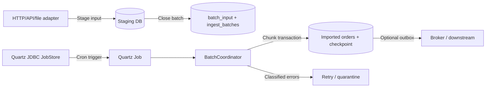
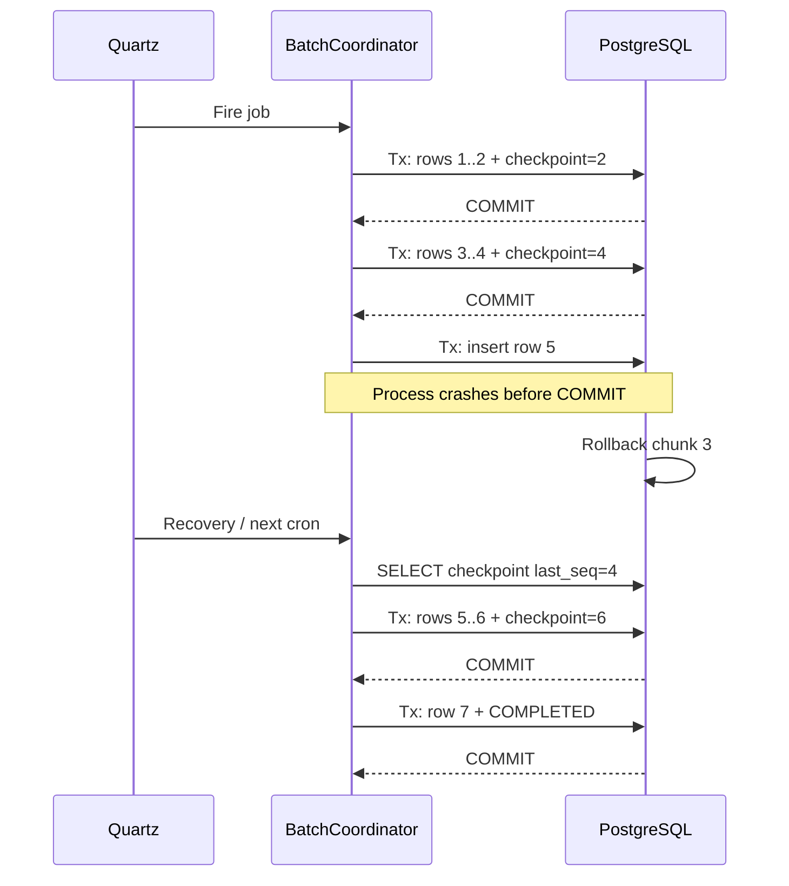

# Scheduling Quartz to Launch Batch Jobs with Checkpoints and Safe Re-runs

In a Spring Boot integration system, an application may periodically pull data from a partner's HTTP API, import orders from a staging database, refresh caches, and publish results to a message broker. A batch processing tens of thousands of records will inevitably hit failures: application restarts, database timeouts, partner resends, or two instances waking up at the same scheduled time. If every run starts over from scratch without recognizing already-processed records, the batch can duplicate data; if progress lives only in memory, a restart can drop work.

This practice lesson in the **Comprehensive Practice** chapter of the `SPRING_BOOT_INTEGRATION` module builds a **Quartz-triggered batch flow with database-persisted checkpoints and safe re-execution**. The goal is managing concurrent schedules, data integrity, errors/retries, deduplication, testing, and observability. Examples use Java, Spring Boot, Quartz JDBC JobStore, Spring JDBC, and PostgreSQL; table and class names are application-defined. Configuration values are illustrative only and must be tuned to your Spring Boot/Quartz version, infrastructure, and real SLAs.

## 1. Problem Statement and Completion Criteria

Suppose a partner pushes order data into a staging table `batch_input`. Each batch has a `batch_id`, ordered rows by `seq`, an external order ID `external_order_id`, and an amount. Once ingestion finishes loading a batch, it marks the batch `CLOSED`; from that point on, the batch's record list is **immutable**. Every five minutes, Quartz triggers a job that finds incomplete batches and imports them in chunks into `imported_orders`.

Requirements:

1. Each batch may hold thousands of records; **never hold one DB transaction across the entire batch**.
2. Each chunk commits both imported data and its checkpoint together; after a crash, execution resumes from the latest committed checkpoint.
3. A single `external_order_id` from the same partner must never create two orders even if the job is re-triggered or the source contains duplicates.
4. Two Spring Boot instances sharing a Quartz cluster, or an operator manually re-triggering a task, must not corrupt progress.
5. Transient errors needing retry must be distinguishable from bad data needing separate handling.
6. Progress is observable via SQL/metrics; restarts/replays are controllable.



**Boundary of responsibility:** Quartz owns *when to invoke the job* and persisting schedule state. Business checkpoints own *how far processing reached and how to resume*. Both may share PostgreSQL, yet their data models and transactions must be understood separately.

### 1.1. Defining Exact Meanings of "Re-run"

| Re-run Type | Cause | Desired Handling |
| --- | --- | --- |
| Chunk retry | SQL timeout, process crash mid-chunk | Chunk transaction rolls back; next run re-reads that chunk |
| Batch resume | Some chunks committed, job stopped | Read committed `last_seq` and continue |
| Re-trigger same batch | Cron fires, manual trigger, or Quartz recovery | No duplicate side effects; `COMPLETED` batches are skipped |
| Replay finished batch | Needed due to business logic fix or mapping change | Must be explicitly requested; never blindly wipe checkpoint and overwrite |
| Backfill late-arriving data | New rows arrive after batch closed | Create a separate batch or compensating scan with its own rules |

Achieving **effectively once in the target database** differs from "the job only runs once." Quartz may fire a job multiple times, while transactions and unique constraints prevent business results from duplicating.

## 2. Why Quartz JobDataMap Alone Is Not Enough for Checkpoints

Quartz provides `JobDetail`, `Trigger`, `Scheduler`, and `JobExecutionContext`:

| Component | Role in Practice |
| --- | --- |
| `JobDetail` | Defines job class, key, and metadata |
| `CronTrigger` | Defines firing schedule, timezone, and misfire policy |
| `Scheduler` | Coordinates jobs, threads, and schedule state |
| JDBC `JobStore` | Persists jobs/triggers in Quartz tables; supports clustering and recovery per configuration |
| `JobDataMap` | Passes parameters to jobs; some configurations persist data across executions |
| **Business checkpoint** | Tracks committed chunk, processing cutoff, errors, and business status |

Never use a counter inside `JobDataMap` as the sole checkpoint for financial/order batches. Even with `@PersistJobDataAfterExecution`, Quartz saving `JobDataMap` after a job runs **is not committed atomically** with business rows updated by `JdbcTemplate`. If the DB writes data and the process dies before Quartz persists the counter, a rerun reprocesses rows. If the counter persists before DB completion, rows can be skipped.

**Rule:** place the checkpoint and critical business writes inside **the same local database transaction** whenever possible; backstop retries with unique constraints. Quartz JobStore is still needed separately so schedules survive restarts and the cluster selects an appropriate worker.

## 3. Designing Immutable Source Data and Checkpoints

This example uses **a closed batch**, disallowing inserts/updates/deletes once `ingest_batches.status='CLOSED'`. Each row has a monotonically increasing integer `seq` within `batch_id`; `seq` need not be gap-free, only deterministically ordered.

The "closed before running" invariant is crucial: scanning `WHERE id > last_id` on an actively written table allows transaction ID 101 to commit after ID 102; a job advancing to 102 misses 101. For external data that may arrive late, use an explicit guaranteed cutoff/watermark, compensating scans, or subsequent batches.

### 3.1. Illustrative PostgreSQL Schema

```sql
-- A batch moves to CLOSED only after all rows are written and committed.
CREATE TABLE ingest_batches (
    batch_id VARCHAR(120) PRIMARY KEY,
    status VARCHAR(20) NOT NULL,
    closed_at TIMESTAMPTZ,
    CONSTRAINT chk_ingest_status
        CHECK (status IN ('OPEN', 'CLOSED'))
);

CREATE TABLE batch_input (
    batch_id VARCHAR(120) NOT NULL
        REFERENCES ingest_batches(batch_id),
    seq BIGINT NOT NULL,
    partner_id VARCHAR(80) NOT NULL,
    external_order_id VARCHAR(160) NOT NULL,
    amount NUMERIC(18, 2) NOT NULL,
    PRIMARY KEY (batch_id, seq),
    CONSTRAINT chk_batch_input_seq CHECK (seq > 0)
);

CREATE TABLE imported_orders (
    partner_id VARCHAR(80) NOT NULL,
    external_order_id VARCHAR(160) NOT NULL,
    amount NUMERIC(18, 2) NOT NULL,
    source_batch_id VARCHAR(120) NOT NULL,
    source_seq BIGINT NOT NULL,
    imported_at TIMESTAMPTZ NOT NULL DEFAULT NOW(),
    PRIMARY KEY (partner_id, external_order_id)
);

CREATE TABLE batch_checkpoint (
    batch_id VARCHAR(120) PRIMARY KEY
        REFERENCES ingest_batches(batch_id),
    snapshot_max_seq BIGINT NOT NULL,
    last_seq BIGINT NOT NULL DEFAULT 0,
    status VARCHAR(20) NOT NULL DEFAULT 'READY',
    last_error VARCHAR(500),
    updated_at TIMESTAMPTZ NOT NULL DEFAULT NOW(),
    CONSTRAINT chk_checkpoint_status
        CHECK (status IN ('READY', 'RUNNING', 'COMPLETED', 'FAILED')),
    CONSTRAINT chk_checkpoint_seq
        CHECK (last_seq >= 0 AND last_seq <= snapshot_max_seq)
);

CREATE INDEX ix_batch_input_read
    ON batch_input (batch_id, seq);
```

`batch_input` uses primary key `(batch_id, seq)` for ordered keyset queries. `imported_orders` uses primary key `(partner_id, external_order_id)` so one order ID from one partner cannot be imported twice. `batch_checkpoint` persists each batch's latest committed sequence and fixed `snapshot_max_seq` cutoff.

The schema alone does not stop the application from mutating `batch_input` after closing; that is an **invariant enforced by the ingestion service, DB permissions, or operational triggers/constraints**. In real systems, separate staging and processing write permissions and ensure `OPEN → CLOSED` happens only after all related inserts commit.

If a partner resends **the same order ID with a different amount**, never treat it as a harmless duplicate. The chunk processor below checks existing content and throws a contract error on conflict.

### 3.2. Initializing a Checkpoint Once per Closed Batch

```sql
INSERT INTO batch_checkpoint (
    batch_id, snapshot_max_seq, last_seq, status
)
SELECT b.batch_id, COALESCE(MAX(i.seq), 0), 0, 'READY'
FROM ingest_batches b
LEFT JOIN batch_input i ON i.batch_id = b.batch_id
WHERE b.batch_id = :batch_id
  AND b.status = 'CLOSED'
GROUP BY b.batch_id
ON CONFLICT (batch_id) DO NOTHING;
```

This is PostgreSQL SQL; `:batch_id` is a `NamedParameterJdbcTemplate` bind parameter, not a literal `psql` placeholder. It inserts a checkpoint only if the batch is `CLOSED` and lacks a checkpoint. When a worker restarts, `ON CONFLICT DO NOTHING` preserves `last_seq` instead of resetting progress.

If a batch is empty, `snapshot_max_seq=0` and the next run transitions straight to `COMPLETED`. If closed-batch inputs must be fixed, **never** silently bump `snapshot_max_seq`; create a new batch version or an explicit replay workflow.

### 3.3. What Should a Good Checkpoint Record?

| Field | Meaning |
| --- | --- |
| `batch_id` | Identifies the closed source dataset/ruleset |
| `snapshot_max_seq` | Immutable upper bound of this import |
| `last_seq` | Highest `seq` processed and committed alongside results |
| `status` | READY/RUNNING/COMPLETED/FAILED for operations |
| `last_error` | Sanitized latest error without secrets/PII |
| `updated_at` | Detects stalled batches and SLA breaches |

A checkpoint is only useful when operators know which **source data version, transformation rules, and batch identity** it belongs to. Changing mappings and re-importing the same input can yield different results. Add `mapping_version`, checksum/snapshot ID, and expected row count when strict auditing is required.

## 4. Configuring Quartz in Spring Boot

Example Gradle configuration with dependency versions managed by a compatible Spring Boot BOM:

```gradle
dependencies {
    implementation 'org.springframework.boot:spring-boot-starter-quartz'
    implementation 'org.springframework.boot:spring-boot-starter-jdbc'
    runtimeOnly 'org.postgresql:postgresql'
    testImplementation 'org.springframework.boot:spring-boot-starter-test'
}
```

Quartz can run with `RAMJobStore` for experimentation, but surviving restarts and coordinating multiple instances requires **JDBC JobStore**. Example `application.yml`:

```yaml
spring:
  quartz:
    scheduler-name: integration-batch-scheduler
    job-store-type: jdbc
    jdbc:
      initialize-schema: never
    overwrite-existing-jobs: false
    properties:
      org.quartz.scheduler.instanceId: AUTO
      org.quartz.jobStore.isClustered: true
      org.quartz.jobStore.clusterCheckinInterval: 20000
      org.quartz.jobStore.misfireThreshold: 60000
      org.quartz.threadPool.threadCount: 3
  datasource:
    url: jdbc:postgresql://localhost:5432/integration
    username: integration_app
    password: change-me-in-secret-store
```

This demo configuration shares one database between Quartz tables and business data. In production, inject passwords via secret manager/environment and optionally designate a separate `@QuartzDataSource` for the scheduler. **Quartz JDBC** tables (typically prefixed `QRTZ_`) must be created via controlled migrations matching your Quartz/DB version. `initialize-schema: never` prevents Spring Boot from recreating tables; never use destructive schema re-initialization on production startup.

Clustering considerations:

- All instances must share **the same JDBC JobStore and same `scheduler-name`**, with unique instance IDs (e.g., `AUTO`).
- Nodes need reliable DB connectivity, synchronized clocks, and matching cluster parameters. Ensure no instance falls back to `RAMJobStore` due to missing config.
- Do not manually set an `org.quartz.jobStore.class` conflicting with the `DataSource`-backed JobStore configured by Spring Boot; integration and class names depend on version.
- Jobs/triggers need **stable JobKey/TriggerKey**. If multiple replicas register jobs on startup, verify registration/overwrite behavior for your version; deploy schedule changes from one controlled source.
- `overwrite-existing-jobs: false` avoids accidentally resetting persisted JobStore triggers on restart. When changing cron schedules, perform deliberate migration/rescheduling rather than assuming code edits update persisted schedules.

**Never equate Quartz JDBC JobStore with business checkpoints.** Quartz recovers job firing; your own checkpoint tracks which data mutations committed.

### 4.1. Registering JobDetail, CronTrigger, and Misfire Policy

```java
@Configuration(proxyBeanMethods = false)
public class ImportQuartzConfiguration {

    @Bean
    JobDetail partnerImportJobDetail() {
        return JobBuilder.newJob(PartnerImportQuartzJob.class)
                .withIdentity("partner-import", "integration")
                .requestRecovery(true)
                .storeDurably()
                .build();
    }

    @Bean
    Trigger partnerImportTrigger(JobDetail partnerImportJobDetail) {
        return TriggerBuilder.newTrigger()
                .withIdentity("partner-import-cron", "integration")
                .forJob(partnerImportJobDetail)
                .withSchedule(CronScheduleBuilder
                        .cronSchedule("0 0/5 * * * ?")
                        .inTimeZone(TimeZone.getTimeZone("Asia/Ho_Chi_Minh"))
                        .withMisfireHandlingInstructionDoNothing())
                .build();
    }

    @Bean
    SchedulerFactoryBeanCustomizer batchSchedulerContext(
            BatchCoordinator coordinator) {
        return scheduler ->
                scheduler.setSchedulerContextAsMap(
                        Map.of("batchCoordinator", coordinator));
    }
}
```

Typical imports: `org.quartz.JobBuilder`, `org.quartz.JobDetail`, `org.quartz.Trigger`, `org.quartz.TriggerBuilder`, `org.quartz.CronScheduleBuilder`, `org.springframework.boot.autoconfigure.quartz.SchedulerFactoryBeanCustomizer`, `java.util.TimeZone`, and `java.util.Map`. In compatible Spring Boot setups, `JobDetail`/`Trigger` beans are automatically registered with the scheduler at startup.

`0 0/5 * * * ?` fires every 5 minutes at second 0 in the specified timezone. `DoNothing` skips missed firings while the scheduler was down; it **does not skip unfinished batches**, because the next cron run still picks up incomplete batches from the database. If business rules require catching up once immediately upon scheduler recovery, evaluate `withMisfireHandlingInstructionFireAndProceed()` and test restart scenarios. Avoid stacking missed firings into repeated identical executions.

`requestRecovery(true)` lets Quartz schedule recovery for an in-flight job if a scheduler instance dies under conditions supported by JobStore. **Never rely on this flag to track per-row progress**: recovery re-runs the job, so the batch must always be idempotent.

`SchedulerFactoryBeanCustomizer` places the Spring bean `BatchCoordinator` into **each process's SchedulerContext**. This lets the Quartz job access Spring-injected services without serializing a Spring bean (non-serializable) into the `JobDataMap` stored in JDBC JobStore. Verify the customizer interface if using a different Spring Boot version.

## 5. Quartz Job Acts Solely as Orchestrator

To let Quartz instantiate the job via default mechanisms, use a class with a no-arg constructor and fetch the Spring service from `SchedulerContext`:

```java
@DisallowConcurrentExecution
public class PartnerImportQuartzJob implements Job {

    @Override
    public void execute(JobExecutionContext context)
            throws JobExecutionException {
        try {
            BatchCoordinator coordinator = (BatchCoordinator)
                    context.getScheduler()
                            .getContext()
                            .get("batchCoordinator");

            if (coordinator == null) {
                throw new IllegalStateException("BatchCoordinator missing");
            }
            for (String batchId : coordinator.findRunnableBatchIds(3)) {
                if (Thread.currentThread().isInterrupted()) {
                    return; // Next run resumes from committed checkpoint.
                }
                coordinator.processBatch(batchId, 20, 100);
            }
        } catch (Exception exception) {
            throw new JobExecutionException(
                    "Partner import failed; checkpoint remains durable",
                    exception);
        }
    }
}
```

Key imports: `org.quartz.Job`, `org.quartz.JobExecutionContext`, `org.quartz.JobExecutionException`, and `org.quartz.DisallowConcurrentExecution`. `findRunnableBatchIds(3)` processes at most three batches per cron firing. `processBatch(batchId, 20, 100)` caps each firing at 20 chunks of at most 100 rows so one trigger does not monopolize worker threads for too long. Remaining batches resume on subsequent cron cycles.

`@DisallowConcurrentExecution` prevents overlapping runs **of the same JobDetail/JobKey** within a properly configured scheduler, including clustered JDBC setups. It does not forbid two distinct JobKeys from calling `BatchCoordinator`, does not lock direct calls from REST admin endpoints, and does not replace DB locks on `batch_id`.

When a job throws `JobExecutionException`, Quartz logs the error; **never assume Quartz automatically retries immediately**. This design waits for the next cron cycle while the checkpoint retains committed progress. If using `refireImmediately` or retry advice, bound attempts and backoff to avoid hot spin-loops when the database is down or data is corrupt.

The job retrieves one Spring service from SchedulerContext; all database transactions live inside that service. This keeps the job thin and lets you test batch logic independently of Quartz.

## 6. BatchCoordinator: Committing Data and Checkpoint in One Chunk Transaction

In this example, `BatchCoordinator` uses `JdbcTemplate` and `TransactionTemplate`. This deliberately avoids the common pitfall of calling a `@Transactional` method via `this.method()` within the same bean, where Spring proxies do not intercept self-invocation. `TransactionTemplate` defines transaction boundaries explicitly where each chunk runs.

The code below assumes all tables from section 3 live under **one PostgreSQL transaction manager**. If the checkpoint resides in DB A and target data in an independent DB B, local transactions **cannot** commit both atomically; use true XA or outbox/idempotency with dedicated recovery.

### 6.1. Finding Runnable Batches and Initializing Checkpoints

```java
@Service
public class BatchCoordinator {
    private final JdbcTemplate jdbc;
    private final TransactionTemplate tx;

    public BatchCoordinator(
            JdbcTemplate jdbc,
            PlatformTransactionManager transactionManager) {
        this.jdbc = jdbc;
        this.tx = new TransactionTemplate(transactionManager);
    }

    public List<String> findRunnableBatchIds(int limit) {
        if (limit < 1) {
            throw new IllegalArgumentException("limit must be positive");
        }
        return jdbc.query(
                """
                SELECT b.batch_id
                  FROM ingest_batches b
                  LEFT JOIN batch_checkpoint c ON c.batch_id = b.batch_id
                 WHERE b.status = 'CLOSED'
                   AND (c.batch_id IS NULL
                        OR c.status IN ('READY', 'RUNNING'))
                 ORDER BY b.closed_at, b.batch_id
                 LIMIT ?
                """,
                (rs, rowNum) -> rs.getString("batch_id"),
                limit);
    }

    public void processBatch(
            String batchId, int maxChunks, int chunkSize) {
        if (maxChunks < 1 || chunkSize < 1 || chunkSize > 1000) {
            throw new IllegalArgumentException("Invalid batch limits");
        }
        tx.executeWithoutResult(status -> initializeCheckpoint(batchId));

        for (int chunk = 0; chunk < maxChunks; chunk++) {
            if (Thread.currentThread().isInterrupted()) {
                return;
            }
            Integer processed = tx.execute(
                    status -> processNextChunk(batchId, chunkSize));
            if (processed == null || processed == 0) {
                return;
            }
        }
    }

    private void initializeCheckpoint(String batchId) {
        jdbc.update(
                """
                INSERT INTO batch_checkpoint
                    (batch_id, snapshot_max_seq, last_seq, status)
                SELECT b.batch_id, COALESCE(MAX(i.seq), 0), 0, 'READY'
                FROM ingest_batches b
                LEFT JOIN batch_input i ON i.batch_id = b.batch_id
                WHERE b.batch_id = ? AND b.status = 'CLOSED'
                GROUP BY b.batch_id
                ON CONFLICT (batch_id) DO NOTHING
                """,
                batchId);
    }

    // processNextChunk and records are defined in the next subsection.
}
```

This is **the first half** of `BatchCoordinator`; `processNextChunk` and helper records from section 6.2 belong inside this same class when assembling the code. Main imports: `org.springframework.jdbc.core.JdbcTemplate`, `org.springframework.transaction.PlatformTransactionManager`, `org.springframework.transaction.support.TransactionTemplate`, `org.springframework.stereotype.Service`, and `java.util.List`.

In projects with multiple transaction managers, inject the **exact manager governing both checkpoint and target tables** using `@Qualifier` or a named `TransactionTemplate` bean. Using a default manager bound to a different DB will still compile while silently losing atomicity.

### 6.2. Reading, Writing, and Checkpointing in One Transaction

Place the following members **inside the same `BatchCoordinator` class** from section 6.1:

```java
private int processNextChunk(String batchId, int chunkSize) {
    Checkpoint cp = jdbc.queryForObject(
            """
            SELECT last_seq, snapshot_max_seq, status
              FROM batch_checkpoint
             WHERE batch_id = ?
             FOR UPDATE
            """,
            (rs, rowNum) -> new Checkpoint(
                    rs.getLong("last_seq"),
                    rs.getLong("snapshot_max_seq"),
                    rs.getString("status")),
            batchId);

    if (cp == null) {
        throw new IllegalStateException("Checkpoint not found");
    }
    if ("COMPLETED".equals(cp.status())) {
        return 0;
    }
    if ("FAILED".equals(cp.status())) {
        throw new IllegalStateException(
                "Batch requires operator intervention");
    }
    if (cp.lastSeq() == cp.snapshotMaxSeq()) {
        jdbc.update(
                """
                UPDATE batch_checkpoint
                   SET status = 'COMPLETED', updated_at = NOW()
                 WHERE batch_id = ?
                """,
                batchId);
        return 0;
    }

    List<SourceRow> rows = jdbc.query(
            """
            SELECT seq, partner_id, external_order_id, amount
              FROM batch_input
             WHERE batch_id = ?
               AND seq > ?
               AND seq <= ?
             ORDER BY seq
             LIMIT ?
            """,
            (rs, rowNum) -> new SourceRow(
                    rs.getLong("seq"),
                    rs.getString("partner_id"),
                    rs.getString("external_order_id"),
                    rs.getBigDecimal("amount")),
            batchId, cp.lastSeq(), cp.snapshotMaxSeq(), chunkSize);

    if (rows.isEmpty()) {
        throw new IllegalStateException(
                "Immutable batch input unexpectedly missing");
    }

    for (SourceRow row : rows) {
        int inserted = jdbc.update(
                """
                INSERT INTO imported_orders
                    (partner_id, external_order_id, amount,
                     source_batch_id, source_seq)
                VALUES (?, ?, ?, ?, ?)
                ON CONFLICT (partner_id, external_order_id) DO NOTHING
                """,
                row.partnerId(), row.externalOrderId(),
                row.amount(), batchId, row.seq());

        if (inserted == 0) {
            BigDecimal existing = jdbc.queryForObject(
                    """
                    SELECT amount FROM imported_orders
                     WHERE partner_id = ? AND external_order_id = ?
                    """,
                    BigDecimal.class,
                    row.partnerId(), row.externalOrderId());
            if (existing == null ||
                    existing.compareTo(row.amount()) != 0) {
                throw new DataConflictException(
                        "Duplicate business key has different amount");
            }
        }
    }

    long newLastSeq = rows.get(rows.size() - 1).seq();
    jdbc.update(
            """
            UPDATE batch_checkpoint
               SET last_seq = ?,
                   status = ?,
                   last_error = NULL,
                   updated_at = NOW()
             WHERE batch_id = ?
            """,
            newLastSeq,
            newLastSeq >= cp.snapshotMaxSeq()
                    ? "COMPLETED" : "RUNNING",
            batchId);
    return rows.size();
}

private record Checkpoint(
        long lastSeq, long snapshotMaxSeq, String status) {}

private record SourceRow(
        long seq, String partnerId,
        String externalOrderId, BigDecimal amount) {}

private static final class DataConflictException
        extends RuntimeException {
    DataConflictException(String message) {
        super(message);
    }
}
```

Additional import: `java.math.BigDecimal`. Executing via `TransactionTemplate` is the core pattern. As PostgreSQL executes:

1. `SELECT ... FOR UPDATE` locks the checkpoint row for `batch_id`. A second job targeting the same batch blocks until this transaction finishes, then reads the updated checkpoint.
2. Fetches up to `chunkSize` rows where `seq > last_seq` and `seq <= snapshot_max_seq`; avoid `OFFSET`, which degrades at large offsets and skips/duplicates if rows shift.
3. Inserts target rows. `PRIMARY KEY(partner_id, external_order_id)` prevents duplicates inside the DB even under concurrent requests. On key collision with a different amount, it throws to **roll back the chunk**, avoiding silently accepting corrupted data.
4. Only after every row succeeds does it update `last_seq` to the chunk's final sequence and commit **in the same transaction**.
5. If a crash happens before commit, both inserts and checkpoint roll back; the next run reprocesses the chunk. If after commit, both survive; the next run resumes after `last_seq`.

This snippet treats `partner_id`, `external_order_id`, and `amount` as the record's contract. When records carry currency, version, shipping address, or status, compare **all fields determining business semantics**, or store a normalized payload fingerprint rather than checking only amount.

Never make HTTP calls, send emails, or publish to message brokers inside this chunk transaction loop. If events must be emitted after import, write **outbox** records in the same transaction alongside `imported_orders` and the checkpoint, letting a relay publish after commit. Chunk retries then preserve stable `event_id` values in the outbox while consumers remain idempotent.

### 6.3. Handling Transient Errors and Data Errors

`processBatch` above lets exceptions propagate to Quartz, halting at the failing chunk so the next cron run resumes from committed `last_seq`. In production, record error details **after the chunk transaction rolls back**:

```java
// Replacement wrapper around tx.execute(...) inside processBatch:
try {
    Integer processed = tx.execute(
            status -> processNextChunk(batchId, chunkSize));
    if (processed == null || processed == 0) {
        return;
    }
} catch (RuntimeException failure) {
    boolean permanent = failure instanceof DataConflictException;
    String errorCode = failure.getClass().getSimpleName();

    tx.executeWithoutResult(status ->
            jdbc.update(
                    """
                    UPDATE batch_checkpoint
                       SET status = CASE
                               WHEN ? THEN 'FAILED'
                               ELSE status
                           END,
                           last_error = ?,
                           updated_at = NOW()
                     WHERE batch_id = ?
                    """,
                    permanent, errorCode, batchId));
    throw failure;
}
```

This **replaces** the `tx.execute(...)` call inside the `for` loop of `processBatch`; do not execute chunk processing twice. It records error state in a **new** DB transaction because the chunk transaction just rolled back. On transient failures like DB connection loss, updating `last_error` may fail too; ensure logs and metrics still capture the root cause without masking it.

With `DataConflictException`, `FAILED` forces review of source/target before continuing. With transient infrastructure failures, the batch stays `READY/RUNNING` so the next cron cycle retries. Production systems need retry budgets, `next_attempt_at`, SQLSTATE classification, backoff, and dead-letter/quarantine policies instead of retrying a poison record every five minutes forever.

**Never advance `last_seq` past a permanently failing record** just to make a job "finish." If skipping a record is permitted, persist quarantine evidence and advance the checkpoint **in the same transaction** under approved business rules; otherwise, data is lost silently.

## 7. Separating Quartz Concurrency from Data Concurrency

There are at least four layers of concurrency:

| Layer | Scenario | Primary Safeguard |
| --- | --- | --- |
| Single Quartz JobDetail | Next cron firing arrives while previous still runs | `@DisallowConcurrentExecution` |
| Multiple Quartz nodes sharing JDBC JobStore | Two schedulers race for a trigger | Clustered JDBC JobStore with unique instance IDs |
| Two JobDetails/admin endpoints processing one batch | Manual replay overlaps cron run | `SELECT checkpoint FOR UPDATE`, plus claim/lease if needed |
| Two events/batches referencing one business key | Duplicate feeds or overlapping partner batches | Unique constraints, idempotency, and payload comparison |

`@DisallowConcurrentExecution` applies per **JobKey**, not across all `PartnerImportQuartzJob` executions in the JVM. An HTTP endpoint invoking `coordinator.processBatch` directly also bypasses Quartz concurrency guards. Database transactions and unique constraints serve as the ultimate backstop.

When running multiple batches concurrently, per-`batch_id` checkpoint locks allow distinct batches to progress in parallel. If two batches attempt to insert the same `(partner_id, external_order_id)`, the target unique constraint arbitrates. When ingestion order matters semantically (e.g., v1 then v2), add version/ordering rules so simple key deduplication does not drop valid updates.

With **Quartz RAMJobStore** across multiple replicas, every replica fires the same cron independently. Setting `isClustered=true` only works with a properly configured shared JDBC JobStore database; it is not a magic switch turning any scheduler into a safe cluster.

## 8. Tracing a Crash: How Checkpoints Enable Resumption

Suppose batch `partner-feed-20261121` has seven rows `seq=1..7`, chunk size 2, and initial checkpoint `last_seq=0`:

| Execution | Operation | Committed Checkpoint | Committed Target Results |
| --- | --- | --- | --- |
| Chunk 1 | Import seq 1, 2 → commit | 2 | 1, 2 |
| Chunk 2 | Import seq 3, 4 → commit | 4 | 1, 2, 3, 4 |
| Chunk 3 | Insert seq 5; process crashes before commit | **4** | Still 1, 2, 3, 4 |
| Restart/next Quartz firing | Reads checkpoint 4; imports seq 5, 6 → commit | 6 | 1..6 |
| Final chunk | Import seq 7 → commit | 7, `COMPLETED` | 1..7 |



If the process dies **after the DB commits chunk 3 but before the app receives the commit response**, the app does not know whether the transaction succeeded. Upon restart, it reads the checkpoint from DB: if 6, it avoids re-importing 5/6; if still 4, the prior transaction rolled back (or never completed per DB visibility) and must be retried. Never derive `last_seq` from logs saying "started inserting row 5."

When target records trigger external side effects like HTTP shipment calls, SQL rollback cannot undo HTTP. Never call HTTP directly inside a chunk; write to a **transactional outbox** with an idempotency key so a post-commit worker dispatches requests and reconciles timeouts.

### 8.1. Difference Between Resume and Replay

**Resume** means continuing from `last_seq` on an incomplete batch; this is routine automatic behavior. **Replay** means intentionally reprocessing data already marked `COMPLETED` due to a mapping bugfix, new field, or business rule change. Replays may require a new import version, staging table, diff checks before writing, or versioned idempotent upserts—never casually run:

```sql
-- DO NOT run arbitrarily in production:
UPDATE batch_checkpoint
SET last_seq = 0, status = 'READY'
WHERE batch_id = 'partner-feed-20261121';
```

A naive reset can overwrite valid newer updates with old mapping logic or trigger duplicate downstream notifications. Require an approved replay workflow verifying immutable source data, transformer version, record scope, impact on business keys, duplicate-side-effect prevention, and who requested the replay.

## 9. Safe HTTP Acquisition and Batch Closing Flow

The example above starts from an already-closed `batch_input`. In a real integration system, data may first be fetched from a partner's HTTP API. Distinguish two kinds of checkpoints:

| Type | Purpose | Example |
| --- | --- | --- |
| **Acquisition checkpoint** | How far pagination/cursor fetched from partner API | `next_page_token`, ETag, source snapshot ID |
| **Processing checkpoint** | How far rows committed into target database | `batch_checkpoint.last_seq` |

A safe ingestion pipeline:

1. Create `ingest_batches(batch_id, status='OPEN')` and record source cursor/snapshot ID. If the API provides idempotent pagination or snapshot tokens, persist them durably.
2. Use `RestClient` or `WebClient` to fetch pages with connect/read timeouts, bounded retries, `429 Retry-After` handling, and partner-specific authentication.
3. Write page rows to staging with unique key `(batch_id, seq)` or stable source record ID; commit alongside the acquisition cursor per contract so pages aren't lost on crash.
4. Verify page completeness and checksum/counts if provided, then transition the batch to `CLOSED` **only after all source data commits**. Disallow mutating rows in closed batches.
5. The Quartz batch processor picks up only `CLOSED` batches; HTTP calls never execute inside chunk import transactions.

If an upstream API uses offset pagination over mutating data, rows can duplicate or vanish between pages. Use snapshots/versions, stable cursors, or watermark + compensating scans with stable event IDs. Quartz alone cannot fix an unstable upstream pagination model.

When imports must emit events to Kafka/RabbitMQ, insert **outbox events** inside the same transaction as target rows and checkpoints. If the relay fails, it republishes with the same `eventId`; consumers use unique keys or `processed_events` to deduplicate.

## 10. Handling Poison Records, Late Data, and Oversized Batches

### 10.1. Poison Records

A record violating schema or business invariants can cause the same chunk to roll back repeatedly—for instance, order `E-500` arriving with an amount mismatching an earlier import.

Choose explicitly between two strategies:

- **Fail-fast entire batch:** mark `FAILED`, keep `last_seq` untouched, alert operators. Fix source or target per contract, verify, and resume.
- **Quarantine per record:** write the offending record, reason, and source ID to `batch_quarantine` in **the same transaction** that advances the checkpoint past that row, if business rules permit skipping. Report `COMPLETED_WITH_ERRORS` or equivalent instead of clean success.

Never push a failing record to an in-memory list while advancing the checkpoint: a crash loses error evidence while the checkpoint skips the record. Likewise, never put `catch(Exception e) { continue; }` inside an import transaction, which silently turns DB failures into dropped data.

### 10.2. Late-Arriving Data

A `CLOSED` batch must stay immutable. If a partner sends extra rows under an already-closed batch ID, reject them, open a supplementary batch, or run a versioned amendment workflow. Appending to a finished batch and merely bumping `snapshot_max_seq` breaks auditing and checkpoint invariants. When data carries timestamps/watermarks, define lateness rules and periodic compensating scans using stable IDs.

### 10.3. Long Batches and Chunk Sizing

Oversized chunks reduce commit overhead at the cost of longer row locks, heavier rollback cost, higher heap usage, and prolonged connection hold times. Undersized chunks increase transaction and round-trip overhead. With the example's 100 rows/chunk and max 20 chunks/firing, each Quartz firing handles up to ~2,000 rows **per batch**. These are illustrative caps; tune based on payload size, DB latency, index count, lock contention, and SLAs.

When jobs process millions of rows, consider:

- Keyset batch paging with matching indexes, avoiding large `OFFSET`.
- Bounding concurrent batches, worker concurrency, and DB connections.
- JDBC batch/bulk operations while keeping conflict checks intact.
- Partitioning by tenant/partner or source ID with **per-partition checkpoints**, preventing workers from contending on one checkpoint.
- Yielding cleanly between firings: never tie up a Quartz worker thread for hours when work can be split into small increments.

For complex reader/processor/writer pipelines, skip/retry policies, execution metadata, and partitioning, **Spring Batch** is a more specialized framework. Quartz can still act as the scheduler **launching Spring Batch Jobs**, while Spring Batch manages `JobRepository`, `JobExecution`, `StepExecution`, and `ExecutionContext`. When combining them, assign **one** owner per batch checkpoint: never update a custom checkpoint and Spring Batch's `ExecutionContext` independently without a unified design.

## 11. Misfires, Restarts, Clustering, and Shutdown

A cron job may miss its exact firing time because the scheduler was down, threads were busy, the DB JobStore failed, or infrastructure was deploying.

| Scenario | Design Behavior |
| --- | --- |
| Scheduler stopped across cron time | Misfire instruction chooses skip or catch-up; **business backlog** remains in DB |
| JVM restarts mid-chunk | DB rolls back uncommitted transaction; next Quartz firing resumes from checkpoint |
| Node A dies in cluster | Quartz cluster detects and recovers per config; another node continues |
| Node A receives trigger but thread pool is saturated | Monitor trigger latency/misfires; do not add a second competing scheduler |
| Admin and cron trigger batch simultaneously | DB row locks and unique keys serialize progress/records |
| Multiple batches queued | Cap batches per cycle and monitor oldest backlog age |
| Rolling update deployment | Nodes must maintain schema/logic compatibility with in-progress checkpoints |

`spring.quartz.wait-for-jobs-to-complete-on-shutdown` can be evaluated per Spring Boot version/config to wait for running jobs during graceful shutdown. However, container orchestrators enforce a **finite grace period**; if a process is killed, uncommitted chunks must roll back and resume cleanly. Never assume graceful shutdown guarantees every job finishes cleanly.

During deployments that upgrade transformer logic, older checkpoints may be resumed by newer code. Define compatibility rules: bind versions to `batch_id`, store mapping version in checkpoints, or drain old batches before switching logic. For breaking contract changes, migrate or mark batches for controlled replay.

### 11.1. Cluster Pitfalls

Quartz JDBC clustering requires consistent scheduler/job-store configuration across nodes. Common mistakes include:

- Two instances using different `scheduler-name` values on the same DB while expecting cluster coordination.
- One instance using `RAMJobStore` while another uses JDBC JobStore.
- Recreating `QRTZ_` tables on startup and wiping persisted triggers.
- Multiple JobDetails with distinct JobKeys scanning the same source; `@DisallowConcurrentExecution` does not stop them from overlapping.
- Configuring batch services on one node yet omitting them on another; Quartz fires on the misconfigured node and fails repeatedly.

When an admin triggers a job via `scheduler.triggerJob(jobKey)`, Quartz uses the same JobDetail and concurrency controls. If an admin endpoint invokes `BatchCoordinator.processBatch(batchId,...)` directly outside Quartz, only DB checkpoint locking and unique constraints prevent parallel corruption.

## 12. Observing Progress and Troubleshooting Incidents

Monitor **Quartz scheduling**, **batch progress**, and **target consistency** separately:

| Metric | Interpretation | Suggested Alert |
| --- | --- | --- |
| Quartz triggers fired/misfired | Are crons running on schedule? | Misfires rising, scheduler node disconnected |
| Batch `RUNNING` age | How long since the batch last progressed? | `updated_at` stale beyond SLA |
| Batch backlog | Count of `CLOSED` batches not yet `COMPLETED/FAILED` | Unfinished backlog steadily growing |
| Chunk duration | How long does read/write/checkpoint take? | High p95, DB lock contention |
| Rows scanned / imported / deduplicated | Rows examined, inserted, skipped as valid duplicates | Abnormal spike in duplicates |
| Failed/quarantined records | Contract-error data needing attention | Unresolved beyond SLA |
| Connection pool active/pending | JDBC pressure during batch runs | Pool exhausted, HTTP requests slowing down |
| Outbox lag, consumer lag | Are downstream steps keeping pace after import? | Import done while broker/consumers stall |

Example checkpoint progress query (for diagnostics; avoid running full table scans too frequently):

```sql
SELECT c.batch_id, c.status,
       c.last_seq, c.snapshot_max_seq,
       COUNT(i.seq) AS total_input_rows,
       COUNT(i.seq) FILTER (
           WHERE i.seq <= c.last_seq
       ) AS scanned_rows,
       c.updated_at, c.last_error
  FROM batch_checkpoint c
  LEFT JOIN batch_input i
    ON i.batch_id = c.batch_id
   AND i.seq <= c.snapshot_max_seq
 GROUP BY c.batch_id, c.status, c.last_seq,
          c.snapshot_max_seq, c.updated_at, c.last_error
 ORDER BY c.updated_at;
```

Do not treat `last_seq / snapshot_max_seq` as an exact percentage if `seq` has gaps. The **scanned rows / total rows** ratio above is better for monitoring, though still expensive on huge datasets. For multi-million-row batches, store total and scanned counts inside the checkpoint or a summary table updated in the same transaction instead of running `COUNT` on every dashboard refresh.

Logs should include `batchId`, `jobKey`, `fireInstanceId`, `lastSeqBefore`, `lastSeqAfter`, `chunkSize`, `durationMs`, `attempt`, and classified error code. Never log full payloads with customer PII, HTTP tokens, or connection strings containing passwords. If publishing events to a broker, attach stable event/correlation IDs for trace linkage.

### 12.1. Runbook When a Batch Appears Stuck

1. Check if Quartz is firing triggers and which scheduler nodes are alive; inspect misfires and thread pools.
2. Check `ingest_batches` for `CLOSED` batches; if still `OPEN`, investigate HTTP acquisition/adapters first.
3. Inspect `batch_checkpoint`: status, `last_seq`, `snapshot_max_seq`, `updated_at`, and `last_error`. Distinguish "job not running" from "job repeatedly failing on the same chunk."
4. Check DB health, connection pools, row locks, and blocked transactions. If multiple workers contend on one batch, verify JobKey, cluster config, and checkpoint locking.
5. On data errors, inspect the source row by `batch_id`/`seq` against the target business key. Never delete target rows or skip the checkpoint past an error blindly.
6. Once root cause is resolved, transition `FAILED` back to runnable **only via authorized, audited actions**; trigger Quartz or wait for the next cron cycle, then reconcile results.

Query for overdue `READY/RUNNING` batches:

```sql
SELECT batch_id, status, last_seq, snapshot_max_seq, updated_at
FROM batch_checkpoint
WHERE status IN ('READY', 'RUNNING')
  AND updated_at < NOW() - INTERVAL '30 minutes'
ORDER BY updated_at;
```

This threshold is illustrative only. If cron runs every five minutes and handles 20 chunks per firing, a large batch spans multiple cycles; base SLA alerts on measured throughput and business tolerances.

### 12.2. Controlled Manual Triggering

An admin service can ask Quartz to fire the exact JobDetail:

```java
public void triggerImport(Scheduler scheduler)
        throws SchedulerException {
    scheduler.triggerJob(
            JobKey.jobKey("partner-import", "integration"));
}
```

Imports: `org.quartz.Scheduler`, `org.quartz.SchedulerException`, `org.quartz.JobKey`. This triggers the **job that scans unfinished batches**; it does not guarantee a particular batch finished before returning, nor does it reset `COMPLETED` batches. Protect admin APIs with authentication/authorization, auditing, and rate limits. For targeted replays, persist an explicit replay request specifying batch ID, mapping version, and reason, processed through an approved workflow.

## 13. Integration Testing: Proving Checkpoints and Idempotency

Meaningful tests must run on real PostgreSQL or Testcontainers with both business and Quartz schemas; mocking `JdbcTemplate` cannot prove transaction rollbacks, `FOR UPDATE`, unique constraints, or cluster behavior.

| Scenario | Outcome to Prove |
| --- | --- |
| `CLOSED` batch of 7 rows, chunk size 2 | Checkpoint advances 0→2→4→6→7; ends `COMPLETED` |
| Crash mid-chunk 3 before DB commit | Only first two chunks persist; resume finishes remainder with zero missing rows |
| Crash after DB commit before Quartz job returns | Checkpoint persisted; Quartz recovery/re-fire creates no duplicate target rows |
| Same batch triggered twice concurrently | DB row lock serializes progress; no duplicate outcomes |
| Two batches share an external order with identical payload | Target unique constraint keeps one row; both checkpoints finish |
| Two batches share business key with differing amounts | Conflicting chunk rolls back; batch goes `FAILED`/quarantine without silent ignore |
| Batch not yet `CLOSED` | No checkpoint initialized and no rows imported |
| Empty `CLOSED` batch | Marks `COMPLETED` with `last_seq=0` and `snapshot_max_seq=0` |
| Source mutated after closing | Invariant/constraint blocks or test catches input drift |
| DB timeout before commit | Checkpoint does not advance if inserts didn't commit |
| Quartz scheduler down for one cycle | Misfire follows policy; backlog persists in DB and runs on recovery |
| Two Quartz instances sharing JDBC JobStore | Cluster coordinates triggers; checkpoint stays accurate when killing one instance |
| Poison row mid-chunk | No partial commit; alert and failure handling activate |
| High worker/concurrency load | Transactions/chunks stay bounded; no prolonged pool exhaustion or deadlocks |
| Outbox emitted at end of chunk | Events and checkpoint commit atomically; consumer handles duplicate emits |

### 13.1. Example Checkpoint Resume Test

Illustrative test using project-implemented test fixtures/helpers:

```java
@Test
void resumesFromCommittedCheckpoint() {
    String batchId = "test-batch-42";
    insertClosedBatch(batchId, 7); // Rows seq 1..7.

    coordinator.processBatch(batchId, 2, 2); // 2 chunks x 2 rows.
    assertThat(checkpointLastSeq(batchId)).isEqualTo(4);
    assertThat(importedRowCount(batchId)).isEqualTo(4);

    // Simulate app stopping between firings:
    coordinator.processBatch(batchId, 10, 2);
    assertThat(checkpointLastSeq(batchId)).isEqualTo(7);
    assertThat(checkpointStatus(batchId)).isEqualTo("COMPLETED");
    assertThat(importedRowCount(batchId)).isEqualTo(7);

    // Re-triggering a completed batch creates no extra rows.
    coordinator.processBatch(batchId, 10, 2);
    assertThat(importedRowCount(batchId)).isEqualTo(7);
}
```

This verifies resuming across `processBatch` calls, **not yet simulating a mid-transaction crash**. Helpers `insertClosedBatch`, `checkpointLastSeq`, `checkpointStatus`, and `importedRowCount` are test fixtures, not Spring APIs; `importedRowCount` assumes the fixture assigns batch-distinct business keys. To verify crash-before-commit, inject faults right before commit and query the database after process termination or rollback.

### 13.2. Killing Processes Instead of Only Throwing Exceptions

High-value recovery tests:

1. Start PostgreSQL and the Quartz app with JDBC JobStore, run a multi-chunk batch, and log `batchId/lastSeq`.
2. Wait for at least one chunk to commit, then inject a fault pausing or delaying inside the next chunk.
3. Kill the container/process **before commit**, then start a fresh instance against **the same database** and Quartz schema.
4. Wait for recovery/cron trigger or invoke the admin trigger. Verify target counts, unique business keys, and checkpoints confirm zero missing or duplicate rows.
5. Repeat with fault injection **after commit** but before Quartz records job completion.
6. Run two scheduler nodes, kill the active node mid-run, and verify the surviving node completes the batch accurately.

These are infrastructure tests requiring container/fault orchestration and understanding driver transaction boundaries—never replaceable by mocking `Quartz Scheduler` to return "success." You do not need crash tests in per-commit unit suites; run them in a scheduled CI integration/reliability suite.

### 13.3. Separating Business Logic Tests from Scheduler Wiring Tests

- **Unit tests:** verify source → target mapping, duplicate comparisons, error classification, and batch/chunk bounds. Never mock a transaction and claim rollback is proven.
- **DB integration tests:** schema, chunk transactions, checkpoints, concurrency, unique constraints, rollbacks, and resume.
- **Quartz integration tests:** JobDetail/Trigger registration, misfire config, JDBC JobStore, scheduler context, clustering, and recovery.
- **End-to-end integration tests:** HTTP acquisition → staging → CLOSED → Quartz → imported orders → outbox/broker, including timeouts, retries, and correlation IDs.

Test datasets should be small yet include **seq gaps**, same-key duplicates, conflicting duplicates, and rows right on chunk boundaries; ideal `1..N` sequences hide many cursor bugs.

## 14. Common Mistakes

| Mistake | Consequence | Fix |
| --- | --- | --- |
| Storing `lastSeq` only in a Java variable | Restarts lose progress | Persist checkpoints durably in DB |
| Using Quartz `JobDataMap` as business checkpoint | Not atomic with target inserts | Commit target + checkpoint in one transaction |
| Advancing checkpoint before writes succeed | Crash can skip rows | Update checkpoint at end of chunk in same transaction |
| Writing target and checkpoint in separate transactions | Crash leaves an uncertain gap | Single transaction in one DB; idempotency across systems |
| Using `OFFSET` over changing source data | Skips/duplicates as rows shift | Stable snapshot and keyset cursor |
| Scanning `id > last_id` with out-of-order commits | Misses late-committing lower IDs | Close batch/snapshot or use watermark + backfill scans |
| Enabling `@DisallowConcurrentExecution` and dropping unique keys | Manual runs/other JobKeys still duplicate | Lock checkpoint + enforce business unique keys |
| Setting Quartz `isClustered=true` with RAMJobStore | Each node still fires independently | Proper JDBC JobStore cluster |
| Holding one DB transaction across entire batch | Long locks/connections, huge rollbacks | Per-chunk transactions |
| Calling HTTP/Kafka/SMTP inside chunk transactions | Remote side effects ignore DB rollback | Transactional outbox + idempotency |
| Catching all exceptions and advancing cursor | Silently loses failing records | Fail-fast or durable quarantine alongside checkpoint |
| Treating Quartz misfire as batch deletion | No awareness of DB backlog | Incomplete batches remain queryable in DB |
| Resetting `COMPLETED` to 0 for replay | Risks re-triggering unwanted side effects | Versioned, idempotent, audited replays |
| Testing only happy path/single Quartz firing | Misses crashes, clustering, duplicates | Test rollbacks, recovery, concurrency, and fault injection |

## 15. Practical Implementation Checklist

1. **Source data:** are batch IDs, source IDs, deterministic ordering, cutoffs/snapshots, and immutable closing rules in place?
2. **Scheduler:** does Quartz use JDBC JobStore, version-matched tables, stable JobKey/TriggerKey, proper timezone/misfire, and cluster config?
3. **Transactions:** do business inserts/updates and `last_seq` commit in the same DB transaction per chunk?
4. **Deduplication:** do business keys have unique constraints, payload conflict checks, and concurrent duplicate handling?
5. **Load limits:** are chunk size, chunks per firing, concurrent batches, JDBC pool, SQL timeouts, and lock waits bounded?
6. **Recovery:** do restarts before/after commit, killed scheduler nodes, and job replays resume cleanly from durable checkpoints?
7. **Bad data:** do invalid records move the batch to `FAILED`/quarantine with durable evidence and an authorized continuation path?
8. **Cross-DB boundaries:** do HTTP acquisition, Redis cache, Kafka/RabbitMQ, and email enforce timeouts, outbox/retries, and idempotency?
9. **Observability:** can you see triggers/misfires, backlog, chunk duration, `last_seq`, errors, duplicates, and overdue batch age?
10. **Operations:** do you have audited reset/replay runbooks, admin authorization, schema migrations, deployment compatibility rules, and SLA alerts?

**Practice takeaway:** Quartz schedules batch execution reliably and recovers trigger schedules across restarts; source data uses an immutable snapshot; each chunk runs in a short transaction alongside its checkpoint; target tables enforce uniqueness constraints. Together, subsequent runs can **resume** after crashes or **re-trigger** safely. Side effects toward HTTP, Redis, email, and brokers still require dedicated contracts, outboxes, or idempotency so batch re-runs never produce duplicate business outcomes.
