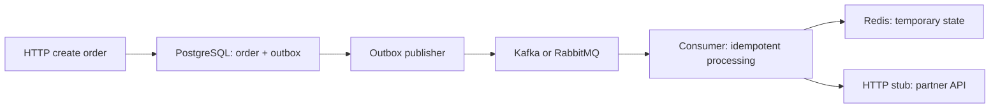
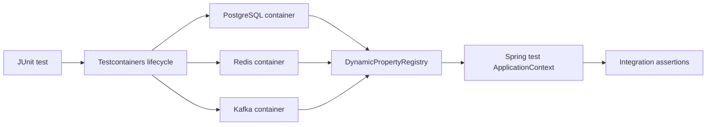
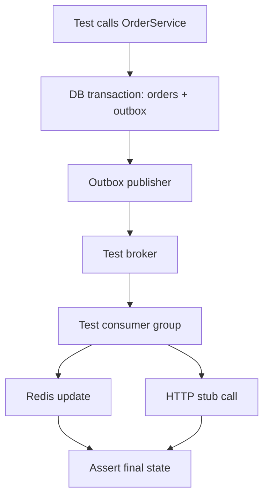

# Preparing Test Services with Docker Compose or Testcontainers

## 1. Objective of the Comprehensive Practice

In the **SPRING_BOOT_INTEGRATION** module, a Spring Boot business flow rarely relies on a single bean. An application may accept HTTP requests, write to PostgreSQL, store short-lived state in Redis, emit events through Kafka or RabbitMQ, and then call an external HTTP API via WebClient or a Spring Integration outbound adapter. To learn and test such flows, we need **test infrastructure close enough to production yet isolated with its own data, permissions, and lifecycle**.

This lesson demonstrates two ways to prepare it:

- **Docker Compose** to run a local cluster of services that you can inspect, test manually, and keep data across restarts.
- **Testcontainers** to spin up containers from test code, inject endpoints into Spring Boot, and clean up resources per the test lifecycle.

After this lesson, you will be able to stand up an environment for PostgreSQL, Redis, a message broker, and an HTTP stub; configure Spring Boot to hit the right endpoints; run integration tests; verify migrations, data, retries, duplicate events, and adapter behavior; and decide when to choose Compose versus Testcontainers.

### End-to-End Scenario

Assume an `order-integration` service with this flow:



Tests must answer more than "does the application boot?": Does the DB have the right schema? Does the producer emit the right event? Does the consumer handle duplicates safely? Are 503 retries bounded? And did test data land in the intended isolated resources?

**Example scope:** Images, ports, and passwords shown are strictly for **local/test** use; image tags illustrate one development setup. When adopting them, verify compatible versions and your project's security policies. Business classes like `OrderService` and `OutboxPublisher` are assumed application-implemented components.

## 2. Choosing Your Tool Before Provisioning Infrastructure

| Criterion | Docker Compose | Testcontainers |
| --- | --- | --- |
| How started | Developer/CI runs `docker compose up` or Spring Boot Docker Compose integration manages it | JUnit/test code initializes containers |
| Lifecycle | Usually stays running across code edits; stopped per project | Tied to test execution; typically torn down afterward |
| Endpoints | Published host ports or service DNS names inside Compose network | Host and mapped ports retrieved dynamically from container objects |
| Data | Can persist across runs via named volumes for debugging | Usually fresh data recreated per test run |
| Best suited for | Manual API testing, broker debugging, inspecting DB/cache, demos | Automated regression integration tests, CI, fault reproduction with assertions |
| Common pitfalls | Shared volumes/ports/project names; stale data polluting tests | Docker dependency, startup overhead, Spring context reuse against stopped containers |
| What it won't solve | Idempotency, DB–broker transactions, permissions, schema contracts | Same business concerns; containers do not replace test assertions |

Both approaches can **coexist**: developers run Compose locally during development, while CI runs Testcontainers. Within **a single test run**, however, keep one clear source of endpoint configuration; avoid simultaneously enabling Spring Boot Docker Compose integration and injecting Testcontainers properties, which can route traffic to unintended targets.

### Minimal Services Needed by Test Type

| Test Category | Services to Provision | What Can Be Stubbed |
| --- | --- | --- |
| Repository/transaction/outbox | Real PostgreSQL/MySQL | HTTP clients, broker if publish isn't tested yet |
| Cache and TTL | Redis | DB or HTTP if unrelated |
| Kafka producer/consumer | Test Kafka broker, real topics/groups and serializers | External HTTP APIs |
| RabbitMQ/Spring AMQP | Test RabbitMQ vhost/queues/exchanges | External APIs |
| WebClient and HTTP contracts | MockWebServer/WireMock | Broker/DB if testing client only |
| End-to-end integration flow | DB + broker + cache + HTTP stub along flow boundaries | Third-party systems outside your control |

The rule is to use **real services at the boundaries you want to prove**, while stubbing/sandboxing third parties. Testcontainers does not require starting every service for every test; doing so wastes time and adds failure points.

## 3. Prerequisites and Example Project Structure

Your local machine or CI runner needs a compatible Docker Engine/daemon, sufficient RAM, image pull permissions, and initial network access to download images. Commands `docker compose version` and `docker info` verify Docker/Compose readiness. Testcontainers also requires permission to talk to the Docker socket/daemon; never grant Docker daemon access to untrusted test code.

Illustrative project layout:

```text
order-integration/
  compose.yaml
  .gitignore
  .env.local                  # example: local params and secrets, never commit
  .local-secrets/
    postgres-password.txt     # local secret, never commit
  wiremock/
    mappings/
      order.json
  src/
    main/resources/
      application.yml
      application-local.yml
    test/java/...
    test/resources/
      application-test.yml
```

Files in this tree are **suggestions to create when practicing**, not files generated automatically by the lesson. Add `.env.local` and `.local-secrets/` to `.gitignore`; never commit real passwords, access tokens, private keys, or production data dumps to the repository. For local credentials, pick unique random values disposable after the lab.

## 4. Option A — Standing Up Docker Compose for Local Development

### 4.1. Compose with PostgreSQL, Redis, RabbitMQ, and HTTP Stub

The `compose.yaml` below uses non-default host ports bound strictly to loopback. Kafka is covered via Testcontainers later; if you run Kafka in Compose, configure listeners/advertised listeners carefully for both host-based and container-based clients.

```yaml
services:
  postgres:
    image: postgres:17-alpine
    environment:
      POSTGRES_DB: integration_lab
      POSTGRES_USER: integration_lab
      POSTGRES_PASSWORD_FILE: /run/secrets/pg_password
    secrets:
      - pg_password
    volumes:
      - postgres_data:/var/lib/postgresql/data
    ports:
      - "127.0.0.1:15432:5432"
    healthcheck:
      test: ["CMD-SHELL", "pg_isready -U integration_lab -d integration_lab"]
      interval: 5s
      timeout: 3s
      retries: 12

  redis:
    image: redis:7-alpine
    command: ["redis-server", "--save", "", "--appendonly", "no"]
    ports:
      - "127.0.0.1:16379:6379"

  rabbitmq:
    image: rabbitmq:4-management
    environment:
      RABBITMQ_DEFAULT_USER: ${LAB_RABBITMQ_USER:?Required}
      RABBITMQ_DEFAULT_PASS: ${LAB_RABBITMQ_PASSWORD:?Required}
    ports:
      - "127.0.0.1:15673:5672"
      - "127.0.0.1:15672:15672"
    healthcheck:
      test: ["CMD", "rabbitmq-diagnostics", "-q", "ping"]
      interval: 10s
      timeout: 5s
      retries: 12

  wiremock:
    image: wiremock/wiremock:3.9.2
    volumes:
      - ./wiremock:/home/wiremock:ro
    ports:
      - "127.0.0.1:18080:8080"

volumes:
  postgres_data:

secrets:
  pg_password:
    file: ./.local-secrets/postgres-password.txt
```

Explanation of choices:

- `postgres_data` is a **named volume**, preserving DB data across normal `docker compose stop` or `down`. Great for debugging, though you must reset intentionally so old data doesn't taint new tests.
- `POSTGRES_PASSWORD_FILE` lets Postgres read its secret from a Compose-mounted file. The source file must exist before startup and contain only a local password.
- Redis disables persistence in **this lab** because test cache state does not need to survive restarts; do not apply this to real caches needing durability.
- RabbitMQ pulls credentials from Compose interpolation variables `LAB_RABBITMQ_USER` and `LAB_RABBITMQ_PASSWORD`. Convenient for **local** runs, though container environment variables are visible to anyone able to inspect Docker config; use proper secret injection in shared/production environments.
- `wiremock` mounts read-only stub mappings without connecting to any real partner API. Services inside the Compose network reach each other using hostnames `postgres`, `redis`, `rabbitmq`, and `wiremock`.
- Healthchecks show basic readiness. `running` does not guarantee schemas are migrated or broker exchanges/queues are provisioned yet.

### 4.2. Preparing Secrets and Stub Mapping Files

Example `.env.local` **strictly for your learning machine**:

```dotenv
LAB_RABBITMQ_USER=integration_lab
LAB_RABBITMQ_PASSWORD=<random-local-only-password>
```

Replace the placeholder with a random lab-only password. Create `.local-secrets/postgres-password.txt` with a local PostgreSQL password and keep it out of Git. When running the app on the host, pass **the same value** via `LAB_POSTGRES_PASSWORD` in your IDE/terminal run config; Docker Compose's `--env-file` **does not automatically export variables to a Spring Boot process launched directly on the host**.

To make WireMock return a stubbed order, add a sample mapping in `wiremock/mappings/order.json`:

```json
{
  "request": {
    "method": "GET",
    "urlPathPattern": "/api/orders/[A-Za-z0-9_-]+"
  },
  "response": {
    "status": 200,
    "headers": {
      "Content-Type": "application/json"
    },
    "jsonBody": {
      "id": "demo-001",
      "status": "READY"
    }
  }
}
```

This is a static demo fixture; when testing exact `orderId` matching or multiple failure states, use specific matchers, WireMock `scenario` state, or programmatic stubs inside tests. Never point the HTTP client at real sandbox/production URLs just because a mock lacks a response.

### 4.3. Starting, Inspecting, and Stopping

```bash
# Run in the directory containing compose.yaml.
docker compose --env-file .env.local -p integration-lab config
docker compose --env-file .env.local -p integration-lab up -d
docker compose --env-file .env.local -p integration-lab ps
docker compose --env-file .env.local -p integration-lab logs postgres rabbitmq
```

`docker compose config` validates the interpolated configuration, but **may print secret values from environment variables**. Never paste its output into tickets/chats or public CI logs. Keep `-p integration-lab` consistent when inspecting logs, stopping, and cleaning up resources.

Basic smoke checks:

```bash
# Is PostgreSQL accepting connections?
docker compose --env-file .env.local -p integration-lab exec postgres \
  pg_isready -U integration_lab -d integration_lab

# Does Redis reply PONG?
docker compose --env-file .env.local -p integration-lab exec redis \
  redis-cli PING

# Does WireMock return the stubbed HTTP response (run from host)?
curl -i http://127.0.0.1:18080/api/orders/demo-001
```

On PowerShell, run each command on **one line** (`\` line continuations above are Unix shell syntax). If `curl` is unavailable or aliased, use an equivalent HTTP client. `redis-cli PING` tests local Redis without ACLs; when auth/TLS is enabled, pass credentials explicitly.

Stop while keeping DB data:

```bash
docker compose --env-file .env.local -p integration-lab down
```

Only when you are sure you want to **wipe lab data** and have verified the target project/volumes:

```bash
docker compose --env-file .env.local -p integration-lab down --volumes
```

`down --volumes` deletes Compose-managed named volumes; never run it on projects holding data you want to keep. `external: true` or `name: ...` on volumes can share state unexpectedly, and project names do not isolate bind mounts pointing to the same host directory.

## 5. Connecting Spring Boot to Compose

### 5.1. App on Host vs. App Inside a Container

| Where Does the App Run? | PostgreSQL | Redis | RabbitMQ | WireMock |
| --- | --- | --- | --- | --- |
| Development host | `127.0.0.1:15432` | `127.0.0.1:16379` | `127.0.0.1:15673` | `http://127.0.0.1:18080` |
| Container on same Compose network | `postgres:5432` | `redis:6379` | `rabbitmq:5672` | `http://wiremock:8080` |

Inside a container, `localhost` points to **that container itself**, not the neighboring PostgreSQL/Redis container. Conversely, DNS names like `postgres` normally resolve only inside the Docker Compose network, not from the host. If running two Compose projects side by side, change host ports or omit port publishing for network-internal services.

### 5.2. Local Profile

Example `application-local.yml` for Spring Boot running directly on the host:

```yaml
spring:
  config:
    activate:
      on-profile: local
  docker:
    compose:
      enabled: false
  datasource:
    url: jdbc:postgresql://127.0.0.1:15432/integration_lab
    username: integration_lab
    password: ${LAB_POSTGRES_PASSWORD}
  data:
    redis:
      host: 127.0.0.1
      port: 16379
  rabbitmq:
    host: 127.0.0.1
    port: 15673
    username: ${LAB_RABBITMQ_USER}
    password: ${LAB_RABBITMQ_PASSWORD}

partner:
  orders:
    base-url: http://127.0.0.1:18080
```

`partner.orders.base-url` is a **custom application property** bound to WebClient/HTTP gateway code. In production, use HTTPS with certificate/hostname validation and host allowlisting. Locally, WireMock runs loopback HTTP to focus on HTTP contracts; never send production tokens over plain HTTP.

`spring.docker.compose.enabled=false` is set because we manage Compose via CLI here. To use **Spring Boot Docker Compose support**, add `spring-boot-docker-compose` and let Spring Boot manage connections/lifecycle per config; service connections supply connection details automatically instead of manual YAML. Avoid mixing both control mechanisms unless you have verified configuration precedence.

### 5.3. Common Dependencies

Depending on modules used, dependencies typically include:

```text
spring-boot-starter-web            or spring-boot-starter-webflux
spring-boot-starter-jdbc           or spring-boot-starter-data-jpa
org.postgresql:postgresql
spring-boot-starter-data-redis
spring-boot-starter-amqp           (if using RabbitMQ)
spring-kafka                       (if using Kafka)
spring-integration-core            + matching adapters if using Spring Integration
spring-boot-starter-test
```

You do not need every starter at once if testing a single branch. Several starters pull transitive libraries; use Spring Boot's dependency management/BOM rather than manually pinning arbitrary library versions.

### 5.4. Verifying Before Enabling Flows

Once the app starts with the `local` profile, verify effective DB, Redis, broker, and HTTP URL connections. Environment variables or command-line args override YAML. Avoid dumping the full Spring `Environment`, JDBC URLs with passwords, or tokens during debugging.

Consumers, schedulers, and Spring Integration pollers should have controlled startup so they don't hit external APIs or pull real messages before the environment is ready. A custom flag like `integration.jobs.enabled=false` only works if your code actually reads and enforces it; adding a key to YAML alone does nothing.

## 6. Option B — Using Testcontainers in JUnit

### 6.1. Container Creation and Endpoint Injection

Testcontainers launches real Docker containers, usually assigning **random host ports**. Tests must never hardcode `localhost:5432` for PostgreSQL or `localhost:6379` for Redis. Retrieve the JDBC URL/host/mapped port from the container object and wire it into Spring via `@DynamicPropertySource` or `@ServiceConnection`.



The biggest win is not Docker automation itself, but **tying each test run's endpoints to freshly created test resources**, preventing accidental hits on shared services or stale state from prior runs.

### 6.2. Test Dependencies

For JUnit 5 and the containers in the example, include the corresponding Testcontainers artifacts:

```text
org.testcontainers:junit-jupiter
org.testcontainers:postgresql
org.testcontainers:testcontainers       (GenericContainer)
org.testcontainers:kafka                (KafkaContainer)
```

Artifact names and compatible versions depend on your Testcontainers version. Spring Boot Test manages versions via dependency management; if using Testcontainers 2.x, verify package/artifact changes instead of blindly copying 1.x coordinates. Using `@ServiceConnection` also requires Spring Boot's `spring-boot-testcontainers`.

### 6.3. Example Test Connecting to PostgreSQL, Redis, and Kafka

```java
import java.sql.Connection;
import java.util.Map;
import java.util.concurrent.TimeUnit;
import javax.sql.DataSource;

import org.apache.kafka.clients.admin.AdminClient;
import org.apache.kafka.clients.admin.AdminClientConfig;
import org.junit.jupiter.api.Test;
import org.springframework.beans.factory.annotation.Autowired;
import org.springframework.boot.test.context.SpringBootTest;
import org.springframework.data.redis.core.StringRedisTemplate;
import org.springframework.test.context.ActiveProfiles;
import org.springframework.test.context.DynamicPropertyRegistry;
import org.springframework.test.context.DynamicPropertySource;
import org.testcontainers.containers.GenericContainer;
import org.testcontainers.containers.PostgreSQLContainer;
import org.testcontainers.junit.jupiter.Container;
import org.testcontainers.junit.jupiter.Testcontainers;
import org.testcontainers.kafka.KafkaContainer;
import org.testcontainers.utility.DockerImageName;

import static org.junit.jupiter.api.Assertions.assertEquals;
import static org.junit.jupiter.api.Assertions.assertNotNull;
import static org.junit.jupiter.api.Assertions.assertTrue;

@Testcontainers
@SpringBootTest(properties = {
    "spring.docker.compose.enabled=false",
    "spring.kafka.listener.auto-startup=false"
})
@ActiveProfiles("test")
class IntegrationInfrastructureIT {

    @Container
    static final PostgreSQLContainer<?> postgres =
        new PostgreSQLContainer<>("postgres:17-alpine")
            .withDatabaseName("integration_test");

    @Container
    static final GenericContainer<?> redis =
        new GenericContainer<>(DockerImageName.parse("redis:7-alpine"))
            .withExposedPorts(6379);

    @Container
    static final KafkaContainer kafka =
        new KafkaContainer(
            DockerImageName.parse("apache/kafka:3.9.1")
        );

    @DynamicPropertySource
    static void registerConnections(DynamicPropertyRegistry properties) {
        properties.add("spring.datasource.url", postgres::getJdbcUrl);
        properties.add("spring.datasource.username", postgres::getUsername);
        properties.add("spring.datasource.password", postgres::getPassword);
        properties.add("spring.data.redis.host", redis::getHost);
        properties.add("spring.data.redis.port",
            () -> redis.getMappedPort(6379));
        properties.add("spring.kafka.bootstrap-servers",
            kafka::getBootstrapServers);
    }

    @Autowired DataSource dataSource;
    @Autowired StringRedisTemplate redisTemplate;

    @Test
    void databaseAndCacheAreReachable() throws Exception {
        try (Connection connection = dataSource.getConnection()) {
            assertTrue(connection.isValid(2));
        }

        redisTemplate.opsForValue().set("test:probe", "ok");
        assertEquals("ok", redisTemplate.opsForValue().get("test:probe"));
    }

    @Test
    void kafkaBrokerReturnsMetadata() throws Exception {
        try (AdminClient admin = AdminClient.create(Map.of(
                AdminClientConfig.BOOTSTRAP_SERVERS_CONFIG,
                kafka.getBootstrapServers()
            ))) {
            assertNotNull(
                admin.describeCluster().clusterId().get(15, TimeUnit.SECONDS)
            );
        }
    }
}
```

This is a **baseline infrastructure test**: it requires JDBC/Redis starters, PostgreSQL driver, Kafka client dependency, Spring Test, and matching Testcontainers versions. It verifies DB connectivity, Redis commands, and broker metadata; it **does not yet** prove producers/consumers, offsets, retries, or business idempotency work.

If the application also has `@RabbitListener`, Spring Integration inbound pollers, or `@Scheduled` jobs starting automatically, **disable them in the `test` profile or provide real test RabbitMQ/endpoints** before creating the Spring context. This test disables Kafka listener auto-startup, which does not automatically stop other listeners/schedulers.

#### A Note on Container Lifecycle and Spring Context Caching

Static `@Container` lifecycles are managed by the JUnit extension. If the test framework caches and reuses a Spring `ApplicationContext` across test classes after the prior class's containers stopped, beans/connection pools in the cached context retain dead endpoints. Pick a clean strategy: keep shared containers scoped across the context lifetime, control context caching, or organize tests with clear lifecycles. **Never** enable cross-run container reuse purely for speed if leftover test data leaks into subsequent runs.

### 6.4. @ServiceConnection vs. @DynamicPropertySource

In Spring Boot versions supporting `spring-boot-testcontainers`, `@ServiceConnection` derives `ConnectionDetails` directly from compatible containers, auto-configuring DataSource, Redis, or Kafka without manual property wiring.

```java
// Illustrates an alternative for PostgreSQL configuration only.
@Container
@ServiceConnection
static final PostgreSQLContainer<?> postgres =
    new PostgreSQLContainer<>("postgres:17-alpine");
```

Import `org.springframework.boot.testcontainers.service.connection.ServiceConnection` with the matching dependency. When using it, **never also inject conflicting endpoints** via `@DynamicPropertySource`, YAML, or Docker Compose auto-service for the same client; inspect which connection details Spring Boot resolves.

`@DynamicPropertySource` remains valuable for containers lacking Spring Boot service-connection support, custom endpoints, or multi-property mappings. Neither mechanism isolates tests automatically if code still calls an external HTTP base URL or runs background jobs with production credentials.

## 7. Preparing Schemas, Test Data, and Message Contracts

### 7.1. Test Databases Must Enforce the Same Schema Rules

A fresh PostgreSQL container starts with an empty database. To test repositories/outboxes, create schemas using the application's real migrations (Flyway/Liquibase or controlled test scripts); never use Hibernate `create-drop` against a DB holding data you wish to keep.

Minimal illustrative schema:

```sql
CREATE TABLE orders (
    id           VARCHAR(64) PRIMARY KEY,
    state        VARCHAR(32) NOT NULL,
    created_at   TIMESTAMPTZ NOT NULL
);

CREATE TABLE outbox_event (
    event_id     UUID PRIMARY KEY,
    aggregate_id VARCHAR(64) NOT NULL,
    event_type   VARCHAR(80) NOT NULL,
    payload      TEXT NOT NULL,
    state        VARCHAR(20) NOT NULL,
    created_at   TIMESTAMPTZ NOT NULL
);
```

This is a teaching schema. Production needs foreign keys, indexes on `state/created_at`, claims/leases, retry counts, transactional outbox metadata, retention, PII security, and versioned migrations. Never weaken types or constraints just to pass tests when the app contract requires stricter rules.

### 7.2. Deterministic and Repeatable Seed Data

Seed test records with explicit IDs (`order-001`, `event-id-...`), deterministic states, and timestamps controlled via `Clock`. Across reruns, reset test data cleanly, roll back transactions where appropriate, or partition by test ID. Never rely on leftover records from earlier runs.

For consumers/producers, define an explicit event contract:

```json
{
  "eventId": "f73a7d22-23ad-4d4d-b32d-bc2f9d6a51f7",
  "eventType": "OrderCreated",
  "schemaVersion": 1,
  "orderId": "order-001",
  "occurredAt": "2026-11-21T01:00:00Z"
}
```

`eventId` must remain stable on retries so consumers can use it for deduplication. Test schemas/serializers, required fields, and backward compatibility with older versions. Never embed API keys, access tokens, DB passwords, or unnecessary personal data in payloads.

### 7.3. Topics, Queues, and Cache Keys Must Belong to the Test Environment

- **Kafka:** create test topics via `AdminClient` or `NewTopic` beans when appropriate, using isolated group IDs. Verify topics exist and serializers/deserializers match before sending.
- **RabbitMQ:** provision test vhosts, exchanges, queues, and bindings per lab permissions.
- **Redis:** use key prefixes like `it:orders:*` or a dedicated Redis instance; verify TTL/eviction and idempotency keys if used.
- **HTTP stub:** test `200`, `400`, `429`, `503`, and timeouts. Assert the actual received URL/headers/payload, not merely that a method was called.

If sharing a broker across multiple people, enforce distinct principals/ACLs and namespaces; **changing only a topic prefix while holding cluster-wide credentials is not security isolation**.

## 8. Integration Flow Test Scenarios

### 8.1. What Must the Success Path Prove?



An end-to-end test can follow this sequence:

1. Create an order with deterministic input and assert the HTTP response matches the contract.
2. Verify the DB transaction saved **both** the order and outbox row; never only one side.
3. Run the publisher (directly or via test poller) and wait for the broker to receive the event with `eventId` and valid schema.
4. Let the test consumer handle the event and assert Redis or the target table updated.
5. Verify the HTTP stub received exactly one request conforming to contract, with no leaked credentials and hitting the test endpoint.
6. Replay **the same** event ID and assert no duplicate records or duplicate business side effects occur.

Never use `Thread.sleep(5000)` as proof processing finished. Wait with a bounded deadline (Awaitility or condition polling with timeout) and descriptive assertion messages naming the expected DB state, event, or request.

### 8.2. Failure Matrix to Test

| Case | Setup | What Must Be Observed |
| --- | --- | --- |
| PostgreSQL not ready yet | Slow startup or unreachable connection | App does not treat open socket as schema-ready; reports diagnosable error |
| DB lost while writing outbox | Stop test DB at exact point | Transaction rolls back/recovers per contract; no ghost events emitted |
| Redis timeout | Block test Redis temporarily | Clear fallback/error policy; no corrupt state persisted |
| Broker temporarily unavailable | Stop test broker while publisher sends | Outbox `PENDING` preserved; bounded retries succeed once back |
| Duplicate event | Re-send already-processed `eventId` | Idempotency prevents duplicate updates/partner calls |
| Consumer crashes before offset commit | Kill consumer after side effect | Redelivery occurs yet business outcome does not duplicate |
| Partner HTTP returns 429/503 | Stub returns retryable errors | Bounded backoff/deadline; retries do not multiply across layers |
| HTTP returns 401/403 | Stub returns auth error | No endless retry; never escalates to higher-privilege token |
| Wrong URL/host | Base URL points outside allowlist | Fails fast; never sends tokens/payloads to disallowed hosts |
| Invalid event schema | Missing fields, bad version | Error classified and routed to DLQ/quarantine per contract |
| App shuts down mid-run | Restart or kill test worker | Checkpoints/outbox/inbox recover safely |

When testing failures, assert **final state**, send counts, row counts, and observable telemetry. Catching an expected exception alone does not prove consistency—especially when an HTTP call or Kafka publish already completed before the client timed out.

### 8.3. Broker Testing Does Not Mean End-to-End Exactly-Once

Kafka/RabbitMQ, DBs, and HTTP APIs occupy separate transaction boundaries. Even Kafka producer idempotence or Kafka transactions do not create a shared atomic transaction across PostgreSQL and an external HTTP API. Use transactional outboxes, idempotency keys, deduplication/inboxes, or sagas/compensation per business semantics.

In your lab, deliberately simulate the broker accepting an event while the client loses the ACK. When retries resend the same `eventId`, the consumer must suppress duplicate effects per contract. That proves far more than a test passing once on the happy path.

## 9. Separating Secrets, Permissions, and Cross-Environment Impact

### 9.1. Minimum Boundaries

| Component | Recommended for Local/Test | Avoid |
| --- | --- | --- |
| PostgreSQL | Dedicated DB + runtime user with minimal DML | Staging/prod DBs or DBA roles |
| Redis | Dedicated instance/key prefix, scoped ACLs | User with `FLUSHALL` on shared Redis |
| Kafka | Dedicated test broker/topic/group and principal | Committing offsets on real consumer groups |
| RabbitMQ | Dedicated lab vhost/queue/user | Production broker admin user |
| HTTP | WireMock/sandbox + test tokens | Production access tokens or following untrusted redirects |
| Object storage/SFTP | Sandbox bucket/path, dedicated identity | Directories receiving real files |
| Container volumes | Dedicated project name and volumes | Bind mounts or external volumes holding others' data |
| CI | Scoped runtime test secrets | Printing passwords into logs, build args, or artifacts |

Testcontainers gives isolated connection endpoints, yet does not stop code from calling real external APIs if misconfigured. Control `spring.profiles.active`, runtime endpoints, secrets, egress, and auto-starting listeners/pollers.

### 9.2. Preventing Background Jobs from Touching External Systems in Tests

In applications with `@Scheduled`, `@KafkaListener`, `@RabbitListener`, or Spring Integration `Poller`, components can start **as soon as the Spring context boots**. If the app accidentally reads a production URL from an environment variable, incidents happen before the test body even runs.

Safe practices:

- Disable auto-start on listeners/jobs in tests not exercising them; enable selectively per test using test resources.
- Ensure custom flags like `integration.jobs.enabled` are genuinely enforced in code; YAML properties alone do not pause arbitrary schedulers.
- Validate endpoint/cluster/environment markers before enabling side-effecting tasks.
- Provision local/test credentials lacking access to staging/prod, combined with network egress restrictions.
- Clearly distinguish real vs. test data across topics/queues, tables, cache keys, DLQs, and logs.

### 9.3. Controlling Cleanup

`docker compose down` typically stops/removes project containers and networks while preserving named volumes. `docker compose down --volumes` deletes persisted data. With Testcontainers, resources normally follow test lifecycles and cleanup, yet never assume container reuse, Docker daemons, or CI runners always clean up after crashes.

Every cleanup script must scope strictly to **project/namespace/resource prefixes** rather than wiping an entire Docker host or shared broker. After interrupted tests, inspect leftover containers, volumes, networks, and state using scoped resource listings.

## 10. Common Errors and Isolation Diagnostics

| Symptom | Likely Cause | How to Check |
| --- | --- | --- |
| `Connection refused` when host app uses `postgres:5432` | Service DNS exists only inside Compose network | Use published host port `127.0.0.1:15432` or run app on network |
| Containerized app using `localhost:5432` | `localhost` refers to app container itself | Use service DNS `postgres:5432` |
| `password authentication failed` after changing Postgres password | Named volume already initialized DB with old password; init env applies only on first creation | Inspect volume, update password via DB command, or intentionally reset **lab volume** |
| PostgreSQL port already in use | Two Compose projects publish the same host port | Pick another project/port or omit publishing |
| Redis test returns stale data from prior run | Shared instance/prefix or reuse enabled | Isolate test prefix/reset properly; check TTL |
| Kafka test fails to send/receive | Wrong bootstrap/advertised listener, topic, serializer, or group | Read endpoint from container; verify metadata and ACLs |
| Consumer receives unexpected records | Shared test topic/group or leftover offsets | Use unique topic/group names, reset deliberately |
| HTTP client calls URL outside lab | Config precedence or wrong default base URL | Check effective endpoint, enforce egress/allowlists |
| Spring Boot Docker Compose conflicts with manual Compose | Both startup/connection providers active | Pick one lifecycle owner, check auto-config |
| Testcontainers fails to start | Docker daemon/permissions/network/image pull issue | Inspect Docker logs, container logs, resources; never point test at prod DB |
| JUnit test passes alone yet fails in suite | Context caching/reused container or shared static state | Check container lifecycle, test data, ordering, and static state |
| Test waits forever for an event | Listener didn't start, wrong topic/queue, or race | Log consumer/group status, DLQ, and awaited condition |

### Layer-by-Layer Diagnosis

Pinpoint which layer failed:

1. **Container:** Created, running, and passing healthchecks?
2. **Network:** Is the app on host or inside container; which DNS and port are actually used?
3. **Authentication:** Do credentials match the target environment and service?
4. **Authorization:** Does the principal hold permissions on the topic, queue, table, cache key, or endpoint?
5. **Schema/contract:** Are tables, topics, serializers, JSON schemas, and migrations ready?
6. **Application behavior:** Are retries, backoff, idempotency, transactions, offsets, DLQs, and timeouts working?

Never fix permission errors by granting admin, TLS errors by disabling certificate checks, or test failures by pointing temporarily at production. Such shortcuts mask root causes and defeat test isolation.

## 11. Observing Practice Outcomes

A solid test leaves verifiable evidence:

| Evidence | How to Collect |
| --- | --- |
| Services ready | Container healthchecks, JDBC `isValid`, Redis ping, Kafka metadata |
| Connected to right environment | Logical host/cluster identity, active profile, DB marker, test principal |
| DB data consistent | Query order/outbox post-transaction; zero missing or extra rows |
| Messages match contract | `eventId`, schema version, key, topic/queue/group |
| Consumer deduplicates | Assert record/idempotency counts after replay |
| HTTP leaks no data | WireMock captures expected test URL/headers/body with zero real tokens |
| Bounded failure behavior | Attempt counts, deadlines, DLQs, and classified errors |
| Scoped cleanup | Only lab resources deleted/reclaimed |

Log environment name, logical adapter name, and correlation ID, e.g.:

```text
environment=test
flow=order-outbox
event_id=f73a7d22-23ad-4d4d-b32d-bc2f9d6a51f7
destination=kafka-test
result=published
attempt=1
```

Never log passwords, bearer tokens, JAAS strings, private keys, full payloads with PII, or sensitive connection strings. In metrics, avoid unbounded random IDs in labels due to high cardinality; keep event IDs in access-controlled traces/logs.

## 12. Hands-On Exercises

### Exercise A — Local Flow via Compose

1. Create `compose.yaml` and local secret/mapping files per the example; start Compose with a dedicated project name.
2. Start Spring Boot under the `local` profile and verify PostgreSQL, Redis, RabbitMQ, and WireMock connections.
3. Create a stub order, writing order + outbox in the same transaction. Publish the event to the RabbitMQ test queue; consumer updates cache and calls WireMock.
4. Configure WireMock to return 503 on the first call and 200 on the second. Verify bounded retries without creating two orders or two non-idempotent side effects.
5. Stop and restart a container. Inspect outbox/consumer states and prove recovery completes without duplicate results.

### Exercise B — Moving Part of the Suite to Testcontainers

1. Create an integration test using `PostgreSQLContainer`, Redis `GenericContainer`, and `KafkaContainer` as shown; disable listeners/pollers not under test.
2. Have test setup/migrations build schemas, seed events, and verify connectivity without hardcoded ports.
3. Create a test Kafka topic and dedicated group, publish `OrderCreated`, and assert the consumer processes the schema/state accurately.
4. Replay the exact same `eventId`; assert the business result is applied once. Then simulate broker disconnect and recovery to test the outbox.
5. Run the test twice and alongside other tests; verify zero data leakage and clean resource state afterward.

### Completion Criteria

A practice run is complete when you can **reproduce the environment from configuration**, verify every endpoint belongs to test resources, pass both happy-path and failure-path runs, prove no duplicate side effects occur, capture secret-free logs/metrics, and cleanly tear down lab resources.

## 13. Pre-Reuse Checklist for Real Projects

- [ ] Chosen Compose for manual local dev or Testcontainers for automated tests, with clear lifecycle ownership.
- [ ] Docker engine and images fit local/CI runners; healthchecks and readiness verified.
- [ ] Host ports vs. container DNS distinguished; `localhost` never misused inside containers.
- [ ] Spring Boot connects to DB, cache, broker, and HTTP stubs under the intended profile and effective endpoints.
- [ ] No auto-starting jobs/listeners/pollers touch services outside the lab.
- [ ] PostgreSQL runs migrations/schemas and seed data independently of prior runs.
- [ ] Dedicated Kafka topics/groups or RabbitMQ vhosts/queues/exchanges with verified serializers/contracts.
- [ ] Dedicated Redis keys/TTLs; never execute global flush commands on shared resources.
- [ ] Local/test secrets isolated from staging/production; never committed or printed in logs/config dumps.
- [ ] Integration assertions verify transactions, event payloads, consumers, caches, and HTTP calls.
- [ ] Tested network faults, bounded retries, redeliveries, and duplicate events via idempotency keys.
- [ ] Scoped cleanup rules cover Docker volumes, test resources, event data, and logs.
- [ ] CI enforces regression checks, finite timeouts, clear failure reporting, and zero shared-resource dependencies.

### Self-Check Questions

1. Why can running the app in a container with JDBC URL `jdbc:postgresql://localhost:15432/...` fail even though Postgres works from the host?
2. Why do `docker compose down` and `docker compose down --volumes` differ in data impact?
3. Is a test using `PostgreSQLContainer` while Kafka URL still points to staging safe? What must be locked down?
4. What problem does `@DynamicPropertySource` solve when Docker publishes random ports?
5. Why does a Kafka connection returning cluster metadata not prove consumer groups, schemas, and idempotency work?
6. What failure can occur when two test classes reuse a Spring context while the first class's static container stopped?
7. Why should a business test simulate "broker accepted event while client lost ACK," and what should you assert?
8. When integrating a Spring Integration poller with DB and RabbitMQ, what must be verified before letting the poller auto-start?

**Takeaway:** Docker Compose and Testcontainers give you **reproducible test services**, while practice quality comes from controlling **exact endpoints, data, configuration, permissions, lifecycles, and business outcomes**. Getting containers booted is only step one; integration tests must prove transactions, failures, retries, idempotency, and end-to-end observability across the Spring Boot flow.
