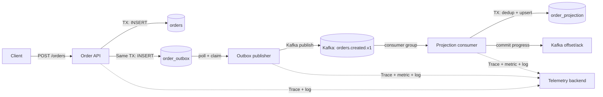
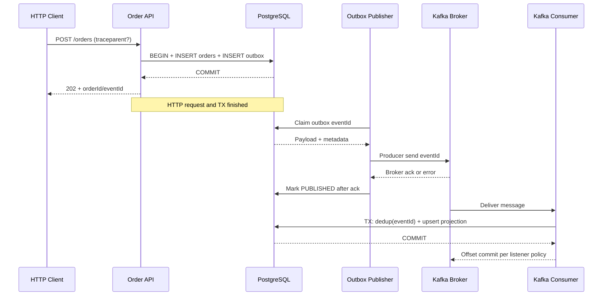

# Observing an Operation Across HTTP, Database, and Broker

In a Spring Boot system integrating HTTP, SQL, and a message broker, a request may receive a successful API response yet fail to emit an event to the broker; or the broker may accept the event while the consumer fails to process it. Looking only at HTTP status codes, one service's logs, or CPU graphs makes it hard for operators to tell how far work progressed, whether to retry, and whether retrying risks duplicate side effects.

This practice belongs to the **Comprehensive Practice** chapter of the `SPRING_BOOT_INTEGRATION` module. The module organizes Spring Boot integrations across HTTP clients, databases, caches, message brokers, and Spring Integration adapters, focusing on configuration, data contracts, transactions, errors, idempotency, testing, and end-to-end observability. Here we connect **one business operation** from HTTP through PostgreSQL and Kafka, and design visibility across every boundary using traces, metrics, logs, and durable state.

**End-to-end scenario:** a client sends `POST /orders`. The application writes the order and an `OrderCreated` event into an outbox table in **the same SQL transaction**. A publisher polls the outbox and sends the event to Kafka. A consumer receives the event and updates a read model table. Operators want to look up an operation by `orderId`, `eventId`, or `traceId` to see where it stands and which step failed.

After this lesson, you will be able to:

- Map the exact path HTTP → service → SQL transaction → outbox → Kafka producer → consumer → SQL read model.
- Distinguish traces/spans, structured logs, metrics, and business state; pick the right signal at the right time.
- Enable Micrometer Observation/Tracing, record business spans, and propagate context across HTTP/Kafka when framework and exporters are configured.
- Recognize the **trace break** when a publisher picks up work from an outbox asynchronously; use `eventId`, correlation, or deliberate context propagation to bridge it.
- Prove that SQL rollbacks emit no events, Kafka publish completion is marked only after acknowledgment, consumer redeliveries never duplicate data, and telemetry backend failures do not corrupt business data.
- Test end-to-end behavior in an isolated environment, interpret dashboards, and write diagnostic runbooks.

> **Assumptions:** examples use Java 17+, Spring Boot 3.x, Spring JDBC, Spring Kafka, PostgreSQL, Micrometer Observation/Tracing, and an OpenTelemetry-compatible backend (e.g., OpenTelemetry Collector + Jaeger/Tempo). Exact APIs, metric names, and auto-instrumentation vary by version; verify against your actual dependencies. Code for `OutboxRepository`, event contracts, and tests is split into focused snippets; this is an architectural practice rather than a complete production application.

## 1. Define "Seeing an Operation" Before Writing Code

### 1.1. Choose Questions Answerable with Evidence

Given `orderId=ORD-1042`, an on-call engineer needs to answer:

1. Which instance handled the HTTP request, what status did it return, and how long did it take?
2. Did the order-creation transaction **commit** or **roll back**?
3. Was the `OrderCreated` event durably saved in the outbox?
4. How many times did the publisher try sending, and did the broker confirm persistence?
5. Which consumer received the message, how far did processing get, and did it retry or dead-letter?
6. Does the read model hold the data yet, and which spans/logs/metrics explain any delay?
7. If the request was re-sent, did it create a duplicate order or unintended side effect?

Not every question is answered by the same tool. Traces show **execution paths and stage durations**; metrics reveal **aggregate trends**; structured logs provide **specific diagnostic events**; state tables and business records serve as **durable evidence** even when traces are sampled out or expired.

### 1.2. Practice Acceptance Criteria

| Criterion | Required Evidence |
|---|---|
| HTTP observed | Server span showing endpoint template, status, and duration; no sensitive payloads |
| SQL observed | Business span wrapping persistence, or JDBC spans when instrumentation supports it |
| Transactions accurate | Order and outbox coexist after commit and both vanish on rollback |
| Broker observed | Visibility into each publish attempt, broker ack/error result, timestamp, and attempt count |
| Consumer observed | Logs/spans keyed by `eventId`, processing outcome, and redelivery counts |
| Segments joinable | From `orderId` or `eventId`, locate HTTP request, outbox, Kafka record, and consumer outcome |
| Diagnosable without traces | Business state remains queryable via database/logs even when telemetry export fails |
| No duplicate processing | Redelivery of an `eventId` never applies the read-model update twice |

A pretty graph that cannot answer those questions does not prove the flow is observable.

## 2. Flow Diagram and Durable Boundaries

### 2.1. Recommended Path



Dashed lines are telemetry paths and **never participate in SQL or Kafka commits**. If the telemetry backend is temporarily unreachable, the application must still honor business boundaries unless strict auditing policies specify otherwise.

Precise descriptions of the flow:

- HTTP `202 Accepted`: API durably saved the order/request and event-emission intent into the database; downstream may not have received it yet.
- SQL `COMMIT`: order and outbox row both committed.
- Kafka send succeeds per producer acknowledgment: broker confirmed per configured `acks`/durability; **does not mean the consumer processed it**.
- Consumer committed read-model transaction: consumer database updated; Kafka offset commit may follow afterward.
- Consumer offset commit succeeds: group recorded read progress; **does not merge SQL and broker into one atomic transaction**.

### 2.2. Operation Timeline



This diagram shows the **normal logical flow**, without implying instantaneous cross-system updates. A publisher can crash after Kafka accepts the message yet before marking `PUBLISHED`; on recovery it sends again. Consumers need dedicated idempotency.

### 2.3. Three Identities You Must Not Confuse

| Identifier | Where Created | Purpose | Stable Across Retries? |
|---|---|---|---|
| `traceId` | HTTP tracing context or newly started root span | Locate execution within tracing system | Not guaranteed; outbox poller/consumer may start a new trace |
| `orderId` | Business application | Query order/read model records | Yes, per business contract |
| `eventId` | When creating outbox event | Deduplication, linking publisher/consumer, handling redelivery | **Must stay stable** for the same logical event |
| `requestId/idempotencyKey` | Client or HTTP ingress per contract | Prevent duplicate orders on client retries | Only if persisted and enforced by the app |
| `spanId` | Each instrumented span | Distinguish individual stages inside a trace | No; newly generated per span |

For long-term traceability, persist `orderId`/`eventId` with business state in the database. `traceId` aids diagnostics yet may be sampled out, split across async boundaries, or expire past retention.

## 3. What Are Traces, Spans, Logs, and Metrics Measuring?

### 3.1. Traces and Spans

A **trace** represents causally related operations across services. A **span** represents one unit of work with start/end timestamps, parent-child or link relationships, attributes, and error status. When the HTTP server is instrumented, a span covers `POST /orders`; when code creates a custom `Observation`, tracing backends record spans like `orders.persist`.

A successful run may look like:

```text
Trace A (while HTTP request is active)
└── HTTP POST /orders                   34 ms
    ├── orders.persist                  21 ms
    │   ├── SQL INSERT orders            6 ms  [if JDBC instrumented]
    │   └── SQL INSERT outbox            4 ms  [if JDBC instrumented]
    └── HTTP response (202)              2 ms

Trace B (publisher polls at a later time)
└── outbox.publish                       18 ms
    └── Kafka send orders.created.v1      9 ms

Trace C (Kafka consumer)
└── Kafka receive/process                27 ms
    └── orders.projection.apply           8 ms
```

**This illustrates structure**, not guaranteed span names or timings emitted automatically by Spring Boot. HTTP tracing typically comes with auto-instrumentation when configured properly. **JDBC spans are not present by default in every Spring Boot app**; seeing individual SQL queries may require compatible JDBC instrumentation, the OpenTelemetry Java agent, or custom observations. Never label a dashboard panel "SQL spans" if only the service method is instrumented.

In the outbox pattern, Trace A finishes before the publisher runs. Do not assume Kafka instrumentation automatically stitches Trace B onto Trace A when the publisher reads rows from the database.

### 3.2. How to Use Each Signal

| Signal | Questions Answered Well | Pitfalls to Avoid |
|---|---|---|
| Distributed tracing | Which stage was slow/failed in a single run? | Treating traces as the sole source of truth for business state |
| Structured logging | What exact event occurred, for which `eventId`? | Logging full payloads, secrets, tokens, or PII |
| Metrics | Requests/s, error rates, p95 latency, backlogs? | Using `orderId`/`eventId` as tags causing cardinality explosions |
| DB state / Job state | Did the order commit, what state is outbox in? | Inferring state from "preparing to send" logs |
| Broker/client telemetry | Publish acks/errors, consumer lag/retries/DLT? | Equating producer ack with consumer success |

**A completed span does not guarantee a committed business transaction.** A span closes whenever the wrapped code block finishes; choose span names and record outcomes at exact boundaries.

## 4. Setting Up the Practice Environment

### 4.1. Components to Run

At minimum:

1. A Spring Boot app housing the HTTP controller, transactional service, outbox publisher, and Kafka consumer. When studying observability, you can split the consumer into a second app to observe cross-process tracing, though it is not needed on step one.
2. Dedicated PostgreSQL for practice, using migrations to create `orders`, `order_outbox`, and `processed_event`/`order_projection`.
3. Dedicated Kafka broker, topic `orders.created.v1`, and consumer group `orders-read-model` with explicit endpoints/group names.
4. Collector or backend accepting OTLP/traces; e.g., Jaeger, Tempo, or an available tracing stack.
5. HTTP client like `curl`/Postman and tools to inspect the database/broker.

Use Docker Compose or Testcontainers to spin up test services; verify broker listeners, port mappings, and hostnames from **both inside containers and the host**. `localhost` for a host-run app is not `localhost` inside another container.

### 4.2. Dependencies for Spring Boot 3.x

Example `build.gradle.kts` using the Spring Boot plugin's BOM:

```kotlin
dependencies {
    implementation("org.springframework.boot:spring-boot-starter-web")
    implementation("org.springframework.boot:spring-boot-starter-jdbc")
    implementation("org.springframework.boot:spring-boot-starter-actuator")
    implementation("org.springframework.kafka:spring-kafka")

    implementation("io.micrometer:micrometer-tracing-bridge-otel")
    runtimeOnly("io.opentelemetry:opentelemetry-exporter-otlp")
    runtimeOnly("io.micrometer:micrometer-registry-prometheus")
    runtimeOnly("org.postgresql:postgresql")

    testImplementation("org.springframework.boot:spring-boot-starter-test")
    testImplementation("org.springframework.kafka:spring-kafka-test")
    testImplementation("org.testcontainers:junit-jupiter")
    testImplementation("org.testcontainers:postgresql")
    testImplementation("org.testcontainers:kafka")
}
```

BOMs and versions may differ in Spring Boot 4.x; verify dependencies and auto-configuration for your version before copying. Adding a bridge alone does not create a tracing backend; you need a running exporter target and collector endpoint.

### 4.3. Reference Configuration

```yaml
spring:
  application:
    name: orders-integration
  datasource:
    url: jdbc:postgresql://postgres:5432/orders
    username: ${DB_USERNAME}
    password: ${DB_PASSWORD}

  kafka:
    bootstrap-servers: kafka:9092
    producer:
      key-serializer: org.apache.kafka.common.serialization.StringSerializer
      value-serializer: org.apache.kafka.common.serialization.StringSerializer
      acks: all
    consumer:
      group-id: orders-read-model
      key-deserializer: org.apache.kafka.common.serialization.StringDeserializer
      value-deserializer: org.apache.kafka.common.serialization.StringDeserializer
      auto-offset-reset: earliest
    listener:
      ack-mode: record

management:
  tracing:
    sampling:
      probability: 1.0 # Learning/testing only; production must follow trace budgets
  otlp:
    tracing:
      endpoint: http://otel-collector:4318/v1/traces
  endpoints:
    web:
      exposure:
        include: health,info,metrics,prometheus
```

This configuration assumes the app runs **inside the same container network** with hostnames `postgres`, `kafka`, and `otel-collector`. If running on the host, adjust hostnames/ports accordingly. `sampling.probability=1.0` captures every trace during the lab; production uses lower sampling plus policies retaining error/slow traces where supported.

`acks=all` instructs the producer to wait for broker acks per configured replicas/ISR; **it does not turn a single-broker test cluster into fault-tolerant production infrastructure**. Nor does it turn Kafka and SQL into an atomic distributed transaction.

Exposing metrics endpoints for tests requires access controls in real environments. Never expose `/actuator/prometheus` or admin endpoints to the public Internet.

### 4.4. Enabling Kafka Observation

Micrometer tracing for HTTP and Kafka uses separate instrumentation hooks. For Spring Kafka versions supporting observation, enable observation on producer and listener containers via **the API/config of your version**. When customizing factories, retain other settings from Spring Boot auto-configuration.

Illustrative programmatic configuration for custom beans:

```java
@Bean
KafkaTemplate<String, String> observedKafkaTemplate(
        ProducerFactory<String, String> producerFactory) {

    KafkaTemplate<String, String> template =
            new KafkaTemplate<>(producerFactory);
    template.setObservationEnabled(true);
    return template;
}

@Bean
ConcurrentKafkaListenerContainerFactory<String, String>
kafkaListenerContainerFactory(
        ConsumerFactory<String, String> consumerFactory) {

    var factory =
            new ConcurrentKafkaListenerContainerFactory<String, String>();
    factory.setConsumerFactory(consumerFactory);
    factory.getContainerProperties().setObservationEnabled(true);
    return factory;
}
```

Key imports: `KafkaTemplate`, `ProducerFactory`, `ConsumerFactory`, and `ConcurrentKafkaListenerContainerFactory` from Spring Kafka. Use this **approach** when your project explicitly owns factory/template beans; avoid registering duplicate bean names if Boot already auto-configures the same role. Verify which beans the app actually uses and confirm serializers, error handlers, concurrency, transactions, retry/DLT, and acknowledgments remain intact. Some Boot versions offer properties to toggle observation; prefer configuration consistent with your project version.

When tracing/observation is enabled, Spring Kafka propagates context from producer record headers and extracts it on the consumer. With an **outbox relay**, the active context during producer send belongs to the publisher rather than the original HTTP request. Section 8 addresses this boundary.

## 5. Designing Data Contracts and Database

### 5.1. A Meaningful Event with a Stable ID

Example `OrderCreated` JSON:

```json
{
  "eventId": "123e4567-e89b-12d3-a456-426614174001",
  "eventType": "OrderCreated",
  "schemaVersion": 1,
  "orderId": "123e4567-e89b-12d3-a456-426614174000",
  "occurredAt": "2026-11-21T08:00:00Z",
  "totalAmount": 125000,
  "currency": "VND"
}
```

`eventId` and `orderId` are generated **once** before writing to the DB. When the publisher retries, it must send **the exact persisted `eventId`/payload**. Never generate a fresh `eventId` on each Kafka send. When event contracts evolve, manage `schemaVersion` and consumer compatibility; avoid serializing JPA entities directly as public contracts.

Customer details, addresses, card numbers, and tokens do not belong in event/trace payloads. Fields that must be transmitted must follow data classification, access, retention, and encryption policies.

### 5.2. Minimal PostgreSQL DDL

```sql
CREATE TABLE orders (
    id           UUID PRIMARY KEY,
    total_amount BIGINT NOT NULL,
    currency     VARCHAR(3) NOT NULL,
    status       VARCHAR(24) NOT NULL,
    created_at   TIMESTAMPTZ NOT NULL DEFAULT now()
);

CREATE TABLE order_outbox (
    event_id      UUID PRIMARY KEY,
    order_id      UUID NOT NULL REFERENCES orders(id),
    event_type    VARCHAR(80) NOT NULL,
    payload       JSONB NOT NULL,
    status        VARCHAR(20) NOT NULL DEFAULT 'NEW',
    attempts      INTEGER NOT NULL DEFAULT 0,
    lease_owner   VARCHAR(120),
    lease_until   TIMESTAMPTZ,
    created_at    TIMESTAMPTZ NOT NULL DEFAULT now(),
    published_at  TIMESTAMPTZ
);
CREATE INDEX idx_outbox_dispatch
    ON order_outbox (status, created_at);

CREATE TABLE processed_event (
    consumer_name VARCHAR(80) NOT NULL,
    event_id      UUID NOT NULL,
    processed_at  TIMESTAMPTZ NOT NULL DEFAULT now(),
    PRIMARY KEY (consumer_name, event_id)
);

CREATE TABLE order_projection (
    order_id      UUID PRIMARY KEY,
    total_amount  BIGINT NOT NULL,
    currency      VARCHAR(3) NOT NULL,
    status        VARCHAR(24) NOT NULL,
    updated_at    TIMESTAMPTZ NOT NULL DEFAULT now()
);
```

`orders` and `order_outbox` must be written in **the same JDBC transaction** to guarantee an event follows every committed state change. `processed_event` lets consumers deduplicate by `eventId` per consumer group/pipeline. Production adds retry limits, claim indexes, deadlines, size guards, retention, dead-lettering, migrations/backups, and proper permissions.

**Never use a single status table as proof of every stage.** Outbox `status=PUBLISHED` means the producer got an ack per policy and persisted that state; the consumer may not have processed it yet. `order_projection`/`processed_event` reflect consumer progress.

### 5.3. Transaction Must Wrap Both Operations

Example service inserting order and outbox in one transaction:

```java
import java.time.Instant;
import java.util.UUID;

import com.fasterxml.jackson.databind.ObjectMapper;
import io.micrometer.observation.Observation;
import io.micrometer.observation.ObservationRegistry;
import org.springframework.jdbc.core.JdbcTemplate;
import org.springframework.stereotype.Service;
import org.springframework.transaction.annotation.Transactional;

@Service
public class CreateOrderService {

    public record CreateOrderRequest(long totalAmount, String currency) {}
    public record CreatedOrder(UUID orderId, UUID eventId) {}

    private final JdbcTemplate jdbc;
    private final ObjectMapper mapper;
    private final ObservationRegistry observations;

    public CreateOrderService(
            JdbcTemplate jdbc,
            ObjectMapper mapper,
            ObservationRegistry observations) {
        this.jdbc = jdbc;
        this.mapper = mapper;
        this.observations = observations;
    }

    @Transactional
    public CreatedOrder create(CreateOrderRequest request) {
        return Observation.createNotStarted("orders.persist", observations)
                .lowCardinalityKeyValue("operation", "create")
                .observe(() -> {
                    UUID orderId = UUID.randomUUID();
                    UUID eventId = UUID.randomUUID();
                    try {
                        String payload = mapper.writeValueAsString(
                                new OrderCreated(
                                        eventId, orderId, Instant.now(),
                                        request.totalAmount(),
                                        request.currency()));

                        jdbc.update("""
                            INSERT INTO orders(
                                id, total_amount, currency, status
                            ) VALUES (?, ?, ?, ?)
                            """,
                            orderId, request.totalAmount(),
                            request.currency(), "ACCEPTED");

                        jdbc.update("""
                            INSERT INTO order_outbox(
                                event_id, order_id, event_type, payload
                            ) VALUES (?, ?, ?, CAST(? AS jsonb))
                            """,
                            eventId, orderId, "OrderCreated", payload);

                        return new CreatedOrder(orderId, eventId);
                    } catch (com.fasterxml.jackson.core.JsonProcessingException e) {
                        throw new IllegalStateException(
                                "Cannot serialize OrderCreated", e);
                    }
                });
    }

    public record OrderCreated(
            UUID eventId,
            UUID orderId,
            Instant occurredAt,
            long totalAmount,
            String currency) {}
}
```

Add `totalAmount`/`currency` validation on DTOs and stabilize the event schema in production. `@Transactional` must be invoked **via a Spring proxy** from another bean; self-invocation inside the same bean can bypass advice. If either `jdbc.update` fails, the transaction rolls back when the exception propagates per transaction-manager rules.

**Detail on spans and commits:** `orders.persist` wraps method execution; Spring's `@Transactional` interceptor can complete the actual commit **after the method returns**, depending on advice ordering. Therefore, never infer from this span alone that `COMMIT` definitely succeeded. Real proof is committed data or instrumenting transaction outcomes at the right boundary. Rollback tests remain essential verification.

Here Observation only emits a **business-operation-level span** when a tracing handler is present; individual SQL statements get spans only when matching JDBC instrumentation is enabled. Never attach full payloads as tags.

### 5.4. API Returning Accurate Status

```java
import java.util.UUID;
import org.springframework.http.ResponseEntity;
import org.springframework.web.bind.annotation.*;

@RestController
@RequestMapping("/orders")
public class OrderController {

    private final CreateOrderService createOrders;

    public OrderController(CreateOrderService createOrders) {
        this.createOrders = createOrders;
    }

    @PostMapping
    public ResponseEntity<CreatedOrderResponse> create(
            @RequestBody CreateOrderService.CreateOrderRequest request) {

        var created = createOrders.create(request);

        return ResponseEntity.accepted().body(
                new CreatedOrderResponse(
                        created.orderId(),
                        created.eventId(),
                        "PENDING_DISPATCH"));
    }

    public record CreatedOrderResponse(
            UUID orderId, UUID eventId, String status) {}
}
```

HTTP `202 Accepted` fits because the API accepted and persisted the order durably while downstream remains asynchronous. If clients retry requests, add `Idempotency-Key`, unique constraints, and a `key → orderId/eventId` mapping to avoid creating two orders when responses drop. That is **distinct** from consumer `eventId` deduplication.

If you prefer not exposing `eventId` publicly, the API can return just `orderId`/status URL while operations retain the `orderId ↔ eventId` mapping in the database. Never return raw stack traces or internal broker names to clients.

## 6. Outbox Publisher: When the Broker Acknowledges

### 6.1. A Polling Loop with Claims and Leases

Across multiple replicas, prevent two publishers from grabbing and sending the same outbox row simultaneously. PostgreSQL short-transaction claim example:

```sql
WITH picked AS (
    SELECT event_id
    FROM order_outbox
    WHERE status = 'NEW'
       OR (status = 'CLAIMED' AND lease_until < now())
    ORDER BY created_at, event_id
    FOR UPDATE SKIP LOCKED
    LIMIT 20
)
UPDATE order_outbox o
SET status = 'CLAIMED',
    lease_owner = :worker_id,
    lease_until = now() + INTERVAL '60 seconds',
    attempts = attempts + 1
FROM picked
WHERE o.event_id = picked.event_id
RETURNING o.event_id, o.order_id, o.payload, o.attempts;
```

Bind `:worker_id` using `NamedParameterJdbcTemplate` or equivalent. The claim transaction commits right after setting the lease, **never holding SQL locks across Kafka sends**. When sending many events or facing slow responses, renew leases or keep batches small so two publishers do not double-send upon lease expiry.

`SKIP LOCKED` does not guarantee exactly-once. Duplicates still happen on process crashes, lease expirations, slow broker acks, or failed outbox status commits. That is why consumers must be idempotent.

### 6.2. Publishing, Recording Outcomes, and Creating Observations

Illustrative dispatch path:

```java
import java.time.Duration;
import java.util.concurrent.TimeUnit;

import io.micrometer.observation.Observation;
import io.micrometer.observation.ObservationRegistry;
import org.apache.kafka.clients.producer.ProducerRecord;
import org.springframework.kafka.core.KafkaTemplate;
import org.springframework.stereotype.Service;

@Service
public class OutboxPublishService {

    private final KafkaTemplate<String, String> kafka;
    private final OutboxRepository outbox;
    private final ObservationRegistry observations;

    public OutboxPublishService(
            KafkaTemplate<String, String> kafka,
            OutboxRepository outbox,
            ObservationRegistry observations) {
        this.kafka = kafka;
        this.outbox = outbox;
        this.observations = observations;
    }

    public void publish(OutboxRow event) {
        Observation observation =
                Observation.createNotStarted("outbox.publish", observations)
                        .lowCardinalityKeyValue("event.type", event.eventType())
                        .lowCardinalityKeyValue("destination", "orders.created.v1")
                        .start();

        try (Observation.Scope scope = observation.openScope()) {
            var record = new ProducerRecord<String, String>(
                    "orders.created.v1",
                    event.orderId().toString(),
                    event.payloadJson());

            // eventId is the key for correlating outcomes/duplicates;
            // never use it as a low-cardinality metric tag.
            record.headers().add(
                    "x-event-id",
                    event.eventId().toString()
                         .getBytes(java.nio.charset.StandardCharsets.UTF_8));

            // Wait for producer ack with finite timeout.
            // At high throughput, use async callbacks/CompletableFuture
            // with bounded concurrency instead of blocking.
            kafka.send(record).get(5, TimeUnit.SECONDS);

            outbox.markPublished(event.eventId());
        } catch (Exception failure) {
            observation.error(failure);
            outbox.markRetryable(event.eventId(), failure);
            throw new OutboxPublishException("Kafka send failed", failure);
        } finally {
            observation.stop();
        }
    }

    public interface OutboxRepository {
        void markPublished(java.util.UUID eventId);
        void markRetryable(java.util.UUID eventId, Exception cause);
    }

    public record OutboxRow(
            java.util.UUID eventId,
            java.util.UUID orderId,
            String eventType,
            String payloadJson) {}

    public static class OutboxPublishException extends RuntimeException {
        public OutboxPublishException(String message, Throwable cause) {
            super(message, cause);
        }
    }
}
```

This illustrates **sequence and instrumentation placement**, not a complete dispatcher (it omits the claim repository, `@Scheduled`, backoff, and dead-lettering). `markPublished` should verify lease ownership when multiple replicas run; `markRetryable` must save attempt/retry-after info without masking the root exception. If `markPublished` fails after broker ack, recovery republishes—making consumer deduplication mandatory.

`kafka.send(...).get(5, TimeUnit.SECONDS)` waits only for **Kafka producer acknowledgment**, not the consumer. Never call this blocking API inside HTTP requests or long SQL transactions. In high-throughput systems, use async pipelines with bounded in-flight counts, outcome callbacks, timeouts, and lease renewals, instrumenting upon actual completion.

### 6.3. Recording Spans/Metrics at Exact Moments

| Milestone | Signal to Record | What Is **Not** Proven |
|---|---|---|
| Claim outbox row | `outbox.claimed`, attempts and lease owner in logs | Broker received message |
| Start Kafka send | `outbox.publish.attempt`, `eventId` in logs | Publish succeeded |
| Producer future succeeds | `outbox.publish.acknowledged`, duration, partition/offset if available | Consumer processed it |
| `PUBLISHED` commit | Durable `outbox.state=PUBLISHED` | Consumer side effects finished |
| Producer future errors/times out | `outbox.publish.failed`, retryable status | Certainty that broker did **not** receive message |

Especially on timeouts, you **cannot be sure** whether the broker stored the event. Build retries around at-least-once + idempotency instead of assuming "timeout means nothing was published."

## 7. Consumer: Observing Messages, Deduplication, and SQL Transactions

### 7.1. Reading Events via Kafka Listener

```java
import com.fasterxml.jackson.databind.ObjectMapper;
import org.apache.kafka.clients.consumer.ConsumerRecord;
import org.springframework.kafka.annotation.KafkaListener;
import org.springframework.stereotype.Component;

@Component
public class OrderProjectionListener {

    private final ObjectMapper mapper;
    private final OrderProjectionService projections;

    public OrderProjectionListener(
            ObjectMapper mapper,
            OrderProjectionService projections) {
        this.mapper = mapper;
        this.projections = projections;
    }

    @KafkaListener(
            topics = "orders.created.v1",
            groupId = "orders-read-model")
    public void handle(ConsumerRecord<String, String> record)
            throws com.fasterxml.jackson.core.JsonProcessingException {

        var event = mapper.readValue(
                record.value(), CreateOrderService.OrderCreated.class);

        projections.apply(event);
    }
}
```

When the listener returns without throwing, the container manages offset/ack **per configuration**; if it throws, the error handler/retry/DLT policy governs redelivery. Do not claim "listener received" equals "offset committed" without observing consumer group state. With `ack-mode: record`, container offset commits follow container mechanics rather than sharing a JDBC transaction.

### 7.2. Deduplicating and Writing Projection in One Transaction

```java
import org.springframework.jdbc.core.JdbcTemplate;
import org.springframework.stereotype.Service;
import org.springframework.transaction.annotation.Transactional;

@Service
public class OrderProjectionService {

    private final JdbcTemplate jdbc;

    public OrderProjectionService(JdbcTemplate jdbc) {
        this.jdbc = jdbc;
    }

    @Transactional
    public void apply(CreateOrderService.OrderCreated event) {
        int claimed = jdbc.update("""
            INSERT INTO processed_event (consumer_name, event_id)
            VALUES (?, ?)
            ON CONFLICT DO NOTHING
            """,
            "orders-read-model",
            event.eventId());

        if (claimed == 0) {
            return; // this event was already processed and committed earlier
        }

        jdbc.update("""
            INSERT INTO order_projection(
                order_id, total_amount, currency, status
            ) VALUES (?, ?, ?, 'CREATED')
            ON CONFLICT (order_id)
            DO UPDATE SET
                total_amount = EXCLUDED.total_amount,
                currency = EXCLUDED.currency,
                status = EXCLUDED.status,
                updated_at = now()
            """,
            event.orderId(),
            event.totalAmount(),
            event.currency());
    }
}
```

**Correctness condition:** `processed_event` and `order_projection` must share **the same transaction** on the same database/transaction manager. If projection fails, the dedup insert rolls back so retries can run again. Once `eventId` commits, duplicate deliveries become a business no-op. Unique constraints arbitrate races between two consumers/processes handling the same `eventId`.

If the consumer also makes external HTTP calls or publishes to another broker, JDBC transactions **cannot roll back those side effects**. Use an outbox/idempotency or dedicated compensation. If `OrderCreated` has multiple versions arriving in order, a "last arrival wins" upsert can corrupt state; enforce sequence/version guards so older events never overwrite newer states.

### 7.3. What Should Logs Capture on Consumer Redelivery?

Example structured log (illustrative data):

```json
{
  "service": "orders-integration",
  "stage": "order.projection.apply",
  "event_type": "OrderCreated",
  "event_id": "123e4567-e89b-12d3-a456-426614174001",
  "consumer_group": "orders-read-model",
  "result": "duplicate_ignored",
  "kafka_topic": "orders.created.v1",
  "kafka_partition": 2,
  "kafka_offset": 1349
}
```

`eventId` and partition/offset are searchable log fields—never put them in **metric tags**. When `traceId`/`spanId` appear in MDC via Micrometer Tracing/Logging, include them in logs to jump from traces to logs; with Kafka consumer thread pools, verify context propagation works in your runtime environment.

Only log `result=duplicate_ignored` after confirming the conflict came from your business dedup key; never assume every unique-key violation on other tables is a "valid duplicate."

## 8. Linking Trace Context Across HTTP, Outbox, and Kafka

### 8.1. HTTP and W3C Trace Context

An HTTP request may carry:

```text
traceparent: 00-4bf92f3577b34da6a3ce929d0e0e4736-00f067aa0ba902b7-01
tracestate: vendor=value
```

This illustrates the W3C Trace Context format. Tracing instrumentation parses/validates headers via propagators; never treat client-supplied `traceparent` headers as authentication or authorization. `traceId` is not a secret and must never serve as an idempotency key or auth token.

Once the request is instrumented, the active HTTP span parents observations inside the service. With `ObservationRegistry` and a tracing bridge configured, `Observation.createNotStarted(...).observe(...)` adds child stages to the trace.

**Limitation:** if sampling drops the trace at ingress or the backend drops exports, spans may be missing from dashboards even though the business operation succeeded. Always retain durable order/event state and logs independently of trace retention.

### 8.2. Kafka Headers Can Carry Tracing Context

When Spring Kafka observation is enabled on both producer and listener containers, instrumentation injects context into Kafka record headers and extracts it at the consumer. Exact mechanics depend on framework versions and `KafkaTemplate`/factory setup.

Verify empirically with tests:

1. Start an `Observation` on the producer.
2. Send an event through the observation-enabled `KafkaTemplate`.
3. Confirm the consumer span appears with the right trace context/relationship, and verify custom serializers/adapters did not strip record headers.
4. If using Spring Integration Kafka adapters or gateways, verify instrumentation on those specific adapters instead of assuming they share `KafkaTemplate`'s wiring.

Consumer span parent/child vs. link relationships depend on "receive" vs. "process" semantics and instrumentation defaults. Do not require every backend to render consumer spans as direct children of producer spans.

### 8.3. Why Outbox Normally Starts a New Trace

In this design, the publisher runs after the HTTP response already returned. It polls outbox rows from PostgreSQL on a separate scheduler thread. **The request's ThreadLocal/MDC/active span is long gone.** With auto-instrumentation alone:

```text
HTTP span (trace A)
  └── orders.persist

Scheduler/publisher (trace B)
  └── Kafka send

Consumer (usually linked to trace B if propagation succeeds)
  └── orders.projection.apply
```

This is **not a bug**. They are two asynchronous executions separated in time, linked logically by `eventId`. Operators can still correlate Trace A ↔ Trace B via `eventId` in outbox rows and logs even when distributed tracing shows separate traces.

### 8.4. Three Ways to Bridge Across an Outbox

| Approach | Implementation | Benefits | Limitations |
|---|---|---|---|
| **Join by eventId** | Persist `eventId`/`orderId` durably, log in API/publisher/consumer | Simple, immune to sampling; solid for investigations | Trace UI displays separate traces |
| **Persist W3C context in outbox** | Inject `traceparent/tracestate` from **trusted active context**; extract on publish | Represents trace link across async boundary | Needs clean propagation code, handling missing/bad context, size caps, and security |
| **Span links** | Publisher/consumer starts new trace and links span to event-creation context | Models async causality cleanly without over-long parent spans | Needs span-link support in tracing SDK/backend and UI |

For your first practice pass, **joining by `eventId`** is a rock-solid baseline. If your goal is one connected trace across the outbox, **deliberately** persist and restore trace context and test it. Never imagine that adding an `x-event-id` header automatically produces a parent-child trace.

When persisting context, use OpenTelemetry/Micrometer propagators instead of manually slicing `traceparent` strings or copying raw unvalidated HTTP headers. Whitelist allowed context keys and never persist bearer tokens, cookies, or PII-bearing baggage in the outbox. When events process hours later, traces may have expired or been sampled out—so `eventId` remains indispensable.

### 8.5. MDC and Log Correlation

Example HTTP structured log:

```json
{
  "stage": "orders.http.accepted",
  "order_id": "123e4567-e89b-12d3-a456-426614174000",
  "event_id": "123e4567-e89b-12d3-a456-426614174001",
  "trace_id": "4bf92f3577b34da6a3ce929d0e0e4736",
  "http_status": 202
}
```

The publisher may log the same `event_id` with a different `trace_id`; the consumer then inherits the publisher's trace through Kafka. **That is valid without explicit outbox propagation.**

MDC is thread-bound. When using `@Async`, executors, schedulers, or Reactor, check context propagation support for your framework version; never expect `MDC.put` on an HTTP thread to appear automatically on publisher/consumer threads. Also clear scopes/MDC cleanly so a prior request's `traceId` never leaks onto reused threads.

## 9. Creating Meaningful Business and Operational Metrics

### 9.1. Minimal Metric Set

| Logical Name (Example) | Type | Low-Cardinality Labels | Meaning |
|---|---|---|---|
| `orders.accepted` | Counter | `result=accepted/rejected` | Orders/API requests accepted |
| `orders.persist.duration` | Timer | `operation=create` | Persistence stage duration inside service |
| `outbox.backlog` | Gauge | `eventType=OrderCreated` | Count of unfinished outbox events |
| `outbox.oldest.age` | Gauge | `eventType=OrderCreated` | Age of oldest unpublished event |
| `outbox.publish.attempts` | Counter | `result=ack/error/timeout` | Publish attempts and producer outcomes |
| `orders.consumer.events` | Counter | `result=applied/duplicate/error` | Consumer received/applied event counts |
| `orders.projection.delay` | Timer/Histogram | `eventType=OrderCreated` | Delay from event creation to read-model commit |

These are **suggested business metrics**, not built-in Spring Boot metrics. Implement them via Micrometer `MeterRegistry` or custom Observation conventions. Framework metrics for HTTP requests, Kafka clients, JVM, and datasources may be exported automatically depending on classpath and config.

Never use `orderId`, `eventId`, `traceId`, emails, resource paths, or raw SQL as metric tags. Put those in logs, exemplars, or traces where backends support them and data policies allow.

### 9.2. Instrumentation Example with MeterRegistry

```java
import io.micrometer.core.instrument.MeterRegistry;
import org.springframework.stereotype.Component;

@Component
public class OrderIntegrationMetrics {
    private final MeterRegistry meters;

    public OrderIntegrationMetrics(MeterRegistry meters) {
        this.meters = meters;
    }

    public void recordPublish(String result) {
        // result is a fixed application-controlled set,
        // e.g., ack, timeout, error.
        meters.counter(
                "outbox.publish.attempts",
                "eventType", "OrderCreated",
                "result", result).increment();
    }

    public void recordConsumer(String result) {
        meters.counter(
                "orders.consumer.events",
                "eventType", "OrderCreated",
                "result", result).increment();
    }
}
```

In production, constrain `result` with an enum/allowlist so raw exception messages never become tags. `MeterRegistry` does not automatically know when Kafka acks or SQL commits; invoke metric methods **at the exact boundaries**. For `Timer`, measure durations with an appropriate clock; for backlog `Gauge`, read from cached periodic SQL snapshots rather than running expensive DB queries on every Prometheus scrape.

### 9.3. Three Charts to View Side by Side

1. **HTTP:** request rate, p50/p95/p99 latency, and 4xx/5xx ratio for `POST /orders`.
2. **Handoff:** outbox `NEW/CLAIMED` count, oldest backlog age, publish attempts, and producer ack/error/timeout.
3. **Consumption:** Kafka consumer lag, retries/DLT, applied/duplicate events, and latency from `occurredAt` to projection commit.

If HTTP keeps returning 202 while outbox backlog climbs, post-commit trouble sits at the publisher/broker. If backlog stays at 0 while the read model falls behind, check consumer lag/retries and SQL projection. If HTTP 500 spikes with no outbox growth, investigate ingress validation, transactions, or DB.

Avoid interpreting any single chart in isolation: consumer lag of 0 can simply mean no new messages arrived, not that business processing succeeded. Always correlate logs, traces, and durable data by `eventId`.

## 10. Practice Run 1: The Happy Path

### 10.1. Prepare and Send a Request

Start PostgreSQL, Kafka, the application, and the telemetry backend in the same test environment; verify Spring Boot health, DB migrations, topics, and the collector endpoint. Open the trace UI and a terminal watching outbox/read-model tables.

Send request:

```bash
curl -i -X POST http://localhost:8080/orders \
  -H "Content-Type: application/json" \
  -H "Idempotency-Key: demo-order-1042" \
  -d '{"totalAmount":125000,"currency":"VND"}'
```

In the sample controller, `Idempotency-Key` **is not yet implemented**; production requires adding unique key storage and retry handling. In this lab, the request illustrates a client sending the key—do not claim HTTP deduplication works without implementing header handling.

Expected response semantics:

```json
{
  "orderId": "123e4567-e89b-12d3-a456-426614174000",
  "eventId": "123e4567-e89b-12d3-a456-426614174001",
  "status": "PENDING_DISPATCH"
}
```

IDs are illustrative; real values are generated by the app. HTTP 202 must never be misrepresented as `ORDER_DELIVERED`.

### 10.2. Verify the SQL Transaction

```sql
SELECT id, status, created_at
FROM orders
WHERE id = :order_id;

SELECT event_id, order_id, status, attempts, created_at, published_at
FROM order_outbox
WHERE order_id = :order_id
ORDER BY created_at;
```

Right after HTTP 202, both the order row and outbox row should exist. Outbox status may already have transitioned quickly from `NEW` to `PUBLISHED` if the publisher ran before your query; that is normal. Query by `eventId` when an order can emit multiple events.

If practicing with a PostgreSQL client lacking named parameters, substitute `:order_id` with positional parameters/controlled test values; never concatenate user input into SQL.

### 10.3. Verify Broker and Consumer

Search publisher logs by `eventId`: trace attempt → broker ack → mark published. Use Kafka test tools or an independent consumer to inspect topic/key/headers/value without advancing the app's production consumer group offset. Then query:

```sql
SELECT order_id, status, total_amount, currency, updated_at
FROM order_projection
WHERE order_id = :order_id;

SELECT consumer_name, event_id, processed_at
FROM processed_event
WHERE event_id = :event_id;
```

Once the consumer commits, both projection and `processed_event` rows appear. Never assume a message in the topic means the read model is immediately updated; consumers may lag by seconds or be retrying.

### 10.4. Read Traces and Logs

Locate `POST /orders` in the tracing UI by service/operation name and timestamp. Inspect the `orders.persist` span, status/errors, and stage durations. Next, search logs by `eventId`, grab the publisher's `traceId`, and open the Kafka publish trace. With Kafka observation active, the consumer span carries context from the record or links as rendered by your backend.

Record findings explicitly in your practice report:

| Action | Evidence | Accurate Conclusion |
|---|---|---|
| API returned 202 | HTTP span and response | Order accepted and committed per controller/service contract |
| Order + outbox in DB | SQL query | Transaction persisted both |
| Producer logged broker ack | Kafka send result + record metadata | Broker confirmed receipt per producer config |
| Outbox `PUBLISHED` | SQL state | System persisted publish confirmation |
| Projection + processed event in DB | SQL query | Consumer applied event and committed DB |
| Consumer lag/offset healthy | Kafka metrics/consumer group | Group keeping up under current measurement |

**Strictly avoid** slapping a single `SUCCESS` label over the whole pipeline when only partial evidence has been checked.

## 11. Practice Run 2: Deliberately Injecting Faults and Reading Signals

### 11.1. Database Fails While Saving

**Inject fault:** in the test environment, trigger a validation/constraint failure on outbox insert after order insert, or drop datasource connectivity.

**Expected:** HTTP returns an error; transaction rolls back both order and outbox. Tracing shows an error span/log on `orders.persist`; publisher sees no new event. If an order row exists without an outbox row, check whether `@Transactional` is actually active, both repositories share the same datasource/transaction manager, or exceptions were swallowed / nested transactions misconfigured.

**Do not** describe this failure as "Kafka lost data"; no event ever committed to the outbox.

### 11.2. Kafka Temporarily Unreachable

**Inject fault:** stop the test broker, break network routing in an isolated test, or induce a controlled publisher timeout.

**Expected:** HTTP 202 can still succeed with order/outbox committed. Outbox stays `NEW/CLAIMED/RETRY`, attempts increment per policy, age/backlog rise, and producer error/timeout metrics climb. Never mark `PUBLISHED` without an ack. Once the broker returns, the dispatcher retries **the same `eventId`** and backlog drains cleanly.

**Interpreting traces:** the HTTP trace succeeds while the publisher trace shows errors/timeouts. They are two separate traces; `eventId` is the reliable join key.

### 11.3. Producer Gets Broker Ack Then App Crashes

**Inject fault:** inject a failure right after the Kafka future completes and before `markPublished` commits.

**Expected:** the outbox row is not marked complete; on lease expiry/recovery, it may republish. The consumer processes `eventId` once, then sees `processed_event` on redelivery and no-ops. Verify the projection did not double-increment or duplicate side effects rather than only counting Kafka messages.

This proves why an outbox pipeline carries **at-least-once** semantics rather than exactly-once from SQL across every downstream.

### 11.4. Consumer Fails Before Commit

**Inject fault:** temporarily fail SQL projection writes while the record is in Kafka.

**Expected:** the consumer transaction rolls back both `processed_event` and `order_projection`; the listener throws; the error handler applies retry/DLT policies. Once the DB recovers, the same `eventId` reprocesses and commits. Verify real error-handler/retry configs to avoid infinite loops or committing offsets before durable writes.

### 11.5. Consumer Finishes DB Commit Before Offset Commit

**Inject fault:** stop the consumer right after DB commit and before offset commit via a test hook.

**Expected:** upon restart, the same record may be redelivered; unique `processed_event(consumer_name, event_id)` turns subsequent processing into a no-op. No duplicate projections or uncontrolled side effects occur.

### 11.6. Telemetry Backend Unavailable

**Inject fault:** shut down the OpenTelemetry Collector or block the exporter in tests.

**Expected:** depending on exporter SDK config, traces buffer or drop after timeout; the app still persists orders/outboxes and processes Kafka reliably as long as logging/exporting is not configured to block request paths. Exporter warnings may log; telemetry exceptions must never roll back business transactions unless explicitly required by policy.

Never treat lost traces as business failure. Runbooks must fall back to `orderId`/`eventId` and DB state whenever tracing is interrupted.

## 12. Reproducible Integration Testing

### 12.1. Test Layers

| Scope | Appropriate Tools | What to Prove |
|---|---|---|
| Domain/mapper | JUnit + mocks | `OrderCreated` contract, validation, ID preservation |
| HTTP + DB transaction | `@SpringBootTest` + Testcontainers PostgreSQL | HTTP status, order/outbox commit/rollback, idempotency key if present |
| Publisher + Kafka | Testcontainers Kafka + PostgreSQL | Broker ack then mark, retry on failure, preserved `eventId` |
| Consumer + DB | Kafka test broker + PostgreSQL | Duplicate delivery creates no second side effect |
| Tracing & log correlation | `ObservationRegistry` test handler or OTel test exporter | Spans emitted, `eventId` correlation and configured propagation |
| End-to-end | HTTP + DB + broker + consumer running together | One order reaches projection within finite deadline |
| Fault injection | Test hooks, proxies, isolated broker/DB containers | Crash windows and accurate recovery semantics |

**You do not have to start with all containers and threads at once.** Prove SQL transactions and deduplication first, then layer in broker and tracing; smaller tests isolate bugs much faster.

### 12.2. SpringBootTest with Testcontainers

Illustrative skeleton for a Testcontainers version with compatible PostgreSQL/Kafka containers:

```java
@SpringBootTest(
    webEnvironment = SpringBootTest.WebEnvironment.RANDOM_PORT)
@Testcontainers
class OrderPipelineIT {

    @Container
    static final PostgreSQLContainer<?> postgres =
            new PostgreSQLContainer<>("postgres:16-alpine");

    // Pick a KafkaContainer class and image compatible
    // with your project's Testcontainers/Broker version.
    @Container
    static final KafkaContainer kafka =
            new KafkaContainer(
                    DockerImageName.parse(
                            "confluentinc/cp-kafka:7.6.1"));

    @DynamicPropertySource
    static void endpoints(DynamicPropertyRegistry properties) {
        properties.add(
                "spring.datasource.url", postgres::getJdbcUrl);
        properties.add(
                "spring.datasource.username", postgres::getUsername);
        properties.add(
                "spring.datasource.password", postgres::getPassword);
        properties.add(
                "spring.kafka.bootstrap-servers",
                kafka::getBootstrapServers);
    }

    // In real tests:
    // - send HTTP to RANDOM_PORT
    // - assert status 202 and capture orderId/eventId
    // - await until outbox PUBLISHED + projection row exists
    // - assert processed_event has exactly 1 logical event
    // - inspect spans/logs via test exporter or in-memory observer
}
```

Illustrative imports: `org.springframework.boot.test.context.SpringBootTest`, `org.testcontainers.junit.jupiter.Testcontainers`, `org.testcontainers.junit.jupiter.Container`, `org.testcontainers.containers.PostgreSQLContainer`, `org.testcontainers.containers.KafkaContainer`, and `org.springframework.test.context.DynamicPropertySource`. `KafkaContainer` classes/packages and images change across Testcontainers versions; select those matching your version. This skeleton shows **dynamic endpoint wiring** and is not runnable verbatim without imports, schema migrations, test methods, and service config.

When a container exposes bootstrap servers to host-run tests, Kafka must advertise a host-reachable listener. When both app and tests run on the same container network, use matching network aliases/ports instead of hardcoding `localhost`.

### 12.3. Waiting on Conditions Instead of Sleep

Example assertion after receiving HTTP 202:

```java
await().atMost(Duration.ofSeconds(30))
        .pollInterval(Duration.ofMillis(200))
        .untilAsserted(() -> {
            assertThat(outboxRepository.status(eventId))
                    .isEqualTo("PUBLISHED");

            assertThat(projectionRepository.exists(orderId))
                    .isTrue();

            assertThat(
                    processedEventRepository.countFor(
                            "orders-read-model", eventId))
                    .isEqualTo(1);
        });
```

This is an illustrative assertion skeleton using Awaitility and test repository adapters. Timeouts must accommodate CI environments while remaining bounded; avoid `Thread.sleep(10000)`, which neither proves the condition nor runs reliably.

For retry or duplicate tests, do not assert only that a table has one row; also assert **downstream APIs were not invoked twice** when business rules require it, and confirm errors/states recorded accurately across crash windows.

### 12.4. Testing Context Propagation

Use `TestObservationRegistry`, an in-memory span exporter, or a test OTLP backend to verify spans/traces in tests. Concrete test plan:

1. Send an HTTP request with a valid `traceparent`; verify the server span joins or creates context per policy.
2. Verify `orders.persist` observation attaches to the right context when tracing is enabled.
3. Run the publisher creating its own observation; log the publisher's `traceId` alongside `eventId`.
4. When Spring Kafka propagation is enabled, verify message headers and consumer spans relate properly to the producer.
5. If storing W3C context in the outbox, confirm the publisher extracts valid saved context and falls back cleanly when missing or malformed.
6. Disable sampling on selected paths and confirm the flow remains traceable via `orderId`/`eventId` and database queries.

Avoid asserting random IDs, async callback ordering, or exact span counts that break across instrumentation upgrades. Focus on **committed relationships, attributes, and key checkpoints**.

## 13. Diagnosing via Symptom Matrix

| On-Call Symptom | First Data to Cross-Check | Hypotheses to Test |
|---|---|---|
| HTTP 500, no outbox row | HTTP trace, transaction logs, SQL errors | Validation error, DB lock, exception, rollback |
| HTTP 202, outbox `NEW` growing | Age/backlog, publisher logs, scheduler/leases | Publisher stopped, failing to claim, under-provisioned |
| Outbox stuck `CLAIMED` | Lease owner/expiry, producer future, broker health | Hung worker, timeout, broken lease renewal |
| Publish timeouts climbing | Producer metrics, network, topic/broker status | Broker slow/unavailable; outcome may be uncertain |
| Outbox `PUBLISHED`, projection missing | Consumer lag, listener errors, projection DB | Consumer down, retrying/DLT, schema mismatch |
| Multiple Kafka records with same `eventId` | Outbox attempts, crash between ack and mark | At-least-once replay; verify consumer dedup |
| Projection wrong/duplicated | `processed_event`, transaction boundary, event version | Dedup outside transaction, external side effects |
| No publisher trace after HTTP | Outbox async boundary, sampling/exporter | Context not persisted; trace sampled/split |
| Trace exists yet logs missing | MDC propagation, structured logging config | Lost ThreadLocal, missing correlation fields |
| Telemetry errors coincide with rising latency | Exporter queue/retries, resource usage | Blocking exporter/logging, excessive spans/logs |
| HTTP p95 rises while SQL is fast | Traces, thread pools, connection acquisition | Connection wait, locks, queuing, external calls outside DB |
| Kafka lag growing | Consumer throughput, SQL queries, retries | Slow consumer, DB pool exhaustion, poison message |

Short diagnostic runbook for an `orderId`:

1. Fetch `eventId` and creation time from outbox using `orderId`.
2. Check HTTP/SQL logs in that time window to see how far the request and transaction got.
3. Inspect `NEW/CLAIMED/PUBLISHED` state, `attempts`, and leases; check broker acks/errors.
4. Search consumer logs by `eventId`, partition/offset, retries/DLT, and `processed_event`.
5. Verify the projection/read model directly rather than inferring from producer acks.
6. Open available traces for each segment; join split traces using `eventId`.
7. Before retrying/replaying, verify whether target side effects already occurred to avoid duplicate execution.

## 14. Observability Data Quality and Cost Control

### 14.1. Avoiding Cardinality Explosions and Sensitive Data Leaks

For logs and traces:

- Log searchable IDs with bounded retention and access controls, especially `orderId` which can link to customer records.
- Never log bearer tokens, cookies, DB passwords, full HTTP bodies, or entire Kafka payloads by default.
- Attach only low-cardinality attributes to metrics; `http.route=/orders` is vastly better than raw URIs containing IDs.
- Limit stack trace sizes and redact secrets; rate-limit/sample repetitive errors.
- Scrub sensitive trace attributes before export; `traceId` is never proof of authentication.

When using OpenTelemetry baggage to propagate metadata across services, include only small, safe, essential keys. Baggage crosses multiple boundaries and may be visible to third parties in integration chains; **never send PII or secrets via baggage**.

### 14.2. Controlling Sampling, Retention, and Overhead

There is rarely a reason to retain 100% of traces in high-RPS production. Define:

- Sampling rates balanced against traffic, SLOs, and investigative needs.
- Retaining error/slow traces where tail sampling is supported, keeping in mind tail sampling buffers data temporarily and carries infrastructure cost.
- Separate retention windows for traces/logs/metrics; `eventId` and business state follow business retention policies.
- Bounds on span attributes, logged payload lengths, exporter queues, and retries.
- Benchmarks measuring overhead when scaling tracing/logging on high-throughput publishers/consumers.

When sampling skips a trace, dashboards still retain aggregate metrics, structured logs, and DB state. That is why we design **complementary observability signals**.

### 14.3. Do Not Confuse Wall-Clock Timestamps with Causal Order

Timestamps across containers/hosts can drift due to unsynchronized clocks. A Kafka event may carry `occurredAt` (event creation), `publishedAt` (publisher ack recording), and `processedAt` (consumer commit). Differences between two timestamps are only meaningful once clock sources, timezones, and skew are understood.

For latency within a single process, monotonic timers are more accurate than subtracting two `Instant.now()` values. When measuring end-to-end latency from event creation to projection commit, account for clock skew and retries. For minute/hour business SLAs, DB commit timestamps are useful for reconciliation.

## 15. Extension Exercises and Self-Check Questions

### 15.1. Four Exercises

**Exercise A — Detecting a stalled outbox.** Stop the publisher while HTTP keeps accepting orders. Create 20 orders and watch `outbox.backlog` and `oldest.age`. Restart the publisher and confirm backlog drops to 0 and all 20 orders reach the read model. Explain why HTTP 202 says nothing about consumer lag.

**Exercise B — Deliberate redelivery.** After Kafka confirms a message, simulate a crash before updating outbox `PUBLISHED`. Let the publisher resend. Prove `processed_event` holds one logical event and the projection was not applied twice, while publish attempts exceed unique events.

**Exercise C — Segmented traces.** Send a request with tracing enabled without persisting trace context in the outbox. Open the HTTP trace and publisher/consumer traces, documenting how to join them via `eventId`. Add log correlation and compare troubleshooting effort before and after.

**Exercise D — Missing SQL spans.** Wrap `orders.persist` in an Observation and check whether the backend shows only the service span or individual SQL statements. If SQL spans are missing, specify what instrumentation is needed and verify via tests. Never assume "Micrometer creates JDBC spans by default" unless verified in your exact version.

### 15.2. Self-Check Questions

1. Why should `traceId` not replace `eventId` for deduplication?
2. Given HTTP 202 and an outbox row in `NEW`, which step is guaranteed to have succeeded?
3. When a producer future times out, can you assume the broker did not receive the message?
4. Why does saving `orders` and `order_outbox` in two separate transactions risk losing events?
5. If Kafka redelivers after the consumer committed the DB but before offset commit, what stops the projection from applying twice?
6. When the publisher polls the outbox on a scheduler thread, what happens to the original HTTP active span?
7. What happens to a time-series backend if a metric uses `eventId` as a tag?
8. When the trace exporter stops accepting data, which sources remain to verify business outcomes?
9. If the consumer sends an outbound HTTP callback outside its SQL transaction, does DB dedup automatically guarantee the callback runs once?
10. Where is the best place to measure "time from request accepted to read model ready," and which timestamp sources must be verified?

## 16. Implementation Checklist and References

Before concluding this practice meets requirements, verify:

- [ ] HTTP endpoint returns accurate status semantics; request retries enforce idempotency if required.
- [ ] `orders` and `order_outbox` commit/roll back in the same transaction.
- [ ] Event contract carries stable `eventId`, `orderId`, version, and permitted payload fields.
- [ ] Dispatcher claims/leases are bounded, retries use backoff, and producer timeouts are never assumed "definitely unsent."
- [ ] Outbox marks `PUBLISHED` only after producer ack per policy; crash reconciliation exists.
- [ ] Consumer checks dedup and updates projection in the same SQL transaction.
- [ ] Kafka observation/propagation is enabled on the exact beans/factories in use and verified by tests.
- [ ] HTTP, publisher, and consumer traces plus logs correlate via `eventId`; trace splits across outbox are understood.
- [ ] Metrics use low-cardinality labels; logs/traces omit secrets and sensitive payloads.
- [ ] Dashboards display HTTP, backlog/publish, and consumer lag/projection; alerts link to runbooks.
- [ ] Tests cover rollbacks, Kafka outages, ack-before-mark crashes, consumer redeliveries, and telemetry exporter failures.
- [ ] Metrics are interpreted per real boundaries: received, committed, published, consumed, and applied.

**Core takeaway:** Observing across HTTP, SQL, and brokers means **answering what happened at each stage with concrete evidence**, not merely attaching one `traceId` everywhere. In outbox architectures, traces split across asynchronous boundaries; `eventId`, durable states, and structured logs still connect the full story. Once transactions, acknowledgments, retries, and idempotency are right, traces and metrics accurately reveal how the integration system behaves.

Authoritative references for your exact versions:

- [Spring Boot — Tracing](https://docs.spring.io/spring-boot/reference/actuator/tracing.html).
- [Spring Boot — Metrics](https://docs.spring.io/spring-boot/reference/actuator/metrics.html).
- [Micrometer — Observation](https://docs.micrometer.io/micrometer/reference/observation.html).
- [Spring Kafka — Micrometer Observation](https://docs.spring.io/spring-kafka/reference/kafka/micrometer.html).
- [OpenTelemetry — Context Propagation](https://opentelemetry.io/docs/concepts/context-propagation/).
- [W3C Trace Context](https://www.w3.org/TR/trace-context/).
- [Spring Framework — Transaction Management](https://docs.spring.io/spring-framework/reference/data-access/transaction.html).
- [Transactional Outbox Pattern](https://microservices.io/patterns/data/transactional-outbox.html).

When taking this model to production, align with your exact Spring Boot/Micrometer/Spring Kafka/OpenTelemetry versions, verify spans and metrics are **actually exported** in the runtime environment, and test failure windows against isolated databases, brokers, and telemetry backends.
