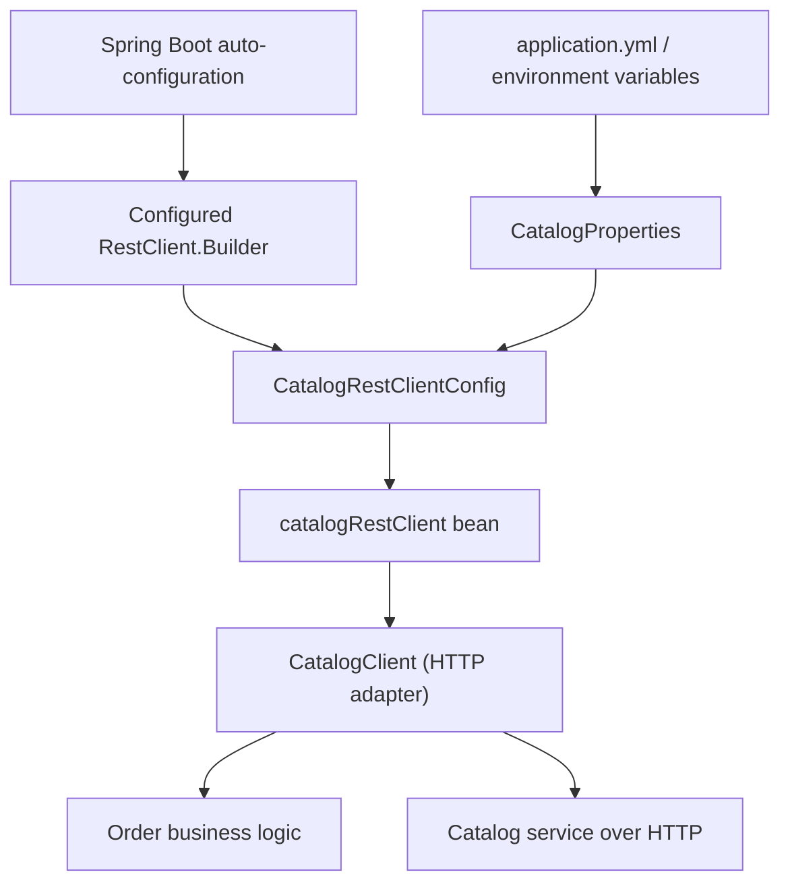

# Creating `RestClient` from Spring Boot's Configured `RestClient.Builder`

## 1. The Integration Problem

In a Spring Boot application, an order service may need to make an HTTP call to a catalog service to retrieve a product's name and availability status before confirming an order. This is **synchronous HTTP integration**: the processing thread sends a request, waits for the response, and only then proceeds. A single slow call or network error can slow down the exact thread serving the user.

Spring Framework provides `RestClient` for writing HTTP clients with a fluent API. Spring Boot adds an **auto-configured `RestClient.Builder`**, allowing the application to inherit the shared defaults that Boot has prepared and then customize them per partner system.

After this lesson, you will be able to:

- Explain the difference between `RestClient.builder()` and **injecting `RestClient.Builder` from the Spring container**.
- Create a dedicated `RestClient` bean for an external system, complete with a `baseUrl` and default headers.
- Organize URL configuration using `@ConfigurationProperties`, decoupling the HTTP client from business logic.
- Understand where to configure timeouts, HTTP error handling, request testing, and call observability.
- Recognize common pitfalls with multiple upstreams, retries, and sensitive data.

> **Version Scope:** `RestClient` was introduced in Spring Framework 6.1, and Spring Boot provides auto-configuration support for `RestClient.Builder` starting in Spring Boot 3.2. Examples in this lesson use Java 17+, Spring Boot 3.x with `RestClient` support, and modern Spring configuration style. For other Boot versions, verify the corresponding API names and HTTP client configuration properties.

## 2. Why Use the Builder Provided by Spring Boot?

There are two common ways to create an HTTP client:

```java
// Created directly via Spring Framework:
RestClient directClient = RestClient.builder()
    .baseUrl("https://catalog.example")
    .build();
```

```java
// Receiving the builder configured by Spring Boot:
@Bean
RestClient catalogRestClient(RestClient.Builder builder) {
    return builder
        .baseUrl("https://catalog.example")
        .build();
}
```

Both produce a usable `RestClient`. However, when receiving the builder from Spring Boot, the application can inherit customizations applied by Boot and `RestClientCustomizer` beans: environment-appropriate HTTP transport selection, configuration of related components, observation/metrics/tracing support when enabled, and application-wide shared customizations. The exact capabilities depend on the Boot version, libraries on the classpath, and enabled configuration.

Key distinctions:

| Component | Responsibility |
| --- | --- |
| `RestClient.Builder` | A **mutable** object used to set the base URL, headers, interceptors, error handlers, request factory, etc., before calling `build()`. |
| `RestClient` | The HTTP client created from the builder; used to execute `GET`, `POST`, `PUT`, `DELETE` requests, etc. |
| Spring Boot auto-configuration | Provides the builder and applies customizations appropriate for the application environment. |
| `RestClientCustomizer` | An extension point for consistently customizing builders managed by Boot. |
| Application `RestClient` bean | A client specific to one upstream; typically configured with its own base URL, authentication, and error behavior. |

In a standard Spring Boot configuration, the `RestClient.Builder` bean has **prototype scope**: each time Spring resolves an injection point, it receives a separate builder instance. This prevents catalog client settings from accidentally leaking into the payment client. However, **if you hold onto and reuse the same builder variable within a single method**, mutations still accumulate; obtain a fresh builder or call `clone()` before creating another client.

### Creation and Usage Flow



## 3. Requirements for Boot to Provide `RestClient.Builder`

In a Spring MVC application, the standard starter is:

```xml
<!-- pom.xml -->
<dependency>
    <groupId>org.springframework.boot</groupId>
    <artifactId>spring-boot-starter-web</artifactId>
</dependency>
```

This starter brings Spring Web onto the classpath. When running with Spring Boot and the appropriate auto-configuration, you can inject `RestClient.Builder` into a constructor or `@Bean` method without declaring the builder bean yourself. If the application does not need an MVC server, you can still use appropriate HTTP client dependencies alongside Spring Web and Boot configuration; building controllers is not required.

Do not confuse `RestClient` with `WebClient`:

- `RestClient` is a **synchronous client**: a standard call blocks the current thread until a result is received or an error occurs.
- `WebClient` is a reactive-style HTTP client, suitable when the application actively uses asynchronous/reactive processing flows.
- `RestTemplate` still exists in many legacy applications. For new synchronous code, `RestClient` provides a fluent API; there is no need to rewrite an entire system just for a single endpoint.

## 4. Complete Example: A Client Calling the Catalog Service

Suppose the upstream exposes:

```http
GET /api/products/P-100 HTTP/1.1
Host: catalog.example
Accept: application/json
```

Success response:

```json
{
  "id": "P-100",
  "name": "Mechanical keyboard",
  "available": true
}
```

Our application places the HTTP adapter in the `example.integration.catalog` package, consisting of configuration, a DTO, and a client. The paths in this example only illustrate the contract; in a real run, they must be replaced with the upstream URL or an HTTP stub.

### Step 1 — Externalize the Upstream URL

```yaml
# src/main/resources/application.yml
integration:
  catalog:
    base-url: http://localhost:8089/api
```

For real runtime environments, override `integration.catalog.base-url` via deployment configuration or the environment variable `INTEGRATION_CATALOG_BASE_URL`. Never embed environment-specific URLs in business logic.

Declare the configuration-mapping class:

```java
// CatalogProperties.java
package example.integration.catalog;

import org.springframework.boot.context.properties.ConfigurationProperties;

@ConfigurationProperties(prefix = "integration.catalog")
public record CatalogProperties(String baseUrl) {
}
```

Using a `record` fits read-only configuration well. In a real project, you should validate that `baseUrl` is non-empty and a well-formed URL at startup (for example, via Bean Validation and `spring-boot-starter-validation`).

### Step 2 — Create the `RestClient` Bean from the Injected Builder

```java
// CatalogRestClientConfig.java
package example.integration.catalog;

import org.springframework.boot.context.properties.EnableConfigurationProperties;
import org.springframework.context.annotation.Bean;
import org.springframework.context.annotation.Configuration;
import org.springframework.http.HttpHeaders;
import org.springframework.http.MediaType;
import org.springframework.web.client.RestClient;

@Configuration(proxyBeanMethods = false)
@EnableConfigurationProperties(CatalogProperties.class)
public class CatalogRestClientConfig {

    @Bean
    RestClient catalogRestClient(
            RestClient.Builder builder,
            CatalogProperties properties) {

        return builder
                .baseUrl(properties.baseUrl())
                .defaultHeader(
                        HttpHeaders.ACCEPT,
                        MediaType.APPLICATION_JSON_VALUE)
                .build();
    }
}
```

Step-by-step explanation:

1. Spring Boot supplies the `RestClient.Builder builder` argument; we do not call `RestClient.builder()` in this configuration.
2. `CatalogProperties` reads the upstream address from environment-specific configuration.
3. `baseUrl(...)` sets the common URL prefix; when calling the API, the adapter only needs the `/products/{id}` path.
4. `defaultHeader(...)` declares a default `Accept: application/json` header. Per-request headers can still be specified on individual calls.
5. `build()` produces the `RestClient` bean reused by other components.

Configuring a dedicated client per upstream keeps changes like host, timeouts, or authentication mechanisms localized right at the integration boundary.

### Step 3 — Model the Response Data

```java
// ProductDto.java
package example.integration.catalog;

public record ProductDto(
        String id,
        String name,
        boolean available) {
}
```

Field names in the DTO must match the JSON contract or be explicitly mapped via Jackson configuration. A DTO represents the **integration contract**; if the internal domain model differs from the upstream, convert the DTO into the internal model at the adapter layer.

### Step 4 — Write the Adapter Executing the Call

```java
// CatalogClient.java
package example.integration.catalog;

import org.springframework.beans.factory.annotation.Qualifier;
import org.springframework.stereotype.Component;
import org.springframework.web.client.RestClient;

@Component
public class CatalogClient {

    private final RestClient restClient;

    public CatalogClient(
            @Qualifier("catalogRestClient") RestClient restClient) {
        this.restClient = restClient;
    }

    public ProductDto findProduct(String productId) {
        ProductDto result = restClient
                .get()
                .uri("/products/{id}", productId)
                .retrieve()
                .body(ProductDto.class);

        if (result == null) {
            throw new IllegalStateException(
                    "Catalog returned an empty body for product " + productId);
        }
        return result;
    }
}
```

If `base-url` is `http://localhost:8089/api`, calling `findProduct("P-100")` targets `GET http://localhost:8089/api/products/P-100`. The `productId` value is passed via a URI template rather than manual string concatenation, ensuring characters in path parameters are encoded properly.

Here, `CatalogClient` is an **adapter**: the business layer simply requests `findProduct(id)` without needing to know how URLs are assembled, headers are sent, JSON is parsed, or HTTP errors are classified.

### Step 5 — Invoke the Adapter in a Use Case

```java
// Excerpt from a business service class
private final CatalogClient catalogClient;

public void verifyProductIsAvailable(String productId) {
    ProductDto product = catalogClient.findProduct(productId);
    if (!product.available()) {
        throw new IllegalStateException("Product is not available");
    }
}
```

The business layer can translate the DTO into a domain object instead of using `ProductDto` directly, depending on complexity and the desired level of decoupling. Every `findProduct` invocation is a synchronous HTTP call; its latency must be accounted for in the calling endpoint's time budget.

## 5. Three Configuration Levels and Preventing Cross-Upstream Interference

In real systems, there are often multiple HTTP clients: catalog, payment, shipping, notifications. Distinguish between:

| Level | Scope | Examples |
| --- | --- | --- |
| Spring Boot-prepared configuration | Starting point for Boot-managed builders | Appropriate request factory, observation when enabled, customizers |
| `RestClientCustomizer` | Shared policy across Boot-managed builders | Application identity header, common interceptors |
| Per-`RestClient` bean customization | One specific upstream | `baseUrl`, dedicated headers, authentication, status handling |

Example of a **shared** customizer:

```java
import org.springframework.boot.web.client.RestClientCustomizer;
import org.springframework.context.annotation.Bean;
import org.springframework.http.HttpHeaders;

@Bean
RestClientCustomizer callerHeaderCustomizer() {
    return builder -> builder.defaultHeader(
            "X-Caller-Service", "order-service");
}
```

This bean can live in an application `@Configuration` class. Spring Boot applies it when configuring Boot-managed builders. Only place **truly shared** policies here; never put catalog-specific tokens or URLs into a global customizer.

**What to avoid:** creating two clients from the exact same builder variable after mutating `baseUrl` and interceptors. A builder holds mutable configuration state:

```java
// Same builder reused sequentially: configuration easily bleeds across clients.
RestClient catalog = builder.baseUrl(catalogUrl).build();
RestClient billing = builder.baseUrl(billingUrl).build();
```

When you need to create multiple clients inside the same method, obtain independent builders via `ObjectProvider<RestClient.Builder>.getObject()` or call `builder.clone()` before each customization branch. Across separate `@Bean` methods, Spring Boot normally provides a distinct prototype builder via dependency injection.

A built `RestClient` bean can be safely reused across many concurrent requests as long as your custom interceptors and components are also thread-safe. Do not recreate a client per business call without a specific reason.

## 6. Timeouts and Resource Management for Synchronous Calls

Synchronous HTTP ties up the processing thread until the request completes. Therefore, you must bound wait times instead of letting an unresponsive upstream hold threads indefinitely.

Two key concepts:

- **Connect timeout:** limits the time allowed to establish a connection to the upstream.
- **Read/response timeout:** limits the time spent waiting for response data according to the semantics of the underlying HTTP client; do not treat it as an absolute end-to-end deadline for the entire use case.

Spring Boot provides property-based HTTP client configuration and APIs that vary by **version**. If a specific upstream needs custom timeouts, you can attach a `ClientHttpRequestFactory` to the builder. The example below demonstrates using the JDK HTTP client on Spring Framework 6.1+:

```java
// Alternative snippet for building the catalogRestClient bean.
// Additional imports:
// java.net.http.HttpClient
// java.time.Duration
// org.springframework.http.client.JdkClientHttpRequestFactory

@Bean
RestClient catalogRestClient(
        RestClient.Builder builder,
        CatalogProperties properties) {

    HttpClient httpClient = HttpClient.newBuilder()
            .connectTimeout(Duration.ofSeconds(2))
            .build();

    JdkClientHttpRequestFactory requestFactory =
            new JdkClientHttpRequestFactory(httpClient);
    requestFactory.setReadTimeout(Duration.ofSeconds(5));

    return builder
            .requestFactory(requestFactory)
            .baseUrl(properties.baseUrl())
            .defaultHeader(HttpHeaders.ACCEPT,
                    MediaType.APPLICATION_JSON_VALUE)
            .build();
}
```

This is an example of configuring **only the catalog client**. When calling `requestFactory(...)`, you explicitly replace the request factory that Boot may have selected based on libraries on the classpath; therefore, consider connection pooling, proxy, TLS, and shared HTTP settings before replacing it. Wherever Boot's built-in timeout properties meet your needs, prefer configuring them using the documented mechanism for your Boot version.

In operations, you must also consider connection limits, API gateway/reverse proxy timeouts, and the calling endpoint's own timeout. If an endpoint has a 3-second processing budget, a 5-second HTTP client timeout does not fit that budget.

## 7. HTTP Errors, Network Errors, and Response Payloads

`retrieve()` provides ways to read the body or `ResponseEntity`:

```java
ProductDto product = restClient.get()
        .uri("/products/{id}", "P-100")
        .retrieve()
        .body(ProductDto.class);
```

```java
ResponseEntity<ProductDto> response = restClient.get()
        .uri("/products/{id}", "P-100")
        .retrieve()
        .toEntity(ProductDto.class);

int status = response.getStatusCode().value();
ProductDto body = response.getBody();
```

The difference: `body(...)` fits when you primarily need the payload; `toEntity(...)` additionally exposes the HTTP status and response headers. For responses without a body (such as 204), `body(...)` may return `null`; the adapter example handles that case according to the expected contract.

By default, with `retrieve()`, **4xx/5xx** responses result in an exception in the `RestClientResponseException` hierarchy (e.g., `HttpClientErrorException.NotFound`). I/O errors such as connection failure or timeout typically surface as `ResourceAccessException`. Never collapse all of these into a "product not found" message.

Example mapping a specific error at the adapter boundary:

```java
public ProductDto findRequiredProduct(String productId) {
    try {
        ProductDto product = restClient.get()
                .uri("/products/{id}", productId)
                .retrieve()
                .body(ProductDto.class);

        if (product == null) {
            throw new IllegalStateException(
                    "Catalog returned an empty body");
        }
        return product;
    } catch (org.springframework.web.client.HttpClientErrorException.NotFound ex) {
        throw new IllegalArgumentException(
                "Product does not exist: " + productId, ex);
    }
}
```

This is just an example of translating error semantics. In a real system, define a dedicated domain exception such as `ProductNotFoundException`. You can use `retrieve().onStatus(...)` or `defaultStatusHandler(...)` to centralize status handling; choose between them based on whether the handler applies to a single request or the entire client.

| Situation | Handling to Consider |
| --- | --- |
| 200, valid JSON | Deserialize JSON to DTO; validate contract-required fields. |
| 204 or unexpected empty body | Handle explicitly; avoid treating `null` as valid data. |
| 400 | Check request, schema, and input data; do not retry blindly. |
| 401/403 | Check credentials, scopes, and permissions; never log secrets. |
| 404 | Depends on contract: missing entity, unsynced data, or wrong path. |
| 429/503 | Consider bounded retries with backoff/jitter, honoring `Retry-After` where appropriate. |
| Timeout, connection loss | Distinguish network failures from business errors; measure error rate and latency. |
| Malformed JSON schema | Treat as an inter-system contract violation; catch in integration tests. |

`RestClient` **does not automatically make every call safe to retry**. In particular, a transaction-creating `POST` or side-effecting `PUT` requires analyzing idempotency and duplicate handling. If a request succeeds on the server but the response is lost, retrying may trigger the side effect a second time. Design an idempotency key or receiver-side deduplication mechanism when the business logic requires it.

A local database transaction also does not automatically roll back an operation already executed on an external HTTP service. Across multi-system chains, define transaction boundaries, intermediate states, and compensation behavior as needed.

## 8. Per-Request Authentication and Headers

Headers should not always be fixed on the `RestClient` bean. For instance, a user token must be attached per **individual request** context, whereas an application API key can come from environment secret configuration.

```java
ProductDto product = restClient.get()
        .uri("/products/{id}", productId)
        .headers(headers -> headers.setBearerAuth(accessToken))
        .retrieve()
        .body(ProductDto.class);
```

The snippet above illustrates attaching a Bearer token per call. `accessToken` must come from a token provider aligned with your security architecture—never hardcoded and never logged in full. For client-wide authentication, consider configuring `defaultRequest(...)` or an interceptor, while ensuring tokens are refreshed on time and never leak across users.

Standardize correlation/request ID headers to trace flows across multiple services. When Spring Boot observation/tracing is configured, using the Boot-managed builder preserves that integration as long as the required components are present and enabled.

## 9. Testing the HTTP Client Without Real Network Calls

Adapter tests should verify **URL, method, headers, and body mapping** without depending on an external environment. In Spring Boot 3.x with `RestClient` support, the `@RestClientTest` slice and `MockRestServiceServer` simulate the upstream.

Add the test dependency:

```xml
<dependency>
    <groupId>org.springframework.boot</groupId>
    <artifactId>spring-boot-starter-test</artifactId>
    <scope>test</scope>
</dependency>
```

Example using the exact `CatalogClient`, `CatalogRestClientConfig`, and `CatalogProperties` classes declared earlier:

```java
// CatalogClientTest.java
package example.integration.catalog;

import org.junit.jupiter.api.Test;
import org.springframework.beans.factory.annotation.Autowired;
import org.springframework.boot.test.autoconfigure.web.client.RestClientTest;
import org.springframework.context.annotation.Import;
import org.springframework.http.HttpMethod;
import org.springframework.http.MediaType;
import org.springframework.test.context.TestPropertySource;
import org.springframework.test.web.client.MockRestServiceServer;

import static org.assertj.core.api.Assertions.assertThat;
import static org.springframework.test.web.client.match.MockRestRequestMatchers.method;
import static org.springframework.test.web.client.match.MockRestRequestMatchers.requestTo;
import static org.springframework.test.web.client.response.MockRestResponseCreators.withSuccess;

@RestClientTest(CatalogClient.class)
@Import(CatalogRestClientConfig.class)
@TestPropertySource(properties =
        "integration.catalog.base-url=https://catalog.test/api")
class CatalogClientTest {

    @Autowired
    private CatalogClient catalogClient;

    @Autowired
    private MockRestServiceServer server;

    @Test
    void readsProductFromCatalog() {
        server.expect(requestTo(
                        "https://catalog.test/api/products/P-100"))
                .andExpect(method(HttpMethod.GET))
                .andRespond(withSuccess(
                        "{\"id\":\"P-100\",\"name\":\"Mechanical keyboard\",\"available\":true}",
                        MediaType.APPLICATION_JSON));

        ProductDto product = catalogClient.findProduct("P-100");

        assertThat(product)
                .isEqualTo(new ProductDto(
                        "P-100", "Mechanical keyboard", true));
        server.verify();
    }
}
```

This test confirms that the adapter targets the right URL and deserializes JSON into the DTO without starting a real catalog service. Add cases for 404, 500, empty bodies, invalid JSON, and authentication behavior. When testing connection timeouts/TLS, DNS, proxies, or real sockets, use integration tests against a local HTTP stub server; in-memory mocks do not reproduce those network characteristics.

**Test slice note:** `@RestClientTest` loads only a slice of the application. If your client configuration depends on additional beans outside the slice, import them or provide test doubles; do not assume every production bean is available in the test.

## 10. Observability in Operations

Because synchronous calls consume the incoming request's time budget, observe at a minimum:

| Signal | Meaning |
| --- | --- |
| Call count and success/error rate per upstream | Distinguishes a catalog-specific incident from a system-wide outage. |
| Latency (p50, p95, p99) | Detects sudden slowdowns even before error rates rise. |
| Error type (4xx, 5xx, timeout, decode failure) | Guides the right response and avoids retries that worsen an incident. |
| Trace ID / correlation ID | Follows a single request through the API, HTTP adapter, and upstream. |
| Concurrent requests / resource saturation | Measures the impact of synchronous HTTP on threads and connection pools. |

With Spring Boot Actuator, Micrometer, and proper observation configuration, HTTP clients can be instrumented via application observations/metrics. Name or tag metrics by **upstream name, URI template, and outcome**—never by arbitrary product IDs or token values, which risk exploding cardinality and leaking sensitive data.

A useful error log includes the upstream name, operation, status code or exception type, duration, and trace ID. Never log full bodies or headers containing `Authorization`, cookies, or personal data without redaction rules.

## 11. Common Configuration Mistakes

| Symptom | Common Cause | How to Check |
| --- | --- | --- |
| Cannot inject `RestClient.Builder` | Missing Spring Web, Boot version too old, auto-configuration disabled, or conflicting custom config | Check Spring Boot/Framework versions, dependencies, and application configuration. |
| Calling wrong host or path | `base-url` points to the wrong environment, path segments joined incorrectly | Verify the final URL via `MockRestServiceServer`; use clear URI templates. |
| Header has no effect | Per-request header overrides default, or customizer was not applied | Check whether the builder was injected by Spring Boot or created directly; inspect interceptors and headers on mock requests. |
| Client A carries Client B's settings | Reusing the same mutable builder | Use separate builders, `ObjectProvider`, or `clone()`. |
| Endpoint is occasionally very slow | Misconfigured timeouts, exhausted connection pool, slow upstream | Measure p95/p99, check timeouts at every layer, resource limits, and concurrency. |
| Test hits the real network | Test failed to bind mock to the right builder/client or slice config is wrong | Verify `@RestClientTest`, `@Import`, URL overrides, and server expectations. |
| 404 treated as a network error | Collapsing HTTP errors and I/O errors into one category | Separate `RestClientResponseException` responses from `ResourceAccessException`. |

## 12. Production Readiness Checklist

1. **Contract:** Pin down exact endpoints, HTTP methods, JSON schemas, required fields, error codes, and API versioning strategy.
2. **Configuration:** Externalize URLs and secrets; configure each upstream independently; validate configuration values at startup.
3. **Builder:** Inject `RestClient.Builder` from Boot; customize only as needed and keep builders isolated across clients.
4. **Resource protection:** Set timeouts, consider connection limits and the synchronous thread's time budget.
5. **Errors:** Distinguish business errors, HTTP errors, and network errors; avoid unbounded retries; design idempotency for side-effecting operations.
6. **Security and observability:** Protect tokens, standardize traces/logs/metrics, and never log sensitive data.
7. **Testing:** Use HTTP mocks to verify URLs/headers/bodies/statuses; add real integration tests for network-level behavior.

### Self-Check

**Question 1.** Why should an application inject the `RestClient.Builder` provided by Spring Boot instead of always calling `RestClient.builder()`?  
*Hint:* think about customizers, request factory selection, and observation provided by the application environment.

**Question 2.** If you need to call both a catalog service and a payment service, should you reuse a single builder variable and sequentially change its `baseUrl`?  
*Hint:* a builder holds mutable state; Boot's builder bean is typically prototype-scoped.

**Question 3.** An order placement request succeeds on the upstream, but the caller times out before receiving the response. Should you immediately retry the POST?  
*Hint:* the receiver's state may already have changed; determine idempotency and duplicate handling first.

## Conclusion

Spring Boot's configured `RestClient.Builder` is the right starting point for building synchronous HTTP clients in a Spring Boot application. Create a `RestClient` bean per upstream, supply configuration via `@ConfigurationProperties`, encapsulate HTTP operations in an adapter, enforce timeouts and error status handling, and test the request/response contract. This structure makes HTTP integration clearer, easier to operate, and less coupled to external communication details inside business logic.
