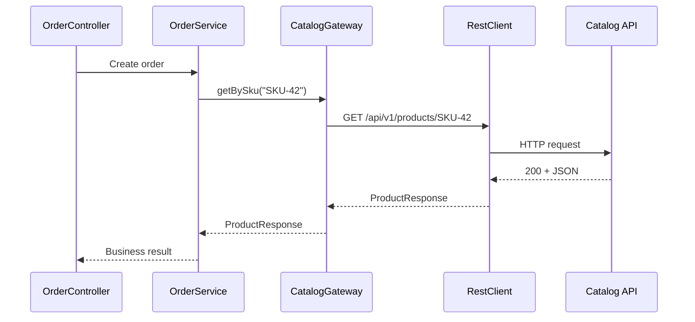
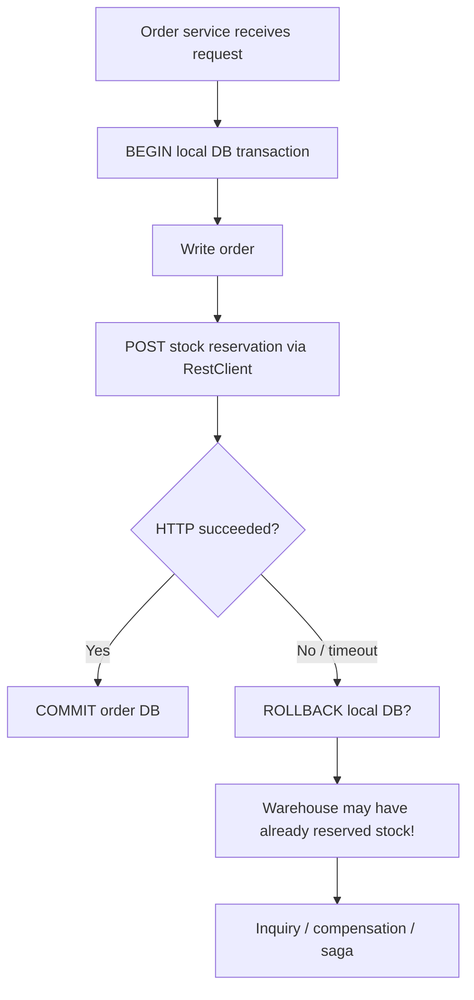

# Calling GET, POST, PUT, PATCH, and DELETE with `RestClient`

## 1. Context and Objectives

In a Spring Boot application, not all data lives in the same database. `order-service` may need to query prices from `catalog-service`, create inventory reservations in `warehouse-service`, or cancel a resource created in a partner API. For steps that require **sending an HTTP request and receiving the result immediately within the calling thread**, Spring Framework provides `RestClient`: a synchronous HTTP client API with a fluent interface for configuring the method, URL, headers, request body, and response handling.

Within the scope of **SPRING_BOOT_INTEGRATION**, this lesson connects the HTTP client with system integration concerns: environment-specific configuration, data contracts, network and HTTP error handling, transactions, safe retries, testing, and observability. HTTP methods GET, POST, PUT, PATCH, and DELETE only express the action; a correct integration flow must also honor the receiver's API contract and manage business side effects.

After this lesson, you will be able to:

1. Create a `RestClient` in Spring Boot and configure its base URL, timeouts, and media types.
2. Write GET, POST, PUT, PATCH, and DELETE calls following proper HTTP semantics.
3. Pass path variables, query parameters, headers, authentication, and JSON bodies.
4. Read the body or `ResponseEntity<T>`, and classify 4xx/5xx and connection errors.
5. Understand when retries are safe and how to coordinate with idempotency keys, ETags, and database transactions.
6. Test the actual generated requests using `MockRestServiceServer` without calling external APIs.

> **Version:** Examples use **Java 17+, Spring Boot 3.2+, and Spring Framework 6.1+**, where `RestClient` was introduced in Spring Framework 6.1. Spring Boot 4.x and Spring Framework 7.x continue to support `RestClient` but may change certain auto-configuration/HTTP request factory details; verify against your project's version.

## 2. What Is `RestClient` and Where Does It Fit in the Architecture?

`RestClient` is Spring's **synchronous** HTTP client. Calling a terminal operation such as `retrieve().body(...)` typically blocks the executing thread until the response is read or an error/timeout occurs. It uses HTTP message converters to convert Java objects to JSON (and vice versa) as configured.



| Component | Responsibility |
| --- | --- |
| `OrderService` | Executes business rules and decides when external data is needed. |
| `CatalogGateway` | Hides external API details: paths, bodies, headers, statuses, and errors. |
| `RestClient` | Builds the HTTP request, executes the connection via the request factory, and converts the response. |
| `RestClient.Builder` | Shared configuration: `baseUrl`, default headers, interceptors, message converters, request factory. |
| `ClientHttpRequestFactory` | Provides the underlying HTTP transport, connection management, and specific timeouts. |
| DTO | Describes the data contract on the wire; should not be a JPA entity directly. |

### 2.1. Comparing Options in Spring

| HTTP Client Option | Characteristics | When to Use |
| --- | --- | --- |
| `RestClient` | Synchronous fluent API, Spring Framework 6.1+. | Spring MVC applications, jobs, or imperative services needing a clean HTTP client. |
| `RestTemplate` | Legacy synchronous API, still common in existing systems. | Existing projects using it; can migrate incrementally to `RestClient` when appropriate. |
| `WebClient` | Reactive API combining `Mono`/`Flux` and non-blocking I/O when used end-to-end. | Reactive/WebFlux pipelines or asynchronous I/O needs. |
| HTTP Interface | Declares HTTP methods via `@HttpExchange` and dedicated annotations, generating a proxy backed by RestClient/WebClient. | When you want to separate the API calling contract into an interface. |

`RestClient` does not automatically make calls asynchronous, add retries/circuit breakers, or enroll in distributed transactions with other services. Those policies must be designed at the integration layer.

## 3. Preparing Dependencies and Application Configuration

With Spring Boot 3.2+, an application can use `spring-boot-starter-web`, which includes Spring Web and `RestClient`. If you do not need to run an HTTP server, you can use `spring-web` directly with the required configuration modules, though this example uses the Web starter to run easily as a Spring Boot application.

```xml
<!-- pom.xml, Spring Boot 3.2+ with parent or BOM managing versions -->
<dependency>
    <groupId>org.springframework.boot</groupId>
    <artifactId>spring-boot-starter-web</artifactId>
</dependency>

<dependency>
    <groupId>org.springframework.boot</groupId>
    <artifactId>spring-boot-starter-test</artifactId>
    <scope>test</scope>
</dependency>
```

When Jackson JSON is present (configured by the Web starter in typical projects), Spring can serialize Java objects to JSON and deserialize responses into DTOs. If the server returns XML, binary, or a custom format, you need the corresponding converter and `Content-Type`.

### 3.1. Externalizing URLs and Timeouts

```yaml
# application.yml
clients:
  catalog:
    base-url: ${CATALOG_BASE_URL:https://catalog.example.internal}
    connect-timeout: 2s
    read-timeout: 5s
```

`CATALOG_BASE_URL` can be supplied by the deployment environment; never hardcode production addresses into business calls. The two timeout types have distinct meanings:

- **Connect timeout:** limits the time allowed to establish a connection (exact behavior depends on the HTTP transport).
- **Read timeout:** limits waiting/reading the response according to the active request factory; it does not automatically equal the total deadline of a multi-step business flow.

Setting timeouts too high can exhaust synchronous request-handling threads, while setting them too low triggers excessive retries and increases load on the upstream. Choose values based on SLOs, p95/p99 latency, the overall request time budget, and API characteristics.

Bind the configuration:

```java
// CatalogClientProperties.java
import java.net.URI;
import java.time.Duration;
import org.springframework.boot.context.properties.ConfigurationProperties;

@ConfigurationProperties(prefix = "clients.catalog")
public record CatalogClientProperties(
    URI baseUrl,
    Duration connectTimeout,
    Duration readTimeout
) {}
```

### 3.2. Creating the Client and Gateway as Spring Beans

```java
// CatalogClientConfiguration.java
import java.net.http.HttpClient;

import org.springframework.boot.context.properties.EnableConfigurationProperties;
import org.springframework.context.annotation.Bean;
import org.springframework.context.annotation.Configuration;
import org.springframework.http.HttpHeaders;
import org.springframework.http.MediaType;
import org.springframework.http.client.JdkClientHttpRequestFactory;
import org.springframework.web.client.RestClient;

@Configuration(proxyBeanMethods = false)
@EnableConfigurationProperties(CatalogClientProperties.class)
public class CatalogClientConfiguration {

    @Bean
    CatalogGateway catalogGateway(
        RestClient.Builder restClientBuilder,
        CatalogClientProperties properties
    ) {
        HttpClient nativeClient = HttpClient.newBuilder()
            .connectTimeout(properties.connectTimeout())
            .build();

        JdkClientHttpRequestFactory requestFactory =
            new JdkClientHttpRequestFactory(nativeClient);
        requestFactory.setReadTimeout(properties.readTimeout());

        RestClient client = restClientBuilder
            .baseUrl(properties.baseUrl().toString())
            .requestFactory(requestFactory)
            .defaultHeader(
                HttpHeaders.ACCEPT,
                MediaType.APPLICATION_JSON_VALUE
            )
            .build();

        return new CatalogGateway(client);
    }
}
```

Here:

- Spring Boot provides `RestClient.Builder`, enabling it to inherit customizers and converters registered in the application context.
- `baseUrl` holds the API **origin**; examples use full paths starting with `/api/v1`, avoiding two different prefixes being concatenated in configuration.
- `JdkClientHttpRequestFactory` illustrates configuration using the Java HTTP Client. Projects may use Apache HttpComponents or Boot's default transport; verify actual timeout and pooling behavior.
- The `CatalogGateway` bean will be injected into services. Because it is already created via `@Bean`, there is no need to add `@Service` to the gateway class itself.

With multiple upstreams, create separate clients/gateways to isolate base URLs, authentication, timeouts, error policies, and metrics. Avoid turning a shared `RestClient` into an object that sends requests to arbitrary URIs taken from user input.

## 4. Example API Contract: Catalog Service

Assume an internal product-management API with endpoints **defined specifically for this example**. When calling a real API, consult the receiver's documentation/OpenAPI specification: URLs, media types, schemas, HTTP statuses, and behavior may differ.

| HTTP method | URL | Sample Contract Meaning | Success Response |
| --- | --- | --- | --- |
| GET | `/api/v1/products/{sku}` | Fetch a product by SKU. | `200` + product JSON; `404` if not found. |
| GET | `/api/v1/products?category=...&page=...` | Search product list. | `200` + JSON array. |
| POST | `/api/v1/products` | Create a new product. | `201 Created` + JSON/`Location`. |
| PUT | `/api/v1/products/{sku}` | Replace all editable fields of a product. | `200` + updated JSON. |
| PATCH | `/api/v1/products/{sku}` | Update only the `active` field. | `200` + updated JSON. |
| DELETE | `/api/v1/products/{sku}` | Delete a product. | `204 No Content`. |

Example JSON for a single product:

```json
{
  "sku": "SKU-42",
  "name": "Insulated bottle",
  "price": 125000.00,
  "active": true
}
```

### 4.1. Client-Side DTOs

Do not use `order-service`'s database entities to represent `catalog-service`'s JSON contract. Define separate records; **place each public record in its own matching Java file**.

```java
// ProductResponse.java
import java.math.BigDecimal;

public record ProductResponse(
    String sku,
    String name,
    BigDecimal price,
    boolean active
) {}

// CreateProductRequest.java
import java.math.BigDecimal;

public record CreateProductRequest(
    String sku,
    String name,
    BigDecimal price,
    boolean active
) {}

// ReplaceProductRequest.java
import java.math.BigDecimal;

public record ReplaceProductRequest(
    String name,
    BigDecimal price,
    boolean active
) {}
```

The DTOs above are example types for learning API calls. Input validation (non-blank SKU, non-negative price, name length, currency, etc.) belongs at the business/DTO boundary according to the contract. Java records and HTTP message converters do not automatically guarantee that upstream data is valid for business rules. If the receiver's JSON schema renames a field, use `@JsonProperty` or an appropriate adapter mapping.

## 5. Writing All Five HTTP Methods with `RestClient`

`RestClient` follows a consistent fluent structure:

```text
restClient
  .<get|post|put|patch|delete>()
  .uri(...)
  [.header(...) | .headers(...) | .accept(...) | .contentType(...)]
  [.body(...)]                 // Only for methods that support a body.
  .retrieve()
  .<body(Class) | toEntity(Class) | toBodilessEntity()>
```

The `.retrieve().body(...)`, `toEntity(...)`, and `toBodilessEntity()` calls are **terminal operations**: they trigger the actual HTTP exchange and response processing. The return type varies depending on whether you need only the body or also status/headers.

### 5.1. Complete Gateway Implementation

```java
// CatalogGateway.java
import java.util.List;
import java.util.Map;

import org.springframework.core.ParameterizedTypeReference;
import org.springframework.http.MediaType;
import org.springframework.http.ResponseEntity;
import org.springframework.web.client.RestClient;

public class CatalogGateway {
    private final RestClient client;

    public CatalogGateway(RestClient client) {
        this.client = client;
    }

    // GET: fetch a single product using a path variable.
    public ProductResponse getBySku(String sku) {
        return client.get()
            .uri("/api/v1/products/{sku}", sku)
            .retrieve()
            .body(ProductResponse.class);
    }

    // GET: safely build a query string using UriBuilder.
    public List<ProductResponse> search(String category, int page) {
        return client.get()
            .uri(uriBuilder -> uriBuilder
                .path("/api/v1/products")
                .queryParam("category", category)
                .queryParam("page", page)
                .build())
            .retrieve()
            .body(new ParameterizedTypeReference<List<ProductResponse>>() {});
    }

    // POST: create a product, retrieving status + headers + body.
    public ResponseEntity<ProductResponse> create(
        CreateProductRequest request,
        String idempotencyKey
    ) {
        return client.post()
            .uri("/api/v1/products")
            .contentType(MediaType.APPLICATION_JSON)
            .header("Idempotency-Key", idempotencyKey)
            .body(request)
            .retrieve()
            .toEntity(ProductResponse.class);
    }

    // PUT: replace the entire editable representation.
    public ProductResponse replace(
        String sku,
        ReplaceProductRequest request
    ) {
        return client.put()
            .uri("/api/v1/products/{sku}", sku)
            .contentType(MediaType.APPLICATION_JSON)
            .body(request)
            .retrieve()
            .body(ProductResponse.class);
    }

    // PATCH: example updating a single field per this API contract.
    public ProductResponse setActive(String sku, boolean active) {
        return client.patch()
            .uri("/api/v1/products/{sku}", sku)
            .contentType(MediaType.APPLICATION_JSON)
            .body(Map.of("active", active))
            .retrieve()
            .body(ProductResponse.class);
    }

    // DELETE: API returns 204, no JSON body needs to be parsed.
    public ResponseEntity<Void> delete(String sku) {
        return client.delete()
            .uri("/api/v1/products/{sku}", sku)
            .retrieve()
            .toBodilessEntity();
    }
}
```

The `search` method assumes the response is a **JSON array**; if the real API returns a paginated envelope like `{"items":[...],"total":...}`, you must define `PageResponse<ProductResponse>` or the corresponding DTO. Never force an envelope into `List<ProductResponse>`.

**Note on response bodies:** `body(ProductResponse.class)` can return `null` on a bodyless response, even though the Java return type is `ProductResponse`. If the contract requires a body, the gateway should check and raise a contract error rather than passing `null` deep into the domain. Do not assume a `2xx` status guarantees the response matches the schema.

## 6. GET: Fetching a Resource and Passing Query Parameters

GET is for **reading** resources; never use it for actions intended to create orders, charge payments, or delete products. Two parameter styles:

```java
// Path variable: /api/v1/products/SKU-42
ProductResponse product = client.get()
    .uri("/api/v1/products/{sku}", "SKU-42")
    .retrieve()
    .body(ProductResponse.class);

// Query string: /api/v1/products?category=bottle&page=0
List<ProductResponse> products = client.get()
    .uri(builder -> builder
        .path("/api/v1/products")
        .queryParam("category", "bottle")
        .queryParam("page", 0)
        .build())
    .retrieve()
    .body(new ParameterizedTypeReference<List<ProductResponse>>() {});
```

The `client` variables in this snippet represent a configured `RestClient`; in the main design they live inside `CatalogGateway`. Use `uri(template, variable)` or `UriBuilder` so the framework handles path/query encoding. Avoid manual string concatenation such as `"/products?category=" + userInput`: spaces, `&`, Unicode, or special characters can produce malformed URLs or alter query semantics.

### 6.1. Controlling Not-Found Handling and Memory

REST APIs typically return `404 Not Found` when a product does not exist. With `retrieve()`, 4xx responses are treated as errors by default rather than automatically becoming `null`. If "not found" is a valid business outcome, the gateway can intentionally map it to `Optional.empty()`:

```java
import java.util.Optional;
import org.springframework.web.client.HttpClientErrorException;

public Optional<ProductResponse> findBySku(String sku) {
    try {
        return Optional.ofNullable(getBySku(sku));
    } catch (HttpClientErrorException.NotFound notFound) {
        return Optional.empty();
    }
}
```

This is an **additional method placed inside `CatalogGateway`**, calling `getBySku(...)` above. Do not catch generic `RestClientException` and return empty: doing so hides authentication failures, upstream 503 errors, or timeouts behind "product does not exist".

For list endpoints, if the server returns massive datasets, paginate or filter at the API instead of loading everything into a single `List`. Synchronous `RestClient` does not provide end-to-end reactive streaming/backpressure like `WebClient`.

## 7. POST: Creating a Resource and Sending a JSON Body

`POST` is typically used to **create a resource** or execute a command that cannot be expressed purely as a replacement.

```java
CreateProductRequest request = new CreateProductRequest(
    "SKU-42",
    "Insulated bottle",
    new BigDecimal("125000.00"),
    true
);

ResponseEntity<ProductResponse> response =
    gateway.create(request, "create-product-SKU-42-attempt-1");

int status = response.getStatusCode().value();
String location = response.getHeaders().getFirst("Location");
ProductResponse created = response.getBody();
```

`gateway` is the `CatalogGateway` bean, and `BigDecimal` requires importing `java.math.BigDecimal`. The corresponding HTTP request, with a JSON converter configured:

```http
POST /api/v1/products HTTP/1.1
Host: catalog.example.internal
Accept: application/json
Content-Type: application/json
Idempotency-Key: create-product-SKU-42-attempt-1

{"sku":"SKU-42","name":"Insulated bottle","price":125000.00,"active":true}
```

The sample server might respond with:

```http
HTTP/1.1 201 Created
Location: /api/v1/products/SKU-42
Content-Type: application/json

{"sku":"SKU-42","name":"Insulated bottle","price":125000.00,"active":true}
```

### 7.1. Distinguishing `Accept` and `Content-Type`

| Header | Meaning | Setting in `RestClient` |
| --- | --- | --- |
| `Accept: application/json` | The client wants to **receive** the response in JSON format. | `.accept(MediaType.APPLICATION_JSON)` or `defaultHeader`. |
| `Content-Type: application/json` | The request **sends** a JSON-encoded body. | `.contentType(MediaType.APPLICATION_JSON)`. |
| `Authorization: Bearer ...` | Access token when required by the upstream. | `.headers(h -> h.setBearerAuth(token))` or an interceptor. |
| `Idempotency-Key: ...` | Identifies a single-execution creation command that can be safely retried. | `.header("Idempotency-Key", key)`. |
| `X-Correlation-Id: ...` | Correlates logs/traces across services when agreed upon. | `.header("X-Correlation-Id", id)`. |

The `Idempotency-Key` header **only takes effect** when the server supports idempotency: storing processing state per key, binding the key to the payload, and returning the previous result. Simply sending the header from the client does not prevent the server from creating duplicates.

When the client receives no response, that does not mean the POST failed: the server may already have created the product. Retry using the **same idempotency key** for the same command, or query state by a stable business key. Never generate a fresh key on each retry attempt.

## 8. PUT: Replacing the Entire Updatable Representation

`PUT` means setting the resource at the target URI to the desired state. For the example API, the body contains **all editable fields**: name, price, and active status; the SKU is in the path and is not modified by this PUT.

```java
ReplaceProductRequest replacement = new ReplaceProductRequest(
    "Insulated bottle 750 ml",
    new BigDecimal("139000.00"),
    true
);

ProductResponse updated = gateway.replace("SKU-42", replacement);
```

Outgoing request:

```http
PUT /api/v1/products/SKU-42 HTTP/1.1
Host: catalog.example.internal
Accept: application/json
Content-Type: application/json

{"name":"Insulated bottle 750 ml","price":139000.00,"active":true}
```

Under HTTP semantics, PUT is **idempotent with respect to its intended effect**: sending the same representation again should not keep mutating the resource on every execution. However, the server must implement that contract faithfully. If the server also sends an email or charges a fee on every PUT, those external side effects still need their own deduplication mechanism.

### 8.1. PUT Is Not Equivalent to PATCH

- PUT: replaces the representation per contract; omitting fields can cause the server to reset defaults, clear fields, or reject the request.
- PATCH: describes a partial modification; the server must understand the patch document and how to apply it.
- Do not use PUT just to change `active` while omitting `name` and `price` unless the API officially specifies those semantics.
- Some APIs support **upsert** with PUT (create if absent), while others allow updates only; read the contract rather than guessing from the HTTP method.

## 9. PATCH: Partial Update

In the example, `PATCH /api/v1/products/{sku}` accepts a JSON object updating only the fields present:

```java
ProductResponse updated = gateway.setActive("SKU-42", false);
```

```http
PATCH /api/v1/products/SKU-42 HTTP/1.1
Host: catalog.example.internal
Accept: application/json
Content-Type: application/json

{"active":false}
```

With **this sample contract**, resending `{"active":false}` is idempotent with respect to `active` because it sets the same value. However, PATCH is **not inherently idempotent**: a patch like "increase price by 10,000" will keep adding on every repeat.

### 9.1. Do Not Confuse Plain JSON, JSON Merge Patch, and JSON Patch

| Patch Style | Common Media Type | Meaning |
| --- | --- | --- |
| API-specific partial JSON | `application/json` | The server defines how present/absent fields are handled. |
| JSON Merge Patch (RFC 7396) | `application/merge-patch+json` | A `null` value indicates removing a member per Merge Patch rules; omitted fields remain unchanged. |
| JSON Patch (RFC 6902) | `application/json-patch+json` | The body is a list of operations such as `add`, `replace`, `remove`, `test`. |

Do not set `application/merge-patch+json` or `application/json-patch+json` merely because you are using HTTP PATCH. In the example, the server **specifically** accepts `application/json` with an `active` field, so `Map.of("active", active)` is appropriate. If a server uses Merge Patch, set the right media type and distinguish **absent fields** from **null fields**; using a DTO whose null fields are serialized by default can accidentally delete data.

When a PATCH updates multiple interdependent fields, you can use ETag/conditional requests to prevent overwriting someone else's changes.

## 10. DELETE: Deleting a Resource and Reading a Bodyless Response

`DELETE` removes a resource or makes it no longer visible at the URI per contract. With the sample API, the server returns `204 No Content`:

```java
ResponseEntity<Void> result = gateway.delete("SKU-42");

if (result.getStatusCode().value() == 204) {
    // Catalog confirmed deletion.
}
```

When a method does not need to read a body, `toBodilessEntity()` retrieves status/headers without requiring deserialization of `ProductResponse`. Other APIs may return `200 OK`, `202 Accepted` (asynchronous deletion), or `404 Not Found` on a second delete call; **HTTP idempotency describes the state of the resource after the action**, not that every invocation must return the exact same status code.

For instance, if deleting `SKU-42` returns 204 the first time and 404 the second time, the resource remains in the "does not exist" state after each call. The client may accept 404 as an equivalent outcome **only when** the business contract permits it (e.g., resource cleanup), rather than blindly swallowing every 404.

Do not confuse DELETE with erasing audit events, deleting legally retained records, or voiding a financial transaction: a business workflow may require soft deletes, compensating events, and dedicated permission checks.

## 11. Reading Responses: `body`, `toEntity`, `toBodilessEntity`, and `exchange`

### 11.1. Three Common Approaches with `retrieve()`

| Terminal Operation | Result | When to Use |
| --- | --- | --- |
| `retrieve().body(ProductResponse.class)` | DTO, or `null` if there is no body. | Only the data payload is needed. |
| `retrieve().body(new ParameterizedTypeReference<List<ProductResponse>>() {})` | Generic type preserving element types during deserialization. | Response body is a JSON list or generic type. |
| `retrieve().toEntity(ProductResponse.class)` | `ResponseEntity<ProductResponse>` containing status, headers, and body. | Need `Location`, `ETag`, or distinguishing 201 vs 200. |
| `retrieve().toBodilessEntity()` | `ResponseEntity<Void>` containing status/headers. | DELETE 204 or any operation returning no payload. |

### 11.2. When Low-Level Status/Body Control Is Needed

`exchange(...)` grants direct access to `ClientHttpRequest` and `ClientHttpResponse` so you can handle statuses yourself:

```java
// Illustrative method placed inside CatalogGateway:
public boolean exists(String sku) {
    return client.get()
        .uri("/api/v1/products/{sku}", sku)
        .exchange((request, response) -> {
            int code = response.getStatusCode().value();
            if (code == 200) {
                return true;
            }
            if (code == 404) {
                return false;
            }
            throw new IllegalStateException(
                "Catalog returned unexpected status: " + code
            );
        });
}
```

With `exchange(...)`, `retrieve()`'s default status handlers and `onStatus(...)` handlers **do not run automatically**; the callback is responsible for classifying statuses and reading the response body if needed. Do not keep `response.getBody()`/`InputStream` to use after the callback returns; HTTP resources are tied to the exchange lifecycle. When standard JSON deserialization is all you need, `retrieve()` is more concise and maintainable.

## 12. URIs, Headers, Authentication, and Request Payloads

### 12.1. Path Variables and Queries

```java
String sku = "SKU/42"; // Example containing a character requiring encoding.

ProductResponse item = client.get()
    .uri("/api/v1/products/{sku}", sku)
    .retrieve()
    .body(ProductResponse.class);

List<ProductResponse> matches = client.get()
    .uri(b -> b.path("/api/v1/products")
        .queryParam("category", "insulated bottle")
        .queryParam("page", 0)
        .build())
    .retrieve()
    .body(new ParameterizedTypeReference<List<ProductResponse>>() {});
```

When an ID contains `/`, verify the URL encoding rules of the library and the actual reverse proxy/server. Even if the client encodes it properly, a server might reject encoded slashes or decode them differently than expected. Prefer IDs without path separators when you control the contract. Never construct URLs with arbitrary user-supplied strings as the host; that can introduce SSRF vulnerabilities.

### 12.2. Dynamic Headers and Bearer Tokens

```java
// token comes from an auth mechanism/server-side credential provider,
// correlationId comes from the tracing context or a standardized source.
ProductResponse item = client.get()
    .uri("/api/v1/products/{sku}", "SKU-42")
    .headers(headers -> {
        headers.setBearerAuth(token);
        headers.add("X-Correlation-Id", correlationId);
    })
    .retrieve()
    .body(ProductResponse.class);
```

Never put real Bearer tokens into examples, annotations, source code, query strings, or logs. When multiple requests share an OAuth2 token, attach an interceptor or integrate with an OAuth2 client to obtain/refresh tokens per policy. Do not create a new `RestClient` for every HTTP request just to attach headers; reuse the client configuration and connection pool.

### 12.3. Content Negotiation and Validation

- `.accept(MediaType.APPLICATION_JSON)` specifies the acceptable response representation.
- `.contentType(MediaType.APPLICATION_JSON).body(request)` enables the converter to serialize the DTO to JSON. XML, form-url-encoded, multipart, or file uploads require the corresponding converter/body type.
- A request DTO may be valid in Java yet violate the upstream contract; validate before sending and back it with contract tests.
- Never send raw JPA entities to an upstream: this risks exposing sensitive fields, triggering lazy collections, and coupling schemas.

## 13. Handling 4xx, 5xx, Network Errors, and Contract Violations

By default, `retrieve()` treats 4xx/5xx responses as HTTP errors and throws an exception rather than deserializing them as success DTOs. Common error scenarios:

| Scenario | Meaning | Integration Policy |
| --- | --- | --- |
| 400 Bad Request | Invalid payload, format, or validation. | Fix the contract/mapping; do not retry the exact payload endlessly. |
| 401/403 | Missing/expired token or insufficient permissions. | Handle authentication/authorization and alert. |
| 404 | Missing resource or wrong endpoint. | Map to not found **only when the contract permits**. |
| 409 Conflict | Duplicate/business conflict/concurrency. | Distinguish a replay with the same key from a genuine conflict. |
| 412 Precondition Failed | `If-Match`/ETag no longer matches. | Re-read current version and handle optimistic concurrency. |
| 429 Too Many Requests | Upstream applied rate limiting. | Respect `Retry-After` and apply bounded backoff. |
| 500/502/503/504 | Upstream or gateway error. | Conditional retries, circuit breaker, and alerting. |
| Connect/read timeout | Request outcome is uncertain. | Distinguish read vs. write commands; use idempotency/inquiry. |
| 200 with malformed JSON/missing body | Response contract violation. | Integration error; never treat as valid data by default. |

Common Spring exception classes:

- `HttpClientErrorException` for most 4xx responses; includes subclasses such as `HttpClientErrorException.NotFound`.
- `HttpServerErrorException` for most 5xx responses.
- `RestClientResponseException` is a useful base class for inspecting the status and response body of many HTTP status exceptions.
- `ResourceAccessException` typically wraps I/O errors such as connection loss or timeouts in synchronous transport.
- `RestClientException` is broader, covering response conversion/reading failures and other client errors.

### 13.1. Mapping Errors on a Single Request with `onStatus`

```java
// Snippet inside CatalogGateway; CatalogConflictException is an
// application-defined exception, not a built-in Spring class.
ResponseEntity<ProductResponse> response = client.post()
    .uri("/api/v1/products")
    .contentType(MediaType.APPLICATION_JSON)
    .header("Idempotency-Key", idempotencyKey)
    .body(request)
    .retrieve()
    .onStatus(
        status -> status.value() == 409,
        (httpRequest, httpResponse) -> {
            throw new CatalogConflictException(
                "SKU already exists or request conflicted"
            );
        }
    )
    .toEntity(ProductResponse.class);
```

The handler is invoked when the status predicate matches. To apply a shared error policy across all requests of the same client, configure `RestClient.Builder.defaultStatusHandler(...)`; per-request rules belong in the gateway so they do not affect other endpoints.

**Do not call `exchange(...)` expecting `onStatus(...)` to run automatically.** Those two mechanisms hand response control to different layers.

### 13.2. Timeouts Can Create Uncertain Outcomes

Example POST creating a product:

1. The client sends `POST /products`; the server saves the product and commits successfully.
2. The connection drops before the response reaches the client.
3. The client receives a timeout and does not know whether the server completed the work.

If the client resends the POST with a **new** idempotency key, it may create a duplicate resource or trigger side effects again. If the upstream supports idempotency keys, retries must reuse the **exact same key** for the same command. For APIs without idempotency support, use a business key/GET status lookup, reconciliation, or appropriate compensation.

Retries should only happen on recoverable errors, with backoff/jitter, a capped attempt count, and an overall time budget. Avoid retrying simultaneously at the gateway, service, and caller layers, which multiplies total requests exponentially.

## 14. Conditional Updates: ETag and `If-Match`

Idempotency solves **repeating the same operation**; optimistic concurrency solves **two different operations modifying the same resource concurrently**. HTTP provides a standard way to prevent lost updates when two actors modify a product at the same time:

1. GET the product; the upstream returns `ETag: "v17"`.
2. The client sends PUT/PATCH with `If-Match: "v17"`.
3. The upstream updates only if the current version still matches; otherwise, it returns `412 Precondition Failed`.

```java
ResponseEntity<ProductResponse> current = client.get()
    .uri("/api/v1/products/{sku}", "SKU-42")
    .retrieve()
    .toEntity(ProductResponse.class);

String etag = current.getHeaders().getETag();
if (etag == null) {
    throw new IllegalStateException("Catalog did not provide an ETag");
}

ReplaceProductRequest replacement = new ReplaceProductRequest(
    "Insulated bottle 750 ml",
    new BigDecimal("139000.00"),
    true
);

ProductResponse updated = client.put()
    .uri("/api/v1/products/{sku}", "SKU-42")
    .headers(headers -> headers.setIfMatch(etag))
    .contentType(MediaType.APPLICATION_JSON)
    .body(replacement)
    .retrieve()
    .body(ProductResponse.class);
```

This snippet assumes `BigDecimal` is imported and the Catalog API actually supports ETags/preconditions. Do not fabricate `If-Match` headers if the upstream does not advertise that contract. Enabling ETag checks does not replace idempotency keys on creation POST commands.

## 15. Synchronous HTTP and Cross-Service Data Consistency

An HTTP call cannot automatically join Spring Boot's local database transaction. If a service is inside `@Transactional` and calls an external API, the local database transaction **cannot roll back** effects already committed on the partner API.



Risks:

- Holding a database transaction open while waiting on HTTP increases lock duration and keeps DB connections busy.
- If the DB rolls back after the warehouse has reserved inventory, the system requires compensation or reconciliation.
- A timeout does not prove the warehouse never executed the command.
- Retrying a write without an idempotency key can cause duplicate writes.

For long-running workflows, consider business states (`PENDING_RESERVATION`, `RESERVED`, `FAILED`), sagas, or task/outbox patterns. Local transactions, HTTP timeouts, retries, and idempotency ownership must each be specified explicitly.

## 16. Safe Production Operations for `RestClient`

### 16.1. Policies to Configure

| Goal | Action | Risk If Omitted |
| --- | --- | --- |
| Latency bounds | Connect/read timeouts and an overall flow deadline. | Hanging requests, exhausted servlet threads. |
| Resource control | Reuse the HTTP client and transport connection pool. | Excessive new connections, extra TLS handshakes, higher latency. |
| Environment-proper auth | Token provider, TLS/mTLS, secret manager. | Credential leaks or 401 failures when tokens expire. |
| Traffic control | Rate limits, bulkheads, circuit breakers per contract. | One slow upstream cascades across multiple tiers. |
| Responsible retries | Retry only transient errors/safe operations with backoff and jitter. | Request storms, duplicated side effects. |
| Data contracts | JSON schema/DTO versioning, validation, consumer contract tests. | Decode failures or misinterpreting data. |
| URI safety | Allow only trusted, configured hosts/base URLs. | SSRF and sending tokens to unintended hosts. |

### 16.2. Logging, Metrics, and Traces

When using Spring Boot Actuator, Micrometer, and the corresponding observation components, HTTP clients can be tracked through metrics and traces. Monitor:

- Call counts by upstream/HTTP method/route template/status.
- p50/p95/p99 latency, 4xx/5xx errors, and connect/read timeouts.
- Retry counts, circuit-breaker open rates, and queued/in-flight request counts.
- Correlation/trace IDs linking requests from controllers to catalog/warehouse APIs.
- Counts of JSON contract violations, 409/412 conflicts, and uncertain outcomes.

Never use SKUs, orderIds, emails, or full URLs containing user query params as high-cardinality metric tags. Never log `Authorization` headers, cookies, API keys, or sensitive bodies; for debugging, use structured logging with filtering and restricted access.

## 17. Testing the HTTP Client Contract with `MockRestServiceServer`

Merely mocking `CatalogGateway` in an `OrderService` test will not catch the gateway sending the wrong method, URL, or content type. To test **the actual requests built by `RestClient`**, use `MockRestServiceServer` from `spring-test` (included via `spring-boot-starter-test`).

### 17.1. Testing GET and Response Deserialization

```java
import static org.junit.jupiter.api.Assertions.assertEquals;
import static org.springframework.test.web.client.match.MockRestRequestMatchers.header;
import static org.springframework.test.web.client.match.MockRestRequestMatchers.method;
import static org.springframework.test.web.client.match.MockRestRequestMatchers.requestTo;
import static org.springframework.test.web.client.response.MockRestResponseCreators.withSuccess;

import org.junit.jupiter.api.Test;
import org.springframework.http.HttpHeaders;
import org.springframework.http.HttpMethod;
import org.springframework.http.MediaType;
import org.springframework.test.web.client.MockRestServiceServer;
import org.springframework.web.client.RestClient;

class CatalogGatewayTest {
    @Test
    void getBySkuSendsGetAndReadsProduct() {
        RestClient.Builder builder =
            RestClient.builder().baseUrl("https://catalog.test");

        MockRestServiceServer server =
            MockRestServiceServer.bindTo(builder).build();

        CatalogGateway gateway = new CatalogGateway(
            builder.defaultHeader(HttpHeaders.ACCEPT, "application/json")
                .build()
        );

        server.expect(
                requestTo("https://catalog.test/api/v1/products/SKU-42"))
            .andExpect(method(HttpMethod.GET))
            .andExpect(header(HttpHeaders.ACCEPT, "application/json"))
            .andRespond(withSuccess(
                """
                {
                  "sku": "SKU-42",
                  "name": "Insulated bottle",
                  "price": 125000.00,
                  "active": true
                }
                """,
                MediaType.APPLICATION_JSON
            ));

        ProductResponse response = gateway.getBySku("SKU-42");

        assertEquals("SKU-42", response.sku());
        assertEquals(0,
            new java.math.BigDecimal("125000.00")
                .compareTo(response.price()));
        server.verify();
    }
}
```

**Configuration order matters:** `MockRestServiceServer.bindTo(builder)` must happen before `builder.build()`. If the gateway uses a different `RestClient`, the mock server will not observe the requests.

### 17.2. Testing POST, Headers, and JSON Body

Example of another test method in its own test class (each test can create its own builder/server):

```java
import static org.junit.jupiter.api.Assertions.assertEquals;
import static org.springframework.test.web.client.match.MockRestRequestMatchers.content;
import static org.springframework.test.web.client.match.MockRestRequestMatchers.header;
import static org.springframework.test.web.client.match.MockRestRequestMatchers.method;
import static org.springframework.test.web.client.match.MockRestRequestMatchers.requestTo;
import static org.springframework.test.web.client.response.MockRestResponseCreators.withStatus;

import java.math.BigDecimal;
import org.junit.jupiter.api.Test;
import org.springframework.http.HttpHeaders;
import org.springframework.http.HttpMethod;
import org.springframework.http.HttpStatus;
import org.springframework.http.MediaType;
import org.springframework.http.ResponseEntity;
import org.springframework.test.web.client.MockRestServiceServer;
import org.springframework.web.client.RestClient;

class CatalogGatewayCreateTest {
    @Test
    void createSendsPostWithJsonAndStableKey() {
        RestClient.Builder builder =
            RestClient.builder().baseUrl("https://catalog.test");
        MockRestServiceServer server =
            MockRestServiceServer.bindTo(builder).build();
        CatalogGateway gateway = new CatalogGateway(builder.build());

        server.expect(requestTo("https://catalog.test/api/v1/products"))
            .andExpect(method(HttpMethod.POST))
            .andExpect(header(
                HttpHeaders.CONTENT_TYPE,
                MediaType.APPLICATION_JSON_VALUE
            ))
            .andExpect(header("Idempotency-Key", "cmd-123"))
            .andExpect(content().json(
                """
                {
                  "sku": "SKU-42",
                  "name": "Insulated bottle",
                  "price": 125000.00,
                  "active": true
                }
                """
            ))
            .andRespond(withStatus(HttpStatus.CREATED)
                .contentType(MediaType.APPLICATION_JSON)
                .header(HttpHeaders.LOCATION, "/api/v1/products/SKU-42")
                .body(
                    """
                    {
                      "sku": "SKU-42",
                      "name": "Insulated bottle",
                      "price": 125000.00,
                      "active": true
                    }
                    """
                ));

        ResponseEntity<ProductResponse> result = gateway.create(
            new CreateProductRequest(
                "SKU-42",
                "Insulated bottle",
                new BigDecimal("125000.00"),
                true
            ),
            "cmd-123"
        );

        assertEquals(HttpStatus.CREATED, result.getStatusCode());
        assertEquals("SKU-42", result.getBody().sku());
        server.verify();
    }
}
```

For other tests, use `MockRestRequestMatchers` to verify PUT/PATCH/DELETE, path variables, queries, status 204, and rejected requests.

### 17.3. Testing HTTP Errors

```java
import static org.junit.jupiter.api.Assertions.assertThrows;
import static org.springframework.test.web.client.match.MockRestRequestMatchers.requestTo;
import static org.springframework.test.web.client.response.MockRestResponseCreators.withStatus;

import org.junit.jupiter.api.Test;
import org.springframework.http.HttpStatus;
import org.springframework.test.web.client.MockRestServiceServer;
import org.springframework.web.client.HttpClientErrorException;
import org.springframework.web.client.RestClient;

class CatalogGatewayNotFoundTest {
    @Test
    void missingProductRaises404() {
        RestClient.Builder builder =
            RestClient.builder().baseUrl("https://catalog.test");
        MockRestServiceServer server =
            MockRestServiceServer.bindTo(builder).build();
        CatalogGateway gateway = new CatalogGateway(builder.build());

        server.expect(
                requestTo("https://catalog.test/api/v1/products/UNKNOWN"))
            .andRespond(withStatus(HttpStatus.NOT_FOUND));

        assertThrows(
            HttpClientErrorException.NotFound.class,
            () -> gateway.getBySku("UNKNOWN")
        );
        server.verify();
    }
}
```

These tests are **client-side** contract tests: they verify request/response mapping at the gateway layer. They do not prove that the live catalog service shares the same contract. Add test environments or upstream API contract verification to confirm compatibility, especially after upgrades.

### 17.4. Essential Test Matrix

| Behavior | Representative Test |
| --- | --- |
| GET path/query | SKU path variable encoded properly; Unicode category and page query accurate. |
| POST JSON | Method, `Content-Type`, body, `Idempotency-Key`, 201 response, and `Location`. |
| PUT | Body includes all updatable fields per contract, right path, and 200 response. |
| PATCH | Only fields to change, correct media type; distinguishes missing fields from nulls. |
| DELETE | Handles empty 204 body and 404 according to contract. |
| 4xx/5xx errors | 400, 401, 404, 409, 412, 429, 503 classified correctly. |
| Network/timeout errors | Timeout not turned into 404; bounded retries with the same idempotency key for writes. |
| Concurrency | Matching `If-Match` succeeds; stale ETag returns 412. |
| Security | Tokens absent from logs/queries; dynamic URLs restricted by host allowlist. |
| Observability | Trace IDs propagated; logs/metrics use route templates without exposing sensitive data. |

When you need to test TLS, keep-alive, proxies, real network timeouts, or pooling, `MockRestServiceServer` is insufficient because it opens no real network connections. Use WireMock/MockWebServer/Testcontainers or a test environment with a real HTTP server to verify the transport layer.

## 18. Common Mistakes and How to Fix Them

| Mistake | Consequence | Fix |
| --- | --- | --- |
| Using `GET` to create or mutate business data | Retries, prefetches, or crawlers accidentally execute side effects. | Use the appropriate method and idempotency for commands. |
| Mixing up PUT and PATCH | Missing fields accidentally clear or reset data to defaults. | Follow the API contract strictly: full replacement vs. partial update. |
| Building URLs by concatenating user input | Broken queries or encoding bugs. | Use `uri(template, vars)`/`UriBuilder` and validate URIs. |
| Always calling `body(T.class)` even for 204 responses | Receiving `null` or downstream errors. | Use `toBodilessEntity()` when the API returns no body. |
| Treating `404` as empty for every API | Masks wrong endpoints, routing bugs, or API version mismatches. | Map 404 to not found only when the contract specifies it. |
| Catching all `RestClient` exceptions and returning empty data | Hides upstream outages, auth failures, and timeouts. | Classify status, I/O, and schema errors separately. |
| Retrying every POST/PATCH after timeout | Can create duplicate orders, charges, or stock deductions. | Stable idempotency key, status inquiry, and backoff. |
| Not setting connect/read timeouts | Thread exhaustion and system-wide latency spikes. | Configure the request factory and monitor in production. |
| Confusing `Accept` with `Content-Type` | HTTP 406/415 or deserialization failures. | `Accept` for response; `Content-Type` for request body. |
| Sending tokens in URLs or logs | Credential exposure. | Bearer auth headers, secret providers, log redaction. |
| Wrapping HTTP calls in `@Transactional` expecting upstream rollback | Two systems drift out of sync when one fails. | Saga/outbox, idempotency, reconciliation, and clear transaction boundaries. |
| Testing only by mocking the gateway interface | Misses wrong methods, paths, headers, or JSON shapes. | Use `MockRestServiceServer` to verify the client's wire contract. |

## 19. Production Adoption Workflow

1. **Read the API contract:** endpoints and HTTP methods, request/response schemas, auth, status codes, ETags, idempotency, and rate limits.
2. **Isolate the adapter:** create dedicated DTOs for the wire contract and a dedicated gateway per upstream; never let domain services assemble URLs or HTTP headers.
3. **Centralize configuration:** inject `RestClient.Builder`, externalize base URLs/timeouts, and choose the environment-appropriate transport.
4. **Implement methods:** GET for reads, POST for creations/commands, PUT for replacements, PATCH for partial updates, DELETE for removals; choose `body`, `toEntity`, or `toBodilessEntity` appropriately.
5. **Manage errors:** classify 4xx, 5xx, timeouts, and deserialization errors; never mask upstream failures with fake values.
6. **Design retries/consistency:** ensure idempotency for writes; use ETags for concurrent updates; define what needs reconciliation or compensation.
7. **Test:** assert HTTP method/URL/headers/body/status against a mock server; verify networking/auth separately as needed.
8. **Observe:** measure latency, statuses, errors, timeouts, and retries; protect tokens, sensitive payloads, and metric cardinality.

**Self-Check Questions**

1. When should you use `retrieve().toEntity(ProductResponse.class)` instead of `retrieve().body(ProductResponse.class)`?
2. Why can `DELETE` still satisfy idempotency semantics even if a second call returns `404`?
3. What contract makes `PATCH {"active":false}` safe to resend? Why is a price-increment PATCH not similarly safe?
4. What happens if a `POST` was processed by the server, yet the client hits a read timeout?
5. What problem do `ETag`/`If-Match` solve differently from `Idempotency-Key`?
6. Why doesn't `@Transactional` automatically undo an HTTP request already sent to the warehouse service?
7. What can `MockRestServiceServer` verify, and what can it *not* test about the HTTP transport?

## 20. References

- [Spring Framework — REST Clients](https://docs.spring.io/spring-framework/reference/integration/rest-clients.html): RestClient, builders, requests/responses, error handling, and HTTP Service clients.
- [Spring Boot — Calling REST Services](https://docs.spring.io/spring-boot/reference/io/rest-client.html): auto-configuration and `RestClient.Builder`.
- [Spring Framework — RestClient Javadoc](https://docs.spring.io/spring-framework/docs/current/javadoc-api/org/springframework/web/client/RestClient.html): fluent API, `retrieve()`, `exchange()`, and HTTP methods.
- [Spring Framework — MockRestServiceServer Javadoc](https://docs.spring.io/spring-framework/docs/current/javadoc-api/org/springframework/test/web/client/MockRestServiceServer.html): binding the mock server to `RestClient.Builder`.
- [RFC 9110 — HTTP Semantics](https://www.rfc-editor.org/rfc/rfc9110.html): GET, POST, PUT, DELETE, HTTP statuses, and conditional requests.
- [RFC 5789 — PATCH Method for HTTP](https://www.rfc-editor.org/rfc/rfc5789.html): semantics of the PATCH method.
- [RFC 7396 — JSON Merge Patch](https://www.rfc-editor.org/rfc/rfc7396.html): representing partial updates with Merge Patch.
- [RFC 6902 — JSON Patch](https://www.rfc-editor.org/rfc/rfc6902.html): list of patch operations on a JSON document.
