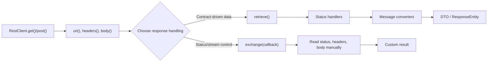
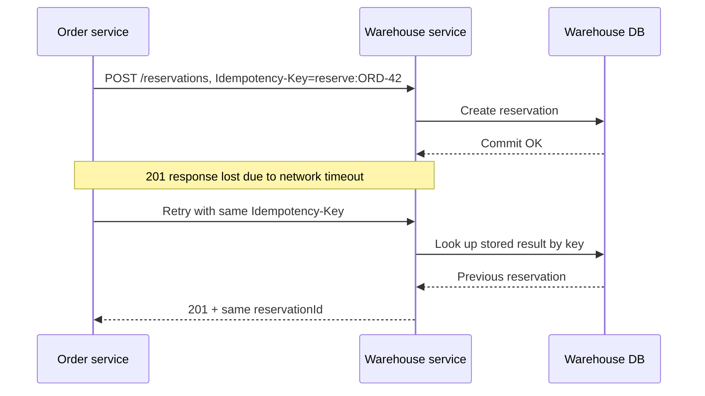
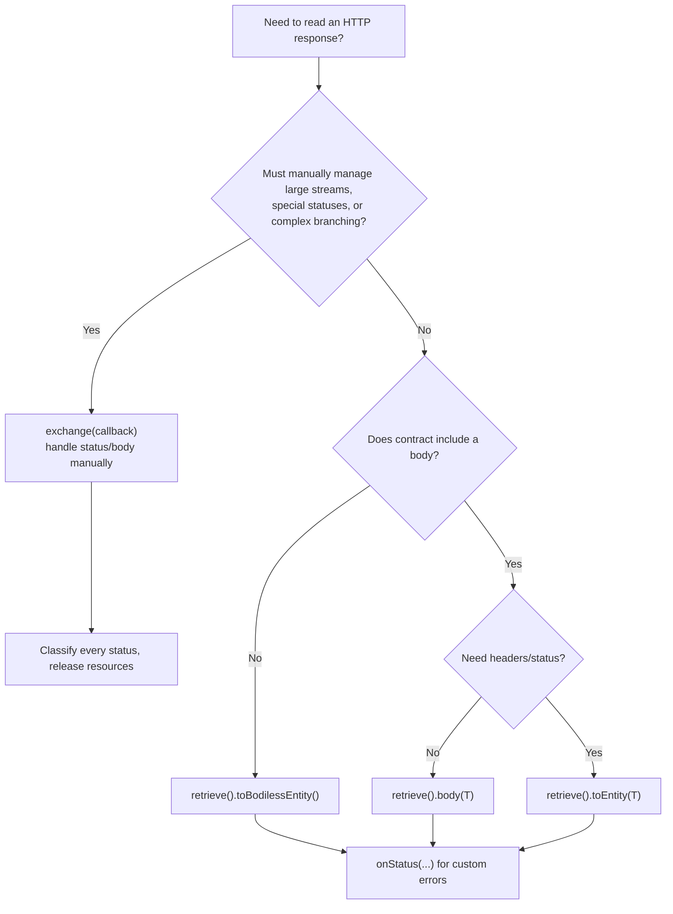

# `retrieve`, `exchange`, and Choosing How to Handle Responses

## 1. Context: Reading an HTTP Response Is More Than Reading JSON

A Spring Boot service calling an external API can receive many different outcomes for the same URL:

- `200 OK` with JSON representing the business data to process.
- `201 Created` with a body and a `Location` header pointing to the newly created resource.
- `202 Accepted` indicating the command was accepted, while the work is still in progress.
- `204 No Content` confirming success without a response body.
- `304 Not Modified` instructing the client to use its cached copy, with no new body.
- `400/404/409/412/429` indicating invalid input, not found, conflict, failed precondition, or rate limiting.
- `500/502/503/504` reflecting errors or unavailability at the upstream or gateway.
- Connection failures, timeouts, or malformed JSON occurring **without a valid HTTP response**.

Spring Framework provides `RestClient`, a **synchronous** HTTP client with a fluent API. When building a client, the two primary ways to handle responses are:

1. **`retrieve()`:** the high-level option, applying HTTP status handling rules and Spring's `HttpMessageConverter`s to turn the body into a Java object.
2. **`exchange(...)`:** the low-level option, receiving the actual request/response to **decide yourself** which statuses are valid, how to read the stream, and what result to return.

In the **SPRING_BOOT_INTEGRATION** module, this topic connects directly to HTTP contracts, cross-service data synchronization, error handling, retries, idempotency, timeouts, testing, and observability. Picking the wrong response-reading style can drop `Location`/`ETag`, swallow `404` errors, or mistake "command accepted" for "business operation completed".

**After this lesson, you will be able to:**

1. Explain where the HTTP request is triggered in `RestClient`'s fluent API.
2. Choose accurately between `body(...)`, `toEntity(...)`, `toBodilessEntity()`, or `exchange(...)` according to the contract.
3. Handle generic JSON, empty responses, 4xx/5xx statuses, `ETag`, and conditional GETs.
4. Distinguish `onStatus(...)` from manual status handling inside `exchange(...)`.
5. Stream large payloads and manage response lifecycles without leaking resources.
6. Design HTTP client tests and safe retry behavior in the face of network failures.

> **Version:** Examples use Java 17+, Spring Boot 3.2+, and Spring Framework 6.1+ (`RestClient` was introduced in Spring Framework 6.1). For Spring Boot 4.x/Spring Framework 7.x, check the specific version's APIs and auto-configuration before applying the code verbatim. This content focuses on synchronous `RestClient`, not reactive `WebClient`.

## 2. Execution Flow: Request Specification and Terminal Operation

Calls like `get()`, `uri(...)`, `header(...)`, and `accept(...)` only **describe the request**. The HTTP exchange takes place when a terminal operation such as `retrieve().body(...)` or `exchange(...)` is invoked.

```java
// client is a pre-configured, reused RestClient.
StockResponse stock = client.get()
    .uri("/api/v1/stocks/{sku}", "SKU-42")
    .accept(MediaType.APPLICATION_JSON)
    .retrieve()
    .body(StockResponse.class);
```

In imperative Java, the current thread waits until the response is read or an error/timeout occurs. Do not confuse `RestClient` with `WebClient`'s reactive programming model; if called synchronously on servlet threads, many concurrent slow calls can exhaust threads and connections.



### 2.1. Quick Comparison Table

| Criterion | `retrieve()` | `exchange(...)` |
| --- | --- | --- |
| Abstraction level | High, convenient for standard JSON APIs. | Low, direct control over the response. |
| 4xx/5xx status | Throws exceptions by default per Spring's handling. | **Does not automatically** invoke default status handlers; callback decides. |
| Custom status logic | `onStatus(...)`, builder `defaultStatusHandler(...)`. | `response.getStatusCode()`, arbitrary logic. |
| JSON deserialization | Built-in `body(Class)`, `body(ParameterizedTypeReference)`. | Read stream manually and invoke an appropriate converter/parser. |
| Status/headers | Via `toEntity(...)`, `toBodilessEntity()`. | Read directly from `ClientHttpResponse`. |
| Large streaming data | Not the most convenient choice when sequential stream processing is required. | Can read/copy the stream **inside the callback**. |
| Pitfalls | Choosing the wrong DTO or forgetting null body checks. | Forgetting to check statuses, or failing to close/read the body properly. |

**Rule of thumb:** start with `retrieve()`. Drop down to `exchange(...)` only when you need custom response control that `retrieve()` cannot express cleanly or appropriately.

## 3. Setting Up a Warehouse HTTP Client

Assume `order-service` calls `warehouse-service` to query stock levels and create inventory reservations. The endpoints form an **example contract**:

| Method/Endpoint | Response | Meaning |
| --- | --- | --- |
| `GET /api/v1/stocks/{sku}` | `200` + JSON / `404` | Stock lookup. |
| `GET /api/v1/stocks/{sku}` with `If-None-Match` | `200` + JSON + ETag / `304` | Conditional cache refresh. |
| `POST /api/v1/reservations` | `201` + JSON + Location / `409` | Create reservation command. |
| `POST /api/v1/reconciliations` | `202` + Location, no body | Submit an asynchronous reconciliation job. |
| `DELETE /api/v1/reservations/{id}` | `204` no body | Release reservation. |
| `GET /api/v1/reports/{id}/download` | `200` + octet stream | Download a potentially large report. |

### 3.1. Dependencies and Configuration

In Spring Boot 3.2+, a Spring MVC application typically includes `spring-boot-starter-web` and a Boot-configured `RestClient.Builder`. For testing, add `spring-boot-starter-test`:

```xml
<!-- pom.xml using Spring Boot parent/BOM -->
<dependency>
    <groupId>org.springframework.boot</groupId>
    <artifactId>spring-boot-starter-web</artifactId>
</dependency>
<dependency>
    <groupId>org.springframework.boot</groupId>
    <artifactId>spring-boot-starter-test</artifactId>
    <scope>test</scope>
</dependency>
```

Never hardcode production URLs or timeouts in the adapter:

```yaml
# application.yml
clients:
  warehouse:
    base-url: ${WAREHOUSE_URL:https://warehouse.example.internal}
    connect-timeout: 2s
    read-timeout: 5s
```

Example record-based configuration:

```java
// WarehouseClientProperties.java
import java.net.URI;
import java.time.Duration;
import org.springframework.boot.context.properties.ConfigurationProperties;

@ConfigurationProperties(prefix = "clients.warehouse")
public record WarehouseClientProperties(
    URI baseUrl,
    Duration connectTimeout,
    Duration readTimeout
) {}
```

Creating a reusable client:

```java
// WarehouseClientConfig.java
import java.net.http.HttpClient;
import com.fasterxml.jackson.databind.ObjectMapper;
import org.springframework.boot.context.properties.EnableConfigurationProperties;
import org.springframework.context.annotation.Bean;
import org.springframework.context.annotation.Configuration;
import org.springframework.http.MediaType;
import org.springframework.http.client.JdkClientHttpRequestFactory;
import org.springframework.web.client.RestClient;

@Configuration(proxyBeanMethods = false)
@EnableConfigurationProperties(WarehouseClientProperties.class)
public class WarehouseClientConfig {

    @Bean
    WarehouseGateway warehouseGateway(
        RestClient.Builder builder,
        WarehouseClientProperties props,
        ObjectMapper objectMapper
    ) {
        HttpClient httpClient = HttpClient.newBuilder()
            .connectTimeout(props.connectTimeout())
            .build();

        JdkClientHttpRequestFactory requestFactory =
            new JdkClientHttpRequestFactory(httpClient);
        requestFactory.setReadTimeout(props.readTimeout());

        RestClient restClient = builder
            .baseUrl(props.baseUrl().toString())
            .requestFactory(requestFactory)
            .defaultHeader("Accept", MediaType.APPLICATION_JSON_VALUE)
            .build();

        return new WarehouseGateway(restClient, objectMapper);
    }
}
```

`JdkClientHttpRequestFactory` here illustrates a transport with connect/read timeouts. With Apache HttpComponents, proxies, TLS, or other connection pools, how timeouts are configured and what they mean depend on the actual request factory. `RestClient` does not automatically retry just because timeouts are configured.

### 3.2. Example DTOs

Define separate Java records (each `public record` in its corresponding file). Use `Integer` rather than `int` to distinguish "quantity field missing" from "quantity is actually 0" when deserializing:

```java
// StockResponse.java
public record StockResponse(
    String sku,
    Integer available,
    String warehouseId
) {}

// ReservationRequest.java
public record ReservationRequest(
    String orderId,
    String sku,
    int quantity
) {}

// ReservationResponse.java
public record ReservationResponse(
    String reservationId,
    String status
) {}
```

In small examples, a single gateway can hold these methods; in larger applications, split by business capability and error policy so one class does not end up handling every API.

## 4. `retrieve().body(...)`: When You Only Need the Data

Choose `body(Class<T>)` when:

- A successful response always carries JSON matching a known DTO.
- Business code does not need the response status or headers.
- 4xx/5xx statuses should be handled by the default policy or `onStatus(...)`.

Example:

```java
// Inside WarehouseGateway with field RestClient client.
public StockResponse getStock(String sku) {
    StockResponse result = client.get()
        .uri("/api/v1/stocks/{sku}", sku)
        .retrieve()
        .body(StockResponse.class);

    if (result == null
        || result.sku() == null
        || result.available() == null
        || result.available() < 0) {
        throw new IllegalStateException(
            "Warehouse returned an invalid stock body"
        );
    }
    return result;
}
```

**Note:** `body(StockResponse.class)` can return `null` when a response has no body. Receiving `2xx` does not guarantee the payload satisfies the business contract; JSON can still miss fields, contain invalid values, or reflect a different version. Validate at the adapter boundary.

### 4.1. Generic Types: Lists and Envelopes

Because of Java type erasure, `List.class` does not carry the information that elements are `StockResponse`. Use `ParameterizedTypeReference<T>`:

```java
import java.util.List;
import org.springframework.core.ParameterizedTypeReference;

List<StockResponse> stocks = client.get()
    .uri(uriBuilder -> uriBuilder
        .path("/api/v1/stocks")
        .queryParam("warehouse", "HCM-01")
        .build())
    .retrieve()
    .body(new ParameterizedTypeReference<List<StockResponse>>() {});
```

If the API returns:

```json
{
  "items": [{"sku":"SKU-42","available":12,"warehouseId":"HCM-01"}],
  "nextCursor": null
}
```

you must define an envelope:

```java
public record PageResponse<T>(
    java.util.List<T> items,
    String nextCursor
) {}
```

and read it with:

```java
PageResponse<StockResponse> page = client.get()
    .uri("/api/v1/stocks")
    .retrieve()
    .body(
        new ParameterizedTypeReference<PageResponse<StockResponse>>() {}
    );
```

Never "cast" a `List<Map>` to `List<StockResponse>`: generic types cannot be safely converted that way. `PageResponse`/DTO records must match the actual naming, nullability, and JSON version.

## 5. `retrieve().toEntity(...)`: Getting Status, Headers, and Body Together

Use `ResponseEntity<T>` when business or integration logic needs response metadata:

- `201 Created` and `Location` to store the URL/ID of the new resource.
- `200 OK` and `ETag` to optimize conditional requests.
- `Retry-After`, correlation IDs, or agreed-upon domain headers.
- Needing to distinguish multiple **success** statuses, such as `200` vs. `202`.

```java
import org.springframework.http.ResponseEntity;
import org.springframework.http.MediaType;

public ResponseEntity<ReservationResponse> createReservation(
    ReservationRequest request,
    String idempotencyKey
) {
    return client.post()
        .uri("/api/v1/reservations")
        .contentType(MediaType.APPLICATION_JSON)
        .header("Idempotency-Key", idempotencyKey)
        .body(request)
        .retrieve()
        .toEntity(ReservationResponse.class);
}
```

The caller reads metadata:

```java
ResponseEntity<ReservationResponse> response =
    gateway.createReservation(request, "reserve-order-42");

int status = response.getStatusCode().value();
var location = response.getHeaders().getLocation();
var etag = response.getHeaders().getETag();
ReservationResponse body = response.getBody();

if (status != 201 || body == null || body.reservationId() == null) {
    throw new IllegalStateException("Create reservation response violated contract");
}
```

`gateway` and `request` are variables in the calling layer. Verify `Location` whenever the API promises that header; do not treat a missing `Location` as full success if downstream steps need that URI to query status.

### 5.1. Comparing `body(T)` and `toEntity(T)`

| Need | Choice | Why |
| --- | --- | --- |
| Only need `sku` and `available` | `body(StockResponse.class)` | Less code, clearer intent. |
| Need `ETag` | `toEntity(StockResponse.class)` | Exposes headers. |
| Need to tell `201` apart from `200` | `toEntity(...)` | Exposes status. |
| Response is a generic list and headers are needed | `toEntity(new ParameterizedTypeReference<List<StockResponse>>() {})` | Preserves generic types and metadata. |
| No body (204) | `toBodilessEntity()` | Does not ask converters to parse a body. |

### 5.2. `ResponseEntity` Does Not Make an HTTP Request Asynchronous

The `ResponseEntity` class name describes the response data; it does **not** represent a future/async task. `RestClient` remains a synchronous client. If an upstream returns `202 Accepted`, the HTTP call has finished, yet **the upstream business work may still be running**; that is asynchronous behavior in the business contract, not the HTTP client itself.

## 6. `retrieve().toBodilessEntity()`: Reading Status and Headers, Ignoring Body

When a successful endpoint **returns no payload**, the clearest way to express it is:

```java
import org.springframework.http.ResponseEntity;

public ResponseEntity<Void> releaseReservation(String reservationId) {
    return client.delete()
        .uri("/api/v1/reservations/{id}", reservationId)
        .retrieve()
        .toBodilessEntity();
}
```

Example `DELETE` response:

```http
HTTP/1.1 204 No Content
Date: Sat, 21 Nov 2026 02:00:00 GMT
```

`toBodilessEntity()` captures status/headers without requiring a response DTO. However, it does not "forbid" the server from sending a body on other statuses; rely on the contract and check the status code as needed.

### 6.1. `202 Accepted` May Also Have No Body

```java
ResponseEntity<Void> accepted = client.post()
    .uri("/api/v1/reconciliations")
    .header("Idempotency-Key", reconciliationCommandId)
    .retrieve()
    .toBodilessEntity();

if (accepted.getStatusCode().value() != 202) {
    throw new IllegalStateException("Provider did not return 202 as contracted");
}
var statusUri = accepted.getHeaders().getLocation();
if (statusUri == null) {
    throw new IllegalStateException("Missing Location to track job");
}
```

Upon receiving 202, the client may need to poll the status URI, receive a callback, or wait for a completion event per contract. **Never mark a job as "completed" merely because 202 was returned.**

## 7. `retrieve()` Default Handling for 4xx/5xx

If you call:

```java
StockResponse result = client.get()
    .uri("/api/v1/stocks/UNKNOWN")
    .retrieve()
    .body(StockResponse.class);
```

and the provider returns `404 Not Found`, Spring by default **throws an HTTP status exception** instead of deserializing the error body into `StockResponse` or returning `null`.

Common exception types:

| Situation | Typical Exception | Design Implication |
| --- | --- | --- |
| HTTP 4xx | `HttpClientErrorException` | Response received, but request/auth/business conflict was rejected. |
| HTTP 5xx | `HttpServerErrorException` | Response received; upstream/server/gateway error. |
| Other HTTP errors or atypical statuses | `RestClientResponseException` or appropriate subtype | Inspect status/headers/body carefully. |
| Connect timeout, read timeout, connection reset | `ResourceAccessException` | Uncertain whether the server executed the command. |
| Deserialization/converter error | Exception in `RestClientException` or converter hierarchy | Response received, but payload failed schema or converter is missing. |
| URI/template/validation error | May throw before the HTTP exchange occurs | Do not equate with "upstream unavailable". |

`RestClientResponseException` can contain the status, headers, and error response body bytes. Do not log the entire error body by default: it may contain personal data, tokens, or stack traces returned by the partner.

### 7.1. Classifying Errors by Semantics

A client usually needs to answer these questions:

- Does `404` mean "SKU does not exist" as a normal business outcome, or a misconfigured endpoint?
- Is `409` "reservation already exists with the same command ID", or a conflict between two different commands?
- Does `429` include a `Retry-After` header, and can it be retried within the time budget?
- Is `503` transient, or is a circuit breaker currently open?
- On a timeout after POST, might the command have already succeeded at the provider?

A blanket catch of `RestClientException` returning an empty list hides critical failures. The gateway should map errors into intentional domain/integration error types so upper layers can make the right decisions.

## 8. `onStatus(...)`: Changing How `retrieve()` Interprets HTTP Statuses

Each `retrieve()` call can attach one or more status handlers. For example, converting `409 Conflict` from the reservation endpoint into a clear business exception:

```java
import org.springframework.http.MediaType;

public ReservationResponse reserve(
    ReservationRequest request,
    String idempotencyKey
) {
    ReservationResponse result = client.post()
        .uri("/api/v1/reservations")
        .contentType(MediaType.APPLICATION_JSON)
        .header("Idempotency-Key", idempotencyKey)
        .body(request)
        .retrieve()
        .onStatus(
            status -> status.value() == 409,
            (httpRequest, httpResponse) -> {
                throw new ReservationConflictException(
                    "Reservation conflicted with existing request"
                );
            }
        )
        .body(ReservationResponse.class);

    if (result == null) {
        throw new IllegalStateException("Missing reservation body");
    }
    return result;
}
```

Here `ReservationConflictException` is an application-defined class, e.g., `class ReservationConflictException extends RuntimeException`. `httpRequest`/`httpResponse` let you read additional details when needed; if an error body contains structured JSON, parse it safely and bound its size before reading.

### 8.1. `onStatus` Is Not a Function That Converts Responses Into a Different DTO

A status handler exists to **handle status/error conditions**; it has no contract for returning `Optional<StockResponse>` or `ResponseEntity<...>` in place of the terminal operation.

Misleading example:

```java
// NOT RECOMMENDED: an empty handler only suppresses the default
// exception for 404, but does not return Optional.empty().
StockResponse response = client.get()
    .uri("/api/v1/stocks/UNKNOWN")
    .retrieve()
    .onStatus(status -> status.value() == 404,
        (request, rawResponse) -> { /* does not throw */ })
    .body(StockResponse.class);
```

A handler that does not throw allows Spring to continue reading the body through the converter. If the `404` body is Problem Details JSON, deserializing it into `StockResponse` may fail or produce an invalid object; if the response is empty, you get `null`. Instead of mixing success DTOs and error DTOs, use intentional exception mapping or `exchange(...)` for branches where "404 is a normal outcome".

### 8.2. Shared Status Handlers with `defaultStatusHandler(...)`

To apply a 5xx rule across the entire Warehouse client:

```java
RestClient warehouseClient = builder
    .baseUrl("https://warehouse.example.internal")
    .defaultStatusHandler(
        status -> status.is5xxServerError(),
        (request, response) -> {
            throw new WarehouseUnavailableException(
                "Warehouse returned status " + response.getStatusCode().value()
            );
        }
    )
    .build();
```

In this example, `WarehouseUnavailableException` is a custom exception. Per-request handlers registered via `onStatus(...)` take precedence over matching default status handlers; only if no handler claims the error status does the default error handling run.

**Remember:** `defaultStatusHandler(...)` on the builder applies only to the `retrieve()` pipeline; do not expect it to run when using `exchange(...)`.

### 8.3. Do Not Lump All 4xx/5xx Errors Into One Retryable Error

For instance, `401`/`403` usually require fixing credentials/permissions; `400` requires fixing the payload; `404` may be valid; `409` may require reconciliation; `429` may be retried according to `Retry-After`; `503` may be transient. Error mapping must go hand in hand with **retry policy**, not just renaming exceptions.

## 9. `retrieve()` and `404 Not Found`: Three Reasonable Options

When the API defines "SKU absent" as a normal possibility:

### 9.1. Catch Exactly `NotFound` and Return `Optional.empty()`

```java
import java.util.Optional;
import org.springframework.web.client.HttpClientErrorException;

public Optional<StockResponse> findStock(String sku) {
    try {
        return Optional.of(getStock(sku));
    } catch (HttpClientErrorException.NotFound e) {
        return Optional.empty();
    }
}
```

This is concise and keeps default handling for 400/401/503. However, if a `defaultStatusHandler` already maps `404` to a custom exception, catch that custom type instead or choose another pattern. Never catch `Exception` and return empty.

### 9.2. `exchange(...)` Returning a Classified Result

When you prefer not to use exceptions for a normal branch:

```java
import java.util.Optional;

public Optional<StockResponse> findStockDirect(String sku) {
    return client.get()
        .uri("/api/v1/stocks/{sku}", sku)
        .exchange((request, response) -> {
            int status = response.getStatusCode().value();
            if (status == 404) {
                return Optional.<StockResponse>empty();
            }
            if (status != 200) {
                throw new IllegalStateException(
                    "Warehouse returned unexpected status: " + status
                );
            }
            StockResponse body = objectMapper.readValue(
                response.getBody(), StockResponse.class
            );
            if (body.sku() == null || body.available() == null) {
                throw new IllegalStateException("Stock body is missing fields");
            }
            return Optional.of(body);
        });
}
```

This snippet lives in a class with an `ObjectMapper objectMapper` field injected from the Spring context. It **explicitly checks 503, 401, and the JSON body**; never return empty for arbitrary non-200 statuses. The advantage is a return type that expresses "in stock / missing" without using exceptions for control flow. The drawback is more verbose code with direct responsibility for deserialization and error handling.

### 9.3. Using a Result DTO with Business Status

If an API has more valid branches (200, 202, 304, 404), you can define a sealed type or result enum/record instead of returning `null` or `Optional`. That is an important option for clients handling caching, async jobs, or partial content.

## 10. `exchange(...)`: Direct Control Over Status, Headers, and Body

Mental signature:

```java
T value = client.get()
    .uri("/some/path")
    .exchange((request, response) -> {
        // Read response.getStatusCode(), response.getHeaders(),
        // response.getBody(), and return T.
        return ...;
    });
```

Inside the callback:

- `request` is the executed HTTP request, useful when context is needed.
- `response` is `ClientHttpResponse`, exposing status, headers, and the body stream.
- Your code **must** decide which statuses are valid and how to handle all others.
- `retrieve()`'s `onStatus(...)` and default status handlers **do not apply**.
- The response body stream must be read within the callback lifecycle; after the callback returns, `RestClient` manages closing the response. Never return the raw `InputStream` for the caller to consume later.

### 10.1. Example Reading Raw Body and Classifying Manually

```java
public byte[] downloadSmallDocument(String documentId) {
    return client.get()
        .uri("/api/v1/documents/{id}", documentId)
        .exchange((request, response) -> {
            int status = response.getStatusCode().value();
            if (status == 404) {
                throw new DocumentNotFoundException(documentId);
            }
            if (status != 200) {
                throw new IllegalStateException(
                    "Failed to download document, status=" + status
                );
            }
            long length = response.getHeaders().getContentLength();
            if (length > 5_000_000) {
                throw new IllegalStateException("Document too large");
            }
            byte[] bytes = response.getBody().readNBytes(5_000_001);
            if (bytes.length > 5_000_000) {
                throw new IllegalStateException("Document too large");
            }
            return bytes;
        });
}
```

`DocumentNotFoundException` is an application-defined exception. The example enforces a 5 MB limit, checking both `Content-Length` and actual bytes read, because a server may omit the header or send an inaccurate length. For large files, avoid buffering into `byte[]`; stream to a file as shown in the next section.

### 10.2. Why `exchange` Is Not Necessarily "Better"

If all you need is a `200` JSON response with a `StockResponse` body, `retrieve().body(StockResponse.class)` is shorter and reuses message converters and status handlers. Writing manual callbacks for every endpoint easily introduces bugs around unchecked 4xx codes, charsets, media types, empty bodies, and resource lifecycles. Use `exchange` only when **the extra flexibility provides real value**.

## 11. Conditional GET with `ETag` and `304 Not Modified`

This is a classic case requiring fine-grained status control. Suppose the client already cached stock data along with ETag `"v17"`. When refreshing:

```http
GET /api/v1/stocks/SKU-42 HTTP/1.1
Accept: application/json
If-None-Match: "v17"
```

The provider may:

- Return `200 OK` + a new ETag + a JSON body if the content changed.
- Return `304 Not Modified` with no body if the cached representation is still valid.
- Return `404 Not Found` if the SKU was deleted.

### 11.1. Clear Result Modeling

```java
// StockFetch.java
public sealed interface StockFetch
    permits StockFound, StockNotModified, StockMissing {}

// StockFound.java
public record StockFound(
    StockResponse stock, String etag
) implements StockFetch {}

// StockNotModified.java
public record StockNotModified(
    String etag
) implements StockFetch {}

// StockMissing.java
public record StockMissing() implements StockFetch {}
```

Each `public` type belongs in its matching Java file. Not every project needs a sealed hierarchy, but it expresses the three valid outcomes far more clearly than a nullable `StockResponse`.

### 11.2. Using `exchange` to Handle `200/304/404`

```java
import org.springframework.http.HttpHeaders;
import org.springframework.http.MediaType;

public StockFetch refreshStock(String sku, String cachedEtag) {
    return client.get()
        .uri("/api/v1/stocks/{sku}", sku)
        .accept(MediaType.APPLICATION_JSON)
        .headers(headers -> {
            if (cachedEtag != null && !cachedEtag.isBlank()) {
                headers.set(HttpHeaders.IF_NONE_MATCH, cachedEtag);
            }
        })
        .exchange((request, response) -> {
            int status = response.getStatusCode().value();
            String etag = response.getHeaders().getETag();

            if (status == 304) {
                return new StockNotModified(etag);
            }
            if (status == 404) {
                return new StockMissing();
            }
            if (status != 200) {
                throw new IllegalStateException(
                    "Warehouse error status=" + status
                );
            }

            StockResponse stock = objectMapper.readValue(
                response.getBody(), StockResponse.class
            );
            if (stock == null || stock.sku() == null
                || stock.available() == null || stock.available() < 0) {
                throw new IllegalStateException("Invalid Warehouse body");
            }
            return new StockFound(stock, etag);
        });
}
```

On `304`, the caller must **already hold a valid cached copy** matching the same cache key/variant in order to reuse it; if no cached copy exists, it must resend an unconditional request or report missing data. `304` carries no new body to convert into a DTO.

**Important:** An ETag is an opaque validator that may include quotes and a weak prefix `W/`. Do not arbitrarily strip quotes, and do not treat it as a timestamp or numeric version unless the provider specifies that format. ETag validates representations; it does not replace a business aggregate version for multi-system updates.

### 11.3. What About `304` with `retrieve()`?

By default, `retrieve()` focuses on error statuses (4xx/5xx); `304` is not 4xx/5xx. However, `body(StockResponse.class)` on a 304 response can return `null` because there is no body. To distinguish 304 from a 200 with a body, either use `toEntity(...)` to inspect status/headers and handle accordingly, or use `exchange(...)` to return a clear branched result type as shown above.

## 12. Streaming Large Files with `exchange`

Suppose the Warehouse API returns CSV reports weighing hundreds of megabytes. You should not load the entire response into a `byte[]` or `String`. Inside `exchange`, consume the stream before the callback finishes.

```java
import java.io.IOException;
import java.nio.file.Files;
import java.nio.file.Path;
import java.nio.file.StandardCopyOption;
import org.springframework.http.MediaType;

public Path downloadReport(String reportId, Path outputDirectory) {
    if (!reportId.matches("[A-Za-z0-9_-]{1,80}")) {
        throw new IllegalArgumentException("Invalid reportId");
    }

    Path target = outputDirectory
        .resolve("report-" + reportId + ".csv")
        .normalize();

    return client.get()
        .uri("/api/v1/reports/{id}/download", reportId)
        .accept(MediaType.APPLICATION_OCTET_STREAM)
        .exchange((request, response) -> {
            if (response.getStatusCode().value() != 200) {
                throw new IllegalStateException(
                    "Failed to download report, status="
                        + response.getStatusCode().value()
                );
            }

            // Create a temp file in the target directory so partial files are never exposed.
            Path temp = Files.createTempFile(
                outputDirectory, ".report-", ".part"
            );
            try {
                Files.copy(
                    response.getBody(),
                    temp,
                    StandardCopyOption.REPLACE_EXISTING
                );

                // ATOMIC_MOVE requires filesystem support; do not ignore failures
                // if the contract requires atomic publication.
                Files.move(
                    temp,
                    target,
                    StandardCopyOption.ATOMIC_MOVE
                );
                return target;
            } finally {
                Files.deleteIfExists(temp);
            }
        });
}
```

This example assumes `outputDirectory` already exists, resides in trusted storage, and is writable; never let user input control directory paths. `ATOMIC_MOVE` may not be supported on some filesystems or shared volumes. Production code also needs size limits, `Content-Type` verification, checksums, disk-space checks, and collision/no-overwrite handling per contract.

**Never return** `response.getBody()` out of the callback:

```java
// WRONG: the stream may no longer be usable after exchange completes.
InputStream stream = client.get()
    .uri("/api/v1/reports/42/download")
    .exchange((req, response) -> response.getBody());
```

With `exchange(...)`, `RestClient` manages the response lifecycle. Read the stream while the callback is executing and return only results detached from the HTTP resource, such as a `Path`, byte count, hash, or parsed object.

## 13. Status Codes That Commonly Cause Confusion

| Status | Typical Body | Appropriate Handling |
| --- | --- | --- |
| `200 OK` | Usually JSON/bytes | `body(T)` if only DTO is needed; `toEntity(T)` if headers/status are needed; `exchange` for streaming. |
| `201 Created` | May include JSON | `toEntity(T)` to read `Location` when the contract uses it. |
| `202 Accepted` | May have no body | `toBodilessEntity()` or `toEntity(T)` per contract; treat job as still in progress. |
| `204 No Content` | No body | `toBodilessEntity()`. |
| `206 Partial Content` | Byte range only | If using Range requests, check `Content-Range` and reassemble properly. |
| `301/302/307/308` | Redirect/metadata | HTTP transport may follow redirects depending on config; watch authentication and HTTP method changes. |
| `304 Not Modified` | No new body | `toEntity(...)` inspecting status or `exchange`; use only a valid cache entry. |
| `400/422` | Error body | Map validation/contract errors; do not retry the exact request endlessly. |
| `404` | Error body or empty | Can become `Optional.empty()` when contract permits; never hide wrong endpoints. |
| `409/412` | Error body | Business conflict/precondition failure; handle explicitly. |
| `429` | May include `Retry-After` | Bounded backoff; do not retry blindly. |
| `500/502/503/504` | Error body may be unreliable | Conditional retry, monitoring, circuit breaker/bulkhead. |

**Never infer solely from a status code that no side effect occurred.** A POST that timed out or returned 503 may already have been partially or completely executed by the provider without delivering the response.

### 13.1. `Content-Type` and Status Must Align with the Body

If the server returns `200` and `Content-Type: text/html` when the contract requires JSON, the converter may fail to read `StockResponse`; this is an integration error that must be reported, not replaced with an empty object. With `exchange`, verify the media type manually when needed; with `retrieve`, converters handle it, though you should still write contract tests for media type and schema.

### 13.2. Body Parse Errors Differ from HTTP Status Errors

Provider returns 200 with malformed JSON:

```http
HTTP/1.1 200 OK
Content-Type: application/json

{"sku":"SKU-42","available":}
```

The HTTP exchange succeeded at the network and status levels, yet deserialization failed. Retrying will only add load if the error comes from an incompatible schema version. Track **transport errors**, **status errors**, and **contract/parse errors** separately.

## 14. Building a Gateway So Business Code Does Not Depend on HTTP Details

Keep `retrieve/exchange` inside the adapter and return clear business or integration results. Example:

```java
// StockLookupService.java
import org.springframework.stereotype.Service;

@Service
public class StockLookupService {
    private final WarehouseGateway gateway;

    public StockLookupService(WarehouseGateway gateway) {
        this.gateway = gateway;
    }

    public boolean canReserve(String sku, int quantity) {
        if (quantity <= 0) {
            throw new IllegalArgumentException("quantity must be positive");
        }
        StockResponse stock = gateway.getStock(sku);
        return stock.available() >= quantity;
    }
}
```

The business layer **does not need to know about** `ResponseEntity` or `HttpClientErrorException` once the gateway maps them into appropriate result or error types. Keeping the HTTP contract and business rules separate lets you evolve upstream APIs, serializers, authentication, and retries with minimal impact on the domain.

### 14.1. When Should You Not Return `ResponseEntity` Directly to the Business Layer?

`ResponseEntity` is useful inside the adapter because it carries HTTP metadata; however, if every application service receives it, business logic becomes coupled to an external API's status codes and headers. Usually you should translate it right inside the gateway:

| External API Returns | Gateway Returns to Domain |
| --- | --- |
| 200 + stock | Validated `StockAvailability` or `StockResponse`. |
| 404 SKU does not exist | `Optional.empty()` or a dedicated `StockNotFound`. |
| 409 reservation conflict | `ReservationConflict` domain/integration exception. |
| 202 + Location | `PendingReconciliation(jobId, statusUri)`. |
| 503/timeout | Integration error classified as retryable/unknown outcome. |

Hiding all HTTP details is not always mandatory: if the application itself is an API gateway or HTTP proxy, preserving status codes and headers may be its **primary responsibility**. Decide based on architectural boundaries.

## 15. Retries, Idempotency, and Transactions

Neither `RestClient.retrieve()` nor `exchange()` **automatically guarantees exactly-once execution**. Even when JSON deserialization succeeds, a write operation at the provider can fail, be retried, or be duplicated:



For side-effecting POST/PATCH commands:

1. Choose a **stable idempotency key** for the same logical command; never mint a new key on each retry.
2. The server/provider must genuinely support the deduplication contract; sending the header alone provides no guarantee.
3. Distinguish timeouts (uncertain outcome) from 400/401/403 (deterministically rejected requests).
4. Bound retries/backoff/jitter and overall time budgets across all layers.
5. For uncertain outcomes, call a status-lookup API by `commandId`/`reservationId` before issuing another action.

**Spring Boot database transactions cannot roll back HTTP side effects already committed in another service.** If an `@Transactional` method in the Order service calls Warehouse and then the Order DB rolls back, the Warehouse reservation may still exist. Use sagas/compensation, outbox/inbox, idempotency, or reconciliation depending on the flow.

### 15.1. 404 and 409 Should Not Be Retried Like 503

A generic retry wrapper around `RestClient` that does not classify errors can:

- Pointlessly repeat 400 validation errors.
- Trigger a request storm when a 401 token is missing.
- Produce repeated 409 conflicts without resolving state.
- Query a nonexistent 404 SKU dozens of times.

Base retry policies on operation + status + I/O error type + provider idempotency support. Never loop endlessly on a servlet thread.

## 16. Security, Resources, and Observability

### 16.1. Request and Response Security

- Call only trusted, configured base URLs/hosts; never turn `exchange()` into a tool that fetches arbitrary URLs from user input due to SSRF risks.
- Never log `Authorization`, session cookies, API keys, raw payment data, or personal information from error bodies.
- Cap response size before buffering into the heap or writing logs; do not rely solely on `Content-Length`.
- For downloads, validate content type, filename, destination path, and write permissions; never use a partner-supplied `Content-Disposition filename` directly as a filesystem path.
- When routing through proxies/TLS/mTLS, configure request factories and secret providers per upstream, never reusing tokens across hosts.

### 16.2. Metrics and Tracing

Monitor each outcome type:

| Metric | Benefit |
| --- | --- |
| HTTP client request count by method, route template, status | Detects 4xx/5xx spikes and contract changes. |
| Latency p50/p95/p99 and timeouts | Evaluates SLOs and thread/connection pool sizing. |
| Retry count and retries exhausted | Detects unstable upstreams or retry storms. |
| Response parse/schema failures | Detects breaking changes even when the provider returns 200. |
| Cache hit/304 ratio | Evaluates conditional GET effectiveness and freshness. |
| Download bytes/time and incomplete files | Monitors streaming/report delivery. |
| Unknown-outcome commands and idempotency conflicts | Tracks flows requiring reconciliation. |

Spring Boot Actuator/Micrometer Observation can instrument HTTP clients built from a properly configured builder. With `exchange(...)`, handling the response yourself does not mean skipping HTTP client metrics, though you should verify actual instrumentation when using custom request factories or builders. Never use SKUs, order IDs, or full URLs containing personal query params as high-cardinality metric tags.

## 17. Testing `retrieve()` and `exchange()`

Unit tests mocking `WarehouseGateway` only exercise business code. To test the HTTP requests produced by `RestClient` and its response mapping, use `MockRestServiceServer` in `spring-test`:

### 17.1. GET 200: Verifying `retrieve().body(...)`

```java
import static org.junit.jupiter.api.Assertions.assertEquals;
import static org.springframework.test.web.client.match.MockRestRequestMatchers.method;
import static org.springframework.test.web.client.match.MockRestRequestMatchers.requestTo;
import static org.springframework.test.web.client.response.MockRestResponseCreators.withSuccess;

import org.junit.jupiter.api.Test;
import org.springframework.http.HttpMethod;
import org.springframework.http.MediaType;
import org.springframework.test.web.client.MockRestServiceServer;
import org.springframework.web.client.RestClient;

class WarehouseRetrieveTest {
    @Test
    void retrieveReadsJsonBody() {
        RestClient.Builder builder =
            RestClient.builder().baseUrl("https://warehouse.test");
        MockRestServiceServer server =
            MockRestServiceServer.bindTo(builder).build();

        RestClient client = builder.build();
        server.expect(
                requestTo("https://warehouse.test/api/v1/stocks/SKU-42"))
            .andExpect(method(HttpMethod.GET))
            .andRespond(withSuccess(
                """
                {"sku":"SKU-42","available":12,"warehouseId":"HCM-01"}
                """,
                MediaType.APPLICATION_JSON
            ));

        StockResponse stock = client.get()
            .uri("/api/v1/stocks/{sku}", "SKU-42")
            .retrieve()
            .body(StockResponse.class);

        assertEquals("SKU-42", stock.sku());
        assertEquals(12, stock.available());
        server.verify();
    }
}
```

Remember that `bindTo(builder).build()` must happen before `builder.build()` creates the client under test.

### 17.2. GET 404: `retrieve()` Throws an Exception

```java
import static org.junit.jupiter.api.Assertions.assertThrows;
import static org.springframework.test.web.client.match.MockRestRequestMatchers.requestTo;
import static org.springframework.test.web.client.response.MockRestResponseCreators.withStatus;

import org.junit.jupiter.api.Test;
import org.springframework.http.HttpStatus;
import org.springframework.test.web.client.MockRestServiceServer;
import org.springframework.web.client.HttpClientErrorException;
import org.springframework.web.client.RestClient;

class WarehouseRetrieveErrorTest {
    @Test
    void retrieveRaises404ByDefault() {
        RestClient.Builder builder =
            RestClient.builder().baseUrl("https://warehouse.test");
        MockRestServiceServer server =
            MockRestServiceServer.bindTo(builder).build();
        RestClient client = builder.build();

        server.expect(
                requestTo("https://warehouse.test/api/v1/stocks/UNKNOWN"))
            .andRespond(withStatus(HttpStatus.NOT_FOUND));

        assertThrows(HttpClientErrorException.NotFound.class, () ->
            client.get()
                .uri("/api/v1/stocks/UNKNOWN")
                .retrieve()
                .body(StockResponse.class)
        );
        server.verify();
    }
}
```

### 17.3. GET 404: `exchange()` Can Return a Normal Value

```java
import static org.junit.jupiter.api.Assertions.assertTrue;
import static org.springframework.test.web.client.match.MockRestRequestMatchers.requestTo;
import static org.springframework.test.web.client.response.MockRestResponseCreators.withStatus;

import java.util.Optional;
import org.junit.jupiter.api.Test;
import org.springframework.http.HttpStatus;
import org.springframework.test.web.client.MockRestServiceServer;
import org.springframework.web.client.RestClient;

class WarehouseExchangeTest {
    @Test
    void exchangeMaps404ToEmpty() {
        RestClient.Builder builder =
            RestClient.builder().baseUrl("https://warehouse.test");
        MockRestServiceServer server =
            MockRestServiceServer.bindTo(builder).build();
        RestClient client = builder.build();

        server.expect(
                requestTo("https://warehouse.test/api/v1/stocks/UNKNOWN"))
            .andRespond(withStatus(HttpStatus.NOT_FOUND));

        Optional<String> result = client.get()
            .uri("/api/v1/stocks/UNKNOWN")
            .exchange((request, response) -> {
                if (response.getStatusCode().value() == 404) {
                    return Optional.<String>empty();
                }
                throw new IllegalStateException("Unexpected status");
            });

        assertTrue(result.isEmpty());
        server.verify();
    }
}
```

This test confirms that `exchange()` does not automatically throw `HttpClientErrorException.NotFound` under `retrieve()`'s default error handling. The callback must handle 404 as well as every other status.

### 17.4. Recommended Test Matrix

| Scenario | What to Assert |
| --- | --- |
| 200 valid JSON | `body(T)` deserializes properly; business validation passes. |
| 200 missing field | Gateway raises a contract error rather than faking `available=0`. |
| 200 malformed JSON | Parse error is not treated as "out of stock". |
| 201 Created | `toEntity(T)` preserves `Location`, status, and body. |
| 202 Accepted without body | `toBodilessEntity()` preserves status/Location; caller does not mark work complete. |
| 204 No Content | No JSON parsing attempted, no null dereference. |
| 304 Not Modified | Reuses existing cache; does not parse empty body. |
| 404 | `retrieve` throws by default; `exchange` can return Optional. |
| 409/412 | Maps conflict/precondition per contract. |
| 429 | Handles `Retry-After` and enforces retry limits. |
| 500/503 | Default/custom error policies trigger and record metrics. |
| Timeout/network reset | Not confused with HTTP status errors; POST keeps a stable key on retry. |
| Large file | Streamed inside the callback; temporary file cleaned up on failure. |

`MockRestServiceServer` does not open real HTTP sockets: it does not verify TLS, connection pooling, proxies, DNS, server redirects, or exact network timeouts. Use WireMock/MockWebServer/Testcontainers or real HTTP test servers for transport concerns, and contract/provider verification to prove the live API matches expectations.

## 18. Common Mistakes

| Mistake | Consequence | Fix |
| --- | --- | --- |
| Calling `body(T)` on 204/304 responses | Receiving null and dereferencing fields; or misinterpreting cache status. | Use `toBodilessEntity()`/`toEntity(...)` or `exchange(...)` with explicit branches. |
| Needing `Location` while using `body(T)` | Loses the resource URI metadata. | `toEntity(T)`. |
| Reading `List.class` and casting to `List<StockResponse>` | Generic elements become maps or fail with runtime `ClassCastException`. | `ParameterizedTypeReference<List<StockResponse>>`. |
| Assuming `retrieve()` always returns a DTO even on 404 | 4xx becomes an exception by default. | Catch/map `NotFound` or use `exchange`. |
| Using `onStatus(404, empty handler)` as an `Optional.empty` | Error body may still be parsed incorrectly. | Catch 404 intentionally or handle explicitly in `exchange`. |
| Assuming `exchange()` automatically runs `onStatus` | Ignores 500 and parses it as "success". | Check all statuses inside the callback. |
| Returning `response.getBody()` out of the callback | Accessing the stream after the response has closed. | Read/copy the stream inside the callback. |
| Reading large files into `byte[]` | Heap exhaustion or heavy GC pressure. | Stream to a temporary file and enforce size limits. |
| Catching all `RestClientException`s and returning empty | Hides 401/503, JSON errors, and timeouts. | Classify by status, transport, and contract. |
| Retrying POST with a new idempotency key | Creates duplicate side effects. | Keep the key stable and query status on timeout. |
| Treating 202 as completed processing | Workflow state falls out of sync. | Poll job/status or wait for completion events. |
| Expecting `@Transactional` to roll back HTTP side effects | Data across two services becomes inconsistent. | Saga/compensation/outbox/idempotency. |
| Logging raw HTTP bodies or error bodies | Leaks sensitive data. | Redact, bound logs, and record minimal metadata. |

## 19. Checklist for Choosing a Response-Handling API



**Production rollout steps:**

1. Read the API contract: possible statuses, body schemas, headers, response sizes, media types.
2. Choose `body`, `toEntity`, `toBodilessEntity`, or `exchange` based on **the data needed**, not code brevity.
3. Configure timeouts, authentication, trace/correlation IDs, and environment-driven base URLs.
4. Define mappings for 4xx/5xx, timeouts, parse errors, and uncertain outcomes.
5. For side-effecting commands, design idempotency keys, retry/backoff policies, and reconciliation.
6. Test 200/201/202/204/304, 404, 409, 429, 503, malformed JSON, and empty bodies.
7. Observe latency, errors, retries, and streaming callbacks; never log sensitive payloads.

**Self-Check Questions**

1. When can `body(StockResponse.class)` return `null` without throwing an HTTP status exception?
2. If you need to read `ETag` and `Location`, which terminal operation fits?
3. Why doesn't `exchange(...)` automatically apply `retrieve()`'s `onStatus(...)` handlers?
4. `404` is a normal result for SKU lookup; would you choose try/catch `NotFound` or `exchange`, and why?
5. Why shouldn't you return `response.getBody()` out of an `exchange` callback?
6. In a conditional GET, when the server returns `304`, can the client read a new body?
7. A POST creating a reservation times out after the server commits: why must retries reuse the same idempotency key?
8. When a provider returns 200 with schema-invalid JSON, what kind of error is that and which metric should track it?

## 20. References

- [Spring Framework — REST Clients](https://docs.spring.io/spring-framework/reference/integration/rest-clients.html): `RestClient`, `retrieve()`, `exchange()`, and status handlers.
- [Spring Framework — RestClient Javadoc](https://docs.spring.io/spring-framework/docs/current/javadoc-api/org/springframework/web/client/RestClient.html): fluent client API.
- [Spring Framework — RestClient.ResponseSpec Javadoc](https://docs.spring.io/spring-framework/docs/current/javadoc-api/org/springframework/web/client/RestClient.ResponseSpec.html): `body`, `toEntity`, `toBodilessEntity`, and `onStatus`.
- [Spring Framework — ClientHttpResponse Javadoc](https://docs.spring.io/spring-framework/docs/current/javadoc-api/org/springframework/http/client/ClientHttpResponse.html): status, headers, and response body stream.
- [Spring Boot — Calling REST Services](https://docs.spring.io/spring-boot/reference/io/rest-client.html): `RestClient.Builder` auto-configuration and customizers.
- [Spring Framework — Testing REST Clients](https://docs.spring.io/spring-framework/reference/testing/spring-mvc-test-client.html): testing HTTP clients with Spring Test.
- [RFC 9110 — HTTP Semantics](https://www.rfc-editor.org/rfc/rfc9110.html): HTTP statuses, conditional requests, and idempotent methods.
- [RFC 9111 — HTTP Caching](https://www.rfc-editor.org/rfc/rfc9111.html): cache validation, freshness, and 304 responses.
