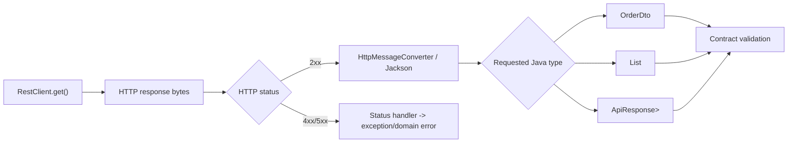
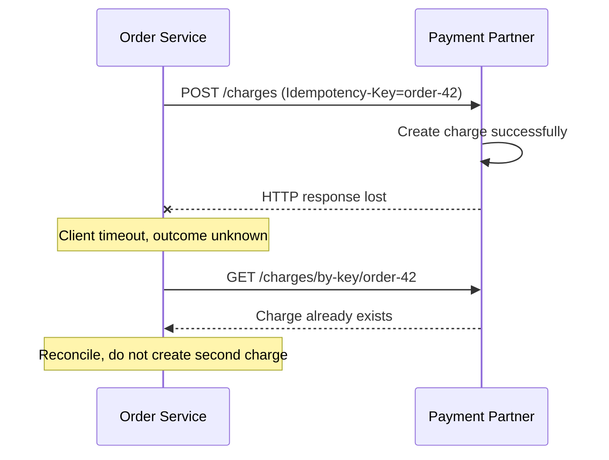
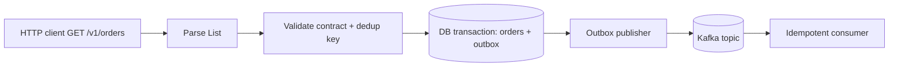
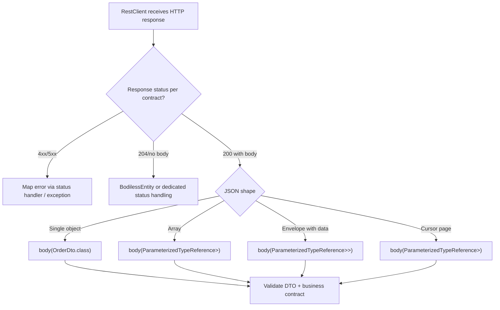

# Mapping Single Responses, Lists, and Generic Types

> **Chapter:** Synchronous HTTP  
> **Module:** SPRING_BOOT_INTEGRATION — integrating systems in Spring Boot via HTTP clients, databases, caches, message brokers, and Spring Integration adapters; emphasizing configuration, data contracts, transactions, errors, deduplication, testing, and observability.

## 1. Problem: Same JSON Format, Different Java Results

An order service needs to synchronize data from a partner API:

- `GET /v1/orders/{id}` returns **a single order** as a JSON object.
- `GET /v1/orders?customerId=...` returns a **list of orders** as a JSON array.
- `GET /v1/orders/lookup?customerId=...` returns a **generic envelope** containing metadata and `data` as an order list.
- `GET /v1/orders/page?cursor=...` returns a **cursor-paginated page of results**.

If everything is deserialized with `Object.class` or `List.class`, business code may receive `LinkedHashMap` instances instead of `OrderDto`. `ClassCastException` when accessing elements typically surfaces only **after the HTTP call has already succeeded**.

In Spring Boot, choosing the right response type is not merely picking a `body(...)` syntax: it is part of the **data contract between systems**. Java types, JSON shapes, HTTP status codes, headers, charsets, number/date formats, and error policies must all align.

### 1.1. Learning Objectives

After this lesson, you will be able to:

1. Understand how `RestClient` combines `HttpMessageConverter`/Jackson to read HTTP responses.
2. Distinguish `.body(OrderDto.class)`, `.body(OrderDto[].class)`, and `.body(new ParameterizedTypeReference<List<OrderDto>>() {})`.
3. Read `ApiResponse<List<OrderDto>>` envelopes, `Map<String, OrderDto>`, and pagination wrappers in a type-safe manner.
4. Retrieve status/headers via `ResponseEntity<T>`, and handle 204/404/202 and empty bodies with proper semantics.
5. Define DTOs, validate schemas, and translate HTTP/JSON failures into appropriate business signals.
6. Write outbound HTTP tests with `MockRestServiceServer`, monitor latency, and control resources.

## 2. What Does a Response Actually Contain?

An HTTP response consists of a **status line**, **headers**, and usually a **body**; not every response carries a body.

```http
HTTP/1.1 200 OK
Content-Type: application/json
ETag: "rev-17"
X-Request-Id: partner-95c

{
  "id": "ord-42",
  "customerId": "cus-7",
  "amount": 125.50,
  "status": "PAID",
  "createdAt": "2026-11-21T07:15:30Z"
}
```

| Response Part | Example | Adapter Responsibility |
| --- | --- | --- |
| Status code | 200, 204, 404, 409, 429, 503 | Classify success, not-found, business conflict, throttling, and transient errors |
| Content-Type | `application/json` | Select the matching converter; never assume every body is JSON |
| ETag/Last-Modified | `"rev-17"` | Can support caching and conditional requests if the contract permits |
| Correlation header | `X-Request-Id` | Aids tracing and investigation while avoiding sensitive-data leaks |
| JSON body | Object/array/envelope | Deserialize into the right type and validate key properties |
| Empty body | HTTP 204 or contract error | Distinguish intentional no-content success from a contract-violating response |

### 2.1. Mapping Pipeline in RestClient



`RestClient` (Spring Framework 6.1+) provides a **synchronous** HTTP API; reading the body blocks the calling thread until a response or error arrives. When an application uses Spring MVC, JDBC/JPA, and imperative business logic, this approach is generally a better fit than creating a reactive publisher only to call `.block()` at every step.

In Spring Boot 3.2–3.5 applications, `RestClient.Builder` is auto-configured when the required dependencies are present; use the injected builder to inherit application-configured customizers, codecs, and observability. Calling `RestClient.create()` arbitrarily can bypass those customizations.

### 2.2. Three Levels of Type Information

| Java Type Passed | Matching JSON | Remarks |
| --- | --- | --- |
| `OrderDto.class` | Single JSON object | Concrete type expressible via `Class<T>` |
| `OrderDto[].class` | JSON array | Arrays preserve their component type at runtime |
| `new ParameterizedTypeReference<List<OrderDto>>() {}` | JSON array | Preserves generic element type when Jackson instantiates each `OrderDto` |
| `new ParameterizedTypeReference<ApiResponse<List<OrderDto>>>() {}` | Object whose `data` field is an array | Preserves multi-level nested generic types |
| `Map.class` / `List.class` | Object/array | Drops concrete value/element types, usually producing raw maps/lists |

**Why a type token is required:** Java **type erasure** gives `List<OrderDto>` and `List<String>` the exact same raw runtime class `List.class`. Therefore, `ParameterizedTypeReference<T>` is needed to carry the full `T` type information to the converter.

## 3. Setting Up the Sample Application and Data Contract

Examples below target **Spring Boot 3.2–3.5, Spring Framework 6.1+, Java 17+**, using `RestClient` in a blocking application. If you run another major line such as Boot 4, verify packages, starters, and APIs against that version's BOM.

### 3.1. Spring Web and Test Dependencies

```groovy
// build.gradle — project applying the Spring Boot plugin/BOM
dependencies {
    implementation 'org.springframework.boot:spring-boot-starter-web'
    testImplementation 'org.springframework.boot:spring-boot-starter-test'
}
```

The Web starter puts Spring Web and the required JSON mapping libraries on the classpath in standard setups. Let Spring Boot manage Spring/Jackson versions; do not mix `spring-web` from one Framework line with Boot from another.

### 3.2. JSON Contracts

**Single order**:

```json
{
  "id": "ord-42",
  "customerId": "cus-7",
  "amount": 125.50,
  "status": "PAID",
  "createdAt": "2026-11-21T07:15:30Z"
}
```

**Order list**:

```json
[
  {
    "id": "ord-42",
    "customerId": "cus-7",
    "amount": 125.50,
    "status": "PAID",
    "createdAt": "2026-11-21T07:15:30Z"
  },
  {
    "id": "ord-43",
    "customerId": "cus-7",
    "amount": 9.99,
    "status": "NEW",
    "createdAt": "2026-11-21T07:20:00Z"
  }
]
```

**Generic envelope**:

```json
{
  "requestId": "partner-r-92",
  "status": "OK",
  "data": [
    {
      "id": "ord-42",
      "customerId": "cus-7",
      "amount": 125.50,
      "status": "PAID",
      "createdAt": "2026-11-21T07:15:30Z"
    }
  ]
}
```

Design note: an endpoint returning a bare array is **not the same** as an endpoint returning an object with a `data` field. `List<OrderDto>` can only deserialize a top-level JSON array directly; if the API returns an envelope, you must declare a wrapper containing `data`.

### 3.3. Record DTOs

```java
// OrderDto.java
import java.math.BigDecimal;
import java.time.Instant;

public record OrderDto(
        String id,
        String customerId,
        BigDecimal amount,
        String status,
        Instant createdAt) {
}
```

Data type choices:

- `BigDecimal` for monetary amounts to avoid binary floating-point rounding errors in payment arithmetic.
- `Instant` for UTC timestamps ending in `Z`; a properly configured JSON converter parses ISO-8601 strings into Java instants.
- `String` for partner IDs because you should not assume partner IDs will always remain `UUID` or numeric.
- `record` makes DTO fields immutable after deserialization, yet it **does not automatically validate** `id`, `amount`, or business state.

If the partner returns `order_id` instead of `id`, use `@JsonProperty("order_id")` or an agreed naming strategy; never guess JSON field names. If using an enum for status, define how the client behaves when the partner introduces a new value instead of letting deserialization fail unexpectedly.

### 3.4. Type Wrappers for Generic Responses

```java
// ApiResponse.java
public record ApiResponse<T>(
        String requestId,
        String status,
        T data) {
}
```

```java
// CursorPage.java
import java.util.List;

public record CursorPage<T>(
        List<T> items,
        String nextCursor,
        Long totalCount) {
}
```

Both DTOs above are **concrete classes with generic parameters**, not raw `Map<String, Object>`. When reading `ApiResponse<List<OrderDto>>` or `CursorPage<OrderDto>`, pass the complete generic type to RestClient.

### 3.5. Configuring Base URL from the Environment

```yaml
# application.yml — configuration containing no real credentials
integration:
  orders:
    base-url: ${ORDERS_API_BASE_URL:https://orders.example.invalid/api}
```

```java
import org.springframework.beans.factory.annotation.Value;
import org.springframework.context.annotation.Bean;
import org.springframework.context.annotation.Configuration;
import org.springframework.web.client.RestClient;

@Configuration(proxyBeanMethods = false)
class OrdersHttpConfiguration {

    @Bean("ordersRestClient")
    RestClient ordersRestClient(
            RestClient.Builder builder,
            @Value("${integration.orders.base-url}") String baseUrl) {
        return builder.baseUrl(baseUrl).build();
    }
}
```

The `example.invalid` domain is strictly illustrative, not a live service. In production, you **must** supply the real URL via environment variables or secret configuration, never letting the `example.invalid` fallback act as a real endpoint. Use HTTPS and partner-specified authentication only, managing timeouts, pools, and tokens outside business code.

## 4. Single Response: body(OrderDto.class)

For a single JSON object, `Class<T>` is enough to describe the Java type.

```java
import java.util.Objects;
import org.springframework.beans.factory.annotation.Qualifier;
import org.springframework.http.MediaType;
import org.springframework.stereotype.Component;
import org.springframework.web.client.RestClient;

@Component
public class OrdersHttpGateway {
    private final RestClient client;

    public OrdersHttpGateway(
            @Qualifier("ordersRestClient") RestClient client) {
        this.client = client;
    }

    public OrderDto findRequired(String id) {
        OrderDto order = client.get()
                .uri("/v1/orders/{id}", id)
                .accept(MediaType.APPLICATION_JSON)
                .retrieve()
                .body(OrderDto.class);

        return Objects.requireNonNull(
                order, "Orders API returned no body for required order");
    }
}
```

**Flow:** Spring constructs the URL from the base URL + path variable, sends GET, receives status/body, and uses the JSON converter to populate `OrderDto`. On an HTTP 2xx with an empty body, `body(OrderDto.class)` can return `null`; `Objects.requireNonNull` here catches the contract violation immediately instead of letting a `NullPointerException` surface deeper in the business layer.

Key points:

1. `.uri("/v1/orders/{id}", id)` delegates URI template expansion and encoding to Spring, which is far safer than concatenating `"/orders/" + id` with untrusted input.
2. `accept(application/json)` requests a JSON representation via HTTP content negotiation, which **does not guarantee** the server will actually return valid JSON.
3. If `amount` is absent in JSON, Jackson may assign `null` instead of failing automatically; validate the contract after deserialization.
4. `@JsonIgnoreProperties(ignoreUnknown = true)` or unknown-property configuration may be needed to tolerate newly added fields; use it only when the business logic accepts ignoring extra fields.
5. Accept a single `OrderDto` only when the endpoint is specified to return **one object**, not an object inside an array or an envelope.

### 4.1. Mapping Different Field Names

Suppose the partner renames fields to `order_id` and `total_amount`. You can declare an adapter-local DTO:

```java
import java.math.BigDecimal;
import com.fasterxml.jackson.annotation.JsonIgnoreProperties;
import com.fasterxml.jackson.annotation.JsonProperty;

@JsonIgnoreProperties(ignoreUnknown = true)
public record PartnerOrderPayload(
        @JsonProperty("order_id") String id,
        @JsonProperty("total_amount") BigDecimal amount) {
}
```

Then **map `PartnerOrderPayload` to a domain DTO** using explicit rules. Never pass raw external payloads straight into JPA/MongoDB entities or Kafka messages when their schemas and lifecycles differ.

### 4.2. Validating Data After Deserialization

Example check at the boundary:

```java
static OrderDto requireValid(OrderDto order) {
    if (order == null
            || order.id() == null || order.id().isBlank()
            || order.amount() == null
            || order.amount().signum() < 0
            || order.createdAt() == null) {
        throw new IllegalArgumentException(
                "Orders API returned a contract-invalid order");
    }
    return order;
}
```

This fragment illustrates a validation method placed in an adapter validator. In production, use a dedicated exception for **upstream contract violations** with proper error codes and tracing so an HTTP controller does not mistakenly return a 400 client error when **the downstream returned bad data**. Jakarta Bean Validation can also be used, but never assume validation runs automatically simply because `RestClient.body(OrderDto.class)` succeeded.

## 5. List Responses: Array or ParameterizedTypeReference

Endpoint `GET /v1/orders?customerId=cus-7` returns a JSON array. There are two valid ways to map it:

### 5.1. Using an Array Class Token

```java
import java.util.Arrays;
import java.util.List;

OrderDto[] array = client.get()
        .uri(uri -> uri.path("/v1/orders")
                .queryParam("customerId", customerId)
                .build())
        .retrieve()
        .body(OrderDto[].class);

List<OrderDto> orders =
        array == null ? List.of() : Arrays.asList(array);
```

This code is a fragment inside a method that already has `client`/`customerId`. Advantage: `OrderDto[].class` retains the element type at runtime so the converter creates the proper array. However, **do not silently turn `null` into an empty list** when the API contract requires HTTP 200 to always return a JSON array; use the ternary only if the partner **explicitly specifies** that an empty body means an empty list. Otherwise, throw a contract exception.

### 5.2. Using ParameterizedTypeReference for List<OrderDto>

```java
import java.util.List;
import org.springframework.core.ParameterizedTypeReference;
import org.springframework.http.MediaType;

List<OrderDto> orders = client.get()
        .uri(uri -> uri.path("/v1/orders")
                .queryParam("customerId", customerId)
                .build())
        .accept(MediaType.APPLICATION_JSON)
        .retrieve()
        .body(new ParameterizedTypeReference<List<OrderDto>>() {});
```

`ParameterizedTypeReference` captures the generic type via an anonymous subclass. Spring passes `List<OrderDto>` type metadata to Jackson, so every element becomes an `OrderDto` instead of a `Map`. The result must still be validated against the contract: `orders == null`, null elements, blank IDs, and oversized lists each need explicit handling.

### 5.3. Anti-Pattern: Why Does List.class Fail?

```java
// WRONG if downstream code expects every item to be an OrderDto.
List<?> rawItems = client.get()
        .uri("/v1/orders")
        .retrieve()
        .body(List.class);

// When the JSON body contains objects, elements are usually LinkedHashMap,
// not OrderDto.
OrderDto wrong = (OrderDto) rawItems.get(0); // Likely ClassCastException
```

The HTTP call can return 200 and deserialize cleanly, yet the **runtime element type is wrong** because `List.class` carries no generic type parameter. Simply declaring a return type `List<Object>` will not tell the converter which elements are `OrderDto` either.

**Do not "fix" this with** `(List<OrderDto>)(List<?>)rawItems`: an unchecked cast only silences the compiler warning; it does not turn a `LinkedHashMap` into an `OrderDto`. Use `OrderDto[].class` or `ParameterizedTypeReference<List<OrderDto>>` when reading the response.

### 5.4. 200 with [] Differs from 204 and 404

| Response | Agreed Semantics | Java Value |
| --- | --- | --- |
| `200 OK` + `[]` | Search/list succeeded with zero matching items | `List.of()` or empty list |
| `200 OK` + populated array | Query succeeded | `List<OrderDto>` |
| `200 OK` + empty body | Possible contract violation if API promises a JSON array | Throw contract error unless partner specifies otherwise |
| `204 No Content` | Success **with no** body | Accept per specific contract; do not fabricate a list |
| `404 Not Found` | Missing endpoint/resource or domain not found | Map per API contract; do not assume equivalent to an empty list |
| `503 Service Unavailable` | Downstream unavailable | Infrastructure failure; never return an empty list to mask the error |

For collection APIs, returning `200 []` on zero results is usually clearer than 404, but **you must follow the partner's contract**, not rewrite their rules.

## 6. Generic Types: ApiResponse<T>, List<T>, and Map<K, V>

In integration systems, many partners standardize JSON inside an envelope:

```json
{
  "requestId": "partner-r-92",
  "status": "OK",
  "data": [
    {
      "id": "ord-42",
      "customerId": "cus-7",
      "amount": 125.50,
      "status": "PAID",
      "createdAt": "2026-11-21T07:15:30Z"
    }
  ]
}
```

If Java passes `ApiResponse.class`, the `data` field of `ApiResponse<T>` loses `T` at runtime. When `T` is a list of objects, Jackson typically deserializes it as `List<Map<String,Object>>` rather than `List<OrderDto>`.

### 6.1. Envelope Containing One OrderDto

```java
import org.springframework.core.ParameterizedTypeReference;

ApiResponse<OrderDto> response = client.get()
        .uri("/v1/orders/lookup/{id}", id)
        .retrieve()
        .body(new ParameterizedTypeReference<ApiResponse<OrderDto>>() {});
```

Do not pass `body(ApiResponse.class)` and then cast `response.data()` to `OrderDto`; `T` is erased. Using `ParameterizedTypeReference` tells the converter that `data` has type `OrderDto`.

### 6.2. Envelope Containing a List of OrderDto

```java
import java.util.List;
import org.springframework.core.ParameterizedTypeReference;

ApiResponse<List<OrderDto>> response = client.get()
        .uri(uri -> uri.path("/v1/orders/lookup")
                .queryParam("customerId", customerId)
                .build())
        .retrieve()
        .body(new ParameterizedTypeReference<
                ApiResponse<List<OrderDto>>>() {});
```

This is the classic example of **multi-level nested generics**:

```text
ApiResponse<T>
└── T = List<OrderDto>
    └── element = OrderDto
```

The type token preserves the entire `ApiResponse<List<OrderDto>>` structure. After deserialization, verify:

1. The envelope is non-null and its `status` is within the accepted set of values.
2. `data` is present if required by the API; an empty list differs from a null body/envelope.
3. Each element passes domain validation: ID, amount, timestamp, etc.
4. `requestId` is used for controlled correlation/logging; never put arbitrary values into metric tags.

**Note:** `status="OK"` inside the body is a **partner-defined business status**, not an HTTP status code. A server can return HTTP 200 with `status="ERROR"` in the body; the adapter must understand the contract and actively translate that into a domain/integration error rather than treating HTTP 2xx as unconditional success.

### 6.3. Envelope Containing Map<String, OrderDto>

Another API may return an object where each property key is an order ID:

```json
{
  "requestId": "partner-r-93",
  "status": "OK",
  "data": {
    "ord-42": {
      "id": "ord-42",
      "customerId": "cus-7",
      "amount": 125.50,
      "status": "PAID",
      "createdAt": "2026-11-21T07:15:30Z"
    }
  }
}
```

Read the response using:

```java
import java.util.Map;
import org.springframework.core.ParameterizedTypeReference;

ApiResponse<Map<String, OrderDto>> response = client.get()
        .uri("/v1/orders/index")
        .retrieve()
        .body(new ParameterizedTypeReference<
                ApiResponse<Map<String, OrderDto>>>() {});
```

Do not fall back to `Map<String,Object>` when the contract specifies a concrete value type. However, **do not equate an object map with a list**: JSON objects cannot represent duplicate keys like arrays can, key ordering should not be relied upon for business ordering, and using IDs as property names requires bounding size/cardinality.

### 6.4. Defining Reusable Type Tokens

You do not need a fresh anonymous subclass at every call site when response shapes are fixed. You can declare constants:

```java
import java.util.List;
import org.springframework.core.ParameterizedTypeReference;

public final class OrdersResponseTypes {
    private OrdersResponseTypes() {}

    public static final ParameterizedTypeReference<List<OrderDto>> ORDER_LIST =
            new ParameterizedTypeReference<List<OrderDto>>() {};

    public static final ParameterizedTypeReference<
            ApiResponse<List<OrderDto>>> ORDER_LIST_ENVELOPE =
            new ParameterizedTypeReference<
                    ApiResponse<List<OrderDto>>>() {};
}
```

Then:

```java
ApiResponse<List<OrderDto>> result = client.get()
        .uri("/v1/orders/lookup")
        .retrieve()
        .body(OrdersResponseTypes.ORDER_LIST_ENVELOPE);
```

Type tokens are stateless and can be shared across requests with the same schema; they hold no response data. Using constants prevents one call site from using `List.class` while another supplies full generic type information.

### 6.5. When the Generic Type Is Known Only at Runtime

Writing `new ParameterizedTypeReference<ApiResponse<T>>() {}` **inside a generic method** does not capture the concrete type of `T`; at runtime `T` remains a type variable. When you know the element's `Class<T>` at runtime, construct the `Type` using `ResolvableType`:

```java
import java.util.List;
import org.springframework.core.ParameterizedTypeReference;
import org.springframework.core.ResolvableType;
import org.springframework.web.client.RestClient;

public final class GenericOrderLookup {
    private GenericOrderLookup() {}

    public static <T> ApiResponse<List<T>> fetchListEnvelope(
            RestClient client,
            String path,
            Class<T> elementType) {
        ResolvableType list = ResolvableType.forClassWithGenerics(
                List.class, elementType);
        ResolvableType envelope = ResolvableType.forClassWithGenerics(
                ApiResponse.class, list);

        ParameterizedTypeReference<ApiResponse<List<T>>> type =
                ParameterizedTypeReference.forType(envelope.getType());

        return client.get()
                .uri(path)
                .retrieve()
                .body(type);
    }
}
```

This shows how to **build a generic `Type` token when `Class<T>` is passed at runtime**. In practice, when endpoints and schemas are known upfront, constant type tokens are simpler. The `path` argument here **must come from trusted code**, never from arbitrary HTTP input, to prevent SSRF or accessing unintended credentialed endpoints.

If elements themselves are complex types like `Map<String, List<OrderDto>>`, nest `ResolvableType` or construct the full `Type` explicitly; never pass `List.class` expecting the framework to guess from JSON field names.

## 7. Pagination: Generic Wrappers Beyond List<T>

A paginated endpoint typically returns an envelope:

```json
{
  "items": [
    {
      "id": "ord-42",
      "customerId": "cus-7",
      "amount": 125.50,
      "status": "PAID",
      "createdAt": "2026-11-21T07:15:30Z"
    }
  ],
  "nextCursor": "opaque-cursor-2",
  "totalCount": 235
}
```

Using the `CursorPage<T>` DTO defined earlier:

```java
import org.springframework.core.ParameterizedTypeReference;

CursorPage<OrderDto> page = client.get()
        .uri(uri -> uri.path("/v1/orders/page")
                .queryParam("limit", 50)
                .queryParam("cursor", cursor)
                .build())
        .retrieve()
        .body(new ParameterizedTypeReference<CursorPage<OrderDto>>() {});
```

Here `cursor` is a local variable inside the adapter method. If the API specifies **omitting the parameter** when `cursor` is null, build the URI conditionally so `queryParam("cursor", cursor)` is added **only when non-null**. Never assume `cursor=` or literal `null` behaves the same as omitting the parameter.

### 7.1. Pagination Contracts Must Be Explicitly Documented

| Property | Questions to Confirm |
| --- | --- |
| `items` | Always an array or nullable? Are null elements allowed? |
| `nextCursor` | Does null/blank mean last page, or is there a separate flag? |
| `totalCount` | Total across the dataset, an estimate, or count within the page? |
| `limit` | What is the maximum page size the server accepts? |
| Ordering | Is order stable across pages while underlying data changes? |
| Cursor lifetime | Does the cursor expire or bind to a snapshot session? |
| Duplicates/gaps | How are items changing between page fetches handled? |

**Do not deserialize paginated partner APIs directly into Spring Data's `Page<OrderDto>`** unless the partner explicitly publishes that exact schema/contract. `Page` is an interface with specific expectations; partner JSON typically uses `items` and `nextCursor` rather than Spring Data's layout. Use adapter-specific DTOs and convert to internal domain/response models as needed.

### 7.2. Bounded Page Iteration

Every page is an HTTP request; the total request count must be bounded by deadlines and partner policies. Pseudocode:

```text
cursor = null
seenOrderIds = set()
for pageNumber from 1 to MAX_PAGES:
    page = fetch(cursor, limit=50)
    assert page/items satisfy contract
    for order in page.items:
        validate order and process with stable idempotency key
    if page.nextCursor is absent:
        stop successfully
    if page.nextCursor equals cursor:
        fail: cursor did not advance
    cursor = page.nextCursor
if MAX_PAGES exceeded:
    fail with an explicit pagination limit error
```

Do not assume fetching all pages forms an isolated snapshot read. If the partner mutates data during pagination, records may be duplicated or skipped. For import jobs, persist cursors/checkpoints and use business/idempotency keys so failures in HTTP requests or database commits can recover cleanly.

### 7.3. Very Large Lists Should Not Be Collected Into a Single List

`RestClient.retrieve().body(List<OrderDto>)` normally deserializes the entire body into an in-memory list; with millions of records, that consumes heap, increases GC pauses, and holds connections open too long. Instead:

- Paginate with bounded page sizes.
- Process in batches/chunks and persist checkpoints.
- If the API supports streaming/NDJSON, use an appropriate streaming reader/protocol and ensure response resources are closed.
- Apply backpressure/memory bounds in the processing layer; consider `WebClient`/streaming when the architecture warrants it.

In Spring Batch, a reader calling a paginated API must record the cursor/record ID in the checkpoint for safe restarts. Parsing an HTTP response successfully does not mean PostgreSQL has committed or Kafka has accepted the event.

## 8. ResponseEntity<T>: When You Need HTTP Status and Headers

`body(...)` works when the caller only needs the payload. When you need `ETag`, `X-Request-Id`, or the status code, use `toEntity(...)`:

```java
import org.springframework.http.HttpHeaders;
import org.springframework.http.MediaType;
import org.springframework.http.ResponseEntity;

ResponseEntity<OrderDto> response = client.get()
        .uri("/v1/orders/{id}", id)
        .accept(MediaType.APPLICATION_JSON)
        .retrieve()
        .toEntity(OrderDto.class);

int statusCode = response.getStatusCode().value();
String etag = response.getHeaders().getETag();
String partnerRequestId =
        response.getHeaders().getFirst("X-Request-Id");
OrderDto body = response.getBody();
```

`toEntity(OrderDto.class)` returns a `ResponseEntity<OrderDto>` with status, headers, and body. HTTP 4xx/5xx responses may still be turned into exceptions by `retrieve()` before returning a `ResponseEntity`, unless an appropriate status handler is registered. `toEntity(...)` **is not a way to suppress status errors**.

### 8.1. ResponseEntity with Generic Types

```java
import java.util.List;
import org.springframework.core.ParameterizedTypeReference;
import org.springframework.http.ResponseEntity;

ResponseEntity<List<OrderDto>> response = client.get()
        .uri("/v1/orders")
        .retrieve()
        .toEntity(new ParameterizedTypeReference<List<OrderDto>>() {});

List<OrderDto> orders = response.getBody();
```

`ResponseEntity<List<OrderDto>>` preserves the HTTP metadata alongside deserialized data, while `ParameterizedTypeReference` preserves the element type. They solve **two orthogonal concerns** and cannot replace each other.

Similarly, if the API returns an envelope:

```java
ResponseEntity<ApiResponse<List<OrderDto>>> response = client.get()
        .uri("/v1/orders/lookup")
        .retrieve()
        .toEntity(OrdersResponseTypes.ORDER_LIST_ENVELOPE);
```

### 8.2. HTTP 204, HEAD, and Bodyless Responses

For endpoints contracted to **return no body**, choose:

```java
import org.springframework.http.ResponseEntity;

ResponseEntity<Void> response = client.head()
        .uri("/v1/orders/{id}", id)
        .retrieve()
        .toBodilessEntity();
```

`HEAD` reads only resource metadata and has no response body by specification. For `DELETE` or `POST` returning 204 per contract, `toBodilessEntity()` likewise gives status/headers without requiring DTO deserialization.

**Never assume HTTP 204 = not found:** 204 means success with no content. Conversely, `200 OK` with an empty body **may be a contract violation** if the API promised to return `OrderDto`.

### 8.3. 202 Accepted Does Not Mean Business Processing Finished

A POST triggering report generation may return `202 Accepted` + `Location: /v1/jobs/{id}`. This indicates **asynchronous acceptance on the partner system**, not that the job is COMPLETED—even though `RestClient` is a synchronous API.

If the flow requires the final outcome, poll the status endpoint, receive a webhook, or consume an event; enforce timeouts/deadlines and use an idempotency key for job creation. Never treat HTTP 202 as a completed `OrderDto`.

### 8.4. Headers That Matter for Caching and Errors

- `ETag`/`Last-Modified` enable conditional requests such as `If-None-Match`; HTTP 304 normally has no body.
- `Retry-After` on 429/503 indicates when to retry, if defined by the API contract.
- `Location` on 201/202 identifies the newly created resource/job.
- `Content-Type` and `Content-Encoding` control converter selection and decompression; never assume JSON blindly regardless of headers.
- Correlation headers link requests across services; never log tokens, cookies, `Authorization`, or sensitive bodies.

## 9. Mapping HTTP Errors and Data Contract Violations

Picking `OrderDto` or `List<OrderDto>` alone is not enough. The adapter must also translate transport, status, and contract errors into clear outcomes for application services instead of swallowing 404, 503, or malformed JSON as empty data.

### 9.1. Common Classification Table

| Signal | Default Interpretation to Consider | Should Retry? |
| --- | --- | --- |
| HTTP 200, valid body | HTTP and contract success | No |
| HTTP 200, wrong shape or missing required field | Upstream contract/serialization failure | Do not blindly retry against the same schema |
| HTTP 204 | Success with no body | No, unless specified otherwise |
| HTTP 404 on `GET /orders/{id}` | Order does not exist per contract | Usually no |
| HTTP 404 on a misconfigured URL | Routing/endpoint configuration bug | Do not retry before fixing the URL |
| HTTP 409/422 | Possible business conflict/validation error | Inspect domain code in error body |
| HTTP 429 + Retry-After | Throttling/rate limit | Wait/retry within budget |
| HTTP 500/502/503/504 | Possible transient or infrastructure failure | Bounded retries for safe operations |
| DNS/TLS/connection failure | Network, TLS verification, or configuration issue | Classify; bad certs will not self-heal |
| Timeout after side-effecting POST | Unclear whether server processed the request | Retry only with idempotency/reconciliation |

**HTTP status is not business status.** An API returning 200 with `{"status":"REJECTED", "data":null}` can indicate a rejected order. Conversely, a 404 from a misconfigured proxy/gateway does not mean an `orderId` is absent in the target database.

### 9.2. Default Behavior of RestClient.retrieve()

With `RestClient.retrieve()`, 4xx/5xx HTTP responses are mapped by default to exceptions (appropriate `RestClientResponseException` subtypes) unless the application registers a custom status handler.

```java
import org.springframework.web.client.HttpClientErrorException;
import java.util.Optional;

public Optional<OrderDto> findOptional(String id) {
    try {
        return Optional.ofNullable(client.get()
                .uri("/v1/orders/{id}", id)
                .retrieve()
                .body(OrderDto.class));
    } catch (HttpClientErrorException.NotFound notFound) {
        return Optional.empty();
    }
}
```

This fragment assumes `client` exists in the adapter. Mapping 404 to `Optional.empty()` is **only valid when the contract defines HTTP 404 = order not found**. If an endpoint uses 404 for invalid routes/configurations or encodes different error meanings in the body, inspect the details first. Moreover, `Optional.ofNullable(...)` turns an empty HTTP 200 body into empty as well; if the partner promises a mandatory DTO, **explicitly detect and raise a contract violation** rather than merging both cases.

### 9.3. onStatus: Mapping 404 to a Business Exception

```java
// OrderNotFoundException.java
public final class OrderNotFoundException extends RuntimeException {
    public OrderNotFoundException(String id) {
        super("Order not found: " + id);
    }
}
```

```java
OrderDto order = client.get()
        .uri("/v1/orders/{id}", id)
        .retrieve()
        .onStatus(
                status -> status.value() == 404,
                (request, response) -> {
                    throw new OrderNotFoundException(id);
                })
        .body(OrderDto.class);
```

`onStatus(...)` translates HTTP signals into exceptions with clear semantics inside the adapter. Unmatched error statuses continue using Spring's default error handling. Maintain a unified error-mapping scheme across HTTP client adapters, controller advice, retry policies, logs, and metrics instead of letting each service map ad hoc.

### 9.4. Reading Contracted JSON Error Bodies

Suppose the partner returns an error:

```http
HTTP/1.1 422 Unprocessable Content
Content-Type: application/json

{"code":"ORDER_STATE_INVALID","message":"Order is already closed"}
```

An error DTO:

```java
public record PartnerError(String code, String message) {
}
```

Example status handler reading the JSON error body **once** with Jackson:

```java
import com.fasterxml.jackson.databind.ObjectMapper;

OrderDto order = client.get()
        .uri("/v1/orders/{id}", id)
        .retrieve()
        .onStatus(
                status -> status.value() == 422,
                (request, response) -> {
                    PartnerError error = objectMapper.readValue(
                            response.getBody(), PartnerError.class);
                    throw new PartnerBusinessRejectionException(
                            error.code());
                })
        .body(OrderDto.class);
```

This fragment assumes `objectMapper` is injected from Spring Boot and `PartnerBusinessRejectionException` is an adapter-defined exception. In real implementations, guard against empty/malformed JSON error bodies or oversized payloads; `readValue(...)` can throw parse errors. **Never log the full error body** if it may contain PII or sensitive data.

Note that reading the error body inside a handler does not make a request retry-safe. Classify only domain codes published by the partner API; never assume 422 means the same thing across different partners.

### 9.5. HTTP 429 and Retry-After

```java
import org.springframework.http.HttpHeaders;

OrderDto order = client.get()
        .uri("/v1/orders/{id}", id)
        .retrieve()
        .onStatus(
                status -> status.value() == 429,
                (request, response) -> {
                    String retryAfter = response
                            .getHeaders()
                            .getFirst(HttpHeaders.RETRY_AFTER);
                    throw new PartnerRateLimitedException(retryAfter);
                })
        .body(OrderDto.class);
```

This fragment assumes a `PartnerRateLimitedException` class passes the header up to the retry layer. `Retry-After` can be **a number of seconds** or an **HTTP-date**, not always an integer. Cap wait times by the total deadline and retry policy; do not immediately retry 429 across multiple threads, which can trigger a retry storm.

### 9.6. Timeouts Do Not Prove No Side Effect Occurred



The lookup-by-key endpoint is an **illustrative contract assumption**, not a universal feature of every payment API. For side-effecting POST/PUT/PATCH requests, establish idempotency key support and reconciliation **before** writing retry logic. Successfully deserializing a response into `OrderDto` also does not guarantee a PostgreSQL transaction or Kafka event has committed.

## 10. Mapping Traps That Cause Subtle Bugs

### 10.1. Swapped JSON Objects and Arrays

| Actual API Response | Requested Java Type | Result |
| --- | --- | --- |
| `{ "id": "ord-42" }` | `OrderDto.class` | Valid if other fields match |
| `[{ "id": "ord-42" }]` | `OrderDto.class` | Wrong JSON shape; deserialization error |
| `{ "data": [...] }` | `List<OrderDto>` | Wrong JSON shape |
| `{ "data": [...] }` | `ApiResponse<List<OrderDto>>` | Valid with matching envelope |
| `[]` | `List<OrderDto>` | Valid empty list |
| `null` | `OrderDto.class` | May yield null; requires explicit contract policy |

**Never use `ObjectMapper.convertValue(raw, OrderDto.class)` as a default workaround for raw responses** when you can pass the right type during HTTP body parsing. Only convert dynamically in adapters handling genuinely flexible schemas with validation.

### 10.2. Number Mapping and Financial Precision

JSON `{"amount":125.50}` deserialized into `double` cannot represent decimal values exactly. Use `BigDecimal` with an explicit currency/rounding policy; do not treat `125.50` and `125.5` as different **monetary values**, while keeping scale rules clear when storing or transmitting amounts.

When JSON encodes `amount` as a string (e.g., `"125.50"`), confirm in the contract whether the converter should coerce or reject it. Match DTO types to the actual schema instead of relying on accidental default coercion.

### 10.3. Nulls, Missing Fields, and Primitive Defaults

If `CursorPage<T>` uses primitive `long totalCount`, missing `totalCount` in JSON under some Jackson configurations defaults to `0`, making it hard to distinguish **absent field** from **total equals 0**. That is why the sample DTO in Section 3 uses `Long totalCount`, enabling null checks to catch missing required fields, or strict deserialization constraints that have been tested.

Likewise, a missing `boolean success` can silently become `false` without validation. At integration boundaries, boxed `Boolean`/`Long` with validation are often safer than primitives when missing fields are errors.

### 10.4. Enums and Schema Evolution

If status maps directly to a Java enum `OrderStatus {NEW, PAID, CANCELLED}`, a partner adding `PARTIALLY_PAID` can break parsing. Three strategies:

1. Fail fast under a strict contract, raise an alert, and update client code.
2. Use `String` in the external DTO and map to a domain enum with an explicit `UNKNOWN` state handled intentionally.
3. Use a custom Jackson deserializer with a fallback, while **never** defaulting unknown values to PAID/COMPLETED.

Choose according to business risk; never disable deserialization errors and treat unknown statuses as success.

### 10.5. Date/Time and Timezones

`2026-11-21T07:15:30Z` is a UTC instant. If the partner sends `2026-11-21T14:15:30+07:00`, that represents the **same instant**. Use `Instant` or `OffsetDateTime` when the contract includes timezones; never parse timezone-aware strings into `LocalDateTime` and assume UTC.

For `LocalDate` (business calendar dates), separate local calendar dates from instants. Timestamps like `createdAt` and dates like `businessDate` should not arbitrarily share converters or semantics.

### 10.6. Mismatched Content-Type and Gateway Errors

A common failure: an HTTP proxy returns a 502 HTML page while the application expects JSON. Depending on status handlers/converters, you may get an HTTP 502 exception before parsing or an unsupported `Content-Type` error. **Never catch all errors and return a null DTO**: log error codes/statuses, upstream names, and traces without logging HTML bodies containing sensitive info or credentials.

For huge payloads or malformed encodings, bound response body size and monitor memory; avoid reading huge JSON into `String.class` only to re-parse it unless specifically justified.

### 10.7. Versioning DTO Contracts

When an API changes its response from `List<OrderDto>` to `ApiResponse<List<OrderDto>>`, that is a **breaking shape change** even if the inner object is unchanged. Version endpoints or negotiate media types/contracts for older consumers. Test all combinations:

- New provider -> old consumer.
- Old provider -> new consumer.
- Payloads with new fields, missing fields, and unknown enums.
- 200, 204, 404, 409, 429, 503, and timeouts.

When forwarding responses into Kafka events, never let silent HTTP schema changes alter Kafka event schemas without versioning and compatibility review.

## 11. Legacy RestTemplate and Declarative HTTP Interfaces

`RestClient` is the modern synchronous HTTP choice in Spring Framework 6.1+. In older codebases, `RestTemplate` may still be used; both solve mapping via HTTP message converters.

### 11.1. RestTemplate.getForObject for Objects

```java
import org.springframework.web.client.RestTemplate;

RestTemplate restTemplate = new RestTemplate();

OrderDto order = restTemplate.getForObject(
        "https://orders.example.invalid/api/v1/orders/{id}",
        OrderDto.class,
        id);
```

For generic lists, **do not use** `getForObject(url, List.class)` when you need `OrderDto` elements. Use `exchange(...)` and `ParameterizedTypeReference`:

```java
import java.util.List;
import org.springframework.core.ParameterizedTypeReference;
import org.springframework.http.HttpEntity;
import org.springframework.http.HttpMethod;
import org.springframework.http.ResponseEntity;

ResponseEntity<List<OrderDto>> response = restTemplate.exchange(
        "https://orders.example.invalid/api/v1/orders",
        HttpMethod.GET,
        HttpEntity.EMPTY,
        new ParameterizedTypeReference<List<OrderDto>>() {});

List<OrderDto> orders = response.getBody();
```

This legacy pattern is valid, though for new Spring Boot synchronous code consider `RestClient` for consistent fluent APIs, status handling, and customizers. **Never instantiate a fresh `RestTemplate` on every request**; manage client configuration, authentication, timeouts, and instrumentation via beans.

### 11.2. HttpServiceProxyFactory and Generic Interfaces

Spring Framework supports declarative HTTP interfaces as follows:

```java
import java.util.List;
import org.springframework.http.ResponseEntity;
import org.springframework.web.bind.annotation.PathVariable;
import org.springframework.web.bind.annotation.RequestParam;
import org.springframework.web.service.annotation.GetExchange;
import org.springframework.web.service.annotation.HttpExchange;

@HttpExchange("/v1/orders")
public interface OrdersPartnerApi {

    @GetExchange("/{id}")
    OrderDto findOne(@PathVariable("id") String id);

    @GetExchange
    List<OrderDto> list(@RequestParam("customerId") String customerId);

    @GetExchange("/lookup")
    ApiResponse<List<OrderDto>> lookup(
            @RequestParam("customerId") String customerId);

    @GetExchange("/{id}")
    ResponseEntity<OrderDto> findWithHeaders(
            @PathVariable("id") String id);
}
```

Create a proxy backed by `RestClient`:

```java
import org.springframework.web.client.support.RestClientAdapter;
import org.springframework.web.service.invoker.HttpServiceProxyFactory;

OrdersPartnerApi api = HttpServiceProxyFactory
        .builderFor(RestClientAdapter.create(ordersRestClient))
        .build()
        .createClient(OrdersPartnerApi.class);
```

`ordersRestClient` is assumed to be injected/configured with the partner's base URL. On the interface, `List<OrderDto>` and `ApiResponse<List<OrderDto>>` signatures carry generic metadata directly for the proxy/converter, removing the need to pass `ParameterizedTypeReference` per method.

**However, interfaces do not guarantee safety automatically:** configure timeouts, error status mapping, schema validation, idempotency, tokens, and correlation headers just like with manual RestClient calls. If backed by `WebClientAdapter`, `Mono<T>`/`Flux<T>` return types have different semantics and must not be `.block()`ed carelessly on an event loop.

## 12. Testing Mapping with MockRestServiceServer

A test that merely mocks `OrdersHttpGateway` to return a `List<OrderDto>` does not prove an HTTP JSON array is actually parsed properly. To test the outbound boundary, use `spring-test`'s `MockRestServiceServer` with `RestClient.Builder`:

### 12.1. Setting Up Tests Without Network Connections

```java
import org.junit.jupiter.api.BeforeEach;
import org.springframework.http.MediaType;
import org.springframework.test.web.client.MockRestServiceServer;
import org.springframework.web.client.RestClient;

import static org.springframework.test.web.client.match.MockRestRequestMatchers.requestTo;
import static org.springframework.test.web.client.response.MockRestResponseCreators.withSuccess;

class OrdersHttpResponseMappingTest {
    private RestClient client;
    private MockRestServiceServer server;

    @BeforeEach
    void setUp() {
        RestClient.Builder builder = RestClient.builder()
                .baseUrl("https://orders.example.invalid/api");
        server = MockRestServiceServer.bindTo(builder).build();
        client = builder.build();
    }

    // The @Test methods below belong inside this class.
}
```

`MockRestServiceServer` binds to the builder **before** the client is built and controls responses inside the test JVM. It validates request URIs, statuses, bodies, and headers without real network calls. If production code builds another `RestClient` bypassing this builder, requests may leak onto the real network instead of hitting the mock server.

### 12.2. Testing a Single OrderDto Response

```java
import org.junit.jupiter.api.Test;

import static org.assertj.core.api.Assertions.assertThat;

@Test
void mapsOneOrderWithBigDecimalAndInstant() {
    server.expect(requestTo(
                    "https://orders.example.invalid/api/v1/orders/ord-42"))
            .andRespond(withSuccess(
                    """
                    {
                      "id":"ord-42",
                      "customerId":"cus-7",
                      "amount":125.50,
                      "status":"PAID",
                      "createdAt":"2026-11-21T07:15:30Z"
                    }
                    """,
                    MediaType.APPLICATION_JSON));

    OrderDto order = client.get()
            .uri("/v1/orders/{id}", "ord-42")
            .retrieve()
            .body(OrderDto.class);

    assertThat(order).isNotNull();
    assertThat(order.id()).isEqualTo("ord-42");
    assertThat(order.amount().toPlainString()).isEqualTo("125.50");
    assertThat(order.createdAt().toString())
            .isEqualTo("2026-11-21T07:15:30Z");
    server.verify();
}
```

This test method goes **inside the setup class from Section 12.1**; combine imports/static imports at the top of the real Java file. It proves JSON -> `BigDecimal`/`Instant`/record mapping works with the classpath converters. It does not verify TLS, TCP timeouts, or live server behavior.

### 12.3. Testing Typed List Elements

```java
import java.util.List;
import org.springframework.core.ParameterizedTypeReference;

@Test
void mapsJsonArrayToTypedList() {
    server.expect(requestTo(
                    "https://orders.example.invalid/api/v1/orders"))
            .andRespond(withSuccess(
                    """
                    [
                      {
                        "id":"ord-42",
                        "customerId":"cus-7",
                        "amount":125.50,
                        "status":"PAID",
                        "createdAt":"2026-11-21T07:15:30Z"
                      }
                    ]
                    """,
                    MediaType.APPLICATION_JSON));

    List<OrderDto> orders = client.get()
            .uri("/v1/orders")
            .retrieve()
            .body(new ParameterizedTypeReference<List<OrderDto>>() {});

    assertThat(orders).hasSize(1);
    assertThat(orders.get(0)).isInstanceOf(OrderDto.class);
    assertThat(orders.get(0).id()).isEqualTo("ord-42");
    server.verify();
}
```

The crucial assertion checks **both element type and values**, not just `orders.size() == 1`. With `List.class`, the size would pass while elements were actually `LinkedHashMap`.

### 12.4. Testing Nested Generic Envelopes and Headers

```java
import java.util.List;
import org.springframework.http.ResponseEntity;

@Test
void mapsNestedEnvelopeAndPreservesHeaders() {
    server.expect(requestTo(
                    "https://orders.example.invalid/api/v1/orders/lookup"))
            .andRespond(withSuccess(
                    """
                    {
                      "requestId":"partner-r-92",
                      "status":"OK",
                      "data":[{
                        "id":"ord-42",
                        "customerId":"cus-7",
                        "amount":125.50,
                        "status":"PAID",
                        "createdAt":"2026-11-21T07:15:30Z"
                      }]
                    }
                    """,
                    MediaType.APPLICATION_JSON)
                    .header("ETag", "\"rev-17\"")
                    .header("X-Request-Id", "partner-r-92"));

    ResponseEntity<ApiResponse<List<OrderDto>>> response =
            client.get()
                    .uri("/v1/orders/lookup")
                    .retrieve()
                    .toEntity(OrdersResponseTypes.ORDER_LIST_ENVELOPE);

    assertThat(response.getStatusCode().value()).isEqualTo(200);
    assertThat(response.getHeaders().getETag()).isEqualTo("\"rev-17\"");
    assertThat(response.getBody()).isNotNull();
    assertThat(response.getBody().data()).hasSize(1);
    assertThat(response.getBody().data().get(0))
            .isInstanceOf(OrderDto.class);
    assertThat(response.getBody().requestId()).isEqualTo("partner-r-92");
    server.verify();
}
```

Here `toEntity(OrdersResponseTypes.ORDER_LIST_ENVELOPE)` verifies two independent requirements at once: **generic body type** and **HTTP metadata**. The `ETag` header must include surrounding quotes per standard validator syntax. If a test lacks the Jackson Java Time converter, fix dependencies/configuration rather than downgrading the `Instant` DTO field to a string without cause.

### 12.5. Testing Error Statuses and Wrong Shapes

```java
import org.junit.jupiter.api.Test;
import org.springframework.http.HttpStatus;
import org.springframework.web.client.HttpClientErrorException;
import org.springframework.web.client.RestClientException;

import static org.assertj.core.api.Assertions.assertThatThrownBy;
import static org.springframework.test.web.client.response.MockRestResponseCreators.withStatus;

@Test
void notFoundIsAnHttpErrorNotAnEmptyDto() {
    server.expect(requestTo(
                    "https://orders.example.invalid/api/v1/orders/missing"))
            .andRespond(withStatus(HttpStatus.NOT_FOUND));

    assertThatThrownBy(() -> client.get()
            .uri("/v1/orders/{id}", "missing")
            .retrieve()
            .body(OrderDto.class))
            .isInstanceOf(HttpClientErrorException.NotFound.class);
    server.verify();
}

@Test
void arrayCannotSilentlyBecomeSingleOrderDto() {
    server.expect(requestTo(
                    "https://orders.example.invalid/api/v1/orders/ord-42"))
            .andRespond(withSuccess(
                    "[{\"id\":\"ord-42\"}]",
                    MediaType.APPLICATION_JSON));

    assertThatThrownBy(() -> client.get()
            .uri("/v1/orders/{id}", "ord-42")
            .retrieve()
            .body(OrderDto.class))
            .isInstanceOf(RestClientException.class);
    server.verify();
}
```

These test methods also belong in the setup class from Section 12.1. JSON shape mismatches should fail explicitly rather than returning a null DTO and proceeding to write PostgreSQL or emit Kafka events. Exact exception subclasses can vary across converters/versions; assert the `RestClientException` superclass when appropriate.

### 12.6. Testing 204 and Null Contracts

For an endpoint where 204 is a valid response:

```java
import org.springframework.http.ResponseEntity;
import static org.springframework.test.web.client.response.MockRestResponseCreators.withNoContent;

@Test
void noContentHasNoDtoBody() {
    server.expect(requestTo(
                    "https://orders.example.invalid/api/v1/orders/ord-42"))
            .andRespond(withNoContent());

    ResponseEntity<OrderDto> response = client.get()
            .uri("/v1/orders/{id}", "ord-42")
            .retrieve()
            .toEntity(OrderDto.class);

    assertThat(response.getStatusCode().value()).isEqualTo(204);
    assertThat(response.getBody()).isNull();
    server.verify();
}
```

If that same endpoint's contract **requires 200 + DTO**, the 204 test should assert that the adapter throws a contract violation instead of treating it as success, even though `RestClient` returns `ResponseEntity` without error. That is a **per-contract adapter decision**, not a generic HTTP client rule.

### 12.7. Integration Testing When Real Networking Is Required

`MockRestServiceServer` cannot test real DNS, TLS handshakes, TCP connect/read timeouts, proxies, pool saturation, or HTTP compression. When needed:

- Run WireMock or MockWebServer as a real HTTP server on an ephemeral port.
- Verify URLs, TLS/truststores, auth headers, large responses, timeouts, and connection-reset failures.
- Use Testcontainers for proxy/gateway topologies when warranted.
- Keep test endpoints and credentials isolated from production; never test failure modes by sending fake payloads to a live partner.

Every HTTP client mapping test should use **contract fixtures** from the partner or versioned OpenAPI/schemas. Never craft fixtures completely divorced from real responses and assume integration compatibility.

## 13. Performance, Security, and End-to-End Integration Consistency

### 13.1. Synchronous RestClient and Resource Limits

While `body(List<OrderDto>)` waits on the upstream, the calling thread blocks on HTTP. Meanwhile, the HTTP client manages its own connection pool and sockets. Enforce bounds on:

| Limit | Why Needed? |
| --- | --- |
| Connect timeout | Avoid waiting indefinitely when TCP cannot connect |
| Read/response timeout | A slow upstream must not hold threads/connections too long |
| Pool acquisition timeout | Waiting for a free connection must also have a max wait |
| Max connections and concurrency | Protect both downstream and this service from overload |
| Total deadline | Encompasses retries, backoff, parsing, and downstream processing |
| Max response/page size | Prevents deserializing giant arrays and heap pressure |
| Retry budget + jitter | Prevents retry storms when many requests fail together |

In MVC applications on Java 21+, virtual threads reduce the cost of parking platform threads on I/O, yet they do not make connection pools, target servers, or giant JSON responses infinite. **Accurate type mapping does not replace observability and load limits.**

### 13.2. Transaction Boundaries: An HTTP Body Is Not a Committed Record

An integration pipeline:



HTTP GET 200 and successful parsing only mean **the representation was received**. To synchronize data safely:

1. Validate ID/version/amount/status before writing data.
2. Insert/upsert using a unique business key so retries or batch restarts do not create duplicates.
3. Never keep a DB transaction open waiting for partner HTTP responses.
4. To publish Kafka events reflecting DB changes, use a transactional outbox/inbox for consistency.
5. Make consumers idempotent, as duplicate events can arrive during publisher retries or broker redeliveries.
6. Assign HTTP retry ownership to a single clear layer instead of letting cron, Spring Batch, HTTP client, and broker each retry blindly.

**There is no "system-wide exactly-once"** merely because RestClient parses a clean `List<OrderDto>` or a service uses `@Transactional` on PostgreSQL.

### 13.3. Safety When Receiving and Storing Partner JSON

- Use HTTPS, authenticate properly, and never disable certificate verification.
- Never allow callers to inject arbitrary full URLs/hosts into a client holding default tokens: prevent **SSRF and credential exfiltration**.
- Bound response body sizes, items per page, and JSON nesting depth when reading untrusted inputs.
- Never log raw payloads containing PII, tokens, account numbers, or payment details.
- Deserialize into adapter-dedicated DTOs, then map to validated domain entities/events; never deserialize straight into side-effecting entities.
- Be cautious with Jackson polymorphic/default typing on untrusted payloads; never allow arbitrary class deserialization from external JSON.
- Never skip validation of amounts, currencies, timestamps, and enums just because JSON parsing succeeded.

### 13.4. Layer-Appropriate Observability

Collect:

| Metric/Log/Trace | Value |
| --- | --- |
| HTTP client request duration (p50/p95/p99) | Identifies which upstream causes tail latency |
| Status distribution (2xx/4xx/5xx, 429) | Separates contract bugs, rate limits, and outages |
| Deserialization/contract violation count | Detects breaking API JSON shape changes |
| Null-body/empty-list frequency | Spots anomalies between 200, 204, and empty arrays |
| Response bytes/items per page | Catches oversized pagination responses |
| Retry attempts and timeout budgets | Reveals retry amplification |
| DB write/upsert conflicts | Tracks idempotent replays and duplicate records |
| Outbox/backlog and Kafka ACK | Confirms data synchronized to brokers/consumers |
| Correlation IDs | Links an HTTP request to DB transactions and events |

Spring Boot Actuator/Micrometer and RestClient observation support provide instrumentation, yet **do not assume every metric is enabled automatically** just by adding `spring-boot-starter-web`. Verify registries/exporters, URI templates, and recorded tags. Never use full URIs with IDs or arbitrary query strings as metric tags due to cardinality and data leaks.

### 13.5. Production Incident Runbook

| Symptom | Common Cause | Investigation/Fix |
| --- | --- | --- |
| `ClassCastException: LinkedHashMap -> OrderDto` | Read using `List.class`/`ApiResponse.class` | Use `ParameterizedTypeReference` to retain generic types |
| Error deserializing array into single object | Wrong JSON shape | Verify contract; use `List<OrderDto>` or proper envelope |
| HTTP 200 yet `body() == null` | Missing body/204/contract violation | Check status explicitly; never equate null with success |
| HTTP 200 with body `status=ERROR` | Envelope carries business error code | Validate `ApiResponse.status`, map to domain error |
| 200 with inaccurate amount | Used `double`, mismatched currency scale | Use `BigDecimal` with explicit scale/currency policy |
| Timestamp parsing failure | Mismatched ISO/date pattern or timezone | Align converter/schema with contract |
| RestClient throws 404 by default | `retrieve()` throws on error statuses | Use `onStatus` or catch `NotFound` when domain permits |
| Status handler mishandles 422 | Missing/invalid error body schema | Map a dedicated error DTO with clear status fallback |
| Loading all orders exhausts JVM heap | Unbounded one-shot list | Paginate with bounded processing/streaming |
| Timeout after POST creates duplicates | Missing idempotency key | Reconcile by request ID; retry with the same key if supported |
| Missing Kafka event despite HTTP/DB success | Missing outbox or unawaited ACK | Transactional outbox, durable retries, consumer dedup |

## 14. Decision Tree, Exercise, and Checklist

### 14.1. Choosing the Mapping Type from JSON Shape



This decision tree applies to APIs returning JSON in agreed shapes. For XML, plain text, files, or streaming payloads, choose the matching `HttpMessageConverter`, content type, and reading model. **Do not force every response into a generic JSON DTO.**

### 14.2. Exercise: Importing Orders from a Partner API

**Scenario:** a Spring Boot application runs a sync job at 02:00. The partner exposes three endpoints:

```text
GET /api/v1/orders/{id}
  -> HTTP 200 + single OrderDto, or 404 with code ORDER_NOT_FOUND

GET /api/v1/orders/lookup?customerId={customerId}
  -> HTTP 200 + ApiResponse<List<OrderDto>>

GET /api/v1/orders/page?limit=50&cursor={cursor}
  -> HTTP 200 + CursorPage<OrderDto>
```

Implementation requirements:

1. Create `OrderDto` with `BigDecimal amount` and `Instant createdAt`, matching the JSON contract.
2. Build `RestClient` from Boot's builder with an environment-supplied base URL, HTTPS, auth, and valid timeouts.
3. For the single-order endpoint, use `body(OrderDto.class)`; map 404 to not-found only when the domain error code matches.
4. For lookup, use `ParameterizedTypeReference<ApiResponse<List<OrderDto>>>`, validating envelope `status` and each `OrderDto`.
5. For pagination, use `CursorPage<OrderDto>`, enforce max pages, ensure cursors advance, and handle null/empty per contract.
6. Persist records in the database using a unique business ID so retries/restarts never duplicate orders.
7. If Kafka events must be published after DB writes, use an outbox with stable event IDs.
8. Test with `MockRestServiceServer`: single object, list, nested generics, empty list, 204, 404, 429, 503, and malformed JSON.
9. Test against a real HTTP server in staging for TLS, timeouts, authentication, response sizes, and paging.
10. Monitor latency, HTTP errors, conversion failures, items/page, and sync backlog.

### 14.3. HTTP Client Code Review Checklist

- [ ] Is the JSON root verified as object, array, map, or generic envelope?
- [ ] Is `RestClient.Builder` injected/configured via Boot rather than creating ad-hoc clients per request?
- [ ] Is `body(Class<T>)` used only for concrete types without erased generic parameters?
- [ ] Are `List<T>` and nested `ApiResponse<List<T>>` read via `ParameterizedTypeReference`?
- [ ] Are there zero unchecked casts from `List<Map>` to `List<OrderDto>`?
- [ ] Are HTTP 200 with `[]`, 200 with empty body, 204 no content, and 404 handled distinctly?
- [ ] Is `ApiResponse.status`/business code checked in addition to HTTP status?
- [ ] Do DTOs use accurate types: `BigDecimal` for money, `Instant` for timezone-aware timestamps?
- [ ] Is the response schema validated with policies for missing fields, nulls, unknown enums, and version changes?
- [ ] Are important headers/statuses read via `ResponseEntity<T>` where needed?
- [ ] Are error statuses and connection failures classified, with bounded retries and no unsafe POST repeats?
- [ ] Are connect/read/pool/total timeouts, response size limits, and pagination bounds enforced?
- [ ] Are authentication, TLS, URL trust boundaries, and PII log redaction addressed?
- [ ] Are JSON mapping tests backed by a mock HTTP server and integration tests where real networking is needed?
- [ ] Does the HTTP -> database -> broker pipeline define clear idempotency, transaction boundaries, and recovery?

### 14.4. Self-Check Questions

1. Why is `OrderDto.class` sufficient for a JSON object whereas `List.class` is insufficient for `List<OrderDto>`?
2. When can `OrderDto[].class` be used instead of `ParameterizedTypeReference<List<OrderDto>>`?
3. Why doesn't casting `(List<OrderDto>) rawList` turn a `LinkedHashMap` into an `OrderDto`?
4. How does `ApiResponse<List<OrderDto>>` differ from `List<OrderDto>` in JSON root shape and type token?
5. What two distinct problems do `ResponseEntity<List<OrderDto>>` and `ParameterizedTypeReference<List<OrderDto>>` solve?
6. On HTTP 204, is `body(OrderDto.class)` returning `null` always an error?
7. Why shouldn't HTTP 503 or JSON parse errors be mapped to `List.of()` just to keep processing going?
8. Does an API returning 200 with body `status="REJECTED"` represent business success?
9. Why can using `long totalCount` lose information when a field is missing from JSON?
10. When an API returns `nextCursor`, what safeguards prevent infinite loops and cross-page duplicates?
11. When should you use `RestTemplate.exchange(...)` instead of `getForObject(..., List.class)` in a legacy codebase?
12. Why doesn't successfully parsing an HTTP GET into a DTO guarantee PostgreSQL and Kafka consistency?

**Remember:** `Class<T>` handles single responses, `ParameterizedTypeReference<T>` handles generic types, `ResponseEntity<T>` exposes status/headers/body, and `ApiResponse<T>`/`CursorPage<T>` reflect the **partner's actual JSON contract**. Mapping the data correctly is only step one; a reliable Spring Boot integration must handle **HTTP errors, 204/nulls, schema evolution, timeouts, retries/idempotency, transaction boundaries, testing, and observability**.

### Official References

- [Spring Framework — REST Clients: RestClient, RestTemplate, and HTTP Interface](https://docs.spring.io/spring-framework/reference/integration/rest-clients.html)
- [Spring Framework — HTTP Message Conversion](https://docs.spring.io/spring-framework/reference/web/webmvc/message-converters.html)
- [Spring Framework — ParameterizedTypeReference Javadoc](https://docs.spring.io/spring-framework/docs/6.2.x/javadoc-api/org/springframework/core/ParameterizedTypeReference.html)
- [Spring Framework — RestClient Javadoc](https://docs.spring.io/spring-framework/docs/6.2.x/javadoc-api/org/springframework/web/client/RestClient.html)
- [Spring Framework — MockRestServiceServer Javadoc](https://docs.spring.io/spring-framework/docs/6.2.x/javadoc-api/org/springframework/test/web/client/MockRestServiceServer.html)
- [Spring Boot — Calling REST Services](https://docs.spring.io/spring-boot/3.5/reference/io/rest-client.html)
- [RFC 9110 — HTTP Semantics](https://www.rfc-editor.org/rfc/rfc9110)
