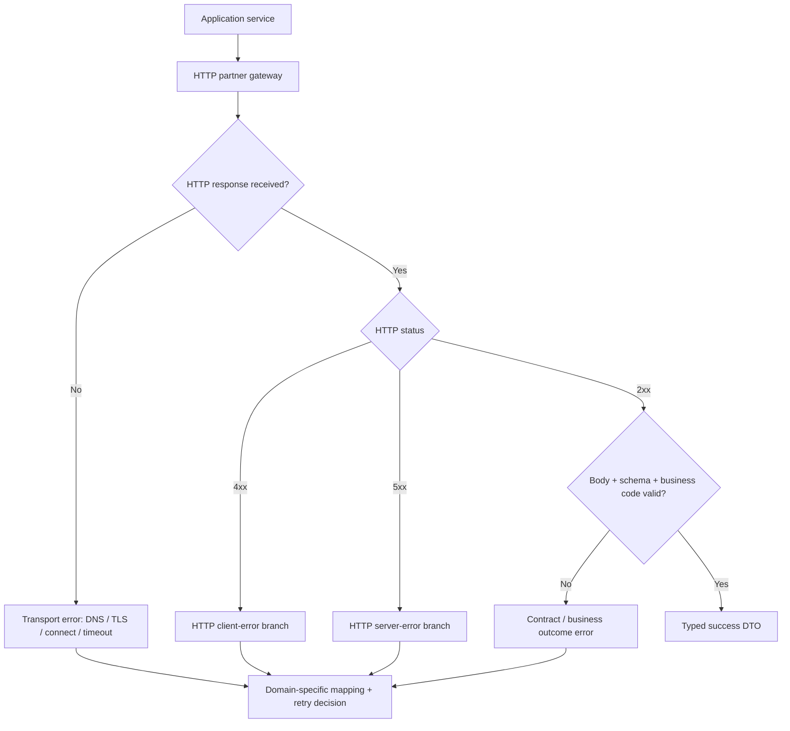
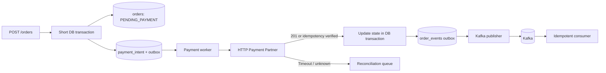
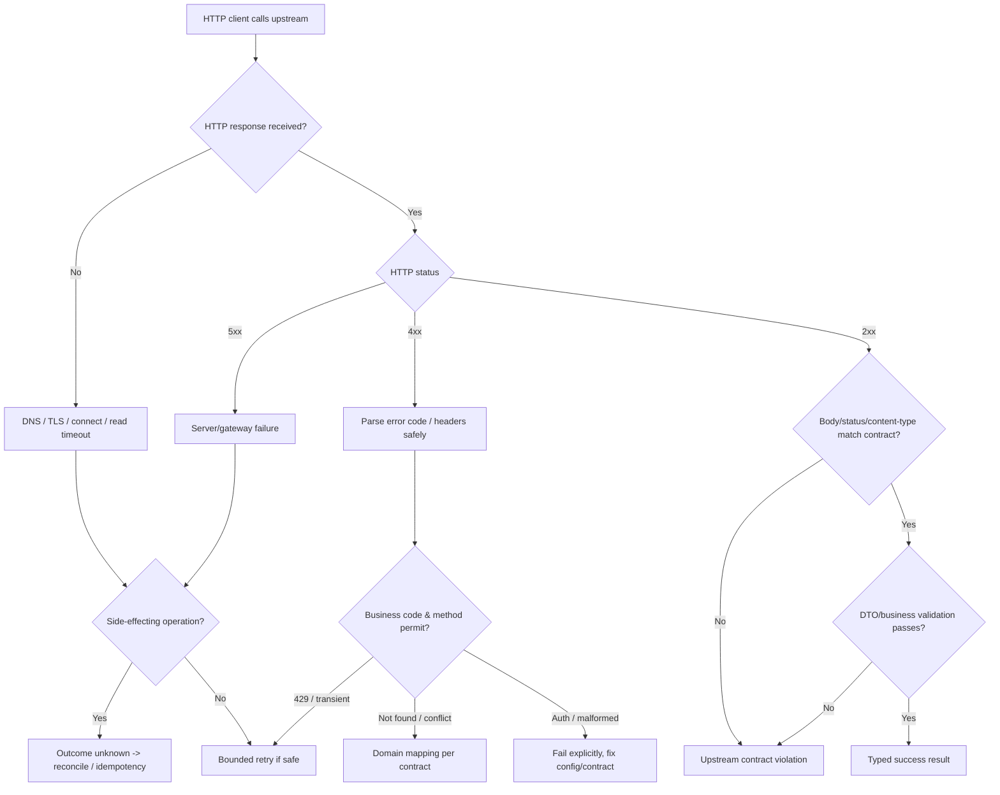

# Handling 4xx, 5xx, and Contract-Violating Responses

> **Chapter:** Synchronous HTTP  
> **Scope:** SPRING_BOOT_INTEGRATION — integrating Spring Boot systems across HTTP clients, databases, caches, message brokers, and Spring Integration adapters; emphasizing data contracts, configuration, transactions, error classification, deduplication, testing, and observability.

## 1. Real-World Problem: HTTP 200 Does Not Guarantee Success, HTTP 500 Does Not Guarantee Total Failure

An order service uses `RestClient` to call a payment system:

```text
POST /v1/payments
Idempotency-Key: order-42-charge

{"orderId":"order-42","amount":"125.50","currency":"USD"}
```

In production, the very same call can produce drastically different outcomes:

- `201 Created` + schema-valid JSON: the partner created the payment according to contract.
- `400 Bad Request` + validation errors: malformed request; retrying unchanged will only repeat the failure.
- `401 Unauthorized`: invalid or expired token; not proof that the order was declined.
- `409 Conflict`: the payment may already exist under that idempotency key, or business state forbids it.
- `429 Too Many Requests` + `Retry-After`: traffic must be throttled and retried under control.
- `503 Service Unavailable`: service temporarily unavailable; the outcome of a write issued right before the error **may be unknown**.
- **Client timeout after the partner committed**: "no response received" cannot be treated as "payment not executed".
- `200 OK` returning HTML, wrong JSON fields, or `{"status":"REJECTED"}`: HTTP transport succeeded, yet the **response contract or business outcome failed**.

If code lumps everything into `catch (Exception e) { return null; }`, the business layer loses the ability to tell apart missing data, auth failures, upstream outages, schema violations, and uncertain write outcomes. This causes infinite retries, lost records, or duplicate commands.

### 1.1. Learning Objectives

After this lesson, you will be able to:

1. Distinguish **HTTP status**, **business result**, **transport failure**, and **response contract violation**.
2. Explain `RestClient.retrieve()`'s default behavior for 4xx/5xx, and how to use `onStatus(...)` and `exchange(...)`.
3. Normalize error bodies (including `ProblemDetail`) at the integration boundary without leaking sensitive data.
4. Detect 2xx responses with empty bodies, wrong JSON shapes, wrong `Content-Type`, missing fields, unknown enums, or invalid business values.
5. Design mappings for 404/409/412/422/429/5xx per **individual API contract** rather than forcing one rigid rule across all partners.
6. Implement bounded retries with idempotency keys and reconciliation when write outcomes are unknown.
7. Write tests using `MockRestServiceServer` and monitor HTTP errors, parse errors, latency, retries, transactions, and outboxes.

### 1.2. Placing Errors at the Right Layer



**Principle:** exception types must express *what is known* and *what is unknown*, not merely severity. In particular, a timeout after POST does not tell you whether the server committed.

## 2. Four Dimensions of an HTTP Call Outcome

| Dimension | Example | What Is Known | What Is Not Guaranteed |
| --- | --- | --- | --- |
| **HTTP transport** | Full status, headers, body received | A response arrived over the connection | Business data or operation validity |
| **HTTP protocol** | 200, 404, 503 | Status meaning per spec and endpoint contract | Business status codes inside the body |
| **Response contract** | JSON has typed `paymentId`, `amount` | Body deserializes and passes schema checks | Whether other downstreams processed it |
| **Business result** | `state=SETTLED` or `state=REJECTED` | Partner's contracted outcome | Whether our app's PostgreSQL/Kafka transaction committed |

An HTTP 200 can accompany `{"success":false,"errorCode":"PAYMENT_DECLINED"}`. An HTTP 202 can mean a job was **accepted for asynchronous processing**, not finished. An HTTP 409 can mean the request already ran with the same idempotency key, or a conflicting payload requires intervention.

Never classify every 4xx as a "user error" in your own application. For example, a `401` caused by an expired **service-to-service token** is a configuration/integration failure, not an end-user HTTP mistake.

### 2.1. Error Taxonomy for Application Services

| Internal Error Category | Characteristics | Examples |
| --- | --- | --- |
| `RESOURCE_NOT_FOUND` | Resource genuinely absent per API contract | GET order returns 404 + valid error code |
| `BUSINESS_CONFLICT` | Request violates state or version | 409/412 with documented business code |
| `UPSTREAM_AUTH_FAILURE` | Service identity/credentials rejected | 401, 403 |
| `UPSTREAM_THROTTLED` | Partner rate limit exceeded | 429, possibly with `Retry-After` |
| `UPSTREAM_UNAVAILABLE` | Upstream down or gateway error | 502, 503, 504 |
| `UPSTREAM_CONTRACT_VIOLATION` | HTTP success but invalid payload | 200 + array instead of object, missing required ID |
| `UPSTREAM_TRANSPORT_FAILURE` | DNS/TCP/TLS or socket failure | No HTTP status received |
| `UPSTREAM_OUTCOME_UNKNOWN` | Side effect may have occurred despite lost response | POST timeout/connection reset after sending |

**Note:** this is an **application design taxonomy**, not a set of built-in Spring exception classes. Spring has its own HTTP and I/O exceptions; the gateway translates them into structured business/integration error categories.

## 3. Setting Up the RestClient Example and Response Contract

Code snippets target **Java 17+, Spring Boot 3.2–3.5, Spring Framework 6.1+**, using `RestClient` in a **synchronous HTTP** model. For Boot 4.x/Spring Framework 7.x, check starters, packages, and APIs against that version's dependency management.

### 3.1. Dependencies and Configuration

```groovy
// build.gradle — application using Spring Boot plugin/BOM.
dependencies {
    implementation 'org.springframework.boot:spring-boot-starter-web'
    implementation 'org.springframework.boot:spring-boot-starter-validation'
    testImplementation 'org.springframework.boot:spring-boot-starter-test'
}
```

```yaml
# application.yml; never store real credentials in Git.
integration:
  payments:
    base-url: ${PAYMENTS_API_BASE_URL}
```

```java
import org.springframework.beans.factory.annotation.Value;
import org.springframework.context.annotation.Bean;
import org.springframework.context.annotation.Configuration;
import org.springframework.web.client.RestClient;

@Configuration(proxyBeanMethods = false)
class PaymentHttpConfiguration {
    @Bean("paymentRestClient")
    RestClient paymentRestClient(
            RestClient.Builder builder,
            @Value("${integration.payments.base-url}") String baseUrl) {
        return builder.baseUrl(baseUrl).build();
    }
}
```

**Why inject Boot's builder?** A Spring Boot-configured builder can carry registered message converters, request factories/customizers, and observation instrumentation. Calling `RestClient.create("...")` on every request bypasses those customizations. The client should be a reused bean with infrastructure-configured connection pools, timeouts, TLS, and tokens.

`PAYMENTS_API_BASE_URL` must come from a trusted deployment source. Never accept arbitrary host URLs from users and send a partner's `Authorization` header there—doing so risks SSRF and credential leaks.

### 3.2. Request and Success DTOs

```java
import java.math.BigDecimal;
import java.time.Instant;

public record CreatePaymentRequest(
        String orderId,
        BigDecimal amount,
        String currency) {
}

public record PaymentReceipt(
        String paymentId,
        String orderId,
        String state,
        BigDecimal amount,
        Instant createdAt) {
}
```

Example success contract:

```http
HTTP/1.1 201 Created
Content-Type: application/json
Location: /v1/payments/pay-8b3
X-Request-Id: partner-4fd

{
  "paymentId": "pay-8b3",
  "orderId": "order-42",
  "state": "SETTLED",
  "amount": 125.50,
  "createdAt": "2026-11-21T08:30:00Z"
}
```

This example assumes the endpoint **returns 201 + JSON receipt**. Another partner might return `202 ACCEPTED` for deferred processing or `201` with only a `Location` header. The gateway must follow the versioned contract of **that exact endpoint**.

### 3.3. Error DTOs Differ from Success DTOs

```java
// PartnerError.java
public record PartnerError(
        String code,
        String message,
        String requestId) {
}
```

An error body might look like:

```json
{
  "code": "ORDER_STATE_INVALID",
  "message": "Order cannot be charged in the current state",
  "requestId": "partner-4fd"
}
```

**Do not** catch HTTP errors and deserialize the error body into `PaymentReceipt`. For 4xx/5xx statuses, the representation usually uses a completely different error schema. If business error codes arrive under HTTP 200, verify the envelope contract separately.

## 4. 4xx Codes: Classifying by Operation and Contract

**4xx** signals that the request was rejected or could not be completed per HTTP semantics, yet **not every 4xx error is permanent**. Several 4xx codes relate to authentication, concurrency, or rate limits and require distinct handling.

| Status | Typical Context | Gateway Reaction |
| --- | --- | --- |
| **400 Bad Request** | Invalid JSON/query format, missing params | Fix request mapping/validation; never retry the exact payload endlessly |
| **401 Unauthorized** | Missing or invalid credentials/challenge | Check token/scope and refresh logic; never misreport as "user not found" |
| **403 Forbidden** | Valid credentials lacking permission/policy | Check ACL/tenant/role; do not retry blindly |
| **404 Not Found** | Missing resource or missing route | Map to not-found **only when endpoint contract confirms** |
| **405 Method Not Allowed** | Wrong HTTP method | Fix client/API version; do not retry unchanged |
| **408 Request Timeout** | Server did not receive full request in time | Conditional retry; writes still require idempotency |
| **409 Conflict** | Version/state conflict or existing resource | Distinguish successful replay from payload conflict |
| **412 Precondition Failed** | `If-Match`/ETag no longer matches | Read latest state and handle optimistic concurrency |
| **415 Unsupported Media Type** | Unsupported request `Content-Type` | Fix serialization/headers; do not retry unchanged |
| **422 Unprocessable Content** | Syntactically valid body violating business rules | Return business validation/rejection per error code |
| **429 Too Many Requests** | Rate limiting/quota exceeded | Read `Retry-After`, back off, reduce concurrency, bound retries |

### 4.1. 404 Does Not Always Mean Optional.empty()

On `GET /v1/orders/{id}`, a partner may specify 404 + `{"code":"ORDER_NOT_FOUND"}` as order not found, allowing the adapter to return `Optional.empty()`. However, 404 can also result from:

- A wrong endpoint/path after the partner changed API versions.
- A misconfigured reverse proxy route.
- A tenant unauthorized to view the resource where the partner intentionally masks 403 as 404.
- Improperly escaped URI templates.

Turning **every 404** into an empty list or `Optional.empty()` can hide a severe configuration outage.

### 4.2. Is 409/412 Concurrency or Idempotency?

A `POST /payments` returning 409 may mean:

1. A request with the same idempotency key was already processed: **look up the prior result** and verify the payload matches.
2. That idempotency key was already used for a **different** payload: return a conflict; do not treat the prior result as a match.
3. The order is in a state that forbids charging: a business rejection.

`412 Precondition Failed` typically relates to optimistic concurrency, e.g., sending `If-Match: "revision-7"` when the resource is already at revision 8. Do not retry with the stale revision; fetch the latest state and re-evaluate the business transition.

### 4.3. 401 and 403 Are Usually Inter-Service Issues

If a service-to-service token expires, refresh credentials per policy and retry **once under control** when safe. On 403 due to missing permissions, configuration/ACL fixes are typically needed rather than retries.

Never log tokens or response headers containing secrets. Never propagate a 401 caused by **our server's own** invalid partner credentials straight out to an **already-authenticated end user** as if the user failed authentication.

### 4.4. 429 Requires Preventing Retry Storms

`Retry-After` can be a number of seconds or an **HTTP-date**. It is a hint for when to retry, **not an exemption** from overall request deadlines or system quotas. If many workers retry simultaneously the instant the wait expires, they cause a *thundering herd*; combine rate limiters, exponential backoff + jitter, and bounded concurrent in-flight requests.

**Never turn 429 into an empty list or 200** just to keep a batch import moving: it is a capacity/throttling failure that must be reflected in step status, retry budgets, and scheduling.

## 5. 5xx Codes: Server/Gateway Errors, When Is Retry Safe?

**5xx** indicates the server, proxy, or gateway failed to fulfill the request per HTTP semantics. For read-only operations, bounded retries are often appropriate. For writes, HTTP 500/502/503/504 **never proves no side effect occurred**.

| Status | Typical Situation | Assessment |
| --- | --- | --- |
| **500 Internal Server Error** | Partner bug/exception or internal failure | Analyze error code/trace; for POST, outcome may be unknown |
| **501 Not Implemented** | Server does not support capability/method | Usually version/contract mismatch; retries will not fix it |
| **502 Bad Gateway** | Proxy received an invalid upstream response | Possibly transient; did the request reach the upstream? |
| **503 Service Unavailable** | Maintenance, overload, temporary outage | Budgeted retries possible; honor `Retry-After` if present |
| **504 Gateway Timeout** | Gateway timed out waiting on upstream | **Especially dangerous for POST**: upstream may have committed |

### 5.1. Two Distinct Kinds of Timeouts

- **Client-side timeout with no status received:** transport/client failure; no HTTP 504 was returned by the server.
- **HTTP 504 response:** a gateway/proxy returned **HTTP status 504**, meaning a status—and possibly body/headers—arrived. Still, it does not guarantee the upstream did not process the request.

Similarly, `503` may carry `Retry-After`, yet a 503 from a gateway does not always mean the payment backend never received the command. Never equate status codes with database commit state at the partner.

### 5.2. GET Is Safer to Retry Than POST, Yet Still Needs Bounds

HTTP defines `GET` as a safe method semantically. If a lookup GET fails with 503, retrying with backoff within the deadline is reasonable. Still:

- Retrying huge volumes of GETs can overload an already struggling upstream.
- An endpoint labeled GET that triggers non-standard side effects is a **contract defect** to fix with the provider, not something to rely on by method name alone.
- `PUT`/`DELETE` are idempotent at the HTTP semantics level, but actual implementations and side effects (emails, billing) must still be verified.
- POST must not be retried automatically without an **idempotency key** or deterministic outcome check backed by the partner's commitment.

### 5.3. Circuit Breakers Do Not Replace Data Contracts

Circuit breakers, bulkheads, rate limiters, and backoff prevent hammering failing upstreams. However, they **do not**:

- Turn schema-invalid JSON into valid data.
- Recover an unknown-outcome payment without reconciliation.
- Create an atomic transaction spanning HTTP, PostgreSQL, and Kafka.
- Make every 500 a transient retryable failure.

When a breaker opens, the application layer must know the response is **dependency unavailable**, not silently interpret it as "order not found" or "payment declined".

## 6. RestClient.retrieve(): Default Behavior and onStatus Customization

In Spring Framework 6.1+, `RestClient` offers two primary response paths:

- `retrieve()`: convenient path supporting `body(Class<T>)`, `body(ParameterizedTypeReference<T>)`, `toEntity(...)`, and `onStatus(...)`.
- `exchange(...)`: low-level response access where the application handles status, headers, and body itself. With exchange, **`retrieve()` status handlers do not run automatically**; the caller must classify statuses.

### 6.1. Default 4xx/5xx Exceptions in retrieve()

```java
import org.springframework.web.client.RestClient;

PaymentReceipt receipt = client.get()
        .uri("/v1/payments/{id}", paymentId)
        .retrieve()
        .body(PaymentReceipt.class);
```

When the response is 4xx/5xx, `retrieve()` throws an appropriate exception in the `RestClientResponseException` hierarchy by default:

| Exception | Meaning |
| --- | --- |
| `HttpClientErrorException` | HTTP client error status (4xx) |
| `HttpClientErrorException.NotFound` | HTTP 404 represented as a Spring subclass |
| `HttpClientErrorException.TooManyRequests` | HTTP 429 |
| `HttpServerErrorException` | HTTP server error status (5xx) |
| `RestClientResponseException` | Base class holding status, headers, and response body (when present) |
| `ResourceAccessException` | I/O failure accessing the resource, commonly timeouts/connection errors |
| `RestClientException` | Broader base class covering client errors such as conversion failures |

HTTP exceptions are not domain exceptions. On `RestClientResponseException`, you can inspect status/headers/error payload **if policy allows**, but never blindly log `getResponseBodyAsString()`: bodies may contain PII, tokens, payment details, or proxy HTML.

**Avoid**:

```java
// Anti-pattern: swallowing all errors and returning fake data.
try {
    return client.get().uri("/v1/orders").retrieve()
            .body(OrderDto[].class);
} catch (RestClientException ex) {
    return new OrderDto[0]; // 503, bad JSON, TLS error all become "no orders".
}
```

This **pseudocode inside a method with `client`** demonstrates a logic flaw. Empty results must come from a valid data contract (such as 200 + `[]`), never from catching arbitrary exceptions.

### 6.2. Map 404 Only Per Endpoint Contract

Suppose `GET /v1/orders/{id}` specifies `404 = ORDER_NOT_FOUND`. A gateway can convert 404 into a domain exception:

```java
public final class PartnerOrderNotFoundException extends RuntimeException {
    public PartnerOrderNotFoundException(String id) {
        super("Partner order not found: " + id);
    }
}
```

```java
OrderDto order = client.get()
        .uri("/v1/orders/{id}", orderId)
        .retrieve()
        .onStatus(
                status -> status.value() == 404,
                (request, response) -> {
                    throw new PartnerOrderNotFoundException(orderId);
                })
        .body(OrderDto.class);
```

The second snippet is a fragment inside a method that has `client` and `orderId`. It expresses **a policy valid only if every 404 on this endpoint means not-found**. If the partner uses body error codes to distinguish causes, the handler must read and validate that code before deciding.

### 6.3. Standardizing Errors Into a Gateway-Specific Exception

To decouple application services from HTTP library exception types, define an error carrying only safe fields for downstream handling:

```java
// PartnerHttpFailure.java
public final class PartnerHttpFailure extends RuntimeException {
    private final int statusCode;
    private final String partnerCode;
    private final String retryAfter;

    public PartnerHttpFailure(
            int statusCode,
            String partnerCode,
            String retryAfter) {
        super("Payment partner HTTP " + statusCode
                + " (" + partnerCode + ")");
        this.statusCode = statusCode;
        this.partnerCode = partnerCode;
        this.retryAfter = retryAfter;
    }

    public int statusCode() { return statusCode; }
    public String partnerCode() { return partnerCode; }
    public String retryAfter() { return retryAfter; }
}
```

Never embed raw response bodies, `Authorization` headers, or customer/payment payloads in exception messages. HTTP status, a normalized error code, correlation ID, and validated `Retry-After` are typically sufficient for classification and debugging.

### 6.4. onStatus with JSON Error Bodies and Bounded Reads

A partner API may return `application/json` or `application/problem+json`. If the endpoint's error contract matches `PartnerError` from Section 3, parse the body within strict byte limits:

```java
import com.fasterxml.jackson.core.JsonProcessingException;
import com.fasterxml.jackson.databind.ObjectMapper;
import org.springframework.http.HttpHeaders;
import org.springframework.http.MediaType;
import org.springframework.web.client.RestClient;

public final class PaymentStatusHandlers {
    private static final int MAX_ERROR_BODY_BYTES = 4096;

    private PaymentStatusHandlers() {}

    public static RestClient.ResponseSpec withPartnerErrors(
            RestClient.ResponseSpec spec, ObjectMapper mapper) {

        return spec.onStatus(
                status -> status.is4xxClientError()
                        || status.is5xxServerError(),
                (request, response) -> {
                    int statusCode = response.getStatusCode().value();
                    String retryAfter = response.getHeaders()
                            .getFirst(HttpHeaders.RETRY_AFTER);
                    MediaType contentType = response.getHeaders()
                            .getContentType();

                    // Read at most MAX+1 bytes to detect oversized payloads.
                    byte[] body;
                    boolean unreadableBody = false;
                    try {
                        body = response.getBody()
                                .readNBytes(MAX_ERROR_BODY_BYTES + 1);
                    } catch (java.io.IOException failedReadingErrorBody) {
                        // HTTP status was received, but error body could not be read.
                        // Do not lose the original status due to error-body failure.
                        body = new byte[0];
                        unreadableBody = true;
                    }
                    String code = unreadableBody
                            ? "UNREADABLE_ERROR_BODY"
                            : "HTTP_" + statusCode;
                    boolean looksJson = contentType != null
                            && "application".equalsIgnoreCase(
                                    contentType.getType())
                            && ("json".equalsIgnoreCase(
                                    contentType.getSubtype())
                                || contentType.getSubtype()
                                    .toLowerCase(java.util.Locale.ROOT)
                                    .endsWith("+json"));

                    if (body.length <= MAX_ERROR_BODY_BYTES
                            && body.length > 0 && looksJson) {
                        try {
                            PartnerError error =
                                    mapper.readValue(body, PartnerError.class);
                            if (error != null
                                    && error.code() != null
                                    && error.code().matches(
                                            "[A-Z][A-Z0-9_]{0,63}")) {
                                code = error.code();
                            }
                        } catch (JsonProcessingException invalidErrorBody) {
                            code = "MALFORMED_ERROR_BODY";
                        }
                    } else if (body.length > MAX_ERROR_BODY_BYTES) {
                        code = "ERROR_BODY_TOO_LARGE";
                    }

                    throw new PartnerHttpFailure(
                            statusCode, code, retryAfter);
                });
    }
}
```

Usage at a `retrieve()` call site:

```java
PaymentReceipt receipt = PaymentStatusHandlers
        .withPartnerErrors(
                client.get()
                        .uri("/v1/payments/{id}", paymentId)
                        .retrieve(),
                objectMapper)
        .body(PaymentReceipt.class);
```

This is a **sample adapter**, not a universal error parser. Standard `application/problem+json` payloads have different fields than `PartnerError` and require a matching DTO/parser. When the body has an unexpected content type, is empty, or is malformed JSON, the code **preserves the HTTP status** so the root cause is not lost. The 4 KiB cap only bounds bytes read inside the handler; comprehensive oversized-response protection also requires HTTP client, proxy, and infrastructure limits.

In production, apply an allowlist to `partnerCode` before placing it in metrics; external error codes can be arbitrary strings and cause high cardinality. Check content type before parsing, and never echo unvalidated error payloads back to external HTTP clients.

### 6.5. onStatus Does Not Automatically Trigger Retries

`onStatus(...)` only defines **how a response is handled**. Throwing `PartnerHttpFailure(429, ...)` does not make Spring wait for `Retry-After` or resend the request. Retries require an explicit policy with deadlines, max attempts, backoff, safety checks, and idempotency keys for side effects.

When registering multiple status handlers, control their ordering and precedence per API; never write a catch-all status handler that accidentally swallows specific statuses and returns success.

## 7. RestClient.exchange(): Full Status Control, Full Responsibility

`retrieve()` usually suffices for JSON APIs using status handlers. `exchange(...)` fits when you need direct control over reading the raw response, handling non-default statuses, or branching on headers and body together.

**Crucial distinction:** when calling `exchange(...)`, status handlers attached to `retrieve()` or the builder **do not apply automatically**. The caller must handle 4xx/5xx and ensure every branch finishes cleanly.

### 7.1. Reading an Order, Allowing 404 per Contract, Rejecting Invalid Bodies

Illustrative DTO for a lookup endpoint (independent of the payment DTOs):

```java
import java.math.BigDecimal;

public record OrderDto(String id, BigDecimal amount) {
}
```

```java
import com.fasterxml.jackson.databind.ObjectMapper;
import java.io.IOException;
import java.util.Optional;
import org.springframework.http.HttpStatusCode;
import org.springframework.http.MediaType;
import org.springframework.web.client.RestClient;

public final class OrderExchangeGateway {
    private static final int MAX_SUCCESS_BODY_BYTES = 128 * 1024;

    private final RestClient client;
    private final ObjectMapper mapper;

    public OrderExchangeGateway(
            RestClient client, ObjectMapper mapper) {
        this.client = client;
        this.mapper = mapper;
    }

    public Optional<OrderDto> find(String id) {
        return client.get()
                .uri("/v1/orders/{id}", id)
                .exchange((request, response) -> {
                    HttpStatusCode status = response.getStatusCode();

                    if (status.value() == 404) {
                        // Only when the endpoint guarantees 404 = ORDER_NOT_FOUND.
                        return Optional.empty();
                    }
                    if (!status.is2xxSuccessful()) {
                        throw new PartnerHttpFailure(
                                status.value(),
                                "UNEXPECTED_HTTP_STATUS",
                                null);
                    }
                    if (status.value() == 204) {
                        throw new PartnerContractViolation(
                                "Expected OrderDto but got 204");
                    }
                    MediaType contentType =
                            response.getHeaders().getContentType();
                    if (contentType == null
                            || !MediaType.APPLICATION_JSON
                                    .isCompatibleWith(contentType)) {
                        throw new PartnerContractViolation(
                                "Expected application/json");
                    }

                    byte[] body = response.getBody()
                            .readNBytes(MAX_SUCCESS_BODY_BYTES + 1);
                    if (body.length == 0
                            || body.length > MAX_SUCCESS_BODY_BYTES) {
                        throw new PartnerContractViolation(
                                "Required order body missing or too large");
                    }
                    try {
                        OrderDto order =
                                mapper.readValue(body, OrderDto.class);
                        if (order == null
                                || order.id() == null
                                || order.id().isBlank()
                                || order.amount() == null) {
                            throw new PartnerContractViolation(
                                    "Order missing required fields");
                        }
                        return Optional.of(order);
                    } catch (IOException invalidJson) {
                        throw new PartnerContractViolation(
                                "Invalid order JSON", invalidJson);
                    }
                });
    }
}
```

Simple exception for contract violations:

```java
public final class PartnerContractViolation
        extends RuntimeException {
    public PartnerContractViolation(String message) {
        super(message);
    }

    public PartnerContractViolation(
            String message, Throwable cause) {
        super(message, cause);
    }
}
```

**Scope note for this example:** `OrderDto` must match the endpoint contract (a dedicated order DTO is used here), and the mapper must have Java Time modules configured like the application. Inside `exchange(...)`, avoid reading the body twice or returning the response `InputStream` outside the callback: response resources are managed within the exchange scope. If an API supports HTTP 304 with `If-None-Match`, add an explicit branch to reuse validated cached data; never map 304 as a 200 with a new body.

### 7.2. retrieve or exchange?

| Situation | Recommended API | Reason |
| --- | --- | --- |
| 2xx + JSON object, 4xx/5xx via handlers | `retrieve().body(OrderDto.class)` | Reuses converters and default status behavior |
| Need status + headers + typed body | `retrieve().toEntity(OrderDto.class)` | Exposes `ResponseEntity<T>` while keeping status handlers |
| JSON array or generic envelope | `retrieve().body(ParameterizedTypeReference<T>)` | Preserves generic types for converter mapping |
| Need custom decisions from raw status/headers/body | `exchange(...)` | Full ownership of every status and response stream |
| HTTP 204 with no body expected | `retrieve().toBodilessEntity()` | No-content contract without forcing DTO parsing |

**Never use `exchange` just to ignore 500 and return null.** Low-level control means the gateway must enforce a clear error taxonomy and test every branch.

## 8. Error Body Contracts: Custom JSON and Problem Details

There is no single mandatory error body schema across all HTTP APIs. Many systems use:

```json
{
  "code": "INSUFFICIENT_FUNDS",
  "message": "Account balance is too low",
  "requestId": "partner-8f2"
}
```

Modern APIs may adopt **Problem Details** per RFC 9457 (succeeding RFC 7807) with media type `application/problem+json`:

```http
HTTP/1.1 422 Unprocessable Content
Content-Type: application/problem+json

{
  "type": "https://api.example.invalid/problems/invalid-payment",
  "title": "Payment cannot be processed",
  "status": 422,
  "detail": "The requested order state is not chargeable",
  "instance": "/v1/payments/requests/partner-8f2",
  "code": "ORDER_STATE_INVALID"
}
```

`type`, `title`, `status`, `detail`, and `instance` have standard meanings; `code` is a provider-defined extension. **Never treat `detail` as a stable string for conditional logic**: its wording or locale can change, or it may contain sensitive data.

### 8.1. Spring ProblemDetail vs. Custom DTOs

Spring Framework provides `org.springframework.http.ProblemDetail`. When your application **emits** HTTP errors, controller advice can return `ProblemDetail`. When your application **consumes** partner errors, you can deserialize into a Problem Details DTO or `ProblemDetail` if the contract is compatible.

Custom DTO for provider errors with an extension code:

```java
import com.fasterxml.jackson.annotation.JsonIgnoreProperties;
import java.net.URI;

@JsonIgnoreProperties(ignoreUnknown = true)
public record PartnerProblem(
        URI type,
        String title,
        Integer status,
        String detail,
        String instance,
        String code) {
}
```

`URI type` fits problem identifiers, but **never automatically fetch the URL in `type`**. That URL comes from the upstream and may be untrusted; avoid SSRF. If using Spring's `ProblemDetail`, check how extension properties behave with your Jackson modules and configuration. Never assume `ProblemDetail` shares identical constructors or JSON shapes with every custom DTO.

### 8.2. Validate the Error Body Before Deciding Business Mapping

Example endpoint rules:

| HTTP Status | Error Body | Decision |
| --- | --- | --- |
| 404 | `code=ORDER_NOT_FOUND` | Safe to map to domain not-found |
| 404 | Proxy HTML page | Upstream routing/config failure; **do not** map to domain not-found |
| 409 | `code=IDEMPOTENCY_REPLAY`, includes resource ID | Look up and verify prior payload/result |
| 409 | `code=IDEMPOTENCY_PAYLOAD_MISMATCH` | True conflict; never retry the same key with a different payload |
| 422 | `code=ORDER_STATE_INVALID` | Business rejection to surface/persist in state |
| 429 | Valid `Retry-After` | Throttle/retry within deadline |
| 503 | Unparseable error body | Still HTTP 503; keep status and correlation, do not invent a domain code |

If an error body is missing or mismatches the schema, **never turn an HTTP error into success**. A status handler can fall back to `HTTP_503` and emit a `malformed_error_body` metric while bounding read size to protect memory.

### 8.3. Never Store Full Error Payloads in Exceptions or Logs

An HTTP 502 from a gateway can return HTML containing internal hostnames, upstream paths, or debug traces. A 400/422 error body might echo back a request containing PII or card/payment data. Best practices:

- Keep only **HTTP status**, **allowlisted provider code**, validated **requestId/correlationId**, and short sanitized metadata.
- Cap error body bytes read; never attach raw bodies to metric attributes or exception messages.
- Never log `Authorization`, `Cookie`, `Set-Cookie`, API keys, or query strings containing tokens.
- Enable short-lived raw payload logging only in isolated environments with strict access control, complying with retention/security policies.
- Distinguish success-body parse errors from **error-body** parse errors: if the response was HTTP 503, preserve its unavailable nature even when the error body is invalid.

### 8.4. API Error Contracts Evolve Across Versions

When a provider migrates from:

```json
{"error":"not_found"}
```

to:

```json
{"code":"ORDER_NOT_FOUND","message":"Order does not exist"}
```

an older adapter may fail to recognize the error code. Rely on contract tests, OpenAPI/schema versioning, and compatible rollouts. Match against documented error codes instead of comparing free-form `message` text.

## 9. Why Are Contract-Violating 2xx Responses Dangerous?

`RestClient.retrieve().body(OrderDto.class)` can finish an HTTP 2xx call and still deliver **unusable data**. The fact that Jackson deserialized JSON into a Java object does not prove the document satisfies the business contract.

### 9.1. Common Violations

| HTTP Response | Why It Violates the Contract | Reaction |
| --- | --- | --- |
| 200 + JSON array when object expected | Wrong JSON root shape | Conversion error -> contract violation |
| 200 + `{}` when `id`/`status` required | Missing required fields | Validate DTO after deserialization |
| 200 + empty body when Order promised | Missing body | Contract violation; never construct `new OrderDto()` |
| 200 + `text/html` login page | Auth redirect/proxy returned wrong representation | Contract violation / auth diagnosis |
| 200 + `{"success":false}` | API uses a custom business envelope | Business rejection despite HTTP 200 |
| 201 + `Location` when contract promises receipt body | Body omitted | Verify contract/version |
| 202 + async processing ticket | Final business result not ready | Persist ticket; poll/webhook/event |
| 204 + empty body | Valid **if endpoint specifies no-content** | Consume bodyless response |
| 206 Partial Content when full JSON expected | Response is a partial representation | Accept only if API/range contract supports it |
| 200 + `application/json` with malformed JSON | Right content type, broken payload | Conversion/contract violation |
| 200 + valid syntax, negative `amount` | Violates business invariant | Validate and reject data |
| 200 + unknown enum value | Consumer/schema mismatch | Apply unknown-enum policy or fail explicitly |

**Never equate** `204 No Content` with not-found. HTTP 204 signals success with no body; 404 is an error status whose meaning depends on the endpoint. Nor should you equate `200 []`, `200 null`, and `204` when the contract distinguishes them.

### 9.2. Contract Violations Are the Upstream's Responsibility

When service A calls service B and B returns 200 with a schema-invalid response, A should report an upstream contract failure/gateway error per policy; **never turn it into an HTTP 400 blaming A's client** just because a DTO field was missing. End users cannot fix a broken JSON response from B.

In systems with retries, contract errors usually require **fail-fast + alerts** or dead-letter/quarantine rather than blasting hundreds of identical requests hoping the schema changes. If a provider is rolling out multiple versions, establish a contract compatibility strategy and test against live responses.

## 10. JSON/Jackson and Validation: Deserialization Alone Is Not Enough

### 10.1. Defining Success DTOs with Explicit Constraints

If a partner guarantees `paymentId`, `orderId`, `state`, `amount > 0`, and a timestamp, apply Jakarta Bean Validation at the outbound HTTP boundary.

```java
import jakarta.validation.constraints.DecimalMin;
import jakarta.validation.constraints.NotBlank;
import jakarta.validation.constraints.NotNull;
import java.math.BigDecimal;
import java.time.Instant;

public record ValidatedPaymentReceipt(
        @NotBlank String paymentId,
        @NotBlank String orderId,
        @NotBlank String state,
        @NotNull @DecimalMin("0.01") BigDecimal amount,
        @NotNull Instant createdAt) {
}
```

Spring Boot with `spring-boot-starter-validation` provides a Jakarta `Validator` when configured. However, **`RestClient.body(ValidatedPaymentReceipt.class)` does not automatically invoke `validator.validate(...)` on responses**. The adapter must validate explicitly:

```java
import jakarta.validation.Validator;
import java.util.Set;

public final class PaymentReceiptValidator {
    private final Validator validator;

    public PaymentReceiptValidator(Validator validator) {
        this.validator = validator;
    }

    public ValidatedPaymentReceipt requireValid(
            ValidatedPaymentReceipt receipt,
            CreatePaymentRequest expected) {
        if (receipt == null) {
            throw new PartnerContractViolation(
                    "Missing successful payment response");
        }
        Set<?> violations = validator.validate(receipt);
        if (!violations.isEmpty()) {
            throw new PartnerContractViolation(
                    "Payment response failed schema validation");
        }
        if (!receipt.orderId().equals(expected.orderId())
                || receipt.amount().compareTo(expected.amount()) != 0) {
            throw new PartnerContractViolation(
                    "Payment response does not match request identity");
        }
        if (!Set.of("SETTLED", "AUTHORIZED")
                .contains(receipt.state())) {
            throw new PartnerContractViolation(
                    "Unknown or unsupported payment state");
        }
        return receipt;
    }
}
```

`ValidatedPaymentReceipt` and `PaymentReceiptValidator` illustrate **contract validation**, not complete payment domain rules. In production, account for currency, amount scale, refunds/partial authorizations, rounding tolerances per contract, and valid endpoint states. Never log `ConstraintViolation.toString()` if it contains sensitive field values.

### 10.2. Entities, DTOs, and "Unknown Properties"

A partner may add a new `riskScore` field to JSON. Two common policies:

- **Forward-compatible:** tolerate unknown fields while **still validating required fields** and business invariants. Fits contracts allowing additive fields.
- **Strict schema:** reject unknown fields and wrong names/types. Fits contracts requiring exact shapes and tightly controlled rollouts.

`@JsonIgnoreProperties(ignoreUnknown = true)` only ignores extra fields. It **does not** fail on missing `paymentId`, check `amount > 0`, or confirm `orderId` matches the request.

Avoid deserializing external JSON straight into JPA/MongoDB entities or public event messages. Follow **partner DTO -> validation -> domain model -> persistence/event DTO** to isolate upstream schema changes.

### 10.3. Missing Fields, Nulls, and Primitive Defaults

```json
{"paymentId":"pay-8b3","amount":null,"state":"SETTLED"}
```

With `record PaymentReceipt(...)`, Jackson can instantiate an object with null fields (depending on creator/null-handling settings). If business code inspects `receipt.state()` while skipping `paymentId()`, corrupt data can enter the database.

If a DTO uses primitive `long totalCount` or `boolean success`, an omitted JSON field defaults to `0`/`false`, making "partner omitted field" indistinguishable from "partner sent 0/false". For required fields, consider `Long`/`Boolean` paired with annotations and validation.

### 10.4. Amounts, Timestamps, Enums, and Schema Evolution

| Field | Recommended Choice | Pitfall |
| --- | --- | --- |
| `amount` | `BigDecimal` + currency/scale policy | `double` causes decimal rounding errors; unclear currency unit |
| `createdAt` | `Instant`/`OffsetDateTime` per contract | Confusing timezone/local time or date formats |
| `state` | String in partner DTO + mapped to domain enum via policy | New enum value breaks parsing or silently counts as success |
| `id` | String/UUID per actual contract, never guessed | Leading zeros or format lost if coerced to a number |
| `data` | Concrete generic type | Using `Object.class` or `List.class` yields raw `Map` |
| `version` | Version/ETag token per provider semantics | Skipping optimistic concurrency overwrites newer state |

JSON containing `"amount":"125.50"` instead of numeric `125.50` may be coerced by Jackson depending on configuration. Never rely on accidental coercion to define your contract; if the provider allows only JSON numbers, test cases with strings should verify your strictness.

### 10.5. Generic Responses, Lists, and Envelopes

If an API returns:

```json
{
  "status": "OK",
  "data": [
    {"id":"ord-1","amount":10.00},
    {"id":"ord-2","amount":20.00}
  ]
}
```

Do not read it with `List.class` or `ApiResponse.class` and cast arbitrarily. Declare a type token:

```java
import java.math.BigDecimal;
import java.util.List;
import org.springframework.core.ParameterizedTypeReference;

public record OrderSummary(String id, BigDecimal amount) {}
public record ApiResponse<T>(String status, T data) {}

ParameterizedTypeReference<ApiResponse<List<OrderSummary>>> type =
        new ParameterizedTypeReference<
                ApiResponse<List<OrderSummary>>>() {};

ApiResponse<List<OrderSummary>> result =
        client.get()
                .uri("/v1/orders/lookup")
                .retrieve()
                .body(type);
```

These `record` declarations are separate example DTOs; the call lives inside a gateway with `client`. The type token preserves generic types through Jackson, yet you must still verify `result != null`, `result.status().equals("OK")`, `data != null`, and each item's validity.

**HTTP 200 with body `{"status":"ERROR","data":null}` is a business-level failure** when the envelope defines it so. Never check only HTTP status and write every response straight to PostgreSQL.

### 10.6. Content-Type and Invalid JSON

| Response | What to Check |
| --- | --- |
| `200 application/json` + JSON object | Schema and semantic validation |
| `200 text/html` + login page | Session/token redirect, proxy, wrong Content-Type |
| `200 application/json` + HTML text | Malformed JSON; proxy may have set the wrong Content-Type |
| `200 application/json` + `[]` when object expected | JSON root shape mismatch |
| `200 application/json` + huge payload | Body size/heap limits, pagination, streaming |
| `200 application/json` + deeply nested JSON | Parser depth/complexity limits; never trust external input blindly |

For sensitive payloads, never read the response into a `String` and log all of it on deserialization failures. Log the error code, endpoint template, status, content type, response size, and sanitized correlation ID instead.

## 11. Complete Application-Level Gateway: Validating Status and Payload

A well-designed gateway **does not leak raw HTTP library exceptions to domain services**. It captures known outcomes, raises typed errors, and never blindly retries write operations.

The service below uses the validated success DTO and error status handler built earlier:

```java
import com.fasterxml.jackson.databind.ObjectMapper;
import java.math.BigDecimal;
import java.util.Objects;
import org.springframework.beans.factory.annotation.Qualifier;
import org.springframework.http.HttpStatus;
import org.springframework.http.MediaType;
import org.springframework.http.ResponseEntity;
import org.springframework.stereotype.Component;
import org.springframework.web.client.RestClient;

@Component
public class PaymentPartnerGateway {
    private final RestClient client;
    private final ObjectMapper mapper;
    private final PaymentReceiptValidator validator;

    public PaymentPartnerGateway(
            @Qualifier("paymentRestClient") RestClient client,
            ObjectMapper mapper,
            PaymentReceiptValidator validator) {
        this.client = client;
        this.mapper = mapper;
        this.validator = validator;
    }

    public ValidatedPaymentReceipt create(
            CreatePaymentRequest request,
            String idempotencyKey) {
        if (request == null || request.orderId() == null
                || request.orderId().isBlank()
                || request.amount() == null
                || request.amount().compareTo(BigDecimal.ZERO) <= 0
                || idempotencyKey == null
                || idempotencyKey.isBlank()) {
            throw new IllegalArgumentException(
                    "Invalid payment request");
        }

        ResponseEntity<ValidatedPaymentReceipt> response =
                PaymentStatusHandlers.withPartnerErrors(
                        client.post()
                                .uri("/v1/payments")
                                .contentType(MediaType.APPLICATION_JSON)
                                .accept(MediaType.APPLICATION_JSON)
                                .header("Idempotency-Key", idempotencyKey)
                                .body(request)
                                .retrieve(),
                        mapper)
                        .toEntity(ValidatedPaymentReceipt.class);

        if (response.getStatusCode().value()
                != HttpStatus.CREATED.value()) {
            throw new PartnerContractViolation(
                    "Expected HTTP 201 for create payment");
        }

        return validator.requireValid(
                response.getBody(), request);
    }
}
```

This pattern assumes the endpoint **succeeds only with 201 + JSON receipt**, `@Component` or `@Bean` for `PaymentReceiptValidator` is registered in the Spring context, and the partner honors idempotency for the sent header. Because `PaymentReceiptValidator` in Section 10 was a plain Java class, register it explicitly as a bean:

```java
import jakarta.validation.Validator;
import org.springframework.context.annotation.Bean;
import org.springframework.context.annotation.Configuration;

@Configuration(proxyBeanMethods = false)
class PartnerValidationConfiguration {
    @Bean
    PaymentReceiptValidator paymentReceiptValidator(Validator validator) {
        return new PaymentReceiptValidator(validator);
    }
}
```

**Key takeaways:**

1. 4xx/5xx errors pass through `PaymentStatusHandlers`, retaining HTTP status and partner code.
2. A 2xx response **violating the status contract** throws `PartnerContractViolation`.
3. A 201 response with a missing body, invalid fields, or mismatched request identity is also a contract violation.
4. The gateway **does not retry POST itself**: the orchestration layer or retry owner decides when to retry with the **same idempotency key**.
5. The idempotency key header must bind to an **immutable business request**; never mint a fresh UUID per retry without persisting the original key.

If a partner uses 202/200 as valid success or returns receipt details in headers instead of the body, **adjust the gateway contract and tests**—never apply the 201 pattern blindly across APIs.

### 11.1. Domain Mapping and Your Application's Own HTTP Responses

Do not blindly forward `PartnerHttpFailure(503)` as HTTP 503 to end callers. The adapter emits an **upstream dependency unavailable** error; controller advice chooses the status matching **your own API's contract** (often a dedicated gateway/dependency error) along with a correlation ID, without leaking partner hostnames, tokens, or raw error bodies.

| Upstream Error | Business/Domain Interpretation | Your Application's HTTP Response |
| --- | --- | --- |
| 404 + valid `ORDER_NOT_FOUND` | Resource does not exist | Possibly 404, per your API contract |
| 422 + `ORDER_STATE_INVALID` | Business rejection | Possibly 409/422 or domain error response |
| 401 from service credentials | Inter-service authentication failure | Never forward straight out as a 401 for the end user |
| 429 | Upstream throttling | Possibly 503/429 per gateway contract and quota policy |
| 503/504 | Dependency unavailable | Possibly 502/503/504 per gateway architecture |
| 200 malformed JSON | Upstream contract violation | Normally not an HTTP 400 blaming the end user |
| POST timeout after sending | Outcome unknown | Return pending/reconciliation state per contract; avoid claiming definite failure |

No single HTTP-to-HTTP mapping table fits every organization. What matters is a **documented, testable rule that does not misassign fault**.

### 11.2. Type-Safe Error Results Instead of Only Throwing RuntimeExceptions

Some applications model outcomes with typed results such as `Success<T>`, `NotFound`, `BusinessConflict`, `UpstreamUnavailable`, and `OutcomeUnknown` (sealed interface/`Result` type). That approach is equally valid, provided:

- No `null`/empty fallback drops failure details.
- Callers are forced to handle every important variant.
- Connection/timeout failures and unknown outcomes are never treated as business rejections.
- Business result data is consumed only after validation.

This lesson uses an exception-based gateway because it integrates cleanly with imperative Spring MVC services, **not because it is mandatory everywhere**.

## 12. Timeouts, Retries, Retry-After, and Unknown Outcomes

### 12.1. Multiple Wait Phases in One Request

| Bound | Scope | Does Not Replace |
| --- | --- | --- |
| DNS/connect timeout | Route resolution and TCP establishment | Response read timeout |
| TLS handshake timeout | Establishing encrypted connection | Overall business deadline |
| Pool acquisition timeout | Waiting for a free client pool connection | Database pool or HTTP server processing |
| Read/response timeout | Waiting for response data | Total deadline spanning attempts and backoff |
| Overall deadline | All attempts and retries for one business action | POST idempotency rules |
| Circuit breaker/bulkhead | Concurrency limits and failure isolation | Distributed transactions |

When a Spring MVC app calls a synchronous API, the request thread blocks waiting for the HTTP response. Missing timeouts hold threads and connections indefinitely, cascading into thread pool exhaustion, Hikari pool exhaustion, and request queuing when an upstream slows down.

### 12.2. Configuring Request Factory Timeouts

In a Spring Framework 6.1/6.2 environment using the simple request factory:

```java
import org.springframework.beans.factory.annotation.Value;
import org.springframework.context.annotation.Bean;
import org.springframework.context.annotation.Configuration;
import org.springframework.http.client.SimpleClientHttpRequestFactory;
import org.springframework.web.client.RestClient;

@Configuration(proxyBeanMethods = false)
class TimedPaymentHttpConfiguration {

    @Bean("timedPaymentRestClient")
    RestClient timedPaymentRestClient(
            RestClient.Builder builder,
            @Value("${integration.payments.base-url}") String baseUrl) {

        SimpleClientHttpRequestFactory factory =
                new SimpleClientHttpRequestFactory();
        factory.setConnectTimeout(2_000);
        factory.setReadTimeout(3_000);

        return builder
                .baseUrl(baseUrl)
                .requestFactory(factory)
                .build();
    }
}
```

**This is an illustrative choice, not a production requirement to use `SimpleClientHttpRequestFactory`.** If your project relies on Apache HttpComponents, JDK HttpClient, proxies, TLS bundles, or Boot connection pooling, configure timeouts **on the actual request factory in use** instead of replacing it and accidentally wiping out pooling, SSL, or client settings. Also avoid registering both `RestClient` beans simultaneously without clear `@Qualifier` wiring if the app expects a single bean.

These two timeouts **do not create an overall deadline**. Three attempts can consume multiple read timeouts plus backoff, so still enforce a workflow-level budget.

### 12.3. Two Formats of Retry-After

Examples:

```http
HTTP/1.1 429 Too Many Requests
Retry-After: 12
```

or:

```http
HTTP/1.1 503 Service Unavailable
Retry-After: Sat, 21 Nov 2026 09:00:00 GMT
```

`12` is delay seconds; the date form uses HTTP-date. A helper parsing both forms:

```java
import java.time.Clock;
import java.time.Duration;
import java.time.Instant;
import java.time.ZonedDateTime;
import java.time.format.DateTimeFormatter;
import java.time.format.DateTimeParseException;
import java.util.Optional;

public final class RetryAfterParser {
    private RetryAfterParser() {}

    public static Optional<Duration> parse(
            String header, Clock clock) {
        if (header == null || header.isBlank()) {
            return Optional.empty();
        }
        try {
            long seconds = Long.parseLong(header.trim());
            return seconds < 0
                    ? Optional.empty()
                    : Optional.of(Duration.ofSeconds(seconds));
        } catch (NumberFormatException invalidSeconds) {
            // Fall through to HTTP-date format.
        }
        try {
            Instant retryAt = ZonedDateTime.parse(
                    header, DateTimeFormatter.RFC_1123_DATE_TIME)
                    .toInstant();
            Duration remaining =
                    Duration.between(clock.instant(), retryAt);
            return Optional.of(
                    remaining.isNegative()
                            ? Duration.ZERO : remaining);
        } catch (DateTimeParseException invalidDate) {
            return Optional.empty();
        }
    }
}
```

This helper only **parses the header**; it does not decide whether retrying is safe. The caller must cap delays against deadlines/max waits, account for clock skew, add jitter where appropriate, and prevent schedulers from firing massive simultaneous retry waves.

### 12.4. Retry Matrix by Operation and Outcome

| Operation and Failure | Auto-Retry? | Mandatory Conditions |
| --- | --- | --- |
| Idempotent GET, connection reset | Possible | Max attempts, backoff, overall deadline, load limits |
| GET, 503/504 | Possible | Never convert 503 to empty result; enforce retry budget |
| GET, invalid JSON schema | Usually no | Alert/contract fix; do not retry blindly |
| POST payment, 400/422 validation | Usually no | Fix input/contract; do not create new side effects |
| POST payment, 401 | Only per auth policy | Controlled credential refresh; keep business ID unchanged |
| POST payment, 409 | Per business code | Lookup/reconcile; never resend a different payload with the same key |
| POST payment, 429/503 | Only when idempotency contract permits | Stable idempotency key, `Retry-After`, deadline |
| POST payment, timeout after send | **Outcome unknown** | Look up by idempotency key; reconcile before issuing a new command |
| PUT/PATCH with ETag, 412 | Do not retry unchanged | Fetch fresh state and re-evaluate concurrency/business transition |
| Delete resource and lost ACK | Depends on API semantics | Idempotent operation/resource ID; verify final state |

**Single retry owner:** if `RestClient` retries 3 times, the service retries 3 times, and a Spring Batch step retries 3 times, attempts amplify up to 27 per business operation. Pick one clear retry owner sharing max attempts and deadlines instead of stacking retry loops across layers.

### 12.5. Timeout After POST: Two Outcomes Indistinguishable to the Client Alone

```mermaid
sequenceDiagram
    participant Order as Order Service
    participant Pay as Payment Partner
    Order->>Pay: POST /payments (Idempotency-Key=order-42-charge)
    Pay->>Pay: Create payment, commit
    Pay--xOrder: 201 response lost in network
    Note over Order: Socket timeout / outcome unknown
    Order->>Pay: GET /payments/by-idempotency-key/order-42-charge
    Pay-->>Order: Existing payment pay-8b3
    Order->>Order: Reconcile; do not create new logical charge
```

The lookup path here is an **illustrative API**; each provider exposes its own lookup endpoint or idempotency replay semantics. The key design requirement is **the ability to determine whether the operation occurred**. When a provider lacks both idempotency and lookup, automation cannot turn a timeout into "definitely unpaid"; introduce a `RECONCILIATION_REQUIRED` state and resolution workflow.

### 12.6. Separating Retries from Long Database Transactions

Never keep a PostgreSQL `@Transactional` open for seconds or minutes waiting on HTTP retries or `Retry-After`:

- DB connections and row locks stay held while downstream is unresponsive.
- If PostgreSQL rolls back, an already-created partner payment does not roll back.
- Retries can produce duplicate side effects if keys change.
- Application queues and pools back up in a domino effect.

Instead, persist **business intent and state** in a short DB transaction, commit, and execute HTTP calls from a worker with retries/deadlines—or use a state machine + saga/compensation when coordinating multiple systems.

## 13. Transaction Boundaries: HTTP -> Database -> Kafka

### 13.1. A Single Local Transaction Is Not Enough

An anti-pattern:

```java
// Pseudocode: does not guarantee atomic commit across PostgreSQL/HTTP/Kafka.
@Transactional
public void createAndCharge(CreateOrderRequest request) {
    orders.save(mapOrder(request));
    paymentPartner.createCharge(request);          // External HTTP.
    kafkaTemplate.send("orders.created", event);   // Async future.
}
```

Note: `CreateOrderRequest`, `mapOrder`, `orders`, and `event` are illustrative placeholders, not a complete Java snippet. The flaw is not syntactic order: `@Transactional` manages only the selected transaction manager's resources. It cannot roll back an external HTTP payment or a Kafka record already written by the broker.

If SQL commit fails after the payment succeeds, your DB and the partner diverge. If Kafka send succeeds before SQL commit, consumers observe events for an uncommitted order. If the send future has not completed when the method returns, you have no proof the broker ACKed.

### 13.2. State Model and Outbox/Inbox



A practical workflow:

1. Create the order with a **unique requestKey/business ID** and store the payment intent in a short PostgreSQL transaction.
2. A worker picks up the committed intent and makes the HTTP call with a **stable idempotency key**—without holding an open SQL transaction over the network.
3. On 201 + valid receipt, record the payment ID and business state in a fresh DB transaction; on timeout, move to a pending-reconciliation state.
4. When a state transition must emit an event, write it to an **outbox table in the same SQL transaction**.
5. The publisher sends to Kafka after commit, reusing the same `eventId` on retries; consumers deduplicate via an inbox or unique `eventId`.
6. Monitor overdue intents, unknown outcomes, pending outbox age, and retry counts.

**Never claim end-to-end exactly-once.** Transactional outbox ensures the *intent to publish* commits atomically with DB state, yet the publisher can still emit duplicates if it crashes after Kafka ACK before marking the outbox row sent. Consumers must remain idempotent.

### 13.3. Applying This to Spring Batch and Spring Integration

For a Spring Batch reader calling a REST API:

- HTTP 200 + empty JSON array can signal end-of-stream **when specified by the API**.
- HTTP 204 should not automatically be treated as EOF unless contracted.
- HTTP 429/503 require bounded retries; if the budget is exhausted, FAIL/STOP the step for clean restart—**never return `null` from `ItemReader` to pretend input ended**.
- HTTP 200 returning an error schema is a contract violation, never skip it as success when key records are missing.
- Store cursors/offsets in `ExecutionContext` against a stable snapshot source; test fail/restart paths.
- Use unique business keys / upsert semantics in JDBC writers and an outbox when publishing Kafka events.

In Spring Integration, `ExecutorChannel`, `QueueChannel`, pollers, Kafka/JMS gateways, or reactive adapters can switch threads and transaction scopes. Never assume a connected message flow forms one continuous SQL transaction. Each adapter requires its own retry, error channel, ACK, and deduplication rules.

### 13.4. Caches Must Not Mask Source-of-Truth Failures

When Redis caches display data, serving **stale cache** during a temporary HTTP outage may be acceptable per contract when clearly marked with timestamps and confidence metadata. However, if HTTP is the payment confirmation source or Redis stores idempotency locks, you cannot treat 503/timeouts as cache misses and authorize a second payment.

"Fail open vs. fail closed" depends on **business risk**:

| Flow | When Upstream Fails | Typical Sensible Choice |
| --- | --- | --- |
| Avatar/display name lookup | Valid stale cache exists | Degrade explicitly, emit metrics, enforce TTL |
| Payment status check before fulfillment | No confirmation available | Do not ship as paid; reconcile |
| Permission check from LDAP/IdP | Cannot verify authorization | Usually fail closed |
| Mandatory event emission after order commit | Broker unavailable | Persist outbox, retry durably, alert on backlog |
| HTTP batch ingestion | API returns 429/503 | Retry within budget, checkpoint, fail/stop instead of swallowing |

## 14. Testing 4xx, 5xx, and Contracts with MockRestServiceServer

Unit tests mocking `paymentGateway.create(...)` do not prove `RestClient` deserialized responses properly or that status handlers fired. With Spring Web Test, `MockRestServiceServer` binds to `RestClient.Builder` to stub responses inside the JVM, verifying **HTTP method, URL, headers, status, and JSON body** without real network calls.

### 14.1. Setting Up the Mock HTTP Client for Tests

```java
// PaymentPartnerGatewayTest.java — shared class for the @Test methods below.
import com.fasterxml.jackson.databind.ObjectMapper;
import jakarta.validation.Validation;
import jakarta.validation.ValidatorFactory;
import java.math.BigDecimal;
import org.junit.jupiter.api.AfterEach;
import org.junit.jupiter.api.BeforeEach;
import org.springframework.http.MediaType;
import org.springframework.test.web.client.MockRestServiceServer;
import org.springframework.web.client.RestClient;

class PaymentPartnerGatewayTest {
    private MockRestServiceServer server;
    private PaymentPartnerGateway gateway;
    private ValidatorFactory validatorFactory;

    @BeforeEach
    void setUp() {
        RestClient.Builder builder = RestClient.builder()
                .baseUrl("https://payments.example.invalid");

        server = MockRestServiceServer.bindTo(builder).build();
        RestClient client = builder.build();

        ObjectMapper mapper =
                new ObjectMapper().findAndRegisterModules();
        validatorFactory =
                Validation.buildDefaultValidatorFactory();
        gateway = new PaymentPartnerGateway(
                client,
                mapper,
                new PaymentReceiptValidator(
                        validatorFactory.getValidator()));
    }

    @AfterEach
    void tearDown() {
        server.verify();
        validatorFactory.close();
    }

    private CreatePaymentRequest request() {
        return new CreatePaymentRequest(
                "order-42", new BigDecimal("125.50"), "USD");
    }

    // Place the @Test methods below inside this class.
}
```

This is a **test class skeleton**. When implementing, gather all imports and static imports at the top of the file and put each test method **inside** this class. `ObjectMapper.findAndRegisterModules()` supports Java Time mapping in standalone tests; Boot projects can inject the customized context `ObjectMapper` instead. `example.invalid` is strictly a mock target, never a real endpoint.

### 14.2. Testing Success: 201 + Valid Receipt

```java
import org.junit.jupiter.api.Test;
import org.springframework.http.HttpMethod;
import org.springframework.http.HttpStatus;

import static org.assertj.core.api.Assertions.assertThat;
import static org.springframework.test.web.client.match.MockRestRequestMatchers.*;
import static org.springframework.test.web.client.response.MockRestResponseCreators.withStatus;

@Test
void mapsSuccessfulPaymentReceipt() {
    server.expect(requestTo(
                    "https://payments.example.invalid/v1/payments"))
            .andExpect(method(HttpMethod.POST))
            .andExpect(header("Idempotency-Key", "order-42-charge"))
            .andRespond(withStatus(HttpStatus.CREATED)
                    .contentType(MediaType.APPLICATION_JSON)
                    .body("""
                            {
                              "paymentId":"pay-8b3",
                              "orderId":"order-42",
                              "state":"SETTLED",
                              "amount":125.50,
                              "createdAt":"2026-11-21T08:30:00Z"
                            }
                            """));

    ValidatedPaymentReceipt receipt =
            gateway.create(request(), "order-42-charge");

    assertThat(receipt.paymentId()).isEqualTo("pay-8b3");
    assertThat(receipt.amount())
            .isEqualByComparingTo("125.50");
}
```

This test verifies HTTP status 201, `Idempotency-Key`, Jackson mapping, and Bean Validation together. It **does not** prove the live upstream enforces idempotency or that production TLS/certificates work.

### 14.3. Testing 422 with a Contracted Error Body

```java
import static org.assertj.core.api.Assertions.assertThatThrownBy;

@Test
void mapsStructured422ToPartnerHttpFailure() {
    server.expect(requestTo(
                    "https://payments.example.invalid/v1/payments"))
            .andRespond(withStatus(HttpStatus.UNPROCESSABLE_ENTITY)
                    .contentType(MediaType.APPLICATION_JSON)
                    .body("""
                            {
                              "code":"ORDER_STATE_INVALID",
                              "message":"Cannot charge order",
                              "requestId":"partner-4fd"
                            }
                            """));

    assertThatThrownBy(() ->
            gateway.create(request(), "order-42-charge"))
            .isInstanceOf(PartnerHttpFailure.class)
            .satisfies(error -> {
                PartnerHttpFailure failure =
                        (PartnerHttpFailure) error;
                assertThat(failure.statusCode()).isEqualTo(422);
                assertThat(failure.partnerCode())
                        .isEqualTo("ORDER_STATE_INVALID");
            });
}
```

Do not assert exact free-form `message` text that providers may localize or reword; assert the **documented error code** and status. This snippet does not map the business rejection to your application's HTTP 422; that belongs in application/controller advice.

### 14.4. Testing 503 HTML: Never Turn Error Bodies Into Success

```java
@Test
void preservesHttp503EvenWhenErrorBodyIsHtml() {
    server.expect(requestTo(
                    "https://payments.example.invalid/v1/payments"))
            .andRespond(withStatus(HttpStatus.SERVICE_UNAVAILABLE)
                    .contentType(MediaType.TEXT_HTML)
                    .body("<html>maintenance</html>"));

    assertThatThrownBy(() ->
            gateway.create(request(), "order-42-charge"))
            .isInstanceOf(PartnerHttpFailure.class)
            .satisfies(error -> {
                PartnerHttpFailure failure =
                        (PartnerHttpFailure) error;
                assertThat(failure.statusCode()).isEqualTo(503);
                assertThat(failure.partnerCode())
                        .isEqualTo("HTTP_503");
            });
}
```

An HTML error body must not cause HTTP 503 to vanish into a parsing success or `null`. The handler preserves the HTTP status and extracts a provider code only when content type and JSON match.

### 14.5. Testing 429 and Retry-After

```java
import org.springframework.http.HttpHeaders;

@Test
void capturesRetryAfterFrom429() {
    server.expect(requestTo(
                    "https://payments.example.invalid/v1/payments"))
            .andRespond(withStatus(HttpStatus.TOO_MANY_REQUESTS)
                    .header(HttpHeaders.RETRY_AFTER, "7")
                    .contentType(MediaType.APPLICATION_JSON)
                    .body("""
                            {"code":"RATE_LIMITED","message":"Slow down"}
                            """));

    assertThatThrownBy(() ->
            gateway.create(request(), "order-42-charge"))
            .isInstanceOf(PartnerHttpFailure.class)
            .satisfies(error -> {
                PartnerHttpFailure failure =
                        (PartnerHttpFailure) error;
                assertThat(failure.statusCode()).isEqualTo(429);
                assertThat(failure.retryAfter()).isEqualTo("7");
            });
}
```

This test only proves **the header was preserved**; it does not test retry scheduling or deadlines. In production, add dedicated unit tests for `RetryAfterParser`: seconds, HTTP-dates, invalid formats, past dates, values exceeding max wait, and clock skew.

### 14.6. Testing 200 and 204 Violating the Success Contract

```java
@Test
void rejectsHttp200WhenEndpointRequires201() {
    server.expect(requestTo(
                    "https://payments.example.invalid/v1/payments"))
            .andRespond(withStatus(HttpStatus.OK)
                    .contentType(MediaType.APPLICATION_JSON)
                    .body("""
                            {
                              "paymentId":"pay-8b3",
                              "orderId":"order-42",
                              "state":"SETTLED",
                              "amount":125.50,
                              "createdAt":"2026-11-21T08:30:00Z"
                            }
                            """));

    assertThatThrownBy(() ->
            gateway.create(request(), "order-42-charge"))
            .isInstanceOf(PartnerContractViolation.class);
}

@Test
void rejects204WhenPaymentReceiptIsRequired() {
    server.expect(requestTo(
                    "https://payments.example.invalid/v1/payments"))
            .andRespond(withStatus(HttpStatus.NO_CONTENT));

    assertThatThrownBy(() ->
            gateway.create(request(), "order-42-charge"))
            .isInstanceOf(PartnerContractViolation.class);
}
```

These two tests deliberately enforce this example's **201 + receipt** contract. If another API specifies 200 or 204 as success, adapt the gateway and tests accordingly—never turn one partner's test into a universal rule.

### 14.7. Testing 201 with Missing Schema Fields

```java
@Test
void rejectsMissingPaymentIdEvenWith201() {
    server.expect(requestTo(
                    "https://payments.example.invalid/v1/payments"))
            .andRespond(withStatus(HttpStatus.CREATED)
                    .contentType(MediaType.APPLICATION_JSON)
                    .body("""
                            {
                              "orderId":"order-42",
                              "state":"SETTLED",
                              "amount":125.50,
                              "createdAt":"2026-11-21T08:30:00Z"
                            }
                            """));

    assertThatThrownBy(() ->
            gateway.create(request(), "order-42-charge"))
            .isInstanceOf(PartnerContractViolation.class);
}
```

This proves **Jackson creating a DTO is not sufficient**. Bean Validation catches the missing `@NotBlank paymentId` and prevents the adapter from persisting a broken receipt.

### 14.8. Testing Wrong JSON Shape or Syntax

```java
import org.springframework.web.client.RestClientException;

@Test
void malformedSuccessJsonCannotBeUsedAsReceipt() {
    server.expect(requestTo(
                    "https://payments.example.invalid/v1/payments"))
            .andRespond(withStatus(HttpStatus.CREATED)
                    .contentType(MediaType.APPLICATION_JSON)
                    .body("[{\"paymentId\":\"pay-8b3\"}]"));

    assertThatThrownBy(() ->
            gateway.create(request(), "order-42-charge"))
            .isInstanceOf(RestClientException.class);
}
```

Here an **array** is returned where an object is required. A converter unable to map an array to a record throws a `RestClientException`-family exception; avoid asserting an overly specific subclass that might vary across converters or framework versions. If your organization needs a stable taxonomy, add an **adapter-level conversion/contract exception mapper** and test against it.

### 14.9. Testing Transport Exceptions Without HTTP Status

```java
import java.net.SocketTimeoutException;
import org.springframework.web.client.ResourceAccessException;

import static org.springframework.test.web.client.response.MockRestResponseCreators.withException;

@Test
void transportTimeoutIsNotHttp503() {
    server.expect(requestTo(
                    "https://payments.example.invalid/v1/payments"))
            .andRespond(withException(
                    new SocketTimeoutException("synthetic timeout")));

    assertThatThrownBy(() ->
            gateway.create(request(), "order-42-charge"))
            .isInstanceOf(ResourceAccessException.class);
}
```

This test simulates an I/O failure **with no HTTP response**, distinct from 503/504. At the application layer, this is `UPSTREAM_TRANSPORT_FAILURE`; for a POST already sent, handle **outcome unknown** rather than assuming no payment occurred.

### 14.10. Mock HTTP Does Not Replace Real-Network Integration Tests

`MockRestServiceServer` verifies request/response semantics inside the application, yet it does not verify:

- DNS, TLS handshakes, certificate trust, proxy redirects, and HTTP version negotiation.
- Real TCP connect/read timeouts, connection pool exhaustion, chunked/compressed responses.
- Whether the real server actually implements idempotency, rate limits, and versioned schemas.
- Crash windows between DB commit, partner HTTP commit, and Kafka send.

To verify those, use WireMock/MockWebServer or an isolated staging service with ephemeral ports and targeted TLS/auth/timeout tests. For payment APIs, never generate real financial transactions inside CI pipelines.

### 14.11. Essential Pre-Release Test Scenarios

| Test | Mocked/Simulated Response | What to Assert |
| --- | --- | --- |
| Happy path | 201 + valid JSON receipt | Status, headers, DTO fields, business validation |
| 404 domain | 404 + documented error code | Maps to not-found only on the contracted endpoint |
| 401/403 auth | Credentials/token rejected | No token leaked; not confused with nonexistent customer |
| 409/412 concurrency | Conflict code/ETag | Never auto-retried with stale data; distinct domain branch |
| 422 business | Valid error code | Business rejection, distinct from transport failures |
| 429 rate limit | `Retry-After` seconds/date | Throttling, max delay, max attempts, deadline |
| 503 error JSON | Schema-invalid error body | Preserves HTTP 503 instead of converter success |
| 503 HTML | Unexpected content type | Preserves HTTP status; never reads/logs sensitive body |
| 200 malformed JSON | Unparseable JSON | Contract violation, never returns empty result |
| 200 empty body | Missing required body | Contract violation |
| 204 | No content | Valid or error strictly per endpoint contract |
| 201 missing ID | Missing non-null field | Bean Validation fails |
| 201 mismatched order ID | Receipt belongs to another request | Never updates current order's payment state |
| 201 negative/wrong amount | Business invariant violation | Contract violation |
| TCP timeout | No HTTP status | Outcome unknown for writes |
| Retry after lost ACK | Same idempotency key | Does not create a second logical payment |
| Broker unavailable after DB commit | Outbox pending | Worker retries; no lost events |

## 15. Observability: Separating Outages from Schema Drift and Business Rejections

A dashboard showing only "HTTP 5xx rate" is insufficient. In production operations, you must know whether an upstream has transport failures, returns 429s, breaks JSON contracts, or actively rejects payments under business rules.

### 15.1. Essential Signals

| Signal | Purpose | Notes |
| --- | --- | --- |
| HTTP client request rate | Volume per partner/operation | Tag by URI template, never raw IDs |
| HTTP status distribution | 2xx/3xx/4xx/5xx per operation | Break out 401/403/404/409/429/503/504 |
| Request duration p50/p95/p99 | Latency and tail-latency spikes | Also track retry overhead at the workflow level |
| Connect/read timeout rate | Detects DNS, socket, pool, or slow servers | Separate HTTP 504 from statusless client timeouts |
| Contract violation count | Wrong content type, missing body/fields, malformed JSON | Alerts on schema drift even under HTTP 200 |
| Business rejection count | Provider codes like `ORDER_STATE_INVALID` | Tag only allowlisted codes |
| Retry attempts/exhausted budget | Detects retry amplification | Track per retry owner |
| HTTP 429 and Retry-After distribution | Detects quota/rate limiting | Use histograms/buckets; avoid raw header labels |
| Connection pool acquired/wait/errors | Shows internal client saturation | Configuration depends on request factory |
| Outbox pending/oldest age | DB committed while broker has not received | Track lag and worker failures |
| Outcome-unknown queue | Payments awaiting reconciliation | Never count as definitively failed payments |
| Cache stale-response usage | Deliberate degraded reads | Attach timestamps/TTLs per contract |

Micrometer/Actuator and Spring HTTP client instrumentation provide request metrics and traces **when enabled and configured properly**. Never assume every metric appears automatically just from `spring-boot-starter-web`. For custom error taxonomies, add gateway counters/histograms respecting cardinality and security rules.

### 15.2. Cardinality and Sensitive Data Redaction

**Safe labels:** `partner=payments`, `operation=createPayment`, `status=503`, `errorCategory=UPSTREAM_UNAVAILABLE`.

**Forbidden labels:** `orderId`, `paymentId`, idempotency keys, `X-Request-Id`, raw URLs with query params, tokens, customer emails, or arbitrary error messages. These can expose PII and cause unbounded metric series.

A trace correlates spans via trace IDs, yet trace IDs and business IDs **are not database transaction IDs**. When a workflow spans SQL commit, HTTP payment, and Kafka send, those remain separate resource boundaries even within one trace.

### 15.3. Structured Error Logs Instead of Dumping Raw Responses

Illustrative safe log entry:

```text
timestamp=2026-11-21T08:31:02Z
traceId=4cb9...redacted
partner=payments
operation=createPayment
httpMethod=POST
httpStatus=503
errorCategory=UPSTREAM_UNAVAILABLE
providerCode=HTTP_503
attempt=2
retryBudgetExhausted=false
durationMs=2890
outcome=UNKNOWN
```

**Never log:** `Authorization: Bearer ...`, raw idempotency keys, full card/payment requests, response bodies, cookies, or unsanitized exception messages. When diagnosing schema mismatches, log **missing field names** or allowlisted validation rule codes rather than full JSON documents.

### 15.4. Actionable Alerts

| Alert | Example Threshold/Condition | Operator Action |
| --- | --- | --- |
| 503/504 spike | Sharp increase over a window | Check partner status, network, gateway, retry budget |
| Sudden 401/403 | Sustained auth rejections | Check secret rotation, scopes, policies, ACLs |
| Sustained 429 | Prolonged quota exhaustion | Lower concurrency; inspect rate limits and `Retry-After` |
| 200 contract violation | Any noticeable rise on critical endpoints | Pause/quarantine ingestion; check response version |
| Outcome unknown backlog | Payments awaiting reconciliation past SLA | Re-query by key; contact partner if needed |
| High outbox oldest age | Unpublished events past SLA | Check broker ACK, auth, DLT/retry worker |
| DB connection pool wait | Abnormal p95 wait spike | Find transactions holding connections over HTTP calls |

Set dashboard thresholds from real SLAs, load profiles, and baselines; never treat arbitrary example numbers as production commitments.

## 16. Symptom-Based Diagnosis and Operations Runbook

### 16.1. Quick Diagnostic Matrix

| Symptom | Possible Causes | What to Verify |
| --- | --- | --- |
| `HttpClientErrorException.NotFound` | Missing resource, wrong route, API version change | URL template, 404 error code, proxy route |
| Repeated 401 after token refresh | Wrong credentials/service account/scope | Auth provider, clock skew, token audience, secret rotation |
| 403 when staging calls production | Permission/tenant isolation | Environment credentials, ACLs, network policies |
| 409 after POST timeout | Idempotency replay or payload conflict | Compare keys, payload hashes, lookup results |
| 412 with ETag | Resource version changed | `If-Match`, optimistic concurrency, business transition |
| 429 despite retries | Retry storm or low quota | `Retry-After`, backoff/jitter, max concurrency |
| Persistent 500 | Partner bug or incompatible request | Partner code, status page, schema, contract tests |
| 502/503 while health probe looks green | Gateway/route/specific backend failing | Host, DNS, proxy, mTLS, load balancer, dependencies |
| 504 after POST | Gateway timed out while upstream may have committed | Look up/reconcile by idempotency key |
| `ResourceAccessException` | Connect/read timeout, TLS/socket, DNS | Was any HTTP response received? Network logs, certificates |
| 200 + HTML login | Redirect/session/auth/gateway rewrite | Redirect policy, cookies, Content-Type |
| 200 + `LinkedHashMap` instead of DTO | Deserialized with raw `List.class`/`Map.class` | `ParameterizedTypeReference<T>` |
| 200 + JSON parse error | Malformed body or schema change | Safe fixtures, response Content-Type, Jackson config |
| 200 + null DTO | Empty body or JSON null | Contract for 200, 204, schema validation |
| 200 + wrong amount | `double`, currency/scale, contract mismatch | `BigDecimal`, field type, rounding policy |
| Batch job COMPLETED with missing records | Client swallowed 429/503 as empty list | Reader must fail/retry properly; verify checkpoints |
| DB committed yet Kafka missing event | Missing outbox or publisher failure | Outbox backlog, ACKs, eventId, consumer lag |
| Duplicate payment after retry | Fresh idempotency key generated per attempt | Stable business key, provider replay semantics |

### 16.2. Nine-Step Production Incident Investigation

1. **Scope the operation:** partner, endpoint template, HTTP method, timestamp, trace ID; avoid raw URLs containing tokens.
2. **Determine whether a status arrived:** transport errors (no HTTP response) differ from server/gateway-returned 408/504.
3. **Inspect status and headers selectively:** `Retry-After` on 429/503, auth challenges on 401, ETag concurrency on 412; never log secrets.
4. **Verify the response contract:** Content-Type, body presence, JSON shape, required fields, enums/statuses, and provider error codes.
5. **Assess side-effect outcome:** GETs mutate nothing; for POST payments, confirm commit status by idempotency key.
6. **Audit retry owners and budgets:** attempt counts across client/service/worker/scheduler, total deadlines, concurrency.
7. **Cross-check DB/outbox/Kafka:** which transactions committed, which `eventId`s ACKed, which pending/unknown items need replay or reconciliation.
8. **Apply remediation:** fix auth/config/schema, shed load, fail-fast/quarantine, run durable retries, or escalate to the partner.
9. **Add a regression test:** reproduce the exact status, error body, and response shape that caused the incident.

Never blindly rerun batches of financial POST operations when outcomes are unknown. Retry **only with the same key under the idempotency contract**, or route through manual reconciliation/safe orchestration.

### 16.3. When to Stop Retrying and Hand Off to Durable Orchestration

In a synchronous HTTP request, the time budget is finite. Once the deadline expires without confirming a side effect's outcome:

- Persist an operation status such as `PENDING_RECONCILIATION` or `UNKNOWN` in the workflow database.
- Return a clear status from your own API (e.g., accepted/pending with an operation ID), **never claiming definitive failure**.
- Let the application's dedicated durable background worker/automation re-check by key/operation ID.
- Enforce idempotency constraints, retention, and auditing to prevent duplicate payments or fulfillment.
- Alert when pending reconciliations exceed SLAs; never leave `UNKNOWN` records orphaned without an owner.

This is software workflow architecture, not a promise that an assistant runs background jobs for you; the application must implement its own workers and schedulers.

## 17. Decision Tree, Checklist, and Hands-On Exercise

### 17.1. Making Decisions When Receiving a Response



Note that this diagram intentionally omits 3xx/304: redirects, cache validation, and follow-redirect policies require **their own branch**. Never follow redirects to untrusted hostnames carrying tokens/`Authorization`; govern redirect hosts, methods, and credentials via HTTP client configuration and security policies.

### 17.2. Exercise: Building a Resilient Payment Gateway

**Scenario:** the system receives `POST /orders`, persists the order in PostgreSQL, asks a partner to create a payment, and publishes a `PaymentSettled` event over Kafka. Assumed partner API:

```text
POST /v1/payments
  Header: Idempotency-Key
  Request: {orderId, amount, currency}

201 + {paymentId, orderId, state, amount, createdAt}
400 + {code, message, requestId}
401/403 + auth/permission error
409 + {code: IDEMPOTENCY_REPLAY | IDEMPOTENCY_PAYLOAD_MISMATCH}
422 + {code: ORDER_STATE_INVALID}
429 + Retry-After
502/503/504 + JSON or HTML error body
Network timeout + unknown outcome
```

Hands-on steps:

1. Declare `RestClient` from a Boot-managed builder using an environment URL and partner-specific auth/TLS.
2. Define the request DTO, success receipt DTO, error DTO, and `ProblemDetail`/Problem Details mapping if supported by the API.
3. Build `PaymentPartnerGateway` with `create(...)`, sending an idempotency key **stable per logical business operation**.
4. Use `retrieve().onStatus(...)` to classify 4xx/5xx; never parse error bodies into success receipts.
5. Bound error body reads, sanitize provider codes, log correlation IDs, and never log tokens/PII.
6. After 201, validate required fields, `BigDecimal amount`, `Instant createdAt`, and confirm receipt identity matches the order.
7. Simulate 409 with `IDEMPOTENCY_REPLAY`: query the prior outcome per partner policy before marking the business flow complete; 409 mismatch must fail.
8. Simulate 429 and parse `Retry-After` in both seconds and HTTP-date formats; retry only while total deadline budget remains.
9. Simulate 503/504 or a socket timeout after the partner **already stored the payment**; verify the workflow routes to reconciliation rather than creating a second payment.
10. Persist order/payment state and the outbox event in a short PostgreSQL transaction; run the Kafka publisher after commit.
11. Simulate a lost Kafka ACK; republish with the same `eventId` and verify the consumer deduplicates via its inbox key.
12. Write at least ten HTTP response tests with `MockRestServiceServer` and one real-network integration test covering TLS/timeouts/connection pooling.
13. Emit metrics for 4xx/5xx, contract violations, retry attempts, outcome-unknown age, and pending outbox age.
14. Verify that adding a new JSON field or unknown enum status does not cause the service to silently persist bad data.

**Acceptance criteria:** no HTTP error code or malformed response is treated as "paid"; every uncertain outcome has a reconciliation path; repeating the same business request never creates two logical payments; replaying events never causes duplicate consumer side effects.

### 17.3. Pre-Production HTTP Integration Checklist

- [ ] Is the exact response contract defined per endpoint: valid statuses, required headers, JSON schemas, error codes?
- [ ] Are **HTTP 4xx/5xx** clearly distinguished from **statusless transport failures**?
- [ ] Are 400/401/403/404/409/412/422/429 handled per operation instead of lumped into one catch-all branch?
- [ ] Are 500/502/503/504 prevented from being assumed as "no write occurred" on POST/PUT/PATCH side effects?
- [ ] Is 404 mapped to not-found only when confirmed by the endpoint contract (inspecting body codes when required)?
- [ ] Is `Retry-After` on 429/503 parsed safely, capped, and bounded by a total deadline?
- [ ] Are empty lists, nulls, and fake successes avoided on DNS/TLS/HTTP 503/malformed JSON errors?
- [ ] Are `204`, empty 200 bodies, 202 accepted, 304, and unexpected 2xx handled per contract?
- [ ] Is post-Jackson validation applied: required fields, types, numeric precision, currency/timezone, business states?
- [ ] Are generic responses read via `ParameterizedTypeReference<T>` rather than raw `List.class`/`ApiResponse.class`?
- [ ] Does error body parsing cap bytes and check content type, preserve HTTP status on parse failure, and avoid logging raw payloads?
- [ ] Are arbitrary provider error codes and request IDs kept out of high-cardinality metric tags?
- [ ] Does the HTTP client configure connect/read/pool/total timeouts, TLS verification, connection pooling, and response size caps?
- [ ] Is there a single retry owner with max attempts, backoff/jitter, rate limiting, and permanent vs. transient vs. unknown outcome classification?
- [ ] Do side-effecting POSTs use stable idempotency keys and a reconciliation API/process on lost ACKs?
- [ ] Are partner HTTP calls kept outside long DB transactions rather than relying on SQL rollback to undo remote effects?
- [ ] When publishing to Kafka after SQL commit, are transactional outbox, idempotent publisher/consumer, and backlog monitoring in place?
- [ ] Do tests cover 4xx, 5xx, malformed 2xx, empty/204, timeouts, 429, idempotency replay, and schema evolution?
- [ ] Does a runbook document how to verify actual payment/order state before re-executing commands?

### 17.4. Self-Check Questions

1. Does HTTP 200 guarantee the JSON payload matches the contract or that the business operation succeeded? Why or why not?
2. What is the difference between HTTP 504 and a `ResourceAccessException` caused by a client read timeout?
3. Why shouldn't HTTP 404 on `GET /orders/{id}` always become `Optional.empty()`?
4. Why shouldn't a 401 from a service-to-service token automatically be forwarded as a 401 to the end user?
5. On a 409 caused by a duplicate idempotency key, what else must be verified before treating the replay as success?
6. How does a 412 related to `If-Match`/ETag differ from a 409 business conflict?
7. What two formats can `Retry-After` take? Why shouldn't a client blindly wait the entire advertised value?
8. How does `retrieve().onStatus(...)` differ from `exchange(...)` in applying status handlers?
9. If an error body's JSON is malformed, should the gateway drop the HTTP 503 and report only a parse error?
10. Is `ProblemDetail` automatically compatible with every partner API's error schema?
11. Should a deserialized success DTO missing `paymentId` be written to the database? Why?
12. Why can `double` for amounts and `List.class` for DTO lists introduce latent bugs?
13. Why must `204 No Content` and `200 OK` with an empty body be evaluated separately against the contract?
14. After a POST times out following a server commit, what is the risk of retrying with a new idempotency key?
15. Can `@Transactional` on a service roll back an HTTP charge or an ACKed Kafka event?
16. Why does an outbox pattern still usually require consumer deduplication after broker ACK?
17. What does a `MockRestServiceServer` test prove, and what still requires real-network testing?

**Remember:** receiving an HTTP response is only the beginning. Interpret 4xx/5xx by **method, endpoint contract, error code, headers, and business context**; inspect 2xx responses for **JSON shape, required fields, and invariants**. A timeout after a write is an **unknown outcome**, never proof of failure. A trustworthy Spring Boot HTTP integration needs an **exception taxonomy, validation, bounded parsing, timeout/retry budgets, idempotency, reconciliation, transaction boundaries, outbox/inbox, contract tests, and observability**.

### Official References

- [Spring Framework — REST Clients: RestClient and RestTemplate](https://docs.spring.io/spring-framework/reference/integration/rest-clients.html)
- [Spring Framework 6.2 — RestClient Javadoc](https://docs.spring.io/spring-framework/docs/6.2.x/javadoc-api/org/springframework/web/client/RestClient.html)
- [Spring Framework 6.2 — RestClient.ResponseSpec Javadoc](https://docs.spring.io/spring-framework/docs/6.2.x/javadoc-api/org/springframework/web/client/RestClient.ResponseSpec.html)
- [Spring Framework — HTTP Message Conversion](https://docs.spring.io/spring-framework/reference/web/webmvc/message-converters.html)
- [Spring Framework — Error Responses and ProblemDetail](https://docs.spring.io/spring-framework/reference/web/webmvc/mvc-ann-rest-exceptions.html)
- [Spring Framework — MockRestServiceServer](https://docs.spring.io/spring-framework/reference/testing/spring-mvc-test-client.html)
- [Spring Boot 3.5 — Calling REST Services](https://docs.spring.io/spring-boot/3.5/reference/io/rest-client.html)
- [Spring Boot 3.5 — Validation](https://docs.spring.io/spring-boot/3.5/reference/io/validation.html)
- [RFC 9110 — HTTP Semantics](https://www.rfc-editor.org/rfc/rfc9110)
- [RFC 9457 — Problem Details for HTTP APIs](https://www.rfc-editor.org/rfc/rfc9457)
- [RFC 6585 — Additional HTTP Status Codes (429)](https://www.rfc-editor.org/rfc/rfc6585)
