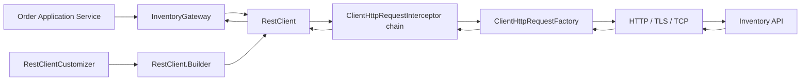
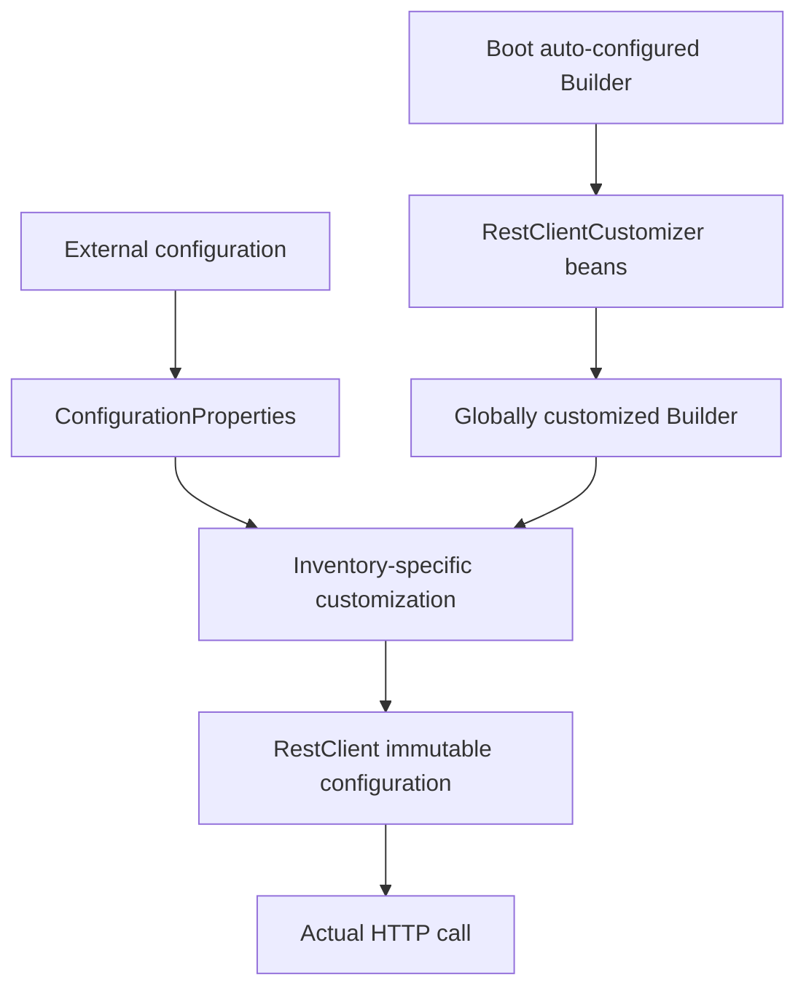
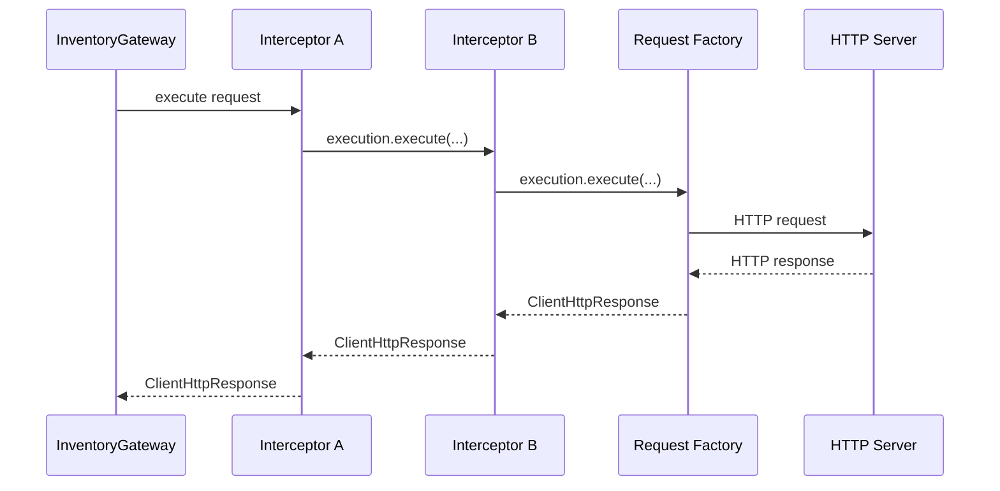

# RestClientCustomizer, Interceptors, and ClientHttpRequestFactory

## 1. Objectives and Challenges in Synchronous HTTP Integration

A Spring Boot application may call multiple external HTTP APIs simultaneously: an Inventory Service to check stock, a Pricing Service to fetch quotes, and a Payment Gateway to look up payment outcomes. These calls all need **timeouts, TLS, client identification, observability, error handling, and testing**, yet they do not necessarily share the same base URL, tokens, retry policies, or wait budgets.

In Spring Framework 6.1+, `RestClient` is a **synchronous** HTTP client with a fluent API. In Spring Boot 3.2+, an auto-configured `RestClient.Builder` applies Boot's shared integrations; developers can add customizations at three distinct layers:

1. **`RestClientCustomizer`**: customizes Spring Boot-configured builders, typically for application-wide shared policies.
2. **`ClientHttpRequestInterceptor`**: intercepts each request/response at the HTTP execution layer, suited for metadata/headers, small cross-cutting policies, and controlled instrumentation.
3. **`ClientHttpRequestFactory`**: determines the actual transport mechanism—such as `HttpURLConnection`, Java `HttpClient`, or Apache HttpClient 5; this layer is especially critical for connections, timeouts, TLS, proxies, and pooling.

Do not confuse these three layers: a customizer **configures the builder**, an interceptor **runs during each request execution**, and a request factory **creates requests over the transport**.

This lesson belongs to the **Synchronous HTTP** chapter of the **SPRING_BOOT_INTEGRATION** module. The module organizes Spring Boot system integration across HTTP clients, databases, caches, message brokers, and Spring Integration adapters, emphasizing **configuration management, data contracts, errors, deduplication, testing, and observability**. Accordingly, we will use an Inventory HTTP client as a running example, paying special attention to timeouts and retry boundaries when a request may already have been processed on the server even if the client lost the response.

### 1.1. After This Lesson, You Will Be Able To

- Distinguish `RestClient.create()`, `RestClient.builder()`, and the `RestClient.Builder` injected by Spring Boot.
- Explain where a `RestClientCustomizer` applies, when it is bypassed, and why a single partner's token should never be configured across all clients.
- Build an interceptor honoring `ClientHttpRequestInterceptor.intercept(...)`, calling `execution.execute(...)` properly, and never leaking sensitive data.
- Select a `ClientHttpRequestFactory` and configure connect/read/response timeouts, connection pools, proxy/TLS settings, and resource lifecycles.
- Use `@ConfigurationProperties` to configure each partner independently without hardcoding base URLs or tokens in application logic.
- Classify `4xx`/`5xx` HTTP errors and connection/timeout errors, handle replays/idempotency, and close response streams in the right scope.
- Test interceptors/customizers with `MockRestServiceServer` and test real transport behavior with a socket-backed test HTTP server, verifying both HTTP contracts and timeouts.
- Diagnose classpath/factory shifts, interceptor ordering, observation/tracing issues, and custom beans causing unexpected behavior.

> **Version Context:** Examples target Java 17+, Spring Boot 3.2+, and Spring Framework 6.1+, using `org.springframework.web.client.RestClient` and `org.springframework.boot.web.client.RestClientCustomizer`. Blocking REST clients differ from reactive `WebClient`. Default request factory selection and certain timeout configuration APIs may vary across minor versions; never copy Spring Boot 2.x code or older HTTP client snippets without checking your BOM/versions.

### 1.2. End-to-End Integration Flow



In this diagram, the builder/customizer act **at client creation time**, while interceptors and the factory act whenever `InventoryGateway` performs an HTTP call. When a request returns `5xx` or times out, the gateway must classify the situation and raise a meaningful error for the application service; never turn every failure into "out of stock" or blindly resend side-effecting commands.

## 2. RestClient Fundamentals and the Configuration Chain

### 2.1. RestClient Is a Synchronous HTTP Client

A typical call:

```java
RestClient client = RestClient.create(
        "https://inventory.example.org");

StockSnapshot snapshot = client.get()
        .uri("/api/v1/stock/{sku}", "SKU-42")
        .retrieve()
        .body(StockSnapshot.class);
```

`retrieve()` processes statuses according to configured status handlers/default behavior, and `body(...)` converts the payload to a Java type via `HttpMessageConverter`. This is a synchronous/blocking API: the calling thread waits until I/O finishes. If your application runs on a WebFlux/Netty event loop, never invoke blocking `RestClient` directly on an event-loop thread; choose a reactive HTTP client or offload blocking operations to an appropriately bounded executor.

### 2.2. Not Every Builder Receives Boot Configuration

| Creation Style | Meaning | What You Must Know |
|---|---|---|
| `RestClient.create()` | Convenience factory using Framework defaults | Does not automatically pick up Boot `RestClientCustomizer` beans |
| `RestClient.builder()` | Framework-level builder created manually | Does not go through Boot's auto-configured builder by default |
| Inject Boot-provided `RestClient.Builder` | Builder configured by Boot from the context | Receives compatible message converters, observation, and `RestClientCustomizer`s |
| Inject an application `RestClient` bean | Already-built, shared client | Policies depend on how that bean was constructed |
| `existingClient.mutate()` | Creates a builder seeded from an existing client | Useful for intentional variants; avoid accidentally inheriting sensitive config |

In a Spring Boot application with standard auto-configuration, **inject `RestClient.Builder`** when configuring partner clients. Calling `RestClient.builder()` inside every service skips registered `RestClientCustomizer` beans, causing logging, request factories, and observation to diverge across clients.

### 2.3. When Is the Builder Configured?



Once built via `build()`, `RestClient` is designed to be reused across concurrent requests. The builder itself is **mutable**: calling `baseUrl(...)`, `defaultHeader(...)`, `requestFactory(...)`, or `requestInterceptor(...)` mutates how the client will be built. Never share a single builder singleton and mutate its base URL or token per request; under concurrency, configuration will bleed across partners or users.

### 2.4. Minimal Dependencies

With Maven using the Spring Boot parent/BOM:

```xml
<dependencies>
    <dependency>
        <groupId>org.springframework.boot</groupId>
        <artifactId>spring-boot-starter-web</artifactId>
    </dependency>
    <dependency>
        <groupId>org.springframework.boot</groupId>
        <artifactId>spring-boot-starter-test</artifactId>
        <scope>test</scope>
    </dependency>
</dependencies>
```

`spring-boot-starter-web` provides Spring MVC and the standard dependencies for `RestClient`; if an application runs no HTTP server, lighter dependency sets can be used depending on the architecture. You do not need WebFlux just to use synchronous `RestClient`. If you want Apache HttpClient 5 connection pooling, include the compatible Apache HttpClient 5 dependency and matching transport configuration:

```xml
<dependency>
    <groupId>org.apache.httpcomponents.client5</groupId>
    <artifactId>httpclient5</artifactId>
</dependency>
```

Do not manually override managed versions when the BOM controls them, unless a tested compatibility or security fix demands it.

## 3. RestClientCustomizer: Application-Wide Builder Customization

### 3.1. Customizer Contract

`RestClientCustomizer` is a Spring Boot functional interface with a single method:

```java
void customize(RestClient.Builder builder);
```

A customizer bean can:

- Register shared interceptors, headers, or user-agents for clients built from the auto-configured builder.
- Set shared default request customizations, status handlers, or controlled observation policies.
- Attach a custom request factory for **all** clients if that is the intent.
- Avoid duplicating identical boilerplate across multiple client configurations.

It is **not a servlet Filter**, does not intercept inbound MVC requests, and is not invoked per incoming HTTP response. It executes **when Boot configures the builder**, whereas callbacks/interceptors it registers can run on every outbound request.

### 3.2. A Safe Global Customizer

```java
// ClientIdentityRestClientCustomizer.java — imports abbreviated
@Component
public class ClientIdentityRestClientCustomizer
        implements RestClientCustomizer {

    @Override
    public void customize(RestClient.Builder builder) {
        builder.requestInterceptor(
                new ClientIdentityInterceptor("order-service"));
    }
}

// ClientIdentityInterceptor.java
public final class ClientIdentityInterceptor
        implements ClientHttpRequestInterceptor {
    private final String clientName;

    public ClientIdentityInterceptor(String clientName) {
        this.clientName = clientName;
    }

    @Override
    public ClientHttpResponse intercept(
            HttpRequest request,
            byte[] body,
            ClientHttpRequestExecution execution
    ) throws IOException {
        request.getHeaders().set("X-Client-Name", clientName);
        return execution.execute(request, body);
    }
}
```

When this bean is in the Spring context, Boot auto-configured `RestClient.Builder`s pick up the interceptor; a `RestClient.builder()` created outside Boot **does not see** the bean. `ClientIdentityInterceptor` adds only a non-sensitive static header and forwards the request exactly once.

**Never use a global customizer to attach an Inventory-specific token to the Payment client.** A broadly applied customizer can leak `Authorization` headers to unrelated domains. Partner-specific tokens or credentials must live only on the **dedicated client bean** or a scoped auth adapter.

### 3.3. Registering via `@Bean` and Controlling Order

```java
@Configuration(proxyBeanMethods = false)
public class RestClientCommonConfiguration {

    @Bean
    @Order(Ordered.LOWEST_PRECEDENCE)
    RestClientCustomizer identifyApplication() {
        return builder -> builder.requestInterceptor(
                new ClientIdentityInterceptor("order-service"));
    }
}
```

When multiple customizers modify a builder, execution order matters—especially if one customizer **replaces** the request factory while another **adds** an interceptor. Spring Boot orders customizers in supported auto-configuration paths, yet code order must still be verified after upgrades or if the application defines a custom `RestClient.Builder` bean.

`@Component` in Section 3.2 and `@Bean` in Section 3.3 are **two alternative ways to register the customizer**—do not enable both for the same policy. `@Order` controls relative order among customizer beans, **not** the final order of request interceptors if another piece of code calls `requestInterceptors(list -> ...)` to reorder or clear them. Write integration tests asserting exact order whenever ordering matters.

### 3.4. Global vs. Per-Client: Decision Matrix

| Policy | Where It Usually Belongs | Why |
|---|---|---|
| Application-wide correlation/tracing/observation | Boot instrumentation or a controlled common customizer | Consistent across all clients |
| Non-sensitive application identity header | Common customizer | Partner-independent |
| Inventory base URL, timeouts | Inventory-specific builder/factory config | Each API has its own SLA |
| Inventory-specific API token | Dedicated Inventory client/interceptor | Prevents leaking to Payment/Shipping |
| Bank mTLS truststore | Dedicated transport on Payment client | Does not alter trust policies of other clients |
| Retry for an idempotent POST | Gateway/application service or scoped policy | Requires business semantics |
| Shared JSON mapper | Boot message converter auto-config or intentional config | Prevents divergent `ObjectMapper` behavior |
| Corporate proxy for specific destinations | Per-client request factory/transport | Avoids routing all traffic through the wrong proxy |

Practical rule of thumb: **Customizers define builder defaults**, while **per-client configuration** owns service contracts, timeouts, and credentials. Before adding an interceptor to all clients, assess its impact on tests, metrics/tracing, and existing outbound HTTP calls.

### 3.5. Why Might Modifying a Global Customizer Leave Some Clients Unchanged?

Typical causes:

1. The client was built via `RestClient.create()` or `RestClient.builder()`, bypassing Boot's builder.
2. The application declared a custom `RestClient.Builder` bean, causing Boot's default builder auto-configuration to back off.
3. A client builder was cloned/mutated before or after customizers in a different order.
4. Client beans are built at startup; mutating a property or singleton afterwards does not rebuild existing clients.
5. Per-client configuration called `requestFactory(...)` after the global customizer, replacing the shared factory.
6. Multiple `RestClient` beans exist and the caller injected the wrong bean via `@Primary`/`@Qualifier`.
7. Tests use `MockRestServiceServer`, replacing the transport so real sockets/factories are not exercised.

To find the cause, trace **how the injected client bean is actually constructed**, rather than merely listing customizer beans.

## 4. ClientHttpRequestInterceptor: The Request and Response Pipeline

### 4.1. Exact Contract

RestClient interceptors implement Spring's HTTP client interceptor interface:

```java
public interface ClientHttpRequestInterceptor {
    ClientHttpResponse intercept(
            HttpRequest request,
            byte[] body,
            ClientHttpRequestExecution execution
    ) throws IOException;
}
```

Parameter semantics:

| Parameter / Return | Content | What to Avoid |
|---|---|---|
| `HttpRequest request` | HTTP method, URI, headers | Arbitrary URI/token tampering, header injection |
| `byte[] body` | Request body bytes prepared for this attempt | Logging sensitive payloads or copying repeatedly |
| `ClientHttpRequestExecution execution` | Next link in the interceptor chain, ending at the transport | Forgetting `execute`, or repeating calls that are not replay-safe |
| `ClientHttpResponse` | Status, headers, and response body stream | Draining the body without restoring it, or leaking open responses on error paths |

A standard interceptor invokes `execution.execute(request, body)` **exactly once**, then returns the response for `RestClient` to read. If an interceptor blocks a call (e.g., for security policy), it must throw an exception or return a response with well-defined semantics—never return `null`.

### 4.2. Interceptor Ordering and Return Flow

With three interceptors registered in order `A, B, C`:

```text
Request:
  A.before -> B.before -> C.before -> ClientHttpRequestFactory -> Network

Response:
  Network -> C.after -> B.after -> A.after -> RestClient response handling
```



If interceptor B throws before calling `execution.execute`, neither C, the factory, nor the server receives the request. If B calls `execute` twice to retry, a POST may be sent twice. Therefore, **each interceptor's order and side effects** must be explicitly verified in tests.

### 4.3. Interceptor Measuring Latency and Status Families

Example measuring per-attempt HTTP duration, recording only the **status family** and configured service name (never full URLs/queries):

```java
// HttpAttemptMetricsInterceptor.java — imports abbreviated
public final class HttpAttemptMetricsInterceptor
        implements ClientHttpRequestInterceptor {
    private final String serviceName;
    private final MeterRegistry metrics;

    public HttpAttemptMetricsInterceptor(
            String serviceName,
            MeterRegistry metrics) {
        this.serviceName = serviceName;
        this.metrics = metrics;
    }

    @Override
    public ClientHttpResponse intercept(
            HttpRequest request,
            byte[] body,
            ClientHttpRequestExecution execution
    ) throws IOException {
        long started = System.nanoTime();
        String outcome = "io_error";
        try {
            ClientHttpResponse response =
                    execution.execute(request, body);
            int code = response.getStatusCode().value();
            outcome = (code / 100) + "xx";
            return response;
        } finally {
            long elapsedNanos = System.nanoTime() - started;
            Timer.builder("outbound.http.attempt")
                    .tag("service", serviceName)
                    .tag("method", request.getMethod().name())
                    .tag("outcome", outcome)
                    .register(metrics)
                    .record(elapsedNanos, TimeUnit.NANOSECONDS);
        }
    }
}
```

This example requires Micrometer's `MeterRegistry` dependency/starter and serves as supplementary instrumentation. Spring Boot/`RestClient` has built-in observation/tracing when configured; enabling default observation alongside a duplicate custom counter can **double-count** or create redundant spans/metrics per request. Before adding a custom metrics interceptor, audit existing instrumentation and decide whether you are measuring an **HTTP attempt** or the **whole application operation**, as they are not the same.

Notice that the code neither reads the response body nor closes the response before returning it: `RestClient` still needs to consume it. If `response.getStatusCode()` throws `IOException` on an exceptional path, ensure a close policy runs when the response is not returned; in production code, verify lifecycle/exception paths with `try/finally` as needed to prevent connection leaks.

### 4.4. Do Not Drain the Response Body in an Interceptor Without Buffering

Anti-pattern:

```java
// Wrong: drains the response stream before RestClient parses JSON.
ClientHttpResponse response =
        execution.execute(request, body);
String logged = new String(
        response.getBody().readAllBytes(),
        StandardCharsets.UTF_8);
return response;
```

`response.getBody()` is usually a **one-shot** stream. Once the interceptor reads it to EOF, `retrieve().body(StockSnapshot.class)` sees an empty stream and fails. To inspect bodies safely, use a **response buffering** wrapper with strict byte caps—keeping in mind that buffering payloads in memory adds overhead and risks exposing tokens, PII, or payment data. Production usually needs only **status, duration, service name, and a normalized error code**, not full bodies.

`BufferingClientHttpRequestFactory` is Spring's wrapper enabling re-reads when necessary, though you must evaluate version compatibility and memory cost: large responses or file downloads are poor candidates. Never enable buffering globally for every client just to debug one endpoint.

### 4.5. When Must You Close ClientHttpResponse?

If an interceptor **returns the response** up to `RestClient` for the caller/converter to consume, do not call `response.close()` before returning. If an interceptor enforces a policy that **aborts processing after receiving a response** and does not return it, it must close the response to release the connection:

```java
ClientHttpResponse response =
        execution.execute(request, body);

if (violatesTransportPolicy(response)) {
    try {
        throw new IOException("HTTP response violates policy");
    } finally {
        response.close();
    }
}

return response;
```

`violatesTransportPolicy` is a **hypothetical** helper you would define; for ordinary status handling such as 404/429/503, prefer `RestClient`/gateway status handlers instead of scattering ad-hoc rules inside interceptors.

### 4.6. Identity, Correlation, and Authentication Headers

A shared interceptor can add `X-Client-Name` or propagate tracing headers from supported instrumentation. However:

- Never copy raw headers from incoming external requests and forward them to arbitrary domains.
- Never rely solely on raw `MDC`/`ThreadLocal` when work hops across thread pools or `@Async`; context can drop or bleed without proper cleanup.
- Never put Inventory's bearer token in a global interceptor where Payment, GitHub, or webhook clients would also send it.
- Never generate a fresh `Idempotency-Key` on every **retry attempt** of the same operation. The idempotency key must stay fixed per **logical command**.
- Never log `Authorization`, cookies, client certificates, PII in URLs/queries, or raw request/response bodies.

If a `RestClient` targets only one partner, scoping an auth interceptor to that bean works; in many cases, configuring dedicated OAuth2/auth client support or setting per-request auth via the request builder is even clearer.

### 4.7. Why Retry Interceptors Are Risky

Naive code:

```java
// Anti-pattern: retries HTTP regardless of method or outcome.
try {
    return execution.execute(request, body);
} catch (IOException ex) {
    return execution.execute(request, body);
}
```

can fire **two payment/reservation POSTs** when the server already executed the first attempt and only the response was lost. Moreover, streaming request bodies or certain transports cannot be replayed unconditionally. Even though GET is safe, unbounded retries still cause request storms during downstream outages.

Place retry policies at the application gateway/use case or a contract-aware retry layer: retry only classified errors, enforce attempt caps and overall deadlines, use exponential backoff + jitter, coordinate with circuit breakers/rate limiters, preserve idempotency keys, and implement **reconciliation for `UNKNOWN` outcomes**.

## 5. ClientHttpRequestFactory: Transport, Timeouts, and Connection Pools

### 5.1. What Does the Factory Control?

`ClientHttpRequestFactory` lives in `org.springframework.http.client` and creates client requests for a given URI and HTTP method:

```java
ClientHttpRequest createRequest(
        URI uri, HttpMethod httpMethod) throws IOException;
```

The factory governs how requests hit the network: connection setup, TLS handshakes, proxies, redirect behavior, pooling/keep-alive, timeouts, streaming, and network resource lifecycles. It does **not** govern JSON contracts, status mapping, idempotency, or business authorization.

### 5.2. Common Implementations

| Factory | Underlying Transport | Considerations |
|---|---|---|
| `SimpleClientHttpRequestFactory` | JDK `HttpURLConnection` | Simple connect/read timeouts for demos; lacks Apache-style dedicated pool management and metrics |
| `JdkClientHttpRequestFactory` | Java 11+ `java.net.http.HttpClient` | Uses JDK `HttpClient` with connect timeout, redirect policy, TLS/client lifecycle |
| `HttpComponentsClientHttpRequestFactory` | Apache HttpClient 5 | Best when you need configurable connection pooling, pool lease timeouts, and TLS/proxy options |
| `JettyClientHttpRequestFactory` | Jetty HTTP client | Fits applications already standardizing on Jetty transport and configuration |
| `ReactorClientHttpRequestFactory` | Reactor Netty | Can back blocking clients; requires understanding Reactor resource/connection management |
| `BufferingClientHttpRequestFactory` | Decorator wrapping another factory | Enables re-reading request/response streams at memory buffering cost |

**Never assume factory auto-selection precedence is identical across all Boot/Framework versions.** Adding Apache HttpClient, Jetty, or Reactor Netty to the classpath can alter the default transport unless configured explicitly. When timeouts, pooling, or TLS matter, set the factory explicitly on the client bean and verify with socket-level tests.

### 5.3. Using SimpleClientHttpRequestFactory for Small Clients

```java
SimpleClientHttpRequestFactory factory =
        new SimpleClientHttpRequestFactory();
factory.setConnectTimeout(2_000); // milliseconds
factory.setReadTimeout(4_000);    // milliseconds

RestClient client = RestClient.builder()
        .baseUrl("http://localhost:18080")
        .requestFactory(factory)
        .build();
```

`connectTimeout` bounds transport connection establishment; `readTimeout` bounds read waits—**not necessarily a strict 4-second overall deadline for the entire request and response**. With multi-address DNS, redirects, retries, or slow chunked streaming, wall-clock duration can exceed an individual timeout.

**Zero or negative values can have special semantics depending on factory/JDK:** never pass `0` without checking the docs, as some implementations treat `0` as **infinite**. Always validate positive `Duration` ranges before converting to milliseconds.

### 5.4. JDK HttpClient Request Factory

Configuring the JDK HTTP client explicitly:

```java
HttpClient jdkHttpClient = HttpClient.newBuilder()
        .connectTimeout(Duration.ofSeconds(2))
        .followRedirects(HttpClient.Redirect.NEVER)
        .build();

ClientHttpRequestFactory factory =
        new JdkClientHttpRequestFactory(jdkHttpClient);

RestClient client = RestClient.builder()
        .requestFactory(factory)
        .build();
```

`java.net.http.HttpClient` controls transport policies such as connect timeout and redirects. Response/read timeout on `JdkClientHttpRequestFactory` is configured via the matching API for your Spring Framework version; do not mistake JDK's connect timeout for a full call deadline. Disabling redirects here prevents accidentally forwarding headers/credentials to unexpected redirect hosts.

### 5.5. Apache HttpClient 5: Bounded Connection Pooling

Under high traffic, sharing a pooled client across requests within the **same policy domain** is far more efficient than opening a fresh transport/client per HTTP call:

```java
// InventoryApacheTransportConfiguration.java
@Configuration(proxyBeanMethods = false)
public class InventoryApacheTransportConfiguration {

    @Bean(value = "inventoryApacheHttpClient",
          destroyMethod = "close")
    CloseableHttpClient inventoryApacheHttpClient() {
        PoolingHttpClientConnectionManager manager =
                PoolingHttpClientConnectionManagerBuilder
                        .create()
                        .setMaxConnTotal(100)
                        .setMaxConnPerRoute(30)
                        .build();

        RequestConfig requestConfig = RequestConfig.custom()
                .setConnectionRequestTimeout(
                        Timeout.ofSeconds(1))
                .setResponseTimeout(
                        Timeout.ofSeconds(4))
                .build();

        return HttpClients.custom()
                .setConnectionManager(manager)
                .setDefaultRequestConfig(requestConfig)
                .build();
    }

    @Bean("inventoryRequestFactory")
    ClientHttpRequestFactory inventoryRequestFactory(
            @Qualifier("inventoryApacheHttpClient")
            CloseableHttpClient httpClient) {
        return new HttpComponentsClientHttpRequestFactory(
                httpClient);
    }
}
```

This snippet uses Apache HttpClient 5: `PoolingHttpClientConnectionManagerBuilder` from `org.apache.hc.client5.http.impl.io`, `RequestConfig` from `org.apache.hc.client5.http.config`, and `Timeout` from `org.apache.hc.core5.util`. It illustrates **total/per-route connection limits**, **pool lease wait timeout**, and **response timeout**. In modern Apache 5 releases, **connect timeout** is typically configured via `ConnectionConfig`/socket/TLS settings for that version; treat this snippet as illustrative rather than a complete timeout setup, and verify all options against your resolved Apache version.

`setMaxConnTotal(100)` and `setMaxConnPerRoute(30)` are example numbers, not universal tuning. With 10 replicas at 100 connections each, the downstream can face up to 1,000 concurrent connections across the cluster under load. Size pools based on concurrency, SLAs, and server quotas; always set a pool lease timeout so callers never wait forever when a pool saturates.

### 5.6. Each Timeout Protects Against a Different Bottleneck

| Timeout | Phase | Risk If Missing |
|---|---|---|
| Connection pool lease timeout | Waiting for a free connection from the pool | Request hangs indefinitely even while the server is healthy |
| DNS resolution budget | Hostname lookup (OS/transport dependent) | May not share the connect timeout |
| Connect timeout | TCP connection establishment | Request stalls when host is unreachable |
| TLS handshake timeout | HTTPS TLS negotiation | SSL handshake hangs or fails slowly |
| Response/read timeout | Waiting for response / reading per transport semantics | Slow server ties up threads too long |
| Overall operation deadline | Connect + retries + body + processing combined | Multiple attempts stack past the caller SLA |

Finite individual timeouts **do not automatically enforce** an overall deadline. Three retry attempts, each with connect/read timeouts plus backoff, can easily exceed a frontend HTTP timeout. Enforce an overall budget at the gateway/application layer and propagate deadlines/cancellation where supported.

### 5.7. RequestFactory, TLS, Proxies, and Redirects

Any HTTPS deployment needs:

- Verification of CA chains, certificate hostnames, and compliant TLS protocols/ciphers.
- mTLS when a partner requires client certificates; configure per client rather than sharing one keypair across every domain.
- Proxy allowlists/auth and `NO_PROXY` or explicit routing rules where required.
- Controlled redirect policies—especially preventing `Authorization`/cookies from leaking across hosts.
- DNS refresh/failover awareness and connection lifetime/idle eviction per transport.

**Never fix certificate errors by installing a trust-all `SSLContext` or disabling hostname verification.** "Works on localhost" does not mean production transport is secure.

### 5.8. HTTP Client and Connection Manager Lifecycles

A built `RestClient` is thread-safe for concurrent reuse and should typically be a per-partner singleton bean. When its underlying transport owns a `CloseableHttpClient` or connection manager with background threads/pools, close it on application shutdown. `@Bean(destroyMethod="close")` in the Apache example lets Spring close the managed client cleanly.

Never instantiate a fresh `CloseableHttpClient` inside `getStock` per request, and never close a shared client after one call. Whenever switching request factories, inspect cleanup hooks for the factory, client, and threads, as APIs vary across implementations.

## 6. Building a Dedicated Inventory RestClient with Timeouts and Interceptors

### 6.1. Separating Application Configuration by Partner

Never share a single `remote.base-url` property and token across Inventory, Pricing, and Payment. They have distinct SLAs, rate limits, and trust boundaries.

Example:

```yaml
# application-local.yml
integration:
  inventory:
    base-url: http://127.0.0.1:18080
    connect-timeout: 2s
    read-timeout: 4s
  pricing:
    base-url: http://127.0.0.1:18081
    connect-timeout: 2s
    read-timeout: 3s
```

In production, `base-url` must come from trusted deployment configuration/secret management and normally use HTTPS. If end users can supply URLs for a service to fetch, enforce SSRF defenses—allowlists, resolved IP validation, redirect restrictions, and egress controls—not just property naming.

### 6.2. Validated `@ConfigurationProperties` Record

```java
// InventoryHttpProperties.java — imports abbreviated
@ConfigurationProperties(prefix = "integration.inventory")
public record InventoryHttpProperties(
        URI baseUrl,
        Duration connectTimeout,
        Duration readTimeout
) {
    public InventoryHttpProperties {
        if (baseUrl == null || baseUrl.getScheme() == null
                || baseUrl.getHost() == null
                || baseUrl.getUserInfo() != null) {
            throw new IllegalArgumentException(
                    "Invalid Inventory base URL");
        }

        String scheme = baseUrl.getScheme()
                .toLowerCase(Locale.ROOT);
        if (!"http".equals(scheme)
                && !"https".equals(scheme)) {
            throw new IllegalArgumentException(
                    "Inventory must use http/https");
        }
        requireSupportedMillis(
                connectTimeout, "connect-timeout");
        requireSupportedMillis(
                readTimeout, "read-timeout");
    }

    private static void requireSupportedMillis(
            Duration value, String name) {
        if (value == null || value.isNegative()
                || value.isZero()
                || value.toMillis() < 1
                || value.toMillis() > Integer.MAX_VALUE) {
            throw new IllegalArgumentException(
                    name + " must be in range 1ms..int-max");
        }
    }
}
```

This example allows HTTP locally; production should enforce HTTPS and appropriate truststores. If an oversized `Duration` overflows `toMillis()`, validation throws `ArithmeticException`; production code can catch it and surface a clearer startup configuration error. The goal is to **fail fast on misconfiguration** rather than silently passing 0 ms with unintended infinite-timeout semantics.

### 6.3. Dedicated Factory Bean for Inventory

```java
// InventoryHttpConfiguration.java — imports abbreviated
@Configuration(proxyBeanMethods = false)
@EnableConfigurationProperties(InventoryHttpProperties.class)
public class InventoryHttpConfiguration {

    @Bean("inventoryRequestFactory")
    ClientHttpRequestFactory inventoryRequestFactory(
            InventoryHttpProperties props) {
        SimpleClientHttpRequestFactory factory =
                new SimpleClientHttpRequestFactory();
        factory.setConnectTimeout(
                Math.toIntExact(
                    props.connectTimeout().toMillis()));
        factory.setReadTimeout(
                Math.toIntExact(
                    props.readTimeout().toMillis()));
        return factory;
    }

    @Bean("inventoryRestClient")
    RestClient inventoryRestClient(
            RestClient.Builder bootBuilder,
            InventoryHttpProperties props,
            @Qualifier("inventoryRequestFactory")
            ClientHttpRequestFactory requestFactory) {

        return bootBuilder
                .baseUrl(props.baseUrl().toString())
                .requestFactory(requestFactory)
                .defaultHeader(
                        HttpHeaders.ACCEPT,
                        MediaType.APPLICATION_JSON_VALUE)
                .requestInterceptor(
                        new InventoryTargetInterceptor())
                .build();
    }
}

// InventoryTargetInterceptor.java
public final class InventoryTargetInterceptor
        implements ClientHttpRequestInterceptor {
    @Override
    public ClientHttpResponse intercept(
            HttpRequest request,
            byte[] body,
            ClientHttpRequestExecution execution
    ) throws IOException {
        request.getHeaders().set(
                "X-Downstream-Client", "inventory");
        return execution.execute(request, body);
    }
}
```

**Key points:**

- `RestClient.Builder bootBuilder` is injected from Spring Boot so global customizers and converter/observation setups can apply.
- `requestFactory(requestFactory)` sets the **Inventory-specific transport**, replacing any request factory previously set by a global customizer. Other builder settings such as interceptors remain unless explicitly replaced.
- `InventoryTargetInterceptor` is added only to the Inventory bean, never attached to Payment or Pricing clients.
- `defaultHeader(HttpHeaders.ACCEPT, ...)` sets a fallback; individual calls can override it per RestClient semantics, so write tests if the downstream is strict.
- The built `RestClient` is shared across threads by design; never mutate a shared builder per tenant or request.

If your project uses Apache pooling instead of `SimpleClientHttpRequestFactory`, wire `inventoryRequestFactory` from the Apache config in Section 5 and **never** register two beans of the same name in the same profile; switch factories cleanly using profiles or conditionals.

### 6.4. Defining the DTO and Inventory Contract

```java
// StockSnapshot.java
public record StockSnapshot(
        String sku,
        long available,
        long revision
) {}

// InventoryGateway.java
@Component
public class InventoryGateway {
    private final RestClient client;

    public InventoryGateway(
            @Qualifier("inventoryRestClient") RestClient client) {
        this.client = client;
    }

    public StockSnapshot getStock(String sku) {
        if (sku == null
                || !sku.matches("[A-Za-z0-9_-]{1,80}")) {
            throw new IllegalArgumentException("Invalid SKU");
        }

        StockSnapshot stock = client.get()
                .uri("/api/v1/stock/{sku}", sku)
                .retrieve()
                .body(StockSnapshot.class);

        if (stock == null
                || !sku.equals(stock.sku())
                || stock.available() < 0
                || stock.revision() < 0) {
            throw new IllegalStateException(
                    "Inventory returned an invalid contract");
        }
        return stock;
    }
}
```

This example performs a read-only `GET` lookup, not a **stock reservation** command. When business logic needs to reserve stock, the endpoint is typically `POST`/`PUT` with an idempotent `operationId` and must not blindly reuse GET retry policies.

Never rely on a cached `StockSnapshot.available` to guarantee a sale when Inventory changes concurrently; enforce atomic reservation and consistency inside the authoritative Inventory service. A well-behaved HTTP client guarantees contract delivery, not upstream domain invariants.

### 6.5. Multiple Clients: Using Independent Builders

```java
@Configuration(proxyBeanMethods = false)
class RemoteClientConfiguration {

    @Bean("pricingRestClient")
    RestClient pricingRestClient(
            RestClient.Builder builder,
            PricingHttpProperties props) {
        return builder
                .baseUrl(props.baseUrl().toString())
                .build();
    }

    @Bean("paymentRestClient")
    RestClient paymentRestClient(
            RestClient.Builder builder,
            PaymentHttpProperties props) {
        return builder
                .baseUrl(props.baseUrl().toString())
                .build();
    }
}
```

`PricingHttpProperties` and `PaymentHttpProperties` are **separate classes** to define and register via `@ConfigurationProperties`, just like Inventory. With Boot's **prototype** auto-configured builder in supported versions, separate injection points receive distinct builder instances. Double-check bean configuration if the project overrides `RestClient.Builder` with a singleton.

Never reuse a single mutable builder variable to create Pricing, attach a Payment token to it, and continue building other clients without isolating builder state. In shared helper methods, clone via `clone()`/`mutate()` per your version's API, verifying which interceptors/default headers are copied and keeping credentials scoped.

### 6.6. Per-Request Metadata and Idempotency Keys

When an inventory reservation command requires idempotency:

```java
// Illustrative write call carrying a stable operation ID
client.post()
        .uri("/api/v1/reservations")
        .header("Idempotency-Key", operationId)
        .body(reservationCommand)
        .retrieve()
        .toBodilessEntity();
```

`operationId` must be validated at the application boundary, bound to the payload/caller, and reused across retries and redeliveries **of the exact same logical operation**. This is per-request business metadata; never use a global customizer to mint a fresh UUID per attempt and mistake that for deduplication.

### 6.7. Configuring Authentication for the Proper Trust Boundary

When a partner requires a bearer token, each Inventory client should use its **own** auth provider:

```java
// Illustrative per-request usage; tokenProvider must be defined separately.
String token = tokenProvider.tokenForInventory();

StockSnapshot stock = inventoryRestClient.get()
        .uri("/api/v1/stock/{sku}", sku)
        .headers(headers -> headers.setBearerAuth(token))
        .retrieve()
        .body(StockSnapshot.class);
```

Never store a bearer token as a global default header across all outbound clients, never log tokens, and never rebuild `RestClient` on every token rotation when a token provider/refresh mechanism fits. If a per-client interceptor attaches tokens automatically, it must call a **trusted token provider** with synchronized expiry handling and never forward tokens to untrusted redirect hosts.

## 7. HTTP Responses and Errors: Interception Does Not Replace Domain Contracts

### 7.1. Error Classes to Distinguish

| Event | HTTP Response Received? | Meaning |
|---|---|---|
| `200` + schema-valid JSON | Yes | Valid payload received; still validate business fields |
| `204` | Yes | No body; contract violation if JSON was promised |
| `400` | Yes | Bad request; usually do not retry the identical payload |
| `401/403` | Yes | Authentication/authorization; fix credentials/policies |
| `404` | Yes | Depends on contract: missing resource or wrong route/base URL |
| `409` | Yes | Conflict; inspect operation ID/state for reconciliation |
| `429` | Yes | Rate limited; respect `Retry-After` and retry budgets |
| `500/502/503/504` | Yes | Downstream error; possibly transient, requires explicit policy |
| DNS/connect/TLS/read timeout | Likely no HTTP status | Side-effecting command outcome may be **unknown** |
| JSON parse/schema failure | Yes | Never treat as success even under 2xx status |

A `ClientHttpRequestInterceptor` sees the status at the transport layer, yet **cannot tell** whether an HTTP `409` on that API means a conflict to return to the caller or a previously succeeded reservation. Translating HTTP errors into domain exceptions normally belongs in the **adapter/gateway** or a client-scoped status handler.

### 7.2. RestClient Defaults and Status Handlers

With `retrieve()`, RestClient applies default status error handling for `4xx`/`5xx` responses unless another handler claims them, typically throwing `RestClientResponseException` subtypes. You can configure a default status handler via the builder:

```java
RestClient client = builder
        .baseUrl(props.baseUrl().toString())
        .defaultStatusHandler(
                HttpStatusCode::isError,
                (request, response) -> {
                    HttpStatusCode status =
                            response.getStatusCode();

                    if (status.value() == 429
                            || status.is5xxServerError()) {
                        throw new InventoryUnavailableException(
                                "Inventory temporarily unavailable: HTTP "
                                + status.value());
                    }
                    throw new InventoryRejectedException(
                            "Inventory rejected request: HTTP "
                            + status.value());
                })
        .build();
```

`InventoryUnavailableException`/`InventoryRejectedException` here are unchecked domain exceptions **to be defined in your project** (e.g., extending `RuntimeException`). Never embed raw response bodies, API keys, full URLs/queries, or sensitive headers in exception messages. Even with a client-wide handler, specific business methods may still need custom `404` or `409` handling per contract; a single global handler applied to all services hides those distinctions.

**Handler precedence:** when combining multiple default status handlers with per-response `onStatus(...)`, verify precedence for your RestClient/Framework version and test every key HTTP status code. Never write a catch-all handler that returns normally, allowing `retrieve().body(...)` to try parsing an error payload as a success DTO.

### 7.3. Network Exceptions Differ from HTTP Status Exceptions

An adapter can separate them cleanly:

```java
try {
    return inventoryRestClient.get()
            .uri("/api/v1/stock/{sku}", sku)
            .retrieve()
            .body(StockSnapshot.class);
} catch (RestClientResponseException ex) {
    // Server returned a structured HTTP error status.
    // Classify ex.getStatusCode() per the Inventory contract.
    throw mapHttpStatus(ex);
} catch (ResourceAccessException ex) {
    // DNS/connect/read timeout or I/O error.
    // For side-effecting POSTs, the outcome may be UNKNOWN.
    throw new InventoryUnavailableException(
            "Unable to reach Inventory", ex);
}
```

`mapHttpStatus(ex)` is a hypothetical helper you implement, not a Spring API. If the client already uses `defaultStatusHandler` to throw custom exceptions, adjust the `catch` blocks accordingly; **never stack two overlapping mapping strategies without knowing their precedence**.

### 7.4. A 2xx Status Can Still Violate the Contract

`200 OK` with JSON `{"available": -10}` is an HTTP success yet violates the business contract. `200 OK` carrying a proxy HTML page instead of JSON is likewise a decode/content-type failure. Therefore, beyond status handlers:

- Validate `Content-Type` and schema version as needed.
- Verify response IDs match the request/tenant.
- Validate value ranges/enums instead of silently treating `null` as a valid default.
- Enforce response size limits and timeouts for streaming bodies.
- Handle truncated payloads or premature server disconnects.
- Never pass untrusted responses straight into SQL, logs, or HTML without sanitization/escaping.

### 7.5. ResponseErrorHandler Differs from ClientHttpRequestInterceptor

Older codebases often pair `RestTemplate` with `ResponseErrorHandler`. In `RestClient`, fluent status handlers handle HTTP error mapping. `ClientHttpRequestInterceptor` operates lower in the pipeline for request/response wrapping, headers, logging/metrics, or transport policies.

When migrating from `RestTemplate` to `RestClient`, do not blindly replace `ResponseErrorHandler` with an interceptor reading raw bodies: move each rule to its proper layer, preserve response stream/connection lifecycles, and keep error business semantics intact.

## 8. Testing Customizers and Interceptors with MockRestServiceServer

### 8.1. Two Levels of Testing: Builder Behavior vs. Network Behavior

Two independent questions:

1. **Does the client build the right request?** URI, method, headers, JSON mapping, status handling, interceptor order. `MockRestServiceServer` excels here by stubbing the transport without networking.
2. **Does the transport actually work?** Connect/read timeouts, TLS, hostname verification, redirects, pooling, proxies, socket reuse. Use a **real networked HTTP/HTTPS test server** or integration environment; mock transports never prove those properties.

| Test Goal | `MockRestServiceServer` | Real Socket Test |
|---|---|---|
| `RestClientCustomizer` adds interceptor | Yes | Yes |
| `X-Client-Name` header present | Yes | Yes |
| URI expansion and JSON contract | Yes | Yes |
| `404/429/503` mapping | Yes | Yes |
| Interceptor callback ordering | Yes | Yes |
| `SimpleClientHttpRequestFactory` connect timeout | **No** | Yes |
| Apache pool lease timeout | **No** | Yes, with concurrency setup |
| TLS certificate/hostname validation | **No** | Yes, HTTPS fixture |
| Proxy/redirect behavior | Incomplete | Yes |
| Reaching the actual server endpoint | No, only proves mock received it | Yes |

### 8.2. Unit-Testing a Customizer Without Booting the Full Context

```java
// ClientIdentityCustomizerTest.java — imports/static imports abbreviated
class ClientIdentityCustomizerTest {

    @Test
    void addsClientIdentityHeaderWithoutRealNetwork() {
        RestClient.Builder builder = RestClient.builder();
        new ClientIdentityRestClientCustomizer()
                .customize(builder);

        // bindTo() must be called before building the client.
        MockRestServiceServer server =
                MockRestServiceServer.bindTo(builder).build();

        RestClient client = builder
                .baseUrl("https://inventory.example.test")
                .build();

        server.expect(requestTo(
                    "https://inventory.example.test/api/v1/stock/SKU-42"))
                .andExpect(method(HttpMethod.GET))
                .andExpect(header(
                        "X-Client-Name", "order-service"))
                .andRespond(withSuccess(
                        """
                        {"sku":"SKU-42","available":8,"revision":17}
                        """,
                        MediaType.APPLICATION_JSON));

        StockSnapshot snapshot = client.get()
                .uri("/api/v1/stock/{sku}", "SKU-42")
                .retrieve()
                .body(StockSnapshot.class);

        assertNotNull(snapshot);
        assertEquals(8, snapshot.available());
        server.verify();
    }
}
```

This tests **the customizer's logic when invoked explicitly**. It **does not prove Spring Boot auto-discovery** applies the customizer bean to every injected `RestClient.Builder`; prove that with a Spring context test as shown next.

Notice `MockRestServiceServer.bindTo(builder)` replaces the builder's request factory with a mock factory. Calling `builder.requestFactory(realFactory)` *after* `bindTo` sends requests to the real network so the mock misses them—a classic test-ordering bug.

### 8.3. Testing That Spring Boot Actually Applies the Customizer Bean

```java
// RestClientBootCustomizationIT.java
@SpringBootTest(
        webEnvironment = SpringBootTest.WebEnvironment.NONE
)
class RestClientBootCustomizationIT {
    @Autowired
    RestClient.Builder bootBuilder;

    @Test
    void autoConfiguredBuilderHasClientIdentityCustomizer() {
        MockRestServiceServer server =
                MockRestServiceServer.bindTo(
                        bootBuilder).build();

        RestClient client = bootBuilder
                .baseUrl("https://inventory.example.test")
                .build();

        server.expect(requestTo(
                        "https://inventory.example.test/health"))
                .andExpect(header(
                        "X-Client-Name", "order-service"))
                .andRespond(withSuccess("OK", MediaType.TEXT_PLAIN));

        assertEquals("OK", client.get()
                .uri("/health")
                .retrieve()
                .body(String.class));
        server.verify();
    }
}
```

This test assumes `ClientIdentityRestClientCustomizer` is a Spring bean picked up by component scanning/import and the application has a valid `@SpringBootApplication`. Because `bootBuilder` is mutable and injected once into the test instance, avoid reusing and mutating it across multiple test methods without resetting or cloning; this example keeps one test method for clarity. In production, Boot's builder is typically prototype-scoped, yet each individual injection point still receives a single mutable builder to customize.

If the app defines a custom `RestClient.Builder` bean, this test catches behavior divergence. If the header is missing, check bean scanning, how Boot builds the builder, customizer ordering, and whether the test accidentally used a manually constructed builder.

### 8.4. Testing Interceptor Ordering with an Event List

```java
// Test-only interceptor recording before/after around each request.
static ClientHttpRequestInterceptor recording(
        String id, List<String> calls) {
    return (request, body, execution) -> {
        calls.add(id + ".before");
        try {
            return execution.execute(request, body);
        } finally {
            calls.add(id + ".after");
        }
    };
}

@Test
void interceptorOrderIsNested() {
    List<String> calls = new ArrayList<>();

    RestClient.Builder builder = RestClient.builder()
            .requestInterceptor(recording("A", calls))
            .requestInterceptor(recording("B", calls));
    MockRestServiceServer server =
            MockRestServiceServer.bindTo(builder).build();
    RestClient client = builder
            .baseUrl("https://inventory.example.test")
            .build();

    server.expect(requestTo(
                    "https://inventory.example.test/ping"))
            .andRespond(withSuccess("ok", MediaType.TEXT_PLAIN));

    assertEquals("ok", client.get().uri("/ping")
            .retrieve().body(String.class));
    server.verify();

    assertEquals(List.of(
            "A.before",
            "B.before",
            "B.after",
            "A.after"), calls);
}
```

This snippet uses an ordinary `List` in a single-threaded synchronous test. For asynchronous channels or multi-threaded interceptors, use a thread-safe collection and assert causal order rather than thread scheduling order. The key takeaway is that interceptors form nested wrappers, not a flat list of callbacks all running before the network call.

### 8.5. Testing That Interceptors Do Not Drain the Body

A valuable test flow:

1. Have a fake server return valid JSON containing Vietnamese/Unicode characters.
2. Attach a logging interceptor that **safely reads only status/headers**, never the body.
3. Verify `retrieve().body(StockSnapshot.class)` deserializes properly.
4. Add an anti-pattern interceptor that calls `readAllBytes()` without wrapping and observe JSON parsing fail.
5. If your organization requires body logging, implement bounded buffering/wrapping and verify the converter still receives the full payload.

Never use an in-memory mock to benchmark buffering memory overhead under load; test large payloads, concurrent requests, and heap metrics separately whenever body logging is genuinely needed.

### 8.6. Testing Gateway Status Handlers

Cover each response path:

```text
HTTP 200 + valid JSON       -> Accurate StockSnapshot
HTTP 200 + invalid JSON     -> Contract/decoding error
HTTP 204 + empty body       -> Must not fake available=0
HTTP 400                    -> Request error, no blind retry
HTTP 401/403                -> Credential/authorization failure
HTTP 404                    -> Missing SKU or wrong endpoint per contract
HTTP 409                    -> Business state reconciliation
HTTP 429                    -> Rate limit, budgeted retry
HTTP 503                    -> Transient downstream outage
EOF/timeout                 -> Outcome potentially unknown
```

With `MockRestServiceServer`, use `withStatus(HttpStatus.SERVICE_UNAVAILABLE)` or mock helpers to verify adapter mapping; with socket tests, assert the actual transport exceptions from the request factory. Never write a catch-all `catch (Exception) { return new StockSnapshot(sku, 0, 0); }` that disguises TLS, JSON, or API errors as "out of stock".

## 9. Testing Request Factories Against a Real HTTP Server

### 9.1. Why Mocks Cannot Verify Timeouts

`MockRestServiceServer` replaces the builder's `ClientHttpRequestFactory` with a mock factory. During execution, no TCP connect happens, no TLS handshake occurs, and no real pool is used. Consequently, a test like:

```java
MockRestServiceServer.bindTo(builder).build();
// ...
assertEquals("OK", client.get().uri("/ping")
        .retrieve().body(String.class));
```

**does not prove** `SimpleClientHttpRequestFactory#setConnectTimeout` or Apache pool settings actually work. You need a real socket-backed test server (JDK `HttpServer`, WireMock, MockWebServer, or a container) to test transport behavior.

### 9.2. Using JDK HttpServer to Test Read Timeouts

Self-contained socket integration test using JDK `com.sun.net.httpserver.HttpServer`:

```java
@Test
void readTimeoutFailsInsteadOfWaitingIndefinitely()
        throws IOException {
    HttpServer server = HttpServer.create(
            new InetSocketAddress("127.0.0.1", 0), 0);

    server.createContext("/slow", exchange -> {
        try {
            try {
                Thread.sleep(2_000);
            } catch (InterruptedException interrupted) {
                Thread.currentThread().interrupt();
            }
            byte[] body = "late"
                    .getBytes(StandardCharsets.UTF_8);
            exchange.sendResponseHeaders(200, body.length);
            exchange.getResponseBody().write(body);
        } finally {
            exchange.close();
        }
    });

    server.start();
    try {
        SimpleClientHttpRequestFactory factory =
                new SimpleClientHttpRequestFactory();
        factory.setConnectTimeout(1_000);
        factory.setReadTimeout(150);

        RestClient client = RestClient.builder()
                .requestFactory(factory)
                .build();

        String url = "http://127.0.0.1:"
                + server.getAddress().getPort()
                + "/slow";

        assertThrows(ResourceAccessException.class, () ->
                client.get().uri(url)
                        .retrieve().body(String.class));
    } finally {
        server.stop(0);
    }
}
```

Because the server sleeps for ~2 seconds before sending headers, a client with a 150 ms read timeout throws `ResourceAccessException` wrapping an I/O timeout cause. Avoid asserting exact millisecond timings due to OS/CI scheduler jitter. In practice, keep thresholds far apart to prevent flakiness, clean up threads/sockets, and ensure the server is listening before issuing requests.

JDK `HttpServer` here does not use TLS. To test HTTPS, start `HttpsServer` with trusted test certificates or a controlled TLS server/container, verifying hostname verification and truststores without ever using a trust-all `SSLContext`.

### 9.3. Testing Connect Timeout Differs from Read Timeout

Read timeout means the client **established a connection** yet received no data in time. Connect timeout means the TCP handshake to the endpoint could not complete. Pointing at an arbitrary "nonexistent" IP to test connect timeout is **flaky**: OSes may return `Connection refused` immediately, firewalls may drop packets, and CI network topologies vary.

For connect timeouts, use a controlled network fixture that blackholes/drops packets, a container namespace, or a test proxy to trigger deterministic stalls. Never assert "fails in exactly 2 seconds" against a public internet address, where DNS/routing/firewalls introduce flakiness and unwanted traffic.

### 9.4. Testing Pool Exhaustion with Apache HttpClient

A controlled scenario with Apache pooling:

1. Cap the pool at `maxConnTotal=2`, `maxConnPerRoute=2`.
2. Have the test server hold two HTTP responses open deterministically.
3. Issue a third request and assert it fails with a **pool lease timeout** instead of waiting forever.
4. Complete/cancel the held requests properly and verify connections return to the pool.
5. Inspect active/leased/pending counts and confirm pool recovery.

This verifies the **transport**, not `RestClientCustomizer`. Use synchronization primitives/latches instead of arbitrary `Thread.sleep`, always clean up in `finally`, and never run pool-exhaustion tests against a live partner's production API.

### 9.5. Testing TLS, Redirects, and Credentials

| Test | Setup | Expected Outcome |
|---|---|---|
| Valid HTTPS | Test server with valid hostname cert and trusted CA | Client connects cleanly |
| Unknown CA | Untrusted test certificate | TLS fails; no silent downgrade |
| Wrong hostname | Certificate issued for a different host | Hostname verification rejects connection |
| mTLS required | Server demands client certificate | Only a client with a valid keypair succeeds |
| Cross-host redirect | Server A redirects to B | Client obeys policy without leaking `Authorization` |
| Proxy auth | Mock proxy enforcing policy | Only authorized proxy credentials are sent |
| Large response | Server streams data past cap | Client enforces limits/streaming safely |

Configuring a trust-all HTTP client only produces false-green tests and hides real security flaws. For Payment/Banking APIs, TLS/hostname/mTLS are mandatory security boundaries requiring real-handshake tests.

## 10. Interactions with Transactions, Retries, Caches, and Spring Integration

### 10.1. Synchronous RestClient Can Extend Database Transactions

Anti-pattern:

```java
@Transactional
public void confirmOrderBad(String orderId) {
    Order order = repository.findById(orderId).orElseThrow();
    StockSnapshot stock = inventoryGateway.getStock(order.sku());
    order.confirmBasedOn(stock.available());
}
```

If Inventory takes 4 seconds to respond, the JPA transaction holds a DB connection, locks, and persistence context the entire time. HTTP I/O sits **outside the database transaction manager's rollback scope**. When Inventory is only a GET, query it outside the write transaction and then open a brief transaction to **re-check invariants/versions** before committing. When HTTP is a reservation POST, use a state machine and idempotency/compensation instead of expecting `@Transactional` to roll back downstream calls.

### 10.2. Timeout After POST Can Leave an UNKNOWN Outcome

```mermaid
sequenceDiagram
    participant O as Order Service
    participant I as Inventory Service
    O->>I: POST /reservations (operationId=R-1001)
    I->>I: Commit reservation
    I--xO: Response lost due to network timeout
    Note over O,I: Client sees timeout; server may have committed
    O->>I: GET /reservations/by-operation/R-1001
    I-->>O: RESERVED
```

If the client resends the POST with a **new** idempotency key, the server can reserve stock twice. Retries must reuse `operationId`, the downstream must enforce uniqueness/idempotency, and uncertain outcomes must query current state before issuing any new operation.

Never bake "retry every `IOException` up to 3 times" into a global HTTP interceptor: different clients have different safe/idempotent semantics, and a response timeout never tells you whether the server finished processing.

### 10.3. Circuit Breakers, Rate Limiters, and Bulkheads

A synchronous HTTP client can saturate thread pools if a downstream slows down. Beyond factory timeouts, gateways can combine:

- **Circuit breakers** to fail fast when a dependency is persistently unhealthy; requires accurate error classification.
- **Rate limiters** to respect quotas and `429 Retry-After`.
- **Bulkheads/concurrency limits** so one partner cannot consume all worker threads.
- **Bounded retry budgets** with exponential backoff and jitter.
- **Overall deadlines** so cumulative wait time stays within the caller's SLA.

Spring Boot does not wire all of these automatically just from a `RestClientCustomizer` or request factory. When adding Resilience4j, Spring Retry, or similar libraries, configure dependencies, observability, and rules explicitly—and never stack retries across interceptors, gateways, and message consumers without bounding total attempts.

### 10.4. Combining with a Redis Cache

A gateway may check a Redis cache for stock snapshots on GET and fall back to HTTP on cache misses. Keep clear boundaries:

- Redis holds a TTL-bound cached copy, not the authoritative sellable inventory count.
- Cache hits keep interceptor/HTTP metrics **flat** because no HTTP call occurs.
- Redis cache errors must never be silently turned into "Inventory out of stock".
- When Inventory publishes new revisions, align cache invalidation/TTLs with consistency policies.
- Never cache `4xx/5xx` responses or `null` as valid inventory unless explicitly permitted by contract.

When analyzing performance, separate `cache_hit`, `http_attempt`, `http_success`, and `business_decision`; one business request may perform zero HTTP attempts or multiple attempts due to retries.

### 10.5. Spring Integration HTTP Outbound Adapters/Gateways

Spring Integration defines its own HTTP outbound adapters/gateways and messaging flows. Even if a flow looks like:

```text
Inbound Message
  -> transform command
  -> HTTP outbound gateway
  -> route reply
  -> broker/output
```

that **does not** guarantee the adapter uses your configured `RestClient` bean: some Spring Integration HTTP endpoints use `RestTemplate` or their own HTTP client infrastructure depending on the adapter and version. Never assume a global `RestClientCustomizer` applies to every Spring Integration HTTP call. Inspect the **actual adapter type and underlying HTTP client** and configure its bean, request factory, and interceptors explicitly.

When writing a custom gateway bean and invoking `InventoryGateway` from a service activator, you directly control `RestClient`. For built-in outbound adapters with their own APIs, check version docs for timeouts, error channels, retries, and message ACKs. Never use a `RestClient` interceptor to replace message-flow retries or DLQs.

## 11. Observing Synchronous HTTP Without Leaking Data

### 11.1. Boot Observation vs. Custom Logging Interceptors

With Micrometer/Actuator/tracing dependencies and proper auto-configuration, Spring Boot attaches observation to injected `RestClient.Builder`s. Observation/tracing measures client requests and links callers to downstreams; a customizer or interceptor can serve specialized needs, yet should not duplicate instrumentation Boot already provides.

Observability model:

```text
Application operation:
  confirmOrder(operationId)    -> 1 logical operation
    Inventory.getStock()       -> 1 downstream call
      GET attempt #1          -> timeout
      GET attempt #2          -> HTTP 200

Metrics:
  business operation count    = 1
  HTTP request attempts       = 2
  retry count                 = 1
```

If a custom interceptor sits **inside a retry wrapper**, it runs on every attempt; if retries wrap outside `RestClient` by re-invoking the gateway, instrumentation behaves differently. Clearly define metric/span names and measurement points.

### 11.2. Useful Metrics

| Category | Metric/Attribute | Purpose |
|---|---|---|
| HTTP attempt | Request count by service/method/outcome | Transport success vs. failure rate |
| Latency | p50/p95/p99 by service and operation template | Identifies slow downstreams |
| Errors | HTTP `4xx`/`5xx`, timeouts, TLS, DNS, connection refused | Separates protocol errors from I/O errors |
| Retries | Attempt count, retries exhausted, backoff | Detects retry storms |
| Pool | Leased/available/pending connections | Detects pool starvation or leaks |
| Business | Inventory lookup succeeded, unknown reservation status | Separates HTTP success from domain outcomes |
| Dependency | Downstream health/quota/circuit breaker state | Correlates incidents with downstream health |

Not every metric above is emitted automatically by Spring Boot starters; Apache pools, circuit breakers, or gateway domain errors require dedicated instrumentation per library. When upgrading Boot, verify metric names, tags, and `ObservationRegistry` wiring instead of assuming dashboards stay unchanged.

### 11.3. URI Templates vs. Resolved URIs

An actual URL might look like:

```text
GET /api/v1/stock/SKU-42?access_token=secret
GET /api/v1/stock/SKU-43?access_token=secret
```

Never put full paths, tokens, emails, order IDs, or SKUs into metric labels: cardinality explodes per request and leaks data. Whenever the framework provides a safe **URI template** (`/api/v1/stock/{sku}`) for instrumentation, prefer the template over the resolved URI. For custom metrics, use low-cardinality tags such as `service=inventory`, `operation=getStock`, `method=GET`, `outcome=2xx/5xx/timeout`.

To correlate a specific request, record the trace/span ID in access-controlled, redacted structured logs—never as a metric label.

### 11.4. Common Instrumentation Mistakes

- Calling `RestClient.builder()` inside a bean instead of injecting Boot's builder -> Boot observation/configurers may be skipped.
- Adding a custom metrics interceptor while Actuator already instruments HTTP clients -> conflicting numbers or double-counting.
- Using full URLs as metric labels -> unbounded time-series growth.
- Logging `Authorization`, cookies, JSON bodies, or query secrets in interceptors -> security violation.
- Reading raw response bodies to "log errors", leaving converters with an empty stream.
- Hopping across `@Async`/executors without propagating tracing context properly.
- Generating `UUID.randomUUID()` per retry attempt in an interceptor and using it as a **business idempotency key** -> downstream cannot deduplicate.

### 11.5. Tracing, Threads, and Blocking HTTP Clients

With synchronous `RestClient`, interceptors execute on the calling thread (except where the underlying factory/library uses internal I/O threads). Tracing context can be propagated in headers by instrumented transports/Observation; do not reinvent trace ID generators in every interceptor when the infrastructure handles it.

In Spring MVC, an inbound HTTP request may call several downstream clients sequentially; total latency equals the sum of those blocking calls. With virtual threads or executor pools, thread holding costs change, yet timeouts, pool saturation, and downstream quotas still apply. Virtual threads **do not** make HTTP side effects rollback-capable or eliminate duplicate retry risks.

## 12. Common Failures: Fix the Right Layer

### 12.1. Symptom and Verification Table

| Symptom | Common Cause | How to Verify/Fix |
|---|---|---|
| `RestClientCustomizer` bean exists yet header is missing | Client built via `RestClient.create/builder` outside Boot; customizer skipped | Inject Boot's builder; test mocked headers |
| Interceptor runs on Inventory but not Pricing | Clients built via different paths or intentionally scoped | Inspect bean construction and customizer registration |
| Payment receives Inventory's `Authorization` | Global customizer/headers overly broad | Scope auth per client; test against credential leaks |
| Adding timeout to YAML has no effect on latency | Unbound property, different factory used, or separate overall deadline | Inspect `@ConfigurationProperties`, factory beans, and socket tests |
| Mock tests pass yet production hangs | Mocks bypass real sockets and factories | Run socket integration tests for timeouts/pools/TLS |
| JSON deserialization sees empty body | Interceptor drained the response stream | Stop reading raw bodies or use bounded buffering/wrapping |
| Duplicate header values | Two customizers/interceptors both called `add` | Check ordering and `set` vs. `add` |
| `404` treated as `200` or lost error body | Status handler returned normally, or wrapper swallowed exception | Audit handler ordering and test every status code |
| `429` causes a request storm | Retries lack quotas, backoff, or `Retry-After` handling | Add retry budgets, rate limits, and circuit breakers |
| POST timeout produces two reservations downstream | Retry generated a new operation ID / lacked idempotency | Preserve idempotency key and query state |
| Apache pool exhausted | Unclosed responses, high concurrency, low max-per-route | Inspect pool metrics, lifecycles, and lease timeouts |
| TLS fails in staging | Local used HTTP; differing certs/truststores/SANs | Use HTTPS test fixtures and verify CA/hostname matching |
| Changing Apache dependency alters behavior | Default request factory re-selected from classpath | Configure the factory explicitly and run regression tests |
| Global logging lacks traces | Builder created manually or `ObservationRegistry` missing | Inspect Boot builder/observation dependencies |
| Mock test suddenly hits real network | `requestFactory(realFactory)` called after `MockRestServiceServer.bindTo` | Bind mock last before `build()` |
| Spring Integration RestClient call ignores customizer | Adapter uses `RestTemplate` or its own client | Inspect adapter and configure its actual HTTP transport |
| App hits wrong Inventory base URL | Environment override, hardcoded URL, wrong qualifier | Compare effective properties, bean wiring, and mock requests |

### 12.2. Seven-Step Debugging Runbook

**Step 1 — Pin down the operation and contract.** Document the URI template, HTTP method, max wait, expected HTTP statuses, JSON schema, and idempotency key. Never log raw tokens or PII.

**Step 2 — Trace where the client is created.** Locate `@Bean RestClient`/`RestClient.Builder` and gateway call paths; if `RestClient` was created via manual `create/builder`, Boot customizers may be skipped.

**Step 3 — Trace customization order.** Global `RestClientCustomizer`, per-client `requestInterceptor`, `requestInterceptors(...)`, `requestFactory(...)`, and default status handlers; identify which calls **append** vs. **replace** prior configuration.

**Step 4 — Inspect effective configuration.** Active profiles, `@ConfigurationProperties` binding, environment variables, CLI/test overrides; inspect the actual `InventoryHttpProperties` bean rather than assuming from YAML files. If Actuator is enabled and secured, inspect `/actuator/env` or `/actuator/configprops` without exposing secrets.

**Step 5 — Inspect the real transport.** Actual `ClientHttpRequestFactory` class, Apache pool settings, connect/read/lease timeouts, and TLS/proxy/redirect configuration. Verify with a socket-level test server, not a mock factory.

**Step 6 — Inspect outcomes and retries.** HTTP status vs. network exception, status handler mappings, JSON validation, attempt count, POST timeouts, and `UNKNOWN` states. Inspect downstream event/operation IDs for side-effecting calls.

**Step 7 — Add regression tests.** One mock test for headers/JSON/statuses, one socket-level test for timeouts/TLS/pooling as needed, and one business test for idempotency/reconciliation on retries.

### 12.3. Distinguishing "Ignored Property" from "Replaced Factory"

Example:

```yaml
integration:
  inventory:
    connect-timeout: 1s
    read-timeout: 3s
```

If `InventoryHttpProperties` bound `readTimeout=3s` yet `RestClient` uses an Apache factory swapped in by a global customizer, the property **was read properly but never applied to the active factory**. Conversely, if an environment variable with higher precedence overwrote YAML with `5s`, that is a **PropertySource precedence** issue.

Do not blindly edit YAML files hoping things improve. Verify:

```text
1. Effective InventoryHttpProperties.readTimeout = ?
2. Factory instance/type attached to RestClient = ?
3. Actual factory's configured timeouts = ?
4. When does a socket test trigger a timeout = ?
```

`RestClient` has no universal API to dump every transport's internal settings across all implementations; inspect the injected bean and prove behavior with socket tests.

### 12.4. Interceptor Sees 200 Yet Client Still Fails

An interceptor might log `HTTP 200` while `retrieve().body(StockSnapshot.class)` throws because:

- The body is HTML/text instead of JSON.
- JSON omitted a required field (which could silently become `0` on a primitive without validation).
- Content-Type or schema mismatched.
- Another interceptor already drained the body stream.
- The response stream closed or the socket truncated early.
- Business validation detected a mismatched `sku`.

Therefore, `http.status=200` cannot replace `inventory.lookup.success`. Place validation and error mapping in the adapter after deserialization, and test malformed bodies.

### 12.5. Diagnosing Interceptor Order

Suppose A adds `Authorization`, B logs headers, and C handles tracing. If B runs **after A**, it may accidentally log the token. Do not "fix" this merely by swapping order and continuing to log all headers: a logging interceptor must **redact via allowlist** regardless of order.

If both A and B call `request.getHeaders().add("X-Client-Name", ...)`, the server can receive two header values. For single-valued headers, use `set(...)` and ensure global and per-client interceptors do not conflict. Certain headers (`Authorization`/`Host`/`Content-Length`) are also governed by underlying transport policies; never mutate them arbitrarily.

### 12.6. Timeouts Configured Yet Retries Still Exceed SLA

Suppose 3 retry attempts each have a 4-second read timeout, 2-second connect timeout, and escalating backoff, while the caller's HTTP SLA is 5 seconds. Each individual timeout looks reasonable, yet combined latency blows past the SLA. Derive a **retry budget** from the request deadline:

```text
caller deadline = 5s
attempt #1 ~ 2s
backoff #1  = 200ms
attempt #2 ~ 2s
remaining budget ~ 800ms
=> attempt #3 should not start if it cannot meet the deadline
```

This is a simplified estimate; real execution also includes pool waits, DNS, TLS, and deserialization. Retries must also respect idempotency and `UNKNOWN` states rather than merely summing connect+read timeouts as a hard deadline.

### 12.7. What Should Be Logged for a Production Failure?

A clean structured log beats a raw dump:

```text
event=outbound_http_failure
service=inventory
operation=getStock
method=GET
uri_template=/api/v1/stock/{sku}
outcome=timeout
attempt=2
elapsed_ms=3110
trace_id=<redacted-or-allowed-trace-id>
```

Never log bearer tokens, payment bodies, full resolved URIs/queries, or credentials in exceptions. For HTTP error responses, record a normalized error code—never dump untrusted HTML/bodies into structured logs without sanitization and size caps.

## 13. Upgrading from RestTemplate and Changing HTTP Transports

### 13.1. RestClient Does Not Automatically Replace RestTemplate Beans

Both `RestTemplate` and `RestClient` can share `ClientHttpRequestFactory` and `ClientHttpRequestInterceptor`, yet their call APIs and builder customizations differ:

| Aspect | RestTemplate | RestClient |
|---|---|---|
| Primary API | `getForObject`, `exchange`, `execute`... | `get/post/put/delete` fluent API, `retrieve`, `exchange` |
| Boot builder | `RestTemplateBuilder` | `RestClient.Builder` |
| Boot customizer | `RestTemplateCustomizer` | `RestClientCustomizer` |
| HTTP interceptor | `ClientHttpRequestInterceptor` | Also uses `ClientHttpRequestInterceptor` |
| Transport | `ClientHttpRequestFactory` | Also uses `ClientHttpRequestFactory` |
| Error mapping | `ResponseErrorHandler` | Status handlers on `RestClient`, e.g., `defaultStatusHandler` |
| Observability | Depends on builder/Boot instrumentation | Depends on builder/Boot instrumentation |

**Do not assume a `RestTemplateCustomizer` automatically applies to `RestClient.Builder`** just because both share interceptor and factory interfaces. During migration, port each customizer and status handler explicitly and re-verify observation and timeouts.

### 13.2. Example Migrating an HTTP GET to RestClient

Old code:

```java
StockSnapshot stock = restTemplate.getForObject(
        baseUrl + "/api/v1/stock/{sku}",
        StockSnapshot.class,
        sku);
```

New code:

```java
StockSnapshot stock = restClient.get()
        .uri("/api/v1/stock/{sku}", sku)
        .retrieve()
        .body(StockSnapshot.class);
```

Do not swap the method call and declare migration done. Check every detail:

1. Which auth/tracing interceptors did the old `RestTemplate` have?
2. Did a `ResponseErrorHandler` map 404/409/429 to domain exceptions?
3. Was a custom `ClientHttpRequestFactory` handling TLS, proxies, pooling, or read timeouts?
4. Were custom message converters or a custom JSON mapper configured beyond Boot defaults?
5. Were special request callbacks or streaming bodies used?
6. `RestTemplateBuilder` was Boot auto-configured; does the new `RestClient.Builder` receive matching configuration semantics?
7. `RestClient.retrieve().body(...)` returns `null` when there is no body—how does the adapter handle that?
8. Did legacy paths invoked by a Spring Integration adapter actually move to `RestClient`, or do they still invoke a separate `RestTemplate`?

### 13.3. Classpath Changes Can Switch the Request Factory

Adding Apache HttpClient 5 for one partner can cause auto-detection mechanisms to switch the transport for other clients that do not specify a factory explicitly. This can silently alter pooling, redirect behavior, TLS/proxies, or timeouts. Likewise, upgrading Spring Boot/Framework can add or reorder default HTTP client factory/timeout APIs.

**How to stay in control:** for critical integrations, **set the factory explicitly on the client bean** and verify TLS/timeouts/redirects with socket tests. Never rely on an undocumented legacy transport precedence list without checking release notes for your version.

### 13.4. API Changes Across Versions

`RestClient` arrived in Spring Framework 6.1 and gained Boot support in Spring Boot 3.2; projects on Spring Boot 3.1 or earlier cannot copy `RestClientCustomizer` code without upgrading or adding compatible versions. In addition:

- Configuring timeouts on `JdkClientHttpRequestFactory`/`HttpComponentsClientHttpRequestFactory` requires checking overloads and semantics for your **Spring Framework minor version**.
- Apache HttpClient 5 uses `org.apache.hc.*` packages rather than HttpClient 4's `org.apache.http.*`; never mix modern `HttpComponentsClientHttpRequestFactory` with 4.x clients.
- Spring Boot builder/factory helpers evolve across minor releases; stick to APIs supported by your current version rather than pulling classes from newer guides.
- Auto-configured observation, metrics, and request factory selection depend on classpath dependencies.
- `@ConfigurationProperties` supports relaxed binding yet does not dynamically reconfigure singleton clients on runtime config changes without explicit refresh/rebuild logic.

After upgrades, run both mock unit tests and real-network integration tests. A passing `@SpringBootTest contextLoads()` does not prove status handling, timeouts, or transport behavior stayed intact.

### 13.5. Safe Step-by-Step Migration Plan

```text
Step 1: Inventory all existing RestTemplate beans and HTTP integrations
Step 2: Lock down contracts, auth, timeouts, retries, logging/metrics
Step 3: Create the new RestClient bean from Boot's injected Builder
Step 4: Port interceptors, status handlers, and client factory settings
Step 5: Use MockRestServiceServer to test URL/method/body/status
Step 6: Use socket fixtures to test TLS/redirects/timeouts/pooling
Step 7: Verify traces/metrics, idempotency, and error budgets
Step 8: Cut over one adapter at a time; never switch everything at once
Step 9: Remove redundant RestTemplate config after verifying results
```

If a feature flag toggles Inventory from `RestTemplate` to `RestClient`, ensure you never fire **two side-effecting HTTP POSTs** simultaneously just to "compare implementations". Shadow traffic is suitable only for safe GETs or partner-approved test endpoints; for POST/PUT, rely on sandboxes, operation IDs, and strict anti-duplication guards.

## 14. Choosing the Right Extension Point: Decision Guide

### 14.1. Quick Decision Table

| Need | Preferred Extension Point | Example |
|---|---|---|
| Non-sensitive identity header on all RestClients | `RestClientCustomizer` | `X-Client-Name` |
| API key/token for one specific client | Client-specific config/interceptor | Inventory bearer token |
| Dynamic per-operation header | Request builder / application gateway | `Idempotency-Key` |
| Request/status/latency observability | Boot observation or controlled interceptor | HTTP attempt metrics |
| Shared JSON converter/mapping tweaks | Boot message converters / builder customization | Jackson settings |
| TCP/read timeouts | Per-client `ClientHttpRequestFactory` | Simple/JDK/Apache timeouts |
| Connection pooling | Transport/client manager | Apache max total/per-route |
| TLS/mTLS, proxies, redirects | Transport/factory-specific config | Payment client truststore |
| Handling HTTP 404/409/429 | RestClient status handler / gateway | Mapping domain exceptions |
| Retries with idempotency and deadlines | Gateway / application workflow | POST reservation reconciliation |
| Circuit breakers / rate limits | Resilience layer around gateway | Downstream outage protection |
| Fake HTTP responses in unit/slice tests | `MockRestServiceServer` | Asserting headers/JSON |
| Real timeouts/TLS/pooling | Socket-level test server | Verifying read timeout |
| External message flows in Spring Integration | Configure the actual HTTP adapter/gateway | Do not assume `RestClientCustomizer` applies |

### 14.2. Maintainable Code Organization Pattern

```text
integration/inventory/
  InventoryHttpProperties
  InventoryHttpConfiguration
  InventoryGateway
  StockSnapshot
  InventoryErrorMapper

integration/pricing/
  PricingHttpProperties
  PricingHttpConfiguration
  PricingGateway

integration/common/
  ClientIdentityRestClientCustomizer
  ClientIdentityInterceptor

tests/
  InventoryGatewayMockHttpTest
  InventoryTransportSocketIT
  InventoryIdempotencyIT
```

This layout is illustrative only—**there is no requirement to create these Java files in this step**. The goal is to separate **shared policy** from **partner contracts** and **transport infrastructure**; a giant global customizer must never absorb every token, timeout, retry, and JSON mapping across the whole system.

### 14.3. When Should You Not Use a Global RestClientCustomizer?

Whenever a setting belongs to only one partner:

- Payment uses mTLS and signs requests with a private key.
- Inventory has different token refresh and rate limits than Pricing.
- One service routes through an outbound proxy while others connect directly.
- One integration buffers response bodies to verify digital signatures.
- One partner requires a legacy TLS setting or specialized request factory (after security review).

In those cases, a global customizer causes unintended side effects and credential leaks. Use **per-client beans** with dedicated factories, interceptors, and status handlers; reserve global customizers strictly for defaults safe for every outbound client.

### 14.4. When Should You Not Write a Custom ClientHttpRequestInterceptor?

Whenever the framework already covers the requirement cleanly:

- HTTP tracing/propagation handled by Micrometer Observation.
- Error mapping in `RestClient.retrieve().onStatus(...)` or `defaultStatusHandler`.
- Business contracts like "order inventory reserved" belonging in the application service.
- Retries/redeliveries handled in message consumers with idempotency and DLQs.
- Client authentication handled by OAuth2 client infrastructure.
- Large file downloads needing streaming handlers instead of buffering/logging entire bodies.

A lean interceptor shines when it operates on **every HTTP attempt** with one small, independently testable responsibility and never breaks stream or response lifecycles.

## 15. Exercises, Questions, and Checklist

### 15.1. Exercise A — Global Customizer vs. Per-Client Policy

Create `ClientIdentityRestClientCustomizer` adding `X-Client-Name=order-service`. Create two `RestClient` beans—`inventoryRestClient` and `paymentRestClient`—from Boot's injected `RestClient.Builder`. Attach `X-Downstream-Client=inventory` only to Inventory, and separate authentication only to Payment.

Write two `MockRestServiceServer` tests proving:

- Both emit `X-Client-Name`.
- Inventory emits its dedicated header **without** Payment's token.
- Payment emits proper authentication without Inventory's header.
- A client built manually with `RestClient.builder()` **does not** receive the customizer unless `customize` is called explicitly.

**Completion criteria:** zero secret leakage across domains; assertions verify actual mock-layer requests rather than just inspecting bean definitions.

### 15.2. Exercise B — Interceptor Order and Body Consumption

Create two interceptors A/B appending `before/after` to a list. Assert the sequence `A.before, B.before, B.after, A.after`. Next, write an interceptor that reads the response body stream and returns the raw response unchanged; observe JSON parsing fail. Fix it by **not reading the body** or using bounded buffering/wrapping, and verify the converter receives the full payload again.

**Completion criteria:** returns valid responses, never closes streams prematurely, and never logs sensitive JSON.

### 15.3. Exercise C — Request Factory and Timeouts

Build `inventoryRestClient` using `SimpleClientHttpRequestFactory` with a 500 ms connect timeout and 1-second read timeout. Spin up a real JDK `HttpServer` or WireMock returning a response after 3 seconds. Assert the read timeout error and socket release. Repeat using Apache HttpClient 5 with a tiny pool and test pool lease timeouts under concurrency.

**Completion criteria:** tests run against real sockets rather than pretending `MockRestServiceServer` tests timeouts; servers and pools are cleaned up completely.

### 15.4. Exercise D — Status Mapping and Retry Budgets

Make a fake Inventory server return `429`, `503`, then `200`. Build a retry policy strictly for GETs within an overall deadline, using backoff/jitter and honoring `Retry-After` per contract. Also test `400`/`401`: never retry unchanged payloads or keep sending invalid credentials. Assert the attempt-count metric equals 3 when permitted.

**Completion criteria:** no infinite retries, no quota-busting traffic bursts, and no conflating HTTP status errors with I/O timeouts.

### 15.5. Exercise E — POST Reservations and UNKNOWN Outcomes

Simulate an Inventory API that commits `operationId=RES-1001` while the client times out before receiving the response. Before retrying, the gateway must look up status by operation ID or resend under the downstream's idempotency contract. Test that two requests sharing the same idempotency key never create two reservations.

**Completion criteria:** lost responses cause zero duplicate side effects; tests assert server/database fixture state.

### 15.6. Exercise F — Migrating from RestTemplate to RestClient

Inventory all interceptors, `ResponseErrorHandler`s, `ClientHttpRequestFactory` beans, message converters, and observation configs currently attached to `RestTemplate`. Port an Inventory GET to `RestClient` and compare results against the same fake server for `200`, `404`, `503`, invalid JSON, and timeouts.

**Completion criteria:** zero regressions in auth, TLS verification, timeouts, or error mapping; migrated code no longer depends on the legacy custom `RestTemplate` bean.

### 15.7. Self-Check Questions

1. How do `RestClientCustomizer`, `ClientHttpRequestInterceptor`, and `ClientHttpRequestFactory` differ in **timing** and **responsibility**?
2. Why might `RestClient.builder()` bypass customizer beans managed by Spring Boot?
3. When Spring Boot injects a `RestClient.Builder`, why shouldn't you mutate it per request?
4. Does `@Order` on customizers guarantee all interceptors always execute in the exact expected order?
5. How many times should `ClientHttpRequestExecution.execute(...)` normally be called inside a standard interceptor, and why?
6. Why can an interceptor calling `ClientHttpResponse.getBody().readAllBytes()` break JSON decoding?
7. When an interceptor receives a response and decides to throw an exception, why must it care about `response.close()`?
8. Why shouldn't Inventory's bearer token be added in a global `RestClientCustomizer`?
9. How do `connectTimeout`, `readTimeout`, `pool lease timeout`, and overall deadline differ?
10. Which factory fits when a configurable Apache connection pool is needed, and why must the client's lifecycle be managed?
11. Why can adding Apache HttpClient to the classpath alter client behavior if no factory is chosen explicitly?
12. What can `MockRestServiceServer` test, and what can it **not** prove about TLS or timeouts?
13. On an HTTP POST timeout, why can't the client assume the server never executed the side effect?
14. When should you use `defaultStatusHandler` or a gateway mapper instead of an interceptor to handle 404/429?
15. Why doesn't HTTP 200 guarantee the payload satisfies the contract?
16. If a Spring Integration flow makes an HTTP call, why isn't `RestClientCustomizer` guaranteed to apply?
17. Why shouldn't raw URIs, SKUs, or order IDs be used as metric labels?
18. When migrating `RestTemplate`, which configurations risk getting left behind even while basic GET/POST calls appear to work?

### 15.8. Pre-Production Checklist

- [ ] `RestClient` is built from Boot-injected `RestClient.Builder` whenever Boot auto-configuration is desired.
- [ ] Global customizers apply only policies safe for **every** client; partner tokens, mTLS, and URLs are scoped individually.
- [ ] Integration tests prove customizer beans are applied automatically, not just unit-tested by calling `customize` manually.
- [ ] Interceptors call `execution.execute` intentionally, without uncontrolled retries or draining response bodies.
- [ ] Interceptor logs and metrics omit `Authorization`, cookies, PII, and raw full URIs.
- [ ] Client-specific `@ConfigurationProperties` are validated, with URIs from trusted configuration to prevent SSRF.
- [ ] `ClientHttpRequestFactory` is selected explicitly whenever timeouts, TLS, proxies, or pooling have strict requirements.
- [ ] Connect/read/lease timeouts and overall deadlines align within a consistent SLA budget.
- [ ] Apache/Jetty/JDK transport resources close cleanly at the appropriate application lifecycle hook.
- [ ] Dedicated status/error mappings exist for 400/401/403/404/409/429/5xx and invalid JSON.
- [ ] Side-effecting POST/PUT calls use appropriate operation IDs, idempotency, and reconciliation.
- [ ] Mock tests verify headers, URLs, serialization, statuses, and interceptor ordering.
- [ ] Real socket tests verify timeouts, TLS/hostname checks, redirects, and pooling where required.
- [ ] Metrics/tracing separate **HTTP attempts** from **business operations**, avoiding double-counting and high-cardinality tags.
- [ ] Blocking HTTP is never invoked on Netty event loops, and long DB transactions are never held open waiting on downstream HTTP.
- [ ] After Spring Boot/Framework/Apache upgrades, regression tests run to verify transport selection and error semantics.
- [ ] For Spring Integration HTTP adapters, the **actual underlying client/factory** has been verified rather than assuming `RestClientCustomizer` applies.

**Remember:** `RestClientCustomizer` shapes **Spring Boot's builder**, `ClientHttpRequestInterceptor` wraps **each outbound HTTP attempt**, and `ClientHttpRequestFactory` controls **transport, timeouts, TLS/proxies, and connection resources**. The three layers collaborate without replacing one another. A reliable HTTP integration requires **explicit per-client configuration, accurate error classification, no blind retries on side effects, boundary-appropriate mock and socket tests, credential protection, and end-to-end observability from HTTP attempts to business outcomes**.
