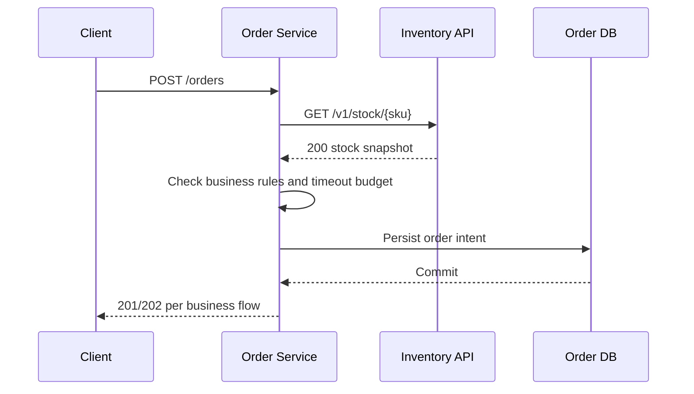
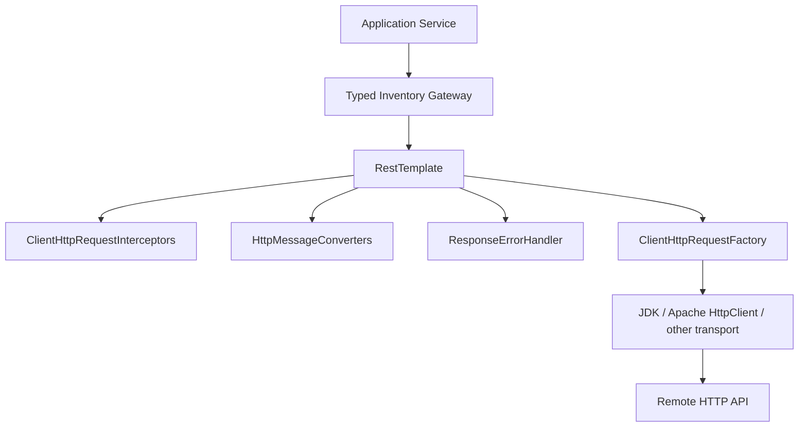
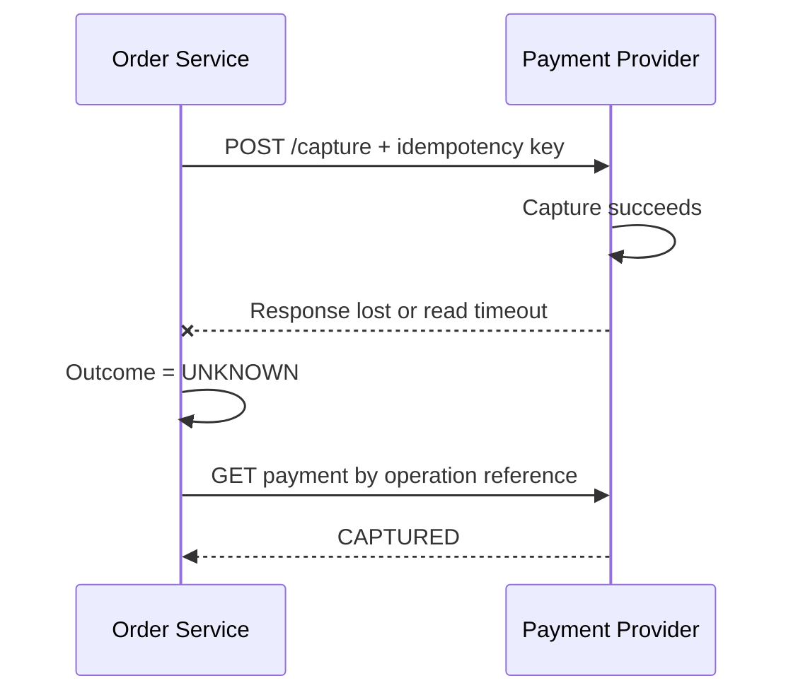
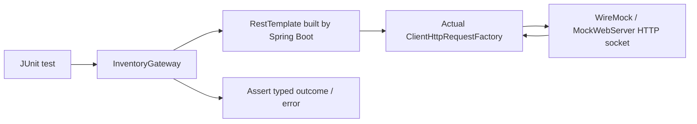
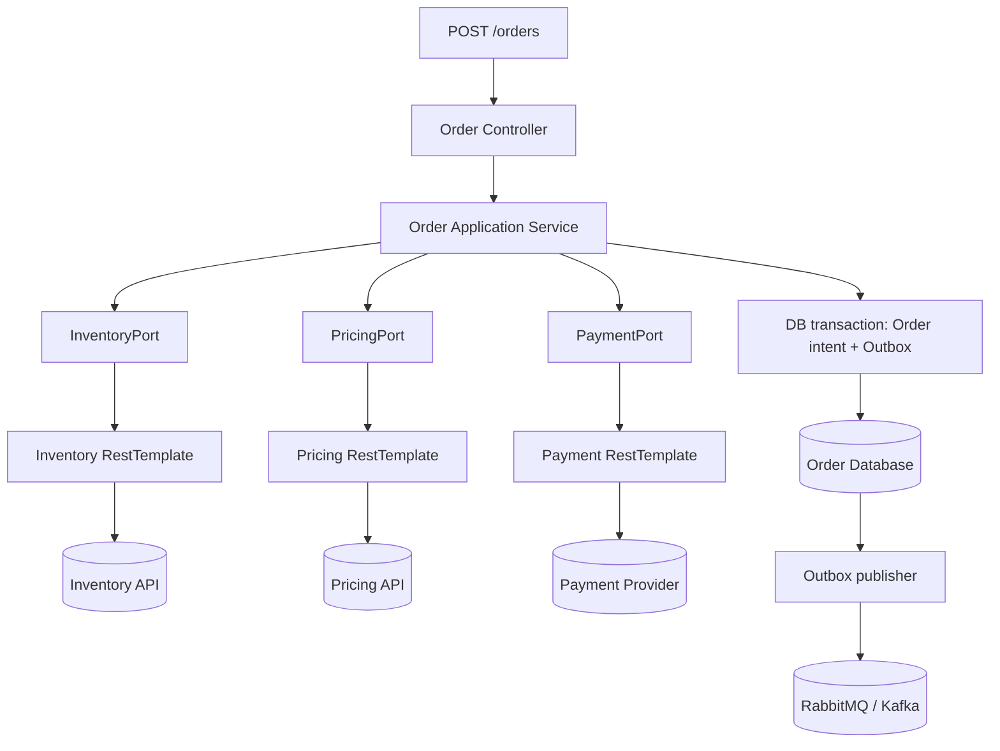

# Creating RestTemplate from RestTemplateBuilder

## 1. Context: RestTemplate as a Synchronous HTTP Client at the Integration Boundary

In the **SPRING_BOOT_INTEGRATION** module, Spring Boot connects systems through HTTP clients, databases, caches, message brokers, and Spring Integration adapters. When a service needs to make **synchronous HTTP calls** to an ERP, Inventory, CRM, or internal API, `RestTemplate` is a familiar option, particularly in Spring MVC applications and existing integration codebases.

Suppose the Order Service must check stock before deciding to accept an order:



`RestTemplate` executes **blocking request–response calls**: the calling thread typically waits until an HTTP response or error returns. It does not coordinate transactions across Inventory and Order DB, does not automatically retry safely, and does not turn an HTTP 200 into a completed business outcome on its own.

There are three ways to instantiate it:

```java
// 1. Direct instantiation: gets only RestTemplate's bare defaults.
RestTemplate direct = new RestTemplate();

// 2. Manual builder: may lack Spring Boot customizers.
RestTemplate manuallyBuilt =
    new RestTemplateBuilder().build();

// 3. Recommended in Spring Boot applications:
//    Inject the Boot-configured builder and call build().
RestTemplate bootConfigured =
    injectedRestTemplateBuilder.build();
```

**Lesson focus:** learn how to obtain the **Spring Boot-managed** `RestTemplateBuilder`, configure builders dedicated to individual dependencies, produce `RestTemplate` beans via `build()`, encapsulate them inside typed HTTP gateways, test the wire contract, and avoid accidentally discarding Spring Boot's configuration.

### 1.1. Version Scope

Main examples use **Java 17+, Spring Boot 3.4–3.5, and Spring Framework 6.x**:

- `RestTemplateBuilder` lives in `org.springframework.boot.web.client`.
- `RestTemplate` lives in `org.springframework.web.client`.
- Starting in Spring Boot **3.4**, the builder provides `connectTimeout(Duration)`, `readTimeout(Duration)`, and `sslBundle(SslBundle)`.
- In Spring Boot **3.0–3.3**, the corresponding APIs are typically `setConnectTimeout(Duration)`, `setReadTimeout(Duration)`, and `setSslBundle(SslBundle)` when SSL bundles are available.
- As of Boot 3.4, those `set*` methods are deprecated and slated for removal in Boot 4.
- **Spring Boot 4** reorganizes packages/structures for several REST client builders; never copy Boot 3 imports straight into Boot 4 without checking the target version's APIs.

`RestClient` (Spring Framework 6.1+) is generally more ergonomic for new synchronous code, and `WebClient` fits non-blocking/reactive clients. Nevertheless, **RestTemplate remains supported in Spring Framework 6.x** and is the focus of this lesson. Do not equate "older RestTemplate" with "unsafe": integration quality depends primarily on configuration, contracts, and operational discipline.

## 2. What Do RestTemplate, RestTemplateBuilder, and ClientHttpRequestFactory Do?

An HTTP call via `RestTemplate` passes through several components:



| Component | Responsibility | What It Does Not Guarantee |
| --- | --- | --- |
| `RestTemplateBuilder` | Configures and **constructs** `RestTemplate` | Does not execute HTTP calls |
| `RestTemplate` | Synchronous API (`getForObject`, `exchange`, `postForEntity`, …) | Does not become non-blocking automatically |
| `ClientHttpRequestFactory` | Creates HTTP requests; selects the client transport | Does not guarantee end-to-end SLAs |
| `HttpMessageConverter` | Converts Java objects <-> HTTP bodies | Does not validate business semantics |
| `ResponseErrorHandler` | Determines which HTTP statuses count as errors | Does not distinguish every domain error |
| `ClientHttpRequestInterceptor` | Wraps requests/responses, adds headers/metrics | Does not provide idempotency |
| `RestTemplateCustomizer` | Applies extra configuration during build | Does not apply to `new RestTemplate()` |
| `UriTemplateHandler` | Expands/encodes URI templates | Does not enforce SSRF defenses or host allowlists |

### 2.1. Spring Boot Provides the Builder Bean, Not Necessarily a RestTemplate Bean

In Spring Boot with standard HTTP client auto-configuration, `RestTemplateBuilder` is available for injection:

```java
import org.springframework.boot.web.client.RestTemplateBuilder;
import org.springframework.stereotype.Service;

@Service
class DirectoryService {

    DirectoryService(RestTemplateBuilder builder) {
        // Illustrative only: production should inject a typed gateway/bean.
        RestTemplate template = builder.build();
    }
}
```

Spring Boot **does not automatically register a global `RestTemplate` bean** merely because `spring-boot-starter-web` is on the classpath. Injecting `RestTemplate` directly without declaring a `@Bean` typically fails with `NoSuchBeanDefinitionException`.

A Spring Boot-configured builder carries `RestTemplateCustomizer`s registered by your application or Boot auto-configuration—for example, HTTP observation/tracing when enabled. Calling `new RestTemplate()` bypasses this builder pipeline.

### 2.2. The Builder Creates Clients Without Mutating Already-Built Clients

`RestTemplateBuilder` follows an **immutable/fluent builder** model: configuration methods return a new builder instance without mutating the original builder.

```java
RestTemplateBuilder base = injectedBuilder;

RestTemplateBuilder inventory = base
    .rootUri("https://inventory.example.test")
    .connectTimeout(Duration.ofMillis(500));

RestTemplateBuilder pricing = base
    .rootUri("https://pricing.example.test")
    .connectTimeout(Duration.ofSeconds(1));

RestTemplate inventoryClient = inventory.build();
RestTemplate pricingClient = pricing.build();
```

`base` remains unchanged. This allows deriving multiple clients from the same **Boot-managed builder** without leaking Inventory's root URL or auth into Pricing.

**Note on built instances:** after `build()`, never mutate a `RestTemplate` concurrently across requests (such as calling `setInterceptors` between calls). Finalize configuration during bean initialization and share a stable instance.

## 3. Getting Started: Dependencies and Building Beans

With Spring Boot 3.4–3.5, Spring MVC projects normally include:

```xml
<dependency>
    <groupId>org.springframework.boot</groupId>
    <artifactId>spring-boot-starter-web</artifactId>
</dependency>
```

`spring-web` supplies `RestTemplate`, while Boot provides `RestTemplateBuilder` and auto-configuration. In background worker apps without an HTTP server, leaner dependencies can be used per architecture; making outbound HTTP calls does not force exposing controllers.

Basic bean configuration:

```java
package example.integration.inventory;

import org.springframework.boot.web.client.RestTemplateBuilder;
import org.springframework.context.annotation.Bean;
import org.springframework.context.annotation.Configuration;
import org.springframework.web.client.RestTemplate;

@Configuration(proxyBeanMethods = false)
public class InventoryHttpConfiguration {

    @Bean("inventoryRestTemplate")
    RestTemplate inventoryRestTemplate(RestTemplateBuilder builder) {
        return builder
            .rootUri("https://inventory.example.test")
            .build();
    }
}
```

Injecting the exact client into a service:

```java
package example.integration.inventory;

import org.springframework.beans.factory.annotation.Qualifier;
import org.springframework.stereotype.Component;
import org.springframework.web.client.RestTemplate;

@Component
public class InventoryGateway {

    private final RestTemplate restTemplate;

    public InventoryGateway(
            @Qualifier("inventoryRestTemplate")
            RestTemplate restTemplate) {
        this.restTemplate = restTemplate;
    }

    public StockResponse findStock(String sku) {
        return restTemplate.getForObject(
            "/v1/stock/{sku}",
            StockResponse.class,
            sku
        );
    }
}
```

A response contract:

```java
package example.integration.inventory;

public record StockResponse(
    String sku,
    long availableQuantity,
    String status
) {}
```

`getForObject` here is **blocking**. If it returns `null` (e.g., on an empty body), the gateway needs an explicit policy instead of hastily treating `null` as "out of stock".

### 3.1. Why @Qualifier Matters

When an application defines:

```text
inventoryRestTemplate
pricingRestTemplate
paymentRestTemplate
```

injecting `RestTemplate` without a qualifier causes injection ambiguity or selects the wrong client. Name beans by **downstream boundary**, use `@Qualifier`, or inject typed gateways instead of spreading raw `RestTemplate` beans across the domain.

### 3.2. Do Not Define a Global RestTemplateBuilder Bean Unless Needed

Misguided setup:

```java
@Bean
RestTemplateBuilder restTemplateBuilder() {
    return new RestTemplateBuilder();
}
```

Declaring this bean can cause Spring Boot's auto-configured builder to **back off**, dropping customizers and defaults provided by Boot or integrations. To customize every instance, prefer `RestTemplateCustomizer` or Boot's builder customization hooks; to build per-partner clients, **derive from the injected builder**.

## 4. Using @ConfigurationProperties to Avoid Hardcoding Endpoints and Timeouts

Never hardcode real domains, timeouts, or credentials in code. Example:

```yaml
integration:
  inventory:
    base-url: ${INVENTORY_URL:https://inventory.example.test}
    connect-timeout: 500ms
    read-timeout: 2s
```

Binding record:

```java
package example.integration.inventory;

import java.time.Duration;
import java.net.URI;

import org.springframework.boot.context.properties.ConfigurationProperties;

@ConfigurationProperties(prefix = "integration.inventory")
public record InventoryClientProperties(
    URI baseUrl,
    Duration connectTimeout,
    Duration readTimeout
) {
    public InventoryClientProperties {
        if (baseUrl == null
                || connectTimeout == null
                || readTimeout == null) {
            throw new IllegalArgumentException(
                "Missing inventory HTTP client properties"
            );
        }
        if (!"https".equalsIgnoreCase(baseUrl.getScheme())) {
            throw new IllegalArgumentException(
                "Inventory URL must use HTTPS"
            );
        }
        if (connectTimeout.isZero() || connectTimeout.isNegative()
                || readTimeout.isZero() || readTimeout.isNegative()) {
            throw new IllegalArgumentException(
                "HTTP timeouts must be positive"
            );
        }
    }
}
```

Configuration consuming it:

```java
package example.integration.inventory;

import org.springframework.boot.context.properties.EnableConfigurationProperties;
import org.springframework.boot.web.client.RestTemplateBuilder;
import org.springframework.context.annotation.Bean;
import org.springframework.context.annotation.Configuration;
import org.springframework.web.client.RestTemplate;

@Configuration(proxyBeanMethods = false)
@EnableConfigurationProperties(InventoryClientProperties.class)
public class InventoryClientConfiguration {

    @Bean("inventoryRestTemplate")
    RestTemplate inventoryRestTemplate(
            RestTemplateBuilder builder,
            InventoryClientProperties properties) {

        return builder
            .rootUri(properties.baseUrl().toString())
            .connectTimeout(properties.connectTimeout())
            .readTimeout(properties.readTimeout())
            .build();
    }
}
```

**Register only one bean of the same name:** `InventoryHttpConfiguration` in Section 3 and `InventoryClientConfiguration` here are **alternatives**; never register both `inventoryRestTemplate` beans in the same `ApplicationContext`.

### 4.1. Separating Defaults from Production Validation

`https://inventory.example.test` is an illustrative endpoint only, never a real production fallback. Production deployments should supply endpoints from configuration/secret management and **fail fast** if critical properties are missing.

In local integration tests, the URL may be `http://localhost:<mappedPort>` pointing to WireMock or MockWebServer. The validation above intentionally mandates HTTPS; for local HTTP tests, use an **explicit test-only policy/override** (such as a test config validating mock server URLs separately) instead of disabling TLS validation in production.

Never let HTTP callers pass raw base URLs into a credentialed client, or you risk **SSRF** and sending `Authorization` headers to untrusted hosts.

### 4.2. Prefer Duration Over Magic Numbers

Spring Boot binds `500ms` and `2s` directly into `Duration`, which is far clearer than unitless integers `500` and `2000`. Derive timeouts from latency SLOs and retry budgets rather than copying arbitrary "safe" numbers.

## 5. rootUri: Base URL for String URI Template Calls

`RestTemplateBuilder.rootUri(String)` is convenient when a client talks exclusively to one fixed provider:

```java
RestTemplate template = builder
    .rootUri("https://inventory.example.test")
    .build();

StockResponse result = template.getForObject(
    "/v1/stock/{sku}",
    StockResponse.class,
    "sku-123"
);
```

For string paths starting with `/`, the request targets:

```http
GET https://inventory.example.test/v1/stock/sku-123
Accept: application/json
```

**Important limitation of rootUri:** per Spring Boot Javadocs, root URI applies only to **String variants** of `RestTemplate` when the URL begins with `/`; it does not automatically prepend to overloads taking `java.net.URI`.

```java
// Root URI applies:
template.getForObject("/v1/stock/{sku}",
    StockResponse.class, sku);

// Does not prepend rootUri to an already-constructed URI:
URI uri = URI.create("https://other.example.test/v1/stock/x");
template.getForObject(uri, StockResponse.class);
```

### 5.1. URI Pitfalls

| Case | Outcome / Risk |
| --- | --- |
| `"/v1/stock/{sku}"` | Root URI applies as expected |
| `"v1/stock/{sku}"` | Does not automatically apply like a `/`-prefixed path |
| Pre-built `URI` | Root URI does not apply |
| Absolute URL String | Root URI is not a host allowlist |
| Path variable containing `/` or `%` | Verify encoding / double-encoding behavior |
| Query param containing sensitive data | Never log full URLs/queries carelessly |
| Client carrying Basic/Bearer calling external absolute URL | Risks leaking tokens unless constrained |

`rootUri` is a **URL-building convenience**, not a security allowlist blocking arbitrary outbound hosts. When a client holds credentials, the gateway should construct only allowlisted relative paths and **never** accept arbitrary URLs from callers.

### 5.2. Never Concatenate URIs Manually

Wrong:

```java
String url = baseUrl + "/v1/stock/" + sku;
```

If `sku` contains spaces, `/`, `?`, or `#`, the resulting URI breaks or routes unexpectedly. Use URI templates/`UriComponentsBuilder`, test boundary encoding, and distinguish unencoded URI variables from pre-encoded strings to avoid double-encoding.

## 6. Connecting and Reading: connectTimeout, readTimeout, and Overall Deadlines

Blocking HTTP clients require explicit time bounds:

| Timeout/Budget | Goal | Limitation |
| --- | --- | --- |
| Connect timeout | Time to establish TCP/proxy connection per request factory | Does not always cover DNS/TLS across implementations |
| Read timeout | Time waiting on I/O/response per transport | Usually not an absolute total deadline |
| Pool lease timeout | Waiting to acquire a connection from the pool | Depends on HTTP client / request factory |
| TLS handshake timeout | Waiting for TLS handshake | Depends on transport/config |
| Per-attempt deadline | Budget for a single HTTP call | May require enforcement beyond connect/read |
| Total business deadline | All retries, backoff, and operations combined | Not created automatically by setting two timeouts |
| Async job timeout | Deadline for an asynchronous workflow | Separate from HTTP socket timeouts |

Spring Boot 3.4–3.5:

```java
RestTemplate inventory = builder
    .rootUri("https://inventory.example.test")
    .connectTimeout(Duration.ofMillis(500))
    .readTimeout(Duration.ofSeconds(2))
    .build();
```

Spring Boot 3.0–3.3:

```java
RestTemplate inventory = builder
    .rootUri("https://inventory.example.test")
    .setConnectTimeout(Duration.ofMillis(500))
    .setReadTimeout(Duration.ofSeconds(2))
    .build();
```

These two snippets are **version-specific alternatives**; do not put `connectTimeout` into a Boot 3.2 project where it does not exist, and avoid deprecated `set*` calls on Boot 3.4+.

### 6.1. Timeouts Do Not Trigger Retries

`readTimeout=2s` does not automatically retry a request. Safe retries require error classification, retry budgets, exponential backoff, jitter, and **idempotency**. For instance, you cannot freely retry `POST /payments` after a timeout because the provider may have committed the payment and dropped the response.

### 6.2. Timeouts May Not Fire Exactly When Expected

Depending on the request factory (JDK, Apache HttpClient, `SimpleClientHttpRequestFactory`, …), connect, read, and connection-request timeouts follow different semantics. HTTP redirects, DNS lookups, TLS handshakes, and slow response streaming can push **total wall-clock duration** well past a naive `connectTimeout + readTimeout` sum.

**Never claim** that setting `readTimeout(2s)` guarantees every HTTP call finishes within 2 seconds. For a 3-second end-to-end SLA, measure p99, allocate budgets, cap retries, and verify the actual client transport.

## 7. ClientHttpRequestFactory: How the Builder Selects the Underlying Transport

`RestTemplate` is not a socket implementation itself. `ClientHttpRequestFactory` creates the underlying requests:

- `SimpleClientHttpRequestFactory`: backed by JDK `HttpURLConnection`.
- `HttpComponentsClientHttpRequestFactory`: Apache HttpClient 5, supporting advanced pooling, proxy, and TLS options.
- `JdkClientHttpRequestFactory`: backed by Java `java.net.http.HttpClient`.
- Other factories depending on classpath and Spring version.

The builder normally **auto-detects an appropriate request factory from the classpath**. Changing classpath dependencies (such as adding Apache HTTP Client) can silently switch transports without any business code change. Know which factory is active so you configure pooling, TLS, redirects, and socket timeouts accurately.

### 7.1. Selecting a Factory Explicitly for Deterministic Behavior

Simple example:

```java
import org.springframework.http.client.SimpleClientHttpRequestFactory;

RestTemplate client = builder
    .requestFactory(SimpleClientHttpRequestFactory.class)
    .connectTimeout(Duration.ofMillis(500))
    .readTimeout(Duration.ofSeconds(2))
    .build();
```

Use `SimpleClientHttpRequestFactory` only when it fits the workload. For high throughput, pooling, proxies, or custom TLS, choose the right transport and test it accordingly—never pick a factory just for shorter code if production needs differ.

### 7.2. detectRequestFactory(false) Does Not Disable HTTP Networking

`detectRequestFactory(false)` tells the builder not to auto-detect an optimized factory from the classpath under Boot's policy. It does not make `RestTemplate` a mock or skip network calls. For tests, use `MockRestServiceServer` or a controlled mock HTTP server.

### 7.3. Request Factories and Connection Pooling

A singleton `RestTemplate` is thread-safe once configured, yet **actual connection reuse and pooling depend on the factory and underlying client**. Never instantiate a fresh `RestTemplate` per request thinking it is "safer"—doing so destroys pooling and leaks transports/threads.

When using Apache HttpClient:

- Configure max total/per-route connections and pool lease timeouts.
- Configure idle/expired connection eviction and clean shutdown lifecycles.
- Enable TLS hostname verification and manage truststores.
- Monitor pool pending/acquired/available stats where available.
- Test concurrent calls and slow upstream responses.

Factories and clients hold sockets and pools; never allocate/destroy them inside hot paths. Spring-managed bean lifecycles handle cleanup cleanly.

## 8. A Typed Gateway: Keeping RestTemplate Out of the Domain

`RestTemplate` is an implementation detail of the HTTP integration boundary. Keep domain/application ports isolated from HTTP DTOs and exceptions.

Port:

```java
package example.integration.inventory;

public interface InventoryPort {
    StockSnapshot checkStock(String sku);
}

public record StockSnapshot(
    String sku,
    long availableQuantity,
    boolean reservable
) {}
```

The wire DTO is `StockResponse(String sku, long availableQuantity, String status)` defined in Section 3. Keep **only that single** wire DTO in the gateway package; never reuse persistence entities as wire contracts.

Gateway implementation:

```java
package example.integration.inventory;

import org.springframework.beans.factory.annotation.Qualifier;
import org.springframework.stereotype.Component;
import org.springframework.web.client.RestTemplate;

@Component
public class HttpInventoryGateway implements InventoryPort {

    private final RestTemplate http;

    public HttpInventoryGateway(
            @Qualifier("inventoryRestTemplate")
            RestTemplate http) {
        this.http = http;
    }

    @Override
    public StockSnapshot checkStock(String sku) {
        if (sku == null || sku.isBlank()) {
            throw new IllegalArgumentException("sku is required");
        }

        StockResponse response = http.getForObject(
            "/v1/stock/{sku}",
            StockResponse.class,
            sku
        );

        if (response == null
                || response.sku() == null
                || response.status() == null
                || response.availableQuantity() < 0) {
            throw new InvalidInventoryResponseException(
                "Inventory response invalid"
            );
        }

        boolean reservable =
            "AVAILABLE".equals(response.status());

        return new StockSnapshot(
            response.sku(),
            response.availableQuantity(),
            reservable
        );
    }
}
```

`InvalidInventoryResponseException` is an **application-defined domain/integration exception** (e.g., `extends RuntimeException`), not a built-in Spring exception.

**Key takeaway:** HTTP 200 can contain `status="UNKNOWN"`, `status="RESERVED"`, or an unrecognized enum. The adapter needs an explicit policy for unknown values rather than treating everything other than `AVAILABLE` as `OUT_OF_STOCK`. This example sets `reservable=false` for clarity, yet production must distinguish `UNAVAILABLE`, `OUT_OF_STOCK`, and `UNKNOWN` when outcomes affect transactions.

### 8.1. Why Not Inject RestTemplate Into Every Service?

Separating `InventoryPort` lets business-policy tests use a fake port while HTTP contract tests verify `HttpInventoryGateway` with `MockRestServiceServer`. Changing API paths, DTOs, or error mappings no longer forces business services to understand `HttpStatusCodeException` or `ClientHttpRequestFactory`.

### 8.2. Blocking Dependencies in Thread Pools

In Spring MVC, `RestTemplate` blocks the request thread unless dispatched asynchronously. Inside a Reactor/WebFlux event loop, calling `RestTemplate` directly blocks the event loop and kills throughput. If the application is non-blocking, prefer `WebClient`; offloading blocking calls onto `boundedElastic` is only a capacity-bounded integration workaround and **does not make `RestTemplate` reactive**.

## 9. Sending Requests with Explicit Status, Headers, and Generic Responses

`getForObject` is handy for simple HTTP GETs, yet hides response statuses and headers. When an API uses `ETag`, `Retry-After`, pagination headers, or `Location`, use `getForEntity`/`exchange`/`postForEntity`.

Example POST reserving stock under Inventory's contract:

```http
POST /v1/reservations HTTP/1.1
Host: inventory.example.test
Content-Type: application/json
Accept: application/json
Idempotency-Key: reserve:ord-1024:line-1

{
  "orderId": "ord-1024",
  "sku": "sku-123",
  "quantity": 2
}
```

DTOs:

```java
package example.integration.inventory;

public record ReserveStockRequest(
    String orderId,
    String sku,
    int quantity
) {}

public record ReserveStockResponse(
    String reservationId,
    String state
) {}
```

Gateway method:

```java
import org.springframework.http.HttpEntity;
import org.springframework.http.HttpHeaders;
import org.springframework.http.HttpMethod;
import org.springframework.http.MediaType;
import org.springframework.http.ResponseEntity;

public ReserveStockResponse reserveStock(
        String orderId, String lineId,
        String sku, int quantity) {

    if (quantity <= 0) {
        throw new IllegalArgumentException(
            "quantity must be positive"
        );
    }

    HttpHeaders headers = new HttpHeaders();
    headers.setContentType(MediaType.APPLICATION_JSON);
    headers.setAccept(
        java.util.List.of(MediaType.APPLICATION_JSON)
    );
    headers.set("Idempotency-Key",
        "reserve:" + orderId + ":" + lineId);

    HttpEntity<ReserveStockRequest> request =
        new HttpEntity<>(
            new ReserveStockRequest(orderId, sku, quantity),
            headers
        );

    ResponseEntity<ReserveStockResponse> response =
        restTemplate.exchange(
            "/v1/reservations",
            HttpMethod.POST,
            request,
            ReserveStockResponse.class
        );

    ReserveStockResponse body = response.getBody();

    if (body == null || body.reservationId() == null) {
        throw new InvalidInventoryResponseException(
            "Missing reservation ID"
        );
    }
    return body;
}
```

This method lives inside the gateway with injected `restTemplate`. `lineId` is included in the idempotency key because one order can have multiple line items sharing a SKU; keying only by order+SKU would collide across valid operations. Uniqueness, retention, and `Idempotency-Key` semantics still depend on **Inventory provider** support.

### 9.1. ResponseEntity and Status 202

HTTP 202 can mean the request was accepted **for asynchronous processing**, not that inventory is already reserved. If the provider returns:

```json
{
  "operationId": "rsv-job-991",
  "state": "PENDING"
}
```

the gateway must not return `ReservationOutcome.RESERVED` merely because `response.getStatusCode().is2xxSuccessful()` is true. Model the pending state and poll/callback per contract.

### 9.2. Returning List<DTO> via ParameterizedTypeReference

Because of Java type erasure, use a generic type token instead of raw `List.class`:

```java
import org.springframework.core.ParameterizedTypeReference;
import org.springframework.http.HttpMethod;
import org.springframework.http.ResponseEntity;

ResponseEntity<java.util.List<StockResponse>> response =
    restTemplate.exchange(
        "/v1/stock?warehouse={warehouse}",
        HttpMethod.GET,
        null,
        new ParameterizedTypeReference<
            java.util.List<StockResponse>>() {},
        "east"
    );

java.util.List<StockResponse> stocks =
    response.getBody() == null
        ? java.util.List.of()
        : response.getBody();
```

**Note:** mapping a `null` body to an empty list is valid only when the API contract defines an empty response as zero items. When the API requires a body, report `invalid upstream response` rather than hiding the defect.

### 9.3. Not Every Request Factory Supports Every HTTP Method

Certain request factories/transports have method restrictions—notably `PATCH` on `HttpURLConnection`-based setups. When using PATCH, proxies, or streaming uploads, pick a supporting factory and **verify on a real socket**. A mock unit test of message converters cannot prove the underlying JDK transport executes PATCH properly.

## 10. HTTP Error Handling: Status, Response Body, and Transport Errors

By default, `RestTemplate` uses `DefaultResponseErrorHandler` and converts 4xx/5xx HTTP responses into subclasses of `RestClientResponseException`, such as:

- `HttpClientErrorException.NotFound` for HTTP 404.
- `HttpClientErrorException.Conflict` for HTTP 409.
- `HttpClientErrorException.TooManyRequests` for HTTP 429.
- `HttpServerErrorException.ServiceUnavailable` for HTTP 503.
- `ResourceAccessException` for I/O/network/timeout errors.
- `UnknownHttpStatusCodeException` for unrecognized status codes; exact behavior depends on Spring Framework version.

Even HTTP 200 can carry `state="REJECTED"`. **Transport success** does not mean **business success**.

### 10.1. Mapping Errors Into Domain Outcomes Instead of Returning Null

Example lookup handler with explicit policies:

```java
import org.springframework.web.client.HttpClientErrorException;
import org.springframework.web.client.ResourceAccessException;
import org.springframework.web.client.RestClientResponseException;

public StockLookupResult lookupStock(String sku) {
    try {
        StockResponse stock = restTemplate.getForObject(
            "/v1/stock/{sku}",
            StockResponse.class,
            sku
        );

        if (stock == null) {
            return StockLookupResult.invalidResponse();
        }
        return StockLookupResult.found(stock);

    } catch (HttpClientErrorException.NotFound ex) {
        return StockLookupResult.notFound();

    } catch (HttpClientErrorException.TooManyRequests ex) {
        return StockLookupResult.rateLimited(
            ex.getResponseHeaders() == null
                ? null
                : ex.getResponseHeaders().getFirst(
                    "Retry-After"
                )
        );

    } catch (ResourceAccessException ex) {
        return StockLookupResult.unavailable();

    } catch (RestClientResponseException ex) {
        return StockLookupResult.upstreamRejected(
            ex.getStatusCode().value()
        );
    }
}
```

`StockLookupResult` is an **application-defined domain result type** (sealed interface/record or class); `found`/`notFound`/… are illustrative application factory methods, not built-in Spring APIs. The point is **explicit error classification** without leaking HTTP exceptions across the business layer.

**Catch order matters:** specific HTTP client exceptions extend `RestClientResponseException`, so catch concrete subtypes before the general base class.

### 10.2. Never Catch All Exceptions and Return Empty

Wrong:

```java
try {
    return inventoryGateway.findStock(sku);
} catch (Exception ignored) {
    return null; // "Out of stock"?
}
```

A network outage is not an HTTP 404. If Order Service treats `null` as out of stock, dependency outages cause wrong decisions or silently dropped operations.

### 10.3. When Is a Custom ResponseErrorHandler Needed?

`RestTemplateBuilder` supports:

```java
RestTemplate template = builder
    .errorHandler(customResponseErrorHandler)
    .build();
```

`customResponseErrorHandler` is a bean implementing `ResponseErrorHandler`. Override only when a partner API defines non-standard semantics (e.g., certain 4xx codes must be read as normal business responses). When replacing the default handler, note which status codes will **no longer throw** automatically, and inspect `ResponseEntity.getStatusCode()` in the gateway.

Avoid writing a custom handler that marks all 4xx/5xx as "non-error" without callers checking statuses. Conversely, never throw `new RuntimeException(responseBody)` containing raw PII, card data, or partner tokens.

### 10.4. Error Bodies and Charsets

An API may return `application/problem+json` (RFC 9457) with `code` and `detail`. Error payloads also depend on converters, charsets, and schema versions. When exceptions capture response bodies, never log raw bodies containing PII or secrets; record only sanitized error codes, status, operation ID, latency, and correlation ID.

## 11. Default Headers, Basic Authentication, and Credentials

`RestTemplateBuilder` provides methods such as:

```java
RestTemplate client = builder
    .rootUri("https://inventory.example.test")
    .defaultHeader("Accept", "application/json")
    .defaultHeader("X-Client", "order-service")
    .build();
```

`defaultHeader(name, values)` adds a default whenever the header is not already set on the request. It **does not** scope an authentication policy by host; if the service calls an arbitrary URL, default headers travel along with it.

### 11.1. Basic Authentication

For a legacy partner truly using HTTP Basic:

```java
RestTemplate basicClient = builder
    .rootUri("https://legacy-erp.example.test")
    .basicAuthentication(username, password)
    .build();
```

`username`/`password` must come from a secured secret manager or configuration (never hardcoded). The builder attaches Basic Authorization to requests **unless an `Authorization` header is already present** per contract.

Rules:

- Only use HTTPS with verified certificates and hostnames.
- Never reuse this Basic client across multiple different hosts.
- Never log `Authorization`, and never embed passwords in exceptions, reports, or URLs.
- Never send Basic credentials over plaintext HTTP.
- Verify redirect and proxy policies: transports behave differently across host redirects, so enforce strict redirect and host allowlist rules.

### 11.2. Bearer/OAuth2 Tokens Are Usually Per-Request Concerns

Avoid passing a short-lived access token to `defaultHeader("Authorization", "Bearer " + staticToken)` on a long-lived singleton client: tokens expire or vary by audience/tenant.

Better pattern:

```java
HttpHeaders headers = new HttpHeaders();
headers.setBearerAuth(tokenProvider.accessTokenForInventory());
HttpEntity<Void> entity = new HttpEntity<>(headers);

ResponseEntity<StockResponse> response = restTemplate.exchange(
    "/v1/stock/{sku}",
    HttpMethod.GET,
    entity,
    StockResponse.class,
    sku
);
```

`tokenProvider` is an application component managing token caching/refresh, audiences, and scopes. When using Spring Security OAuth2 Client, prefer official client integration and proper service identities over ad-hoc token caches. **Never blindly forward an inbound user JWT** to another partner unless audience/delegation policies explicitly permit it.

### 11.3. Header Propagation Requires an Allowlist

Never copy all inbound HTTP headers blindly:

```java
// Unsafe: can leak cookies, tokens, or spoofed tenant headers outbound.
outboundHeaders.addAll(inboundHeaders);
```

Forward only approved correlation/tracing metadata and business headers; establish tenant identity on the server rather than trusting arbitrary caller headers.

## 12. ClientHttpRequestInterceptor: Adding Correlation, Measuring Latency, Controlling Logs

`ClientHttpRequestInterceptor` can inspect/modify `HttpRequest` and body bytes and delegate via `ClientHttpRequestExecution.execute(...)`.

Example adding a static caller header for Inventory:

```java
package example.integration.inventory;

import java.io.IOException;

import org.springframework.http.HttpRequest;
import org.springframework.http.client.ClientHttpRequestExecution;
import org.springframework.http.client.ClientHttpRequestInterceptor;
import org.springframework.http.client.ClientHttpResponse;

public final class ClientIdentityInterceptor
        implements ClientHttpRequestInterceptor {

    @Override
    public ClientHttpResponse intercept(
            HttpRequest request,
            byte[] body,
            ClientHttpRequestExecution execution)
            throws IOException {

        request.getHeaders().set("X-Client", "order-service");
        return execution.execute(request, body);
    }
}
```

Attaching an interceptor to **one client**:

```java
RestTemplate client = builder
    .rootUri("https://inventory.example.test")
    .additionalInterceptors(new ClientIdentityInterceptor())
    .build();
```

`additionalInterceptors(...)` appends to previously configured interceptors, whereas `interceptors(...)` **replaces** the builder's interceptor list. Using `interceptors(...)` by mistake can drop critical application interceptors. With `RestTemplateCustomizer`s running **after** builder configuration, final ordering depends on the applied customizers.

### 12.1. Tracing/Timing Interceptors Must Not Log Full Bodies

Illustrative timing interceptor:

```java
public ClientHttpResponse intercept(
        HttpRequest request, byte[] body,
        ClientHttpRequestExecution execution)
        throws IOException {

    long startedAt = System.nanoTime();

    try {
        return execution.execute(request, body);
    } finally {
        long elapsedNanos = System.nanoTime() - startedAt;
        // Record elapsedNanos tagged with a fixed URI pattern / operation name.
        // Never log bodies, query secrets, or Authorization headers.
    }
}
```

This shows only the method body, not a complete class. Timing inside `finally` can finish before the response body is fully read/deserialized depending on transport/execution, so **do not claim** it measures complete end-to-end latency. Use Spring Boot's Micrometer Observation/tracing instrumentation for consistent metrics.

### 12.2. Do Not Put Uncontrolled Retries Inside Interceptors

Although an interceptor can invoke `execution.execute(...)` repeatedly, retrying non-replayable request bodies, connection streams, and idempotent commands easily breaks. Put retry policies in the gateway/service layer or a dedicated retry library, classify errors, and test provider **commit-then-lost-response** cases. In particular, never retry payment POSTs solely on `IOException`.

## 13. Message Converters: JSON, XML, Text, and Replacing the List

`RestTemplate` uses `HttpMessageConverter` to serialize request bodies and deserialize responses based on `Content-Type`/`Accept`, target Java types, and converter selection order.

| Common Converter | Data Format | Notes |
| --- | --- | --- |
| `MappingJackson2HttpMessageConverter` | JSON <-> Java DTO | Backed by Jackson/`ObjectMapper` |
| `StringHttpMessageConverter` | String/text | Charset/`Content-Type` |
| `ByteArrayHttpMessageConverter` | `byte[]` | Fits small binaries; watch memory |
| `ResourceHttpMessageConverter` | Resource/files | Pay attention to streaming/large payloads |
| Form/Multipart converters | form-urlencoded/multipart | Boundaries and content disposition |
| XML converter when present | XML <-> DTO | Schemas, namespaces, XXE policies |

### 13.1. Do Not Replace All Converters When Adding Just One Format

The builder provides:

```java
RestTemplate client = builder
    .messageConverters(customConverter)
    .build();
```

**Caution:** `messageConverters(...)` **replaces** previously configured converters and can override `RestTemplate` defaults. Even `additionalMessageConverters(...)` can alter when defaults are initialized per Boot 3.5 Javadocs; it does not guarantee every prior converter stays intact. Always test built clients against actual media types.

When you only need to adjust Jackson's handling of `Instant`, `BigDecimal`, or naming policies, customize `ObjectMapper`/Jackson modules via Spring Boot conventions and let HTTP clients share compatible converters instead of registering a manual converter list missing `String`/`byte[]`/multipart support.

### 13.2. Testing Serialization Against the Wire Contract

Example JSON:

```json
{
  "sku": "sku-123",
  "availableQuantity": 17,
  "status": "AVAILABLE"
}
```

A record DTO alone does not guarantee naming/null/default behavior matches the producer. Test:
- Required vs. nullable fields.
- Unknown enum values.
- Decimal precision, timezones, and UTF-8.
- JSON field renames and backward compatibility.
- Verifying `Content-Type` is `application/json` and not an HTML error page.
- Payload sizes; avoid loading massive files into heap memory.

### 13.3. When a Partner Returns 200 with HTML or Broken JSON

`RestTemplate` can throw `UnknownContentTypeException`, `HttpMessageNotReadableException` (wrapped depending on the API), or conversion errors; the gateway must distinguish **invalid upstream response** from **not found** and **out of stock**. These are usually permanent contract errors until the provider fixes its output, so retries rarely help.

## 14. RestTemplateCustomizer, RestTemplateRequestCustomizer, and Application Order

Spring Boot supports three hooks:

- `RestTemplateCustomizer`: configures `RestTemplate` **whenever the builder builds an instance**; fits logging/tracing, shared protocol policies, and uniform adjustments.
- `RestTemplateRequestCustomizer<?>`: runs on **each `ClientHttpRequest`**; fits per-request metadata, headers, or connection-specific request tweaks.
- `ClientHttpRequestInterceptor`: wraps request execution, reading/modifying headers, timing, and responses.

### 14.1. Intentional Global RestTemplateCustomizer

```java
package example.integration.http;

import java.util.ArrayList;

import org.springframework.boot.web.client.RestTemplateCustomizer;
import org.springframework.context.annotation.Bean;
import org.springframework.context.annotation.Configuration;
import org.springframework.http.client.ClientHttpRequestInterceptor;

@Configuration(proxyBeanMethods = false)
public class HttpClientCommonConfiguration {

    @Bean
    RestTemplateCustomizer commonClientCustomizer() {

        ClientHttpRequestInterceptor interceptor =
            (request, body, execution) -> {
                request.getHeaders()
                    .add("X-Platform-Client", "spring-boot-integration");
                return execution.execute(request, body);
            };

        return template -> {
            var existing =
                new ArrayList<>(template.getInterceptors());
            existing.add(interceptor);
            template.setInterceptors(existing);
        };
    }
}
```

When using the **Boot-managed builder**, `RestTemplateCustomizer` beans are picked up automatically by auto-configuration where applicable. Never put tenant-specific auth or single-downstream headers into global customizers; attach those only to dedicated clients.

### 14.2. Per-Client Customizer Configuration

```java
RestTemplate client = builder
    .rootUri("https://inventory.example.test")
    .additionalCustomizers(template -> {
        template.setErrorHandler(
            new org.springframework.web.client.DefaultResponseErrorHandler()
        );
    })
    .build();
```

`additionalCustomizers(...)` appends to customizers; `customizers(...)` **replaces** the builder's existing list. Per Javadocs, customizers run **after builder configuration** in the order added. Thus a customizer calling `setErrorHandler` can overwrite a handler set earlier via `builder.errorHandler(...)`. Never configure the same behavior in multiple places relying on implicit precedence.

### 14.3. Why Calling setRequestFactory in a Customizer Can Wipe Out Timeouts

If a builder configures `connectTimeout`/`readTimeout` and a later customizer executes:

```java
builder.additionalCustomizers(template ->
    template.setRequestFactory(
        new SimpleClientHttpRequestFactory()
    )
);
```

the new factory lacks the builder's timeouts, TLS, proxy, and pooling settings, silently altering runtime behavior. To customize transport, use the **builder's `requestFactory` APIs** or a controlled factory supplier/builder, and verify timeouts against a slow test server.

### 14.4. When Does Interceptor Order Matter?

- An auth header interceptor might overwrite `Authorization` set by the gateway.
- Observation/tracing interceptors/customizers often need to wrap the right segment of the request.
- A logging interceptor draining the response body starves downstream deserialization unless buffered/replayed properly.
- Interceptors altering the request URI must be careful around `Host` and TLS validation.

Never read or log entire response bodies inside interceptors for "quick debugging" without buffering semantics, byte limits, and redaction.

## 15. SSL Bundles, TLS, Proxies, and Outbound Security

In Spring Boot 3.4–3.5, `RestTemplateBuilder.sslBundle(SslBundle)` configures TLS through Spring Boot SSL bundles when supported by the request factory.

Example selecting a configured bundle:

```java
package example.integration.inventory;

import java.time.Duration;
import org.springframework.boot.ssl.SslBundles;
import org.springframework.boot.web.client.RestTemplateBuilder;
import org.springframework.context.annotation.Bean;
import org.springframework.context.annotation.Configuration;
import org.springframework.web.client.RestTemplate;

@Configuration(proxyBeanMethods = false)
class SecuredInventoryConfiguration {

    @Bean("securedInventoryRestTemplate")
    RestTemplate securedInventoryRestTemplate(
            RestTemplateBuilder builder,
            SslBundles sslBundles) {

        return builder
            .rootUri("https://inventory.example.test")
            .sslBundle(sslBundles.getBundle("inventory-client"))
            .connectTimeout(Duration.ofMillis(500))
            .readTimeout(Duration.ofSeconds(2))
            .build();
    }
}
```

Detailed SSL bundle YAML is omitted because trust material, keystore paths, and mTLS identities depend on your infrastructure. `SslBundles.getBundle("inventory-client")` works only when that named bundle is configured and the transport supports applying SSL settings. In Boot 3.1–3.3, use `setSslBundle(...)`; check your version's Javadocs.

### 15.1. TLS Is a Security Boundary, Not "Make It Work" Plumbing

- Keep hostname verification and CA/truststore checks enabled.
- For mTLS, maintain explicit keystore/client-certificate rotation lifecycles.
- Never enable `trustAll` or disable hostname verification to pass test environments.
- For corporate proxies, define CONNECT, auth, and no-proxy policies explicitly.
- Never log credentials or keystore passwords.
- Never let callers pick arbitrary hosts using a client carrying default bearer credentials.

### 15.2. Root URI Is Not an Outbound Allowlist

`rootUri("https://inventory.example.test")` only prefixes String URLs starting with `/`. It does not block:

```java
template.getForEntity(
    "https://untrusted.example.invalid/collect",
    String.class
);
```

Therefore, a security-sensitive gateway must never expose a "fetch arbitrary URL" method sharing an authenticated `RestTemplate`. If a partner API returns redirect or download links, validate host/scheme/IP ranges against an SSRF policy or use an isolated unauthenticated client.

## 16. Retries, Deadlines, and Idempotency: The Builder Does Not Solve Business Failures

Even a properly timed-out client may need retries on `503 Service Unavailable`, `429 Too Many Requests`, or connection resets—yet retries must not be applied blindly to every HTTP call.

| Operation | Safe Retry Scope | Prerequisites |
| --- | --- | --- |
| GET stock snapshot | Usually safe regarding side effects | Bounded attempts/deadline; staleness policy |
| GET price | Usually safe | TTL, pricing version, outage fallback policy |
| PUT idempotent resource | Per contract if truly idempotent | Idempotency and version/ETag |
| POST create reservation | **Not automatically safe** | Provider supports stable idempotency key or lookup |
| POST capture payment | Highly sensitive | Stable payment operation key + reconciliation |
| DELETE resource | Safe if API defines idempotent semantics | Business state / 404 semantics |
| OAuth token refresh | Depends on client auth flow | Synchronized refresh and deadline |

### 16.1. Receiving No Response Does Not Mean the Upstream Did Nothing



If Order Service blindly retries with a new operation ID, it can charge the customer twice. **Retry side-effecting HTTP requests only when the provider contract allows it and the exact same key is preserved across attempts.**

### 16.2. Budget Allocation Across Deadlines

An HTTP endpoint has a 3-second SLO spanning Inventory GET, Payment POST, and a DB commit. If every call sets `readTimeout=2s` with 3 retries, total duration blows past the SLO. Allocate an explicit budget:

```text
End-to-end deadline: 3.0s
  Input validation            0.1s
  Inventory call, max attempts 0.8s
  Payment command             1.0s
  DB commit                   0.4s
  Reserve / network overhead  0.7s
```

These numbers are illustrative; measure in practice and adjust. For workflows taking minutes, return `202 Accepted` and use durable jobs/status/outboxes instead of holding synchronous HTTP requests across multiple remote systems.

### 16.3. Bounded Retry Pattern (Pseudocode)

```text
function queryInventory(command, operationId, deadline):
  for attempt from 1 to maxAttempts:
    if deadline expired:
      return UNAVAILABLE

    try:
      return inventoryGateway.call(command)

    catch validation/auth/contract error:
      fail permanently

    catch 429:
      honor Retry-After if within budget

    catch timeout/503:
      retry only if this operation is safe

    sleep with bounded exponential backoff + jitter
  return UNAVAILABLE
```

This is **pseudocode**, not a built-in Java API. Implement it with Spring Retry, Resilience4j, `RetryTemplate`, or a controlled policy. Because `RestTemplate` is blocking, retries and sleeps hold the caller thread longer; use bulkheads, concurrency caps, and deadlines.

### 16.4. Never Put Unconditional Retries Inside a Global Interceptor

If a global interceptor retries every POST to ERP or Payment, a socket failure after upstream commit easily creates duplicate business state. Tie retries to **operation semantics**, not HTTP status classes alone. When publishing events after local DB commits, use an outbox and background worker retries instead of holding HTTP calls inside open transactions.

## 17. Observability: Builder, RestTemplate, and Spring Boot Metrics/Tracing

In Spring Boot with Micrometer Observation/Actuator configured, auto-configured `RestTemplateBuilder` receives customizers providing HTTP client observation. Calling `new RestTemplate()` or replacing the builder bean manually can strip that instrumentation.

### 17.1. Signals Worth Monitoring

| Signal | Meaning | What to Avoid |
| --- | --- | --- |
| HTTP client duration (p50/p95/p99) | Latency to Inventory/ERP | Mistaking it for total workflow latency |
| HTTP status families | 2xx/4xx/5xx | Grouping 404 and 503 as "out of stock" |
| Connection errors / timeouts | Pre-response or mid-response failures | Logging raw URLs containing tokens |
| Retry attempts/exhausted | Pressure on dependencies | Multiplying retries across stacked layers |
| HTTP client pool leased/pending | Saturation | Watching only CPU while ignoring pool queues |
| Circuit breaker open | Upstream degraded | Treating open breakers as empty results |
| Order workflow completion | Final business outcome | Measuring only HTTP 200 |
| Outbox oldest pending age | Slow event publishing | Blaming `RestTemplate` |
| Trace spans | Correlating HTTP, DB, and messaging | Putting tokens or PII into baggage |

### 17.2. Bounded Cardinality in Metric Tags

Wrong:

```text
http.client.requests{sku="sku-123"}
http.client.requests{sku="sku-124"}
http.client.requests{requestId="req-8021"}
```

Because every SKU or request ID varies, metric cardinality grows without bound.

Prefer `uri="/v1/stock/{sku}"`, `client="inventory"`, `status="503"`, `outcome="timeout"`. Keep request/trace IDs in structured logs/traces governed by privacy and retention policies, never as Prometheus labels.

### 17.3. Distinguishing Observation from Business Correlation

An HTTP client span shows a transport call happened. It does **not** automatically generate an `OrderCreated` event ID or idempotency key. Retries can create distinct spans within one workflow. Distinguish:

- `traceId`: diagnosing distributed spans.
- `correlationId`: tying logs across services for an operation.
- `idempotencyKey`: deduplicating business commands.
- `eventId`: deduplicating broker events.
- `orderId`: resource identity.

Never use `traceId` as a payment idempotency key, since delayed retries run under new traces.

### 17.4. Custom Interceptors and Observability

Adding a custom interceptor via `additionalInterceptors` or a `RestTemplateCustomizer` does not inherently break observation, yet carelessly **replacing** the interceptor list, request factory, or observation registry can strip instrumentation. Verify expected spans and meters with `TestObservationRegistry` or Micrometer test utilities against your Boot version.

## 18. Testing RestTemplateBuilder with @RestClientTest

A REST client test should verify **the requests sent on the wire**, response decoding, and how the gateway handles HTTP errors.

Spring Boot 3.x provides `@RestClientTest`, wiring client-test infrastructure including `RestTemplateBuilder` and `MockRestServiceServer`. Because it does not load every `@Component`/`@ConfigurationProperties` like a full `@SpringBootTest`, import and enable required dependencies explicitly.

### 18.1. Complete Slice Test Example

Using `InventoryClientConfiguration` from Section 4 and `HttpInventoryGateway` from Section 8:

```java
package example.integration.inventory;

import static org.assertj.core.api.Assertions.assertThat;
import static org.springframework.test.web.client.match.MockRestRequestMatchers.*;
import static org.springframework.test.web.client.response.MockRestResponseCreators.*;

import org.junit.jupiter.api.Test;
import org.springframework.beans.factory.annotation.Autowired;
import org.springframework.boot.test.autoconfigure.web.client.RestClientTest;
import org.springframework.context.annotation.Import;
import org.springframework.http.MediaType;
import org.springframework.test.context.TestPropertySource;
import org.springframework.test.web.client.MockRestServiceServer;

@RestClientTest(HttpInventoryGateway.class)
@Import(InventoryClientConfiguration.class)
@TestPropertySource(properties = {
    "integration.inventory.base-url=https://inventory.example.test",
    "integration.inventory.connect-timeout=500ms",
    "integration.inventory.read-timeout=2s"
})
class InventoryGatewayRestClientTest {

    @Autowired
    HttpInventoryGateway gateway;

    @Autowired
    MockRestServiceServer server;

    @Test
    void mapsJsonStockResponse() {
        server.expect(
            requestTo("/v1/stock/sku-123")
        )
        .andExpect(method(org.springframework.http.HttpMethod.GET))
        .andRespond(withSuccess(
            """
            {
              "sku": "sku-123",
              "availableQuantity": 17,
              "status": "AVAILABLE"
            }
            """,
            MediaType.APPLICATION_JSON
        ));

        StockSnapshot snapshot = gateway.checkStock("sku-123");

        assertThat(snapshot.sku()).isEqualTo("sku-123");
        assertThat(snapshot.availableQuantity()).isEqualTo(17);
        assertThat(snapshot.reservable()).isTrue();

        server.verify();
    }
}
```

**Important quirk:** in `@RestClientTest`/`MockRestServiceServer` when a client is built using `RestTemplateBuilder.rootUri(...)`, Spring Boot documentation notes that `requestTo("/v1/stock/sku-123")` **omits the root URI**. If your builder **does not use `rootUri`**, or when testing `RestClient.Builder` or another mock server, expectations may require the **full URI**. Never conclude from this mock behavior that real servers receive relative URLs.

### 18.2. Why @Import Configuration Is Required

`@RestClientTest(HttpInventoryGateway.class)` loads only selected beans and matching auto-configuration. It **does not automatically scan** every `@ConfigurationProperties` or application configuration class. `@Import(InventoryClientConfiguration.class)` paired with `@EnableConfigurationProperties(InventoryClientProperties.class)` supplies the `inventoryRestTemplate` bean and bound properties.

If a test complains about missing `InventoryClientProperties`, do not switch straight to `@SpringBootTest` just to make it pass. Identify the client-slice dependencies and import/enable them cleanly.

### 18.3. Testing HTTP 404

Adding another test:

```java
import static org.assertj.core.api.Assertions.assertThatThrownBy;
import static org.springframework.test.web.client.response.MockRestResponseCreators.withStatus;

import org.springframework.http.HttpStatus;
import org.springframework.web.client.HttpClientErrorException;

@Test
void propagatesNotFoundForGatewayPolicy() {
    server.expect(
        requestTo("/v1/stock/missing-sku")
    ).andRespond(
        withStatus(HttpStatus.NOT_FOUND)
    );

    assertThatThrownBy(
        () -> gateway.checkStock("missing-sku")
    ).isInstanceOf(
        HttpClientErrorException.NotFound.class
    );

    server.verify();
}
```

This test reflects that `HttpInventoryGateway` currently **does not catch 404**; if the adapter later maps 404 to a typed `NOT_FOUND`, update the assertion per contract. Tests should verify clear policies rather than locking business code to raw Spring exception types forever.

### 18.4. Warning About Global RestTemplateCustomizers

If a test context holds multiple `RestTemplate`s or `MockRestServiceServer` fails to intercept the built template, tests may attempt real network calls. Verify that templates are built from the **builder wrapped by the mock customizer**. With multiple builders/templates, `MockServerRestTemplateCustomizer` provides per-instance lookup via `getServer(restTemplate)`; never assume one arbitrary `MockRestServiceServer` monitors every client.

## 19. Manual MockRestServiceServer and MockServerRestTemplateCustomizer

`@RestClientTest` is concise for Spring Boot test slices. When testing a gateway without booting an `ApplicationContext` or when constructing builders manually, `MockRestServiceServer` also supports direct setup.

### 19.1. Binding a Server to an Existing RestTemplate

```java
import org.springframework.test.web.client.MockRestServiceServer;
import org.springframework.boot.web.client.RestTemplateBuilder;
import org.springframework.web.client.RestTemplate;

RestTemplate restTemplate =
    new RestTemplateBuilder()
        .rootUri("https://inventory.example.test")
        .build();

MockRestServiceServer server =
    MockRestServiceServer.bindTo(restTemplate).build();

// Configure request expectations, invoke gateway, then server.verify().
```

Unlike `@RestClientTest`, this is a **manual unit-style test setup** bypassing Boot-managed builders/customizers. It verifies a manually configured client yet **does not prove Boot auto-configuration applied to your beans**. With manual mock servers, verify the handler's expectation URI semantics carefully.

### 19.2. MockServerRestTemplateCustomizer Wrapping a Builder Before Build

```java
import org.springframework.boot.test.web.client.MockServerRestTemplateCustomizer;
import org.springframework.boot.web.client.RestTemplateBuilder;

MockServerRestTemplateCustomizer mockCustomizer =
    new MockServerRestTemplateCustomizer();

RestTemplateBuilder testingBuilder =
    new RestTemplateBuilder(mockCustomizer);

RestTemplate testedClient = testingBuilder
    .rootUri("https://inventory.example.test")
    .build();

MockRestServiceServer server =
    mockCustomizer.getServer(testedClient);
```

`MockServerRestTemplateCustomizer` powers Boot's test infrastructure. When a customizer creates servers for **multiple RestTemplates**, call `getServer(restTemplate)` or track by instance rather than assuming `getServer()` only manages one client. Reset expectations explicitly if reusing servers across tests.

### 19.3. Assertions Beyond Response Bodies

```java
server.expect(requestTo("/v1/reservations"))
    .andExpect(method(HttpMethod.POST))
    .andExpect(header(
        "Idempotency-Key",
        "reserve:ord-1024:line-1"
    ))
    .andExpect(content().contentTypeCompatibleWith(
        MediaType.APPLICATION_JSON
    ))
    .andExpect(jsonPath("$.sku").value("sku-123"))
    .andExpect(jsonPath("$.quantity").value(2))
    .andRespond(withSuccess(
        """
        {"reservationId":"rsv-6701","state":"RESERVED"}
        """,
        MediaType.APPLICATION_JSON
    ));
```

This snippet assumes static imports `MockRestRequestMatchers.*`, `MockRestResponseCreators.*`, and a gateway built from a compatible builder. It verifies method, path, headers, JSON, and conversion, yet cannot prove real socket connect/read timeouts or TLS.

## 20. Testing Real HTTP with WireMock or MockWebServer

`MockRestServiceServer` swaps out the request factory to return mocked responses; it **cannot** fully verify DNS, TLS, TCP pooling, socket read timeouts, or proxies. Those require a mock HTTP server listening on a **real port**, such as WireMock, OkHttp MockWebServer, or an integration test container.

### 20.1. End-to-End Model at the Boundary



Tests to include:

- 200 valid JSON with accurate statuses and headers.
- 404, 409, 422, 429, 503 with contracted bodies.
- Server delays exceeding `readTimeout`.
- Connection refused, abrupt closes, slow streaming responses.
- Invalid JSON or wrong `Content-Type`.
- Redirects to other hosts if redirect following is enabled.
- Large payloads and body buffering bounds.
- TLS truststores/mTLS when the service requires them.
- Retries with stable idempotency keys and bounded attempts.
- Concurrent requests to verify pool exhaustion.

### 20.2. Why Timeout Tests Shouldn't Just Assert "After 2 Seconds"

OS scheduling, CI load, DNS, TLS handshakes, transport timeout semantics, and JVM pauses introduce timing jitter. Use **reasonable bounds** and assert error types/behavior rather than exact nanoseconds. Also verify the active request factory is the expected class, since classpath shifts can alter it.

### 20.3. @SpringBootTest vs. @RestClientTest

| Option | Best For | Cost |
| --- | --- | --- |
| `@RestClientTest` + `MockRestServiceServer` | Gateway contract, JSON, headers, error mapping | Very fast, no real sockets |
| Plain JUnit + manual mock server | Minimal client configs | Misses Boot auto-config if constructing builders manually |
| `@SpringBootTest` + WireMock/MockWebServer | Full wiring, socket/read timeouts, interceptors | Slower |
| Testcontainers upstream service | Connecting against real server/protocol | Docker/resource setup |
| Staging contract tests | TLS/auth/proxy/network/policies close to production | Not fully isolated |

Not every HTTP client test needs Testcontainers. Pick the test level that matches the risk of the change.

## 21. Multiple HTTP Clients in One Application: Deriving from the Same Standard Builder

A Spring Boot integration service may integrate **Inventory**, **Pricing**, and **Legacy ERP**, each with distinct endpoints, timeouts, auth, and error semantics.

```text
Boot-managed RestTemplateBuilder
  |
  +--> Inventory RestTemplate
  |      rootUri inventory, 500ms connect, 2s read
  |
  +--> Pricing RestTemplate
  |      rootUri pricing, 300ms connect, 1s read
  |
  +--> ERP RestTemplate
         rootUri ERP, Basic/mTLS, longer timeout
```

Configuration:

```java
package example.integration.http;

import java.time.Duration;

import org.springframework.beans.factory.annotation.Qualifier;
import org.springframework.boot.web.client.RestTemplateBuilder;
import org.springframework.context.annotation.Bean;
import org.springframework.context.annotation.Configuration;
import org.springframework.web.client.RestTemplate;

@Configuration(proxyBeanMethods = false)
public class DownstreamClientsConfiguration {

    @Bean("inventoryRestTemplate")
    RestTemplate inventory(RestTemplateBuilder builder) {
        return builder
            .rootUri("https://inventory.example.test")
            .connectTimeout(Duration.ofMillis(500))
            .readTimeout(Duration.ofSeconds(2))
            .build();
    }

    @Bean("pricingRestTemplate")
    RestTemplate pricing(RestTemplateBuilder builder) {
        return builder
            .rootUri("https://pricing.example.test")
            .connectTimeout(Duration.ofMillis(300))
            .readTimeout(Duration.ofSeconds(1))
            .build();
    }

    @Bean("erpRestTemplate")
    RestTemplate erp(RestTemplateBuilder builder) {
        return builder
            .rootUri("https://erp.example.test")
            .connectTimeout(Duration.ofSeconds(1))
            .readTimeout(Duration.ofSeconds(5))
            .build();
    }
}
```

This configuration **illustrates deriving multiple instances**; do not enable it alongside configurations from Sections 3/4/15 if bean names collide. URLs here are illustrative; production uses `@ConfigurationProperties` and secret management, adding ERP auth/TLS per contract.

### 21.1. Why Build Beans at Startup?

Calling `builder.rootUri(...).build()` on every HTTP request creates extra factories/connections, duplicates configuration, and hampers observability and lifecycle management. A stably configured `RestTemplate` is safe to share across threads; **mutating configuration at runtime** is what must be avoided.

### 21.2. Separating Clients Enforces Clean Authentication Policies

Inventory may use service-to-service OAuth2, ERP may use Basic or mTLS, and Payment may use signature headers. Never pile all credentials onto one shared `RestTemplate` and allow business code to hit arbitrary hosts. Per-dependency beans + typed gateways establish clean boundaries and make security easy to test.

### 21.3. Do Not Mistake @Primary for the Right Selection

Marking one `@Primary RestTemplate` to silence injection ambiguity can cause Pricing's gateway to inject Inventory's client by mistake. With multiple external dependencies, rely on `@Qualifier` or dedicated typed ports. `@Primary` makes sense only when an explicit default client is intended.

## 22. RestTemplate and Spring Integration: Where It Blocks, Where Errors Go

Spring Integration routes, transforms, and connects HTTP, databases, and messaging. A flow can invoke `InventoryPort` (implemented via `RestTemplate`) through a `@ServiceActivator` or a Spring Integration HTTP outbound gateway.

Simple service activator example:

```java
package example.integration.inventory;

import org.springframework.integration.annotation.ServiceActivator;
import org.springframework.stereotype.Component;

@Component
public class InventoryLookupHandler {

    private final InventoryPort inventory;

    public InventoryLookupHandler(InventoryPort inventory) {
        this.inventory = inventory;
    }

    @ServiceActivator(inputChannel = "inventoryLookupRequests")
    public StockSnapshot lookup(StockLookupRequest request) {
        return inventory.checkStock(request.sku());
    }
}

record StockLookupRequest(String sku) {}
```

This is only the handler; the `inventoryLookupRequests` channel, error-channel policies, and `InventoryPort` bean must be wired in the Spring Integration flow/context. If callers expect replies, configure the gateway/request–reply channel accordingly.

### 22.1. DirectChannel and ExecutorChannel Have Different Failure Visibility

| Model | Where `RestTemplate` Runs | How Callers See Errors |
| --- | --- | --- |
| DirectChannel + synchronous gateway | Calling thread directly | Exceptions can propagate straight back to the caller |
| ExecutorChannel | Executor worker thread | Errors go to an error channel; caller does not automatically receive them |
| QueueChannel/poller | Poller worker | Retries/transactions follow poller/endpoint config |
| Broker inbound adapter | Message listener thread/container | ACK/NACK/retry/DLQ follow transport semantics |
| HTTP controller calling gateway | MVC request thread | Maps exception to status/body |

When `RestTemplate` blocks for 2 seconds, it **ties up the executing thread** for that duration; switching to an `ExecutorChannel` only shifts which thread blocks, without making the network call non-blocking.

### 22.2. Once a Flow Returns HTTP 202, Errors Cannot Be Thrown to the Old Request

Suppose a controller receives a request, persists job intent, and returns 202, after which an executor worker calls ERP and fails. Failures must be persisted in **durable job status**, with bounded retries, alerts, and a status query API. An `errorChannel` helps route/observe errors, yet in-memory channels do not provide durable persistence.

### 22.3. @Transactional Cannot Roll Back Remote HTTP Side Effects

```java
@Transactional
public void confirmOrder() {
    paymentGateway.capture(...); // Remote HTTP side effect
    orderRepository.updateStatus(...); // Local DB
}
```

If Payment captures successfully and the DB update fails, the local Spring transaction **cannot roll back the payment provider**. For recoverable integrations, use workflow state/sagas, idempotency keys, compensation/reconciliation, and outboxes. Never keep DB transactions and locks open during remote HTTP calls unless carefully analyzed and justified.

## 23. Troubleshooting Matrix: Why a Builder-Created RestTemplate Still Fails

| Symptom | Common Cause | How to Verify / Fix |
| --- | --- | --- |
| `NoSuchBeanDefinitionException: RestTemplate` | Boot provides the builder, not a default `RestTemplate` bean | Declare a `@Bean` using the builder |
| 3 `RestTemplate` beans cause ambiguous injection | Multiple downstream clients | Use `@Qualifier` or typed gateways |
| Missing tracing/metrics | Using `new RestTemplate()`/custom builder, skipping auto customizers | Inject Boot-managed builder, verify Observation |
| Timeouts have no effect | Customizer swapped request factory or transport ignores setting | Inspect active factory, run socket tests |
| Fails to compile because `connectTimeout` does not exist | Boot 3.0–3.3 | Use `setConnectTimeout` for that version |
| `setReadTimeout` marked deprecated | Boot 3.4+ | Use `readTimeout` |
| Root URI not prepended | Used `URI` overload or String not starting with `/` | Check `rootUri` Javadocs and request URI |
| Authorization sent to another host | Default auth on a client called with absolute URLs | Per-host typed gateways / allowlists |
| API returns HTML instead of JSON | Error page, proxy, wrong `Content-Type` | Test conversion and status handling |
| Null DTO response | 204/no content or missing body | Enforce explicit invalid-response policy |
| HTTP 404 treated as "service down" | Overly broad exception catch | Catch specific status/domain outcome |
| HTTP 500 treated as empty list | Exception swallowed | Separate `UNAVAILABLE` from `EMPTY` |
| `POST` duplicates after timeout | Retried without idempotency | Use stable operation key and reconciliation |
| Connection count explodes | Building clients/factories in hot paths | Reuse singleton beans; configure pooling |
| Pool pending grows, high p99 | Blocking requests or connection leaks | Monitor pool metrics, timeouts, concurrency caps |
| PATCH fails | Request factory lacks method support | Choose a transport supporting PATCH |
| `MockRestServiceServer` URL mismatch | Special root URI handling inside `@RestClientTest` | Relative path with Boot `rootUri`; full URI where appropriate |
| `@RestClientTest` missing properties/config | Test slice does not scan all beans | Use `@Import` and `@EnableConfigurationProperties` |
| Replacing `messageConverters` breaks `String` reads | Overwrote default converter list | Verify final converter set |
| Trace ID missing from logs | Mismatched MDC/Observation propagation | Configure tracing for your runtime |
| TLS handshake error | Bad truststore, hostname, or client cert | Review SSL bundles, CAs, and certificates |
| Mocks pass yet production times out | No socket/pool/network testing | Use WireMock/MockWebServer/integration tests |
| Partner changes enum/status semantics | Data/business contract drift | Consumer/provider contract tests |

### 23.1. Short Investigation Checklist

1. **Check the instance:** which `RestTemplate` bean is the gateway using? Built via Boot-managed `RestTemplateBuilder` or `new`?
2. **Check the URI:** does `rootUri` apply to the called overload? Are host, scheme, path encoding, and proxy routes right?
3. **Check the request factory:** which class is active post-build? Did any customizer replace it?
4. **Check timeouts:** are connect/read/pool lease timeouts and deadlines applied to the underlying transport?
5. **Check converters:** request/response `Content-Type`, Jackson modules, and schemas?
6. **Check errors:** HTTP statuses, error handlers, bodies, `ResourceAccessException`/DNS/TLS?
7. **Check retries:** attempt counts, idempotency keys, and certainty of provider outcomes?
8. **Check observability:** builder-provided tracing/metrics, sanitized logs, and operation IDs.
9. **Check business consistency:** could a payment/reservation have committed outside the DB? Is reconciliation available?

### 23.2. Anti-Patterns to Avoid

- `new RestTemplate()` inside every hot-path method.
- Injecting one template holding Basic credentials across multiple hosts.
- `getForObject("https://" + userInput, ...)` where callers control the host.
- Setting multi-minute timeouts to "avoid errors", tying up request threads indefinitely.
- Catching all exceptions and returning `null`/`List.of()`.
- Treating HTTP 200 as unconditional business success.
- Retrying payment POSTs without an idempotency key.
- Replacing the message converter list without testing `Content-Type`s.
- Swapping request factories after the builder and wiping out SSL/timeout settings.
- Running blocking `RestTemplate` calls directly on Reactor event loops.
- Relying on unit mocks to prove TLS/pooling/socket timeouts.
- Using full URLs containing customer IDs, tokens, or request IDs as metric tags.

## 24. Case Study: Order Service Integrating Inventory, Pricing, and Payment

An Order Service has three synchronous dependencies:

- Inventory API for stock snapshots and reservations.
- Pricing API for amounts, currencies, and taxes.
- Payment Provider for authorize/capture.

These dependencies have different availability, trust, latency, and idempotency characteristics, so they must not share one `RestTemplate` with one timeout and auth header.



### 24.1. Designing the Clients

| Client | Request Factory / Timeouts | Authorization | Retry Policy |
| --- | --- | --- | --- |
| Inventory | Connection reuse, connect 500ms / read 2s | Service token | Bounded retries on GET; reservations need idempotency |
| Pricing | Connect 300ms / read 1s | Service token / mTLS | Safe GET retries per contract |
| Payment | Secured connection, connect 1s / read 5s | Partner-specific OAuth/mTLS/signature | Never retry capture without provider idempotency/reconciliation |
| Outbox publisher | Does not use `RestTemplate` unless partner API | Broker credentials | Retries with stable event ID |

Timing values are **illustrative**, not measured SLAs. Inventory contracts may demand 100ms, while Payment may need async workflows; tune according to provider p99s and quotas.

### 24.2. Recoverable Workflow

```text
RECEIVED
  -> VALIDATING
  -> STOCK_CHECKED
  -> RESERVATION_PENDING
  -> RESERVED
  -> PAYMENT_PENDING
  -> CONFIRMED
  -> FULFILLMENT_PENDING

Failure / unknown:
  INVENTORY_UNAVAILABLE
  PAYMENT_UNKNOWN
  RECONCILIATION_REQUIRED
  RESERVATION_RELEASE_PENDING
```

A `POST /orders` endpoint can return `202 Accepted` with a durable status ID before long-running steps instead of blocking a request thread across three dependencies. Never open a DB `@Transactional`, call a slow Payment API, and assume the provider will roll back if the DB fails.

### 24.3. Failure Windows to Test

| Incident | What May Have Happened | Right Outcome |
| --- | --- | --- |
| Inventory 404 | SKU does not exist | Domain `NOT_FOUND`, no hot retries |
| Inventory 429 | Rate limit | Bounded retry/`Retry-After` or upstream 503 |
| Inventory GET timeout | Fresh stock snapshot unavailable | `UNAVAILABLE`, do not default to zero |
| Reservation POST timeout | Stock may already be reserved | Query by idempotency key |
| Invalid Pricing JSON | Amount untrustworthy | Contract error, do not fall back to default price |
| Payment 200 with `PENDING` state | Payment not yet settled | Keep `PAYMENT_PENDING` |
| Lost Payment capture response | Provider may have charged | `PAYMENT_UNKNOWN` + reconciliation |
| Local DB committed then broker down | Order exists, event unpublished | Outbox `PENDING` retries |
| Broker redelivers event | Consumer sees duplicate | Inbox/idempotent effect |
| Stale Redis cache | Read model lags | TTL/invalidation/version guard |
| Client times out after DB commit | Order persisted yet response lost | Look up operation ID, retry safely |

### 24.4. Why Does Each Dependency Need Its Own Bean?

When configured per client via `RestTemplateBuilder`:
- Payment credentials never leak to Inventory.
- Timeouts track each partner's SLA.
- Root URIs and TLS bundles stay isolated.
- Specialized interceptors and converters never affect unrelated clients.
- `MockRestServiceServer`/WireMock test each gateway against its own contract.
- Metrics and alerts tie directly to the failing dependency instead of one generic `http_outbound_error`.

### 24.5. Success Is a Business Fact, Not HTTP Call Count

Order Service might get HTTP 200 from Inventory, Pricing, and Payment and still end in `REJECTED` if stock is insufficient or fraud/payment checks fail. Conversely, transient failures can recover via durable async workflows. Persist **business states and reasons**, not just stack traces.

## 25. Checklist, Exercises, and References

### 25.1. Checklist Before Merging a New RestTemplate Client

- [ ] Is the Spring Boot-managed `RestTemplateBuilder` injected rather than overwriting the global builder?
- [ ] Is the `RestTemplate` bean created with `builder.build()` and scoped with a downstream-specific name/qualifier?
- [ ] Are endpoints and connect/read timeouts configured via properties and secrets management?
- [ ] Are builder APIs verified for your Spring Boot version (`connectTimeout` vs. `setConnectTimeout`)?
- [ ] Is `rootUri` used properly with `/`-prefixed String paths rather than `URI` overloads?
- [ ] Do URIs/hosts originate from trusted config rather than letting callers pick arbitrary outbound hosts?
- [ ] Are timeout budgets and concurrency/pool limits configured without holding threads forever?
- [ ] Is the actual request factory verified, including PATCH/TLS/proxy support where needed?
- [ ] Are HTTP Basic/Bearer/mTLS secrets protected from cross-host leakage and logs?
- [ ] Are headers forwarded via allowlists, and do tokens carry exact audiences/scopes?
- [ ] Do `interceptors`/`messageConverters`/`customizers` additions preserve defaults?
- [ ] Are request/response DTOs separated from JPA/Mongo entities and backed by contract tests?
- [ ] Are nulls, empty bodies, unknown enums/statuses, and HTTP 404/409/429/5xx explicitly handled?
- [ ] Are retries restricted to safe operations with idempotency keys and overall deadlines?
- [ ] Is blocking `RestTemplate` kept off Reactor event loops?
- [ ] Do `@RestClientTest`/`MockRestServiceServer` tests verify headers, bodies, and errors?
- [ ] Are real socket tests using WireMock/MockWebServer verifying timeouts, TLS, and pools where needed?
- [ ] Do HTTP observations/tracing continue working after applying builder customizers?
- [ ] Are raw URLs, IDs, and PII kept out of metric tags?
- [ ] Do database, Redis, and broker integrations use outbox/inbox/reconciliation as needed?
- [ ] Does a runbook document owners, escalation paths, credential rotation, and failure recovery?

### 25.2. Hands-On Exercises

**Exercise 1 — Bean from builder:** create `InventoryClientProperties` and an `inventoryRestTemplate` bean with root URI and timeouts. Compare it against `new RestTemplate()` in a test to observe auto-configuration differences.

**Exercise 2 — rootUri and URI overloads:** call a String path `"/v1/stock/{sku}"` and an absolute `URI`; write `MockRestServiceServer` assertions proving when `rootUri` applies.

**Exercise 3 — Timeouts:** run a local HTTP server intentionally delaying responses. Verify `readTimeout` triggers via the active request factory rather than merely timing `Mono`/object creation.

**Exercise 4 — Authorization:** configure a Basic client for Legacy ERP and a Bearer client for Inventory. Verify credentials never cross between hosts.

**Exercise 5 — HTTP statuses:** for 404, 429, 503, and invalid JSON, map to typed domain outcomes rather than catching and returning `null`.

**Exercise 6 — Contracts:** verify a reserve POST sends a stable `Idempotency-Key` across retries, right JSON/method, and that a 202 response is never treated as completed.

**Exercise 7 — Observability:** replace `new RestTemplate()` with an injected Boot builder and verify metrics/spans using an Observation test setup.

**Exercise 8 — Outbox:** simulate a Payment response lost after provider commit; use a stable operation ID and reconciliation rather than retrying capture with a fresh key.

### 25.3. Official References

- [Spring Boot 3.5 — RestTemplateBuilder Javadoc](https://docs.spring.io/spring-boot/3.5/api/java/org/springframework/boot/web/client/RestTemplateBuilder.html)
- [Spring Boot 3.5 — Auto-configured REST Clients / @RestClientTest](https://docs.spring.io/spring-boot/3.5/reference/testing/spring-boot-applications.html#testing.spring-boot-applications.autoconfigured-rest-clients)
- [Spring Framework — RestTemplate Javadoc](https://docs.spring.io/spring-framework/docs/6.2.x/javadoc-api/org/springframework/web/client/RestTemplate.html)
- [Spring Framework — MockRestServiceServer](https://docs.spring.io/spring-framework/reference/testing/spring-mvc-test-client.html)
- [Spring Boot — SSL bundles](https://docs.spring.io/spring-boot/3.5/reference/features/ssl.html)
- [Spring Boot — Observability](https://docs.spring.io/spring-boot/3.5/reference/actuator/observability.html)
- [Spring Boot 3.5 — Deprecated API list](https://docs.spring.io/spring-boot/3.5/api/java/deprecated-list.html)

### 25.4. Conclusion

**`RestTemplateBuilder` is the standard way to create and configure `RestTemplate` in Spring Boot**, letting every HTTP client inherit application/Boot customizations, select a request factory, attach a root URI, configure timeouts, and add headers, interceptors, converters, or error handlers cleanly.

In Spring Boot 3.4–3.5, prefer `connectTimeout(Duration)`/`readTimeout(Duration)` over the deprecated `setConnectTimeout`/`setReadTimeout`. In Boot 3.0–3.3, use the `set*` API matching your version. The builder is **immutable**; derive multiple client beans from the injected builder without replacing the global builder with `new RestTemplateBuilder()` unnecessarily.

A reliable `RestTemplate` client goes beyond `builder.build()`: it requires **typed gateways, HTTP/business contracts, auth/TLS, timeouts/deadlines, idempotent retries, error mapping, wire testing, and observability**. When participating in broader workflows with databases, caches, or message brokers, remember that **synchronous HTTP never forms a distributed ACID transaction**; outbox/inbox patterns, workflow states, and reconciliation ensure business operations recover cleanly from timeouts, crashes, and duplicate deliveries.
