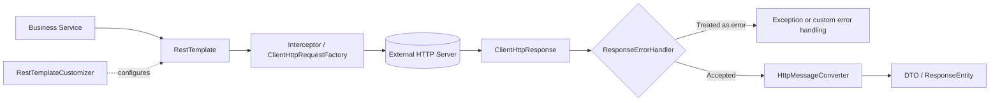
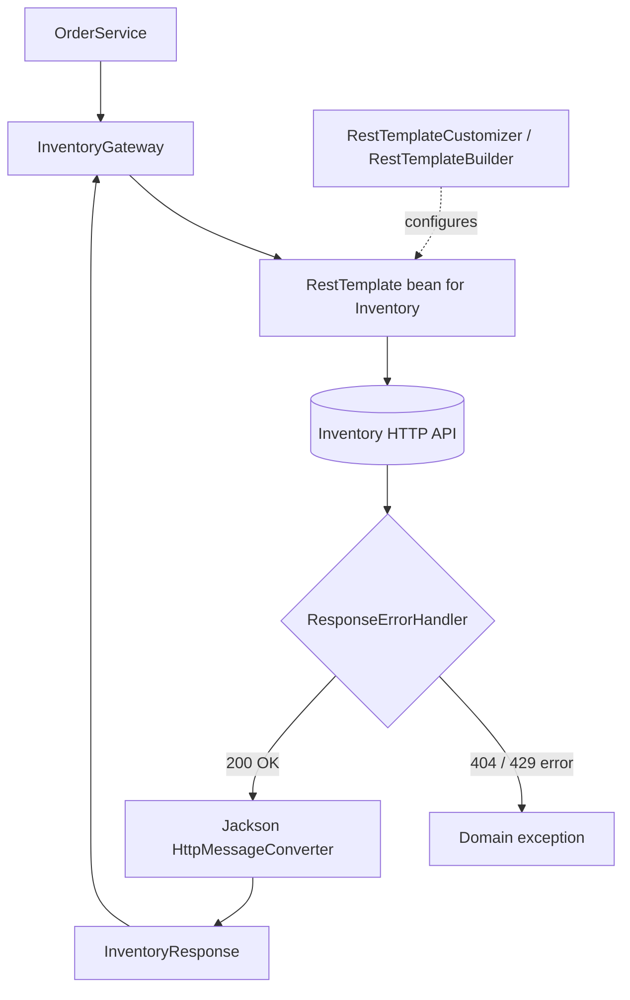

# RestTemplateCustomizer, ResponseErrorHandler, and Data Conversion

## 1. Three Extension Points of a Synchronous HTTP Client

In the **SPRING_BOOT_INTEGRATION** module, a Spring Boot application frequently calls external services to query inventory, calculate shipping fees, verify customers, or submit payment requests. For synchronous HTTP, `RestTemplate` is a widely used client, especially in pre-existing systems; `RestClient` is the fluent synchronous API in newer Spring Framework versions.

An HTTP call involves three distinct concerns that are easy to conflate:

1. **Client configuration before use:** base endpoint, timeouts, interceptors, authentication, request factory, and shared defaults.
2. **HTTP outcome classification:** which responses count as errors and which exception those errors map into.
3. **Data conversion:** serializing Java objects into JSON/form requests and deserializing JSON/text/bytes into Java objects.

Spring Boot and Spring Framework provide three matching extension points:

| Component | Where It Acts | Question It Answers |
| --- | --- | --- |
| `RestTemplateCustomizer` | When initializing/configuring `RestTemplate` via the builder | Which interceptors, error handler, or converters does the client get? |
| `ResponseErrorHandler` | After receiving the HTTP status, before normal response extraction | What error should `404`, `429`, or `500` map to? |
| `HttpMessageConverter<?>` | When writing a request body or reading a response body | Which DTO, charset, and media type map to `application/json`? |

These operate at the **HTTP boundary**. They do not make HTTP part of a database transaction, nor do they automatically provide retries, idempotency, or exactly-once broker messaging.



One crucial point in this diagram: `ResponseErrorHandler` **does not** handle failures where no HTTP response arrived (DNS failures, connection refused, socket timeouts). Those surface at the transport layer as `ResourceAccessException` or related exceptions. Only when a `ClientHttpResponse` exists is there a status code to classify.

## 2. Configuration via RestTemplateBuilder and RestTemplateCustomizer

### 2.1. Why Use Spring Boot's Builder?

Instead of scattering `new RestTemplate()` everywhere, Spring Boot provides a `RestTemplateBuilder` bean to construct clients consistently. The builder picks up registered `RestTemplateCustomizer` beans while maintaining shared HTTP configuration components.

Example for Spring Boot 3.x / Spring Framework 6.x, Java 17+ (note that API method names may differ across major versions):

```java
import java.time.Duration;

import org.springframework.beans.factory.annotation.Qualifier;
import org.springframework.boot.web.client.RestTemplateBuilder;
import org.springframework.context.annotation.Bean;
import org.springframework.context.annotation.Configuration;
import org.springframework.web.client.RestTemplate;

@Configuration(proxyBeanMethods = false)
public class InventoryHttpConfiguration {

    @Bean("inventoryRestTemplate")
    RestTemplate inventoryRestTemplate(RestTemplateBuilder builder) {
        return builder
                .rootUri("https://inventory.example.test")
                .setConnectTimeout(Duration.ofSeconds(2))
                .setReadTimeout(Duration.ofSeconds(5))
                .build();
    }
}
```

Inject the exact instance into the business client:

```java
import org.springframework.beans.factory.annotation.Qualifier;
import org.springframework.stereotype.Service;
import org.springframework.web.client.RestTemplate;

@Service
public class InventoryGateway {
    private final RestTemplate restTemplate;

    public InventoryGateway(
            @Qualifier("inventoryRestTemplate") RestTemplate restTemplate) {
        this.restTemplate = restTemplate;
    }

    public InventoryResponse getStock(String sku) {
        return restTemplate.getForObject(
                "/inventory/{sku}", InventoryResponse.class, sku);
    }
}
```

`rootUri(...)` applies to String URLs starting with `/` when using suitable `RestTemplate` overloads. Passing an absolute `URI` may skip prepending the root URI; verify the final URI in tests.

**Distinguishing timeouts:** connect timeout bounds connection establishment; read timeout bounds waiting to read data according to the selected request factory. Neither creates an **overall deadline** for the entire workflow spanning DNS, retries, request, response, and business logic. With connection pooling, there may also be a pool acquisition timeout. Supported options and method names vary by Spring Boot, Spring Framework, and the underlying HTTP library—verify against your running stack.

### 2.2. Which Clients Does RestTemplateCustomizer Affect?

A `RestTemplateCustomizer` bean adds configuration to every `RestTemplate` produced by **Spring Boot's configured builder**. Example adding a caller identity header:

```java
import org.springframework.boot.web.client.RestTemplateCustomizer;
import org.springframework.context.annotation.Bean;
import org.springframework.context.annotation.Configuration;

@Configuration(proxyBeanMethods = false)
public class SharedHttpCustomization {

    @Bean
    RestTemplateCustomizer callerHeaderCustomizer() {
        return restTemplate -> restTemplate.getInterceptors().add(
                (request, body, execution) -> {
                    request.getHeaders().set(
                            "X-Caller-Service", "order-service");
                    return execution.execute(request, body);
                });
    }
}
```

Use `set` instead of `add` when a header must be single-valued. The interceptor executes on every request sent, not just once at client startup. Register configuration once; avoid appending interceptors to the same `RestTemplate` repeatedly per request.

**Scope matters:** `callerHeaderCustomizer` is a shared bean and will be applied by Spring Boot to **every** `RestTemplate` built from the auto-configured `RestTemplateBuilder`. Never place a single partner's secrets, API keys, or specialized rules inside a global customizer if the application talks to multiple partners.

If a setting applies solely to the Inventory API, attach a **per-client** customizer directly to that client's builder:

```java
@Bean("inventoryRestTemplate")
RestTemplate inventoryRestTemplate(RestTemplateBuilder builder) {
    RestTemplateCustomizer inventoryCustomizer = template ->
            template.getInterceptors().add(
                    (request, body, execution) -> {
                        request.getHeaders().set(
                                "X-Partner-Application", "inventory-client");
                        return execution.execute(request, body);
                    });

    return builder
            .rootUri("https://inventory.example.test")
            .additionalCustomizers(inventoryCustomizer)
            .build();
}
```

This snippet is a **variant** of the `inventoryRestTemplate` bean above—do not declare both methods with the same bean name in one configuration. `additionalCustomizers` appends to existing builder configuration, whereas methods that replace the entire customizer list can discard other system defaults.

### 2.3. Where Should Each Setting Live?

| Requirement | Appropriate Place | Notes |
| --- | --- | --- |
| Per-partner base URL | `RestTemplateBuilder.rootUri(...)` or properties passed to builder | Never assemble URLs from user input without host/path validation |
| Timeouts / request factory | Builder or matching factory configuration | Verify support in the underlying HTTP library |
| Static header on all requests of one client | `ClientHttpRequestInterceptor` in a per-client customizer | Never log sensitive tokens |
| Per-operation dynamic headers | `HttpEntity` / `RequestEntity` at the call site | E.g., idempotency keys, correlation IDs |
| Partner-wide HTTP error policy | `ResponseErrorHandler` on that client | Never apply a single `404` rule blindly across all services |
| JSON mapper / media types | `HttpMessageConverter`, Jackson mapper, or DTO annotations | Avoid replacing all default converters unnecessarily |
| Trace/metrics observation | Boot-version-matched observation/tracing config | Manual interceptors do not automatically replace standard tracing |

`RestTemplate` is safe for concurrent use once **its configuration is finalized**, but never mutate interceptor, converter, or error-handler lists while threads are actively calling it. Perform all configuration during bean initialization.

## 3. ResponseErrorHandler: When Is a Response an Error?

### 3.1. Default Behavior

By default, `RestTemplate` uses `DefaultResponseErrorHandler`. Responses in the **4xx and 5xx** families are treated as errors, throwing exceptions such as:

- `HttpClientErrorException.NotFound` for `404 Not Found`;
- `HttpClientErrorException.TooManyRequests` for `429 Too Many Requests` when supported;
- `HttpServerErrorException.ServiceUnavailable` for `503 Service Unavailable`;
- broader base exceptions when a status lacks a dedicated subclass.

From a service calling a partner, HTTP `404` does not necessarily mean the whole workflow failed—sometimes it means "product does not exist yet"; conversely, `503` is usually transient. Still, **never override `hasError` so all `404`s count as success** if the API does not return the success DTO schema. Doing so causes `HttpMessageConverter` to attempt reading HTML or error JSON into the success DTO, failing with confusing errors.

A `ResponseErrorHandler` makes two decisions:

1. `hasError(ClientHttpResponse)`: should this response enter the error-handling branch?
2. `handleError(...)`: when it is an error, what exception or policy should trigger?

Usually, customize **mapping for specific statuses** inside `handleError(...)` while preserving default behavior for everything else.

### 3.2. Example Error Handler for the Inventory API

Suppose the partner specifies:
- `404`: SKU does not exist;
- `429`: rate limit exceeded, possibly with `Retry-After`;
- other `4xx/5xx`: keep default HTTP exceptions so status/body diagnostics remain intact.

Extend `DefaultResponseErrorHandler` to customize just those two statuses:

```java
import java.io.IOException;
import java.net.URI;

import org.springframework.http.HttpHeaders;
import org.springframework.http.HttpMethod;
import org.springframework.http.client.ClientHttpResponse;
import org.springframework.web.client.DefaultResponseErrorHandler;

public final class InventoryResponseErrorHandler
        extends DefaultResponseErrorHandler {

    @Override
    public void handleError(
            URI url, HttpMethod method, ClientHttpResponse response)
            throws IOException {

        int status = response.getStatusCode().value();

        if (status == 404) {
            throw new InventoryNotFoundException(
                    "Inventory data not found at " + url.getPath());
        }

        if (status == 429) {
            String retryAfter =
                    response.getHeaders().getFirst(HttpHeaders.RETRY_AFTER);
            throw new InventoryRateLimitedException(retryAfter);
        }

        // Preserve Spring's classification for all remaining errors.
        super.handleError(url, method, response);
    }
}
```

Example domain exceptions:

```java
public final class InventoryNotFoundException extends RuntimeException {
    public InventoryNotFoundException(String message) {
        super(message);
    }
}

public final class InventoryRateLimitedException extends RuntimeException {
    private final String retryAfter;

    public InventoryRateLimitedException(String retryAfter) {
        super("Inventory API is rate limiting requests");
        this.retryAfter = retryAfter;
    }

    public String retryAfter() {
        return retryAfter;
    }
}
```

Attach the handler **only to the inventory RestTemplate** via the builder:

```java
@Bean("inventoryRestTemplate")
RestTemplate inventoryRestTemplate(RestTemplateBuilder builder) {
    return builder
            .rootUri("https://inventory.example.test")
            .setConnectTimeout(Duration.ofSeconds(2))
            .setReadTimeout(Duration.ofSeconds(5))
            .errorHandler(new InventoryResponseErrorHandler())
            .build();
}
```

This is also an **alternative version** of the same-named bean in Section 2. In a real application, consolidate root URI, timeouts, interceptors, and error handler in one place.

By calling `super.handleError(...)`, Spring's handling of all other HTTP errors remains intact. Avoid throwing a generic `RuntimeException("HTTP error")` for every status, as that discards valuable diagnostic fields like status code, headers, and body preserved by default exceptions.

**Contract caveat:** this example is valid only if `404` carries the exact same meaning across every endpoint called by `inventoryRestTemplate`. If one endpoint uses `404` differently, split clients/handlers or map errors per operation at the gateway layer.

### 3.3. Which Errors Does the Error Handler Never See?

| Situation | `ClientHttpResponse` Present? | Where to Handle |
| --- | --- | --- |
| Server returns `404/429/500` | Yes | `ResponseErrorHandler` and business policies |
| Server returns `200` with schema-invalid JSON | Yes | `HttpMessageConverter` or DTO validation |
| DNS/TCP connection fails | Usually no | `ResourceAccessException`, timeouts, retry/recovery |
| TLS handshake fails | No valid HTTP response | TLS configuration, truststore/certificates, transport exceptions |
| Socket closes mid-response | Response completeness unguaranteed | I/O exceptions, record uncertain outcome for side effects |
| HTTP `202 Accepted` | Yes, usually not flagged as an error | Application must track asynchronous business progress |

On `429`, `Retry-After` may be seconds **or an HTTP-date**, not necessarily an integer. The header may also be missing or malformed; validate it, cap wait durations, and stay within your retry budget. Never auto-retry side-effecting POSTs without idempotency keys and reconciliation.

### 3.4. Avoid Reading the Response Body Twice

`ClientHttpResponse.getBody()` normally exposes a forward-only stream. If a custom error handler consumes the entire body to log it and then delegates to the default handler or another layer, the stream is already empty.

Remedies:
- Read error content only when truly needed; enforce byte caps, redact sensitive data, and throw an exception holding only the extracted fields needed.
- When re-reading is unavoidable, consider a buffering request factory after evaluating memory overhead; never enable buffering globally for large responses.
- If error bodies carry a dedicated schema (e.g., `{"code":"LIMIT_EXCEEDED"}`), parse them carefully with Jackson inside the error handler/gateway; **never expect** success converters to deserialize error bodies after the handler throws.
- Specialized gateways often benefit from `RestClient` and per-request `onStatus(...)` when error semantics vary by endpoint; with `RestTemplate`, keep handlers/gateways narrowly scoped.

## 4. HttpMessageConverter: Java Objects <-> HTTP Bodies

`RestTemplate` does not automatically apply `ObjectMapper` to every response. It iterates over its configured `HttpMessageConverter<?>` list to find one supporting both the **Java type** and the **media type**.

Common converters:

| Converter | Responsibility | Example Media Types |
| --- | --- | --- |
| `MappingJackson2HttpMessageConverter` | Java object <-> JSON via Jackson | `application/json`, compatible `application/*+json` |
| `StringHttpMessageConverter` | Strings <-> text | `text/plain` and supported text types |
| `ByteArrayHttpMessageConverter` | Byte arrays <-> raw bodies | `application/octet-stream` and allowed types |
| `ResourceHttpMessageConverter` | Reads/writes binary resources | Files, resource streams |
| `FormHttpMessageConverter` | Handles URL-encoded forms; pairs with multipart support | `application/x-www-form-urlencoded`, `multipart/form-data` |

Converters are selected in registration order. Placing an overly broad custom converter at the front of the list can hijack requests previously handled properly by default converters.

### 4.1. Accept Differs from Content-Type

- Request `Content-Type` tells the server how the body the client is **sending** is encoded.
- Request `Accept` tells the server which content types the client wants **returned**.
- Response `Content-Type` identifies the media type of the **received** body, guiding which converter reads it.
- `Accept` does not force every server to comply: clients must handle whatever the server actually returns, including HTML error pages instead of JSON.

Example POST with JSON request and JSON response:

```java
import java.util.List;

import org.springframework.http.HttpEntity;
import org.springframework.http.HttpHeaders;
import org.springframework.http.HttpMethod;
import org.springframework.http.MediaType;
import org.springframework.http.ResponseEntity;

public ReservationResponse reserve(ReserveRequest request) {
    HttpHeaders headers = new HttpHeaders();
    headers.setContentType(MediaType.APPLICATION_JSON);
    headers.setAccept(List.of(MediaType.APPLICATION_JSON));
    headers.set("Idempotency-Key", request.orderId());

    HttpEntity<ReserveRequest> entity =
            new HttpEntity<>(request, headers);

    ResponseEntity<ReservationResponse> response = restTemplate.exchange(
            "/reservations", HttpMethod.POST, entity,
            ReservationResponse.class);

    return response.getBody();
}
```

DTOs can be Java records:

```java
public record ReserveRequest(
        String orderId, String sku, int quantity) {}

public record ReservationResponse(
        String reservationId, String status) {}
```

In production, never assume `response.getBody()` is non-null. If the endpoint promises a body, check for null and throw an explicit contract violation. If it returns `204 No Content`, use a contract that does not require a DTO. For idempotency keys, retries of the same operation must send the exact same business-managed key; sending a header alone does not stop a server lacking idempotency support from duplicating side effects.

### 4.2. Reading JSON Into DTOs When Field Names Differ from Java

Suppose the upstream returns:

```json
{
  "product_code": "SKU-001",
  "available_quantity": 8,
  "warehouse": "HN"
}
```

The DTO only needs the first two fields:

```java
import com.fasterxml.jackson.annotation.JsonIgnoreProperties;
import com.fasterxml.jackson.annotation.JsonProperty;

@JsonIgnoreProperties(ignoreUnknown = true)
public record InventoryResponse(
        @JsonProperty("product_code") String productCode,
        @JsonProperty("available_quantity") int availableQuantity) {}
```

The Jackson converter uses annotations to map `product_code` -> `productCode` and `available_quantity` -> `availableQuantity`. `@JsonIgnoreProperties(ignoreUnknown = true)` tolerates extra fields like `warehouse` without breaking the client contract.

Apply this policy deliberately. If a contract requires catching every field change, ignoring unknown properties everywhere can mask regressions. Also validate missing required fields: a primitive `int` defaults to `0`, blurring **missing data** with **zero stock**. Use `Integer` with null checks or explicit validation whenever that distinction matters.

### 4.3. Collections and Generic Types

Passing `List.class` when calling a list API loses the element type during deserialization. With `RestTemplate`, use `ParameterizedTypeReference`:

```java
import java.util.List;

import org.springframework.core.ParameterizedTypeReference;
import org.springframework.http.HttpEntity;
import org.springframework.http.HttpMethod;
import org.springframework.http.ResponseEntity;

ParameterizedTypeReference<List<InventoryResponse>> responseType =
        new ParameterizedTypeReference<>() {};

ResponseEntity<List<InventoryResponse>> response =
        restTemplate.exchange(
                "/inventory",
                HttpMethod.GET,
                HttpEntity.EMPTY,
                responseType);

List<InventoryResponse> inventoryItems = response.getBody();
```

`ParameterizedTypeReference` retains the generic type so the Jackson converter knows each element is `InventoryResponse`. You must still handle null/empty bodies per endpoint contract.

### 4.4. Adding a Custom Converter Without Losing Defaults

Some partners return non-standard media types such as `application/vnd.vendor.inventory+json`, or need an `ObjectMapper` with extra modules. When the application's shared mapper configuration already fits, prefer reusing it rather than creating an isolated mapper from scratch.

Example adding a custom converter to a single `RestTemplate`:

```java
import java.util.List;

import com.fasterxml.jackson.databind.ObjectMapper;
import org.springframework.http.MediaType;
import org.springframework.http.converter.json.MappingJackson2HttpMessageConverter;

MappingJackson2HttpMessageConverter inventoryJson =
        new MappingJackson2HttpMessageConverter(objectMapper);

inventoryJson.setSupportedMediaTypes(List.of(
        MediaType.APPLICATION_JSON,
        MediaType.valueOf("application/vnd.vendor.inventory+json")));

RestTemplate inventoryRestTemplate = builder
        .rootUri("https://inventory.example.test")
        .additionalMessageConverters(inventoryJson)
        .build();
```

Here `objectMapper` is a pre-configured or injected Jackson instance. This snippet **illustrates adding a converter**, not a full bean definition; in practice combine it with timeouts, error handlers, and other settings. Check converter order after building: if an earlier JSON converter also supports the same media type and Java type, it may take precedence over the new converter. When overriding or prioritizing converters is required, order the list deliberately and test matching media types.

Distinguish carefully:
- `messageConverters(...)` on `RestTemplateBuilder` **sets the converter list**; understand how it replaces default converters in your Boot version.
- `additionalMessageConverters(...)` **augments** converters without dropping working form, string, or binary converters.
- Mutating `restTemplate.setMessageConverters(...)` after the client is in use causes unpredictable behavior across threads.

If a server returns `text/plain` for JSON payloads, fixing the server contract is best. If that is impossible, register a converter supporting that exact media type or read `String` and parse in the adapter under tests—never enable arbitrary JSON parsing across all media types.

## 5. A Unified Example: Inventory Endpoint with Data Conversion and Error Handling

We want to call `GET /inventory/{sku}` from an ordering application. The partner contract states:

- `200 + application/json`: returns `InventoryResponse`.
- `404`: product does not exist in the partner system.
- `429`: rate limited, may include `Retry-After`.
- `503`: service temporarily unavailable.
- Socket timeout: uncertain whether downstream processed side-effecting requests; for this read-only GET, bounded retries per policy are possible.

Code structure:



The gateway handles solely translating the HTTP contract into domain objects and exceptions:

```java
import java.util.List;
import java.util.Objects;

import org.springframework.beans.factory.annotation.Qualifier;
import org.springframework.http.HttpEntity;
import org.springframework.http.HttpHeaders;
import org.springframework.http.HttpMethod;
import org.springframework.http.MediaType;
import org.springframework.stereotype.Component;
import org.springframework.web.client.RestTemplate;

@Component
public final class InventoryGateway {
    private final RestTemplate restTemplate;

    public InventoryGateway(
            @Qualifier("inventoryRestTemplate") RestTemplate restTemplate) {
        this.restTemplate = restTemplate;
    }

    public InventoryResponse loadAvailability(String sku) {
        HttpHeaders headers = new HttpHeaders();
        headers.setAccept(List.of(MediaType.APPLICATION_JSON));

        InventoryResponse body = restTemplate.exchange(
                "/inventory/{sku}",
                HttpMethod.GET,
                new HttpEntity<>(headers),
                InventoryResponse.class,
                sku).getBody();

        return Objects.requireNonNull(
                body, "Inventory API returned an empty body for SKU " + sku);
    }
}
```

This is a **standalone example** replacing the `InventoryGateway.getStock` method shown in Section 2; in a real codebase, keep a single gateway per endpoint group. Never collapse all exceptions to `null`, which makes the business layer confuse "SKU absent", "server down", and "broken schema".

With Spring Boot 3.x, inject Boot's `RestTemplateBuilder` into your configuration bean and attach `InventoryResponseErrorHandler` as shown in Section 3. Externalize base URLs, timeouts, and credentials in type-safe `@ConfigurationProperties` and validate them at startup.

## 6. Testing All Three Extension Points with MockRestServiceServer

`spring-test`'s `MockRestServiceServer` works cleanly with `RestTemplate` by intercepting client requests, matching method/URI/headers, and returning stubbed responses. No real network calls happen, yet requests still flow through `RestTemplate`, error handlers, and converters.

Example testing the `404` handler alongside JSON deserialization:

```java
import static org.assertj.core.api.Assertions.assertThat;
import static org.assertj.core.api.Assertions.assertThatThrownBy;
import static org.springframework.test.web.client.match.MockRestRequestMatchers.*;
import static org.springframework.test.web.client.response.MockRestResponseCreators.*;

import org.junit.jupiter.api.BeforeEach;
import org.junit.jupiter.api.Test;
import org.springframework.boot.web.client.RestTemplateBuilder;
import org.springframework.http.HttpMethod;
import org.springframework.http.MediaType;
import org.springframework.test.web.client.MockRestServiceServer;
import org.springframework.web.client.RestTemplate;

class InventoryGatewayTest {

    private MockRestServiceServer mockServer;
    private InventoryGateway gateway;

    @BeforeEach
    void setUp() {
        RestTemplate template = new RestTemplateBuilder()
                .rootUri("https://inventory.example.test")
                .errorHandler(new InventoryResponseErrorHandler())
                .build();

        mockServer = MockRestServiceServer.bindTo(template).build();
        gateway = new InventoryGateway(template);
    }

    @Test
    void readsJsonIntoInventoryDto() {
        mockServer.expect(requestTo(
                    "https://inventory.example.test/inventory/SKU-001"))
                .andExpect(method(HttpMethod.GET))
                .andRespond(withSuccess(
                        """
                        {
                          "product_code": "SKU-001",
                          "available_quantity": 8,
                          "warehouse": "HN"
                        }
                        """,
                        MediaType.APPLICATION_JSON));

        InventoryResponse result =
                gateway.loadAvailability("SKU-001");

        assertThat(result.productCode()).isEqualTo("SKU-001");
        assertThat(result.availableQuantity()).isEqualTo(8);
        mockServer.verify();
    }

    @Test
    void maps404IntoDomainException() {
        mockServer.expect(requestTo(
                    "https://inventory.example.test/inventory/NO-SKU"))
                .andExpect(method(HttpMethod.GET))
                .andRespond(withResourceNotFound());

        assertThatThrownBy(() -> gateway.loadAvailability("NO-SKU"))
                .isInstanceOf(InventoryNotFoundException.class);

        mockServer.verify();
    }
}
```

These two tests verify different things:

- The `200` test proves the converter maps snake_case JSON fields into the record while ignoring an unused field.
- The `404` test proves the error handler intercepts the error status and throws the business exception.
- `mockServer.verify()` confirms the expected number of requests fired. Add `andExpect(header(...))` to assert required headers as well.
- `MockRestServiceServer` opens no real HTTP connections, so these tests **do not prove** connect timeouts, TLS, connection pooling, or DNS work. Use WireMock, MockWebServer, or a loopback test server for real transport checks.

Also add `429` (with `Retry-After`) and `503` cases to verify default error handling was not accidentally broken:

```java
@Test
void keepsDefault503Mapping() {
    mockServer.expect(requestTo(
                "https://inventory.example.test/inventory/SKU-503"))
            .andRespond(withServerError());

    assertThatThrownBy(() -> gateway.loadAvailability("SKU-503"))
            .isInstanceOf(
                    org.springframework.web.client.HttpServerErrorException.class);

    mockServer.verify();
}
```

This is an **additional test** inside the same test class. When tests depend on Boot's application configuration (customizer beans, custom converters, authentication), test the beans inside a Spring context or `@RestClientTest` slice rather than building a plain `new RestTemplateBuilder()` and assuming Boot auto-configuration was verified.

## 7. Common Mistakes and How to Spot Them

| Mistake | Symptom | Fix |
| --- | --- | --- |
| Registering `RestTemplateCustomizer` yet building clients via `new RestTemplate()` | Interceptors or converters never run | Use Spring Boot's builder; test the actual wired bean |
| Putting one partner's header in a global customizer | Header leaks to other partners, exposing tokens | Scope customizers per client; isolate auth config |
| Overwriting `setMessageConverters` with a single JSON converter | Previously working text/form/binary calls fail | Append converters intentionally and check ordering |
| Custom error handler returning `hasError=false` for all `4xx` | HTML/error JSON gets parsed as a success DTO | Keep error statuses throwing/mapping to explicit errors |
| Reading error body manually then letting default handler read again | Empty error body / lost diagnostics | Read once, bound buffering, and log under redaction |
| Relying solely on HTTP `200` to assume business success | Missing DTO fields or body-level business errors | Validate DTOs and inspect business status codes |
| Using `List.class` to read DTO lists | Elements deserialize as raw maps | Use `ParameterizedTypeReference<List<MyDto>>` |
| Setting connect/read timeouts yet still seeing long waits | Retries, pool waits, DNS, or slow processing exceed socket timeouts | Define overall deadlines and find the true bottleneck |
| Retrying POST immediately after a socket timeout | Duplicate downstream side effects | Use idempotency keys and status lookup/reconciliation |
| Keeping DB `@Transactional` open across HTTP calls | Extended transactions, connections, and row locks | Separate short DB transactions from outbound HTTP |

In particular, `ResponseErrorHandler` inspects only **HTTP status**. If a partner returns `200 OK` with `{"success":false,"errorCode":"OUT_OF_STOCK"}`, interpreting `success=false` belongs in the gateway/service after deserialization. Business invariant checks must never be delegated solely to an error handler.

## 8. Operations: Retries, Timeouts, Observability, and Security

When running `RestTemplate` in production integrations, coordinate every piece:

1. **Measured and tested timeouts:** connect/read timeouts, pool wait timeouts where applicable, retry budgets, and total deadlines must align with the external API's SLA.
2. **Explicit error classification:** `404`, `409`, `429`, and `503` can mean different things per endpoint; never assume `5xx` means "definitely not processed".
3. **Controlled retries:** auto-retry only idempotent operations or when downstream guarantees idempotency. For payments, never change operation IDs across attempts and handle `UNKNOWN` states after timeouts.
4. **Safe logging:** log sanitized endpoints/paths, statuses, durations, and correlation IDs; suppress `Authorization`/`Cookie` headers and sensitive bodies.
5. **Contract-enforced conversion:** validate content types, JSON schemas/DTOs, enums, date/times, nullability, and payload sizes; enforce limits on large responses/streams.
6. **Transaction boundaries:** never wait on external systems inside a DB transaction holding locks or connections. For reliable messaging after DB commit, use an outbox and background publisher.
7. **Per-partner observability:** track p95/p99 latency, status families, timeouts, deserialization errors, retry counts, circuit breaker states, and downstream health.

Never put `@Transactional` on an HTTP gateway method thinking it makes external calls "safer". Spring's JDBC/JPA transaction manager cannot combine HTTP requests and database writes into one ACID transaction.

## 9. Pre-Completion Checklist for an HTTP Adapter

- Inject a properly configured `RestTemplateBuilder` and wire a **clearly scoped client** into the gateway.
- Decide which customizers are application-wide vs. scoped per endpoint/partner.
- Verify timeouts match the active request factory and add real timeout tests.
- Map required error statuses in `ResponseErrorHandler` while preserving Spring defaults for the rest.
- Separate HTTP status errors from transport failures where no response arrived.
- Select converters by `Content-Type`, `Accept`, and DTO type, using generic type tokens where needed.
- Test missing bodies, unexpected fields, nullability, unknown enums, and parse errors beyond the happy path.
- Test requests, responses, handlers, and converters via `MockRestServiceServer`, and use a socket-level HTTP server for real network behaviors.
- Protect sensitive credentials and design retries/idempotency at the appropriate business layer.

**Key takeaway:** `RestTemplateCustomizer` defines **how the client is configured**; `ResponseErrorHandler` defines **which HTTP statuses are errors and how they are represented**; `HttpMessageConverter` defines **how bodies are converted**. Test all three working together on the same `RestTemplate`, while preserving clear boundaries around transactions, retries, and business state.

### References

- [Spring Boot API — RestTemplateCustomizer](https://docs.spring.io/spring-boot/api/java/org/springframework/boot/web/client/RestTemplateCustomizer.html).
- [Spring Boot API — RestTemplateBuilder](https://docs.spring.io/spring-boot/api/java/org/springframework/boot/web/client/RestTemplateBuilder.html).
- [Spring Framework API — ResponseErrorHandler](https://docs.spring.io/spring-framework/docs/current/javadoc-api/org/springframework/web/client/ResponseErrorHandler.html).
- [Spring Framework Reference — REST Clients](https://docs.spring.io/spring-framework/reference/integration/rest-clients.html).
- [Spring Framework Reference — HTTP Message Conversion](https://docs.spring.io/spring-framework/reference/integration/rest-clients.html#rest-message-conversion).
