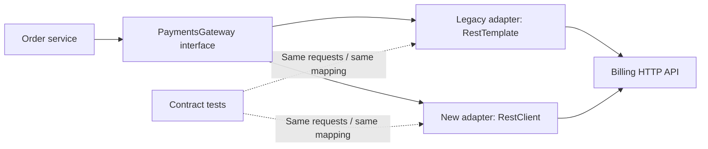
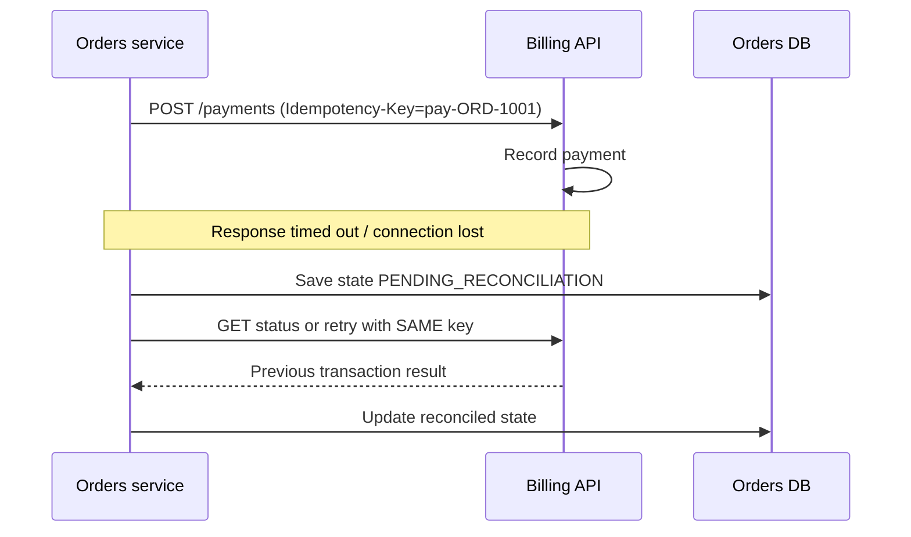

# Migrating Incrementally from RestTemplate to RestClient While Preserving the Contract

## 1. Context: Switching HTTP Clients Must Not Change Integration Behavior

In **Spring Boot Integration**, a service may read an order from a database, call a partner HTTP API to process payment, record the result, publish an event to RabbitMQ/Kafka, and update a cache. Regardless of whether the app uses `RestTemplate` or `RestClient`, the partner system cares only about the **actual HTTP requests it receives** and **how your app reacts to HTTP responses**—not which Java class built the request.

Suppose the service sends:

```http
POST /api/v1/payments HTTP/1.1
Host: billing.example.org
Content-Type: application/json
Accept: application/json
Idempotency-Key: pay-ORD-1001
Authorization: Bearer <token>

{"orderId":"ORD-1001","amount":125000.00,"currency":"VND"}
```

The Billing API returns `201 Created` with a body and `Location` header, or `409 Conflict` if an idempotency key is reused with a different payload. When swapping clients, your app must keep sending the **exact same method, URL, critical headers, body, and status-handling rules**—never accidentally turning `409` into "infinite retries" or dropping `Location`.

**Lesson objective:** migrate adapters one by one from `RestTemplate` to `RestClient`, preserve both HTTP and business contracts, verify both implementations against the same test suite, and support canary/rollback without rewriting every flow at once.



### 1.1. Support Scope and Version Checks

`RestClient` was introduced in **Spring Framework 6.1** (typically paired with **Spring Boot 3.2+**). It is a **synchronous** client with a fluent API; `RestTemplate` is also synchronous and remains usable in legacy apps. You do not need WebFlux or `WebClient` to adopt `RestClient`.

Before changing code, verify your actual Spring Framework/Spring Boot versions and how HTTP clients are currently configured. Builder APIs, request factories, observation hooks, and timeout methods evolve across versions; never copy snippets from one version into another project without compiling and testing.

**Do not conflate concepts:** `RestClient` (Spring synchronous) is **not** `WebClient` (reactive). Calling `RestClient`'s `retrieve().body(...)` or `toEntity(...)` executes synchronously and blocks the calling thread during I/O. It does not return `Mono`/`Flux`.

## 2. Lock Down the Contract Before Touching the Client

The contract goes far beyond JSON DTOs. A thorough inventory covers:

| Contract Layer | Keep Identical or Change Only with Approval | Common Drift Bugs |
| --- | --- | --- |
| **Method + URI** | `GET/POST/PUT/PATCH/DELETE`, paths, queries, percent-encoding, slashes | Clients encoding `/` or spaces differently |
| **Headers** | `Content-Type`, `Accept`, auth, tenant, correlation ID, idempotency key, conditional headers | Dropped headers or duplicate `Authorization` |
| **Body** | Field names, nulls, enums, timezones, monetary amounts, charsets, serialization order | Different Jackson/`ObjectMapper` or converter settings altering JSON |
| **Success status** | `200/201/202/204`, empty bodies, `Location`, `ETag` | Calling `body()` alone and losing statuses/headers |
| **Error status** | `400/401/403/404/409/412/429/5xx`, error payloads, exception mapping | Changing `404` semantics or retrying `409` |
| **Transport** | TLS/mTLS, proxies, redirects, cookies, connection pools, timeouts, compression | Switching HTTP libraries and altering handshakes/timeouts |
| **Resilience** | Retries, backoff, circuit breakers, rate limits, idempotency | Side-effecting requests sent multiple times |
| **Observability** | Metric names, trace propagation, request IDs, log redaction | Lost trace links or leaked tokens in logs |
| **Transactions** | DB commit boundaries and when external API calls run | Assuming HTTP calls and DB writes are atomic together |

### 2.1. Defining "Equivalence" at Two Levels

**Wire equivalence:** what travels over the network matches the contract: HTTP method, target URI, auth, media type, body, status, and relied-upon headers.

**Behavioral equivalence:** identical scenarios yield identical business outcomes—e.g., `404` means "not found", `409` is a non-retryable conflict, `503` is a bounded transient failure, and timeouts never create duplicate payments.

You do not always need identical JSON key order, default `User-Agent`, or internal exception classes if the contract does not depend on them. Still, any discrepancy that could impact the server or downstream flows must be **listed, tested, and approved**, never assumed compatible.

### 2.2. Standardize the Contract at the Adapter Boundary

Place a single interface at the boundary so business services never couple directly to two HTTP client APIs:

```java
import java.math.BigDecimal;
import org.springframework.http.ResponseEntity;

record PaymentRequest(String orderId, BigDecimal amount, String currency) {}
record PaymentResponse(String paymentId, String status) {}

public interface PaymentsGateway {
    ResponseEntity<PaymentResponse> create(
            PaymentRequest request, String idempotencyKey);
}
```

This example keeps `ResponseEntity` because callers need body, status, and `Location`. When business services only need a domain outcome, convert `ResponseEntity` to a domain result inside the adapter to hide HTTP details completely. What matters is that **both implementations obey the exact same interface and mapping contract**.

## 3. Baseline: How Is RestTemplate Currently Behaving?

Legacy adapter example:

```java
import java.net.URI;
import org.springframework.http.HttpEntity;
import org.springframework.http.HttpHeaders;
import org.springframework.http.HttpMethod;
import org.springframework.http.MediaType;
import org.springframework.http.ResponseEntity;
import org.springframework.web.client.RestTemplate;

public final class RestTemplatePaymentsGateway implements PaymentsGateway {
    private final RestTemplate restTemplate;
    private final URI paymentsUri;

    public RestTemplatePaymentsGateway(
            RestTemplate restTemplate, URI paymentsUri) {
        this.restTemplate = restTemplate;
        this.paymentsUri = paymentsUri;
    }

    @Override
    public ResponseEntity<PaymentResponse> create(
            PaymentRequest request, String idempotencyKey) {
        HttpHeaders headers = new HttpHeaders();
        headers.setContentType(MediaType.APPLICATION_JSON);
        headers.setAccept(java.util.List.of(MediaType.APPLICATION_JSON));
        headers.set("Idempotency-Key", idempotencyKey);
        // Authentication and common headers are attached by an interceptor.

        HttpEntity<PaymentRequest> entity =
                new HttpEntity<>(request, headers);
        return restTemplate.exchange(
                paymentsUri,
                HttpMethod.POST,
                entity,
                PaymentResponse.class);
    }
}
```

`paymentsUri` must be an absolute URI from trusted configuration, such as `https://billing.example.org/api/v1/payments`. Never concatenate hostnames from user input or accept arbitrary URLs due to SSRF risks. In real codebases, dynamic paths/queries should be built with properly encoding URI builders.

Characteristics to **document before migrating**:

- Was `RestTemplate` built from `RestTemplateBuilder` or via `new RestTemplate()`?
- Which `ClientHttpRequestFactory` is active (JDK, Apache HttpClient, etc.)?
- Are `ClientHttpRequestInterceptor`s adding tokens, correlation IDs, or logging?
- Does a custom `ResponseErrorHandler` treat `404` as a normal outcome?
- Which `ObjectMapper` does `HttpMessageConverter` use, and does it register Java Time or custom formats?
- Who configures timeouts, SSL trust/key material, proxies, redirects, and connection pooling?

**Never compare call sites alone.** Switching to a default builder can simultaneously change transport, converters, error handlers, and interceptors, introducing regressions even when the DSL call looks identical.

## 4. Rewriting with RestClient: Keeping the Same Contract

A `RestClient` with `baseUrl` and matching HTTP config:

```java
import org.springframework.http.MediaType;
import org.springframework.http.ResponseEntity;
import org.springframework.web.client.RestClient;

public final class RestClientPaymentsGateway implements PaymentsGateway {
    private final RestClient client;

    public RestClientPaymentsGateway(RestClient client) {
        this.client = client;
    }

    @Override
    public ResponseEntity<PaymentResponse> create(
            PaymentRequest request, String idempotencyKey) {
        return client.post()
                .uri("/api/v1/payments")
                .contentType(MediaType.APPLICATION_JSON)
                .accept(MediaType.APPLICATION_JSON)
                .header("Idempotency-Key", idempotencyKey)
                .body(request)
                .retrieve()
                .toEntity(PaymentResponse.class);
    }
}
```

Given a `RestClient` with `baseUrl("https://billing.example.org")`, this generates the exact HTTP POST of the legacy adapter. `retrieve().toEntity(...)` preserves HTTP status, response headers, and body—essential whenever callers need `201 Created` or `Location`. Switching to `retrieve().body(PaymentResponse.class)` would drop status and headers.

### 4.1. Initializing with Spring Boot's RestClient.Builder

Spring Boot provides an auto-configured `RestClient.Builder`. When an app talks to multiple partners, build **per-integration** clients rather than sharing one global base URL and auth header:

```java
import org.springframework.beans.factory.annotation.Qualifier;
import org.springframework.context.annotation.Bean;
import org.springframework.context.annotation.Configuration;
import org.springframework.web.client.RestClient;

@Configuration
class PaymentsHttpConfiguration {
    @Bean("paymentsRestClient")
    RestClient paymentsRestClient(RestClient.Builder builder) {
        return builder.clone()
                .baseUrl("https://billing.example.org")
                .build();
    }

    @Bean
    RestClientPaymentsGateway paymentsRestClientGateway(
            @Qualifier("paymentsRestClient") RestClient client) {
        return new RestClientPaymentsGateway(client);
    }
}
```

`builder.clone()` avoids mutating a builder shared across other clients. In real projects, bind base URLs from `@ConfigurationProperties` or environment configuration, enforcing HTTPS/allowlists; literal URLs here are solely illustrative.

**Wiring note:** declaring two beans implementing `PaymentsGateway` makes unqualified injection ambiguous. Solve adapter selection via `@ConditionalOnProperty` or an explicit router bean (shown in the rollout section) instead of declaring both and hoping Spring picks one.

## 5. Migrating Dynamic URIs Without Altering Percent-Encoding

Moving from `RestTemplate.exchange(String, ...)` to `RestClient.uri(...)` can subtly alter URIs when IDs contain spaces, `/`, `?`, `#`, or Unicode.

```java
PaymentResponse findOrder(
        RestClient client, String remoteOrderId, String tenant) {
    return client.get()
            .uri(builder -> builder
                    .pathSegment("api", "v1", "orders", remoteOrderId)
                    .queryParam("tenant", tenant)
                    .build())
            .accept(MediaType.APPLICATION_JSON)
            .retrieve()
            .body(PaymentResponse.class);
}
```

This illustrates `pathSegment` and `queryParam` instead of string concatenation. **Never assume every URI-building style encodes identically:** passing pre-encoded URIs, template strings, dynamic path segments, and URI builders can behave differently. Write contract fixtures with `remoteOrderId` containing spaces, slashes, plus signs, question marks, and Vietnamese characters, and compare the exact URI received by a mock server.

Lock down these details in the contract:

1. `/orders/A%2FB` vs. `/orders/A/B` may route differently on the server.
2. Query params `x=a+b` vs. `x=a%2Bb` do not always mean the same thing to every server.
3. `null`/empty query params: should they be omitted, sent as `?x=`, or sent as literal `null`?
4. Do trailing slashes on base URLs and leading slashes on paths join cleanly?
5. Are user-supplied IDs validated before entering paths or hosts?

In a safe migration, **capture golden sample requests from the legacy adapter in tests** and replay them against the new adapter instead of guessing from visual inspection.

## 6. JSON Contracts and HttpMessageConverter

Both `RestTemplate` and `RestClient` use Spring's `HttpMessageConverter` infrastructure for serialization/deserialization, yet they **do not automatically share every customization** if built with different builders.

Pay special attention to:

| Data | Risk | Required Test |
| --- | --- | --- |
| `BigDecimal` | Scale, numeric formatting, unintended rounding | Exact amounts; never route through `double` |
| `Instant`, `OffsetDateTime` | Timezones, ISO formatting, or epoch timestamps | Offsets and DST transition timestamps |
| Enums | Case differences, renamed contract enums, unknown values | Known values and unsupported values |
| Null/absent fields | Serializing `null` vs. omitting fields | Does the server distinguish "not sent" from "clear value"? |
| Property names | `camelCase`/`snake_case`, `@JsonProperty` | Golden JSON vs. legacy DTOs |
| Charsets and content types | `application/json`, `application/*+json`, UTF-8 | Vietnamese characters, emojis, escaped characters |
| Generic collections | Preserving element/value types | Use `ParameterizedTypeReference<T>` as needed |

Example preserving JSON formatting with DTO annotations:

```java
import com.fasterxml.jackson.annotation.JsonInclude;
import com.fasterxml.jackson.annotation.JsonProperty;
import java.math.BigDecimal;

@JsonInclude(JsonInclude.Include.NON_NULL)
record PartnerPayment(
        @JsonProperty("order_id") String orderId,
        @JsonProperty("amount") BigDecimal amount,
        @JsonProperty("currency") String currency,
        @JsonProperty("comment") String comment) {}
```

This reflects a `snake_case` contract omitting nulls via annotations. **Never add annotations blindly to "fix" payloads before checking what the legacy adapter actually emitted.** When an application customizes `ObjectMapper` or converters (Java Time, naming strategies, custom serializers), verify the new `RestClient` applies the **exact same settings**. A Boot-managed builder usually inherits those customizations, whereas a standalone `RestClient.builder()` may differ.

### 6.1. Why Mocking Service-Layer Methods Is Insufficient

Mocking `PaymentsGateway.create()` to return a canned `PaymentResponse` tests nothing about JSON, headers, URIs, or status mapping. Pair service unit tests with **adapter-level HTTP contract tests** using a mock HTTP server or `MockRestServiceServer`.

## 7. Status Codes, Response Bodies, and Error Mapping

By default, `RestTemplate` delegates error statuses to `ResponseErrorHandler`, while `RestClient.retrieve()` uses default status handlers and `onStatus(...)`. Both throw exceptions for `4xx`/`5xx` by default, yet **legacy custom handlers do not transfer automatically when constructing a fresh RestClient**.

### 7.1. Never Turn 404 Into an Infrastructure Error When the Contract Means "Absent"

Suppose Billing specifies `GET /payments/{id}` returns `404` when a payment does not exist, and the service expects `Optional.empty()`. Handle this explicitly via `RestClient`'s `exchange`:

```java
import com.fasterxml.jackson.databind.ObjectMapper;
import java.util.Optional;
import org.springframework.web.client.RestClient;

record PaymentView(String paymentId, String status) {}

final class PaymentLookup {
    private final RestClient client;
    private final ObjectMapper mapper;

    PaymentLookup(RestClient client, ObjectMapper mapper) {
        this.client = client;
        this.mapper = mapper;
    }

    Optional<PaymentView> findById(String id) {
        return client.get()
                .uri(b -> b.pathSegment("api", "v1", "payments", id).build())
                .exchange((request, response) -> {
                    int code = response.getStatusCode().value();
                    if (code == 404 || code == 204) {
                        return Optional.empty();
                    }
                    if (response.getStatusCode().isError()) {
                        throw new PartnerStatusException(code);
                    }
                    return Optional.of(mapper.readValue(
                            response.getBody(), PaymentView.class));
                });
    }
}

final class PartnerStatusException extends RuntimeException {
    PartnerStatusException(int status) {
        super("Partner returned HTTP " + status);
    }
}
```

Here `404` and `204` are mapped per a **specific contract**. With `exchange(...)`, the callback owns response handling completely, and **status handlers registered for `retrieve()` do not run**. Consequently, you must handle `429`, `500`, empty bodies, unexpected 2xx codes, and byte size caps yourself; this snippet shows the minimal skeleton.

With `retrieve().onStatus(...)`, handlers map specific error status codes cleanly:

```java
PaymentResponse response = client.post()
        .uri("/api/v1/payments")
        .contentType(MediaType.APPLICATION_JSON)
        .body(request)
        .retrieve()
        .onStatus(code -> code.value() == 409,
                (httpRequest, httpResponse) -> {
                    throw new PaymentConflictException();
                })
        .body(PaymentResponse.class);
```

`PaymentConflictException` is an application-defined business exception. This snippet illustrates **only the 409 mapping path**, not a full adapter. Other 4xx/5xx responses follow remaining status handlers or `retrieve()`'s defaults.

### 7.2. Status Matrix to Verify

| Partner Response | Expected Contract Handling | Common Migration Bugs |
| --- | --- | --- |
| `200 OK` | Parse valid body | Returns `null` due to wrong converter |
| `201 Created` | Extract body and `Location` | Uses `body()` and drops the header |
| `202 Accepted` | Confirmed **accepted**, not finished | Treated as immediately completed |
| `204 No Content` | Do not attempt JSON parsing | EOF errors or NPEs |
| `400 Bad Request` | Contract/payload error; no blind retries | Retrying the same bad payload |
| `401 Unauthorized` | Check token/secret and safe refresh | Infinite retries masking misconfiguration |
| `403 Forbidden` | Missing permissions; no blind retries | Pointlessly re-attaching the same token |
| `404 Not Found` | Per API: optional empty or domain error | Suddenly bubbling out as a 5xx service error |
| `409 Conflict` | Verify idempotency or business conflict | Creating duplicate payments on retry |
| `412 Precondition Failed` | Handle ETag/version conflict | Ignoring optimistic concurrency |
| `429 Too Many Requests` | Back off per `Retry-After` as appropriate | Retrying immediately, causing a request storm |
| `503 Service Unavailable` | Transient error; bounded retries when safe | Simultaneous retries across multiple layers |

Important: **never treat HTTP status alone as proof that no side effect occurred**. If a client times out after the server committed a payment, retrying the POST with a new key can double-charge. Idempotency and reconciliation must remain part of the contract.

### 7.3. Error Bodies and Safety Caps

Error responses often carry structured JSON such as `{"code":"PAYMENT_DUPLICATE","message":"..."}`. If the legacy `ResponseErrorHandler` parsed `code` into a `BusinessException`, port equivalent logic into `onStatus` or an adapter exception mapper.

Never log raw `Authorization` headers, cookies, PII-bearing response bodies, or card details. Cap response/error body sizes, enforce timeouts, and separate malformed JSON from HTTP status errors. **A deserialization failure on a success response** must never be misclassified as `404` or a business rejection.

## 8. Transport Parity: Request Factories, Timeouts, TLS, and Pooling

Switching from `RestTemplate` to `RestClient` can silently change the **underlying HTTP client** if no `ClientHttpRequestFactory` is specified explicitly. Behavioral differences can emerge in connection pooling, DNS, proxies, HTTPS/TLS, redirects, HTTP compression, and cookie handling.

### 8.1. Explicit Request Factory Configuration Example

```java
import org.springframework.context.annotation.Bean;
import org.springframework.context.annotation.Configuration;
import org.springframework.http.client.ClientHttpRequestFactory;
import org.springframework.http.client.SimpleClientHttpRequestFactory;
import org.springframework.web.client.RestClient;

@Configuration
class PartnerTransportConfiguration {
    @Bean("partnerRequestFactory")
    ClientHttpRequestFactory partnerRequestFactory() {
        SimpleClientHttpRequestFactory factory =
                new SimpleClientHttpRequestFactory();
        factory.setConnectTimeout(2_000); // milliseconds
        factory.setReadTimeout(5_000);    // milliseconds
        return factory;
    }
}
```

This is an accessible timeout example, **not a general production optimum**: `SimpleClientHttpRequestFactory` lacks Apache HttpClient's connection pooling capabilities. If the legacy system uses `HttpComponentsClientHttpRequestFactory` with proxies, pooling, mTLS, or connection-request timeouts, inventory and preserve those settings rather than downgrading the transport just for a cleaner DSL.

When building `RestClient`, wire the configured request factory explicitly:

```java
@Bean("billingRestClient")
RestClient billingRestClient(
        RestClient.Builder builder,
        @Qualifier("partnerRequestFactory") ClientHttpRequestFactory factory) {
    return builder.clone()
            .baseUrl("https://billing.example.org")
            .requestFactory(factory)
            .build();
}
```

This snippet assumes Spring imports inside a `@Configuration` class. In production, bind base URLs, timeouts, proxies, and TLS settings per partner instead of sharing one default timeout across every integration.

### 8.2. Timeout Types Are Not Identical

| Timeout | Phase Covered | Failure Mode If Missing |
| --- | --- | --- |
| Connect timeout | Connecting to endpoint / TCP | Threads stall during unreachable connects |
| Connection-request / pool-acquire timeout | Waiting for a free pooled connection (where supported) | Threads block indefinitely on an exhausted pool |
| Read/response timeout | Waiting for response data per HTTP client semantics | Threads stay tied up on slow servers |
| Total business deadline | Overall budget for an operation (potentially across retries) | Stacked retries exceed the caller SLA |

Exact availability and semantics depend on the HTTP implementation and library version. Re-measure in a production-like environment covering TLS handshakes, proxies, connection reuse, and slow-streaming servers.

### 8.3. Never Disable TLS Verification to Finish a Migration

If the legacy client configured a custom truststore, certificate pinning, or mTLS, the new client must preserve chain verification, hostname checks, private keys, and certificate rotation. Never enable trust-all, skip hostname verification, or downgrade HTTPS to HTTP just to "get requests passing". When rotating certificates, test **fresh handshakes**, not merely lingering keep-alive connections.

## 9. Authentication, Interceptors, and Header Propagation

`RestTemplate` commonly attaches tokens via `ClientHttpRequestInterceptor`. `RestClient` supports the same interceptor interface and can be configured similarly. Keep auth mechanics outside business adapters so calls never mix token v1 with an under-scoped token.

Example `RestClient` attaching a Bearer token per request:

```java
import org.springframework.context.annotation.Bean;
import org.springframework.context.annotation.Configuration;
import org.springframework.web.client.RestClient;

interface PartnerAccessTokenProvider {
    String currentToken();
}

@Configuration
class PartnerAuthConfiguration {
    @Bean("authenticatedBillingClient")
    RestClient authenticatedBillingClient(
            RestClient.Builder builder,
            PartnerAccessTokenProvider tokens) {
        return builder.clone()
                .baseUrl("https://billing.example.org")
                .requestInterceptor((request, body, execution) -> {
                    request.getHeaders().setBearerAuth(tokens.currentToken());
                    return execution.execute(request, body);
                })
                .build();
    }
}
```

`PartnerAccessTokenProvider` is an illustrative interface requiring a bean implementation managing TTLs, refreshes, secret-manager rate caps, and `401` handling. For OAuth client credentials, tokens and client secrets have separate lifecycles; never blindly retry `invalid_client` like a transient network glitch.

**Check interceptor ordering:** when combining logging, tracing, request signing, and auth interceptors, order alters headers, bodies, and signatures. For instance, HMAC signing must sign the **exact bytes transmitted**, including encoding, content type, and canonicalization per contract. Never assume `RestTemplate` interceptors automatically carry over to a new `RestClient` simply because both share the same application context.

### 9.1. Correlation and Multi-Tenancy

Propagate correlation IDs and trace context via approved mechanisms without putting PII into metric tags. Whenever tenant context determines tokens, base URLs, or headers, derive tenant identity from an **authenticated context**—never trust arbitrary incoming headers for access control. Each partner or tenant may warrant distinct `RestClient` beans selected via qualifiers or an allowlisted registry.

## 10. Do Not Accidentally Alter Retries, Transactions, and Idempotency

In synchronous HTTP clients, retries can exist at multiple layers:

- `Spring Retry` / `@Retryable` or `RetryTemplate` wrapping the adapter.
- Circuit breakers/retries from resilience libraries.
- Underlying HTTP clients auto-retrying certain I/O failures.
- Broker redeliveries or job schedulers re-running the entire operation.

During migration, **count the total requests that could be emitted**, not just Java calls to `PaymentsGateway.create`. If a new client transport adds automatic retries, POSTs may fire repeatedly without warning.

### 10.1. Timeouts Can Create "Unknown Outcomes"



When a request times out, the server may already have committed. For payment POSTs, enforce a **stable idempotency key**, Billing-supported retry semantics, or a status lookup API. Never generate a fresh idempotency key per retry—that becomes a **new logical command**.

### 10.2. Never Stretch DB Transactions Across HTTP Calls Arbitrarily

Service-level `@Transactional` coordinates only the local database resource. External HTTP APIs are outside normal DB transactions. Synchronous HTTP inside long transactions holds connections/locks, hurting throughput and causing deadlocks. Consider instead:

1. Persist business changes and an outbox row in the same DB transaction.
2. Commit.
3. Have a worker send the HTTP request via the adapter.
4. On success, mark completed; on timeout, run controlled idempotent retries or reconciliation.

Switching from `RestTemplate` to `RestClient` **does not alter transaction boundaries**, yet minor differences in timeouts or retries can expose latent bugs. Regression suites must check both DB/outbox state and external side effects.

## 11. Migrating Adapter by Adapter Using Feature Flags or Bean Wiring

There is no need to swap every `RestTemplate` call across the codebase at once. A clean rollout sequence:

1. Inventory all HTTP call sites and group them by partner + operation.
2. Place stable business interfaces (`PaymentsGateway`, `InventoryGateway`, …) at the boundary.
3. Keep the legacy adapter serving production while building the `RestClient` adapter alongside it.
4. Run **the exact same contract test suite** against both adapters.
5. Enable `RestClient` for **a single flow** or canary pod group and monitor closely.
6. Expand traffic gradually as metrics hold steady, keeping rollback available during the bake window.
7. Remove `RestTemplate` only once zero call sites or beans depend on it and tests are locked in.

```yaml
integration:
  billing:
    http-client: rest-template  # or rest-client
```

Example selecting a single active adapter via property:

```java
import java.net.URI;
import org.springframework.boot.autoconfigure.condition.ConditionalOnProperty;
import org.springframework.context.annotation.Bean;
import org.springframework.context.annotation.Configuration;
import org.springframework.web.client.RestClient;
import org.springframework.web.client.RestTemplate;

@Configuration
class PaymentsGatewaySelection {
    @Bean
    @ConditionalOnProperty(
            prefix = "integration.billing",
            name = "http-client",
            havingValue = "rest-template",
            matchIfMissing = true)
    PaymentsGateway legacyPaymentsGateway(RestTemplate legacyTemplate) {
        return new RestTemplatePaymentsGateway(
                legacyTemplate,
                URI.create("https://billing.example.org/api/v1/payments"));
    }

    @Bean
    @ConditionalOnProperty(
            prefix = "integration.billing",
            name = "http-client",
            havingValue = "rest-client")
    PaymentsGateway newPaymentsGateway(RestClient billingClient) {
        return new RestClientPaymentsGateway(billingClient);
    }
}
```

This illustrates the selection mechanism rather than the full bean wiring. Both `RestTemplate` and `RestClient` beans must be properly configured; with multiple `RestClient`s, add `@Qualifier` for Billing. Some teams use a dynamic router instead of conditional beans; if so, govern routing strictly by feature flag or tenant and guarantee no side-effecting command executes on both adapters.

### 11.1. Why Not "Shadow" Every POST to Compare Results?

Shadow traffic works well for **side-effect-free GETs** using permitted test data. Firing live payment POSTs through two real clients toward Billing, however, can create duplicate charges unless idempotency prevents it—and even then can pollute state. Never shadow-write production POSTs as a default test technique. For writes, rely on mock servers, partner sandboxes, canary traffic with approved idempotency keys, and reconciliation.

## 12. Shared Contract Tests for RestTemplate and RestClient

Spring Framework provides `MockRestServiceServer` to verify HTTP requests and mock responses for synchronous clients. With `RestClient`, bind the mock server to `RestClient.Builder` **before calling `build()`**.

```java
import static org.springframework.test.web.client.match.MockRestRequestMatchers.*;
import static org.springframework.test.web.client.response.MockRestResponseCreators.*;
import static org.junit.jupiter.api.Assertions.*;
import java.math.BigDecimal;
import org.junit.jupiter.api.Test;
import org.springframework.http.HttpMethod;
import org.springframework.http.MediaType;
import org.springframework.http.ResponseEntity;
import org.springframework.test.web.client.MockRestServiceServer;
import org.springframework.web.client.RestClient;

class RestClientPaymentsGatewayTest {
    @Test
    void sendsExpectedRequestAndPreservesCreatedStatus() {
        RestClient.Builder builder = RestClient.builder()
                .baseUrl("https://billing.example.org");
        MockRestServiceServer server =
                MockRestServiceServer.bindTo(builder).build();
        PaymentsGateway gateway =
                new RestClientPaymentsGateway(builder.build());

        server.expect(requestTo(
                    "https://billing.example.org/api/v1/payments"))
                .andExpect(method(HttpMethod.POST))
                .andExpect(header("Idempotency-Key", "pay-ORD-1001"))
                .andExpect(header("Content-Type",
                        org.hamcrest.Matchers.containsString("application/json")))
                .andExpect(content().json(
                    """
                    {"orderId":"ORD-1001","amount":125000.00,"currency":"VND"}
                    """))
                .andRespond(withCreatedEntity(
                        java.net.URI.create("/api/v1/payments/P-123"))
                    .body("""
                          {"paymentId":"P-123","status":"PENDING"}
                          """)
                    .contentType(MediaType.APPLICATION_JSON));

        ResponseEntity<PaymentResponse> result = gateway.create(
                new PaymentRequest("ORD-1001",
                        new BigDecimal("125000.00"), "VND"),
                "pay-ORD-1001");

        assertEquals(201, result.getStatusCode().value());
        assertNotNull(result.getBody());
        assertEquals("P-123", result.getBody().paymentId());
        assertEquals(java.net.URI.create("/api/v1/payments/P-123"),
                result.getHeaders().getLocation());
        server.verify();
    }
}
```

This example targets **Spring Test and JUnit 5**, assuming Jackson converters and Java text blocks. `MockRestServiceServer` validates the generated API request and response parsing; it **opens no real TCP sockets**, so it cannot prove TLS, proxies, connection pooling, or DNS. Verify transport separately in integration tests.

### 12.1. Reusing the Same Fixtures for the RestTemplate Adapter

The `RestTemplate` test mirrors the exact same setup:

```java
RestTemplate legacy = new RestTemplate();
MockRestServiceServer server =
        MockRestServiceServer.bindTo(legacy).build();
PaymentsGateway gateway = new RestTemplatePaymentsGateway(
        legacy,
        java.net.URI.create(
                "https://billing.example.org/api/v1/payments"));

// Reuse the exact request matchers and response fixtures as the RestClient test.
// After gateway.create(...), assert the exact same status, Location, and body.
```

In real suites, share `request`, `response`, `status`, and `error payload` fixtures via a parameterized test or shared contract test base class. The goal is not two tests with similar names, but **identical inputs and identical observable assertions** across both adapters.

### 12.2. Minimum Regression Matrix

| Test Category | Fixtures | Assertions |
| --- | --- | --- |
| Request URI | Plain IDs, spaces, slashes, Unicode, empty query params | Raw path/query encoded per contract |
| Headers | Bearer, tenant, correlation, idempotency | Exact values, none missing or duplicated |
| JSON | `BigDecimal`, null, enums, timestamps, unknown fields | Serialization/deserialization preserves semantics |
| Success | `200, 201 + Location, 202, 204` | Status/headers/body mapped accurately |
| Errors | `400, 401, 403, 404, 409, 412, 429, 503` | Domain exceptions/results and retry classification match |
| Transport | Connect timeout, read timeout, pool exhaustion, TLS failure | Never hangs forever; accurate metrics and fallbacks |
| Retries | Timeout after server commit, transient 503 | Identical idempotency key; zero duplicate side effects |
| Lifecycle | Pod restarts, token/cert rotation, rollback flag | New connections succeed; zero lost messages/outbox items |
| Observability | Trace headers, metrics, log redaction | Correlation preserved; zero leaked credentials |

Contract tests against mocked servers catch most wire/behavioral mismatches; supplement them with **real HTTP server tests** (WireMock, MockWebServer, or partner sandboxes) to validate real transport and codec parity.

## 13. Rollout Procedure and Production Monitoring

### 13.1. Signals to Compare Between Both Clients

| Signal | Question |
| --- | --- |
| HTTP status distribution | Did `2xx/4xx/5xx` ratios shift after enabling `RestClient`? |
| Request latency p50/p95/p99 | Is the new transport slower due to DNS, pooling, or timeouts? |
| Connection/timeout errors | Did pool wait times or read timeouts spike? |
| Retry attempts / rate limits | Is the new client firing more requests or hitting more `429`s? |
| Business success | Did payment success rates or stuck-order counts change? |
| Duplicate operations / conflicts | Did `409`s or idempotency conflicts jump unexpectedly? |
| Trace propagation | Can we still trace an order ID end-to-end from inbound to outbound? |
| TLS/auth failures | Are there missing scopes, truststore mismatches, or certificate errors? |

Monitor **both caller and receiver** when accessible: client metrics see only connection failures or timeouts, whereas Billing may already have committed transactions. Never use `RestClient` as the sole metric tag identifying an adapter; keep a stable logical integration name plus a bounded version/implementation tag.

### 13.2. Canary Steps

1. Capture a `RestTemplate` baseline: sanitized request samples, status distribution, p95, throughput, retry rates, JSON error rates, and business outcomes.
2. Enable `RestClient` in staging/sandbox, running the full contract suite plus timeout/TLS/connection-pooling tests.
3. Flip one pod group or a single operation to `RestClient`; avoid changing DB schemas, tokens, or retry libraries simultaneously unless necessary.
4. Compare per-adapter metrics over identical traffic windows; audit idempotency keys on writes.
5. If regressions appear, flip the flag/bean back to `RestTemplate` while keeping DB/outbox/queue state consistent.
6. Ramp up gradually, then retire the legacy adapter in a dedicated, tested release.

**Rolling back the client does not roll back side effects:** requests already executed by `RestClient` remain committed at the partner. On rollback, never blindly replay old requests without checking transaction IDs / idempotency keys.

## 14. Common Mistakes

| Mistake | Consequence | Prevention |
| --- | --- | --- |
| Converting every `RestTemplate` to `RestClient` in one commit | Hard to isolate partner-specific regressions | Migrate one gateway at a time behind a feature flag |
| Thinking `RestClient` is reactive | Blocking calls on event loops, architectural mismatch | Keep synchronous `RestClient` distinct from reactive `WebClient` |
| Using `body()` when `Location`/`ETag` are required | Drops response headers/status | Use `toEntity()` or explicit response handling |
| Dropping custom `ResponseErrorHandler` | `404/409` semantics change unexpectedly | Port status mappings and test full status matrix |
| Using `exchange` assuming `onStatus` still runs | 4xx/5xx errors silently treated as success | Handle every status explicitly inside `exchange` |
| Accidentally swapping HTTP request factories | Timeouts, proxies, pools, and TLS diverge | Inventory and test transport parity explicitly |
| Building the new client with a default `ObjectMapper` | Null/date/enum/`BigDecimal` JSON diverges | Share/lock converter configs and test golden JSON |
| Concatenating paths manually | Broken URI encoding | Use URI builders and test raw paths/queries |
| Logging `Authorization` headers | Credential leak | Redact logs and restrict log access |
| Retrying POST with a new key after timeout | Duplicate side effects | Reuse stable idempotency keys and reconcile unknown outcomes |
| Shadow-sending live POSTs from both clients | Double charges / duplicate orders | Compare via mocks/sandboxes or read-only safe GETs |
| Changing transport, retries, JSON, and client simultaneously | Impossible to pinpoint regression cause | Separate changes and gate each layer |
| Testing only with mocked gateway interfaces | Misses real request/response contract bugs | Run adapter-level HTTP contract tests |
| Closing shared request factories/pools improperly | Other clients fail on closed connections | Manage resource ownership and lifecycles carefully |

## 15. Migration Completion Checklist

1. Have you verified the Spring Boot/Framework version supporting `RestClient` and inventoried every `RestTemplate` call site to migrate?
2. Does each partner have a clear gateway interface, config, contract, and owner?
3. Do both adapters send identical methods, URIs, percent-encoded paths/queries, `Content-Type`, `Accept`, auth, idempotency, and correlation headers?
4. Do JSON bodies preserve `BigDecimal`, null/absent rules, enums, Java Time formats, and naming strategies?
5. For `200/201/202/204`, are statuses, empty bodies, `Location`, and `ETag` handled identically?
6. For `400/401/403/404/409/412/429/5xx`, do error mapping and retry classification preserve the contract?
7. Does the request factory preserve proxies, TLS/mTLS, connection pools, redirects, and required timeouts?
8. Do auth, tracing, signing, and logging interceptors run in the exact right order without leaking secrets?
9. Are retries bounded by total time budgets and keeping idempotency keys fixed on unknown outcomes?
10. Do `RestTemplate` and `RestClient` pass shared HTTP fixture contract tests plus real-transport tests?
11. Can you enable or roll back per adapter or pod group without disrupting other integrations?
12. Are request latency, status distribution, connection pools, retries, duplicate operations, and end-to-end traces monitored during canary?
13. After rollout, do consumers, Quartz jobs, outboxes, and DB transactions maintain proper deduplication and recovery?
14. Are exit criteria defined for removing legacy `RestTemplate` code once dependencies, old tests, and rollback needs are gone?

**Key takeaway:** migrating from `RestTemplate` to `RestClient` means **swapping the synchronous HTTP client tool**, never altering the integration contract. Success is confirmed only when wire requests, response/error handling, transport behavior, and business outcomes remain unchanged across both success and failure cases. Use adapter interfaces, shared contract tests, canaries, and idempotency to migrate incrementally without disrupting live HTTP, database, cache, and broker flows.
