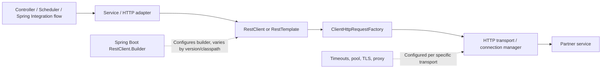
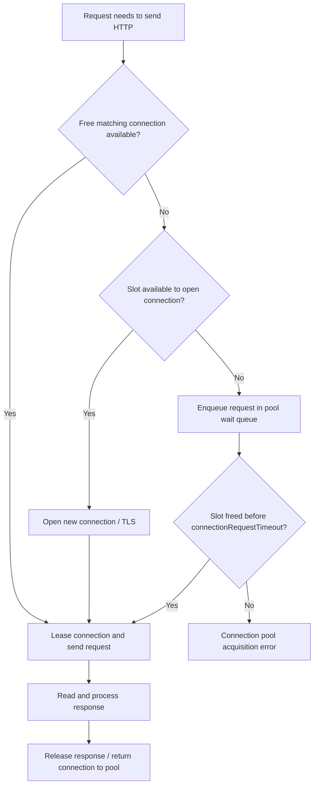

# Testing Request Factory Behavior and Connection Pool Exhaustion

## 1. The Problem in Synchronous HTTP Integration

A **Spring Boot** application makes HTTP calls to a partner service via `RestClient` or `RestTemplate`. As request volume spikes or the partner slows down, the app starts throwing timeout errors even though the target host is still up. Some requests **never even left the application**: they timed out waiting to borrow a connection from the client-side pool.

In the **SPRING_BOOT_INTEGRATION** module, the HTTP client is often just one hop in a broader flow alongside inbound APIs, databases, caches, brokers, and Spring Integration adapters. Without knowing which request factory and pooling mechanism are active, blindly raising timeouts or thread counts worsens congestion—causing failed transactions, duplicate messages, downstream overload, and blind spots in root-cause debugging.

After this lesson, you will be able to:

- Identify which `ClientHttpRequestFactory` a synchronous client actually uses and how each implementation reuses connections.
- Distinguish **waiting in the connection pool**, **TCP connect**, **waiting for a response**, and **overall deadlines**.
- Configure an Apache HttpClient 5 connection pool with total limits, per-route limits, and connection acquisition timeouts.
- Write deterministic tests reproducing pool exhaustion and contrast client-side pool failures with server HTTP statuses.
- Monitor pool stats, tune concurrency, and apply proper retries/idempotency across an integration flow.

## 2. Where Does the Request Factory Sit in the HTTP Call Chain?

For Spring's **synchronous** HTTP APIs, `ClientHttpRequestFactory` creates the low-level requests. Because a factory can wrap the JDK HTTP stack, Apache HttpClient, or another HTTP engine, **the exact same REST calling code** can behave differently in connection reuse, timeouts, and pooling.



| Common Factory / Transport | Behavior to Recognize | Testing Implications |
|---|---|---|
| `SimpleClientHttpRequestFactory` | Uses JDK `HttpURLConnection`. The JDK has internal keep-alive mechanisms, yet lacks Apache HttpClient 5's configurable pool limits and metrics APIs. | Do not expect Apache `maxConnTotal`/`maxConnPerRoute` settings to take effect. |
| `JdkClientHttpRequestFactory` | Backed by `java.net.http.HttpClient`; the JDK manages connection reuse and transport internals. | Verify timeouts, `HttpClient` sharing, and JDK observability; do not assume the JDK never reuses connections. |
| `HttpComponentsClientHttpRequestFactory` | Uses Apache HttpClient 5 in Spring Framework 6.x; pairs with `PoolingHttpClientConnectionManager` offering total/per-route limits plus leased and pending counts. | Ideal for quantitative pool-exhaustion tests and reading `leased/available/pending` stats. |
| Factories from other HTTP stacks | May wrap Jetty or custom/library transports; pool and timeout rules depend on that transport. | Check the exact implementation and docs for your library version. |

`WebClient` is a separate API typically backed by Reactor Netty with its own `ConnectionProvider`. Calling `WebClient.block()` does not turn it into an Apache `ClientHttpRequestFactory`. This lesson focuses on `RestClient`/`RestTemplate` and **classic** Apache HttpClient (HTTP/1.1), where an active request leases one connection during execution.

**Spring Boot may auto-configure the builder** and pick a default factory based on classpath, configuration, and version. Auto-detection precedence should never be treated as a fixed contract across versions. For repeatable tests and production operations, configure the factory explicitly and verify what the client actually receives.

## 3. How Does a Connection Pool Exhaust?

A connection manager allows concurrent requests to **lease** connections. Once a request finishes and its response is properly consumed and closed, eligible connections return to the pool for reuse.

Two key bounds in Apache HttpClient 5:

- **Maximum total:** total connections the pool may allocate across all routes combined.
- **Maximum per route:** maximum connections to a single route, typically identified by scheme, host, port, and proxy/routing attributes. Heavy traffic to one partner can hit the per-route ceiling even while the total pool still has capacity.



Suppose a pool is configured with `maxConnTotal=40` and `maxConnPerRoute=10`. If 30 concurrent calls hit **one route** and each holds a connection for several seconds, at most ~10 calls hold leased connections at a time; the rest queue up despite the total limit of 40.

Not every queued request fails: if a connection returns before the lease deadline expires, the waiting request proceeds normally. **Pool exhaustion** becomes a failure when wait time exceeds the limit, the thread is interrupted, or the client/pool shuts down while waiting.

Common causes:

1. Downstream responds slowly, holding connections longer than expected.
2. Traffic to one route exceeds the pool's concurrent capacity.
3. Streaming responses are never fully consumed or closed properly, causing a **connection leak**.
4. Pool acquisition timeout is unset or too long, stalling HTTP-calling threads in the queue.
5. Unbounded retries multiply concurrent attempts, amplifying load.

Never jump from `pending > 0` straight to "connection leak"; compare traffic rate, downstream latency, and connection hold durations first.

## 4. Distinguishing Four Timeout Groups

| Phase | Concept / Setting | Meaning | Failure Symptom |
|---|---|---|---|
| Waiting for a pool slot | **Connection request / acquisition timeout**, e.g., Apache HttpClient 5's `RequestConfig.setConnectionRequestTimeout(...)` | Bounds how long a request waits to lease a connection before sending. | Fails locally inside the app; downstream **never receives the request**. |
| Opening a new connection | **Connect timeout**, e.g., Apache HttpClient 5's `ConnectionConfig.setConnectTimeout(...)` | Bounds TCP connection setup; DNS/TLS details depend on transport. | Unreachable host/port, network outage, firewall drop, or server refusing connects. |
| Waiting for/reading response | **Response timeout / socket read timeout** per transport and version | Bounds waiting for response or socket reads per library semantics. | Request may already have reached downstream; client times out waiting for data. |
| Entire business workflow | **End-to-end deadline** defined by app/system | Spans queuing, connecting, HTTP exchange, deserialization, and downstream hops when enforced consistently. | HTTP hop may stay under its own timeout while the full workflow breaches its SLO. |

Never blindly add individual timeouts together and assume that sum is a strict end-to-end deadline. Each applies to a specific stage, and some repeat across redirects or retries. Always consult the documentation for your **exact Spring Framework and HTTP transport versions**.

Example: `connectionRequestTimeout=200 ms`, `connectTimeout=2 s`, and `responseTimeout=3 s`. If all 10 per-route connections stay occupied for over 200 ms, the 11th request fails **before attempting a TCP connect**. Raising `connectTimeout` from 2 to 10 seconds will do nothing to fix pool acquisition failures.

### Server HTTP Errors Differ from Client Transport Errors

- When downstream returns `HTTP 429` or `503`, that is an **HTTP response with a status code**. Under `RestClient.retrieve()`, Spring converts 4xx/5xx responses into corresponding HTTP exceptions unless customized.
- When the client fails to lease a connection from the pool, it typically throws `ResourceAccessException` wrapping the transport's I/O exception. No HTTP status arrived from downstream for that attempt.
- `ConnectException`, read timeouts, DNS/TLS errors, connection resets, and cancellations can also wrap into `ResourceAccessException`. Therefore, **never equate every `ResourceAccessException` with pool exhaustion**; inspect the root-cause chain and telemetry.

Low-level exception classes and messages can vary across Apache/JDK versions. Never build business logic by matching `getMessage()` strings.

## 5. Configuring Apache HttpClient 5 with Explicit Pooling

Example for **Spring Boot 3.2+ / Spring Framework 6.1+**, Java 17+, and a compatible Apache HttpClient 5 version. Dependencies require `spring-boot-starter-web` and `org.apache.httpcomponents.client5:httpclient5`, aligned by your project's dependency management/BOM.

```kotlin
dependencies {
    implementation("org.springframework.boot:spring-boot-starter-web")
    implementation("org.apache.httpcomponents.client5:httpclient5")
}
```

Configure a dedicated HTTP client for the payment partner so its pool bounds, timeouts, and metrics remain isolated from other clients:

```java
import org.apache.hc.client5.http.config.ConnectionConfig;
import org.apache.hc.client5.http.config.RequestConfig;
import org.apache.hc.client5.http.impl.classic.CloseableHttpClient;
import org.apache.hc.client5.http.impl.classic.HttpClients;
import org.apache.hc.client5.http.impl.io.PoolingHttpClientConnectionManager;
import org.apache.hc.client5.http.impl.io.PoolingHttpClientConnectionManagerBuilder;
import org.apache.hc.core5.util.Timeout;
import org.springframework.beans.factory.annotation.Value;
import org.springframework.context.annotation.Bean;
import org.springframework.context.annotation.Configuration;
import org.springframework.http.client.HttpComponentsClientHttpRequestFactory;
import org.springframework.web.client.RestClient;

@Configuration(proxyBeanMethods = false)
class PartnerHttpConfiguration {

    @Bean
    PoolingHttpClientConnectionManager partnerConnectionManager() {
        return PoolingHttpClientConnectionManagerBuilder.create()
                .setMaxConnTotal(40)
                .setMaxConnPerRoute(10)
                .setDefaultConnectionConfig(ConnectionConfig.custom()
                        .setConnectTimeout(Timeout.ofSeconds(2))
                        .build())
                .build();
    }

    @Bean(destroyMethod = "close")
    CloseableHttpClient partnerApacheHttpClient(
            PoolingHttpClientConnectionManager partnerConnectionManager) {
        RequestConfig requestConfig = RequestConfig.custom()
                .setConnectionRequestTimeout(Timeout.ofMilliseconds(200))
                .setResponseTimeout(Timeout.ofSeconds(3))
                .build();

        return HttpClients.custom()
                .setConnectionManager(partnerConnectionManager)
                .setDefaultRequestConfig(requestConfig)
                .build();
    }

    @Bean
    RestClient partnerRestClient(
            RestClient.Builder builder,
            CloseableHttpClient partnerApacheHttpClient,
            @Value("${partner.api.base-url}") String baseUrl) {
        return builder
                .requestFactory(new HttpComponentsClientHttpRequestFactory(
                        partnerApacheHttpClient))
                .baseUrl(baseUrl)
                .build();
    }
}
```

```yaml
partner:
  api:
    base-url: https://api.partner.example
```

**Role of each piece:**

- `RestClient.Builder` is injected from Spring Boot when supported, preserving other customizers and observation hooks. Calling `requestFactory(...)` makes the transport explicit here.
- `PoolingHttpClientConnectionManager` enforces connection bounds and exposes pool stats.
- `ConnectionConfig` sets connect timeout for new connections, while `RequestConfig` sets **pool acquisition wait** and **response timeout** in Apache HttpClient 5.
- `CloseableHttpClient` is shared across requests as a bean and closed when the Spring context shuts down; never create a new client/pool per call.
- The partner URL is externalized as a property; real deployments also manage TLS/truststores, proxies, and auth secrets per environment.

This snippet is an experimental starting point, **not universally optimal settings**. Timeout APIs also vary slightly across Apache versions; verify against your resolved dependency. For `RestTemplate`, pass the same factory to the constructor:

```java
RestTemplate restTemplate = new RestTemplate(
        new HttpComponentsClientHttpRequestFactory(partnerApacheHttpClient));
```

When integrating through a Spring Integration adapter, verify that the adapter actually uses your configured `RestTemplate`/`RestClient` rather than instantiating its own internal HTTP client.

## 6. Verifying Which Factory Is Actually Running

Investigation steps when latency rises or timeouts appear:

1. **Read bean configuration:** look for `RestClient.Builder.requestFactory(...)`, `RestTemplate.setRequestFactory(...)`, interceptor/proxy wrappers, customizers, or custom builder beans.
2. **Inspect the dependency tree:** see whether Apache HC5, JDK HTTP client, or another engine is actually on the runtime classpath. Adding a dependency can switch the default factory across Spring Boot releases.
3. **Verify at startup:** inspect Spring's auto-configuration report via `--debug` or `/actuator/conditions` (when Actuator is enabled and properly secured). The report reveals which factory/builder beans registered, though it does not replace checking the actual transport wired into a client.
4. **Pin the factory in integration tests:** configure a tiny pool and inspect `getTotalStats()`. Seeing HTTP 200 or `RestClient`'s class name alone never proves which pool is active.
5. **Verify connection reuse:** send multiple requests to the same endpoint, watch `leased/available/pending` and live TCP sockets, and check keep-alive, network behavior, proxies, and response consumption.

Avoid using reflection to peek inside private fields just to identify a factory. Explicit factory bean wiring, targeted transport integration tests, and connection manager metrics are cleaner and more reliable.

## 7. Testing to Reproduce Connection Pool Exhaustion

A meaningful test must deterministically control **when the first request holds a connection** and **when the second request tries to borrow one**. Sleeping for a fixed duration hoping threads overlap creates flaky tests.

### Experiment Design

| Element | Example Value | Purpose |
|---|---|---|
| Pool total / per route | `1 / 1` | Allows only one concurrent connection leased to the test server. |
| Connection acquisition timeout | `150 ms` | Forces the second request to fail quickly while the connection is held. |
| Response timeout | `5 s` | Gives the first request plenty of time to finish its delayed response. |
| Test server | First response delays body by `2 s` | Keeps the first connection leased after the server receives the request. |
| Test synchronization | Wait until the server receives request #1 | Guarantees request #2 fires only while connection #1 is actively held. |
| Verification | Request #2 fails with a client error while the server saw only one request before release | Separates **pool wait** from a server-returned HTTP 503. |

The JUnit 5 example below uses OkHttp's **MockWebServer** as the test server (add strictly to `test` scope using a version compatible with your project):

```java
import static org.junit.jupiter.api.Assertions.*;

import java.util.concurrent.ExecutorService;
import java.util.concurrent.Executors;
import java.util.concurrent.Future;
import java.util.concurrent.TimeUnit;

import okhttp3.mockwebserver.MockResponse;
import okhttp3.mockwebserver.MockWebServer;
import org.apache.hc.client5.http.config.RequestConfig;
import org.apache.hc.client5.http.impl.classic.CloseableHttpClient;
import org.apache.hc.client5.http.impl.classic.HttpClients;
import org.apache.hc.client5.http.impl.io.PoolingHttpClientConnectionManager;
import org.apache.hc.client5.http.impl.io.PoolingHttpClientConnectionManagerBuilder;
import org.apache.hc.core5.util.Timeout;
import org.junit.jupiter.api.Test;
import org.springframework.http.client.HttpComponentsClientHttpRequestFactory;
import org.springframework.web.client.ResourceAccessException;
import org.springframework.web.client.RestClient;

class PartnerPoolExhaustionTest {

    @Test
    void requestTimesOutWhileWaitingForPoolConnection() throws Exception {
        try (MockWebServer server = new MockWebServer()) {
            server.enqueue(new MockResponse()
                    .setBody("first-ok")
                    .setBodyDelay(2, TimeUnit.SECONDS));
            server.start();

            PoolingHttpClientConnectionManager manager =
                    PoolingHttpClientConnectionManagerBuilder.create()
                            .setMaxConnTotal(1)
                            .setMaxConnPerRoute(1)
                            .build();

            RequestConfig config = RequestConfig.custom()
                    .setConnectionRequestTimeout(Timeout.ofMilliseconds(150))
                    .setResponseTimeout(Timeout.ofSeconds(5))
                    .build();

            try (CloseableHttpClient httpClient = HttpClients.custom()
                    .setConnectionManager(manager)
                    .setDefaultRequestConfig(config)
                    .build()) {

                RestClient client = RestClient.builder()
                        .requestFactory(
                                new HttpComponentsClientHttpRequestFactory(httpClient))
                        .build();

                String url = server.url("/slow").toString();
                ExecutorService executor = Executors.newSingleThreadExecutor();
                try {
                    Future<String> first = executor.submit(() ->
                            client.get().uri(url).retrieve().body(String.class));

                    // Server received the first request; response body is still held back.
                    assertNotNull(server.takeRequest(2, TimeUnit.SECONDS));

                    // Second request targets the same route, but no pool slot is free.
                    assertThrows(ResourceAccessException.class, () ->
                            client.get().uri(url).retrieve().body(String.class));
                    assertEquals(1, server.getRequestCount());

                    // Once the first response body arrives, it completes cleanly.
                    assertEquals("first-ok", first.get(5, TimeUnit.SECONDS));
                } finally {
                    executor.shutdownNow();
                }
            }
        }
    }
}
```

This test verifies a **characteristic symptom**: `ResourceAccessException` on the second request while the server's received request count has not incremented. To prove the cause is specifically **connection lease timeout**, also inspect the exception cause chain for your HttpClient version and assert the manager's `pending`/`leased` metrics in a real suite. Otherwise, the assertion only proves an I/O failure rather than specifically pool exhaustion.

Recommended extensions for your integration test suite:

1. **Control:** increase pool size to 2 and verify both calls succeed, proving the failure was pool-bound.
2. **Latency:** drop server delay below acquisition timeout and verify the queued second request completes.
3. **Per-route:** hit two distinct hosts/routes to contrast total limits vs. per-route limits.
4. **Server error:** have the server return `503` and contrast the HTTP exception/status against local pool failure.
5. **Connection behavior:** simulate abrupt server closes, connect timeouts, and read timeouts to verify accurate classification.
6. **Resource lifetime:** fully read or close streaming responses and assert `leased` drops back to 0 afterwards.

## 8. Monitoring leased, available, pending, and max

Apache HttpClient 5 exposes `PoolingHttpClientConnectionManager.getTotalStats()` to inspect pool state. You can log stats during investigations:

```java
import org.apache.hc.core5.pool.PoolStats;

PoolStats stats = partnerConnectionManager.getTotalStats();
log.info("partner_pool leased={} available={} pending={} max={}",
        stats.getLeased(),
        stats.getAvailable(),
        stats.getPending(),
        stats.getMax());
```

| Metric | Practical Meaning | Interpretation |
|---|---|---|
| `leased` | Connections currently borrowed by active requests. | Sustained growth warrants checking latency and response hold times. |
| `available` | Idle connections in the pool eligible for reuse on matching routes. | `available > 0` globally does not guarantee a free connection for a **congested route**. |
| `pending` | Requests currently waiting to lease a connection. | Climbing alongside timeouts signals pool saturation; brief spikes can occur in bursts. |
| `max` | Configured ceiling for the queried scope. | Compare against real traffic and per-route limits, not just the global total. |

For individual partners, capture **per-route** stats where possible and export Micrometer/Actuator gauges with low-cardinality tags (e.g., `partner=billing`). Never put user IDs, tokens, or URIs with personal data into metric labels.

Monitoring the pool alone is not enough. Measure across every stage:

- **Outbound HTTP:** started requests, successes, 4xx/5xx errors, transport errors, timeout types, connection acquisition wait, and total latency.
- **Business flow:** busy threads, service/adapter queues, concurrency caps, retry rates, rejections, and end-to-end duration.
- **Downstream:** throughput, p95/p99 latency, active server connections, throttling/circuit breaker trips, rate limits, and dependent brokers/caches.

If `pending` climbs while `leased` sits at the per-route ceiling and downstream latency rises, suspect **saturation caused by slowness**. If `leased` never drops after requests finish, check for **unclosed responses** before raising pool size.

## 9. Estimating Pool Size and Controlling Load

By Little's Law, in a steady state:

\[
L \approx \lambda \times W
\]

where `L` is average concurrent active requests, `\lambda` is arrival rate (requests/second), and `W` is average resource hold duration (seconds). This estimates **average concurrency**, not a sufficient formula for p99 latency or traffic bursts.

Example: a service sends ~**50 requests/second** to one route, holding connections **200 ms** on average -> average concurrency is `50 * 0.2 = 10`. If the partner slows down to **2 seconds** at the same traffic rate, average demand jumps to `100` leased connections. A 10-slot per-route pool quickly queues up and times out.

When sizing, factor in latency distributions, traffic spikes, replica count, and downstream capacity:

- If 5 instances each allow 40 connections to the same partner, total cluster connections can reach ~200 without tighter per-route caps—potentially overwhelming the partner.
- Never inflate pools just to mask an overloaded downstream. Concurrency limits/bulkheads and bounded queues protect both sides far better when downstream capacity is fixed.
- Keep acquisition timeouts short enough to protect threads and SLOs without dropping normal micro-bursts.
- Use bounded retries with backoff and jitter only for safe operations. For side-effecting HTTP POSTs, pair idempotency keys with outcome lookup when an earlier attempt may have succeeded.

**Transaction note:** a timeout after sending a request never proves the downstream rejected it. A Spring Boot -> partner HTTP -> database/cache/broker pipeline needs explicit status reconciliation, deduplication, and handling for uncertain outcomes—especially around payments, order updates, and event publishing.

## 10. Seven-Step Incident Diagnosis Playbook

Suppose a service receives 200 concurrent HTTP requests, each calling a partner pricing API. Once the partner slows down, logs fill with "request timeout" and Spring Integration queues back up.

| Step | What to Check | Signals and Decisions |
|---|---|---|
| 1. Locate the client | Confirm which `RestClient`/`RestTemplate` bean and factory the adapter uses. | If the client actually uses JDK transport, Apache pool metrics/settings do not apply here. |
| 2. Classify errors | Separate HTTP 429/503, acquisition timeout, connect timeout, response timeout, TLS, and DNS. | Never lump everything under "server down". |
| 3. Measure the pool | Inspect `leased/available/pending/max` and per-route stats. | `leased ≈ maxPerRoute`, rising `pending`, and server receiving fewer requests than initiated -> pool wait bottleneck. |
| 4. Measure downstream | Check p50/p95/p99 latency, RPS, rate limits, timeouts, and resets. | Distinguish traffic spikes from slow downstream processing. |
| 5. Audit responses | Ensure streams/responses close properly and are not held across slow tasks. | High `leased` remaining after callers finish points to a leak. |
| 6. Shed load | Apply bulkheads, bounded queues, backpressure, and right-sized timeouts; align per-instance pools with partner quotas. | Break retry loops and protect app resources. |
| 7. Re-verify | Load-test at target throughput and simulate slow/failing downstreams. | Confirm error budgets, latency SLOs, pending counts, and actual downstream request rate. |

During incidents, prioritize verified metrics for **requests reaching the server**, **requests waiting in the pool**, **leased connections**, and **per-hop latency**. Looking at one stack trace or one successful `curl` is never conclusive.

## 11. Common Implementation Mistakes

| Anti-Pattern | Why It Breaks | Fix |
|---|---|---|
| Creating `RestClient`/Apache clients per method call | Prevents pool sharing; wastes TCP/TLS handshakes and leaks resources. | Register a singleton bean per downstream or policy group. |
| Setting response timeout while omitting acquisition timeout | Threads stall indefinitely waiting on an exhausted pool. | Configure an explicit lease wait timeout and overall flow deadline. |
| Raising `maxConnTotal` while leaving `maxConnPerRoute` low | A single busy partner still bottlenecks at the per-route cap. | Monitor per-route stats and size deliberately. |
| Treating every `ResourceAccessException` as pool exhaustion | Masks DNS, TLS, connect timeouts, response timeouts, and network drops. | Inspect root-cause chains and transport metrics. |
| Returning a response stream outside a callback unclosed | Leaves connections leased, draining pool capacity. | Consume/close responses in scope; use try-with-resources where required. |
| Increasing concurrent retries when downstream slows | Amplifies request counts, queues, and timeouts. | Enforce bounded retries, jitter, circuit breakers/bulkheads, and idempotency. |
| Verifying factory behavior only locally with different dependencies | Production may resolve a different factory or pooling behavior. | Pin dependencies, configure factories explicitly, and test with deployment profiles. |
| Confusing HTTP/1.1 pool exhaustion with HTTP/2 multiplexing | Misjudges request-to-connection concurrency ratios. | Verify the active protocol, transport, and multiplexing behavior. |

## 12. Testing and Operations Checklist

- [ ] Do you know exactly which client sends HTTP in each adapter and which `ClientHttpRequestFactory`/transport is active?
- [ ] Have you audited the classpath, Spring Boot/Framework/Apache HttpClient versions, and custom beans?
- [ ] Are total and per-route pool limits aligned with per-instance traffic and downstream capacity?
- [ ] Are acquisition, connect, response/read timeouts, and business deadlines explicitly defined and documented?
- [ ] Does a deterministic test reproduce a `1/1` pool holding one connection so the next request fails on lease timeout?
- [ ] Does a control test prove raising pool size or lowering delay resolves the failure?
- [ ] Are server HTTP statuses distinguished from client I/O exceptions—especially acquisition timeout vs. connect/response timeout?
- [ ] Are streaming responses guaranteed to close, and do pools shut down cleanly with the application?
- [ ] Are `leased/available/pending/max`, p95/p99 latency, timeout breakdowns, concurrency, retries, and integration backlogs monitored?
- [ ] Are bounded retries/idempotency and backpressure enforced, with uncertain outcomes reconciled after client timeouts?

**Remember:** when a connection pool exhausts, failures can occur **before a request ever leaves Spring Boot**. Pinpointing the root cause requires knowing the active request factory, measuring lease waits and pool stats, and reproducing the failure under controlled tests. Pool and timeout tuning only works alongside load shedding, proper error handling, and end-to-end observability across the integration pipeline.
