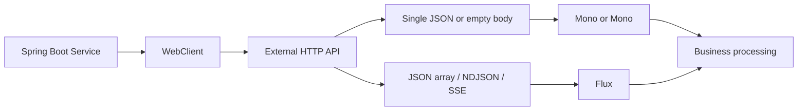
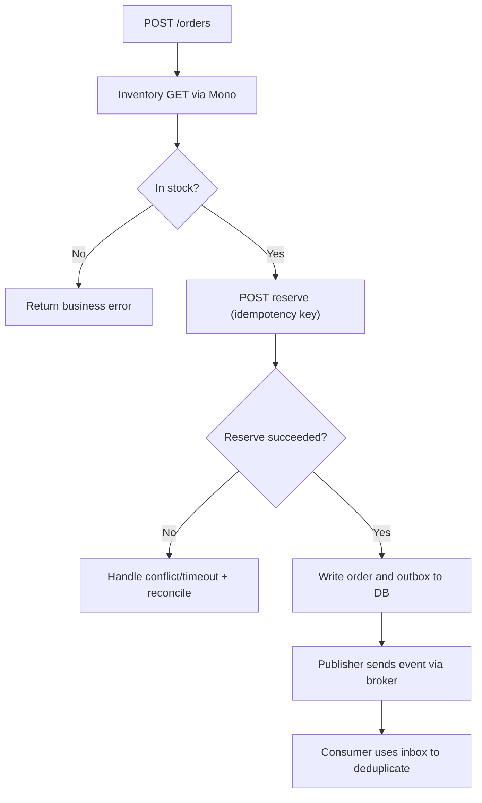

# Sending and Receiving Data with Mono or Flux

## 1. WebClient and Asynchronous Data Exchange

In the **SPRING_BOOT_INTEGRATION** module, a Spring Boot application exchanges data with HTTP APIs, databases, caches, message brokers, and Spring Integration adapters. For outbound HTTP communication, `WebClient` is Spring WebFlux's HTTP client offering a declarative API and asynchronous processing built on **Project Reactor**. The two most common result types are `Mono<T>` and `Flux<T>`.

Imagine an Order Service that needs to call an Inventory API before confirming an order:

- `GET /inventory/{sku}` returns a single inventory record → use `Mono<InventoryResponse>`.
- `GET /inventory/changes` continuously emits inventory changes → use `Flux<InventoryChange>`.
- `POST /reservations` sends a reservation request and returns one result → send one DTO and receive `Mono<ReservationResponse>`.
- `POST /inventory/bulk` accepts a stream of update events → can send `Flux<InventoryUpdate>` **if the server accepts request streaming**.



Importantly, `WebClient` builds **a pipeline describing work**. For a typical call, network I/O happens when that pipeline is subscribed to; merely creating a `Mono`/`Flux` object does not mean the request has been sent. `WebClient` enables non-blocking integration when used inside a truly reactive flow, but it does not automatically make JDBC calls or blocking libraries in other steps non-blocking.

This lesson focuses on **sending and receiving data with `Mono` or `Flux`**: choosing response types, building request bodies, decoding responses, streaming data, composing operations, error handling, timeouts, retries, testing, and observing real integration flows. Examples use Spring Boot 3.x / Spring Framework 6 and Reactor 3.x; when using other versions, verify the corresponding APIs and dependencies.

## 2. Distinguishing Mono and Flux by Element Count

In Reactor, `Mono<T>` and `Flux<T>` implement Reactive Streams `Publisher<T>`. They emit **onNext** (element), **onComplete** (completion), or **onError** (error) signals.

| Aspect | `Mono<T>` | `Flux<T>` |
| --- | --- | --- |
| Number of `onNext` elements | 0 or 1 | 0 to many |
| Examples | A product, token, order creation result, empty response body | Lists, event streams, continuously pushed records |
| When no data is emitted | `Mono.empty()` | `Flux.empty()` |
| On error | Emits `onError` | Emits `onError` |
| Successful completion | `onComplete` after 0 or 1 element | `onComplete` after all elements, or never completes for infinite streams |
| Per-element processing | `map`, `flatMap` | `map`, `flatMap`, `concatMap`, `filter`, `buffer` |

`Mono<Void>` represents **completion or failure without emitting a value** (for example, an HTTP call returning 204). `Flux<T>` does not necessarily contain many elements; a single-element stream can still be a `Flux`. The criterion for choosing the type is **the data source's contract**, not the number of elements that happen to arrive today.

### 2.1. Publisher Type Does Not Dictate How Data Travels Over the Network

`Flux<Product>` can be produced from a **JSON array** returned in a single short HTTP response; it can also read **NDJSON**, **Server-Sent Events (SSE)**, or long-lived data streams. Merely writing `bodyToFlux(Product.class)` **does not turn a JSON array API into a real-time event stream**.

Whether elements are decoded and emitted incrementally depends on content type, encoders/decoders, how the server flushes data, proxy buffering, and endpoint semantics. For large responses, verify codec memory limits and real network behavior.

### 2.2. Cold Publishers and When the Request Runs

`WebClient` typically returns a **cold publisher**: each new subscription can trigger **a new HTTP exchange**.

```java
Mono<InventoryResponse> query =
    webClient.get()
        .uri("/inventory/{sku}", "sku-123")
        .retrieve()
        .bodyToMono(InventoryResponse.class);

// No terminal operation or subscriber here yet.
```

In a WebFlux controller, Spring subscribes to the returned publisher. In a test, `StepVerifier` subscribes. In an imperative application, `block()` can subscribe and wait for the result, though blocking boundaries must be weighed carefully. Never call `subscribe()` arbitrarily inside a service and return success immediately, because errors become detached from the business flow and hard to trace.

## 3. Dependencies and WebClient Configuration

In a Spring Boot 3.x application using `WebClient`, add:

```xml
<dependency>
    <groupId>org.springframework.boot</groupId>
    <artifactId>spring-boot-starter-webflux</artifactId>
</dependency>
```

The starter provides WebFlux/`WebClient` APIs and the required dependencies per the BOM; when using Netty in standard setups, the client can operate non-blockingly. **Adding `spring-boot-starter-webflux` to a Spring MVC application does not automatically convert the entire server to WebFlux**; the application can still use `WebClient` as an HTTP client inside MVC.

Spring Boot typically auto-configures `WebClient.Builder` for declaring clients. Create a dedicated client for the Inventory API with consistent base URL and headers:

```yaml
inventory:
  api:
    base-url: ${INVENTORY_API_URL:http://localhost:8081}
```

```java
import org.springframework.beans.factory.annotation.Value;
import org.springframework.context.annotation.Bean;
import org.springframework.context.annotation.Configuration;
import org.springframework.http.HttpHeaders;
import org.springframework.http.MediaType;
import org.springframework.web.reactive.function.client.WebClient;

@Configuration
public class InventoryWebClientConfig {

    @Bean
    WebClient inventoryWebClient(
            WebClient.Builder builder,
            @Value("${inventory.api.base-url}") String baseUrl) {

        return builder
            .baseUrl(baseUrl)
            .defaultHeader(
                HttpHeaders.ACCEPT,
                MediaType.APPLICATION_JSON_VALUE
            )
            .build();
    }
}
```

A built `WebClient` is meant for reuse; do not call `WebClient.create(...)` per request. If there are multiple upstreams, give beans clear names and configure hostname, timeouts, authentication, and quotas separately; use `@Qualifier` when injecting.

In real environments, configure HTTPS, certificate validation, identity/credentials, and DNS/service discovery according to your infrastructure. Never place real API keys or tokens in source code or logs. Examples use hypothetical internal endpoints to focus on the HTTP contract.

## 4. Receiving a Single Response: GET and bodyToMono

Define a DTO matching the fields promised by the Inventory API:

```java
public record InventoryResponse(
    String sku,
    Integer availableQuantity,
    java.time.OffsetDateTime updatedAt
) {}
```

Using `Integer` instead of primitive `int` lets the application **distinguish a missing/null field from a valid value of 0**; still, validate completeness and bounds at the integration boundary.

```java
import org.springframework.beans.factory.annotation.Qualifier;
import org.springframework.stereotype.Service;
import org.springframework.web.reactive.function.client.WebClient;
import reactor.core.publisher.Mono;

@Service
public class InventoryClient {

    private final WebClient webClient;

    public InventoryClient(
            @Qualifier("inventoryWebClient") WebClient webClient) {
        this.webClient = webClient;
    }

    public Mono<InventoryResponse> getInventory(String sku) {
        return webClient.get()
            .uri("/api/v1/inventory/{sku}", sku)
            .retrieve()
            .bodyToMono(InventoryResponse.class);
    }
}
```

What each step means:

1. `get()` selects the HTTP method.
2. `uri(...)` builds the URL from a template and properly encodes path variables; avoid concatenating raw user-supplied strings into URLs.
3. `retrieve()` returns a `ResponseSpec` with standard response handling.
4. `bodyToMono(InventoryResponse.class)` decodes the body using the `HttpMessageReader`/codec matching the content type, then emits at most one DTO.

For a valid JSON response:

```json
{
  "sku": "sku-123",
  "availableQuantity": 18,
  "updatedAt": "2026-11-21T02:30:00Z"
}
```

The publisher emits the DTO and completes. If a successful response has no body (for example 204), `bodyToMono(InventoryResponse.class)` can complete empty; it **does not synthesize a DTO with null fields** in place of an empty body. When a 200 response is required to have a body, explicitly check for missing data:

```java
return webClient.get()
    .uri("/api/v1/inventory/{sku}", sku)
    .retrieve()
    .bodyToMono(InventoryResponse.class)
    .switchIfEmpty(Mono.error(
        new IllegalStateException("Inventory API returned empty body")
    ));
```

`switchIfEmpty` handles **empty results**, whereas HTTP/JSON/network failures follow the `onError` branch. After decoding, you can `map` and validate the DTO before passing it to business logic.

## 5. Receiving Multiple Elements: GET and bodyToFlux

An API may return a JSON array:

```json
[
  { "sku": "sku-123", "availableQuantity": 18 },
  { "sku": "sku-124", "availableQuantity": 0 }
]
```

Use `Flux` for multiple items:

```java
public record StockSummary(String sku, Integer availableQuantity) {}

public Flux<StockSummary> listStock() {
    return webClient.get()
        .uri("/api/v1/inventory")
        .retrieve()
        .bodyToFlux(StockSummary.class);
}
```

Common transformations:

```java
Flux<StockSummary> available =
    listStock()
        .filter(item -> item.availableQuantity() != null)
        .filter(item -> item.availableQuantity() > 0)
        .map(item -> new StockSummary(
            item.sku(),
            item.availableQuantity()
        ));
```

Note that client-side `filter`/`map` **does not replace** server-side filtering or pagination when datasets are very large; pulling an entire inventory dataset to the client just to filter increases bandwidth, CPU, and memory. If the endpoint supports cursors/pages, use the pagination contract instead of assuming one response holds everything.

Important conversion operators to understand:

| Operator | Result | Use Case |
| --- | --- | --- |
| `flux.collectList()` | `Mono<List<T>>` | Need the entire list in a subsequent step |
| `flux.next()` | `Mono<T>` | Take only the first item; remaining items are cancelled via subscription |
| `flux.count()` | `Mono<Long>` | Count how many items the publisher emitted |
| `mono.flux()` | `Flux<T>` | Convert a 0–1 element publisher into a `Flux` |
| `flux.flatMap(fn)` | `Flux<R>` | Concurrent async processing; completion order may differ |
| `flux.concatMap(fn)` | `Flux<R>` | Serialize inner publishers to preserve processing order |

`collectList()` must retain elements in memory until the stream completes; never use it on infinite streams or huge datasets without bounds. `next()` may cause the client not to read the entire response; verify endpoint contracts and how the upstream handles cancellation.

## 6. Sending a Single DTO: POST with bodyValue or body(Mono)

Suppose Inventory supports reserving stock via:

```java
public record ReserveRequest(String orderId, String sku, int quantity) {}
public record ReserveResponse(String reservationId, String status) {}
```

### 6.1. Ready DTO: bodyValue

```java
public Mono<ReserveResponse> reserve(ReserveRequest request) {
    return webClient.post()
        .uri("/api/v1/reservations")
        .contentType(MediaType.APPLICATION_JSON)
        .accept(MediaType.APPLICATION_JSON)
        .bodyValue(request)
        .retrieve()
        .bodyToMono(ReserveResponse.class);
}
```

`bodyValue(request)` fits when you already have a concrete DTO instance and let the codec serialize it to JSON. `bodyValue` **is not used to pass a `Mono` or `Flux` as the body content**; for publishers, use `body(Publisher, Class)` or an appropriate `BodyInserter`.

### 6.2. Asynchronously Produced DTO: body(Mono, Class)

If the request payload comes from a `Mono<ReserveRequest>`, you can write:

```java
public Mono<ReserveResponse> reserveLater(
        Mono<ReserveRequest> requestMono) {

    return webClient.post()
        .uri("/api/v1/reservations")
        .contentType(MediaType.APPLICATION_JSON)
        .body(requestMono, ReserveRequest.class)
        .retrieve()
        .bodyToMono(ReserveResponse.class);
}
```

`WebClient` subscribes to the body publisher during request execution and encodes the data via the codec. If the request source errors, the error signal propagates through the pipeline; understand how much of the request the server may already have received before deciding to retry, especially for operations with side effects.

**Do not do this:**

```java
// Wrong semantics: Mono is a Publisher, not the JSON DTO to send.
// .bodyValue(Mono.just(request))
```

Even though the client accepts a publisher, the server contract still determines whether the body is a single JSON object, JSON array, NDJSON, or another content type. `Mono` and `Flux` are Java stream abstractions, **not an HTTP wire format**.

### 6.3. When POST Returns No Body

If the provider returns `204 No Content`:

```java
public Mono<Void> notifyProcessed(String orderId) {
    return webClient.post()
        .uri("/api/v1/orders/{id}/processed", orderId)
        .retrieve()
        .bodyToMono(Void.class);
}
```

A successful outcome completes without emitting a value. `Mono<Void>` carries no status payload; if you need to distinguish `201` from `204` or read the `Location` header, use `toEntity(...)` or `exchangeToMono(...)` to inspect status and headers.

**Business warning:** `POST` is not idempotent by default. A client timeout does not prove the server failed to create the reservation. If retries are needed, agree with the provider on an `Idempotency-Key` or event/request ID and duplicate-handling behavior.

## 7. Sending Multiple Elements with Flux: Request Streaming and Batching

When sending multiple updates, distinguish two HTTP contracts:

1. **JSON array batch:** The API accepts one complete JSON array. Build a `List<InventoryUpdate>` and use `bodyValue(list)`. Suitable for bounded batches.
2. **Streaming request:** The API accepts multiple records as NDJSON or another streaming encoding. Pass `Flux<InventoryUpdate>` as the request body with a media type supported by **both client and server**.

NDJSON client example:

```java
import org.springframework.http.MediaType;
import reactor.core.publisher.Flux;
import reactor.core.publisher.Mono;

public record InventoryUpdate(String sku, int delta) {}

public Mono<Void> sendUpdates(Flux<InventoryUpdate> updates) {
    return webClient.post()
        .uri("/api/v1/inventory/updates-stream")
        .contentType(MediaType.APPLICATION_NDJSON)
        .body(updates, InventoryUpdate.class)
        .retrieve()
        .bodyToMono(Void.class);
}
```

This assumes the server exposes `application/x-ndjson`: each JSON record sits on one line and is processed in a streaming-compatible way. You cannot turn an API that only accepts `List<InventoryUpdate>` into a streaming endpoint merely by passing a `Flux`.

**Backpressure:** Reactive Streams lets a subscriber request data based on demand. However, end-to-end load throttling across the full path (client encoder → HTTP/TCP → gateway → server decoder → DB) depends on implementations, buffer limits, TCP, and upstream behavior. `Flux` does not automatically protect a server or broker from overload. Bound batch item counts, payload sizes, and concurrent requests.

If you need to send multiple **independent HTTP requests** concurrently:

```java
Flux<ReserveResponse> responses =
    Flux.fromIterable(requests)
        .flatMap(this::reserve, 8); // at most 8 concurrent inner subscriptions
```

`flatMap` can emit results **out of request order**. If sequential execution is required, use `concatMap(this::reserve)`. A `Flux` of 100 DTOs passed into `body(...)` is **one request with a streamed body**; a `Flux` with `flatMap(this::reserve)` is **multiple HTTP requests**. Distinguish these two models carefully when calculating quotas and idempotency.

## 8. Receiving Continuous Data: NDJSON and Server-Sent Events

### 8.1. NDJSON – Sequential JSON Objects

An endpoint may return headers:

```http
HTTP/1.1 200 OK
Content-Type: application/x-ndjson

{"sku":"sku-123","delta":3}
{"sku":"sku-124","delta":-1}
```

Client:

```java
public Flux<InventoryUpdate> watchUpdates() {
    return webClient.get()
        .uri("/api/v1/inventory/changes")
        .accept(MediaType.APPLICATION_NDJSON)
        .retrieve()
        .bodyToFlux(InventoryUpdate.class);
}
```

With streaming, the decoder can emit items as bytes arrive. If the server buffers the entire response or a proxy only flushes after a long delay, observed latency remains high. For unbounded streams, avoid `collectList()` and design subscription cancellation.

### 8.2. Server-Sent Events – SSE

SSE is an HTTP response with media type `text/event-stream`; each event can carry `id`, `event`, `data`, and other SSE fields. With Spring `WebClient`, you can read only the payload:

```java
public Flux<OrderEvent> streamOrderEvents() {
    return webClient.get()
        .uri("/api/v1/orders/events")
        .accept(MediaType.TEXT_EVENT_STREAM)
        .retrieve()
        .bodyToFlux(OrderEvent.class);
}
```

If SSE metadata is needed:

```java
import org.springframework.core.ParameterizedTypeReference;
import org.springframework.http.codec.ServerSentEvent;

public Flux<ServerSentEvent<OrderEvent>> streamWithMetadata() {
    return webClient.get()
        .uri("/api/v1/orders/events")
        .accept(MediaType.TEXT_EVENT_STREAM)
        .retrieve()
        .bodyToFlux(
            new ParameterizedTypeReference<ServerSentEvent<OrderEvent>>() {}
        );
}
```

`OrderEvent` is a DTO defined by your application according to the server contract. Do not assume SSE always supports resume/replay: `Last-Event-ID` and replay depend on whether the server emits `id`, stores events, and handles reconnects.

### 8.3. Governing Stream Lifecycle

For long-lived streams, specify:

- When to subscribe and who owns the subscription (controller HTTP response, service worker, long-running job).
- When to cancel (client disconnect, application shutdown, consumer no longer interested).
- Which timeout applies to **connection establishment**, **idle time between events**, or **overall lifecycle**. `timeout(Duration.ofSeconds(10))` on a stream can proactively terminate it if no signal arrives within that window.
- Whether reconnect retries need an offset/last-event ID to resume, and whether data could be lost or duplicated on reconnect.
- How buffers and concurrent streams are bounded.

If the backend emits indefinitely while a controller serves per-session users, calling `subscribe()` manually inside a service without lifecycle management can leak connections.

## 9. Reading Generic JSON, Headers, and Status

`Class<T>` does not preserve full runtime generic type information. When the response is a generic wrapper, use `ParameterizedTypeReference`:

```java
import org.springframework.core.ParameterizedTypeReference;
import reactor.core.publisher.Mono;

public record PageResponse<T>(
    java.util.List<T> items,
    String nextCursor
) {}

public Mono<PageResponse<StockSummary>> getPage() {
    return webClient.get()
        .uri("/api/v1/inventory?pageSize=50")
        .retrieve()
        .bodyToMono(
            new ParameterizedTypeReference<PageResponse<StockSummary>>() {}
        );
}
```

For paginated APIs, validate `nextCursor` against the contract. One `PageResponse<List<T>>` page is not an infinite stream; if paging in a loop, guard against repeating cursors and cap the maximum number of requests.

If status or headers are needed alongside the body:

```java
Mono<org.springframework.http.ResponseEntity<InventoryResponse>> result =
    webClient.get()
        .uri("/api/v1/inventory/{sku}", "sku-123")
        .retrieve()
        .toEntity(InventoryResponse.class);
```

`toEntity(...)` is useful for `ETag`, `Retry-After`, `Location`, or distinguishing `200` from `204`. By default, `retrieve()` turns HTTP 4xx/5xx into an error signal; code reading bodies must still have an error-handling strategy.

### 9.1. Deliberately Mapping 404 to Empty

For an API whose contract defines "SKU not found" as an absent result, you can use `exchangeToMono`:

```java
public Mono<InventoryResponse> findInventory(String sku) {
    return webClient.get()
        .uri("/api/v1/inventory/{sku}", sku)
        .exchangeToMono(response -> {
            if (response.statusCode().value() == 404) {
                return Mono.empty();
            }
            if (response.statusCode().is2xxSuccessful()) {
                return response.bodyToMono(InventoryResponse.class);
            }
            return response.createException()
                .flatMap(Mono::error);
        });
}
```

`exchangeToMono` lets you handle responses per status; avoid assuming all non-2xx responses share the same body format. Here 404 is **intentionally** mapped to empty; if 404 actually indicates a misconfigured route, do not hide it. After the callback completes, `WebClient` manages releasing any unconsumed response body per API design; do not retain the `ClientResponse` reference for use outside the callback.

Similarly, `exchangeToFlux` is used when consuming a streaming body with per-status branching. Avoid the legacy `exchange()` method whenever `retrieve()` or `exchangeToMono/Flux` can be used.

## 10. Error Handling: HTTP Status, Decoding, and Network Failures Are Distinct

A publisher can fail before receiving a response (DNS, TLS, connection refused), after receiving a 4xx/5xx status, or while decoding the body. Consequently, an overly broad `onErrorResume` can mask misconfigurations and corrupt data.

### 10.1. retrieve() Default Handling for 4xx/5xx

When `retrieve()` encounters HTTP 4xx/5xx, it defaults to emitting a `WebClientResponseException` (or subclass), carrying status and response details. Use `onStatus` to map a provider-specific error body:

```java
public record ApiError(String code, String message) {}

public Mono<ReserveResponse> reserveWithError(ReserveRequest request) {
    return webClient.post()
        .uri("/api/v1/reservations")
        .bodyValue(request)
        .retrieve()
        .onStatus(
            status -> status.value() == 409,
            response -> response.bodyToMono(ApiError.class)
                .defaultIfEmpty(new ApiError(
                    "CONFLICT", "Reservation conflicts with current stock"
                ))
                .map(error -> new InventoryConflictException(error.code()))
        )
        .bodyToMono(ReserveResponse.class);
}
```

`InventoryConflictException` here is a custom application exception, for example:

```java
public class InventoryConflictException extends RuntimeException {
    public InventoryConflictException(String code) {
        super("Inventory conflict: " + code);
    }
}
```

Note that `onStatus` takes a function returning **`Mono<? extends Throwable>`**, rather than handling status by throwing elsewhere. Without custom mappings, non-2xx responses emit `WebClientResponseException`. Define clearly which errors are retryable and which are valid business outcomes.

### 10.2. Practical Error Classification

| Category | Examples | Rule |
| --- | --- | --- |
| 400/422 | Request body violates schema or invalid parameters | Fix request/contract; usually do not retry |
| 401/403 | Invalid credentials, expired token, missing permissions | Check auth/token refresh per policy; avoid infinite loops |
| 404 | Resource does not exist | Can return `Mono.empty()` if contract specifies; do not swallow every 404 |
| 409 | Business state conflict | Map domain error; consider state reconciliation |
| 429 | Rate limit | Retry with backoff per `Retry-After` if contract allows |
| 500/502/503/504 | Temporary downstream error | Bounded retry when operation is idempotent |
| DNS/TLS/connection timeout | Network/transport failure | Log category, inspect infrastructure; controlled retry |
| JSON decode/schema | Provider unexpectedly changed fields/types | Report contract mismatch; do not fall back to fabricated data |
| Client cancellation | Upstream no longer consuming | Release resources cleanly; distinguish from server errors |

### 10.3. Conditional Fallback

For example, allowing stale cache **only when the Inventory service is temporarily unreachable**:

```java
public Mono<InventoryResponse> getWithFallback(String sku) {
    return getInventory(sku)
        .onErrorResume(
            ex -> ex instanceof org.springframework.web.reactive
                .function.client.WebClientRequestException,
            ex -> readStaleCache(sku)
        );
}
```

`readStaleCache` is an illustrative application-implemented method returning `Mono<InventoryResponse>`. Do not fall back on JSON, auth, or 409 errors if doing so feeds wrong data to the system. For critical operations like stock reservation, returning stale stock without reconciliation can cause overselling.

## 11. Timeouts, Retries, and Idempotency

### 11.1. Timeouts on Publishers

Applying a call-level deadline:

```java
public Mono<InventoryResponse> getWithDeadline(String sku) {
    return getInventory(sku)
        .timeout(java.time.Duration.ofSeconds(3));
}
```

`timeout` enforces a time limit at the reactive publisher layer, distinct from HTTP client connect or response timeouts. On a `Flux` stream, `timeout` can apply between signals; a quiet SSE stream might be cancelled unintentionally. When designing SLAs, account for DNS, TCP/TLS handshake, connection pool wait, response/first byte, read idle, and overall deadline.

You can configure a Reactor Netty `HttpClient` with `ReactorClientHttpConnector` when transport-level control is needed:

```java
import java.time.Duration;

import io.netty.channel.ChannelOption;
import reactor.netty.http.client.HttpClient;
import org.springframework.http.client.reactive.ReactorClientHttpConnector;
import org.springframework.web.reactive.function.client.WebClient;

HttpClient httpClient = HttpClient.create()
    .option(ChannelOption.CONNECT_TIMEOUT_MILLIS, 2000)
    .responseTimeout(Duration.ofSeconds(5));

WebClient configured = WebClient.builder()
    .baseUrl("https://inventory.example.org")
    .clientConnector(new ReactorClientHttpConnector(httpClient))
    .build();
```

This snippet assumes the project uses Reactor Netty; when building a `WebClient` from Boot's auto-configured builder, take care to preserve customizers, metrics/observations, codecs, and SSL settings configured by your environment. Do not set an overly short response timeout on SSE or large download endpoints without accounting for streaming semantics.

### 11.2. Retry Only When Safe

Example retrying up to two times on a safely repeatable `GET` when receiving 503:

```java
import java.time.Duration;
import reactor.util.retry.Retry;
import org.springframework.web.reactive.function.client.WebClientResponseException;

public Mono<InventoryResponse> retryableRead(String sku) {
    return getInventory(sku)
        .retryWhen(
            Retry.backoff(2, Duration.ofMillis(200))
                .filter(ex ->
                    ex instanceof WebClientResponseException responseEx
                    && responseEx.getStatusCode().value() == 503
                )
        );
}
```

`Retry.backoff(2, ...)` means up to **two retries after the initial attempt**, not two attempts total. Use controlled backoff, jitter, circuit breakers, and rate limiting to avoid retry storms when a downstream service struggles. Retries replay the request from the start; when using a `Flux` as a request body, the publisher must support safe replay or recreation.

For `POST /reservations`, retrying after a timeout can create two reservations if the server processed the first attempt. To retry safely, establish a clear idempotency contract: a stable idempotency key, identical request body, retention window, and handling of in-flight concurrent requests.

## 12. Composing Mono and Flux in Business Flows

Reactive composition keeps results and errors flowing cleanly through the pipeline.

### 12.1. Read Inventory Then Create Reservation

```java
public Mono<ReserveResponse> reserveIfAvailable(
        String orderId, String sku, int quantity) {

    return getInventory(sku)
        .switchIfEmpty(Mono.error(
            new IllegalStateException("SKU not found")
        ))
        .flatMap(stock -> {
            if (stock.availableQuantity() == null
                    || stock.availableQuantity() < quantity) {
                return Mono.error(
                    new IllegalStateException("Insufficient stock")
                );
            }
            return reserve(new ReserveRequest(orderId, sku, quantity));
        });
}
```

This is an **orchestration example**; it does not guarantee atomicity between checking stock and reserving it. While two requests run concurrently, available stock may change. The Inventory Service itself must verify and reserve stock **atomically** in its reservation endpoint. If this step also writes to a database or publishes messages, design transactions/outbox and idempotency separately.

### 12.2. Two Independent Calls: zip

When both stock and product price are needed:

```java
Mono<InventoryResponse> stockMono = getInventory("sku-123");
Mono<PriceResponse> priceMono = getPrice("sku-123");

Mono<OrderPreview> preview =
    Mono.zip(stockMono, priceMono)
        .map(tuple -> new OrderPreview(
            tuple.getT1(), tuple.getT2()
        ));
```

`PriceResponse`, `OrderPreview`, and `getPrice` are hypothetical application types/methods. `zip` emits a result only when each publisher emits **a value**; if one source emits `Mono.empty()`, `zip` completes empty. If one source errors, the error propagates and the other source may be cancelled. For optional data, explicitly define defaults or `switchIfEmpty`.

### 12.3. Multiple SKUs with Bounded Concurrency

```java
public Flux<InventoryResponse> loadInventory(
        java.util.List<String> skus) {

    return Flux.fromIterable(skus)
        .flatMap(this::getInventory, 8);
}
```

`flatMap(..., 8)` caps concurrent inner subscriptions; still consider connection pool size, upstream rate limits, and total requests. If SKU order is part of the contract, use `flatMapSequential(...)` or `concatMap(...)` depending on concurrency vs. ordering requirements. Never run long blocking tasks inside `map`/`flatMap` on the event loop.

### 12.4. Bridging from Reactive to Blocking

In an imperative Spring MVC application, you may need synchronous data at a boundary layer:

```java
InventoryResponse stock = getInventory("sku-123")
    .block(java.time.Duration.ofSeconds(3));
```

This is a **blocking boundary** that must be explicitly placed, given a timeout, and never called from a Reactor Netty event-loop thread or WebFlux request handler. If a WebFlux controller returns `Mono<InventoryResponse>`, return the publisher directly and let Spring manage subscription and lifecycle. Mixing `block()` indiscriminately inside reactive chains causes thread starvation and runtime errors.

## 13. Transactions, Security, and Integration Risks

### 13.1. Transactions Across HTTP and Databases

Calling an external API with `WebClient` does not automatically participate in a local database `@Transactional` boundary. For example, if Order Service commits an order and then the Inventory API call fails, the two systems can drift out of sync.

Strategies to choose based on business needs:

- Orchestrating a saga with compensating actions when reservation/ordering fails.
- Transactional outbox when events must be reliably published after DB commit.
- Idempotency keys for HTTP side effects and consumer inboxes for asynchronous messages.
- Reconciliation jobs to resolve uncertain outcomes after timeouts or retries.

**Never assume `WebClient` or `Mono`/`Flux` provides distributed transactions or exactly-once delivery.** A client-side timeout does not mean the server skipped the operation.

### 13.2. Data Contracts and Payload Limits

- Agree on `Content-Type`, `Accept`, status codes, JSON schema, required/nullable fields, timestamps, currency/quantity units, and contract versions.
- Bound payload sizes and stream item counts; manage codec memory (`maxInMemorySize`) when receiving large JSON payloads.
- Never use `collectList()` on infinite streams. For large files, consider `DataBuffer`/streaming downloads and proper buffer release.
- For query/path variables containing user input, use URI builders/templates to escape and validate rather than manual string concatenation.
- Avoid putting tokens/API keys, cookies, PII, or sensitive raw bodies in logs and tracing tags.

### 13.3. Transport and Authentication

When `WebClient` calls external services, ensure proper TLS, timeouts, DNS, credential rotation, proxies if required, and access controls. For OAuth2 Bearer tokens or mTLS, use centrally managed filters/configurations. Enforce request concurrency limits and add circuit breakers/bulkheads if downstreams overload easily.

If using an `ExchangeFilterFunction` for logging, do not read and discard the response body without reconstructing it for the downstream subscriber; misreading the body in a filter leaves handlers with nothing to decode. Prefer client-level metrics/status/timing instrumentation and redact sensitive fields.

## 14. Testing Mono/Flux and HTTP Transport

### 14.1. Testing Pipelines with StepVerifier

Add the `reactor-test` test dependency (typically managed by Spring Boot test configuration) and use `StepVerifier` to assert elements, completion, and errors:

```java
import static org.assertj.core.api.Assertions.assertThat;

import org.junit.jupiter.api.Test;
import reactor.core.publisher.Flux;
import reactor.test.StepVerifier;

class InventoryStreamTest {

    @Test
    void filtersAvailableItems() {
        Flux<StockSummary> result = Flux.just(
                new StockSummary("sku-1", 8),
                new StockSummary("sku-2", 0)
            )
            .filter(item -> item.availableQuantity() > 0);

        StepVerifier.create(result)
            .assertNext(item -> assertThat(item.sku()).isEqualTo("sku-1"))
            .verifyComplete();
    }
}
```

This test only verifies publisher transformations; **it does not test `WebClient` encoding/decoding or networking**. For time-based operators (`delayElements`, backoff), use virtual time when appropriate to keep tests fast; verify the exact chain and schedulers before assuming time can be virtualized.

### 14.2. Testing Real HTTP with a Mock Server

Mocking `ExchangeFunction` enables fast unit tests, but to verify exact HTTP methods, URLs, statuses/headers, JSON codecs, and request bodies, run a mock HTTP server. For example, using **OkHttp MockWebServer** (ensure the test dependency version matches your project's Java/Boot setup):

```java
import static org.assertj.core.api.Assertions.assertThat;

import java.io.IOException;
import okhttp3.mockwebserver.MockResponse;
import okhttp3.mockwebserver.MockWebServer;
import okhttp3.mockwebserver.RecordedRequest;
import org.junit.jupiter.api.AfterEach;
import org.junit.jupiter.api.BeforeEach;
import org.junit.jupiter.api.Test;
import org.springframework.http.MediaType;
import org.springframework.web.reactive.function.client.WebClient;
import reactor.test.StepVerifier;

class InventoryWebClientHttpTest {

    private MockWebServer server;

    @BeforeEach
    void start() throws IOException {
        server = new MockWebServer();
        server.start();
    }

    @AfterEach
    void stop() throws IOException {
        server.shutdown();
    }

    @Test
    void decodesInventoryAndSendsExpectedPath()
            throws InterruptedException {

        server.enqueue(new MockResponse()
            .setHeader("Content-Type", MediaType.APPLICATION_JSON_VALUE)
            .setBody("""
                {
                  "sku": "sku-123",
                  "availableQuantity": 18,
                  "updatedAt": "2026-11-21T02:30:00Z"
                }
                """));

        WebClient client = WebClient.builder()
            .baseUrl(server.url("/").toString())
            .build();

        Mono<InventoryResponse> result = client.get()
            .uri("/api/v1/inventory/{sku}", "sku-123")
            .retrieve()
            .bodyToMono(InventoryResponse.class);

        StepVerifier.create(result)
            .assertNext(item -> {
                assertThat(item.sku()).isEqualTo("sku-123");
                assertThat(item.availableQuantity()).isEqualTo(18);
            })
            .verifyComplete();

        RecordedRequest request = server.takeRequest();
        assertThat(request.getMethod()).isEqualTo("GET");
        assertThat(request.getPath())
            .isEqualTo("/api/v1/inventory/sku-123");
    }
}
```

This example targets the compatible MockWebServer API version (such as 4.x). Newer major MockWebServer versions may use different packages or server APIs; pick compatible versions and imports. You need `reactor-test` and Jackson/Java Time JSON support on the runtime classpath to deserialize `OffsetDateTime`. If your project configures custom `WebClient` filters or authentication, build the test client with that same configuration rather than a stripped-down client without filters.

For POST tests, assert `RecordedRequest.getBody()` and the `Content-Type` header, as well as missing/null JSON fields, 409, 429, 503, and timeouts. For NDJSON/SSE streams, use a mock server supporting chunked responses and test cancellation, mid-stream errors, and reconnection.

### 14.3. When Are Integration Tests Against a Real Service Needed?

Mock servers cannot catch discrepancies caused by gateways, TLS, authentication, proxy buffering, real-world schemas, or provider rate limits. Maintain at least a suite of integration/contract tests against the Inventory API in a test environment or use consumer-driven contract verification with the provider. For flows involving databases, caches, or brokers, end-to-end tests must verify idempotency and consistency, not merely HTTP 200 status.

## 15. Production Observability and Troubleshooting

When a `WebClient` request fails, distinguish between:

| Symptom | Where to Investigate | Initial Check |
| --- | --- | --- |
| Connection refused / DNS failure | Endpoint, DNS, service discovery, firewall | Verify route, hostname, network policies |
| TLS handshake failed | Trust store, certificate, SNI, TLS mode | Inspect certificates and actual endpoint |
| `WebClientResponseException` 4xx | Credentials, path, schema, validation, rate limits | Log allowed status + error code, compare contract |
| `WebClientResponseException` 5xx | Provider failure or broken gateway | Check downstream latency/errors and retry budget |
| JSON decode error | Schema drift, wrong content-type, null values | Inspect sanitized raw schema sample |
| `TimeoutException` | Slow upstream, pool/network congestion, sparse stream | Classify connect/response/publisher timeout |
| Memory growth during collection | Long streams, huge JSON, unbounded buffers | Measure in-flight count, codec memory, reduce `collectList` |
| Duplicated outcomes | Publisher subscribed twice or POST retried | Trace subscriptions, idempotency keys, and side effects |

Recommended metrics:

- HTTP request counts by upstream/operation/status, p50/p95/p99 latency.
- Connect/pool acquisition time, request timeouts, retry counts, and circuit-breaker state (if instrumented).
- Response sizes and decoded stream item counts, active stream counts, and cancellation rates.
- JSON contract mismatch counts, fallback invocations, and duplicate business requests.
- Correlation/trace IDs propagated across client, API, and related message/database steps.

If multiple places subscribe to the same cold `Mono` wrapping a POST, the system may send the request multiple times. Use `cache()` or `share()` only when you understand their lifecycle, memory footprint, and result-caching semantics; they never replace server-side idempotency.

## 16. End-to-End Scenario: Checking Inventory Before Placing an Order

Suppose Order Service (Spring Boot) receives an order creation request and needs to check the Inventory API, reserve stock, write to the database, and publish an `OrderCreated` event. One way to structure this:



The GET step can return `Mono<InventoryResponse>`, and the POST step can return `Mono<ReserveResponse>`. These two steps **are not atomic with each other**; the Inventory API must verify stock and reserve it within its own transaction or atomic condition. Define a policy to compensate/cancel the reservation if writing the order fails. Outbox protects message publishing after DB commit, while consumer idempotency handles event redelivery.

If the inventory service exposes an `/inventory/changes` SSE/NDJSON endpoint, another worker can consume `Flux<InventoryChange>` to update a cache or read model. Streams require resume/reconciliation on reconnect because HTTP streams cannot automatically be treated as persistent message brokers.

**Checklist when writing WebClient integrations:**

1. Choose `Mono` when the contract returns 0–1 value, `Flux` when it returns multiple values or streams; distinguish JSON arrays, NDJSON, and SSE.
2. Isolate `WebClient` configuration per upstream, managing base URLs, TLS, secrets, timeouts, and quotas.
3. Send concrete DTOs with `bodyValue`, and publishers with `body(Publisher, Class)`; verify the server supports streaming requests.
4. Handle 200/201/204/404/409/429/5xx, empty bodies, decoding errors, and request cancellation explicitly.
5. Use `flatMap`/`concatMap`/`zip` appropriately for concurrency, ordering, and empty/error semantics.
6. Retry only safely repeatable operations; POST requests require idempotency keys and handling for ambiguous timeouts.
7. Avoid `block()` on event loops; avoid manual `subscribe()` that loses error and lifecycle management.
8. Test pipelines with `StepVerifier`, HTTP behavior via mock servers, contracts with API providers, and monitor in production.

**Core takeaway:** `Mono` and `Flux` are signal models describing the data and errors of an asynchronous flow; `WebClient` turns that model into an HTTP exchange upon subscription. Integration correctness also depends on body formats, HTTP contracts, timeouts, retry/idempotency, resource bounds, and observability—especially when data flows onward into databases, caches, or message brokers.
