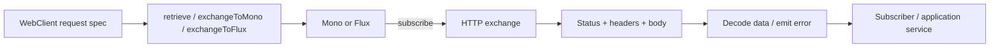
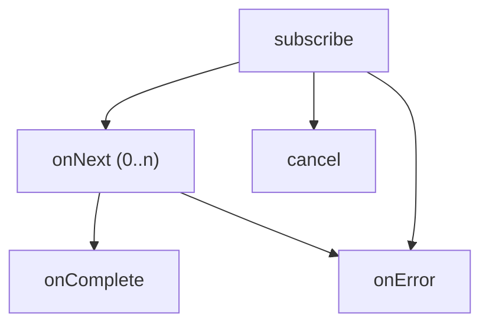
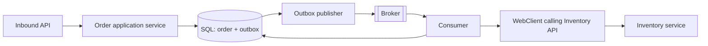

# retrieve, exchangeToMono, and exchangeToFlux

When calling an external API with **WebClient**, a Spring Boot application does more than send an HTTP request and parse JSON. Real integration flows must branch on status codes, read error payloads, handle missing bodies, consume streaming data, enforce timeouts, and recover safely when requests fail.

Spring `WebClient` offers three common choices:

- **`retrieve()`**: the concise way to extract a body or response entity; by default, it turns HTTP 4xx/5xx into error signals.
- **`exchangeToMono(...)`**: processes the **entire `ClientResponse`** with branching logic based on status, headers, and body, returning a single asynchronous `Mono<T>` result.
- **`exchangeToFlux(...)`**: works the same way but returns a `Flux<T>` stream; useful when deciding how to consume a stream based on the response.

This lesson belongs to the **WebClient** chapter in the **SPRING_BOOT_INTEGRATION** module, where Spring Boot integrates across HTTP clients, SQL, caches, message brokers, and Spring Integration adapters. Thus, choosing the right API is not just about writing fewer lines of code—it connects directly to **data contracts, transactions, errors, retries, idempotency, testing, and observability** across the flow.

> **Illustrative versions:** Java 17+, Spring Boot 3.x / Spring Framework 6.x, Spring WebFlux, and Project Reactor. General principles still apply to newer Spring releases, though you should verify APIs, dependencies, and transport settings for your project's version. You do not need a WebFlux server deployment to use `WebClient`.

## 1. Learning Objectives

After this lesson, you will be able to:

1. Distinguish `retrieve`, `exchangeToMono`, and `exchangeToFlux` by the level of control over the response.
2. Explain the execution pipeline `WebClient → request → ClientResponse → Mono/Flux`.
3. Use `retrieve().bodyToMono(...)` and `retrieve().bodyToFlux(...)` when only the body is needed.
4. Use `retrieve().onStatus(...)` to map HTTP errors to domain exceptions.
5. Use `exchangeToMono(...)` for 200/204/404 handling or status-dependent body schemas.
6. Use `exchangeToFlux(...)` for NDJSON/SSE streams and failure control.
7. Understand body/buffer lifecycles and the rule against reusing `ClientResponse` after the callback finishes.
8. Design appropriate timeouts, bounded retries, idempotency, logging, and integration tests.

## 2. Foundations: WebClient, Mono, Flux, and ClientResponse

### 2.1. WebClient Is a Reactive HTTP Client

`WebClient` is the non-blocking, reactive HTTP client API provided by Spring WebFlux. A typical call:

```java
Mono<ProductStock> stockMono = webClient.get()
        .uri("/api/v1/stocks/{sku}", "SKU-001")
        .retrieve()
        .bodyToMono(ProductStock.class);
```

`stockMono` is a **description of asynchronous work**. For standard `WebClient` HTTP publishers, the request is executed only upon subscription—for instance, by a WebFlux controller, a downstream pipeline consumer, or a test subscriber. Without a subscription, never assume the request was sent.



### 2.2. How Do Mono and Flux Differ?

| Reactor Type | Meaning | Examples |
| --- | --- | --- |
| `Mono<T>` | Emits **0 or 1** value then completes, or terminates with an error | One product by SKU, one order placement result |
| `Flux<T>` | Emits **0 to many** values, then completes or errors | Product list, NDJSON stream, SSE |
| `Mono<Void>` | Signals only completion or error; emits no value | HTTP 204 or operations needing only acknowledgment |
| `Mono<ResponseEntity<T>>` | A response holding status, headers, and decoded body | APIs needing `ETag` or status inspection |

**Important:** `Flux<T>` does not necessarily imply infinite HTTP streaming. A JSON array returned in a single response can also be decoded as a `Flux<T>`. Conversely, `retrieve().bodyToFlux(...)` **can also handle streaming**; you do not have to switch to `exchangeToFlux` solely because the response contains multiple items.

### 2.3. Status, Headers, and Body

An HTTP response consists of:

```text
HTTP/1.1 200 OK
Content-Type: application/json
ETag: "v17"

{"sku":"SKU-001","availableQuantity":8}
```

- **Status**: success, missing resource, rate limiting, or server error.
- **Headers**: `Content-Type`, `ETag`, `Retry-After`, correlation ID, pagination/cursor...
- **Body**: JSON, text, binary data, stream, or empty.

`retrieve()` exposes a `ResponseSpec` for decoding bodies and customizing errors. `exchangeToMono/Flux` passes `ClientResponse` directly into your handler, letting you decide which body representation to use **before** decoding.

## 3. Comparison of the Three APIs

| Criterion | `retrieve()` | `exchangeToMono(...)` | `exchangeToFlux(...)` |
| --- | --- | --- | --- |
| Immediate return type | `ResponseSpec` | `Mono<T>` | `Flux<T>` |
| Abstraction level | High, concise | Lower, operates on `ClientResponse` | Lower, operates on `ClientResponse` |
| Default HTTP 4xx/5xx | Produces `WebClientResponseException` unless overridden | **Decided by the callback** | **Decided by the callback** |
| Inspecting status/headers before decoding | Partially via `onStatus` and `toEntity` | Convenient, full control per response | Convenient, full control per response |
| Returning a single result | `bodyToMono` | Returns `Mono<T>` directly | Possible but unnatural |
| Returning multiple results | `bodyToFlux` | Can wrap a list inside a `Mono` | Returns `Flux<T>` directly |
| NDJSON/SSE streaming | **Yes**, with `bodyToFlux` | Unsuitable if emitting item by item | **Yes**, with `bodyToFlux` inside the callback |
| Code verbosity | Minimal | More branches | More branches |
| When to use | Standard success bodies and errors | 200/202/204/404 rules, multiple schemas | Streams with status/header-based decisions |

**Practical rule:** Start with `retrieve()`. Switch to `exchangeToMono(...)` or `exchangeToFlux(...)` only when you need control that `ResponseSpec` cannot express cleanly. Do not treat `exchangeToFlux` as a "newer" or "always faster" version of `retrieve().bodyToFlux`.

## 4. Preparing the Spring Boot Project

### 4.1. Dependencies

Gradle example (Groovy DSL):

```groovy
dependencies {
    implementation 'org.springframework.boot:spring-boot-starter-webflux'

    testImplementation 'org.springframework.boot:spring-boot-starter-test'
    testImplementation 'io.projectreactor:reactor-test'
    testImplementation 'com.squareup.okhttp3:mockwebserver:4.12.0'
}
```

- `spring-boot-starter-webflux` provides `WebClient`, Reactor, and the appropriate HTTP client runtime.
- `reactor-test` provides `StepVerifier` to assert `onNext`, `onComplete`, and `onError` signals.
- MockWebServer is an **HTTP test server** running on loopback, letting you test real HTTP-layer requests without calling partner endpoints.
- For dependencies outside the Spring Boot BOM, check whether versions are managed or specify an explicit compatible version. In the example, MockWebServer specifies its version.

A Spring MVC application can still use `WebClient` for outbound HTTP once the right dependency is added. Including `spring-boot-starter-webflux` in an application that already has the MVC starter does not automatically turn the whole server into WebFlux; verify which web application type is selected.

### 4.2. Configuring Base URL and Timeouts

Example `application-local.yml`:

```yaml
integration:
  partner:
    base-url: ${PARTNER_BASE_URL}
    connect-timeout-ms: 2000
    response-timeout: 5s
```

`PARTNER_BASE_URL` should come from environment variables or controlled deployment config, such as a partner sandbox URL. Never hardcode tokens or secrets in source files or logs.

Java configuration example using Reactor Netty:

```java
package com.example.integration.partner;

import java.time.Duration;

import io.netty.channel.ChannelOption;
import org.springframework.beans.factory.annotation.Value;
import org.springframework.context.annotation.Bean;
import org.springframework.context.annotation.Configuration;
import org.springframework.http.client.reactive.ReactorClientHttpConnector;
import org.springframework.web.reactive.function.client.WebClient;
import reactor.netty.http.client.HttpClient;

@Configuration
public class PartnerClientConfiguration {

    @Bean("partnerWebClient")
    WebClient partnerWebClient(
            WebClient.Builder builder,
            @Value("${integration.partner.base-url}") String baseUrl,
            @Value("${integration.partner.connect-timeout-ms}") int connectMs,
            @Value("${integration.partner.response-timeout}") Duration responseTimeout) {

        HttpClient httpClient = HttpClient.create()
                .option(ChannelOption.CONNECT_TIMEOUT_MILLIS, connectMs)
                .responseTimeout(responseTimeout);

        return builder
                .baseUrl(baseUrl)
                .clientConnector(new ReactorClientHttpConnector(httpClient))
                .build();
    }
}
```

Explanation:

1. Spring Boot's `WebClient.Builder` keeps the client integrated with auto-configuration and customizers where applicable.
2. `baseUrl` prepends to relative paths like `/api/v1/stocks/{sku}`.
3. Connect timeout and response timeout bound two different stages; they **do not automatically form a single deadline** across multiple retries.
4. The client can use a connection pool; concurrency limits, pool settings, DNS/TLS, and proxies must be tuned to load and environment.
5. If the application has multiple outbound clients, use distinct beans or `@Qualifier` to avoid calling the wrong endpoint or using the wrong credentials.

Real configurations also require authentication (OAuth2/API key/mTLS), trusted CA certificates, standardized logging, and retry policies. Changing transports or request factories can alter timeout semantics; always test against the actual deployed stack.

## 5. Sample DTOs and API Used Throughout This Lesson

Suppose a **Partner Inventory API** exposes these operations:

| API | Responses | Meaning |
| --- | --- | --- |
| `GET /api/v1/stocks/{sku}` | 200 + JSON, 404, 503... | Query stock quantity |
| `GET /api/v1/stocks/{sku}/availability` | 200 + JSON, 204, 404 | Partner-specific status rules |
| `GET /api/v1/shipments/{id}/events` | 200 + NDJSON stream, 404, 429... | Emit multiple status events |
| `POST /api/v1/reservations` | 201/202 or error | Create stock reservation, has side effects |

JSON payload returned:

```json
{
  "sku": "SKU-001",
  "availableQuantity": 8,
  "updatedAt": "2026-11-21T02:15:40Z"
}
```

Corresponding Java records:

**`ProductStock.java`**

```java
package com.example.integration.partner;

import java.time.Instant;

public record ProductStock(
        String sku,
        long availableQuantity,
        Instant updatedAt
) {}
```

**`TrackingEvent.java`**

```java
package com.example.integration.partner;

import java.time.Instant;

public record TrackingEvent(
        String eventId,
        String shipmentId,
        String state,
        Instant occurredAt
) {}
```

These are **partner DTOs**, not SQL entities or universal domain contracts shared across every system. Real flows must validate required fields, schema versions, timezones, status codes, and tenants. Successful JSON parsing alone does not prove quantities or status codes are valid.

## 6. retrieve(): The Default Choice When You Need the Body

### 6.1. A Single Object with bodyToMono

**`PartnerInventoryClient.java`** (abbreviated):

```java
package com.example.integration.partner;

import org.springframework.beans.factory.annotation.Qualifier;
import org.springframework.http.MediaType;
import org.springframework.stereotype.Component;
import org.springframework.web.reactive.function.client.WebClient;

import reactor.core.publisher.Mono;

@Component
public class PartnerInventoryClient {
    private final WebClient client;

    public PartnerInventoryClient(
            @Qualifier("partnerWebClient") WebClient client) {
        this.client = client;
    }

    public Mono<ProductStock> getStock(String sku) {
        return client.get()
                .uri("/api/v1/stocks/{sku}", sku)
                .accept(MediaType.APPLICATION_JSON)
                .retrieve()
                .bodyToMono(ProductStock.class);
    }
}
```

How to read it:

1. `get()` constructs a GET request.
2. `uri(...)` binds the SKU into a path template; never concatenate raw input strings into URLs.
3. `accept(...)` declares the expected response format.
4. `retrieve()` creates a `ResponseSpec`.
5. `bodyToMono(ProductStock.class)` decodes JSON into a `ProductStock` inside the reactive publisher.

If the response is `200 OK` with a valid body, the subscriber receives the object and completes. If the response is `204 No Content`, `bodyToMono` usually completes **without emitting a value**, rather than returning `new ProductStock(null,0,null)`. Avoid using `defaultIfEmpty(...)` to invent a fake product without an explicit business contract.

### 6.2. Asynchronous Return Values and Subscriptions

```java
Mono<ProductStock> stockMono = inventoryClient.getStock("SKU-001");

// This is still just a pipeline description; no direct value yet.
Mono<Boolean> hasStock = stockMono
        .map(stock -> stock.availableQuantity() > 0);
```

In a WebFlux controller, return `Mono<Boolean>` directly so the framework subscribes and writes the HTTP response.

In a Spring MVC application or blocking job, `block()` may be used **at a controlled synchronous boundary** if genuinely necessary, but avoid `block()` on event-loop/reactive request-handling threads. Blocking in the wrong place causes thread starvation or runtime exceptions. Never scatter `subscribe()` calls inside application services, as doing so loses control over lifecycle, errors, cancellation, and transactions.

**Cold publisher:** each subscription to a typical `WebClient` pipeline may execute a fresh HTTP exchange. If the same `Mono` is subscribed to twice, **never assume it runs only a single request**. This matters especially for HTTP POST calls with side effects.

### 6.3. bodyToFlux with retrieve

`retrieve()` is not limited to `Mono`:

```java
Flux<TrackingEvent> events = client.get()
        .uri("/api/v1/shipments/{id}/events", shipmentId)
        .accept(MediaType.APPLICATION_NDJSON)
        .retrieve()
        .bodyToFlux(TrackingEvent.class);
```

Here `bodyToFlux` emits multiple `TrackingEvent` items. If the HTTP response uses true NDJSON, JSON documents arrive line by line and the client can decode them incrementally depending on the codec and transport streaming.

If the server returns a standard JSON array, `bodyToFlux` still emits elements, though not necessarily immediately as the server begins writing. Actual streaming characteristics depend on **`Content-Type`**, server flushing, and the message decoder.

### 6.4. Need Status and Headers: toEntity

You do not need `exchangeToMono` just to read headers:

```java
Mono<ResponseEntity<ProductStock>> responseMono = client.get()
        .uri("/api/v1/stocks/{sku}", sku)
        .retrieve()
        .toEntity(ProductStock.class);
```

`ResponseEntity<ProductStock>` holds status, headers, and the decoded body. You can inspect `ETag`, `Last-Modified`, or pagination headers if the API provides them.

For a list:

```java
Mono<ResponseEntity<List<ProductStock>>> responseMono = client.get()
        .uri("/api/v1/stocks")
        .retrieve()
        .toEntityList(ProductStock.class);
```

If you only need a list wrapped in a `Mono`:

```java
Mono<List<ProductStock>> result = client.get()
        .uri("/api/v1/stocks")
        .retrieve()
        .bodyToFlux(ProductStock.class)
        .collectList();
```

`collectList()` buffers all items in memory until the source completes. Never use it casually on infinite streams or huge lists.

## 7. retrieve().onStatus(): Customizing Error Branches

### 7.1. Default Behavior

When using `retrieve()`:

- HTTP **2xx**: handled as a successful response by default, allowing body decoding.
- HTTP **4xx/5xx**: by default emits a `WebClientResponseException`, with specific subtypes for common statuses.
- Network, DNS, TLS, or timeout errors emit different exceptions, typically `WebClientRequestException` or Reactor/Netty transport errors.
- HTTP **3xx**: redirect handling depends on the HTTP client and configuration; `retrieve()` does not automatically treat every 3xx as a 4xx/5xx error. If redirects are significant to the contract, verify them explicitly.

Not every `404` means "out of stock," and not every `409` should be retried. Business meaning comes from the **partner API contract**.

### 7.2. Mapping 404 to a Domain Exception

Suppose the partner specifies that `404` means the SKU does not exist. You can write:

```java
public Mono<ProductStock> getRequiredStock(String sku) {
    return client.get()
            .uri("/api/v1/stocks/{sku}", sku)
            .retrieve()
            .onStatus(
                    status -> status.value() == 404,
                    response -> response.releaseBody()
                            .thenReturn(new StockNotFoundException(sku))
            )
            .bodyToMono(ProductStock.class);
}
```

With the exception:

```java
public class StockNotFoundException extends RuntimeException {
    public StockNotFoundException(String sku) {
        super("SKU not found: " + sku);
    }
}
```

In this example, `releaseBody()` releases the body when the error payload is not needed. The `onStatus` callback returns `Mono<? extends Throwable>`; Spring `WebClient` emits that exception as the error signal when the status matches. Other statuses continue using the default policy.

### 7.3. When You Need to Read the Error Body

If the partner sends an error JSON payload:

```json
{
  "code": "STOCK_LOCKED",
  "message": "Product is temporarily unavailable for reservation"
}
```

You can read it before constructing a business exception:

```java
record PartnerError(String code, String message) {}

public Mono<ProductStock> getWithBusinessError(String sku) {
    return client.get()
            .uri("/api/v1/stocks/{sku}", sku)
            .retrieve()
            .onStatus(
                    status -> status.value() == 409,
                    response -> response
                            .bodyToMono(PartnerError.class)
                            .defaultIfEmpty(
                                    new PartnerError("UNKNOWN", "Empty error body"))
                            .map(err -> new IllegalStateException(
                                    "Partner rejected: " + err.code()))
            )
            .bodyToMono(ProductStock.class);
}
```

Notes:

- `PartnerError` should be declared as its own type with visibility/constructors compatible with your project's codec in production code.
- If the partner returns HTML/plain text instead of the promised JSON, decoding `PartnerError` may fail; establish a policy for non-conforming error bodies.
- Do not log entire raw bodies if they may contain PII, tokens, or sensitive data.
- An `onStatus` callback returning `Mono.empty()` **suppresses error generation for that status**, letting body decoding proceed. This is safe only when the body type and response semantics permit it; if you need 404 → `Optional.empty()` or 204 → a distinct state, `exchangeToMono` is clearer.

## 8. exchangeToMono(): Branching on the Full Response

### 8.1. When Do You Need exchangeToMono?

`retrieve()` suits typical happy paths. However, a partner API might define:

- `200 OK`: JSON stock payload.
- `204 No Content`: no stock snapshot exists at query time.
- `404 Not Found`: SKU does not exist.
- `429 Too Many Requests`: rate limited.
- `5xx`: temporary error.

If you want to return **an internal result type distinguishing the first three cases**, use `exchangeToMono(...)`. Instead of trying to decode every response as `ProductStock`, the callback branches by status.

### 8.2. Result Type Expressing Business Meaning

**`StockLookup.java`**

```java
package com.example.integration.partner;

public sealed interface StockLookup
        permits StockLookup.Found, StockLookup.Pending, StockLookup.Missing {

    record Found(ProductStock stock) implements StockLookup {}

    record Pending(String sku) implements StockLookup {}

    record Missing(String sku) implements StockLookup {}
}
```

`Found`, `Pending`, and `Missing` are cleanly distinct. There is no need to overload `null` or a quantity of `0` to represent different states.

### 8.3. exchangeToMono Implementation

**An additional method on `PartnerInventoryClient`:**

```java
public Mono<StockLookup> lookup(String sku) {
    return client.get()
            .uri("/api/v1/stocks/{sku}/availability", sku)
            .accept(MediaType.APPLICATION_JSON)
            .exchangeToMono(response -> {
                int status = response.statusCode().value();

                if (status == 200) {
                    return response.bodyToMono(ProductStock.class)
                            .switchIfEmpty(Mono.error(
                                    new IllegalStateException(
                                            "200 OK but missing stock body")))
                            .map(stock -> (StockLookup)
                                    new StockLookup.Found(stock));
                }

                if (status == 204) {
                    return response.releaseBody()
                            .thenReturn((StockLookup)
                                    new StockLookup.Pending(sku));
                }

                if (status == 404) {
                    return response.releaseBody()
                            .thenReturn((StockLookup)
                                    new StockLookup.Missing(sku));
                }

                return response.createError();
            });
}
```

How to read it:

1. The `response -> { ... }` callback receives `ClientResponse` with status, headers, and body.
2. `200`: decodes a `ProductStock`; if the body is missing despite the contract, raises an error.
3. `204`: returns `Pending` **without decoding a body**.
4. `404`: returns `Missing` per **this example API's contract**.
5. Disallowed statuses: uses `response.createError()` to return a publisher terminating with `WebClientResponseException`.

**Unlike `retrieve()`:** When calling `exchangeToMono(...)`, **the callback itself is responsible for deciding which statuses succeed and which error**. If you blindly return `response.bodyToMono(ProductStock.class)` for all statuses, an HTTP 500 may be misinterpreted or throw a parsing error instead of a status error. Always write explicit branches.

### 8.4. Why Must the Body Be Consumed Inside the Callback?

`exchangeToMono` grants access to `ClientResponse` scoped to the callback. Once the `Mono` returned by the callback completes, `WebClient` checks and releases any **unconsumed** body to prevent connection/buffer leaks.

Therefore, the following is **conceptually broken**:

```java
Mono<ClientResponse> unsafe = client.get()
        .uri("/api/v1/stocks/{sku}", sku)
        .exchangeToMono(response -> Mono.just(response));

// Wrong: trying to read the response body after the exchangeToMono callback has already returned its publisher.
Mono<ProductStock> later = unsafe.flatMap(
        response -> response.bodyToMono(ProductStock.class));
```

Never pass `ClientResponse` out of the callback and decode it downstream, because the body may already be released once the callback's publisher finishes. Always decode **inside**:

```java
Mono<ProductStock> safe = client.get()
        .uri("/api/v1/stocks/{sku}", sku)
        .exchangeToMono(response -> {
            if (response.statusCode().is2xxSuccessful()) {
                return response.bodyToMono(ProductStock.class);
            }
            return response.createError();
        });
```

This is a primary reason `exchangeToMono`/`exchangeToFlux` replaced the legacy `exchange()` method, which made it too easy to forget to consume or release the body.

### 8.5. How Do releaseBody and createError Differ?

| Operation | When to Use | Result |
| --- | --- | --- |
| `response.bodyToMono(T.class)` | Need to decode the body into a single object | `Mono<T>` |
| `response.bodyToFlux(T.class)` | Need to decode multiple items | `Flux<T>` |
| `response.releaseBody()` | Body not needed; discard/release it | `Mono<Void>` |
| `response.createException()` | Need an exception object holding status/headers/body | `Mono<WebClientResponseException>` |
| `response.createError()` | Need a publisher **terminating with an HTTP error** | `Mono<T>` emitting `WebClientResponseException` |

Do not raise an error via `Mono.error(response.createException())`: `createException()` returns a **`Mono`** containing the exception, not the exception itself. If you need `createException()`:

```java
return response.createException()
        .flatMap(Mono::error);
```

In most cases when you just want to emit the HTTP error, `response.createError()` is shorter and clearer.

## 9. exchangeToFlux(): Multiple Elements with Full Response Control

### 9.1. Multi-Element Data Does Not Always Require exchangeToFlux

The following is completely valid when all successful responses share one structure and you want default 4xx/5xx error handling:

```java
public Flux<TrackingEvent> readEvents(String shipmentId) {
    return client.get()
            .uri("/api/v1/shipments/{id}/events", shipmentId)
            .accept(MediaType.APPLICATION_NDJSON)
            .retrieve()
            .bodyToFlux(TrackingEvent.class);
}
```

Switch to `exchangeToFlux(...)` only if you need custom status/header handling before consuming the stream—for example, `404` returning an empty `Flux` while `429`/`503` produce policy-controlled retryable errors.

### 9.2. NDJSON Streaming Example

Each line is an independent JSON object:

```text
{"eventId":"e-1","shipmentId":"S-42","state":"PICKED_UP","occurredAt":"2026-11-21T01:00:00Z"}
{"eventId":"e-2","shipmentId":"S-42","state":"IN_TRANSIT","occurredAt":"2026-11-21T02:00:00Z"}
{"eventId":"e-3","shipmentId":"S-42","state":"DELIVERED","occurredAt":"2026-11-21T03:00:00Z"}
```

**Method with `exchangeToFlux(...)`:**

```java
public Flux<TrackingEvent> streamEvents(String shipmentId) {
    return client.get()
            .uri("/api/v1/shipments/{id}/events", shipmentId)
            .accept(MediaType.APPLICATION_NDJSON)
            .exchangeToFlux(response -> {
                int status = response.statusCode().value();

                if (status == 200) {
                    return response.bodyToFlux(TrackingEvent.class);
                }

                if (status == 404) {
                    // Only if the contract defines 404 as "no stream yet".
                    return response.releaseBody()
                            .thenMany(Flux.empty());
                }

                return response.createError().flux();
            });
}
```

Meaning:

- `200`: decodes the body into multiple `TrackingEvent` items in a `Flux`.
- `404`: **intentionally** mapped to an empty stream in this example; in another API, 404 may need to be an error.
- `createError().flux()` converts an error-terminating `Mono` into an error-terminating `Flux`, matching the return type.
- When the publisher returned by the callback completes or is cancelled per its lifecycle, `WebClient` handles releasing the body/resources per client rules; avoid holding `ClientResponse` outside the callback.

### 9.3. SSE with Server-Sent Events

If the partner uses `Content-Type: text/event-stream` instead of NDJSON:

```java
import org.springframework.core.ParameterizedTypeReference;
import org.springframework.http.codec.ServerSentEvent;

public Flux<ServerSentEvent<TrackingEvent>> subscribeToSse(
        String shipmentId) {

    return client.get()
            .uri("/api/v1/shipments/{id}/events", shipmentId)
            .accept(MediaType.TEXT_EVENT_STREAM)
            .retrieve()
            .bodyToFlux(
                    new ParameterizedTypeReference<
                            ServerSentEvent<TrackingEvent>>() {});
}
```

SSE can carry an ID, event name, retry hint, and data; if you need that metadata, use `ServerSentEvent<T>` rather than decoding only the data payload. `WebClient` does not automatically guarantee complete replay, "exactly-once" delivery, or automatic resumption from `Last-Event-ID` according to a partner's custom contract. On reconnect, design IDs, cursors, retries, and deduplication explicitly.

### 9.4. Backpressure and Long-Lived Streams

A `Flux` supports **reactive demand**, yet that **does not prove an external HTTP server will slow down its send rate** accordingly. For long-lived streams:

- Limit concurrent connections, message sizes, and buffer sizes.
- Use `take(n)`, cancellation, or deadlines when a task needs only a bounded number of records.
- Avoid `collectList()` on infinite streams, as it buffers everything in memory without completing.
- Avoid unbounded `onBackpressureBuffer()` to "fix" slow consumers.
- Monitor input rates, lag, cancellations, and track checkpoints/cursors if resume is needed.

Never use `exchangeToFlux` to paper over an upstream that ought to expose pagination or bounded batch APIs.

## 10. Body Lifecycle, DataBuffer, and Memory Limits

### 10.1. Why Is Releasing the Body Important?

In WebFlux/Reactor Netty, response bodies can flow through pooled buffers and transport resources. If code retains `ClientResponse` and forgets to consume or release it, resources can remain pinned longer than intended.

`retrieve()` abstracts away response management. `exchangeToMono` and `exchangeToFlux` grant control over status/body, requiring **explicit decisions** about which bodies are decoded or discarded.

The framework releases unconsumed bodies once the publisher returned by the callback completes; however, you must never:

- Pass `ClientResponse` outside the callback for later use.
- Read the same response body twice with two independent `bodyToMono` calls.
- Manually handle `DataBuffer` without honoring release ownership rules.
- Hand raw buffers off to another pipeline without a clear lifecycle contract.
- Leave long-running response streams running without cancellation handling.

### 10.2. Exceeding Codec Buffer Limits

If a JSON response is too large, aggregating/decoding the body can fail with an error such as `DataBufferLimitException` when exceeding the configured buffer limit.

Example setting the limit on data **allowed to be buffered in memory**:

```java
WebClient limitedClient = WebClient.builder()
        .baseUrl("https://partner.example.test")
        .codecs(configurer -> configurer.defaultCodecs()
                .maxInMemorySize(512 * 1024))
        .build();
```

That domain is only an illustrative URL; do not call it in tests or production. Raising `maxInMemorySize` does not replace proper streaming or upstream payload limits. For large payloads, consider batching/pagination/NDJSON, enforcing upstream size limits, and bounding memory allocation.

### 10.3. Do Not Decode the Body Twice

Conceptually broken:

```java
return client.get().uri("/resource")
        .exchangeToMono(response -> {
            Mono<String> raw = response.bodyToMono(String.class);
            Mono<MyDto> dto = response.bodyToMono(MyDto.class);
            // Two independent attempts reading the same response stream: unsafe.
            return Mono.zip(raw, dto);
        });
```

If you truly need both the raw JSON and the parsed object, read **once** and transform inside the pipeline with size bounds and log safety:

```java
return client.get().uri("/resource")
        .exchangeToMono(response ->
                response.bodyToMono(String.class)
                        .map(raw -> parseAndValidate(raw)));
```

`parseAndValidate(...)` here is an application-defined helper. In production, prefer the configured decoder and read raw bodies only when genuinely necessary.

## 11. Reactive Pipelines: Errors, Cancellation, and Multiple Subscriptions

### 11.1. The Three Core Signals

A Reactor publisher can emit:



`onComplete` and `onError` are distinct terminal paths; cancellation stops consumption and does not represent business success. For instance, `Flux.empty()` means zero items followed by completion—**it does not mean the remote API returned 404** unless your code and contract explicitly map it that way.

### 11.2. What Can You Do with Errors?

Common operators:

| Operator | Purpose | Caveats |
| --- | --- | --- |
| `onErrorMap` | Translate an infrastructure exception into a domain exception/result | Preserve the cause; avoid flattening every error into one type |
| `onErrorResume` | Switch to a fallback publisher on specific errors | Never default stock to 0 when upstream fails |
| `retryWhen` | Resubscribe when the policy allows | Can resend HTTP requests; must be safe/idempotent |
| `timeout` | Emit an error if waiting exceeds the limit at that operator position | Distinguish total deadline from per-attempt timeout |
| `doOnError` | Observe error signals (logging/metrics) | Never let logging side effects alter business flow |
| `doFinally` | Observe termination including cancellation | Useful for lifecycle metrics and auxiliary cleanup |

**Where** operators sit in the pipeline changes their meaning. Placing `retryWhen` after SQL/HTTP writes can accidentally repeat multiple side effects. Scope retries tightly around the appropriate remote call.

### 11.3. Retries Do Not Make POST Safe

Example idempotent GET with bounded retries:

```java
import java.time.Duration;

import org.springframework.web.reactive.function.client.WebClientResponseException;
import reactor.util.retry.Retry;

public Mono<ProductStock> getStockWithRetry(String sku) {
    return client.get()
            .uri("/api/v1/stocks/{sku}", sku)
            .retrieve()
            .bodyToMono(ProductStock.class)
            .retryWhen(Retry.backoff(2, Duration.ofMillis(200))
                    .maxBackoff(Duration.ofSeconds(2))
                    .jitter(0.4)
                    .filter(error ->
                            error instanceof WebClientResponseException ex
                            && (ex.getStatusCode().value() == 429
                                || ex.getStatusCode().is5xxServerError())))
            .timeout(Duration.ofSeconds(5));
}
```

In this example:

- Up to **two retries** after the initial attempt per `Retry.backoff(2, ...)`.
- Retries only `429` and `5xx` as an illustrative choice; never retry `400`/`404`.
- `timeout(5s)` placed **after** `retryWhen` caps the total duration of the publisher including retries and backoff. If `timeout` is placed **before** `retryWhen`, it applies per resubscription attempt and total duration can exceed 5 seconds.
- Production APIs may require honoring `Retry-After` on `429`, rate limiters, circuit breakers, and shared retry budgets. This snippet does not parse `Retry-After`.
- GET is read-only in this example contract; if an upstream violates HTTP semantics by mutating state on GET, adjust the policy accordingly.

For an HTTP POST creating a reservation, a timeout can occur **after the partner committed**. Retrying POST requires a stable operation ID/`Idempotency-Key` enforced by the partner. Never generate a fresh key on each retry.

### 11.4. Flux Timeouts Differ from Mono Timeouts

`Flux.timeout(Duration.ofSeconds(5))` typically bounds **the wait time for the next signal** in the stream. An SSE stream staying open for hours with one event per minute will fail with a 5-second timeout even while operating normally per contract.

Distinguish between:

- Connection establishment timeout.
- Byte/response wait timeout.
- Inter-element wait timeout on a reactive stream.
- Overall operation deadline.
- Heartbeat and reconnect rules for SSE/NDJSON streams.

Do not assign the same value to all timeout layers merely for config simplicity.

## 12. Integrating WebClient with SQL, Caches, and Brokers

In **SPRING_BOOT_INTEGRATION**, HTTP requests sit inside multi-boundary flows:



Decisions to make explicit:

1. **Transactions:** `@Transactional` on a SQL database does not cover HTTP calls or broker publishes. You cannot roll back an HTTP side effect just because SQL rolled back.
2. **Error propagation:** `Mono.error(...)` or `Flux.error(...)` must be handled by the application/consumer per contract; logging an exception does not create a retry.
3. **Idempotency:** brokers can redeliver messages; consumers can re-invoke HTTP calls. Keep operation keys stable, and use inbox/outbox or reconciliation when needed.
4. **Caching:** reading from a cache reduces HTTP calls but requires explicit TTL, invalidation, and freshness rules. Never silently treat every cache hit as authoritative for all business flows.
5. **Headers/correlation:** propagate correlation/trace IDs across adapters for observability while keeping request IDs separate from business IDs.
6. **Data contracts:** external HTTP DTOs require mapping and validation before SQL persistence or message publishing. Never let unknown enum values fall back to a success state.

### 12.1. Example of an Ambiguous Side Effect

```text
Consumer receives OrderCreated(order-17)
  -> POST /reservations with operationId=order-17:reserve
  -> Partner creates reservation and commits
  -> Network drops before client receives HTTP 201
  -> WebClient emits timeout
  -> Consumer retries/redelivers message
```

If the partner supports idempotency by `operationId`, the follow-up call returns the prior result or confirms the operation exists. If not, you need status lookup, reconciliation, or a dedicated compensation workflow. **Using `retrieve` vs. `exchangeToMono` does not automatically prevent duplicates.** Those APIs only determine how the HTTP response is read and handled.

## 13. Testing the Three APIs with an HTTP Test Server

Unit tests that mock `WebClient` too deeply miss URI encoding, headers, status handling, and JSON codecs. A loopback HTTP stub server verifies **real protocol-level requests and responses** without calling production partners.

### 13.1. Setting Up MockWebServer

JUnit 5 and MockWebServer example:

```java
package com.example.integration.partner;

import static org.junit.jupiter.api.Assertions.assertEquals;

import java.io.IOException;

import okhttp3.mockwebserver.MockResponse;
import okhttp3.mockwebserver.MockWebServer;
import okhttp3.mockwebserver.RecordedRequest;

import org.junit.jupiter.api.AfterEach;
import org.junit.jupiter.api.BeforeEach;
import org.junit.jupiter.api.Test;
import org.springframework.web.reactive.function.client.WebClient;
import org.springframework.web.reactive.function.client.WebClientResponseException;

import reactor.test.StepVerifier;

class PartnerInventoryClientTest {

    private MockWebServer server;
    private PartnerInventoryClient inventory;

    @BeforeEach
    void setUp() throws IOException {
        server = new MockWebServer();
        server.start();

        WebClient webClient = WebClient.builder()
                .baseUrl(server.url("/").toString())
                .build();

        inventory = new PartnerInventoryClient(webClient);
    }

    @AfterEach
    void tearDown() throws IOException {
        server.shutdown();
    }

    @Test
    void retrieveDecodes200AndSendsCorrectPath() throws Exception {
        server.enqueue(new MockResponse()
                .setResponseCode(200)
                .addHeader("Content-Type", "application/json")
                .setBody("""
                        {
                          "sku": "SKU-001",
                          "availableQuantity": 8,
                          "updatedAt": "2026-11-21T02:15:40Z"
                        }
                        """));

        StepVerifier.create(inventory.getStock("SKU-001"))
                .expectNextMatches(stock ->
                        stock.sku().equals("SKU-001")
                                && stock.availableQuantity() == 8L)
                .verifyComplete();

        RecordedRequest request = server.takeRequest();
        assertEquals("GET", request.getMethod());
        assertEquals("/api/v1/stocks/SKU-001", request.getPath());
    }

    @Test
    void exchangeToMonoMaps404ToMissing() {
        server.enqueue(new MockResponse().setResponseCode(404));

        StepVerifier.create(inventory.lookup("SKU-404"))
                .expectNextMatches(result ->
                        result instanceof StockLookup.Missing missing
                                && missing.sku().equals("SKU-404"))
                .verifyComplete();
    }

    @Test
    void exchangeToFluxDecodesNdjson() {
        server.enqueue(new MockResponse()
                .setResponseCode(200)
                .addHeader("Content-Type", "application/x-ndjson")
                .setBody("""
                        {"eventId":"e1","shipmentId":"S-42","state":"PICKED_UP","occurredAt":"2026-11-21T01:00:00Z"}
                        {"eventId":"e2","shipmentId":"S-42","state":"DELIVERED","occurredAt":"2026-11-21T02:00:00Z"}
                        """));

        StepVerifier.create(inventory.streamEvents("S-42"))
                .expectNextMatches(e -> e.eventId().equals("e1"))
                .expectNextMatches(e -> e.eventId().equals("e2"))
                .verifyComplete();
    }

    @Test
    void retrieveDefaults503ToHttpError() {
        server.enqueue(new MockResponse()
                .setResponseCode(503)
                .setBody("service unavailable"));

        StepVerifier.create(inventory.getStock("SKU-001"))
                .expectError(WebClientResponseException.ServiceUnavailable.class)
                .verify();
    }
}
```

To run this test, place the records/interface and the `getStock`, `lookup`, and `streamEvents` methods from earlier sections into the corresponding source files. This test verifies **the HTTP contract**: the server returns defined responses, `WebClient` executes real requests over loopback, and `StepVerifier` asserts the publisher signals.

### 13.2. Purposefully Testing Status and Body Combinations

| Scenario | `retrieve` | `exchangeToMono` | `exchangeToFlux` |
| --- | --- | --- | --- |
| 200 + valid JSON | Decodes DTO | 200 branch decodes DTO | Can emit one item |
| 200 + NDJSON | `bodyToFlux` reads items | Unsuitable if only one `Mono` is needed | `bodyToFlux` in callback |
| 204 + empty body | `Mono`/`Flux` completes empty | Can map to `Pending` | Can return empty `Flux` |
| 404 | Default HTTP error | Maps domain result/error per contract | Returns empty `Flux` or error per contract |
| 409 + error JSON | `onStatus` decodes error | Callback decodes error body | Callback can return `Flux.error` |
| 429/503 | Default HTTP error | Must explicitly emit error | Must explicitly emit error |
| Timeout/disconnect | Reactive error | Reactive error | Reactive error / stream cancel |
| Malformed JSON body | Decoder error | Decoder error in decode branch | Decoder error during stream decoding |

### 13.3. Advanced Error Tests

Add tests covering:

- HTTP 204 with no body, ensuring no "dummy" DTO is created.
- 404 mapped to `Missing` only on the endpoint specified by contract.
- 429 with `Retry-After` header and retry limit policy.
- 200 response with empty body or missing required fields.
- Wrong `Content-Type` header or truncated NDJSON stream mid-flight.
- Same event ID appearing twice during SSE reconnect.
- Connection timeout, response timeout, and cancellation via `take(n)`.
- Two subscriptions triggering two HTTP calls; for POST, test side effects and idempotency.
- Downstream consumer failure mid-stream: checkpoints/retries must not duplicate already-committed records.

Testing against a mock HTTP server does not replace contract/sandbox testing against the partner, especially for auth/TLS, rate limits, schema evolution, and real retry/acknowledgment behavior.

## 14. Observability and Security for WebClient

### 14.1. Observing Outbound Requests

In Spring Boot, you can use Actuator/Micrometer/tracing when matching dependencies and instrumentation are configured. Measure:

| Signal | Why It Matters |
| --- | --- |
| HTTP client request latency (p95/p99) | Detects slow partners |
| HTTP status and exceptions | Separates 4xx, 5xx, and DNS/TLS/timeout failures |
| Retry attempts / circuit breaker state | Detects unstable dependencies or retry storms |
| Connection pool active/pending | Detects client or network saturation |
| Stream duration / cancellations / items | Monitors long-lived SSE/NDJSON streams |
| Consumer lag / DLQ / duplicates | Tracks flows where `WebClient` is called from a message consumer |
| Correlation/trace ID | Links inbound HTTP, SQL, broker, and outbound HTTP |

Creating `WebClient` via `WebClient.builder()` in multiple places can bypass Boot-configured observability customizations. Use the injected Boot `WebClient.Builder` where appropriate and **verify actual emitted telemetry** rather than assuming it works.

Logs containing full URLs, query strings, or raw error bodies can leak personal data. Use **route templates**, operation names, and bounded error categories as metric tags; never place `eventId`, `orderId`, or arbitrary search strings into high-cardinality labels.

### 14.2. Security

- Enable TLS and verify certificates; never disable hostname verification just to make connections "work."
- Configure OAuth2 client credentials, API keys, or mTLS per partner contract; store secrets securely.
- Restrict base URLs or allowlist hosts whenever users can supply URLs to prevent SSRF.
- Cap request/response sizes and total outbound connections.
- Never log tokens, cookies, credentials, or full JSON payloads containing sensitive data.
- Never map `401`/`403` to empty data, hiding authorization failures.
- Validate external response data at the boundary before persisting to SQL or publishing to a broker.

## 15. Common Pitfalls and Diagnostics

| Symptom | Possible Cause | Diagnostic Approach |
| --- | --- | --- |
| `WebClient` method sends no request | Publisher was never subscribed to | Check subscription flow / returning `Mono`/`Flux` |
| One operation sends two HTTP calls | Resubscription, misplaced retry, or unshared publisher | Count requests and check retry placement |
| 404 parsed as success DTO | Using `exchangeToMono` without checking status | Add status branches and `createError` |
| Default 5xx exception thrown | `retrieve()` treats 4xx/5xx as errors | Add `onStatus` or review contract |
| `IllegalStateException` on `block()` | `block()` called on a thread forbidding blocking | Keep pipeline non-blocking or move to a proper boundary |
| Connections/buffers held open | Body unconsumed or response held past callback | Decode/release inside the exchange callback |
| `DataBufferLimitException` | Buffering an oversized response in memory | Bound sizes, stream/paginate, check codec limits |
| `Flux` never completes | Long SSE/stream without termination condition | Add cancellation, heartbeats, deadlines, checkpoints |
| Continuous 429s | Unbounded retries / missing rate limits | Apply backoff, retry budgets, `Retry-After` |
| POST creates duplicate records | Retrying after timeout without idempotency | Use stable operation keys and reconciliation |
| Trace lost across broker | Missing correlation/tracing context propagation | Inspect headers and instrumentation |
| Tests pass but real API fails | Fixtures/mocks diverge from real contract | Add contract tests, sandbox runs, schema versioning |

When debugging, trace in order: **was the request subscribed → URI/method/headers → network/TLS → status → body/decoder → retry/transaction → downstream side effects**. This sequence separates `WebClient` API bugs from distributed business-logic bugs.

## 16. Self-Check Questions

1. What object does `retrieve()` return, and why must you chain `bodyToMono`/`bodyToFlux` or `toEntity` afterward?
2. How does `exchangeToMono` differ from `retrieve` when distinguishing 404 from 204?
3. Can `retrieve().bodyToFlux(...)` read an NDJSON stream? When is `exchangeToFlux` actually needed?
4. In `exchangeToMono`, who is responsible for emitting an error when the HTTP status is 500?
5. Why should you never return `ClientResponse` out of the callback and decode the body downstream?
6. How do `response.releaseBody()` and `response.createError()` differ in purpose?
7. Why cannot `Mono.empty()` automatically mean 404 or "out of stock"?
8. Does an unsubscribed `WebClient` `Mono` guarantee a request was sent?
9. If two subscribers subscribe to the same `Mono` created by `WebClient`, what can happen?
10. Why does `Flux.timeout(Duration)` on an SSE stream mean something different from an overall batch deadline?
11. When an HTTP POST times out, can you be sure the partner did not commit? What makes retrying safe?
12. How does placing `retryWhen` before vs. after `timeout` change the time budget?
13. Which tests verify that `WebClient` sends the expected URL and headers and handles body/status correctly?
14. When a consumer receives a redelivered message, does `exchangeToFlux` or `retrieve` automatically handle duplicates?
15. Which metrics and logs distinguish network errors, response errors, and consumer backpressure?

### Hands-On Exercise

Design a Spring Boot adapter calling the Inventory API with these requirements:

1. `GET /stocks/{sku}` using `retrieve().bodyToMono`; map 404 to a custom exception.
2. `GET /stocks/{sku}/availability` using `exchangeToMono` to return `Found`, `Pending`, or `Missing` for 200/204/404.
3. `GET /shipments/{id}/events` using `exchangeToFlux` to read NDJSON and handle 404 per contract.
4. Add timeouts and bounded retries only for GET on HTTP 429/5xx; explain why the exact same policy does not apply to POST.
5. Write tests with MockWebServer and StepVerifier verifying path/query/headers, JSON, errors, streams, and cancellation.
6. Propagate a correlation ID from the inbound request through the adapter and record latency/error metrics per operation.
7. Simulate broker redelivery with the same `eventId` and verify SQL/outbound operations are truly idempotent.

**Completion criteria:** You can justify why each API was chosen per endpoint, never swallow errors or read bodies outside their lifecycle, ensure retries never trigger unwanted side effects, and have a test suite validating the HTTP contract.

## 17. Key Takeaways

- **`retrieve()` is the default choice** for most requests; it raises errors for HTTP 4xx/5xx by default and provides `onStatus` for customization.
- **`exchangeToMono(...)`** lets you inspect `ClientResponse` status/headers/body and return a single result or error.
- **`exchangeToFlux(...)`** follows the same model for multiple values; **`retrieve().bodyToFlux(...)` also supports streaming** when no special status branching is needed.
- Inside exchange callbacks, explicitly consume or release the response body; **never pass `ClientResponse` outside to decode later**.
- `Mono`/`Flux` are publishers: subscription, error handling, cancellation, and retries are core parts of their lifecycle.
- None of the three APIs **automatically guarantee transactions, idempotency, safe retries, or security**. Those belong to integration design spanning HTTP, SQL, caches, and brokers.

### Official References

1. [Spring Framework — WebClient: Retrieve](https://docs.spring.io/spring-framework/reference/web/webflux-webclient/client-retrieve.html)
2. [Spring Framework — WebClient: Exchange](https://docs.spring.io/spring-framework/reference/web/webflux-webclient/client-exchange.html)
3. [Spring Framework — WebClient](https://docs.spring.io/spring-framework/reference/web/webflux-webclient.html)
4. [Spring Framework — WebClient RequestHeadersSpec Javadoc](https://docs.spring.io/spring-framework/docs/6.2.0/javadoc-api/org/springframework/web/reactive/function/client/WebClient.RequestHeadersSpec.html)
5. [Spring Framework — ClientResponse Javadoc](https://docs.spring.io/spring-framework/docs/6.2.0/javadoc-api/org/springframework/web/reactive/function/client/ClientResponse.html)

**Conclusion:** Choose among `retrieve`, `exchangeToMono`, and `exchangeToFlux` based on the **HTTP contract** and **required response control**, not line count or notions of what looks "more reactive." Combined with Spring Boot, SQL, brokers, caches, and Spring Integration adapters, proper response handling forms the foundation of a testable, observable, and resilient integration flow.
