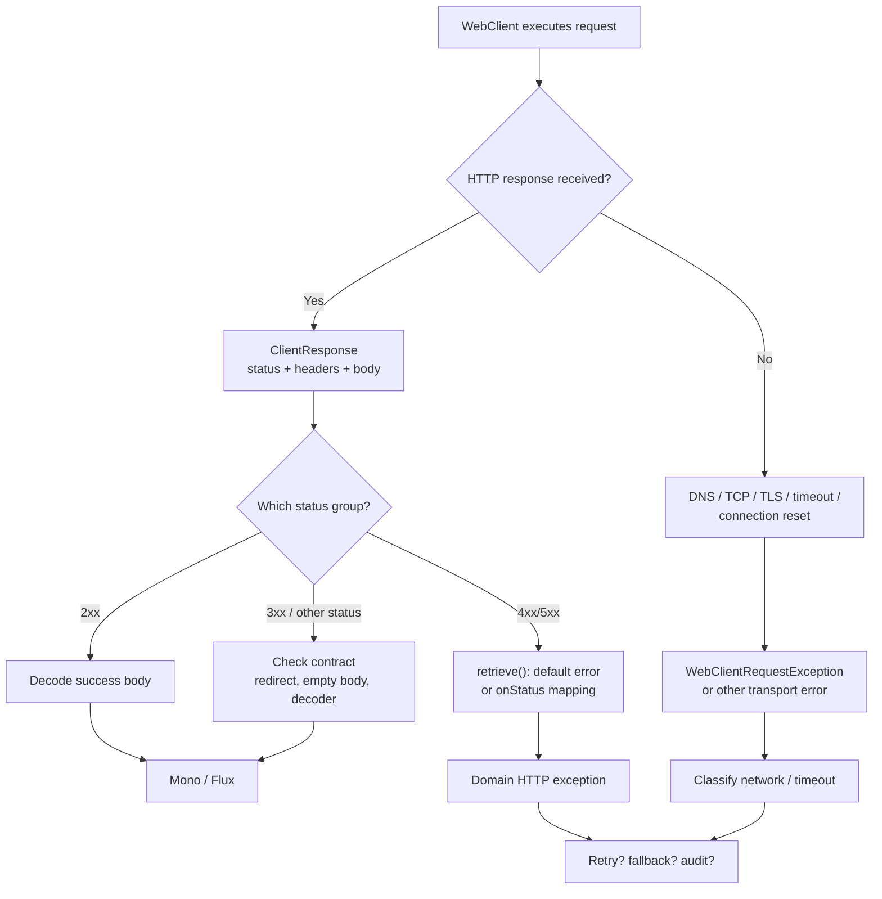
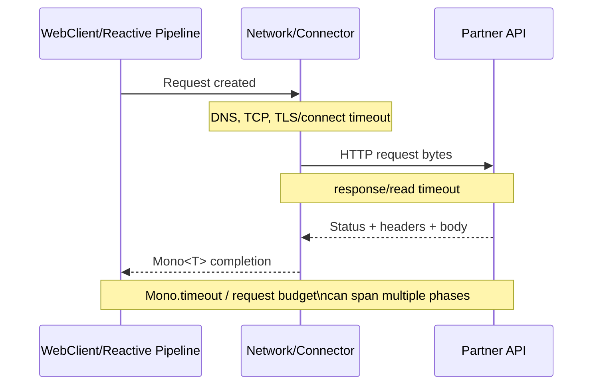
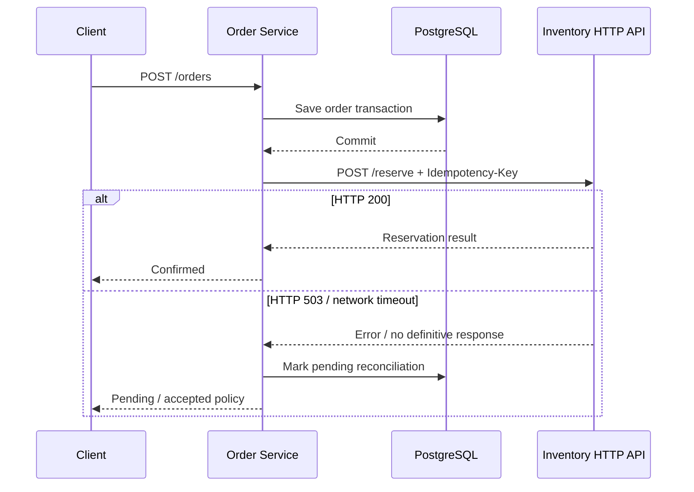
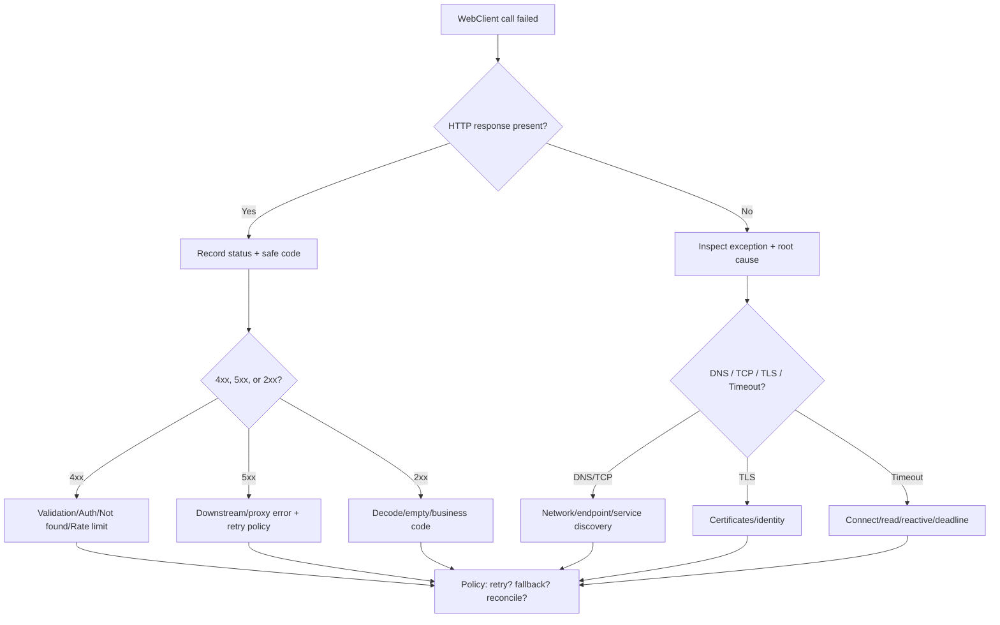

# onStatus, Exception Mapping, and Distinguishing HTTP Errors from Network Errors

## 1. Why Is WebClient Error Handling Part of Integration Design?

In the **SPRING_BOOT_INTEGRATION** module, a Spring Boot application may call partner APIs with `WebClient`, persist state to a database, update a Redis cache, or publish events via RabbitMQ/Kafka. A failed HTTP call is not simply "an exception occurred": how errors are classified shapes **retries, transactions, idempotency, outbox states, monitoring, and caller responses**.

Suppose an order service calls an inventory API to reserve stock:

- Inventory returns **404**: the SKU may not exist; retrying usually will not help if the contract defines 404 as a permanent error.
- Inventory returns **409**: inventory version or reservation state conflicts; an explicit business policy is required.
- Inventory returns **429**: the partner asks the client to slow down, sometimes accompanied by `Retry-After`.
- Inventory returns **503**: the partner server is temporarily unavailable; bounded retries may be appropriate.
- DNS fails to resolve the host, TCP connection is refused, or TLS handshake fails: **there is no valid HTTP response**.
- The client **times out** after sending a reservation command: it is unknown whether the partner committed. Resending without an idempotency key can trigger duplicate effects.

In Spring WebFlux's `WebClient`, `retrieve().onStatus(...)` translates **HTTP responses carrying specific status codes** into domain exceptions. It is **not** where DNS, TCP, TLS, socket, or pre-response timeout errors are handled. Those errors flow through the reactive pipeline as request/transport-layer exceptions.

This lesson helps you:

1. Understand the exact default behavior of `retrieve()` and `WebClientResponseException`.
2. Use `onStatus` to map HTTP errors into meaningful domain exceptions.
3. Distinguish `WebClientRequestException`, network failures, decoding failures, and `TimeoutException`.
4. Decide when to use `exchangeToMono()`, `onErrorMap()`, `onErrorResume()`, and `retryWhen()`.
5. Write integration tests proving both HTTP errors and no-response transport failures.
6. Preserve correctness across HTTP ↔ database ↔ broker flows using retries/idempotency/outbox, logging, and observability.

> Examples use Spring Boot 3.x, Spring Framework 6.x, Java 17+, and Reactor. Exact APIs can vary across major Spring Boot releases; always check your BOM and the matching Spring Framework Reference. Snippets containing hypothetical service/DTO names are explained in the text.

## 2. Two Distinct Failure Branches: With an HTTP Response vs. Without a Response

A request can fail either before or after the partner produces a response:



| Classification | HTTP Status Present? | Typical Exception Form | Handling Strategy |
| --- | --- | --- | --- |
| 404/409/422 from server | Yes | `WebClientResponseException` or exception created by `onStatus` | Map per contract and business logic |
| 429/503/504 from server | Yes | `WebClientResponseException` or transient domain exception | Bounded retry when safe; respect rate limits |
| DNS, TCP refused, reset, TLS | No complete response | `WebClientRequestException` or matching connection/connector error | Inspect root cause; retry only if transient |
| Timeout from `Mono.timeout()` | Response may or may not have arrived | `java.util.concurrent.TimeoutException` in Reactor flow | Know where the deadline sits and that side effects may have occurred |
| Malformed JSON body | Response present | Codec/decoding exception | Contract/version/serialization issue, not network |
| Business error inside HTTP 200 | 2xx response present | Does not automatically become an HTTP exception | Inspect code/status **inside payload** per contract |

**Golden rule:** an **HTTP 503** is a *response received from the remote server or proxy*; a **`ConnectException`** usually means *a connection could not be established*. Both may lead to a retry in a specific read scenario, yet they are **not the same error category** and must never be collapsed under a single "server returned 503" label.

## 3. Dependencies, WebClient.Builder, and Basic Configuration

To use `WebClient`, add WebFlux:

```xml
<dependency>
    <groupId>org.springframework.boot</groupId>
    <artifactId>spring-boot-starter-webflux</artifactId>
</dependency>
```

With Gradle:

```groovy
dependencies {
    implementation 'org.springframework.boot:spring-boot-starter-webflux'
}
```

A Spring MVC application can use `WebClient` as an HTTP client without building the entire server on WebFlux. When synchronous calls are needed in a Spring MVC service, `RestClient` is also worth considering; the focus here is `WebClient`'s reactive API.

Spring Boot typically auto-configures **`WebClient.Builder`** when the appropriate classes are on the classpath. You can create a dedicated client for the inventory API:

```yaml
integration:
  inventory:
    base-url: ${INVENTORY_BASE_URL:http://localhost:8089}
```

```java
import org.springframework.beans.factory.annotation.Value;
import org.springframework.stereotype.Component;
import org.springframework.web.reactive.function.client.WebClient;

@Component
public class InventoryWebClientFactory {

    private final WebClient client;

    public InventoryWebClientFactory(
            WebClient.Builder builder,
            @Value("${integration.inventory.base-url}") String baseUrl) {
        this.client = builder.baseUrl(baseUrl).build();
    }

    public WebClient client() {
        return client;
    }
}
```

The property `integration.inventory.base-url` is **application-specific configuration**, not a built-in `spring.webclient.*` key that discovers the inventory API automatically.

A built `WebClient` is intended to be **reused**, not recreated per request. Injecting the Boot-managed builder lets you inherit Boot's customizers, connectors, codecs, and observability instrumentation. Calling `WebClient.create()` everywhere risks drifting timeouts, tracing, headers, proxies, and TLS settings across adapters.

## 4. How Does retrieve() Handle HTTP Statuses by Default?

Basic call:

```java
import reactor.core.publisher.Mono;

Mono<InventorySnapshot> result = webClient.get()
    .uri("/v1/inventory/{sku}", "SKU-001")
    .retrieve()
    .bodyToMono(InventorySnapshot.class);
```

In this snippet, `webClient` already has `baseUrl` set and `InventorySnapshot` is an application-defined DTO. Upon **subscription**, the request is sent.

Default behavior of `retrieve()`:

- **2xx**: decodes the response body via `bodyToMono`, `bodyToFlux`, or `toEntity`.
- **4xx/5xx**: without a matching custom status handler, `WebClient` emits a `WebClientResponseException` (carrying response, status, headers, and body).
- **No HTTP response**: `onStatus` does not run; errors surface from the HTTP connector/transport.
- **3xx**: does not automatically become a `WebClientResponseException` simply for being non-2xx. Redirect following depends on the HTTP connector/configuration; verify contract and status handling explicitly.
- **204 No Content**: `bodyToMono(T.class)` normally completes empty. `Mono.empty()` does not represent an object containing `null` fields.

### What Does WebClientResponseException Contain?

`WebClientResponseException` generally provides access to:

```java
import org.springframework.web.reactive.function.client.WebClientResponseException;

try {
    // Illustrative example for synchronous code in tests or allowed blocking boundaries.
    call.block();
} catch (WebClientResponseException ex) {
    int status = ex.getStatusCode().value();
    String responseBody = ex.getResponseBodyAsString();
    // Use status/code only for classification; do not log the raw body.
}
```

This API can expose **response headers, request details, body bytes, and charset**; response payloads may contain sensitive information. Never log full exceptions or bodies by default in environments with PII or tokens. Translate errors into low-cardinality codes or observability labels instead.

`WebClientResponseException.NotFound`, `TooManyRequests`, or `ServiceUnavailable` are convenient subclasses for specific statuses, but **avoid coupling the domain layer directly to HTTP client exceptions** if you want clean adapter boundaries.

## 5. onStatus: Syntax and Position in the Pipeline

`retrieve()` returns a `ResponseSpec`. On that object, `onStatus` lets you declare:

```java
.onStatus(
    status -> status.value() == 404,
    response -> response.createException()
        .map(ex -> new InventoryNotFoundException(ex))
)
```

Two arguments:

1. **Predicate** on `HttpStatusCode` identifying which HTTP responses to match.
2. **Function** taking `ClientResponse` and returning `Mono<? extends Throwable>` to turn that status into an **error signal** in the reactive stream.

An `onStatus` handler neither returns a DTO nor retries the request by itself. It only decides how to **emit an error** for matching status responses.

Handlers are evaluated in registration order; the first matching handler determines the error. Therefore, **register specific handlers before general handlers**:

```java
.retrieve()
.onStatus(s -> s.value() == 429, this::mapRateLimit)
.onStatus(s -> s.value() == 404, this::mapNotFound)
.onStatus(HttpStatusCode::is5xxServerError, this::mapServerFailure)
.bodyToMono(InventorySnapshot.class);
```

This snippet is a **structural outline**: `mapRateLimit`, `mapNotFound`, and `mapServerFailure` must be defined, and `HttpStatusCode` is imported from `org.springframework.http`.

### Using Mono.just, Mono.error, and Mono.empty

A status handler can:

- Return `Mono.just(new MyException(...))` or `response.createException().map(...)` to emit an exception.
- Return `Mono.empty()` to **skip treating that status as an error** and let decoding continue via `bodyToMono`/`bodyToFlux`.
- Return a failed publisher if parsing the error body fails; in that case, the parse failure may surface instead of the expected domain exception.

`Mono.empty()` **does not** mean "ignore the response and return an empty result." It only disables HTTP error handling for that status; body decoding still runs. If you want "404 = absent result," prefer `exchangeToMono` or a tightly scoped `onErrorResume`.

## 6. Defining Domain Exceptions Instead of Throwing Generic RuntimeException

An integration service should pass enough context to higher-level policies without leaking partner URLs or raw payloads. Domain exceptions can capture an error code, received HTTP status, and underlying cause.

Example representing an HTTP error from the inventory API:

```java
public final class InventoryHttpException extends RuntimeException {
    private final int downstreamStatus;
    private final String code;

    public InventoryHttpException(
            int downstreamStatus, String code, Throwable cause) {
        super("Inventory API HTTP error: " + code, cause);
        this.downstreamStatus = downstreamStatus;
        this.code = code;
    }

    public int downstreamStatus() {
        return downstreamStatus;
    }

    public String code() {
        return code;
    }
}
```

Add separate exceptions when no HTTP status exists:

```java
public final class InventoryTransportException
        extends RuntimeException {

    public InventoryTransportException(Throwable cause) {
        super("Inventory API transport failed", cause);
    }
}

public final class InventoryTimeoutException
        extends RuntimeException {

    public InventoryTimeoutException(Throwable cause) {
        super("Inventory API timed out", cause);
    }
}
```

This separation lets:

- The **HTTP adapter** classify 404/429/5xx using response metadata.
- The **Transport adapter** classify request/network failures without fabricating an HTTP status.
- The **Application service** decide retries, fallbacks, or terminal states using exception type + code.
- The **Controller** map failures to internal HTTP responses (such as 502/503/504) without forwarding raw partner error bodies.
- **Metrics/logging** record bounded codes instead of sensitive details.

An exception named `InventoryHttpException` does not prove a consumer or database rolled back. An exception is just a signal; transactions and side effects depend on where errors are observed and handled.

## 7. Complete Example: Mapping 404, 429, 5xx, and Network Errors

Success contract:

```java
public record InventorySnapshot(
    String sku,
    long available,
    String warehouse
) {}
```

Client using Spring Boot's `WebClient.Builder`:

```java
import java.time.Duration;
import java.util.concurrent.TimeoutException;

import org.springframework.beans.factory.annotation.Value;
import org.springframework.http.HttpStatusCode;
import org.springframework.stereotype.Service;
import org.springframework.web.reactive.function.client.WebClient;
import org.springframework.web.reactive.function.client.WebClientRequestException;
import reactor.core.publisher.Mono;

@Service
public class InventoryApiClient {

    private final WebClient client;

    public InventoryApiClient(
            WebClient.Builder builder,
            @Value("${integration.inventory.base-url}") String baseUrl) {
        this.client = builder.baseUrl(baseUrl).build();
    }

    public Mono<InventorySnapshot> findSnapshot(String sku) {
        return client.get()
            .uri(uriBuilder -> uriBuilder
                .path("/v1/inventory/{sku}")
                .build(sku))
            .retrieve()
            .onStatus(
                status -> status.value() == 404,
                response -> response.createException()
                    .map(ex -> new InventoryHttpException(
                        404, "SKU_NOT_FOUND", ex))
            )
            .onStatus(
                status -> status.value() == 429,
                response -> response.createException()
                    .map(ex -> new InventoryHttpException(
                        429, "RATE_LIMITED", ex))
            )
            .onStatus(
                HttpStatusCode::is5xxServerError,
                response -> response.createException()
                    .map(ex -> new InventoryHttpException(
                        ex.getStatusCode().value(),
                        "DOWNSTREAM_UNAVAILABLE", ex))
            )
            .bodyToMono(InventorySnapshot.class)
            .timeout(Duration.ofSeconds(3))
            .onErrorMap(
                WebClientRequestException.class,
                InventoryTransportException::new
            )
            .onErrorMap(
                TimeoutException.class,
                InventoryTimeoutException::new
            );
    }
}
```

Breakdown:

1. Sends GET for an SKU safely encoded by the URI builder.
2. Status **404** maps to `InventoryHttpException(404, SKU_NOT_FOUND)`.
3. Status **429** maps to `RATE_LIMITED`, preserving the HTTP status in the exception.
4. Status **5xx** maps to `DOWNSTREAM_UNAVAILABLE`.
5. Other 4xx statuses without custom handlers follow `retrieve()`'s default behavior: `WebClientResponseException`.
6. `bodyToMono` decodes `InventorySnapshot` only if no status handler converted the response into an error.
7. `timeout` emits `TimeoutException` if completion/success does not arrive within the deadline.
8. `onErrorMap(WebClientRequestException.class, ...)` wraps only request/network failures of that type, leaving HTTP exceptions from `onStatus` untouched.
9. `onErrorMap(TimeoutException.class, ...)` classifies the reactive timeout emitted by the operator.

`response.createException()` reads the error response into an exception carrying status/headers/body per Spring `WebClient` behavior. To limit retention of sensitive bodies, consider body consumption limits, buffer limits, and whether to attach the original exception as cause on the domain exception.

**Do not retry directly inside this method**: this adapter is responsible for error classification. Retry policies belong at the use-case layer according to GET/POST semantics and idempotency, as covered in later sections.

## 8. Reading Structured Error Bodies Before Mapping

Some partners define a JSON error contract:

```json
{
  "code": "INVENTORY_CONFLICT",
  "message": "SKU was updated concurrently",
  "traceId": "remote-7f28"
}
```

DTO:

```java
public record PartnerError(
    String code,
    String message,
    String traceId
) {}
```

When that contract is reliable, you can read the error body:

```java
.retrieve()
.onStatus(
    status -> status.value() == 409,
    response -> response.bodyToMono(PartnerError.class)
        .defaultIfEmpty(
            new PartnerError("UNKNOWN_CONFLICT", "", "")
        )
        .map(body -> new InventoryHttpException(
            409,
            body.code(),
            new IllegalStateException("Conflict reported by partner")
        ))
)
.bodyToMono(InventorySnapshot.class);
```

This code only illustrates error mapping; in production clients, your exception may accept `code` and `traceId` directly, **never** logging raw `message` if it might contain sensitive data.

### Three Risks of Decoding Error Bodies

1. **Error body is not JSON:** a reverse proxy returns an HTML/plain-text 502, causing `bodyToMono(PartnerError.class)` to fail decoding before the domain exception is built.
2. **Empty body:** `bodyToMono` completes empty; use `defaultIfEmpty` when the contract allows a fallback.
3. **Oversized or malicious body:** `WebClient` codecs enforce memory limits; exceeding them raises `DataBufferLimitException` or decoding errors. Never raise memory limits indefinitely just to read errors.

With untrusted downstreams or varied error formats, `response.createException()` is a pragmatic way to preserve status and bounded error bytes; outer code can map by status. If JSON parsing is mandatory, provide an explicit fallback when content type or schema mismatches, and never try to read the response body twice after it has been consumed.

## 9. 404 Is Not Always a Domain Exception

A `GET /inventory/{sku}` API might define **404 = SKU not found** rather than a system failure. Both contracts are valid:

- Scenario A: 404 means an invalid request and the caller should surface an error → `InventoryHttpException`.
- Scenario B: 404 means no resource exists and the caller can proceed with `Mono.empty()` → treated as a valid outcome.

### Clear Approach: exchangeToMono

```java
Mono<InventorySnapshot> findOptional(String sku) {
    return client.get()
        .uri("/v1/inventory/{sku}", sku)
        .exchangeToMono(response -> {
            if (response.statusCode().value() == 404) {
                return response.releaseBody()
                    .then(Mono.<InventorySnapshot>empty());
            }

            if (response.statusCode().is2xxSuccessful()) {
                return response.bodyToMono(InventorySnapshot.class);
            }

            return response.createException()
                .flatMap(ex -> Mono.error(ex));
        });
}
```

Advantage: you explicitly **consume/release the body** on the 404 branch and return a true `Mono.empty()`, rather than forcing the success decoder to parse an error JSON body as a success DTO.

`exchangeToMono()` grants direct control over `ClientResponse`. Modern `WebClient` versions automatically release unused bodies once the callback's publisher completes, yet you should still **handle bodies explicitly** and never try to decode the response outside the callback.

### Alternative: Tightly Scoped onErrorResume

```java
return findSnapshot(sku)
    .onErrorResume(
        InventoryHttpException.class,
        ex -> ex.downstreamStatus() == 404
            ? Mono.empty()
            : Mono.error(ex)
    );
```

This reuses the adapter mapping from section 7 without swallowing unrelated errors. Never write `onErrorResume(ex -> Mono.empty())` across an entire HTTP call: DNS failures, auth failures, downstream crashes, and codec errors would all turn into "no data," erasing failure visibility.

### Why onStatus(..., response -> Mono.empty()) Is Misleading

```java
.retrieve()
.onStatus(s -> s.value() == 404, response -> Mono.empty())
.bodyToMono(InventorySnapshot.class);
```

This **disables converting 404 into an exception**, yet **does not guarantee an empty `Mono`**. The 404 response body is still passed to the `InventorySnapshot` decoder. If the body contains error JSON, the decoder may produce a nonsensical DTO or throw an exception. Use `exchangeToMono` when branching on both status and body decoding.

## 10. 429 Too Many Requests and Retry-After

Status 429 is an **HTTP response**, not a network exception. It typically indicates partner rate limiting, though exact behavior depends on the contract.

The `Retry-After` header can be:

- Relative seconds: `Retry-After: 30`.
- HTTP-date: `Retry-After: Sat, 21 Nov 2026 05:00:00 GMT`.

The header value may be absent, malformed, or exceed acceptable deadlines. When designing retries:

1. If required by contract, read `response.headers().asHttpHeaders().getFirst(HttpHeaders.RETRY_AFTER)`.
2. Parse **delta seconds or HTTP-date** per spec rather than calling `Long.parseLong` unconditionally.
3. Cap wait time against caller SLOs and deadlines.
4. Respect shared tenant/provider quotas so 1,000 requests do not all retry in lockstep after 30 seconds.
5. Use backoff/jitter or a queue/worker to defer retries rather than holding HTTP request resources open indefinitely.
6. Never auto-retry state-mutating requests without an idempotency key and safe contract.

`retryWhen(Retry.backoff(...))` **does not read `Retry-After` automatically**. If honoring that header strictly is required, capture it in a domain exception and drive delays via a bounded retry scheduler/policy.

**429 vs. 403:** 403 typically denotes denied authorization, which retrying cannot fix. A provider with an exhausted hard quota or depleted account balance may also return 429 or 403; inspect business error codes rather than relying on status alone.

## 11. HTTP 5xx, 502/503/504, and Proxy Failures

Common statuses:

| Status | Response Source | Typical Meaning | Should You Retry? |
| --- | --- | --- | --- |
| **500** | Server or proxy | Internal server error | Retry sparingly only if the request is safe and errors are known transient |
| **502** | Gateway/reverse proxy | Bad Gateway | Can retry when safe; check upstream/proxy |
| **503** | Server/gateway | Service unavailable | Can retry with backoff and circuit breaker |
| **504** | Gateway/proxy | Gateway timeout | Side-effect outcome may be unknown; verify idempotency |
| **408** | Server | Request timeout | Still an HTTP response; not Reactor's `TimeoutException` |
| **429** | Server/gateway | Rate limit | Follow `Retry-After` and quota policies |

`HTTP 504` **is not the same as** `Mono.timeout()`. 504 means the client received an HTTP response with status 504 (usually generated by a gateway); `Mono.timeout()` means the client itself stopped waiting after a time budget, possibly before receiving any status.

When partner APIs emit non-standard errors (HTML 502, plain-text 503), do not assume every error parses as a JSON DTO. `response.createException()` preserves the HTTP status even when the body breaks schema.

Some networks or proxies may perform their own retries or rewrite statuses. For commands creating orders, reserving stock, charging cards, or issuing invoices, **end-to-end idempotency** must hold even when both proxies and clients retry.

## 12. Distinguishing Network/Transport Errors: WebClientRequestException

When no complete HTTP response is received, `WebClient` commonly emits `WebClientRequestException` (depending on connector and failure mode) with root causes such as:

| Cause | Example Root Cause | Investigation Focus |
| --- | --- | --- |
| DNS | `UnknownHostException` | Wrong hostname, DNS outage, service discovery |
| TCP connect | `ConnectException: Connection refused` | No service listening, wrong port or network ACL |
| Connect timeout | Netty `ConnectTimeoutException` or equivalent | Could not establish connection within budget |
| TCP reset/closed | `PrematureCloseException` or other I/O error | Peer/proxy closed the connection mid-exchange |
| TLS handshake | `SSLException`, wrong certificate/hostname | Trust store, cert rotation, mTLS, SNI |
| Read/response timeout | Netty timeout or connector-specific exception | Slow server/proxy, network stall |
| Request body encode/send error | Codec/I/O exception | Not necessarily a server 4xx |

Exact exception types depend on the connector (Reactor Netty, Jetty, JDK, etc.) and version. Never couple code tightly to **one nested cause class** and assume all request failures are covered.

### Example Classifying Network Errors with a Reactive Operator

```java
Mono<InventorySnapshot> result = client.get()
    .uri("/v1/inventory/{sku}", sku)
    .retrieve()
    .bodyToMono(InventorySnapshot.class)
    .onErrorMap(
        WebClientRequestException.class,
        InventoryTransportException::new
    );
```

This `onErrorMap` does not trigger when a 404 response maps to `WebClientResponseException.NotFound` or another domain exception; it matches only `WebClientRequestException`. Maintaining this separation is essential for reliable retry policies and metrics.

A `WebClientRequestException` can hold the HTTP method, URI, and headers; be cautious when logging `ex.getMessage()` or the whole object because the URI may contain sensitive query parameters. Log only a scrubbed host/service alias, method, category, and correlation ID.

## 13. Timeouts: Connect, Response/Read, and Reactive Deadlines

Multiple timeouts exist within a single API call:



| Timeout | Layer | What It Bounds |
| --- | --- | --- |
| TCP connect timeout | HTTP connector | Time to open the TCP connection |
| Pool acquire timeout | Connection pool | Waiting for an available connection |
| TLS handshake timeout | TLS layer/connector | Time spent in TLS handshake |
| Response/read timeout | HTTP connector/Netty | Waiting for response or reads per connector semantics |
| `Mono.timeout(Duration)` | Reactor pipeline | Time to receive signals from the wrapped publisher |
| Business deadline | Application/workflow | Total budget across retries, queues, HTTP calls, and commits |

### Connector Timeout Example with Reactor Netty

```java
import java.time.Duration;

import io.netty.channel.ChannelOption;
import org.springframework.context.annotation.Bean;
import org.springframework.context.annotation.Configuration;
import org.springframework.http.client.reactive.ReactorClientHttpConnector;
import org.springframework.web.reactive.function.client.WebClient;
import reactor.netty.http.client.HttpClient;

@Configuration(proxyBeanMethods = false)
class InventoryHttpConfiguration {

    @Bean("inventoryWebClient")
    WebClient inventoryWebClient(WebClient.Builder builder) {
        HttpClient httpClient = HttpClient.create()
            .option(ChannelOption.CONNECT_TIMEOUT_MILLIS, 3000)
            .responseTimeout(Duration.ofSeconds(5));

        return builder
            .baseUrl("https://inventory.example.internal")
            .clientConnector(
                new ReactorClientHttpConnector(httpClient)
            )
            .build();
    }
}
```

**This illustrates custom transport selection, not a mandatory template.** Creating `HttpClient.create()` manually can bypass connector/resources/proxy/TLS/metrics customizations provided by Spring Boot. Integrate with Boot's resource management/customizers or `ReactorResourceFactory` when sharing connection pools in production applications.

Reactor Netty's `responseTimeout` and `Mono.timeout` do not measure the exact same interval. `Mono.timeout` at the end of a pipeline measures from subscription to the first/terminal signal of the `Mono`; with `Flux.timeout`, intervals apply between signals. Match timeout placement to the response model.

### Timeouts Do Not Tell Whether a Remote Transaction Committed

Consider a POST reservation: client times out at 3 seconds while the server finishes in 3.2 seconds. The client stopped waiting, yet the server likely committed. Retrying with a new request ID doubles the reservation. This is a **semantic idempotency** problem that cannot be solved by raising timeouts or changing exception types.

## 14. Placing Timeout Before or After Retry?

Compare two compositions:

```java
// Each attempt is bounded; total elapsed time can be much longer.
source
    .timeout(Duration.ofSeconds(2))
    .retryWhen(retrySpec);

// Caps total duration including attempts + backoff underneath the timeout.
source
    .retryWhen(retrySpec)
    .timeout(Duration.ofSeconds(5));
```

In Reactor, operator order defines scope. Placing `timeout` **before** `retryWhen` gives each subscription/attempt its own budget. Placing `timeout` **after** caps the entire retry and backoff sequence.

Real systems often combine both:

- **Per-attempt timeout** prevents a single hung request from stalling too long.
- **Overall deadline** preserves workflow latency/SLO.
- **Retry count/backoff/jitter** bounds attempt volume.
- **Circuit breaker/bulkhead/rate limit** shields downstreams from retry storms.

Illustrative combined pattern:

```java
Mono<InventorySnapshot> guarded = source
    .timeout(Duration.ofSeconds(2))
    .retryWhen(retrySpec)
    .timeout(Duration.ofSeconds(6));
```

`source` and `retrySpec` are assumed properly defined here. With `Mono.defer(...)` or cold `WebClient` publishers, each resubscription fires **a new request**. For non-idempotent POSTs, that creates the risk of duplicate side effects.

## 15. onErrorMap, onErrorResume, and doOnError Are Different

Three frequently confused operators:

| Operator | Intent | What to Avoid |
| --- | --- | --- |
| `onErrorMap(...)` | Translate an infrastructure exception into a domain exception while preserving the error path | Mapping every error into one generic exception and losing root causes |
| `onErrorResume(...)` | Apply an explicit fallback or recovery publisher on specific errors | Swallowing all errors and returning fake "success" data |
| `doOnError(...)` | Perform observational side effects such as logging or metrics | Assuming `doOnError` handles the error or triggers retries |
| `retryWhen(...)` | Resubscribe to the source when errors match a policy | Retrying HTTP POSTs without idempotency |
| `onErrorComplete(...)` | Complete empty upon error | Hiding outages or lost messages if scoped too broadly |

### Valid Fallback Example

Stale cache may be served **only when the inventory service is unreachable**, never when the partner confirms the SKU does not exist or rejects credentials:

```java
return inventoryClient.findSnapshot(sku)
    .onErrorResume(
        InventoryTransportException.class,
        ex -> cachedInventory.findLastKnown(sku)
    );
```

`cachedInventory` is an application-defined adapter; returned data should include metadata such as `stale=true`/snapshot timestamp so callers do not mistake it for live stock. For operations **committing stock deductions**, stale-cache fallbacks are generally unacceptable.

### Anti-Pattern

```java
return client.get()
    .uri("/v1/inventory/{sku}", sku)
    .retrieve()
    .bodyToMono(InventorySnapshot.class)
    .onErrorResume(ex ->
        Mono.just(new InventorySnapshot(sku, 0, "unknown"))
    );
```

This turns **404, 401, 503, DNS failure, and JSON decode failure** alike into "available = 0." Business logic makes wrong decisions while no one notices the outage. Fallbacks must match specific exception types and explicit contracts, never default values on arbitrary errors.

## 16. Conditional Retries by Error Category

A retry policy for a **read-only GET** might permit retries on 429, certain 5xx statuses, or specific transport failures. Never retry 400/401/403/404/422 unless explicitly warranted by contract.

```java
import java.time.Duration;
import reactor.core.publisher.Mono;
import reactor.util.retry.Retry;

public Mono<InventorySnapshot> findWithRetry(String sku) {
    return inventoryApiClient.findSnapshot(sku)
        .retryWhen(
            Retry.backoff(2, Duration.ofMillis(200))
                .maxBackoff(Duration.ofSeconds(2))
                .jitter(0.5)
                .filter(error -> {
                    if (error instanceof InventoryTransportException) {
                        return true;
                    }
                    if (error instanceof InventoryTimeoutException) {
                        return true;
                    }
                    if (error instanceof InventoryHttpException http) {
                        return http.downstreamStatus() == 429
                            || http.downstreamStatus() == 502
                            || http.downstreamStatus() == 503
                            || http.downstreamStatus() == 504;
                    }
                    return false;
                })
                .onRetryExhaustedThrow(
                    (spec, signal) -> signal.failure()
                )
        );
}
```

This pattern shows **two extra retries** after the initial call with exponential backoff, jitter, and exception filtering. `onRetryExhaustedThrow` preserves the final domain error; without it, Reactor wraps exhaustion in its own exception, affecting upper-layer error mapping.

**Not yet sufficient for production** without an overall time budget, circuit breaker, concurrency/rate limiter, monitoring, and finer root-cause classification. For instance, an invalid TLS certificate might sit under `InventoryTransportException`, yet retrying 10 times will not fix a certificate. In real implementations, filter transport errors by recoverability.

### Why Avoid Retry Storms?

If a partner returns 503 for 10,000 requests/second and every request retries three times, traffic multiplies dramatically. Enforce backoff, jitter, concurrency caps, circuit breakers, and consider offloading work to queues/outboxes instead of holding thousands of open HTTP calls.

## 17. Retries for POST/PUT and Idempotency Keys

Retry safety cannot be decided solely by HTTP method:

- GET is expected to have no side effects, though partner APIs can violate this contract.
- PUT is idempotent by HTTP definition **when properly implemented by the server**, though side effects like notifications still require attention.
- POST creating orders, reserving stock, charging payments, or creating shipments **can** create a new effect every time.
- DELETE may be safely repeatable under HTTP semantics, though error codes and side effects must still be checked.

For a reservation POST, the contract may require an `Idempotency-Key` header:

```java
public Mono<ReservationResult> reserve(
        String commandId, ReservationRequest request) {

    return client.post()
        .uri("/v1/reservations")
        .header("Idempotency-Key", commandId)
        .bodyValue(request)
        .retrieve()
        .bodyToMono(ReservationResult.class)
        .timeout(Duration.ofSeconds(5));
}
```

`ReservationRequest` and `ReservationResult` are application-defined DTOs. Crucially, **reuse the exact same `commandId` for the same business action across all attempts**; never generate a fresh UUID on each retry.

However, the header helps only if the server **enforces idempotency**: storing results by key, detecting payload mismatches under the same key, bounding retention windows, handling concurrent in-flight requests, and replaying consistent responses. Clients must never assume an API honors a header merely because the client sent it.

When a partner lacks idempotency support, a timeout after a side-effecting call must be resolved via **status lookup, reconciliation, or manual workflows** rather than blind retries.

## 18. HTTP, Databases, and Message Brokers: Transaction Boundaries

Suppose a Spring Boot service receives an order request, writes to PostgreSQL, and calls an inventory API:



Notes:

- A local database transaction **does not** make an HTTP POST and a SQL commit atomic.
- If the HTTP POST succeeds but the response is lost, the application still receives `InventoryTransportException` or a timeout.
- Rolling back SQL afterward does not roll back the reservation already created at the partner.
- If the app crashes between DB commit and the HTTP call, the intent to call the partner is lost unless persisted durably.

A more resilient design uses a **transactional outbox + worker**: persist the order and an outbox/command record in one local transaction, then have a worker make the HTTP call with a stable idempotency key and persist the result, applying retry/quarantine/reconciliation policies. Once downstream completes, events can be published to RabbitMQ/Kafka; downstream consumers also need idempotency.

**`onStatus` is an error-mapping layer**, not a substitute for an outbox, saga, transaction manager, or distributed consistency strategy.

## 19. When Should You Choose exchangeToMono Over retrieve + onStatus?

`retrieve()` works well when **2xx → body** and **4xx/5xx → error**, needing only a few status handlers. When different statuses carry different response structures (e.g., 202 returns `Location`, 204 has no body, 304 uses cache, 404 returns empty), `exchangeToMono()` lets you decide both **status handling and decoding strategy**.

Example lookup API with multiple valid statuses:

```java
public Mono<InventorySnapshot> findOptional(String sku) {
    return client.get()
        .uri("/v1/inventory/{sku}", sku)
        .exchangeToMono(response -> {
            int status = response.statusCode().value();

            if (status == 200) {
                return response.bodyToMono(InventorySnapshot.class);
            }

            if (status == 204 || status == 404) {
                return response.releaseBody()
                    .then(Mono.<InventorySnapshot>empty());
            }

            return response.createException()
                .flatMap(ex -> Mono.error(
                    new InventoryHttpException(
                        ex.getStatusCode().value(),
                        "UNEXPECTED_HTTP_STATUS",
                        ex
                    )
                ));
        });
}
```

**Key points:**

1. Inside the callback, each branch consumes or releases the body cleanly.
2. `createException()` captures status/headers/body (within configured bounds), while your domain exception can retain only status and code.
3. After the publisher returned by the callback finishes, any unconsumed response body can be released. Never retain `ClientResponse` to read the body later elsewhere.
4. For large streams, choose `exchangeToFlux()` and manage response lifecycle/cancellation accordingly.
5. Never use the deprecated `exchange()` API just to customize errors: modern Spring recommends `exchangeToMono`/`exchangeToFlux` to prevent forgotten body and connection releases.

Some code uses `exchangeToMono` to **suppress all errors** by always returning `Mono.empty()`; that hides critical failures. Unless explicitly permitted by contract, map unexpected statuses to exceptions.

## 20. Empty Bodies, 202 Accepted, 204 No Content, and Error JSON

HTTP status and body must always be evaluated **together**.

| Partner Outcome | Recommended Behavior |
| --- | --- |
| **200 + valid DTO** | Decode success |
| **200 + empty body** | If contract requires a DTO, treat as contract error; never silently default to `null` |
| **202 Accepted** | Request accepted for asynchronous processing; usually requires status polling or callbacks |
| **204 No Content** | Successful response without body; use `Mono<Void>`/empty per contract |
| **304 Not Modified** | Valid only with conditional request / cache validator workflows |
| **404 + Problem JSON** | Map error or empty per API semantics; never decode as success DTO |
| **422 + JSON error** | Validation/business error; parse per error contract |
| **502 + HTML proxy error** | Do not force JSON error decoding; preserve HTTP status for handling |
| **200 + businessCode=FAILED** | HTTP status is 2xx; inspect business code inside the body |

Example turning an empty 200 into a contract error:

```java
return client.get()
    .uri("/v1/inventory/{sku}", sku)
    .retrieve()
    .bodyToMono(InventorySnapshot.class)
    .switchIfEmpty(
        Mono.error(
            new IllegalStateException(
                "Inventory API returned an empty successful response"
            )
        )
    );
```

Ensure this contract exception is classified separately by upper layers so it is not retried endlessly like a network error. If the business API treats empty responses as valid, omit this check.

## 21. Authentication, Authorization, and TLS Are Distinct Failure Modes

An API call can fail at different layers:

| Scenario | HTTP Response Present? | Meaning |
| --- | --- | --- |
| Invalid/expired token, server returns 401 | Yes | HTTP authentication failure |
| User/service lacks permissions, returns 403 | Yes | Authorization failure |
| Proxy returns 407 | Yes | HTTP proxy authentication error |
| Untrusted TLS certificate | No valid HTTP response | TLS handshake/verification failure |
| mTLS client certificate rejected at handshake | Usually no HTTP response | SSL/TLS transport error |
| DNS points to wrong host or SNI mismatch | May have no response | Network/TLS routing issue |

Never map `SSLHandshakeException` to `HTTP 401`. Never retry HTTP 401 indefinitely with the same expired token. If the client refreshes access tokens, synchronize refreshes, bound attempts, and never expose refresh tokens in logs.

`WebClient` can configure OAuth2 filters or client credentials via Spring Security when appropriate dependencies and policies are enabled. **Never disable hostname verification** or trust all certificates to "fix" connection errors; that introduces severe security vulnerabilities.

## 22. Mapping Errors Out to Your Own Application's API

If your service exposes an HTTP API to external callers, avoid blindly relaying partner statuses or messages:

- A partner 404 may become an internal 404 **only if that resource is the exact resource the caller requested**; otherwise, it may represent an integration misconfiguration yielding 502.
- A partner 429 may become 503 or 429 depending on quota ownership, but avoid forwarding one tenant's `Retry-After` blindly to every caller.
- A partner 503 typically surfaces as downstream unavailable in your service; HTTP 502 or 503 can fit depending on API semantics.
- A client timeout after a side-effecting call may require a **PENDING/UNKNOWN** state rather than simply "failed."
- JSON contract mismatches or TLS misconfigurations are adapter bugs requiring alerts, not 400 validation errors blamed on the user.

Example with Spring Web MVC or WebFlux controller advice:

```java
import org.springframework.http.HttpStatus;
import org.springframework.http.ProblemDetail;
import org.springframework.web.bind.annotation.ExceptionHandler;
import org.springframework.web.bind.annotation.RestControllerAdvice;

@RestControllerAdvice
public class InventoryIntegrationExceptionAdvice {

    @ExceptionHandler(InventoryTransportException.class)
    ProblemDetail transportFailure(InventoryTransportException ex) {
        ProblemDetail detail =
            ProblemDetail.forStatus(HttpStatus.BAD_GATEWAY);
        detail.setTitle("Inventory integration unavailable");
        detail.setDetail("Unable to connect to the inventory service.");
        return detail;
    }

    @ExceptionHandler(InventoryTimeoutException.class)
    ProblemDetail timeout(InventoryTimeoutException ex) {
        ProblemDetail detail =
            ProblemDetail.forStatus(HttpStatus.GATEWAY_TIMEOUT);
        detail.setTitle("Inventory integration timed out");
        detail.setDetail("Unable to confirm the result from the inventory service.");
        return detail;
    }
}
```

This illustrates API-level error mapping; it **does not** imply 502/504 are the only valid choices. Define your application's API contract and protect sensitive details. `ProblemDetail` returns safe messages; internal logs record correlation IDs and scrubbed causes.

Never return generic HTTP 500 for everything, losing the distinction between user errors, downstream outages, and contract violations. Likewise, never copy `WebClientResponseException.getResponseBodyAsString()` verbatim into `ProblemDetail.detail` for external callers.

## 23. Logging and Metrics at the Right Layer Without Duplication

A reactive pipeline has many operators, and every layer can see errors pass by:

```java
return inventoryApiClient.findSnapshot(sku)
    .doOnError(ex -> {
        // Record a concise metric/log once at the adapter or boundary.
        // Never log raw bodies, tokens, query strings, or PII.
    });
```

`doOnError` **does not handle, transform, or swallow exceptions**. The error continues downstream unless intercepted by `onErrorResume`/`onErrorMap` or other logic.

Recommended observability dimensions:

| Dimension | Examples |
| --- | --- |
| Logical endpoint | `inventory.read`, `inventory.reserve` |
| HTTP status | 200, 404, 429, 503; recorded only when a response exists |
| Error category | `HTTP_4XX`, `HTTP_5XX`, `DNS`, `CONNECT`, `TLS`, `TIMEOUT`, `DECODE` |
| Latency | Connect time, response time, total latency, retry delay |
| Retry | Attempt count, exhausted flag, reason/branch |
| Business IDs | Controlled `eventId`, `commandId`, trace/correlation ID |
| Reliability | Outbox pending, reconciliation needed, duplicate prevented |
| Resources | Connection pool active/pending, event-loop utilization, request concurrency |

Spring Boot Actuator/Micrometer/Tracing can auto-instrument HTTP clients when matching dependencies are configured. When building custom connectors/filters or mixing `WebClient`/`RestClient`, verify traces and metrics still record properly.

**Never use raw URIs containing arbitrary IDs as metric labels** such as `/v1/inventory/SKU-000123`, which causes unbounded cardinality. Use URI templates or logical operation names. Avoid logging `Authorization`, cookies, passwords, access tokens, and PII-bearing bodies.

### Distinguishing Client-Side vs. Server-Side Failures

Metrics like `http.client.requests` or exception tags depend on instrumentation. Never build alerts assuming "any exception = HTTP 500" because DNS failures have no HTTP status. Maintain a distinct `outcome="NO_RESPONSE"` label and classify network errors separately.

## 24. Testing onStatus with a Real Socket-Based Mock HTTP Server

Unit tests mocking an `InventoryApiClient` interface cannot prove `WebClient` sends the right HTTP method, path, headers, or decodes responses properly. For `onStatus`, use a **socket-backed HTTP test server** such as WireMock, MockWebServer, or Reactor Netty's test server.

Example using OkHttp MockWebServer in tests (package illustrated for MockWebServer 4.x; newer major releases may change artifacts/packages):

```java
import static org.assertj.core.api.Assertions.assertThat;

import java.time.Duration;

import okhttp3.mockwebserver.MockResponse;
import okhttp3.mockwebserver.MockWebServer;
import org.junit.jupiter.api.Test;
import org.springframework.web.reactive.function.client.WebClient;
import reactor.test.StepVerifier;

class InventoryApiClientIT {

    @Test
    void maps404ToDomainHttpError() throws Exception {
        try (MockWebServer server = new MockWebServer()) {
            server.enqueue(
                new MockResponse()
                    .setResponseCode(404)
                    .addHeader("Content-Type", "application/json")
                    .setBody("{\"code\":\"SKU_NOT_FOUND\"}")
            );
            server.start();

            WebClient.Builder builder = WebClient.builder();
            InventoryApiClient client = new InventoryApiClient(
                builder, server.url("/").toString()
            );

            StepVerifier.create(client.findSnapshot("SKU-404"))
                .expectErrorSatisfies(error -> {
                    assertThat(error)
                        .isInstanceOf(InventoryHttpException.class);
                    InventoryHttpException http =
                        (InventoryHttpException) error;
                    assertThat(http.downstreamStatus())
                        .isEqualTo(404);
                    assertThat(http.code())
                        .isEqualTo("SKU_NOT_FOUND");
                })
                .verify(Duration.ofSeconds(5));
        }
    }
}
```

This test proves an **HTTP 404 response over loopback networking** is mapped by `onStatus` into a domain exception. It makes no calls to production APIs and needs no database or broker. Running it requires Spring WebFlux, `reactor-test`, JUnit/AssertJ, and a BOM/version-compatible MockWebServer test artifact.

Never bind test servers to production ports or point CI tests at real partner URLs. Tests should allocate ephemeral ports and shut down servers afterward.

### Response Status Matrix to Test

| Input from Mock Server | Key Assertions |
| --- | --- |
| 200 valid DTO JSON | Returns `InventorySnapshot` with expected fields and request URI |
| 404 Problem JSON | `InventoryHttpException` with expected status/code |
| 409 business conflict | Custom mapping or default `WebClientResponseException` per policy |
| 429 + `Retry-After` | Classified as rate limit; policy respects delay/limits if implemented |
| 503 HTML error page | Preserves status 503 without relying on JSON decoding |
| 204 empty | `Mono.empty()` or matching contract semantics |
| 200 with malformed JSON | Classified as `DecodingException`/contract failure, not network failure |
| 200 + empty body | Contract violation handled explicitly |
| 302 redirect | Behavior matches connector/contract rules; never mistaken for 200 |

Add assertions verifying request paths and headers using `RecordedRequest` or your mock server's equivalent. A green status test with the wrong URI proves nothing about real-endpoint behavior.

## 25. Testing Network Failures and Timeouts: Don't Fake Them as HTTP 503

To test **transport failures**, the mock server must not return a valid HTTP response. You can simulate:

1. Connecting to a local port known to have no listener → TCP connection refused (test environment must ensure the port is unbound).
2. Mock server accepts a connection and closes the socket before writing a status line → premature close/reset.
3. Server delays headers/body longer than the client timeout → Reactor/Netty timeout.
4. TLS test endpoint configured with an untrusted certificate or mismatched hostname → TLS handshake/verification failure.
5. In controlled test DNS setups, an unresolvable hostname → DNS lookup failure.

Do not assert `WebClientRequestException` identically across every case: exact exceptions/causes vary by connector. For `Mono.timeout`, the exception emitted by the **Reactor operator** may be `TimeoutException` rather than `WebClientRequestException`. Assert the adapter's normalized category/domain exceptions instead of coupling tightly to internal Netty classes.

### Example Testing Timeout at the Reactor Layer

```java
import static org.assertj.core.api.Assertions.assertThat;

import java.time.Duration;
import org.junit.jupiter.api.Test;
import reactor.core.publisher.Mono;
import reactor.test.StepVerifier;

class TimeoutPolicyTest {

    @Test
    void classifiesReactiveTimeout() {
        Mono<String> delayed = Mono.<String>never()
            .timeout(Duration.ofMillis(50))
            .onErrorMap(
                java.util.concurrent.TimeoutException.class,
                InventoryTimeoutException::new
            );

        StepVerifier.create(delayed)
            .expectErrorSatisfies(error ->
                assertThat(error)
                    .isInstanceOf(InventoryTimeoutException.class)
            )
            .verify(Duration.ofSeconds(2));
    }
}
```

This tests **the operator and exception mapping**, not the real HTTP connector. To verify Netty response timeouts or TLS, write integration tests backed by appropriate sockets/servers.

When testing multi-attempt retries, assert the **actual number of requests reaching the mock server**, total elapsed time, retry count, and exhausted outcome; never assert only the final error. For POST requests, assert every attempt keeps the exact same idempotency key and the server creates no duplicate side effects per contract.

## 26. Testing Conditional Retries and Preserving Exception Semantics

Test suites should verify:

| Scenario | Retry? | What to Assert |
| --- | --- | --- |
| GET returns 200 | No | Single request, valid DTO |
| GET returns 404 | No | Not-found error, no second request |
| GET returns 401/403 | Not by default | Invalid credentials are not replayed |
| GET returns 422 | Not by default | Error code propagated to caller |
| GET returns 429 then 200 | Possibly | Proper delay/backoff, bounded attempts |
| GET returns 503 repeatedly | Bounded | Stops after limit; original exception preserved |
| TCP refused then succeeds | Possibly | Transport error distinct from HTTP error; accurate metrics |
| POST times out before response | Only when safe | Idempotency key preserved; outcome marked uncertain |
| JSON decode fails | Not by default | Reports contract/codec error; no pointless retries |
| Invalid TLS certificate | Not by default | Reports security/config error; no endless retries |

A clean way to test retries against a mock server is enqueuing `503, 503, 200` and asserting a final request count of three. For `Retry.backoff`, consider virtual time for isolated Reactor policy unit tests to keep CI fast, while keeping bounded real-socket integration tests for select cases.

**Never tweak retry policies just to make a test pass.** If a 500 represents a non-retryable business error, define an explicit exception/code policy instead of blindly retrying every 5xx.

## 27. Contract Testing: HTTP 200 Does Not Guarantee a Valid Payload

Status classification is only one layer. A partner might return HTTP 200 with an altered schema:

```json
{
  "sku": "SKU-001",
  "quantityAvailable": "unknown",
  "warehouse": null
}
```

If the client expects `available` as `long`, this is a data contract error. Depending on Jackson configuration, the resulting error is a decoding/conversion failure. Never relabel it as `InventoryTransportException` simply because the call failed.

Contracts should specify:

- Which status codes denote success, validation failure, rate limits, and outages.
- Success DTOs: required fields, nullability, data types, enums, schema versions.
- Error DTOs: `code`, `message`, `traceId`, safe content bounds.
- Headers: `Retry-After`, `Request-Id`, idempotency keys, and tokens.
- Idempotency semantics per route/method, replay rules, and key retention windows.
- Behavior for empty bodies, `202 Accepted`, or unexpected HTML error responses.

Use OpenAPI, JSON Schema, consumer-driven contracts, or mock-server suites as appropriate for your project. Contract tests **do not replace** integration tests covering DNS, TLS, proxies, connection pools, and database/broker flows.

## 28. Coordinating WebClient with Spring Integration Adapters

Spring Integration provides HTTP outbound gateways/adapters, and applications can also invoke `WebClient` inside service activators or handlers:

```text
AMQP inbound adapter
  -> MessageChannel
  -> Transform JSON to command
  -> Service Activator (WebClient call)
  -> Map HTTP status/transport failure
  -> Route success/failure
  -> PostgreSQL update / outbox
```

Keep in mind:

1. Flows using synchronous **DirectChannel** can block the message-receiving thread if you improperly call `block()` on `WebClient`.
2. Reactive streams require a **subscriber and lifecycle owner**; creating a `Mono` and discarding it means the network call may never run.
3. Spring Integration's error channel and `WebClient`'s `onErrorResume` play different roles. Converting an error into a fake success before returning to the flow prevents the error channel from ever seeing the failure.
4. When consuming RabbitMQ and calling HTTP, timeouts after remote side effects can trigger redelivery/retries; use stable request IDs and deduplication.
5. For asynchronous processing, persist state/outbox or route through a broker so tasks survive process crashes.

Spring Integration does not turn a `WebClient` HTTP call into a distributed transaction; retry design and business confirmation remain the application's responsibility.

## 29. Troubleshooting: Diagnose the Right Error Category Before Fixing

| Symptom | Likely Error Layer | First Check |
| --- | --- | --- |
| `WebClientResponseException$NotFound` | HTTP 404 response | Path, routing, resource contract |
| Domain `InventoryHttpException(429)` | HTTP rate limit | `Retry-After`, quota, concurrency |
| HTTP 502/503/504 | Proxy/server returned status | Reverse proxy, upstream logs, retry policy |
| `Connection refused` | TCP connect failure | Host/port, listening service, network ACL |
| `UnknownHostException` | DNS/service discovery | DNS name, namespace, search domains |
| TLS handshake / cert error | SSL/TLS transport | Trust store, hostname, mTLS, proxy/SNI |
| `PrematureCloseException` | Mid-exchange connection close | Keepalive, LB idle timeout, server restarts |
| `TimeoutException` | Reactive timeout | Placement of `timeout()`, total budget |
| `ReadTimeoutException` | Connector/network read timeout | Netty `responseTimeout`, proxy, server latency |
| `DecodingException` | JSON/schema/codec | `Content-Type`, DTO fields, server payload |
| `DataBufferLimitException` | Payload exceeded codec buffer | Body size, codec configuration, streaming |
| 200 response yielding `Mono.empty()` | Empty success body | 200 vs. 204 contract, conditional responses |
| 404 decoded into odd DTO | Misused `onStatus(...Mono.empty())` | Switch to `exchangeToMono` or typed fallback |
| Retries duplicate orders/reservations | POST side effect + timeout | Idempotency key, remote dedup, outbox |
| High API latency despite fast downstream | Pool acquire, serialization, retry/backoff | Per-stage metrics and thread/event-loop health |

### Investigation Decision Flow



**Do not fix at the wrong layer:**

- Do not tweak `onStatus` to fix DNS.
- Do not raise connect timeout to fix HTTP 401.
- Do not blindly enable `followRedirect` for every 302 API if redirects can leak credentials to another host.
- Do not raise `maxInMemorySize` indefinitely just to buffer an oversized error body.
- Do not enable retries for every exception and accidentally repeat write commands.

## 30. Common Anti-Patterns

1. **Mapping every exception to HTTP 503:** erases distinctions between 404, 401, TLS, decoding, and uncertain outcomes.
2. **Using `onStatus` to catch network exceptions:** `onStatus` runs only when a `ClientResponse` with a status arrives.
3. **Returning `Mono.empty()` in `onStatus` to turn 404 into an empty result:** the body still passes into the success decoder.
4. **Swallowing every failure with `onErrorResume(ex -> Mono.empty())`:** masks outages, validation failures, and schema breaks.
5. **Unfiltered `retryWhen`:** retries 400/401/403/422 and fuels retry storms.
6. **Retrying POST with a fresh UUID per attempt:** risks creating duplicate side effects.
7. **Omitting a total deadline:** stacked attempts and backoffs push calls past SLOs.
8. **Setting only `Mono.timeout` while ignoring connector/network timeouts:** impairs per-phase control and connection hygiene.
9. **Blocking the event loop with `block()`:** stalls reactive servers and drops throughput.
10. **Creating a `WebClient`/connection pool per request:** wastes connections and breaks observability and resource management.
11. **Logging raw `WebClientResponseException` bodies:** risks leaking PII, tokens, or internal details.
12. **Assuming error bodies are always JSON:** proxies may emit HTML or plain text, obscuring the expected HTTP exception.
13. **Treating HTTP 504 identically to TCP timeout:** one has an HTTP status from a peer; the other may never have received a response.
14. **Treating HTTP 200 as business success when the DTO carries an `errorCode`:** always inspect payload semantics.
15. **Returning stock=0 fallback for all errors:** causes wrong business decisions and hides incidents.
16. **Testing only by mocking `WebClient` methods:** leaves status, content type, paths, and codecs unverified.
17. **Swallowing exceptions in Spring Integration flows:** error channels and workers lose visibility into needed retries.
18. **Failing to monitor retry attempts and backlogs:** systems degrade silently.
19. **Forwarding raw partner errors to external HTTP callers:** breaks data boundaries and security.
20. **Failing to persist state when side-effecting requests time out:** makes reconciliation impossible and invites duplicates.

## 31. Applied Scenario: Reserving Partner Stock While Persisting Orders in the Database

A Spring Boot application handles `POST /orders`, writes order status to PostgreSQL, and calls `POST /reservations` on the Inventory API. During the first week in production, operations observes:

- Missing SKUs return HTTP 404.
- During peak hours, the partner returns HTTP 429 with `Retry-After: 10`.
- During proxy maintenance, occasional HTTP 502s and TCP resets occur.
- Several POST calls time out even though the warehouse actually created reservations.
- A developer added `onErrorResume(ex -> Mono.empty())`, causing the API to return 200 for orders whose stock was never reserved.

### Analysis and Solution

**Step 1 — Classify HTTP statuses:** 404 is `SKU_NOT_FOUND` (if defined by contract), 429 is rate limiting requiring a delay, and 502 is a gateway error. All carry responses and belong in `onStatus` or `exchangeToMono`.

**Step 2 — Classify transport errors:** TCP resets are network failures, typically surfacing under `WebClientRequestException` or connector exceptions. `onStatus` does not run because no HTTP response arrived.

**Step 3 — Enforce timeouts:** configure connect/response timeouts and a business deadline. When a POST times out, persist `UNKNOWN/PENDING_RECONCILIATION` instead of assuming no reservation happened.

**Step 4 — Idempotency:** derive a stable `reservationCommandId` from the order record; send the same `Idempotency-Key` across attempts and require the partner to store results by key. If the partner lacks idempotency support, query reservation status by order ID before retrying.

**Step 5 — Transaction/outbox:** write the order and reservation intent in one database transaction; have a worker execute the HTTP call and record the outcome. Never hold a DB transaction open across blocking HTTP calls.

**Step 6 — Retries:** never retry 404/401/422; apply bounded retries for transient errors; for 429, honor `Retry-After`, jitter, and shared quotas to avoid retry storms.

**Step 7 — Stop swallowing errors:** replace `onErrorResume(ex -> Mono.empty())` with explicit exception mapping and workflow states. Callers receive a pending state or an error per the internal API contract.

**Step 8 — Testing:** have a mock server return 404, 429, and 502; drop sockets to test transport failures; delay responses for timeouts; test repeated POSTs with the same key; verify PostgreSQL retains intents needing recovery after a crash.

**Step 9 — Observability:** track metrics separating `HTTP_4XX`, `HTTP_5XX`, `NO_RESPONSE`, `TIMEOUT`, outbox backlog, and actual reservation counts.

### Self-Check Questions

- **Is HTTP 503 a `WebClientRequestException`?** Not by default: a 503 response arrived, so `retrieve()` produces `WebClientResponseException` or an `onStatus`-mapped error.
- **Is `Mono.timeout` necessarily a network error?** No; timeout is a pipeline deadline and can fire while the server is still working.
- **Does `onStatus(..., Mono.empty())` always return `Mono.empty()` for 404?** No; `retrieve()` still proceeds to body decoding.
- **Should a 200 JSON parse error be retried like a 503?** Usually no; it likely indicates a schema/contract break requiring alerts and compatibility fixes.
- **Can you blindly retry POST if you use backoff?** No; backoff only spaces out load and does not guarantee idempotency.
- **Does a mock service returning `Mono.error(new InventoryTransportException(...))` prove real TLS/network error handling?** No; you need socket-backed HTTP tests or equivalent environments.

## 32. Checklist for Building a Reliable WebClient Adapter

- [ ] Uses Spring Boot's `WebClient.Builder` with per-partner base URL, connector, auth, and codecs.
- [ ] Explicitly defines which statuses represent success, business errors, retryable errors, and uncertain states.
- [ ] Uses `onStatus` for HTTP errors needing domain exceptions while keeping defaults for uncustomized statuses.
- [ ] Separates HTTP error responses from `WebClientRequestException`, reactive timeouts, and decoding errors.
- [ ] Uses `response.createException()` or bounded error-body decoding; never assumes all errors are JSON.
- [ ] Uses `exchangeToMono` for special 404/204/202 contracts requiring tailored body handling.
- [ ] Never swallows all errors with blanket fallbacks; retries use filters, backoff, jitter, max attempts, and total deadlines.
- [ ] Side-effecting HTTP POSTs enforce idempotency keys/reconciliation or forbid blind retries.
- [ ] Never treats database transactions as atomic with HTTP/broker calls; uses outbox/saga when recovery is needed.
- [ ] Enforces TLS, hostname verification, credentials, token refresh, and SSRF boundaries.
- [ ] Never blocks Reactor event loops; bounds connection pools and downstream overload.
- [ ] Tests cover success, 4xx/5xx, empty/malformed bodies, TCP/DNS/TLS failures, timeouts, and retry side effects.
- [ ] Captures correlation IDs, traces, and metrics tagged by endpoint template, error category, retry attempts, and business outcome.
- [ ] Never logs sensitive payloads/headers, secret-bearing URLs, or raw partner error bodies.
- [ ] In Spring Integration flows, connects error handling, transaction boundaries, and reactive publisher lifecycles explicitly.

**Remember:** `retrieve().onStatus(...)` handles **HTTP responses by status code**, whereas **DNS, TCP, TLS, socket, and timeout errors** must be classified at the transport/reactive layer. `WebClientResponseException` and `WebClientRequestException` are not interchangeable; `onErrorMap`, `onErrorResume`, and `retryWhen` must reflect business policy. Within **SPRING_BOOT_INTEGRATION**, accurate error classification is only the start—reliable systems also require solid data contracts, clear transaction boundaries, idempotency, realistic tests, and observability.

## References

- [Spring Framework Reference – WebClient](https://docs.spring.io/spring-framework/reference/web/webflux-webclient.html): `WebClient` usage, `retrieve`, `exchangeToMono`, error handling, and body decoding.
- [Spring Framework Javadoc – WebClient.ResponseSpec](https://docs.spring.io/spring-framework/docs/current/javadoc-api/org/springframework/web/reactive/function/client/WebClient.ResponseSpec.html): `onStatus` signatures, status handlers, and response body APIs.
- [Spring Framework Javadoc – WebClientResponseException](https://docs.spring.io/spring-framework/docs/current/javadoc-api/org/springframework/web/reactive/function/client/WebClientResponseException.html): HTTP response error data.
- [Spring Framework Javadoc – WebClientRequestException](https://docs.spring.io/spring-framework/docs/current/javadoc-api/org/springframework/web/reactive/function/client/WebClientRequestException.html): request/transport errors.
- [Project Reactor Reference – Error Handling](https://projectreactor.io/docs/core/release/reference/coreFeatures/error-handling.html): `onErrorMap`, `onErrorResume`, and error operators.
- [Project Reactor Reference – Retry](https://projectreactor.io/docs/core/release/reference/coreFeatures/error-handling.html#_retrying): retry/backoff and error handling.
- [Reactor Netty Reference](https://projectreactor.io/docs/netty/release/reference/index.html): HTTP client, connection pooling, TLS, and timeouts.

References may point to newer library versions. When implementing, check your exact Spring Boot, Spring Framework, Reactor, and HTTP connector versions to verify API signatures, timeout settings, and exception/codec behavior.
