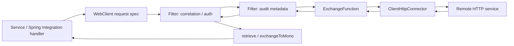
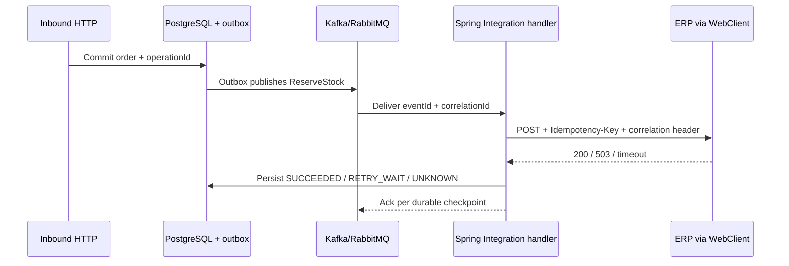
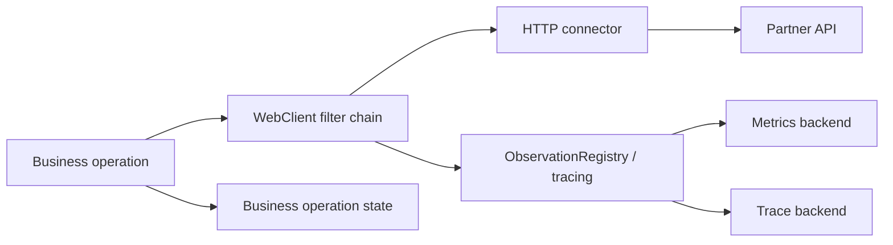

# `ExchangeFilterFunction` and Per-Call Header Handling

## 1. Why Are WebClient Headers an Integration Concern Rather Than Just Syntax?

A Spring Boot application often calls multiple services via `WebClient`: an ERP to look up order status, a shipping partner to create shipments, a payment gateway to verify transactions, and an internal configuration service. Each request may require `Authorization`, a tenant ID, a correlation ID, a locale, an idempotency key, or a contract version. At the same time, the system needs timeouts, retries, error classification, metrics/tracing, and safe logging.

If headers are **stored on a shared client and mutated per request**, concurrent requests easily interfere with one another. If every header is injected by a global filter, an ERP token can accidentally be sent to a CRM service. If a correlation ID is read solely from a `ThreadLocal`, hopping onto a reactive scheduler or `ExecutorChannel` can lose context. And if a filter consumes the response body to log it, downstream decoders have nothing left to deserialize.

In **SPRING_BOOT_INTEGRATION**, this topic supports organizing HTTP clients alongside databases, caches, brokers, and Spring Integration adapters; the focus is on **controlled shared configuration, data contracts, errors, transactions, deduplication, testing, and observability**. In the **WebClient** chapter, two distinct mechanisms must be understood:

- **`ExchangeFilterFunction`:** a functional hook wrapping `WebClient` request/response exchanges, suited to cross-cutting concerns on **each exchange**.
- **Request-specific headers:** headers applying to **a single invocation**, declared on `RequestHeadersSpec`/`RequestBodySpec` or attached by a filter from the current subscription's context.

The goal of this lesson is to build a shared client without sharing **security state or per-request metadata**.

## 2. Architecture: Request Specification, Filter Chain, and HTTP Connector

`WebClient` is Spring WebFlux's reactive HTTP client. A request typically flows through:



Core components:

| Component | Role | Notes |
|---|---|---|
| `WebClient` | Built once and reusable across requests. | Not a place to hold mutable state for the current user. |
| `WebClient.Builder` | Configures base URL, default headers, filters, connector, and codecs. | Mutable builder; configure at startup or branch with `clone()`/`mutate()`. |
| `RequestHeadersSpec`/`RequestBodySpec` | Configures URI, headers, cookies, attributes, and body for the request being built. | Headers here belong to that specific request without mutating the client. |
| `ExchangeFilterFunction` | Function `(ClientRequest, ExchangeFunction) -> Mono<ClientResponse>`. | Can replace the request, inspect the response, and adjust processing. |
| `ClientRequest` | Immutable snapshot of the outbound request passed through filters. | Never mutate directly; build a copy via `ClientRequest.from(...)`. |
| `ClientResponse` | Response carrying status, headers, and body publisher. | Body can normally be consumed only once; release lifecycle must be respected. |
| Reactor `Context` | Immutable per-subscription context in a reactive pipeline. | Not an HTTP header and does not automatically cross brokers/restarts. |
| `ExchangeFunction` | Sends the request to the next exchange stage and returns `Mono<ClientResponse>`. | Filters must call `next.exchange(request)` to proceed over the network. |

Because `WebClient` is reactive, configuring a request and **actually sending the request** happen at different times. Creating a `Mono` normally sends nothing over the network; only when a subscriber subscribes does the exchange chain execute. Retrying via resubscription can re-run the entire filter chain.

## 3. The `ExchangeFilterFunction` Contract

Basic structure:

```java
import org.springframework.web.reactive.function.client.ExchangeFilterFunction;
import reactor.core.publisher.Mono;

ExchangeFilterFunction observe = (request, next) -> {
    // Runs when the request passes through the filter at exchange time.
    return next.exchange(request)
            .doOnNext(response -> {
                // Inspect only safe metadata; do not consume the body.
            });
};
```

Arguments and return value:

1. `request`: the request assembled by `WebClient` with method, URI, and headers.
2. `next`: the next exchange function in the chain—another filter or the connector.
3. Return `Mono<ClientResponse>`: publisher representing the server exchange outcome.

Operations to distinguish:

- **Read request metadata:** `request.method()`, `request.url()`, `request.headers()`, and `request.attributes()`.
- **Build a modified request:** `ClientRequest.from(request)`, updating headers, attributes, or URL per policy.
- **Continue:** `next.exchange(updatedRequest)`.
- **Observe the response:** `doOnNext`/`flatMap` on `Mono<ClientResponse>`.
- **Abort before sending:** return `Mono.error(...)` when policy rejects a request; ensure the caller maps that error properly.
- **Observe errors:** `doOnError` sees exchange/transport errors or downstream filter errors, but **does not automatically treat HTTP 4xx/5xx as a `Throwable`**.

A filter is not a Servlet `Filter`, not a Spring MVC `HandlerInterceptor`, and does not intercept inbound HTTP traffic. It sits in the **outbound `WebClient` exchange pipeline**.

### 3.1. What Belongs in a Filter vs. Elsewhere

| Good Fit for a Filter | Better Handled Elsewhere |
|---|---|
| Adding controlled correlation headers. | Business logic rejecting a payment. |
| Attaching tokens for one specific client/partner. | Persisting DB transactions and outbox state. |
| Logging scrubbed metadata. | Reconciliation when the ERP processed a call but the response dropped. |
| Standardizing select request attributes. | Multi-minute retry workflows requiring durable state. |
| Observing status/transport failures. | Per-API domain error mapping when contracts differ. |

Filters can hold sophisticated logic, yet the more side effects and retries buried inside them, the harder it becomes to identify who owns a failed request.

## 4. Configuring `WebClient` from the Spring Boot-Managed Builder

In Spring Boot with WebFlux on the classpath and matching auto-configuration active, you can inject `WebClient.Builder` preconfigured by Boot and customizers. That builder carries codecs, connector, `ObservationRegistry`, and registered `WebClientCustomizer` beans.

```kotlin
dependencies {
    implementation("org.springframework.boot:spring-boot-starter-webflux")
    implementation("org.springframework.boot:spring-boot-starter-actuator")
}
```

Example dedicated ERP client bean:

```java
import org.springframework.beans.factory.annotation.Value;
import org.springframework.context.annotation.Bean;
import org.springframework.context.annotation.Configuration;
import org.springframework.web.reactive.function.client.WebClient;

@Configuration(proxyBeanMethods = false)
public class ErpWebClientConfiguration {

    @Bean("erpWebClient")
    WebClient erpWebClient(
            WebClient.Builder bootBuilder,
            @Value("${integration.erp.base-url}") String baseUrl) {

        return bootBuilder
                .baseUrl(baseUrl)
                .defaultHeader("X-Client-Application", "order-integration")
                .filter(CorrelationFilters.fromReactorContext())
                .build();
    }
}
```

`CorrelationFilters` is defined in a later section. Sample YAML:

```yaml
integration:
  erp:
    base-url: https://erp.internal.example
```

The address is illustrative and must be replaced with a managed endpoint using allowlists, TLS, and proper secret configuration in deployment. Naming the `@Bean` prevents other clients from accidentally picking up the ERP URL.

**Avoid calling `WebClient.create()` or `WebClient.builder()` in production beans without an explicit reason**: raw builders skip `WebClientCustomizer` beans in the Spring Boot context. HTTP may still work, but metrics, tracing, codecs, or shared connectors can diverge.

### 4.1. Reuse the Client; Never Treat the Builder as Per-Request State

`WebClient` is designed for reuse. When a variant is needed, `webClient.mutate()` creates a builder seeded from the existing client; `WebClient.Builder.clone()` copies a builder where supported by the API/version. Never mutate `baseUrl` or `defaultHeader` on a shared singleton builder per tenant request.

Clean separation:

- Bean `erpWebClient` holds the ERP endpoint and auth.
- Bean `shippingWebClient` holds the shipping carrier endpoint and auth.
- Each call uses `.get()`/`.post()` and attaches request-specific headers.
- Custom filters go only on the builder for the **intended client**; never attach an ERP token across all application clients.

## 5. Attaching Filters via `filter(...)`, `filters(...)`, and `mutate()`

Example filter adding a static application-identification header:

```java
import org.springframework.web.reactive.function.client.ClientRequest;
import org.springframework.web.reactive.function.client.ExchangeFilterFunction;

static ExchangeFilterFunction appNameFilter() {
    return (request, next) -> {
        ClientRequest updated = ClientRequest.from(request)
                .headers(headers ->
                    headers.set("X-Client-Application", "order-integration"))
                .build();

        return next.exchange(updated);
    };
}
```

Registration:

```java
WebClient client = bootBuilder
        .baseUrl(baseUrl)
        .filter(appNameFilter())
        .build();
```

Key points:

- `filter(filter)` appends a filter to the builder.
- `filters(listConsumer)` lets you inspect or edit the current filter list (adding, removing, reordering). Clearing or replacing the whole list can strip filters added by Boot or other libraries.
- `webClient.mutate().filter(filter).build()` produces a new client derived from the existing client without modifying the original.
- Simple cases can use `ExchangeFilterFunction.ofRequestProcessor(...)` and `ofResponseProcessor(...)`.
- Never build a new `WebClient` inside every filter invocation, which breaks connection reuse, metrics, and transport configuration.

### 5.1. Why Use `ClientRequest.from(request)`?

`ClientRequest` is not mutated in place via `request.getHeaders().set(...)`. Creating a copy preserves the rest of the request—HTTP method, URI, body inserter, and metadata—per the builder API.

```java
ClientRequest updated = ClientRequest.from(request)
        .headers(h -> h.set("X-Request-Source", "integration"))
        .build();
```

Never construct `ClientRequest.create(request.method(), request.url())` manually and forget to copy body, cookies, attributes, and other settings. For `POST` requests, dropping the body or content type breaks the data contract.

## 6. Three Ways to Set Headers: Default, Per-Request, and Filter

| Placement | Typical Syntax | Scope | Best Suited For |
|---|---|---|---|
| `builder.defaultHeader(...)` | When building the `WebClient` bean. | Requests using that client unless overridden per API rules. | App identification headers, stable `Accept`. |
| `request.header(...)` / `headers(...)` | On `client.get()/post()`. | **One specific request**. | `Idempotency-Key`, locale, authenticated tenant. |
| `ExchangeFilterFunction` | On the builder; runs on every exchange. | Every request through that client, optionally reading context/attributes. | Correlation, dynamic tokens, shared logging/redaction. |

Examples:

```java
// Default header set when building the bean:
WebClient client = bootBuilder
        .defaultHeader("X-Client-App", "order-integration")
        .build();

// Only this request carries Idempotency-Key:
Mono<ReservationReceipt> result = client.post()
        .uri("/reservations")
        .header("Idempotency-Key", operationId)
        .bodyValue(command)
        .retrieve()
        .bodyToMono(ReservationReceipt.class);
```

### 6.1. `header(name, value)` vs. `headers(h -> h.set(...))`

`header(...)` appends header values when building a request. When you need **exactly one value replacing any prior value**, use:

```java
client.get()
        .uri("/orders/{id}", orderId)
        .headers(h -> {
            h.set("X-Tenant-Id", tenantId);
            h.set("X-Correlation-Id", correlationId);
        })
        .retrieve()
        .bodyToMono(OrderView.class);
```

`HttpHeaders.set(...)` replaces existing values for that header name, which matters especially for `Authorization`, tenant IDs, and headers that must not repeat. Still, **filters running after request creation can overwrite the header again**. Do not treat "set in the gateway method" as an immutable guarantee against downstream filters.

Never put `defaultHeader("Authorization", ...)` on a client shared across tenants. Tokens with distinct lifecycles or audiences belong in per-request/gateway calls or a **partner-scoped** filter.

## 7. Example of Request-Level Headers in a Business Gateway

Suppose the ERP exposes this REST contract:

```text
GET  /api/orders/{id}
POST /api/orders/{id}/reserve
```

Illustrative DTOs:

```java
public record OrderView(String id, String status, long version) {}

public record ReserveCommand(String sku, int quantity) {}

public record ReservationReceipt(String operationId, String state) {}
```

Gateway using the Spring-managed `WebClient` bean:

```java
import org.springframework.beans.factory.annotation.Qualifier;
import org.springframework.stereotype.Component;
import org.springframework.web.reactive.function.client.WebClient;
import reactor.core.publisher.Mono;

@Component
public class ErpOrderGateway {

    private final WebClient erp;

    public ErpOrderGateway(
            @Qualifier("erpWebClient") WebClient erp) {
        this.erp = erp;
    }

    public Mono<OrderView> getOrder(
            String orderId, String tenantId) {

        return erp.get()
                .uri("/api/orders/{id}", orderId)
                .headers(h -> h.set("X-Tenant-Id", tenantId))
                .retrieve()
                .bodyToMono(OrderView.class);
    }

    public Mono<ReservationReceipt> reserve(
            String orderId,
            String tenantId,
            String operationId,
            ReserveCommand command) {

        return erp.post()
                .uri("/api/orders/{id}/reserve", orderId)
                .headers(h -> {
                    h.set("X-Tenant-Id", tenantId);
                    h.set("Idempotency-Key", operationId);
                })
                .bodyValue(command)
                .retrieve()
                .bodyToMono(ReservationReceipt.class);
    }
}
```

This assumes the ERP contract accepts `X-Tenant-Id` and `Idempotency-Key`; verify against partner docs in real projects. `tenantId` must come from an **authenticated and authorized** context, never copied blindly from an untrusted inbound HTTP header.

Never generate a new `operationId` on each resubscription or retry of the same intent. If the first send succeeded and the response dropped, a new key can create a second reservation. State reconciliation after write timeouts is still required.

### 7.1. Why Not Store the Current Tenant in a Gateway Field?

Anti-pattern:

```java
@Component
class UnsafeErpGateway {
    private String currentTenant;

    void setTenant(String tenant) {
        this.currentTenant = tenant;
    }

    // Another request can overwrite currentTenant before network execution.
}
```

`@Component` beans are singletons by default, and a `Mono` can be subscribed to after the method returns. Request-scoped mutable state never belongs in a singleton/gateway field or a shared builder. Pass it via method parameters or controlled Reactor Context.

## 8. `ExchangeFilterFunction.ofRequestProcessor`: Simple Request Transformations

When no response inspection or conditional branching is needed, you can use the factory method:

```java
import org.springframework.web.reactive.function.client.ClientRequest;
import org.springframework.web.reactive.function.client.ExchangeFilterFunction;
import reactor.core.publisher.Mono;

static ExchangeFilterFunction standardHeaders() {
    return ExchangeFilterFunction.ofRequestProcessor(request -> {
        ClientRequest updated = ClientRequest.from(request)
                .headers(h -> {
                    h.set("X-Client-App", "order-integration");
                    h.set("X-Contract-Version", "2");
                })
                .build();

        return Mono.just(updated);
    });
}
```

`ofRequestProcessor` transforms the request before passing it to the next filter or connector. Because it returns `Mono<ClientRequest>`, it can fetch data asynchronously if designed properly, though you should avoid surprising I/O just to populate a static header.

### 8.1. Which Attributes Belong in a Filter?

Relatively uniform metadata works well:

- Application name or fixed client version.
- Correlation ID supplied by the caller/gateway or Reactor Context.
- Properly scoped per-partner authentication filters.
- User-Agent or protocol headers required on every request for that client.

By contrast, a command's `Idempotency-Key` belongs to a **business operation**, so pass it explicitly in the gateway method. If a filter generates a new key on every exchange, retries will send **different keys** for the same intent.

## 9. Reactor Context: Reading Correlation IDs per Subscription

In reactive code, `ThreadLocal` is unreliable for passing values across stages. A pipeline can switch threads, run on different schedulers, or be subscribed to later. Reactor provides **Context** attached to the subscription, accessed via `Mono.deferContextual(...)`.

Complete filter example:

```java
import org.springframework.web.reactive.function.client.ClientRequest;
import org.springframework.web.reactive.function.client.ExchangeFilterFunction;
import reactor.core.publisher.Mono;

public final class CorrelationFilters {

    private CorrelationFilters() {}

    public static ExchangeFilterFunction fromReactorContext() {
        return (request, next) ->
                Mono.deferContextual(context -> {
                    String correlationId =
                            context.getOrDefault("correlationId", "");

                    if (correlationId.isBlank()) {
                        return next.exchange(request);
                    }

                    ClientRequest updated = ClientRequest.from(request)
                            .headers(headers -> headers.set(
                                    "X-Correlation-Id", correlationId))
                            .build();

                    return next.exchange(updated);
                });
    }
}
```

Client call:

```java
Mono<OrderView> result = erpWebClient.get()
        .uri("/api/orders/{id}", "O-42")
        .retrieve()
        .bodyToMono(OrderView.class)
        .contextWrite(context ->
                context.put("correlationId", "request-42"));
```

When `result` is subscribed to, the filter reads `correlationId` from Context. When absent, the example omits the header instead of sending a literal `unknown` that pollutes logs and traces.

**Important:** this illustrates **custom business correlation**. For standard W3C distributed tracing such as `traceparent`, prefer official Micrometer Observation/Tracing and context propagation; never synthesize a `traceparent` from a random ID and assume valid distributed traces.

### 9.1. Context Does Not Populate Automatically from Inbound HTTP

Calling `.contextWrite(...)` in the snippet merely demonstrates passing values inside one reactive chain. In a real application, define where the correlation ID originates:

1. Inbound HTTP gateway validates/accepts or generates the ID per policy.
2. Stores the ID in Reactor Context / Observation Context accordingly.
3. `WebClient` filter reads the context to attach the partner-understood header.
4. Broker producers carry the ID in message envelopes/headers; consumers establish a **fresh context** when processing the message in another process.
5. Logs and traces correlate via the ID without one request overwriting another's context.

Never copy all inbound HTTP headers or `ThreadLocal` values onto outbound calls, which can leak user `Authorization` or cookies to partners.

## 10. Request Attributes Differ from Reactor Context and HTTP Headers

`WebClient` lets you attach **attributes** per request. Attributes are **client-exchange-internal metadata** readable by filters and not transmitted over the wire.

```java
Mono<OrderView> lookup = erpWebClient.get()
        .uri("/api/orders/{id}", orderId)
        .attribute("operation", "order-lookup")
        .attribute("expectedTenant", tenantId)
        .retrieve()
        .bodyToMono(OrderView.class);
```

Filter reading them:

```java
ExchangeFilterFunction operationLogFilter = (request, next) -> {
    Object operation =
            request.attributes().getOrDefault("operation", "unknown");

    // Record metrics/logs using a bounded-cardinality operation value.
    return next.exchange(request);
};
```

| Data | Where It Lives | Sent Over Wire by Default? | Examples |
|---|---|---|---|
| HTTP header | `ClientRequest.headers()`. | **Yes**, sent to server per protocol. | `Idempotency-Key`, `Accept`. |
| Request attribute | `ClientRequest.attributes()`. | **No**. | Logical operation name, internal policy hint. |
| Reactor Context | Reactive subscription context. | **No**; a filter must explicitly copy needed fields to headers. | Business correlation, framework tracing context. |
| Java `ThreadLocal` | Current thread. | No; also unsafe across scheduler boundaries. | MDC on one thread if properly bridged. |
| Business payload | Request body/DTO. | Yes when serialized as body. | `ReserveCommand`. |

Attributes are ideal when a filter needs an operation name without putting it on the wire. Avoid storing huge mutable request or credential objects in attributes and passing them across callbacks without lifetime control.

## 11. Dynamic Authentication: Partner-Scoped, Never Global

A filter can fetch a token before each request. Suppose we have a reactive abstraction `ErpTokenProvider`:

```java
import reactor.core.publisher.Mono;

public interface ErpTokenProvider {
    Mono<String> currentAccessToken();
}
```

Filter:

```java
import org.springframework.web.reactive.function.client.ClientRequest;
import org.springframework.web.reactive.function.client.ExchangeFilterFunction;
import reactor.core.publisher.Mono;

static ExchangeFilterFunction erpBearerAuth(
        ErpTokenProvider tokens) {

    return (request, next) ->
        Mono.defer(() -> tokens.currentAccessToken())
            .flatMap(token -> {
                ClientRequest authorized =
                        ClientRequest.from(request)
                        .headers(h -> h.setBearerAuth(token))
                        .build();

                return next.exchange(authorized);
            });
}
```

Dedicated ERP bean:

```java
@Bean("erpWebClient")
WebClient erpWebClient(
        WebClient.Builder builder,
        ErpTokenProvider tokens,
        ErpClientProperties config) {

    return builder
            .baseUrl(config.baseUrl().toString())
            .filter(erpBearerAuth(tokens))
            .filter(CorrelationFilters.fromReactorContext())
            .build();
}
```

`ErpClientProperties` is typed application configuration registered/bound from `integration.erp.*`. The example assumes the token provider returns a valid token and manages caching/expiry/refresh via its own policy. Never call `.block()` to refresh a token inside a filter on an event loop; token providers should use reactive APIs or non-blocking caches.

### 11.1. Preventing Cross-Host Token Leakage

Mandatory rules:

- ERP tokens must **only** be attached to the ERP client and allowed endpoints/redirects.
- Never use a global `WebClientCustomizer` to attach a single token to all outbound services.
- If callers can supply absolute URIs, enforce a host allowlist; never send bearer tokens to request-controlled hosts.
- Never log `Authorization`, cookies, `X-Api-Key`, or URL queries containing secrets.
- For redirects, audit connector redirect policy; never assume sensitive headers are stripped safely across all versions/transports.
- If tokens depend on tenant/user, validate access rights and audience/scope before acquiring the token.

Spring Security OAuth2 provides filters/mechanisms for client credentials and authorized clients depending on the Spring Security generation. When using OAuth2 libraries, prefer the official mechanisms over hand-rolled token refresh logic.

## 12. Filter Order Affects Both Request and Response

Filters form a chain. With two filters `F1` and `F2` added in order and normal `next.exchange(...)` calls:

```text
Request:  caller -> F1 -> F2 -> connector -> server
Response: caller <- F1 <- F2 <- connector <- server
```

A later filter setting a header can **overwrite** an earlier filter's header:

```java
builder
    .filter((request, next) -> next.exchange(
        ClientRequest.from(request)
            .headers(h -> h.set("X-Mode", "A"))
            .build()))
    .filter((request, next) -> next.exchange(
        ClientRequest.from(request)
            .headers(h -> h.set("X-Mode", "B"))
            .build()));
```

In this snippet, the connector normally sends `X-Mode: B`, because the second filter uses `set`. Calling `add`/`header` repeatedly can send multiple header values, breaking authentication or idempotency.

### 12.1. Observing Requests and Responses Without Arbitrarily Reading the Body

A metadata-only logging filter:

```java
import org.slf4j.Logger;
import org.slf4j.LoggerFactory;
import org.springframework.web.reactive.function.client.ExchangeFilterFunction;

private static final Logger log =
        LoggerFactory.getLogger("outbound-http");

static ExchangeFilterFunction statusLogger() {
    return (request, next) -> {
        String method = request.method().name();

        return next.exchange(request)
                .doOnNext(response -> {
                    log.info("Outbound method={} status={}",
                            method, response.statusCode().value());
                })
                .doOnError(error -> {
                    log.warn("Outbound transport failure method={} type={}",
                            method, error.getClass().getSimpleName());
                });
    };
}
```

Logging only method and status carries far less PII risk than printing full URIs or headers. When URIs or operations are needed, use normalized templates or operation names plus redaction.

**HTTP 404/503 does not trigger `doOnError` in this filter**: `next.exchange(...)` completes normally with a `ClientResponse` carrying that status. HTTP errors are converted into exceptions by `retrieve()` **after the filter chain**, unless another filter or handler maps them earlier. To measure HTTP status errors inside a filter, inspect `response.statusCode()` in `doOnNext`; to log exceptions emitted by `retrieve()`, attach `doOnError` at the gateway after body/status mapping.

## 13. Reading the Response Body in a Filter: Respect Single-Use Data

A response body is a stream with buffer/resource lifecycles, not a string that can be read endlessly.

Anti-pattern:

```java
// Do not use: consumes the response body and returns the original response.
return next.exchange(request)
        .flatMap(response ->
                response.bodyToMono(String.class)
                        .doOnNext(log::info)
                        .thenReturn(response));
```

Afterward, downstream `retrieve().bodyToMono(OrderView.class)` may find no body left to decode; logging raw responses also risks leaking tokens, customer PII, and large payloads.

If inspecting the body is truly unavoidable, you must:

1. Cap maximum body size and restrict allowed content types.
2. Read/release buffers using supported APIs to avoid leaking pooled `DataBuffer` instances.
3. Build a new `ClientResponse` carrying the body for downstream while preserving status, headers, and cookies.
4. Never log secrets, PII, or binary/streaming payloads.
5. Test large responses, decoding failures, cancellation, and backpressure.

Most applications should **log metadata in filters** and **log/map error bodies in the gateway after deserialization**, where contracts and redaction rules are explicit. For 4xx/5xx errors, `retrieve().onStatus(...)` or `exchangeToMono(...)` is usually cleaner than a body-reading filter.

## 14. `retrieve()`, `onStatus(...)`, and `exchangeToMono(...)`

An `ExchangeFilterFunction` operates on HTTP exchanges, while domain error mapping belongs in the gateway.

### 14.1. `retrieve()` for Standard APIs

```java
return erp.get()
        .uri("/api/orders/{id}", orderId)
        .retrieve()
        .bodyToMono(OrderView.class);
```

By default, `retrieve()` turns HTTP 4xx/5xx into `WebClientResponseException` when the body is handled. However, an HTTP 200 can still carry a business error inside JSON; verify the contract.

### 14.2. `onStatus` for Partner-Specific Error Mapping

```java
return erp.get()
        .uri("/api/orders/{id}", orderId)
        .retrieve()
        .onStatus(
                status -> status.value() == 404,
                response -> Mono.error(
                    new OrderNotFoundException(orderId)))
        .bodyToMono(OrderView.class);
```

`OrderNotFoundException` is application-defined. This snippet assumes 404 means the order does not exist per ERP contract, not a misconfigured endpoint. Errors like 401/403, 429, 503, and SOAP/XML business faults require separate policies.

### 14.3. `exchangeToMono` for Conditional Status and Body Handling

```java
return erp.get()
        .uri("/api/orders/{id}", orderId)
        .exchangeToMono(response -> {
            if (response.statusCode().is2xxSuccessful()) {
                return response.bodyToMono(OrderView.class);
            }
            if (response.statusCode().value() == 404) {
                return Mono.empty();
            }
            return response.createException()
                    .flatMap(Mono::error);
        });
```

`exchangeToMono` gives the caller control over `ClientResponse`; when the publisher finishes, Spring releases unconsumed bodies per API contract. Never hold a reference to `ClientResponse` and read the body after the callback exits. For streaming/`exchangeToFlux`, lifecycle discipline is even more critical.

**Conclusion:** filters suit cross-cutting headers and observation; `retrieve()/exchangeToMono` in gateways suits per-operation error contracts. Never force a shared filter to know every partner's business status codes.

## 15. Retries: Placement and How Many Times Filters Execute

Reactor's `retryWhen(...)` **resubscribes** to the upstream publisher. Because `WebClient` exchanges are built lazily, request filters can execute again on every attempt; dynamic tokens may be re-fetched, while **idempotency keys must stay constant**.

Idempotent GET example:

```java
import java.time.Duration;
import reactor.util.retry.Retry;

Mono<OrderView> result = erp.get()
        .uri("/api/orders/{id}", orderId)
        .retrieve()
        .bodyToMono(OrderView.class)
        .retryWhen(
            Retry.backoff(2, Duration.ofMillis(200))
                .filter(this::isTransientFailure));
```

`isTransientFailure(Throwable)` is a gateway-defined helper evaluating status, transport, and deadlines per contract. `Retry.backoff(2, ...)` allows **at most 2 retries after the initial attempt** when the predicate matches.

Constraints:

- Never retry 400/validation/schema/auth failures repeatedly.
- HTTP 429/503 may retry with backoff/jitter while respecting quotas and `Retry-After` as appropriate.
- HTTP request timeouts can happen after the server processed a `POST`; never retry writes without idempotency/reconciliation.
- Filters only see `ClientResponse`; if you place a retry **inside a filter** around `next.exchange`, 503 is not yet an exception as it is after `retrieve()`.
- If the request body is a non-replayable stream, resubscribing/retrying may be unsafe; verify replayability of the request body.
- Budget retries end-to-end: HTTP client + Spring Integration + broker consumer must not stack unbounded retries.
- Token refresh and auth filters can re-run per attempt; prevent refresh storms when concurrent calls receive 401.

### 15.1. Never Generate Idempotency Keys in a Per-Attempt Filter

Business bug:

```java
// Anti-pattern: every HTTP attempt gets a new key.
ClientRequest updated = ClientRequest.from(request)
    .headers(h -> h.set(
        "Idempotency-Key", java.util.UUID.randomUUID().toString()))
    .build();
```

Correct pattern: `operationId` is created **when accepting a new business command** and stored alongside the job/outbox; the gateway puts `operationId` in the header before retries. Even on broker redelivery, the operation ID stays identical.

## 16. Timeouts and Cancellation: Filters Do Not Replace Transport Policies

An outbound call involves queue wait, connection acquisition, connect/TLS, server processing, read/deserialization, and retry backoff. `WebClient` can run on Reactor Netty, Jetty, or other connectors; timeout and pool settings depend on transport and version.

Illustrative example with Reactor Netty when chosen by the application:

```java
import io.netty.channel.ChannelOption;
import java.time.Duration;
import org.springframework.http.client.reactive.ReactorClientHttpConnector;
import reactor.netty.http.client.HttpClient;
import org.springframework.web.reactive.function.client.WebClient;

HttpClient http = HttpClient.create()
        .option(ChannelOption.CONNECT_TIMEOUT_MILLIS, 500)
        .responseTimeout(Duration.ofSeconds(2));

WebClient configured = bootBuilder
        .baseUrl(baseUrl)
        .clientConnector(new ReactorClientHttpConnector(http))
        .filter(CorrelationFilters.fromReactorContext())
        .build();
```

This **intentionally replaces the connector**; verify it does not drop SSL/proxy/connection pool/transport metrics configured earlier by Boot or customizers. Never call `HttpClient.create()` per request. With mTLS/SSL bundles, configure the actual connector and test certificates and hostname verification.

`Mono.timeout(Duration.ofSeconds(2))` caps **how long the publisher has to complete** from the subscriber's view, yet cannot undo committed server side effects. Cancellation can close sockets, not roll back the ERP or database. Thus, correlation-header filters do not resolve remote command ambiguity; you still need idempotency and reconciliation.

## 17. Headers and Consistency Across HTTP, Databases, and Brokers

A real-world flow:



Distinguish the meaning of each ID:

| ID | Origin | Where Used | Preserved Across Retries? |
|---|---|---|---|
| `operationId` | Business command/outbox. | `Idempotency-Key`, DB state, reconciliation. | **Yes**, mandatory for the intent. |
| `eventId` | Event producer. | Inbox deduplication and delivery audit. | Preserved on redelivery of the same event. |
| `correlationId` | Inbound boundary/workflow. | Logs/traces/partner-supported header. | Usually preserved to link the workflow. |
| `traceId/spanId` | Tracing system. | Distributed tracing via standard propagation. | May create new child spans per attempt per tracing policy. |
| `tenantId` | Identity/authorization domain. | Data scoping and controlled routing. | Derived from verified identity, never arbitrary user headers. |

Never confuse `correlationId` with an idempotency key: correlation is for **tracking**, not preventing duplicate server execution. When Spring Integration handles messages on another thread, never rely on inbound HTTP MDC/`ThreadLocal`; carry IDs in **durable message envelopes/headers** and restore context when the consumer begins processing.

### 17.1. Never Expect Java Transactions to Propagate via Outbound HTTP Headers

Spring's `@Transactional` on JDBC/JPA does not span across `WebClient` to the ERP. No custom `Transaction-ID` header makes a DB rollback undo a remote HTTP side effect. Use outbox/saga/compensation and idempotency when DB commits and HTTP calls must converge reliably.

## 18. Headers Across Redirects, Proxies, and Tenant Boundaries

A header safe for `https://erp.example` can become a leak if the request redirects or the URL can vary:

- Block absolute URIs outside an allowlist whenever a client attaches bearer tokens.
- Audit HTTP connector redirect behavior and whether `Authorization`, cookies, or custom tenant headers get forwarded to other hosts.
- Never copy all inbound headers to outbound via `headers(h -> h.addAll(inboundHeaders))`.
- Never write PII-bearing custom headers into metric labels or unredacted logs.
- Through corporate proxies, verify routing, `Host`, `Forwarded`, and SSL trust instead of assuming proxies respect tenant/trace policies.
- Validate CR/LF, length, and character set on correlation IDs if sourced from user-reachable inputs.

### 18.1. Sharing One WebClient Across Multiple Tenants?

A single client can be shared when **base URL and transport are shared** and per-request identity is tightly controlled, without storing mutable auth state on the client. If tenants require distinct hosts, credentials, or truststores, use a client registry/factory keyed by trusted tenant identifiers with explicit quotas and lifecycles; never mutate a shared singleton builder per tenant.

## 19. Observability: Filter Logging Is Not Micrometer Observation

Spring Boot can customize `WebClient.Builder` with `ObservationRegistry` and related components when Actuator/Micrometer are properly configured. Custom filters logging correlation headers complement—and **never replace**—standard instrumentation.



Checklist:

1. `WebClient` is built from the **Boot-managed builder**, not `WebClient.create()` which drops customizations.
2. Observation handlers, meters, and tracing exporters are properly configured in the environment.
3. HTTP client request counts/statuses/latencies track **each attempt**, distinct from logical business operations.
4. Correlation IDs appear in logs/traces across async boundaries without faking `traceparent`.
5. URI templates/operations keep low cardinality; never tag by order, customer, or request ID.
6. No duplicate instrumentation double-counting a single request.

### 19.1. Using Request Attributes to Classify Operations

```java
client.get()
        .uri("/api/orders/{id}", orderId)
        .attribute("integrationOperation", "erp-order-lookup")
        .retrieve()
        .bodyToMono(OrderView.class);
```

A filter can read this value to record an **application metric** using a bounded vocabulary. `request.attributes()` do not automatically become Micrometer tags or wire headers; write explicit instrumentation if desired. Never put `eventId` or `orderId` into high-cardinality tags.

### 19.2. HTTP 503 Is a Response, Not a Transport Exception

If a filter records errors only in `doOnError`, an HTTP 503 counts as a "transport-level success" before `retrieve()` maps it to an exception afterward. Instrumentation must track both **HTTP status** and **transport errors**; business errors inside JSON bodies still need gateway-level metrics.

## 20. Unit Testing Request Filters Without Starting a Real Server

To test header logic in isolation, supply a fake `ExchangeFunction` capturing `ClientRequest`. This verifies filter logic, **not** Spring Boot client wiring or HTTP connector behavior.

Example with JUnit Jupiter and Reactor Test:

```java
import org.junit.jupiter.api.Test;
import org.springframework.http.HttpHeaders;
import org.springframework.http.HttpStatus;
import org.springframework.http.MediaType;
import org.springframework.web.reactive.function.client.ClientResponse;
import org.springframework.web.reactive.function.client.ExchangeFunction;
import org.springframework.web.reactive.function.client.WebClient;
import reactor.core.publisher.Mono;
import reactor.test.StepVerifier;

import static org.junit.jupiter.api.Assertions.assertEquals;

class CorrelationFilterTest {

    record OrderResult(String orderId, String status) {}

    @Test
    void correlationHeaderComesFromSubscriberContext() {
        ExchangeFunction fakeExchange = request -> {
            assertEquals("flow-42",
                    request.headers().getFirst("X-Correlation-Id"));

            return Mono.just(
                ClientResponse.create(HttpStatus.OK)
                    .header(HttpHeaders.CONTENT_TYPE,
                            MediaType.APPLICATION_JSON_VALUE)
                    .body("""
                        {"orderId":"O-42","status":"PAID"}
                        """)
                    .build());
        };

        WebClient webClient = WebClient.builder()
                .exchangeFunction(fakeExchange)
                .filter(CorrelationFilters.fromReactorContext())
                .build();

        Mono<OrderResult> publisher = webClient.get()
                .uri("https://example.invalid/orders/O-42")
                .retrieve()
                .bodyToMono(OrderResult.class)
                .contextWrite(c -> c.put("correlationId", "flow-42"));

        StepVerifier.create(publisher)
                .assertNext(value ->
                    assertEquals("PAID", value.status()))
                .verifyComplete();
    }
}
```

This requires `reactor-test` in test dependencies, and `CorrelationFilters` from section 9. Boot test starters generally bring JUnit/Jackson/WebFlux test dependencies, though actual project dependencies should be verified. `WebClient.builder()` is used **intentionally in this unit test** to isolate the filter; do not mistake it for proof that production builders carry Micrometer, SSL, or customizers.

### 20.1. Testing Two Concurrent Requests for Header Isolation

Launch two parallel subscriptions with different `correlationId` values, capture request metadata into a thread-safe structure in the fake exchange, and assert each request carries its exact ID/URI. Never rely solely on sequential tests because shared-mutable-state bugs often surface only under concurrency.

Also test when Context omits the key: the filter must proceed **without** leaking the previous request's value. That proves far more than testing a single happy path.

## 21. Integration Testing with an HTTP Stub and Spring Boot Context

To validate everything end-to-end, use `@SpringBootTest`, inject the **production beans** `erpWebClient`/`ErpOrderGateway`, point base URL to an HTTP stub (MockWebServer/WireMock/Testcontainers), and verify:

1. Request URI and HTTP method match contract.
2. `Authorization` header belongs to ERP and is never sent to other hosts.
3. `X-Tenant-Id` and `Idempotency-Key` match each business operation without cross-request overwrite.
4. Correlation header comes from Reactor Context or explicit gateway parameters.
5. JSON serialization, content type, and decoder behave properly.
6. HTTP 4xx/5xx status mapping works; connection errors classify separately.
7. Token provider failures prevent **sending the request** rather than falling back to stale invalid tokens.
8. Timeouts, retry counts, and network connection limits match policy.
9. Metrics and tracing remain active because the client uses the Boot-managed builder.

Use `@DynamicPropertySource` to bind dynamic stub server ports when applicable, avoiding hardcoded `localhost:port` and keeping context caching stable. For custom HTTP services without a `ServiceConnection` factory, dynamic properties set `integration.erp.base-url`; for PostgreSQL/Redis where supported, `@ServiceConnection` can be used separately.

### 21.1. Key Header Test Matrix

| Scenario | Expectation |
|---|---|
| `defaultHeader` sets shared value, request sets specific value | Final wire value matches configured API/filter precedence. |
| User-supplied `Authorization` header | Never forwarded verbatim to ERP. |
| Two tenants calling concurrently | No mixed tokens or tenant headers. |
| Missing correlation ID | Never reuses a prior request's ID; matches fallback policy. |
| GET 503 retried twice | Exact attempt count; correlation remains consistent. |
| `POST` retry with idempotency key | Same business operation preserves identical key. |
| Token provider errors | Request never sent with null or placeholder token. |
| Redirect to another host | Credentials do not leak per policy. |
| Error response with huge/PII body | Logs emit safe metadata only; body not misconsumed. |
| Response body cancelled | No buffer or connection leaks. |
| Missing/invalid JSON fields | Codec/contract error reported clearly. |
| Micrometer instrumentation | Attempt metrics emitted; URI tags omit order IDs. |

## 22. Common Pitfalls When Filters and Headers "Look Right"

| Symptom | Possible Cause | How to Verify |
|---|---|---|
| Header missing despite declared filter | Client bypassed that builder/filter bean, or publisher was never subscribed | Inspect bean injection, filter list, and HTTP stub |
| Filter runs twice per logical call | Retry resubscribed, double instrumentation, or filter registered twice | Compare attempt counts, subscribers, and `mutate`/`filters` setup |
| User A's header appears on User B's request | Mutable field/singleton builder or `ThreadLocal` leak | Run concurrency tests and remove request state from shared beans |
| `X-Correlation-Id` empty | Reactor Context not written or lost across async boundary | Trace `contextWrite` placement and consumer context creation |
| HTTP 503 misses filter's `doOnError` | `next.exchange` returns `ClientResponse`; `retrieve()` throws afterward | Inspect status on response or catch errors at the gateway |
| Downstream fails to decode body | Filter read the response body without rebuilding it cleanly | Remove body logging or rebuild with proper buffer lifecycle |
| Duplicate `Authorization` headers | Repeated `add`/`header` calls or stacked auth filters | Use `setBearerAuth` and assert final wire headers |
| ERP OAuth token sent to CRM | Auth filter/global customizer overly broad or missing URI allowlist | Isolate clients/credentials and test redirects/absolute URIs |
| Trace breaks after `ExecutorChannel` | Missing context propagation; `ThreadLocal` does not cross threads | Carry correlation in messages and enable proper tracing bridges |
| Caching/gateway mapping breaks after adding filter | Filter overwrote `Accept`, `Content-Type`, or dropped body | Assert wire requests/responses and converters |
| HTTP metrics disappear | Client built with `WebClient.create()` instead of Boot builder | Inspect bean construction and `ObservationRegistry` |
| Retries create duplicate ERP commands | Filter generates a new idempotency key per attempt | Create key per business operation in gateway/outbox and reuse |
| `timeout` errors while ERP still mutates | Caller cancellation does not roll back remote commits | Reconcile by `operationId` before retrying |

### 22.1. Ordered Diagnostic Steps

1. Identify the **WebClient bean** and its builder; confirm dependencies match.
2. Identify every place headers are added: `defaultHeader`, `headers`, filters, or connector.
3. Confirm the filter is in the chain and check ordering when multiple filters write the same header.
4. Confirm Context/attributes exist at **subscription time**.
5. Use an HTTP stub to inspect **wire headers**, rather than relying on logs printed before the final filter.
6. Separate HTTP statuses, transport exceptions, and business error bodies.
7. Verify whether retries/resubscriptions re-invoke filters as intended.
8. Add regression tests for isolation, token scoping, context propagation, and redaction.

## 23. Anti-Patterns to Avoid

1. **Mutating a singleton `WebClient.Builder` per tenant right before sending a request.** Leaks headers/base URL across requests.
2. **Calling `WebClient.create(...)` inside every method**, bypassing Boot customizers and connection reuse.
3. **Putting an ERP token into a global `WebClientCustomizer`** when the app calls unrelated hosts.
4. **Copying all inbound HTTP headers to outbound** without an allowlist.
5. **Setting `Idempotency-Key` to a fresh UUID in a per-attempt filter**, risking duplicates on retry.
6. **Reading MDC/`ThreadLocal` directly as authoritative context in reactive pipelines**.
7. **Assuming Reactor Context automatically becomes HTTP headers** without a filter or tracing instrumentation.
8. **Assuming `ExchangeFilterFunction.doOnError` sees all HTTP 4xx/5xx responses**.
9. **Reading and discarding the response body just to log it**, starving the downstream decoder.
10. **Attaching logging filters that print raw headers/bodies**, exposing tokens, cookies, and PII.
11. **Applying a blanket retry filter to all requests** without separating GET from side-effecting POSTs.
12. **Double-instrumenting tracing**, causing double counts or malformed nested spans.
13. **Calling `.block()` on Reactor event loops**, stalling reactive execution.
14. **Holding JDBC transactions open across long HTTP retries/backoffs**, exhausting DB connection pools.
15. **Assuming a request timeout means the remote server did not commit**.
16. **Using `defaultHeaders` to store the "latest request's" correlation or tenant**.
17. **Testing only one sequential request** and skipping cross-tenant concurrency and redirect-leakage tests.

## 24. Checklist for Applying `ExchangeFilterFunction` in Spring Boot Integration

- [ ] Define API/partner, base URL, TLS, token audience, and transport per `WebClient` bean.
- [ ] Inject `WebClient.Builder` from the Spring Boot context without inadvertently bypassing customizers.
- [ ] Build and reuse `WebClient` instances; never mutate a shared builder per request.
- [ ] Separate static default headers, per-request business headers, and cross-cutting filters cleanly.
- [ ] Single-value headers are set via `HttpHeaders.set`/`setBearerAuth`.
- [ ] Filters preserve method, URI, body, and attributes when calling `ClientRequest.from(...)`.
- [ ] Filter ordering and potential header overrides across filters are audited.
- [ ] Partner credentials are never attached to global filters or multi-host untrusted clients.
- [ ] Correlation IDs originate from trusted boundaries, live in Reactor Context, and/or are passed explicitly.
- [ ] Tracing framework manages `traceparent`; never forge distributed trace headers manually.
- [ ] Inbound headers/PII are never forwarded blindly; enforce allowlists, redaction, and size bounds.
- [ ] Idempotency keys remain stable per business operation across retries and broker redeliveries.
- [ ] 4xx/5xx errors are mapped in gateways per contract; filters never silently eat bodies.
- [ ] HTTP timeouts, retry budgets, pools, bulkheads, and rate limits are configured per dependency.
- [ ] No blocking on Reactor event loops; request body publishers support replay if retried.
- [ ] Write commands implement outbox/inbox/transaction/UNKNOWN reconciliation as needed.
- [ ] Filters are unit-tested with fake `ExchangeFunction` and Reactor Context.
- [ ] Production beans are integration-tested against HTTP stubs including concurrency and tenant isolation.
- [ ] Redirects, token refresh failures, header precedence, and response body lifecycles are tested.
- [ ] Metrics track HTTP attempts and business latency without tagging by `orderId`/`correlationId`.
- [ ] Runbooks exist for missing headers, auth failures, broken traces, and retry-induced duplicates.

## 25. Summary

**`ExchangeFilterFunction` is the extension point in `WebClient`'s outbound exchange chain: it can inspect or construct a modified `ClientRequest`, delegate to `next.exchange(...)`, and inspect `ClientResponse` metadata.** Headers varying per request should be specified via `.headers(...)` on the request spec or pulled by a filter from the current subscription's Reactor Context or attributes—never stored in mutable singleton state.

In **SPRING_BOOT_INTEGRATION**, an effective pattern is **using the Boot-managed builder, isolating clients per dependency, propagating correlation/tenant/idempotency cleanly across boundaries, scoping authentication tightly, and testing wire headers alongside telemetry**. Filters do not replace transactions, durable queues, retry policies, or post-timeout reconciliation, but placed properly they keep outbound HTTP clients consistent, secure, and observable across production integration flows.
