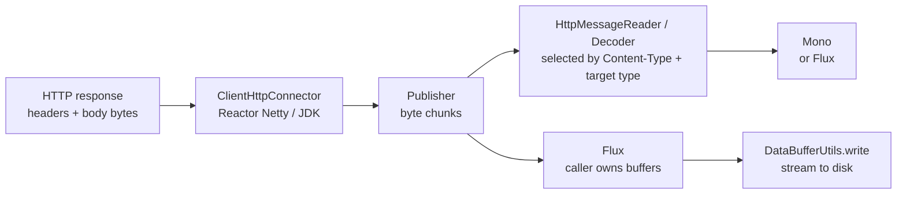
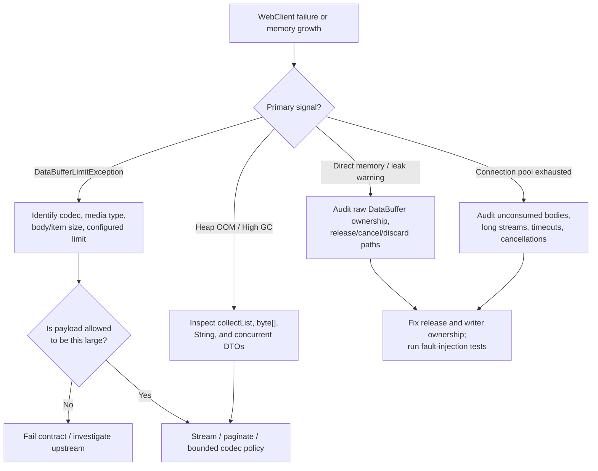

# Codecs, maxInMemorySize, and Releasing Response Content

## 1. The Problem: HTTP Succeeds, Yet the Application Still Runs Out of Memory

A Spring Boot service uses `WebClient` to call a Warehouse system, receive JSON from an inventory API, or download a CSV report from a partner. In test environments, responses are only a few kilobytes; in production, a partner may return a multi-megabyte JSON payload, a malformed text field, a gigabyte-scale file, or an infinite stream. If the application decodes the entire response into a `String`, `byte[]`, or `List<T>`, memory usage spikes sharply. Conversely, if you opt to handle raw `DataBuffer` instances directly and forget to release them, pooled Netty buffers can leak even before JVM heap grows noticeably.

Three operational questions must be answered:

1. **Which codec** turns HTTP bytes into Java values, and where are its buffer limits set?
2. **What does `maxInMemorySize` limit**, and what can still cause excessive memory consumption?
3. **Who owns and releases the response body/`DataBuffer`**, especially on error responses, cancelled subscriptions, or status-only reads?

This lesson belongs to the **WebClient** chapter of the **SPRING_BOOT_INTEGRATION** module: organizing integrations across HTTP clients, databases, caches, brokers, and Spring Integration adapters. The emphasis is proper configuration, data contracts, errors, deduplication, testing, and observability in real integration flows. An unreleased error response can starve connection pools, inflate direct memory, or cause other flows to time out; thus body management is part of **system reliability**, not merely performance tuning.

**After this lesson, you will be able to:**

1. Explain the pipeline HTTP response → `DataBuffer` → `HttpMessageReader/Decoder` → `Mono/Flux`.
2. Configure codecs on `WebClient.Builder` or `ExchangeStrategies` and pick `maxInMemorySize` thresholds aligned with data contracts.
3. Recognize `DataBufferLimitException` and distinguish codec limits from security-level HTTP response size quotas.
4. Choose `bodyToMono(Dto.class)` for small payloads, and `bodyToFlux(T.class)`, NDJSON, SSE, or `DataBufferUtils.write(...)` for large streams.
5. Use `retrieve()`, `onStatus(...)`, `toBodilessEntity()`, and `exchangeToMono()/exchangeToFlux()` without leaving response bodies unmanaged.
6. Apply **ownership** rules for `DataBuffer`, `DataBufferUtils.release(...)`, and cancel/error/discard paths.
7. Design safe file downloads without buffering entire payloads on heap or leaving orphaned temp files after errors.
8. Test oversized payloads, error bodies, stream cancellations, memory pressure, timeouts, and leak detection.

> **Version scope:** Snippets use Java 17+, Spring Boot 3.x, Spring Framework 6.x, Spring WebFlux, and Reactor Netty typical in that stack. Verify BOM, codec libraries, API overloads, and actual defaults when using Boot 4.x/Spring 7.x. Size and time bounds in examples are illustrative and must be tuned to service contracts and real resource budgets.

## 2. Which Layers Process a WebClient Response?



The HTTP client connector manages connections, response headers, and byte streams. Spring WebFlux abstracts bytes as `DataBuffer` instances. Depending on the `WebClient` API invoked, codecs convert those buffers into Java objects or hand raw bytes to the caller.

| Layer | Role | Application Responsibility |
| --- | --- | --- |
| `ClientHttpConnector` | Networking, reading headers/bodies, transport. | Configure connect/read timeouts, TLS, pooling, and safe logging. |
| `DataBuffer` | Byte container, potentially backed by Netty pooled direct buffers. | If consuming raw buffers directly, manage ownership and release. |
| `HttpMessageReader` | Chooses how to read the body by media type and target type. | Configure codecs and data bounds. |
| `Decoder<T>` | JSON → DTO, text → `String`, bytes → `byte[]`, SSE/NDJSON → events. | Match schema/`Content-Type`; choose streaming vs. aggregation. |
| `Mono<T>` | Publisher of at most one item. | Does not guarantee few bytes; a single DTO can be huge. |
| `Flux<T>` | Publisher of multiple items. | Account for backpressure, total items/time limits, and cancellation. |
| `WebClient.ResponseSpec` | Handles status and body decoding via `retrieve()`. | Map errors per contract; never leave responses unmanaged. |
| `ClientResponse` | Exposes status/headers and lets branches decode or release the body. | At low level, use APIs that manage lifecycle cleanly. |

**Core takeaway:** "Reactive" does not mean "zero buffering." A JSON object still needs enough buffered bytes for the parser to build a Java object; calling `collectList()` still gathers all elements into memory. Backpressure regulates **data flow**, not total memory across every application step.

### 2.1. What Is a Codec?

A codec combines **encoding/decoding** logic keyed by media type and Java target type. Common pairings:

- `application/json` → Jackson JSON decoder/encoder for DTOs or collections.
- `text/plain` → `String`.
- `application/octet-stream` → bytes or `DataBuffer`.
- `application/x-ndjson` → line-delimited JSON records.
- `text/event-stream` → Server-Sent Events (SSE).
- `multipart/form-data` → multipart readers and per-configuration part buffering/streaming.

There is no universal "JSON codec" applied regardless of `Content-Type`. For instance, a provider returning `text/html` error pages when the client asks for `OrderView` may raise `UnsupportedMediaTypeException` or a decoding failure instead of a structured domain error. Verify content-type/schema contracts before loosening codec media-type matching.

### 2.2. When Does Buffering Happen?

```text
HTTP chunks:
 [4KiB] [4KiB] [4KiB] ...

bodyToMono(String.class)    -> aggregates entire body into a String
bodyToMono(byte[].class)    -> aggregates entire body into a byte array
bodyToMono(OrderView.class) -> decodes one complete JSON object
bodyToFlux(Item.class)      -> can decode item/record incrementally
bodyToFlux(DataBuffer.class)-> delivers raw byte chunks to caller
collectList()               -> aggregates all Flux items into a List
DataBufferUtils.join()      -> aggregates DataBuffers into a single buffer
```

Decoder limits typically bound how many bytes **are buffered while decoding one item or aggregate**. They do not stop downstream application code from retaining unbounded Java objects in its own lists or maps.

## 3. What Is `maxInMemorySize`?

`maxInMemorySize` sets the memory buffer limit **for applicable default codecs** when aggregating data during decoding or encoding. Spring WebFlux commonly defaults to roughly **256 KiB** for many in-memory readers/codecs if unconfigured; exact behavior and defaults can vary by codec and version.

When a decoder needs to buffer more bytes than the limit allows, it can throw:

```text
org.springframework.core.io.buffer.DataBufferLimitException:
Exceeded limit on max bytes to buffer
```

This limit exists intentionally to prevent accidentally reading huge responses into memory. Never "fix" it by immediately raising it to hundreds of MiB; investigate why the body is large, who owns it, whether the call should stream, and whether the upstream response is trustworthy.

### 3.1. Example 1 MiB Limit

```java
// WebClientConfiguration.java
package com.example.integration.webclient;

import org.springframework.beans.factory.annotation.Value;
import org.springframework.context.annotation.Bean;
import org.springframework.context.annotation.Configuration;
import org.springframework.web.reactive.function.client.WebClient;

@Configuration(proxyBeanMethods = false)
public class WebClientConfiguration {

    @Bean("warehouseWebClient")
    WebClient warehouseWebClient(
        WebClient.Builder builder,
        @Value("${warehouse.base-url}") String baseUrl
    ) {
        return builder
            .baseUrl(baseUrl)
            .codecs(configurer -> configurer
                .defaultCodecs()
                .maxInMemorySize(1024 * 1024)
            )
            .build();
    }
}
```

```yaml
# application.yml
warehouse:
  base-url: ${WAREHOUSE_BASE_URL:http://localhost:8089}
```

Spring Boot provides an environment-configured `WebClient.Builder` when matching dependencies (such as `spring-boot-starter-webflux`) are present. Using the **injected builder** preserves Boot and project customizers, connectors, and observations. Calling `WebClient.builder()` directly inside services bypasses those customizations.

The code above sets an **approximately 1 MiB threshold** on the created client's default codecs. This is not the whole request-size policy: still account for content length, element count, stream duration, disk writes, concurrency, and resulting Java object sizes.

### 3.2. Global Property or Per-Client Configuration?

Projects often talk to diverse upstreams:

```text
Warehouse GET /stock/{sku}    -> small DTO, 256KiB is plenty
Partner GET /catalog          -> moderately large JSON item, 1MiB
Reporting GET /export.csv     -> multi-GiB file, STREAM instead of 512MiB buffer
Payment POST /capture         -> small JSON, tight limit and tight timeout
```

Prefer **per-client configuration matching each contract** over raising a global codec memory limit for every endpoint. Use `WebClientCustomizer` for shared baseline defaults, while special limits belong on the dedicated builder/client, reviewed and tested.

Spring WebFlux also offers properties such as `spring.codec.max-in-memory-size` depending on the Spring Boot version; that property and auto-configured codecs **do not remove the need to verify the actual `WebClient` instance**. Manually building `ExchangeStrategies` or connectors can bypass global customizations. Test the real wired client.

### 3.3. Choosing Limits by Contract

| Response Kind | Recommended Handling | Increase Limit? |
| --- | --- | --- |
| Few-KiB JSON DTO | `bodyToMono(Dto.class)` | No; default is usually enough. |
| JSON DTO up to 700 KiB | `bodyToMono(Dto.class)` with 1 MiB limit | Yes, if permitted by contract and bounded. |
| JSON array of millions of rows | `bodyToFlux(Item.class)` or paginated/NDJSON API | No; never raise to GiB just for `collectList()`. |
| 3 GiB CSV export | `bodyToFlux(DataBuffer.class)` → file | Never use `bodyToMono(byte[].class)`. |
| Continuous SSE | `bodyToFlux(ServerSentEvent<T>)` | Bound per event; never collect the whole stream. |
| Huge error body | Bounded error parsing or skip/release | Never read unboundedly to format exception messages. |
| Multipart response | Per-part reader/streaming per contract | Separate limits for parts/headers/aggregates; one knob is not enough. |

**A 1 MiB limit does not mean the application uses only 1 MiB of RAM:** one JVM may decode 1,000 responses concurrently, each DTO holds objects/strings, plus network buffers, logs, DB writes, and caches. Size memory against concurrent requests and streams.

## 4. Advanced Codec Configuration: Builder and ExchangeStrategies

### 4.1. Using Builder Injection for Production Clients

```java
@Bean
WebClient partnerClient(WebClient.Builder builder) {
    return builder
        .baseUrl("https://partner.example")
        .codecs(codec -> codec.defaultCodecs()
            .maxInMemorySize(2 * 1024 * 1024))
        .build();
}
```

In real projects, take the base URL from configuration properties and enforce TLS, hostname verification, and egress controls. Define `WebClient` as a reusable singleton bean; never recreate connection resources per HTTP request.

### 4.2. `ExchangeStrategies` When Full Codec Control Is Needed

```java
import org.springframework.web.reactive.function.client.ExchangeStrategies;
import org.springframework.web.reactive.function.client.WebClient;

ExchangeStrategies strategies = ExchangeStrategies.builder()
    .codecs(config -> config.defaultCodecs()
        .maxInMemorySize(2 * 1024 * 1024))
    .build();

WebClient client = WebClient.builder()
    .baseUrl("https://partner.example")
    .exchangeStrategies(strategies)
    .build();
```

This is an **alternative approach** used when full control over the codec set is required. When creating fresh strategies/builders manually, note that other Spring Boot/application codec customizations may not be inherited as they are with the injected builder. Avoid configuring codecs via both `exchangeStrategies(...)` and `.codecs(...)` in scattered places without knowing the final effective config.

### 4.3. Custom Jackson Codecs for Special Contracts

If a partner uses non-standard JSON formats, you can register a Jackson decoder/encoder with a tailored `ObjectMapper`. Verify that:

- The JSON parser never enables arbitrary polymorphic deserialization on untrusted inputs.
- Custom codecs declare the exact `MediaType` values they support.
- `maxInMemorySize` actually applies to the custom decoder, depending on how it is registered and implemented.
- NDJSON/SSE endpoints are not decoded as a single monolithic JSON document.
- Outbound serialization vs. inbound deserialization `ObjectMapper` setups remain isolated if partners differ; never alter the global mapper just to patch one endpoint.

Throughout the rest of this lesson, we use Spring WebFlux's default codecs to focus on lifetime and memory limits; custom codecs do not eliminate the need to release raw `DataBuffer`s.

## 5. Detecting and Handling `DataBufferLimitException`

An API returning large JSON:

```java
// PartnerCatalogClient.java
package com.example.integration.webclient;

import org.springframework.beans.factory.annotation.Qualifier;
import org.springframework.stereotype.Component;
import org.springframework.web.reactive.function.client.WebClient;
import reactor.core.publisher.Mono;

@Component
public class PartnerCatalogClient {
    private final WebClient client;

    public PartnerCatalogClient(
        @Qualifier("warehouseWebClient") WebClient client
    ) {
        this.client = client;
    }

    public Mono<CatalogSnapshot> getSnapshot() {
        return client.get()
            .uri("/api/v1/catalog/snapshot")
            .retrieve()
            .bodyToMono(CatalogSnapshot.class);
    }
}
```

`CatalogSnapshot` is an application-defined DTO. If the snapshot JSON exceeds the decoder threshold, the publisher can terminate with `DataBufferLimitException` (directly or in the cause chain depending on path and framework). Never "fix" it with:

```java
// RISK: turns a bounded failure into buffering up to 1 GiB payloads.
.codecs(codec -> codec.defaultCodecs()
    .maxInMemorySize(1024 * 1024 * 1024))
```

Correct resolution steps:

1. Inspect actual response size, media type, and field count against the API contract.
2. If a finite DTO legitimately exceeds the default, pick a bounded limit with headroom and monitoring.
3. If payloads can grow large, switch to pagination, NDJSON, SSE, or stream bytes to disk/object storage.
4. If upstream sends anomalous bodies, fail fast and abort the stream rather than repeatedly retrying a contract-violating payload.
5. If the app needs all data as a Java object list, process in chunks/batches or build a durable read model.

### 5.1. Size Limit Errors Differ from Malformed JSON Errors

| Error Type | Example | Recovery Approach |
| --- | --- | --- |
| `DataBufferLimitException` | Single JSON object or error body exceeds codec limit. | Reduce aggregation, stream/paginate, or adjust limit per contract. |
| JSON parsing error | Malformed payload or type mismatch. | Check schema/provider version; never retry blindly. |
| Unsupported content type | Received HTML while decoder expected JSON. | Inspect `Content-Type` and error mapping; do not loosen codecs carelessly. |
| Network disconnect | Response truncated mid-stream. | Evaluate retryability per operation; clean up resources. |
| User cancel/timeout | Downstream no longer wants the result. | Cancel upstream; ensure release/discard/temp-file cleanup. |
| Heap OOM | Holding too many objects/lists or high concurrency. | Bound cardinality/concurrency; profile and stream. |
| Direct memory leak | Pooled buffers retain non-zero ref counts after use. | Fix ownership/release; run memory/leak detection. |

Never map every `DataBufferLimitException` to "500 and retry 3 times." Retrying the same oversized response only multiplies bandwidth and log pressure.

### 5.2. Codec Limits Are Not Total HTTP Download Quotas

`maxInMemorySize` normally applies when **codecs aggregate** data. With `bodyToFlux(DataBuffer.class)`, you receive raw byte chunks with no automatic cap on **total received bytes**. If the server keeps streaming, the app can download indefinitely until disk, deadlines, or quotas run out.

Additional protections required:

- Early `Content-Length` check (without **trusting it blindly**).
- Enforcing an actual received-byte cap while streaming, since chunked transfers omit `Content-Length` or headers can lie.
- Max duration, idle timeout, total request deadline, and connection pool budgets.
- Max item count/size for JSON streams, NDJSON, and SSE.
- Disk quotas, temp-file cleanup, filename/path validation, and authentication.
- With HTTP compression, account for decompressed size to defend against decompression bombs.

For example, if an API allows CSVs up to 100 MiB, the client must **count actual received bytes** and abort above 100 MiB even when `Content-Length` is missing or inaccurate.

## 6. `retrieve()`: The Default for Decoding and Managing Responses

For small DTO contracts, `retrieve()` is clear and concise. The framework owns the response body and decodes/releases it along the chosen path:

```java
// OrderView.java
package com.example.integration.webclient;

public record OrderView(
    String orderId,
    String status,
    long version
) {}
```

```java
// OrderQueryGateway.java
package com.example.integration.webclient;

import org.springframework.beans.factory.annotation.Qualifier;
import org.springframework.stereotype.Component;
import org.springframework.web.reactive.function.client.WebClient;
import reactor.core.publisher.Mono;

@Component
public class OrderQueryGateway {
    private final WebClient client;

    public OrderQueryGateway(
        @Qualifier("warehouseWebClient") WebClient client
    ) {
        this.client = client;
    }

    public Mono<OrderView> find(String orderId) {
        return client.get()
            .uri("/api/v1/orders/{id}", orderId)
            .retrieve()
            .bodyToMono(OrderView.class);
    }
}
```

With `bodyToMono(OrderView.class)`, the decoder parses JSON into an object. If there is no body (such as HTTP 204), `Mono` completes empty; it **does not** become `new OrderView(...)` or an HTTP error. The business adapter must define whether empty is valid or a contract failure.

### 6.1. Retrieving Both Status and Headers

```java
import org.springframework.http.ResponseEntity;

Mono<ResponseEntity<OrderView>> response = client.get()
    .uri("/api/v1/orders/{id}", orderId)
    .retrieve()
    .toEntity(OrderView.class);
```

`toEntity(...)` still decodes the body per target type/codec while exposing status and headers like `ETag` and `Location`. It does not make oversized payloads stream.

### 6.2. When No Body Is Needed: `toBodilessEntity()`

A `DELETE` endpoint returning 204 or 202 with no business JSON:

```java
import org.springframework.http.ResponseEntity;

Mono<ResponseEntity<Void>> deletion = client.delete()
    .uri("/api/v1/reservations/{id}", reservationId)
    .retrieve()
    .toBodilessEntity();
```

`toBodilessEntity()` instructs the framework to discard/release any unused body and return status/headers. Never call `bodyToMono(byte[].class)` just to throw away the bytes. **Business note:** `202 Accepted` may mean upstream accepted an asynchronous task that has not completed yet; releasing the body does not replace contract and state handling.

### 6.3. `retrieve()` with HTTP Errors

By default, 4xx/5xx HTTP responses in `retrieve()` map to `WebClientResponseException` or an appropriate subtype. Spring reads error bytes for the exception per its policy, meaning error bodies are also subject to codec/memory limits. Never add "read the entire error body as a `String` for logging" without size bounds.

Example mapping 503 **without decoding the error body**:

```java
Mono<OrderView> result = client.get()
    .uri("/api/v1/orders/{id}", orderId)
    .retrieve()
    .onStatus(
        status -> status.value() == 503,
        response -> response.releaseBody()
            .thenReturn(new UpstreamUnavailableException(
                "Warehouse is temporarily unavailable"
            ))
    )
    .bodyToMono(OrderView.class);
```

`UpstreamUnavailableException` is an application-defined `RuntimeException`; here the `onStatus(...)` lambda returns `Mono<? extends Throwable>`. `releaseBody()` declares we do not need the error body and want it released before emitting the error.

If a small JSON error code is needed for domain mapping, decode with bounds:

```java
// ProviderError.java
public record ProviderError(
    String code,
    String message
) {}
```

```java
Mono<OrderView> result = client.get()
    .uri("/api/v1/orders/{id}", orderId)
    .retrieve()
    .onStatus(
        status -> status.value() == 409,
        response -> response.bodyToMono(ProviderError.class)
            .map(problem -> new UpstreamBusinessException(
                problem.code()
            ))
            .switchIfEmpty(Mono.just(
                new UpstreamBusinessException(
                    "UPSTREAM_CONFLICT_WITHOUT_BODY"
                )
            ))
    )
    .bodyToMono(OrderView.class);
```

`UpstreamBusinessException` is also application-defined. When an error response has invalid JSON/schema or exceeds codec limits, decoding the error body **can fail**; map and log the actual cause rather than swallowing errors into false success.

**Do not do this:**

```java
.onStatus(
    status -> status.value() == 404,
    response -> Mono.empty()
)
.bodyToMono(OrderView.class);
```

Returning `Mono.empty()` from a status handler **suppresses status error handling** and feeds the response body into the `OrderView` decoder. If the 404 body is HTML or mismatched error JSON, decoding fails; if empty, the caller sees `Mono.empty()`, blurring "not found." When 404 is a valid business outcome, use `exchangeToMono(...)` to return `NotFound` or `Optional.empty` explicitly.

### 6.4. Avoid Double-Subscribing to Side-Effecting Requests

```java
Mono<OrderView> call = client.get()
    .uri("/api/v1/orders/{id}", orderId)
    .retrieve()
    .bodyToMono(OrderView.class);

// In standard WebClient pipelines, each subscription
// triggers a new HTTP exchange:
call.subscribe();
call.subscribe();
```

For GETs, this wastes requests; for POSTs, two subscriptions trigger **two side effects**. Never call `subscribe()` inside a service while also returning the publisher to callers without clear ownership. Use Reactor composition; if sharing results deliberately, study `cache()`/`share()` lifecycles and error semantics, and never treat them as durable idempotency.

## 7. `exchangeToMono()` and `exchangeToFlux()`: Custom Status Handling with Managed Lifecycles

Previously, the low-level `exchange()` API handed `ClientResponse` to callers to consume or release manually. If callers only checked status without draining the body, resources leaked or connections could not return to the pool; `exchange()` was deprecated in relevant Spring Framework versions because manual body management proved error-prone.

**Prefer** `exchangeToMono(...)` and `exchangeToFlux(...)` when decoding depends on status or headers. Under this API, once the publisher returned by the callback terminates, the framework inspects and releases any unconsumed response body. Still, code should **explicitly consume or release in every branch** for clarity during reviews.

### 7.1. 200, 304, and 404 as Three Distinct Outcomes

An API supporting conditional GET via `If-None-Match`/`ETag`:

```java
// OrderLookup.java — place each public type in its own file in production.
sealed interface OrderLookup {
    record Found(OrderView value, String etag)
        implements OrderLookup {}
    record NotModified(String etag)
        implements OrderLookup {}
    record Missing()
        implements OrderLookup {}
}
```

```java
// Inside a gateway holding field WebClient client.
public Mono<OrderLookup> findWithEtag(
    String orderId, String knownEtag
) {
    return client.get()
        .uri("/api/v1/orders/{id}", orderId)
        .headers(headers -> {
            if (knownEtag != null && !knownEtag.isBlank()) {
                headers.setIfNoneMatch(knownEtag);
            }
        })
        .exchangeToMono(response -> {
            int status = response.statusCode().value();
            String etag = response.headers()
                .asHttpHeaders().getETag();

            if (status == 304) {
                // No body needed; 304 is not an OrderView.
                return response.releaseBody()
                    .thenReturn((OrderLookup)
                        new OrderLookup.NotModified(etag));
            }

            if (status == 404) {
                return response.releaseBody()
                    .thenReturn((OrderLookup)
                        new OrderLookup.Missing());
            }

            if (status >= 200 && status < 300) {
                return response.bodyToMono(OrderView.class)
                    .switchIfEmpty(Mono.error(
                        new IllegalStateException(
                            "200 without required OrderView"
                        )
                    ))
                    .map(value -> (OrderLookup)
                        new OrderLookup.Found(value, etag));
            }

            return response.createException()
                .flatMap(Mono::error);
        });
}
```

In real code, place this method inside a class/bean with a `WebClient client` field and import `reactor.core.publisher.Mono`. Summary:

- Status 200/2xx: codec decodes the body as `OrderView`.
- Status 304: **does not** decode a DTO; the caller uses the cached representation matching that ETag.
- Status 404: releases the body and returns a `Missing` business result instead of throwing a JSON error.
- Other statuses: `ClientResponse.createException()` builds an HTTP exception; error-body buffering still needs bounds.

**A valid 304 ETag does not guarantee the client's cache is intact:** bind ETags strictly to stored representations and protect cache keys/tenants. If 304 arrives after local cache eviction, issue an unconditional GET or follow a fallback workflow per contract.

### 7.2. Common Bug: Returning `ClientResponse` Out of the Callback

Never write:

```java
// RISK: retaining ClientResponse to read its body after
// exchangeToMono has ended the response lifecycle.
Mono<ClientResponse> responseLater =
    client.get().uri("/api/v1/orders/{id}", orderId)
        .exchangeToMono(Mono::just);
```

Once the callback completes, the framework can release any remaining body. Returning `ClientResponse` and calling `bodyToMono(...)` afterward **no longer guarantees the body is readable**. Decode or map to a domain result **inside** the callback.

### 7.3. `exchangeToFlux()` for Multi-Record Streams

```java
// Example endpoint returning NDJSON.
public Flux<InventoryChange> changes(String sku) {
    return client.get()
        .uri("/api/v1/stock/{sku}/changes", sku)
        .accept(MediaType.APPLICATION_NDJSON)
        .exchangeToFlux(response -> {
            if (response.statusCode().is2xxSuccessful()) {
                return response.bodyToFlux(
                    InventoryChange.class
                );
            }
            return response.createException()
                .flatMapMany(Flux::error);
        });
}
```

This assumes `InventoryChange` is an application DTO, `MediaType` is imported from `org.springframework.http.MediaType`, and `Flux` is from Reactor. Never pass `ClientResponse` or a raw `InputStream` out of the callback.

**Note:** `exchangeToFlux` releases unused body data when the returned `Publisher` ends; however, if the callback returns `Flux<DataBuffer>`, raw buffers are handed to the **caller**, which must consume and release them properly. Framework auto-cleanup does not excuse neglecting raw buffers delivered to user code.

### 7.4. When Ignoring the Body, Always Provide an Explicit Release Path

```java
public Mono<Boolean> exists(String orderId) {
    return client.head()
        .uri("/api/v1/orders/{id}", orderId)
        .exchangeToMono(response -> {
            int status = response.statusCode().value();
            if (status == 200) {
                return response.releaseBody().thenReturn(true);
            }
            if (status == 404) {
                return response.releaseBody().thenReturn(false);
            }
            return response.createException()
                .flatMap(Mono::error);
        });
}
```

`HEAD` responses normally carry no body, yet calling `releaseBody()` explicitly on status-only branches keeps behavior safe even if an upstream violates the spec and sends unexpected bytes. `ClientResponse.releaseBody()` returns `Mono<Void>`, not an immediate synchronous action; you must **compose or subscribe with a clear owner** for it to run.

## 8. Ownership Rules for `DataBuffer`

In Reactor Netty, a `DataBuffer` may be backed by a **pooled/reference-counted** Netty `ByteBuf`, often in off-heap direct memory. When using `bodyToMono(Dto.class)`, decoders/WebFlux manage buffer release along standard paths. When calling `bodyToFlux(DataBuffer.class)`, the application receives **raw buffers**.

**Rule:** whichever component owns a raw buffer must ensure it is released **exactly once according to ownership**, including on error and cancellation paths. Never release a buffer another component is still reading; never retain an extra reference without a matching release.

| Read Strategy | Who Usually Owns Release? | Risk |
| --- | --- | --- |
| `bodyToMono(OrderView.class)` | Decoder/WebFlux while mapping to DTO. | Large aggregations, decoding failures. |
| `bodyToMono(String.class)` | Decoder/WebFlux. | Buffering huge Strings in memory. |
| `bodyToFlux(InventoryChange.class)` | Streaming decoder/WebFlux for source buffers. | Downstream item buildup, oversized individual records. |
| `bodyToFlux(DataBuffer.class)` | **Caller/consumer of raw buffers**. | Leaking pooled buffers if release is forgotten. |
| `DataBufferUtils.join(...)` | Utility manages input buffers; **caller releases the joined result** after use. | Buffering large payloads; forgetting to release the joined buffer. |
| `DataBufferUtils.write(..., Path, ...)` | Utility manages/releases buffers written cleanly per Path overload. | Temp files left behind on error/cancel; must enforce total byte cap. |
| `ClientResponse.releaseBody()` | Framework drains/releases body when returned `Publisher` is subscribed. | Forgetting to compose `Mono<Void>` or trying to release after callback. |

### 8.1. When Reading Raw Chunks, Always Use `try/finally`

```java
import org.springframework.core.io.buffer.DataBuffer;
import org.springframework.core.io.buffer.DataBufferUtils;

Flux<byte[]> chunks = client.get()
    .uri("/api/v1/export/bytes")
    .retrieve()
    .bodyToFlux(DataBuffer.class)
    .map(buffer -> {
        try {
            byte[] bytes = new byte[buffer.readableByteCount()];
            buffer.read(bytes);
            return bytes;
        } finally {
            DataBufferUtils.release(buffer);
        }
    })
    .doOnDiscard(
        DataBuffer.class,
        DataBufferUtils::release
    );
```

This copies each chunk into a `byte[]` and immediately releases the raw `DataBuffer`. Each array still occupies heap afterward; if callers invoke `chunks.collectList()`, memory still grows to the full response size. This illustrates **ownership**, not recommended large-file downloading.

`doOnDiscard(DataBuffer.class, DataBufferUtils::release)` frees buffers dropped by discard-aware operators on paths like certain cancellations or filters. It **does not** replace releasing buffers handled normally by callbacks, and should not be relied on as a universal guarantee across every custom operator.

### 8.2. Releasing Means You Cannot Reuse the Buffer

```java
DataBufferUtils.release(buffer);
// NEVER call buffer.read(...), retain a ByteBuffer view,
// or hand the buffer to another thread after releasing it.
```

With reference-counted buffers, backing memory can be recycled immediately after release. If asynchronous handoff is necessary, **retain ownership until the async callback finishes** and release on success, error, and cancel—or better, copy bounded bytes or rely on lifecycle-safe utilities.

### 8.3. Double Releases Are Also Bugs

```text
DataBufferUtils.write(..., Path, ...)
    -> utility releases consumed buffers

Caller manually releases the same buffer afterward
    -> double-release / illegal ref count / hard-to-debug crashes
```

Pick one clear owner. Read the Javadoc for the **exact overload** of `DataBufferUtils.write` you call: overloads writing to `OutputStream` or `WritableByteChannel` return `Flux<DataBuffer>` and **do not release buffers automatically**, requiring `doOnNext(DataBufferUtils.releaseConsumer())` or equivalent. The `Path` overload follows different release rules. Never generalize from one overload to all others.

### 8.4. `DataBufferUtils.join(...)`: Limits and Release

When you truly need to aggregate **a small payload** for a custom protocol, pass an explicit bound:

```java
Mono<byte[]> smallBytes = DataBufferUtils.join(
        client.get()
            .uri("/api/v1/small-binary")
            .retrieve()
            .bodyToFlux(DataBuffer.class),
        64 * 1024
    )
    .map(joined -> {
        try {
            byte[] bytes = new byte[joined.readableByteCount()];
            joined.read(bytes);
            return bytes;
        } finally {
            DataBufferUtils.release(joined);
        }
    });
```

`join(..., maxByteCount)` throws `DataBufferLimitException` if the sum exceeds the cap; the utility releases the **input buffers** upon completion or error per contract. The application **must release the joined `DataBuffer`** once read as shown above. If standard `bodyToMono(byte[].class)` with a codec limit fits your case, it is simpler to maintain.

### 8.5. Cancellation Is a Separate Termination Path

```text
Request receives bytes
  -> downstream cancels (user closes tab, take(n), timeout)
  -> upstream subscription cancels
  -> in-flight/queued buffers may be discarded
  -> file writer/consumer must clean up its own resources
```

A flow that cleans up only on `onComplete` and `onError` while ignoring `cancel` leaks temp files or holds resources. In Reactor, `doFinally(signalType -> ...)` distinguishes `ON_COMPLETE`, `ON_ERROR`, and `CANCEL`; for async resources (files, streams, connections), use `usingWhen` or structured cleanup instead of running blocking I/O inside `doOnCancel` on the event loop.

## 9. Downloading Large Files: Stream to Disk Instead of Buffering on Heap

An export endpoint may return hundreds of megabytes:

```http
GET /api/v1/reports/monthly/2026-11.csv HTTP/1.1
Accept: text/csv
```

Avoid:

```java
Mono<byte[]> bad = client.get()
    .uri("/api/v1/reports/monthly/2026-11.csv")
    .retrieve()
    .bodyToMono(byte[].class);

// Followed by Files.write(..., bytes) in a later step.
```

This forces the entire `byte[]` into memory before touching disk. Increasing `maxInMemorySize` to make it "work" breaks down under concurrent exports.

**Recommended design:**

1. Validate the report ID and construct an application-controlled target path.
2. Check `Content-Length` if present to reject obviously oversized files early.
3. **Count actual received bytes**, never trusting headers as the sole cap.
4. Stream chunks into a temporary file on the same filesystem as the target.
5. Release consumed `DataBuffer`s per `DataBufferUtils.write(..., Path, ...)` contract.
6. Upon completion, perform an atomic move where supported by the filesystem.
7. On error or downstream cancellation, delete the temporary file via async cleanup.
8. Report "download complete" only after the destination file is atomically published.

### 9.1. Bounded, Cleanup-Safe Download Example

```java
// ReportDownloadService.java
package com.example.integration.webclient;

import java.nio.file.Files;
import java.nio.file.Path;
import java.nio.file.StandardCopyOption;
import java.nio.file.StandardOpenOption;
import java.util.concurrent.atomic.AtomicLong;
import org.springframework.beans.factory.annotation.Qualifier;
import org.springframework.core.io.buffer.DataBuffer;
import org.springframework.core.io.buffer.DataBufferUtils;
import org.springframework.stereotype.Service;
import org.springframework.web.reactive.function.client.WebClient;
import reactor.core.publisher.Flux;
import reactor.core.publisher.Mono;
import reactor.core.scheduler.Schedulers;

@Service
public class ReportDownloadService {
    private static final long MAX_BYTES = 100L * 1024 * 1024;

    private final WebClient client;
    private final Path downloadRoot;

    public ReportDownloadService(
        @Qualifier("warehouseWebClient") WebClient client
    ) {
        this.client = client;
        // Example: operator-configured root path, never derived from HTTP input.
        this.downloadRoot = Path.of("/var/app/reports")
            .toAbsolutePath().normalize();
    }

    public Mono<Path> download(String reportId) {
        if (reportId == null
            || !reportId.matches("[A-Za-z0-9_-]{1,64}")) {
            return Mono.error(new IllegalArgumentException(
                "Invalid report id"
            ));
        }

        Path destination = downloadRoot
            .resolve(reportId + ".csv")
            .normalize();
        if (!destination.startsWith(downloadRoot)) {
            return Mono.error(new SecurityException(
                "Invalid download path"
            ));
        }

        // One resource (temp file) per subscription.
        return Mono.usingWhen(
            Mono.fromCallable(() -> {
                    Files.createDirectories(downloadRoot);
                    return Files.createTempFile(
                        downloadRoot, "report-", ".part"
                    );
                })
                .subscribeOn(Schedulers.boundedElastic()),

            temp -> fetchAndWrite(reportId, temp)
                .then(Mono.fromCallable(() -> Files.move(
                        temp, destination,
                        StandardCopyOption.ATOMIC_MOVE
                    ))
                    .subscribeOn(Schedulers.boundedElastic())),

            this::deleteTemp,
            (temp, error) -> deleteTemp(temp),
            this::deleteTemp
        );
    }

    private Mono<Void> fetchAndWrite(
        String reportId, Path temp
    ) {
        return client.get()
            .uri("/api/v1/reports/{id}.csv", reportId)
            .retrieve()
            .bodyToFlux(DataBuffer.class)
            .transform(buffers -> limitBytes(buffers, MAX_BYTES))
            .as(buffers -> DataBufferUtils.write(
                buffers,
                temp,
                StandardOpenOption.WRITE,
                StandardOpenOption.TRUNCATE_EXISTING
            ));
    }

    private static Flux<DataBuffer> limitBytes(
        Flux<DataBuffer> source, long maxBytes
    ) {
        return Flux.defer(() -> {
            AtomicLong received = new AtomicLong();
            return source.concatMap(buffer -> {
                long total = received.addAndGet(
                    buffer.readableByteCount()
                );
                if (total > maxBytes) {
                    DataBufferUtils.release(buffer);
                    return Mono.<DataBuffer>error(
                        new ReportTooLargeException(maxBytes)
                    );
                }
                // Ownership transfers to DataBufferUtils.write(Path).
                return Mono.just(buffer);
            });
        })
        .doOnDiscard(
            DataBuffer.class,
            DataBufferUtils::release
        );
    }

    private Mono<Void> deleteTemp(Path temp) {
        return Mono.fromCallable(() -> Files.deleteIfExists(temp))
            .subscribeOn(Schedulers.boundedElastic())
            .then();
    }
}
```

```java
// ReportTooLargeException.java
package com.example.integration.webclient;

public class ReportTooLargeException
    extends RuntimeException {
    public ReportTooLargeException(long maxBytes) {
        super("Report exceeds " + maxBytes + " bytes");
    }
}
```

**How it works:**

- `Flux.defer` creates a fresh `AtomicLong` per subscription so concurrent downloads never share one counter.
- `concatMap` forwards accepted buffers to the file writer; if total bytes exceed the quota, the offending buffer is released and the publisher emits an error. Buffers already accepted by the writer are managed by the `write(Path)` API.
- `DataBufferUtils.write(Publisher<DataBuffer>, Path, OpenOption...)` writes sequentially to disk and releases source buffers per the **Path overload** contract. Do not call `release` again on buffers owned by the writer.
- `doOnDiscard(...)` releases buffers skipped in discard-aware operators; maintain the **no double-release** rule.
- `Mono.usingWhen` runs cleanup on normal completion, error, and cancellation. After a successful move, `deleteTemp(...)` sees no temp file to remove.
- `Files.createTempFile`, `Files.move`, and `Files.deleteIfExists` are blocking file I/O operations, so they run on `boundedElastic` instead of the Netty event loop.
- `ATOMIC_MOVE` succeeds only on filesystems supporting it; otherwise the operation fails (or uses a specifically designed publish mechanism) rather than silently falling back to a non-atomic move when readers rely on completeness.

**Limitations of the example:** `/var/app/reports` is a placeholder for a managed server path. Production code must configure root paths, filesystem permissions, disk quotas, orphaned temp-file cleanup after process crashes, symlink/path-traversal protection, and collision-safe filenames. The snippet counts decoded bytes; if HTTP compression or response transformations alter sizes, define clearly whether quotas measure **uncompressed or wire bytes**. Never pass untrusted paths into `Files.move`.

### 9.2. Using `exchangeToMono` to Check Content-Length Before Streaming

If the provider usually sends `Content-Length`, add an early check:

```java
Mono<Void> downloadBody = client.get()
    .uri("/api/v1/reports/{id}.csv", reportId)
    .exchangeToMono(response -> {
        if (!response.statusCode().is2xxSuccessful()) {
            return response.createException()
                .flatMap(Mono::error);
        }
        long declared = response.headers()
            .contentLength().orElse(-1L);

        if (declared > MAX_BYTES) {
            return response.releaseBody().then(Mono.error(
                new ReportTooLargeException(MAX_BYTES)
            ));
        }

        Flux<DataBuffer> body = limitBytes(
            response.bodyToFlux(DataBuffer.class),
            MAX_BYTES
        );
        return DataBufferUtils.write(
            body,
            temp,
            StandardOpenOption.WRITE,
            StandardOpenOption.TRUNCATE_EXISTING
        );
    });
```

This **replaces the body of `fetchAndWrite`** inside `ReportDownloadService` (where `client`, `temp`, `reportId`, `MAX_BYTES`, and `limitBytes` are already declared). `Content-Length` only enables fast rejection; the stream still needs `limitBytes` because chunked transfers omit length and providers can send wrong headers.

### 9.3. What Happens If the Subscriber Cancels the Download?

Suppose a caller invokes `download(...).timeout(Duration.ofSeconds(30))`:

1. When the deadline expires, Reactor signals timeout/cancel upstream within `Publisher` semantics.
2. The client connector stops consuming the response and cleans up connections/buffers in the framework pipeline.
3. The writer stops receiving chunks; queued/discarded buffers are released per utility/operator semantics.
4. `usingWhen` invokes the `asyncCancel` path to delete the temporary file.
5. If another remote side effect happened outside the download (e.g., server started generating a report), **client cancellation does not roll back the remote job**.

Process crashes bypass cleanup callbacks. Therefore, still run a housekeeping task scanning aged `*.part` files with ownership rules to avoid deleting files actively written by another worker.

### 9.4. When to Use Object Storage Instead of Local Disk

With multiple replicas where downloaded artifacts must be accessible from any node, local disk is often unsuitable. Stream directly to object storage using an SDK supporting backpressure/multipart uploads, checksums, size limits, cancel cleanup, and idempotent object keys. Abort orphaned multipart uploads on failure. Never assume an HTTP call succeeded merely because upstream returned 200 before object-storage upload finished.

## 10. NDJSON: Decoding Record by Record Instead of One Huge JSON Document

An API returning:

```http
HTTP/1.1 200 OK
Content-Type: application/x-ndjson

{"eventId":"evt-1","sku":"SKU-42","quantity":2}
{"eventId":"evt-2","sku":"SKU-42","quantity":3}
{"eventId":"evt-3","sku":"SKU-42","quantity":4}
```

Unlike a JSON array requiring a full list contract on the client, NDJSON streams independent JSON objects line by line. The decoder emits each record as an item:

```java
// InventoryChange.java
package com.example.integration.webclient;

public record InventoryChange(
    String eventId,
    String sku,
    long quantity
) {}
```

```java
// Inside a gateway holding WebClient client.
public Flux<InventoryChange> receiveChanges(String sku) {
    return client.get()
        .uri("/api/v1/stock/{sku}/changes", sku)
        .accept(MediaType.APPLICATION_NDJSON)
        .retrieve()
        .bodyToFlux(InventoryChange.class)
        .take(10_000)              // Cap items if contract is bounded.
        .timeout(Duration.ofMinutes(2));
}
```

Assumes imports for `MediaType`, `Duration`, and `Flux`. For NDJSON:

- The codec still buffers bytes for **a single record** while parsing; an oversized single JSON line can still exceed `maxInMemorySize`.
- `Flux<InventoryChange>` does not cap total record count automatically; enforce `take(10_000)` or a server-side cursor/window as needed.
- Calling `collectList()` after `bodyToFlux(...)` turns streaming back into bulk object accumulation, risking OOM.
- When persisting items to a DB, never use unbounded `flatMap(..., Integer.MAX_VALUE)` which floods concurrent writes. Use `concatMap` or `flatMap(..., concurrency)` with proper transaction boundaries.
- A schema-invalid record mid-stream needs an explicit fail/dead-letter policy. Never silently skip bad records and ack the entire batch when business rules demand complete ingestion.

### 10.1. Per-Record Processing with Bounded Concurrency

```java
public Mono<Void> importChanges(String sku) {
    return receiveChanges(sku)
        .flatMap(
            change -> inventoryChangeWriter.apply(change),
            8
        )
        .then();
}
```

`inventoryChangeWriter.apply(change)` returns `Mono<Void>` and must provide DB transactions/idempotency keyed by `eventId` in case the stream replays. `flatMap(..., 8)` allows at most 8 concurrent writes; when **strict per-SKU ordering** is required, use `concatMap` or key-partitioned sequencing rather than arbitrary concurrency.

### 10.2. Streaming Is Not Free

If each event carries 10 MiB of JSON, a decoder still needs large per-event buffers. If each event is small yet the consumer fans out via `flatMap` with huge concurrency, thousands of objects and DB writes pile up in flight. Bound **per-item size**, **total items**, **concurrency**, and **deadlines** together.

## 11. Server-Sent Events (SSE) and Long-Lived Streams

SSE uses media type `text/event-stream` and can hold connections open for long periods:

```http
HTTP/1.1 200 OK
Content-Type: text/event-stream

id: 102
event: stock-changed
data: {"sku":"SKU-42","available":10}

id: 103
event: stock-changed
data: {"sku":"SKU-42","available":9}
```

Example:

```java
import org.springframework.core.ParameterizedTypeReference;
import org.springframework.http.MediaType;
import org.springframework.http.codec.ServerSentEvent;
import reactor.core.publisher.Flux;

Flux<ServerSentEvent<InventoryEvent>> stream =
    client.get()
        .uri("/api/v1/stock/events")
        .accept(MediaType.TEXT_EVENT_STREAM)
        .retrieve()
        .bodyToFlux(
            new ParameterizedTypeReference<
                ServerSentEvent<InventoryEvent>
            >() {}
        );
```

`InventoryEvent` is an application DTO. Key considerations:

- Each SSE event decodes into one item; the codec buffers bytes for that event, not the entire stream.
- Streams can remain open for hours; configure appropriate idle/read timeouts and **avoid** short whole-stream deadlines on intentionally long-lived connections.
- On reconnect, pass stable SSE event IDs/`Last-Event-ID` when supported by the provider. Prior events may be replayed; keep downstream idempotent.
- A codec failure or oversized event terminates the subscription; never infinitely reconnect on the same malformed event.
- When callers cancel, verify subscriptions/connections close and never store `ServerSentEvent` objects in unbounded collections.
- Cap downstream throughput and concurrency; if the source outpaces consumers, define explicit backpressure, queue limits, and overflow policies.

### 11.1. Why Never Use `collectList()` on SSE?

```java
// RISK: stream never completes, so the list grows indefinitely
Mono<java.util.List<ServerSentEvent<InventoryEvent>>> all =
    stream.collectList();
```

If the stream is continuous, `collectList()` **may never finish** and grows without bound. If you only need 50 events for display:

```java
Mono<java.util.List<ServerSentEvent<InventoryEvent>>> first50 =
    stream.take(50).collectList();
```

This enforces an **item count limit**, not a per-SSE byte limit. Enforce both per contract.

## 12. JSON Arrays, Streaming Records, and Downstream Accumulation Risks

A body might be:

```json
[
  {"sku":"SKU-1","available":3},
  {"sku":"SKU-2","available":9},
  {"sku":"SKU-3","available":1}
]
```

With the reactive Jackson decoder, `bodyToFlux(StockItem.class)` can emit array elements incrementally in supported scenarios. However, streaming support depends on **codec, media type, payload structure, and target type**; a large array nested deeply inside a wrapper JSON object will not necessarily stream item by item as hoped.

Compare:

```java
// Buffers the whole list into a single Java aggregate object.
Mono<java.util.List<StockItem>> all = client.get()
    .uri("/api/v1/catalog")
    .retrieve()
    .bodyToMono(new ParameterizedTypeReference<
        java.util.List<StockItem>>() {});

// Streams items; caller must process with bounded concurrency/limits.
Flux<StockItem> items = client.get()
    .uri("/api/v1/catalog")
    .retrieve()
    .bodyToFlux(StockItem.class);
```

`StockItem` is an application DTO. The second option enables incremental processing, **yet imposes no default limit on total item count**:

```java
// RISK: re-aggregates everything into a List, negating streaming.
Mono<java.util.List<StockItem>> reAggregated =
    items.collectList();
```

When business logic needs a consistent snapshot of millions of rows, a **paginated API with snapshot/cursor tokens** storing each page into a DB/read model and verifying snapshot versions/chunk completion is usually safer. Streaming decode does not guarantee snapshot consistency if upstream data mutates mid-response.

### 12.1. `ParameterizedTypeReference` Does Not Bypass Memory Limits

`ParameterizedTypeReference<List<OrderView>>` informs the codec of the `List` generic type, yet the result is still **one `List`** in memory. It gives type-safe deserialization, not bounded streaming.

### 12.2. Streaming and Mid-Stream Failures

```text
record 1 -> consumer DB commit
record 2 -> consumer DB commit
record 3 -> malformed JSON, stream errors
record 4 -> never read
```

Even though `WebClient` releases its buffers cleanly, DB side effects for records 1 and 2 have already committed. Retrying the entire stream risks reprocessing them. Streaming imports therefore need stable `eventId`/business keys, inbox/unique constraints, batched transactions, or checkpoints/cursors rather than wrapping the entire `Flux` in `retryWhen(...)`.

Using `onErrorResume(error -> Flux.empty())` to hide decode errors tricks downstream into believing ingestion completed cleanly. A streaming job needs a `FAILED_PARTIAL` state, committed counts, and replay/reconciliation per contract.

## 13. Choosing the Right API by Response Model

| Requirement | API | Lifecycle Notes |
| --- | --- | --- |
| Small JSON, single DTO | `retrieve().bodyToMono(Dto.class)` | Decoder manages buffers; bound codec size. |
| Valid empty response | `bodyToMono(Void.class)` or `toBodilessEntity()` | Never equate empty with business success unless contract agrees. |
| Status/headers + DTO | `toEntity(Dto.class)` | Still decodes body and respects codec limits. |
| Status/headers only | `toBodilessEntity()` | Framework handles unused body. |
| 200/304/404 with custom logic | `exchangeToMono(...)` | Explicitly consume or release on every status branch. |
| NDJSON/events | `bodyToFlux(Dto.class)` or `exchangeToFlux(...)` | Bound per-item, total items/time, and downstream concurrency. |
| SSE | `bodyToFlux(ServerSentEvent<Dto>)` | Long-lived streams; design cancel/reconnect/idempotency. |
| Large files | `bodyToFlux(DataBuffer.class)` + `DataBufferUtils.write(Path)` | Raw buffer ownership, temp-file cleanup, total byte cap. |
| Small binary needing aggregation | `bodyToMono(byte[].class)` or `DataBufferUtils.join(..., bound)` | Choose small cap; release joined `DataBuffer` if using `join`. |
| Error needing only HTTP status | `onStatus(... response.releaseBody().thenReturn(error))` | Avoid building giant error strings/logs. |

**Do not choose `exchangeToMono` thinking "lower level means faster."** When status handling is straightforward, `retrieve()` is easier to review and avoids ownership mistakes.

## 14. Timeouts, Connection Pools, and Backpressure

### 14.1. Codec Limits Are Not Timeouts

An SSE stream emitting 10 bytes/second can run for days without breaching codec memory limits. An API returning 10 MiB in 0.1 seconds breaches the limit immediately. You need independent layers of bounds:

- **Connect timeout:** initial connection setup duration.
- **Response/read timeout:** transport wait for responses or data reads.
- **Total deadline:** overall duration of a logical operation including retries/backoff.
- **`maxInMemorySize`:** codec/decoder aggregation cap where applicable.
- **Total received bytes:** application-enforced quota when streaming raw bytes/files.
- **Concurrency:** active HTTP calls/streams in flight.
- **Max elements:** event/item count per batch or window.
- **Disk quota:** temp-file storage, object-storage uploads, and cleanup.

### 14.2. Reactor Netty Response Timeout

Optional configuration when using Reactor Netty:

```java
import java.time.Duration;
import org.springframework.http.client.reactive.ReactorClientHttpConnector;
import org.springframework.web.reactive.function.client.WebClient;
import reactor.netty.http.client.HttpClient;

HttpClient nettyClient = HttpClient.create()
    .responseTimeout(Duration.ofSeconds(5));

WebClient client = WebClient.builder()
    .clientConnector(new ReactorClientHttpConnector(nettyClient))
    .codecs(c -> c.defaultCodecs()
        .maxInMemorySize(1024 * 1024))
    .build();
```

This is an **alternative configuration**; do not combine simultaneously with earlier beans unintentionally. With custom Reactor Netty connectors, ensure connection providers, SSL, proxies, and observability align with your Spring Boot setup; `HttpClient.create()` uses defaults that may differ from Boot customizations.

**Never apply a 5-second response timeout to an SSE stream meant to stay open long-term** without checking provider cadence, keepalives, and idle timeouts.

### 14.3. Practical Limits of Reactive Backpressure

In Reactor, downstream requests items from upstream and cooperative operators honor that demand. Yet HTTP sockets and OS network stacks maintain their own buffers and providers can keep pushing bytes; never assume a `Flux<DataBuffer>` with a slow subscriber keeps total memory flat. Accumulation points include:

```text
Network receive buffers
  -> Netty pooled buffers
  -> codec's per-item accumulation
  -> Reactor operator queues/prefetch
  -> downstream flatMap concurrency
  -> application collections / database batches
```

A holistic approach lowers `flatMap` concurrency, caps buffer sizes, avoids unbounded `onBackpressureBuffer()`, limits active streams, and tracks direct memory and queue depths during load tests.

### 14.4. Blocking Inside Reactive Pipelines

Avoid:

```java
Flux<DataBuffer> body = client.get()
    .uri("/api/v1/export")
    .retrieve()
    .bodyToFlux(DataBuffer.class);

// RISK: block() on the WebFlux event loop.
byte[] allBytes = body
    .collectList()
    .map(buffers -> /* copy all */ new byte[0])
    .block();
```

This snippet shows an **anti-pattern**, not a valid buffer-copying solution: `collectList()` retains raw `DataBuffer`s without releasing them, leaking direct memory and pressuring heap, while `block()` stalls the event loop. To save files, use `DataBufferUtils.write(Path)` and return `Mono<Path>`. If legacy libraries force blocking I/O, offload only the short blocking call to `Schedulers.boundedElastic()` with concurrency caps while still managing buffer lifetimes.

## 15. HTTP Error Bodies: Error Handling Itself Can Exhaust Memory

A provider can return a massive error body:

```http
HTTP/1.1 503 Service Unavailable
Content-Type: text/html

<body>... multi-megabyte HTML gateway error ...</body>
```

If an application filter or `onStatus(...)` reads the entire body into a `String` for logging, it can breach `maxInMemorySize` or flood logs/telemetry. Never assume all error bodies are small JSON just because success responses are well behaved.

### 15.1. Default `retrieve()` Behavior

`retrieve()` handles 4xx/5xx statuses by emitting a `WebClientResponseException` carrying response metadata/body bytes per framework version. In some versions/paths, decoding/buffering limits on error bodies may wrap or truncate data when creating the exception; **never rely on a single concrete exception class** when error bodies grow huge. Bound logging and memory by contract.

### 15.2. Status-Only Errors Without Reading Body Content

```java
Mono<OrderView> result = client.get()
    .uri("/api/v1/orders/{id}", orderId)
    .retrieve()
    .onStatus(
        status -> status.is5xxServerError(),
        response -> response.releaseBody()
            .thenReturn(
                new UpstreamUnavailableException(
                    "Warehouse 5xx: " + response.statusCode().value()
                )
            )
    )
    .bodyToMono(OrderView.class);
```

**Never log** arbitrary HTML/bodies or raw JSON containing PII, tokens, or upstream stack traces. A fixed message string plus status code and sanitized correlation ID is usually enough for retry policies to classify transient vs. permanent errors.

### 15.3. When Partial Error Body Diagnostics Are Needed

Avoid:

```java
// RISK: attempts to build a full String from the error response.
response.bodyToMono(String.class)
    .doOnNext(log::error);
```

For diagnostics, prefer structured provider error codes and a **bounded JSON decoder** or redacted gateway logs. If extracting a tiny byte prefix is truly mandatory, consume the raw byte stream with an **absolute byte cap**, release all received/discarded buffers, and cancel/release the remainder. Taking "the first 1,000 characters" **after decoding the whole `String`** does not save memory.

### 15.4. Logging Filters Must Not Accidentally Consume Responses

An `ExchangeFilterFunction` logging request/response metadata:

```java
import org.springframework.web.reactive.function.client.ExchangeFilterFunction;

ExchangeFilterFunction metadataLog =
    ExchangeFilterFunction.ofResponseProcessor(response -> {
        logger.info(
            "Upstream status={}",
            response.statusCode().value()
        );
        return Mono.just(response);
    });
```

`logger` is an available logger in the config/service. This filter **does not read the body**. By contrast, if a filter calls `response.bodyToMono(String.class)` and passes the original `ClientResponse` downstream, the body has already been consumed and the main decoder fails. If inspecting/replacing the body is truly required, handle `ClientResponse.mutate()`, buffered bytes, and ref-counting properly; defaulting to metadata/metrics logging is far safer.

## 16. Combining WebClient with Retries and Scoped Transactions

### 16.1. Never Retry Oversized Body Errors Blindly

```text
HTTP GET -> 8 MiB JSON
WebClient maxInMemorySize = 1 MiB
  -> DataBufferLimitException
Retry 3 times
  -> downloads 8 MiB JSON three more times
```

This is a **contract/handling-strategy mismatch**, not a transient upstream glitch. Retrying with the same codec limit wastes memory and bandwidth. Fix the client via pagination/streaming or adjust the bound per contract.

### 16.2. Never Treat a Streaming GET Import as a Single Transaction

If a gateway streams records and persists each one to PostgreSQL:

```java
return client.get()
    .uri("/api/v1/orders/events")
    .retrieve()
    .bodyToFlux(OrderEvent.class)
    .concatMap(event -> eventWriter.saveOnce(event))
    .then();
```

`eventWriter.saveOnce(event)` must be **idempotent** via `eventId`, a unique constraint, or a business version. If the `WebClient` stream breaks at record 100, records 1–99 may already be committed. Retrying the HTTP call must not re-insert 1–99. Design checkpoints, cursors, outbox/inbox tables, and recovery per **logical record**, not per HTTP subscription.

### 16.3. Retrying Writes After Timeout Can Multiply Side Effects

If `WebClient.post()` sent a reservation command, a response timeout does not guarantee the upstream failed to commit. `retryWhen(Retry.backoff(...))` cannot replace a stable `Idempotency-Key` and provider contract. Verify payload fingerprints, stable command IDs, and replay/status-inquiry endpoints before enabling retries.

### 16.4. Spring Integration WebFlux Adapters

When `WebClient` runs inside a Spring Integration outbound gateway/handler, check:

- Does the adapter actually propagate the `Publisher` to the terminal subscriber?
- Does handler retry advice retry the **I/O execution** or merely building a `Publisher`?
- Where do poller transactions/acks happen, and do they cross async boundaries?
- If an error channel or recoverer swallows failures and acks the message, can unprocessed stream data be lost?
- Broker redelivery after DB commits needs inbox/idempotency; codec limits or file I/O failures must never ack as success.

Never push raw `DataBuffer` instances across in-memory Spring Integration queues expecting another thread to release them unless retain/release ownership and durable handoffs are explicitly built. Prefer bounded DTOs or file/object references with committed completion states.

## 17. Testing Codec Limits with an HTTP Test Server

Good tests prove two contrasting behaviors:

1. `bodyToMono(String.class)` fails when a response exceeds the configured `maxInMemorySize`.
2. `bodyToFlux(DataBuffer.class)` consumes the exact same response incrementally without full buffering, releasing each buffer and enforcing total size caps when needed.

Mocking `WebClient` or `ExchangeFunction` alone can bypass the real codec stack. Use a local HTTP test server with controlled byte payloads, such as OkHttp `MockWebServer` (an optional test library whose version must match your stack).

### 17.1. Test Dependencies

```xml
<!-- Maven, using Spring Boot BOM for Spring dependencies. -->
<dependency>
    <groupId>org.springframework.boot</groupId>
    <artifactId>spring-boot-starter-test</artifactId>
    <scope>test</scope>
</dependency>
<dependency>
    <groupId>io.projectreactor</groupId>
    <artifactId>reactor-test</artifactId>
    <scope>test</scope>
</dependency>
<dependency>
    <groupId>com.squareup.okhttp3</groupId>
    <artifactId>mockwebserver</artifactId>
    <version>4.12.0</version>
    <scope>test</scope>
</dependency>
```

The MockWebServer version here illustrates the `okhttp3.mockwebserver.*` API branch; if your project's BOM/constraints specify another version, pick a compatible one without leaking conflicting transitives into production. The goal is exercising Spring codecs over real HTTP responses, not testing OkHttp internals.

### 17.2. JUnit Test: Codec Limit vs. Raw Streaming

```java
// WebClientCodecLimitTest.java
package com.example.integration.webclient;

import static org.junit.jupiter.api.Assertions.*;

import java.io.IOException;
import java.time.Duration;
import okhttp3.mockwebserver.MockResponse;
import okhttp3.mockwebserver.MockWebServer;
import org.junit.jupiter.api.AfterAll;
import org.junit.jupiter.api.BeforeAll;
import org.junit.jupiter.api.Test;
import org.springframework.core.io.buffer.DataBuffer;
import org.springframework.core.io.buffer.DataBufferLimitException;
import org.springframework.core.io.buffer.DataBufferUtils;
import org.springframework.web.reactive.function.client.WebClient;
import reactor.core.publisher.Mono;
import reactor.test.StepVerifier;

class WebClientCodecLimitTest {
    private static MockWebServer server;
    private static WebClient client;

    @BeforeAll
    static void start() throws IOException {
        server = new MockWebServer();
        server.start();

        client = WebClient.builder()
            .baseUrl(server.url("/").toString())
            .codecs(c -> c.defaultCodecs()
                .maxInMemorySize(8 * 1024))
            .build();
    }

    @AfterAll
    static void stop() throws IOException {
        server.shutdown();
    }

    @Test
    void stringDecoderRejectsLargeBody() {
        server.enqueue(new MockResponse()
            .setResponseCode(200)
            .setHeader("Content-Type", "text/plain")
            .setBody("x".repeat(32 * 1024)));

        Mono<String> response = client.get()
            .uri("/large")
            .retrieve()
            .bodyToMono(String.class);

        StepVerifier.create(response)
            .expectErrorSatisfies(error ->
                assertTrue(
                    hasCause(error, DataBufferLimitException.class),
                    "Expected DataBufferLimitException in cause chain"
                )
            )
            .verify(Duration.ofSeconds(5));
    }

    @Test
    void rawBuffersCanBeConsumedWithoutCollectingWholeBody() {
        server.enqueue(new MockResponse()
            .setResponseCode(200)
            .setHeader(
                "Content-Type", "application/octet-stream"
            )
            .setBody("x".repeat(32 * 1024)));

        Mono<Long> receivedBytes = client.get()
            .uri("/stream")
            .retrieve()
            .bodyToFlux(DataBuffer.class)
            .reduce(0L, (total, buffer) -> {
                try {
                    return total + buffer.readableByteCount();
                } finally {
                    DataBufferUtils.release(buffer);
                }
            });

        StepVerifier.create(receivedBytes)
            .expectNext(32L * 1024)
            .verifyComplete();
    }

    private static boolean hasCause(
        Throwable error, Class<?> expected
    ) {
        for (Throwable current = error;
             current != null;
             current = current.getCause()) {
            if (expected.isInstance(current)) {
                return true;
            }
        }
        return false;
    }
}
```

**Takeaways:**

- The exact same payload size exceeds `StringDecoder`'s limit yet streams cleanly as raw chunks.
- The raw stream test **releases every buffer** in `finally`, retaining only a running byte counter in the reducer.
- This test does not prove infinite downloads are safe; it proves **full aggregation is avoided**, while production still requires `MAX_BYTES` and quotas as in section 9.
- The 32 KiB test size is intentionally small for fast repeatable tests; run separate concurrency load tests for direct-memory pressure.

### 17.3. Testing Proper Release on 404/Error Bodies

Another test returns a 404 with a few KiB of body and calls:

```java
Mono<Boolean> exists = client.get()
    .uri("/missing")
    .exchangeToMono(response -> {
        if (response.statusCode().value() == 404) {
            return response.releaseBody()
                .thenReturn(false);
        }
        return response.releaseBody()
            .thenReturn(true);
    });
```

In a real test, enqueue `MockResponse().setResponseCode(404).setBody(...)` and assert `StepVerifier.expectNext(false).verifyComplete()`. Loop across many calls sharing a connection pool to verify no connection stalls occur, though **completing requests alone is not sufficient proof against pooled-memory leaks**—combine with connection metrics and leak detection.

### 17.4. Testing Cancellation and Mid-Stream Failures

To test stream cancellation:

1. Have the HTTP test server emit chunked bodies with delays.
2. Have the client read `bodyToFlux(DataBuffer.class)` and consume/release raw buffers.
3. Apply `take(1)` or `StepVerifier.thenCancel()`.
4. Assert the subscription stops processing items after cancellation per contract.
5. For file writers, assert temp files are removed via `usingWhen` after cancellation/error.
6. Repeat many times and monitor Netty pooled/direct memory, open connections, and leftover temp files.

Never run a quick millisecond-long test and declare zero memory leaks; Netty buffer pooling means memory gauges do not immediately drop to zero.

### 17.5. Testing Oversized Download Quotas

An essential test case:

```text
Configured MAX_BYTES = 100 MiB
Provider sends Content-Length = 1 KiB (untrusted)
Actual stream >100 MiB
Expected:
  - aborts with ReportTooLargeException
  - releases the buffer that exceeded the cap
  - never moves temp file to destination
  - cleans up temp file, leaving no partial "success" file
```

To avoid transferring hundreds of MiB in unit tests, inject a small cap (e.g., 8 KiB) into the service under test and stream 32 KiB, proving the exact same invariant fast. `ReportDownloadService` in section 9 uses a `MAX_BYTES` constant for clarity; in production/testable code, inject a validated configuration property via the constructor.

### 17.6. Testing Mid-Stream Corrupted Records

Example NDJSON:

```text
{"eventId":"e1","sku":"SKU-42","quantity":1}
{"eventId":"e2","sku":"SKU-42","quantity":2}
malformed-json
{"eventId":"e4","sku":"SKU-42","quantity":4}
```

Assert that `Flux<InventoryChange>` terminates with a decode error rather than silently continuing to `e4` as complete data. If the consumer already persisted `e1`/`e2` to the DB, verify checkpointed retries deduplicate by `eventId`. These are **integration contract tests**, not mere codec checks.

## 18. Verifying Low-Level Pooled Buffer Lifecycles

To verify `DataBufferUtils.release(...)` behavior, you can allocate a pooled Netty `DataBuffer` in a unit test:

```java
// Low-level test snippet; requires Reactor Netty/Netty dependencies.
import io.netty.buffer.ByteBufAllocator;
import org.springframework.core.io.buffer.DataBufferUtils;
import org.springframework.core.io.buffer.NettyDataBufferFactory;
import org.springframework.core.io.buffer.PooledDataBuffer;

NettyDataBufferFactory factory =
    new NettyDataBufferFactory(ByteBufAllocator.DEFAULT);

PooledDataBuffer buffer = factory.allocateBuffer(128);
assertTrue(buffer.isAllocated());

try {
    buffer.write(new byte[] {1, 2, 3});
    assertEquals(3, buffer.readableByteCount());
} finally {
    DataBufferUtils.release(buffer);
}

assertFalse(buffer.isAllocated());
```

This is a **test body fragment**; add JUnit assertion imports and place inside a `@Test` method. It proves a buffer **directly owned by the test** gets released, not that the entire `WebClient` pipeline releases across all cancel paths.

### 18.1. Netty Leak Detection

In test or staging environments, you can enable:

```text
-Dio.netty.leakDetection.level=advanced
```

`paranoid` can help in tightly scoped tests at high runtime cost; never enable it across all production traffic by default. Leak detection relies on sampling and GC rather than guaranteeing immediate detection in a single run; pair it with memory metrics, stress tests, and ownership code reviews.

### 18.2. Do Not Confuse Heap Memory with Direct Memory

```text
Java heap:
  Strings, Lists, DTOs, byte[], caches...

Off-heap / direct memory:
  Netty pooled ByteBuf, native buffers...

Socket/file resources:
  Connections, file descriptors, pending writes...
```

A `bodyToMono(List<Dto>)` inflates heap. Unreleased raw `DataBuffer`s inflate direct memory while heap gauges look calm. Unconsumed response bodies stall connection reuse and exhaust pools. Monitor each resource class **independently**.

## 19. Matrix of Failure Modes and Release Responsibilities

| Failure / Scenario | Likely Held Resource | Handling Rule |
| --- | --- | --- |
| GET 200 small JSON | Codec aggregates/DTO. | `bodyToMono(Dto)` within limits; no manual raw release. |
| GET 200 JSON exceeding limit | Intermediate decoder buffers. | Let framework release on error path; do not retry infinitely. |
| GET 404 with error body | Error body/connection. | `retrieve` default or explicit `onStatus` consume/release. |
| `exchangeToMono` reading status only | Unconsumed response body. | `releaseBody()`; never pass `ClientResponse` outside callback. |
| Large CSV via `byte[]` | Heap and aggregated bytes. | Switch to `DataBufferUtils.write(Path)`. |
| Raw `DataBuffer` read in `map` | Caller-owned pooled buffer. | `try/finally DataBufferUtils.release`. |
| `DataBufferUtils.join` succeeds | Caller-owned joined buffer. | Release joined buffer once consumed. |
| `DataBufferUtils.write(Path)` succeeds | Writer owns consumed buffers. | Do not release again; move file after completion. |
| File download exceeds byte quota | Offending buffer, temp file. | Release rejected buffer, cancel stream, delete temp file. |
| File write I/O error | Partial temp file. | Propagate error + `usingWhen` cleanup. |
| Downstream `take(n)`/timeout cancel | Pending/discarded buffers. | Operator discard hooks, raw owners, and cancel cleanup. |
| Infinite SSE/NDJSON | Reactor queues, DTOs, connections. | Cap items/concurrency; avoid infinite `collectList()`. |
| `WebClient` filter reads body then returns old response | Consumed body; main decoder breaks. | Log metadata only, or mutate/rebuild body with clear ownership. |
| Upstream commits write, response times out | Remote side effect exists. | Use idempotency keys/status inquiry; never retry blindly. |
| Process crash | Reactor cleanup callbacks do not run. | Temp-file scavenger, durable state/outbox/recovery. |

## 20. Observability: Which Metrics Reveal Memory or Release Bugs?

### 20.1. HTTP Client Metrics

Track:

- Request rate by upstream/operation/status class.
- Latency p50/p95/p99, connect timeouts, response timeouts, and cancellation counts.
- Active connections, pending acquisitions, idle pool size, connection reuse/eviction.
- Response size/`Content-Length` distributions per **endpoint group**, without logging raw payloads.
- In-flight download counts, byte throughput, and completed/failed/cancelled downloads.

Spring Boot Actuator/Micrometer/Reactor Netty provide relevant metrics when integration and observation are enabled, though exact metric and pool meter names vary by version and configuration. Business metrics such as `download_bytes_total` or `download_cancelled_total` usually require custom instrumentation.

### 20.2. Memory Metrics and Codec Errors

| Metric / Signal | What to Distinguish |
| --- | --- |
| JVM heap used / GC pauses | Aggregated `List`s, DTOs, `String`s, and concurrency. |
| JVM direct/off-heap memory | Pooled Netty buffers and native allocations. |
| Netty pooled allocator used direct/heap | Allocated/reused buffers; high pool values do not automatically mean leaks. |
| `DataBufferLimitException` count | Responses or items breaching codec cap; contract/size signal. |
| Decoder exceptions by media type/endpoint | Schema/`Content-Type` mismatch or corrupted stream. |
| Download temp-file bytes/count/age | Cleanup bugs, process crashes, disk pressure. |
| `Flux` cancellation rate | Downstream timeouts/client disconnects; check for leak paths. |
| Error-body decode sizes/errors | Gateway errors causing client to parse oversized error bodies. |

**Never conclude "no leak" just because heap looks flat.** Watch direct memory, pool behavior, GC/allocations, file descriptors, and temp-directory growth over sustained load tests.

### 20.3. Structured Logs Without Full Bodies

```json
{
  "dependency": "warehouse",
  "operation": "downloadReport",
  "httpStatus": 200,
  "outcome": "CANCELLED",
  "receivedBytes": 1234567,
  "codecLimitBytes": 1048576,
  "byteQuotaBytes": 104857600,
  "durationMillis": 5100
}
```

This is an **illustrative log schema**, not emitted automatically by `WebClient`. Redact or omit user IDs, secret-bearing URLs, `Authorization` headers, cookies, tokens, and raw response bodies. Never place individual `orderId` or `reportId` values in high-cardinality metric tags.

### 20.4. Never "Fix" Memory Issues by Disabling All Codec Limits

If `DataBufferLimitException` spikes after a deployment:

1. Audit the endpoint contract and actual received body sizes.
2. Check for serializer/`Content-Type` changes or unexpected HTML error responses.
3. Check if code accidentally changed `bodyToFlux<T>` into `collectList()` or `bodyToMono(List<T>)`.
4. Compare in-flight request counts alongside pool/heap/direct memory.
5. Either raise the limit **backed by measurements** or switch to streaming/pagination, then load-test under concurrency.
6. Add alerts on response-size drift to catch upstream contract changes before OOM.

Never bump limits to hundreds of MiB for an endpoint supposed to return a 10 KiB DTO; it is likely an upstream bug or an error page hitting the wrong decoder.

## 21. Runbook When WebClient Hits `DataBufferLimitException` or Suspected Buffer Leaks

### 21.1. Triage Flow



**Suggested runbook:**

1. **Isolate upstream/endpoint:** success JSON, error HTML, CSV export, NDJSON, or SSE?
2. **Capture safe headers/sizes:** status, `Content-Type`, `Content-Length` (if any), actual bytes received—never log full bodies.
3. **Verify the active `WebClient` bean:** injected `WebClient.Builder` or manual builder? What is the effective `maxInMemorySize`?
4. **Identify the decode API:** `bodyToMono(Dto/String/byte[])`, `bodyToFlux(Item)`, `bodyToFlux(DataBuffer)`, `join`, or `collectList`?
5. **If codec limit:** identify which per-item aggregate exceeded the cap relative to contract; switch to streaming/pagination or justify a higher limit.
6. **If leak/direct memory:** trace raw buffer paths missing release, `flatMap` holding buffers across async callbacks, cancel/discard hooks, and custom response filters.
7. **If pool exhaustion:** check for unconsumed/unreleased response bodies, long-lived streams, pending connection acquires, and timeouts.
8. **If download failure:** inspect `.part` files, quotas, cancel paths, atomic moves, and crash-recovery cleanup.
9. **Check retries:** is code retrying `DataBufferLimitException`/schema failures repeatedly? Disable retries on permanent errors.
10. **Verify with controlled tests:** tiny/large payloads, HTTP 4xx/5xx, cancellations, infinite streams, and multi-request concurrency.
11. **Monitor post-fix:** direct memory, pool connections, temp files, exception counts, p95/p99 latency, and success rates.
12. **Review contracts/rollouts:** did the provider alter schemas or serve error HTML instead of JSON under load?

### 21.2. Why "the Same Stack Trace" Can Have Different Root Causes

A failure during `bodyToMono(String.class)` can come from a large **success body** or an unexpected **error body** if status handling passes it through. A `DataBufferLimitException` inside a multipart reader may stem from part size rather than JSON. Conversely, heap OOM can arise from `collectList()` holding many small DTOs without ever raising `DataBufferLimitException`.

Therefore, log **bounded** diagnostic dimensions: upstream, operation, HTTP status, content type, target decode type, `codecLimitBytes`, and measured bytes read; never put raw PII-bearing URLs into metric tags.

## 22. Common Mistakes

| Mistake | Consequence | Fix |
| --- | --- | --- |
| Assuming reactive `WebClient` needs no buffering | JSON objects still buffer to decode; memory pressure remains. | Understand the codec pipeline and pick target types carefully. |
| Seeing `DataBufferLimitException` and setting limit to 1 GiB | Risks OOM under concurrent load. | Bound per contract or switch to streaming/pagination. |
| Confusing `maxInMemorySize` with total response quota | Raw streams can download endlessly. | Count received bytes, check `Content-Length`, enforce time/disk quotas. |
| `bodyToMono(byte[].class)` for large files | Pulls entire file onto heap. | `bodyToFlux(DataBuffer)` → file writer. |
| `bodyToFlux(Dto)` followed by unbounded `collectList()` | Loses streaming benefits and inflates heap. | Process per record/batch; cap items and concurrency. |
| Raising limits to handle infinite NDJSON streams | Leaves total record count and lifetime unbounded. | Cap per-item, total-items, deadline, and backpressure. |
| Returning `ClientResponse` out of `exchangeToMono` | Body may already be released once callback finishes. | Decode to domain result inside the callback. |
| Checking `response.statusCode()` and ignoring body in low-level APIs | Can hold connections/resources if API does not auto-release. | Call `releaseBody()`/`toBodilessEntity()` or use auto-releasing APIs. |
| Calling `releaseBody()` without composing its `Publisher` | Release never executes as expected. | `return response.releaseBody().then(...)`. |
| Releasing a raw buffer then passing it to a decoder/file writer | Double-release or use-after-release. | Maintain single clear owner; release at the right boundary. |
| Reading raw `DataBuffer` without `finally` | Direct-memory leak when callbacks throw. | `try/finally DataBufferUtils.release`. |
| Assuming all `DataBufferUtils.write` overloads auto-release | Overloads returning `Flux` do not release automatically. | Check Javadoc for the exact overload used. |
| Calling `DataBufferUtils.join` without releasing the result | Joined buffer stays pinned in memory. | Release joined buffer on both success and error paths. |
| Relying on `doOnDiscard` as the sole release path | Normally processed buffers still leak. | Release consumed buffers explicitly; discard hooks are supplementary. |
| Forgetting temp-file cleanup on cancellation | Disk fills when clients disconnect. | `Mono.usingWhen` / `asyncCancel` cleanup path. |
| Writing final destination directly and reporting success on error | Partial files get read as valid data. | Write to temp file + atomic publish/checksum. |
| Trusting `Content-Length` blindly | Header may be absent or spoofed. | Count actual received bytes, including decompression policies. |
| Calling `collectList()` on SSE | Stream never ends, list grows infinitely. | Use `take(n)`, bounded windows, or event-by-event handling. |
| Failing to separate 304 from 200 bodies | Attempts to decode 304 into empty/broken DTOs. | Use `exchangeToMono` to map `NotModified` explicitly. |
| Using `onStatus(... -> Mono.empty())` on all 404s | Error body passes into success DTO decoder. | Map business status via `exchangeToMono` and release body. |
| Filter reads response body for logging and returns old response | Downstream loses the body and fails decoding. | Log metadata only, or rebuild with clear ownership. |
| Infinitely retrying JSON or oversized-body errors | Triggers retry storms without fixing the contract. | Fail fast and alert. |
| Assuming HTTP POST cancellation rolls back provider state | Committed remote side effects persist. | Idempotency keys, status inquiries, reconciliation. |
| Watching only JVM heap and ignoring direct memory | Netty pooled leaks go unnoticed. | Monitor heap, direct memory, pools, and temp files. |
| Testing one tiny request and assuming zero leaks | Leaks emerge under concurrency and cancellations. | Run sustained stress and fault-injection tests. |

## 23. Production WebClient Design Checklist

1. **Define response contracts:** `Content-Type`, target Java type, max bytes/item/records, and error-body format.
2. **Select body handling:** small `Mono` DTO, `Flux` DTO/NDJSON/SSE, or raw `DataBuffer` streaming.
3. **Configure `WebClient` properly:** injected `WebClient.Builder`, connector, TLS/credentials, timeouts, and per-upstream codec limits.
4. **Keep `maxInMemorySize` as small as practical:** backed by measurements; never use it as a total-size quota.
5. **For raw buffers:** document ownership/release strategy; review every success, error, and cancel path.
6. **For `exchangeToMono/Flux`:** decode or `releaseBody()` in every branch; never leak `ClientResponse` outside callbacks.
7. **Error mapping:** never log full responses, never feed 404 error bodies into success decoders, and never retry schema/size failures.
8. **File streaming:** validate paths, write to temp files, cap actual received bytes, publish atomically, and clean up on cancel/error/crash.
9. **Event streaming:** enforce per-item codec limits, bounded concurrency/items/time, checkpoints, and consumer idempotency.
10. **Transactions:** never hold JDBC locks during multi-minute downloads; keep DB updates short and use outboxes for durable side effects.
11. **Observability:** track heap/direct memory, connection pools, statuses/latencies, codec errors, bytes, and temp-file ages.
12. **Testing:** cover tiny/large/malformed responses, error bodies, cancellations, timeouts, download quotas, memory pressure, and replays.

## 24. Hands-On Exercises

**Exercise A — Codec Limits**

Set up a `MockWebServer` returning 32 KiB of `text/plain` and a `WebClient` configured with `maxInMemorySize=8 KiB`. Verify `bodyToMono(String.class)` throws `DataBufferLimitException`; then consume with `bodyToFlux(DataBuffer.class)`, release each buffer, and count all 32 KiB. Explain why the two approaches behave differently.

**Exercise B — Large CSV Download**

Build a `ReportDownloadService` with a small byte quota, such as 8 KiB in tests. Have the provider send 12 KiB while reporting `Content-Length: 4096` or omitting it. Prove:

- The download fails with a size-limit error.
- No final destination file is created.
- Temporary files are deleted on both cancel and error.
- Buffers are released exactly once on both writer and rejection paths.

**Exercise C — 200/304/404 and ETag**

Build a gateway using `exchangeToMono` returning a sealed `Found/NotModified/Missing` result. For 304/404, release any unexpected response body. For 200, decode the DTO properly; for 503, throw a domain exception without logging oversized bodies. Test all statuses with the same client.

**Exercise D — Mid-Stream NDJSON Error**

Stream 100 records where record 50 has invalid schema. Have the consumer persist each record to a database with a unique `eventId`. Fail the stream and retry from a checkpoint; assert records 1–49 are not duplicated and uncommitted events are not skipped.

**Exercise E — Finding a Direct-Memory Leak**

Write a `Flux<DataBuffer>` handler that intentionally skips releasing buffers (isolated test only), run it repeatedly, and compare against a version with `try/finally` release and cancel/discard hooks. Enable Netty leak detection in the test environment and monitor direct-memory metrics. Ensure the test frees all test-owned buffers/resources on exit.

## 25. Self-Check Questions

1. Why does a `WebClient` method returning `Mono<T>` not guarantee the response is small?
2. What does `maxInMemorySize` limit? Does it enforce a total byte quota on `bodyToFlux(DataBuffer.class)`?
3. Why is raising `maxInMemorySize` to 1 GiB usually the wrong fix for a 3 GiB export?
4. When `bodyToFlux(InventoryChange.class)` reads NDJSON, what error can a single 10 MiB record cause?
5. How does `DataBufferLimitException` differ from a heap OOM and a Netty direct-memory leak?
6. For HTTP 204, when should you use `toBodilessEntity()` instead of `bodyToMono(String.class)`?
7. Why is `exchangeToMono(Mono::just)` followed by reading `ClientResponse` downstream dangerous?
8. When 404 represents a business "not found," why can `onStatus(... -> Mono.empty())` fail?
9. Who must release buffers when the application consumes `bodyToFlux(DataBuffer.class)`?
10. How do release rules for `DataBufferUtils.join` differ from `DataBufferUtils.write(..., Path)`?
11. Why does calling `DataBufferUtils.release(buffer)` before passing the buffer to a writer cause use-after-release?
12. Does `doOnDiscard(DataBuffer.class, DataBufferUtils::release)` replace all normal release paths?
13. Why must downloads count actual received bytes instead of relying solely on `Content-Length`?
14. When downstream cancels a stream, which resources need cleanup?
15. What problem can `Flux<ServerSentEvent<T>>.collectList()` cause on an endless SSE stream?
16. Why does enabling retries on `DataBufferLimitException` create unnecessary load?
17. During an NDJSON import that fails at item 100, why can retrying the entire stream duplicate DB side effects?
18. Which telemetry helps distinguish high heap allocation from a direct-memory leak?
19. How can response-body logging in an `ExchangeFilterFunction` break downstream decoders?
20. If a `WebClient` POST times out, may the application assume the upstream did not commit?

## 26. References

- [Spring Framework — WebClient](https://docs.spring.io/spring-framework/reference/web/webflux-webclient.html): `WebClient` API and reactive HTTP client usage.
- [Spring Framework — WebClient Configuration](https://docs.spring.io/spring-framework/reference/web/webflux-webclient/client-builder.html): builder, codecs, and client connectors.
- [Spring Framework — WebClient retrieve](https://docs.spring.io/spring-framework/reference/web/webflux-webclient/client-retrieve.html): response decoding, status handling, and body mapping.
- [Spring Framework — WebClient exchange](https://docs.spring.io/spring-framework/reference/web/webflux-webclient/client-exchange.html): `exchangeToMono`/`exchangeToFlux` and response lifecycle.
- [Spring Framework — WebFlux Configuration](https://docs.spring.io/spring-framework/reference/web/webflux/config.html): codec configuration and memory limits.
- [Spring Framework — Data Buffers and Codecs](https://docs.spring.io/spring-framework/reference/core/databuffer-codec.html): pooled `DataBuffer`, release, codecs, and leak risks.
- [Spring Framework — DataBufferUtils Javadoc](https://docs.spring.io/spring-framework/docs/current/javadoc-api/org/springframework/core/io/buffer/DataBufferUtils.html): `join`, `release`, `write`, and overloads.
- [Spring Framework — ClientResponse Javadoc](https://docs.spring.io/spring-framework/docs/current/javadoc-api/org/springframework/web/reactive/function/client/ClientResponse.html): `releaseBody`, `bodyToMono`, `createException`.
- [Spring Boot — WebClient](https://docs.spring.io/spring-boot/reference/io/rest-client.html): Boot-managed builders/customization.
- [Project Reactor — Reference](https://projectreactor.io/docs/core/release/reference/): subscriptions, cancellation, backpressure, `usingWhen`, and error handling.
- [Reactor Netty — Reference](https://projectreactor.io/docs/netty/release/reference/index.html): HTTP client timeouts, connection pools, and metrics.
- [Netty — Reference Counted Objects](https://netty.io/wiki/reference-counted-objects.html): pooled `ByteBuf`, ownership/ref counts.
- [RFC 9110 — HTTP Semantics](https://www.rfc-editor.org/rfc/rfc9110.html): HTTP statuses, conditional requests, and HTTP methods.
- [RFC 9112 — HTTP/1.1](https://www.rfc-editor.org/rfc/rfc9112.html): HTTP/1.1 message framing, `Content-Length`, and chunked transfer coding.
