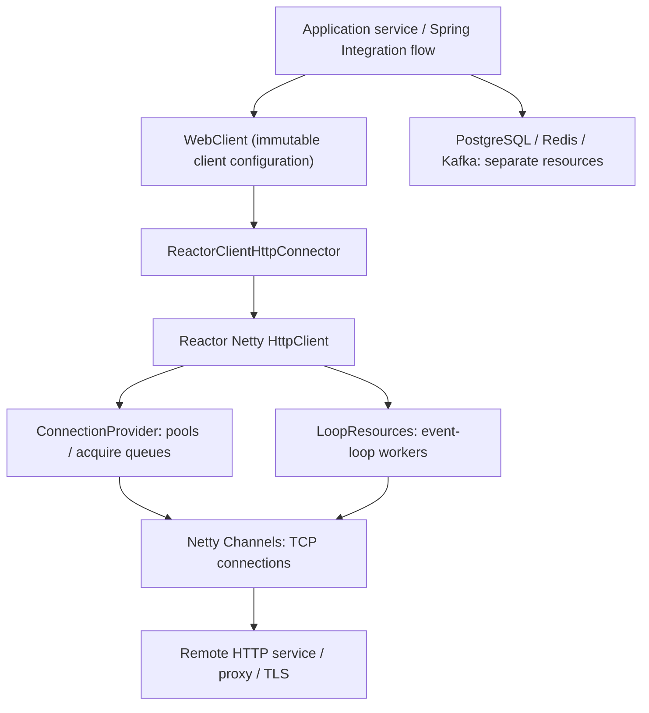
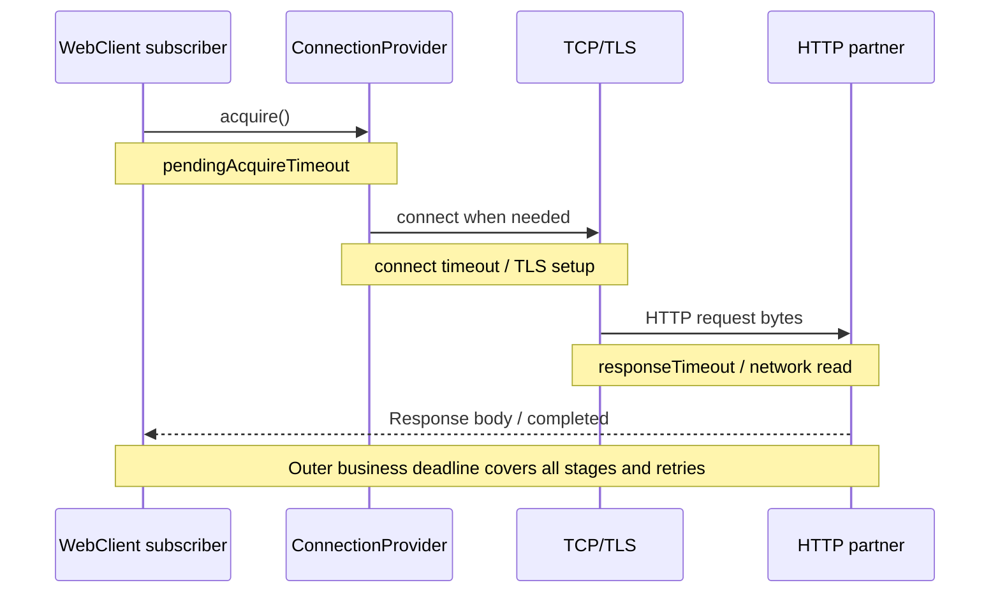
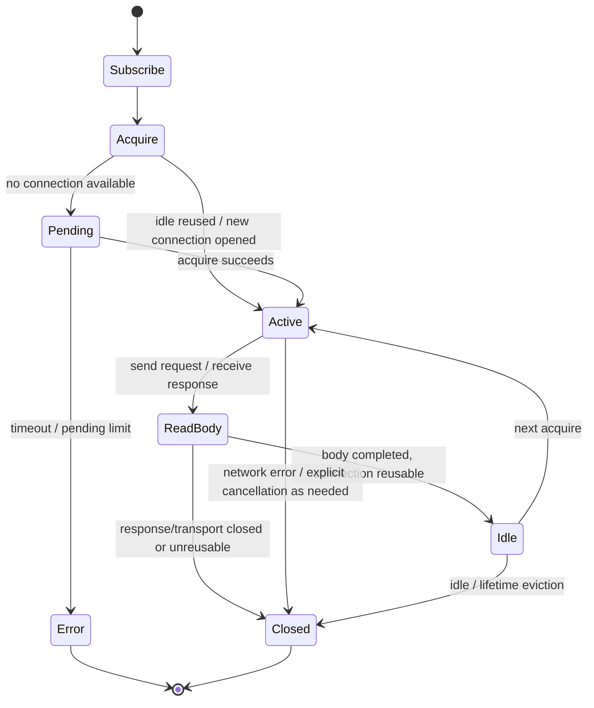
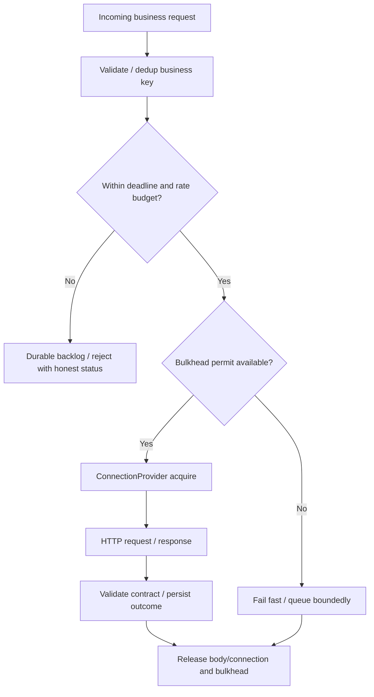
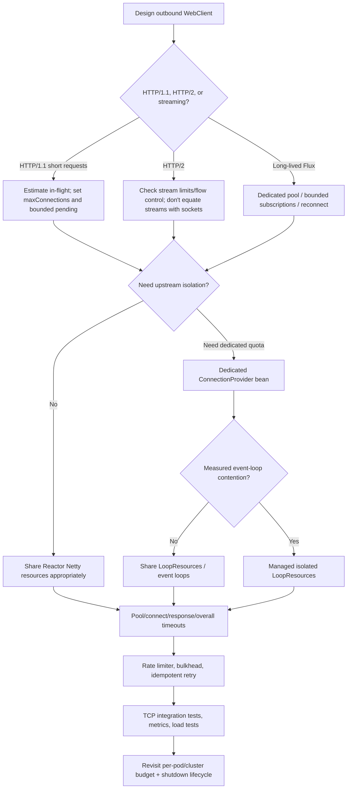

# ConnectionProvider, Reactor Netty Resources, and Connection Limits

> **Chapter:** WebClient  
> **Module:** SPRING_BOOT_INTEGRATION — integrating Spring Boot systems via HTTP clients, databases, caches, message brokers, and Spring Integration adapters. This lesson focuses on configuration management, data contracts, transactions, errors, deduplication, testing, and observability in real integration flows.

## 1. Real-World Problem: WebClient Is Asynchronous, Yet Resources Remain Finite

A Spring Boot service receives HTTP requests, calls a shipping API, writes to PostgreSQL, and publishes events to Kafka. The service uses `WebClient` for non-blocking I/O:

```java
Mono<ShipmentDto> requestShipment(String orderId) {
    return webClient.post()
            .uri("/v1/shipments")
            .bodyValue(new CreateShipmentRequest(orderId))
            .retrieve()
            .bodyToMono(ShipmentDto.class);
}
```

When traffic climbs from 50 to 3,000 concurrent requests, the system can experience:

- Many HTTP requests waiting to **acquire a connection from the pool**, while CPU stays low.
- Simultaneous connect timeout and pending acquire timeout failures.
- Overloaded partner services returning HTTP 429/503, while retries generate even more requests.
- Rising TCP connections and sockets stuck in `TIME_WAIT` if clients are continuously created and torn down.
- Reactor Netty event loops stalling due to a blocking callback.
- Large response bodies spiking memory even at modest HTTP concurrency.
- `ApplicationContext` restarts leaving manually created resources unclosed, leaking connections and threads.

**Core takeaway:** reactive execution removes the need for one blocked thread per waiting network request, yet **does not make sockets, file descriptors, event-loop threads, queue capacity, or memory infinite**. On Reactor Netty, `ConnectionProvider` governs most HTTP connection allocation and reuse policies; `LoopResources` manages event-loop resources; `WebClient` sits as the higher-level API.

### 1.1. Learning Objectives

After this lesson, you will be able to:

1. Explain the roles of `WebClient`, `ReactorClientHttpConnector`, `HttpClient`, `ConnectionProvider`, `LoopResources`, and global HTTP resources.
2. Distinguish **max connections**, **active/idle connections**, **pending acquire queue**, **in-flight HTTP requests**, and downstream limits.
3. Use `ConnectionProvider.builder(...)` to configure `maxConnections`, `pendingAcquireMaxCount`, `pendingAcquireTimeout`, `maxIdleTime`, `maxLifeTime`, `evictInBackground`, and FIFO/LIFO eviction/selection policies.
4. Understand that **connect timeout**, **pool acquire timeout**, **response timeout**, and **overall deadline** are four distinct concerns.
5. Build `WebClient` using a Spring lifecycle-managed pool rather than creating a new pool per request.
6. Know when to share Reactor Netty global event loops, when to isolate resources, and how to dispose cleanly.
7. Recognize differences between HTTP/1.1 connection reuse and HTTP/2 multiplexing, proxies, TLS, and DNS.
8. Design load-shedding, bounded concurrency, retries/idempotency, and non-blocking event-loop safety.
9. Test pools and timeouts against a real local HTTP server, monitor metrics, and write runbooks for pool saturation.

### 1.2. Version Scope and Assumptions

Examples target **Java 17+, Spring Boot 3.2–3.5, Spring Framework 6.x, and Reactor Netty 1.1–1.2 (BOM-compatible line)**. When upgrading Spring Boot or Reactor Netty, check version-specific docs for API names, defaults, HTTP/2 behavior, and metric names.

This lesson covers **outbound HTTP clients**; Reactor Netty's `ConnectionProvider` is not a JDBC `DataSource` pool, nor does it manage Kafka consumer groups or RabbitMQ channels. Still, resource limits across those integrations must be sized together to prevent cascading overload.

## 2. Resource Architecture: WebClient Is Not Directly a TCP Connection



### 2.1. What Is Each Layer Responsible For?

| Layer | Role | Do Not Mistake It For |
| --- | --- | --- |
| `WebClient` | Reactive API: requests, URIs, headers, codecs, response decoding, filters | A dedicated socket or automatic dedicated pool per instance |
| `ReactorClientHttpConnector` | Adapter bridging Spring `WebClient` to Reactor Netty `HttpClient` | An independent connection pool manager |
| `HttpClient` | Configures protocol, TLS, proxies, timeouts, transport, and network I/O | A thread pool executing business logic |
| `ConnectionProvider` | Leases/reuses connections; pool sizing, pending acquires, eviction/metrics | Total allowed requests across the entire system |
| `LoopResources` | Netty event loops (selectors/worker threads) | Thread-per-request or a blocking JDBC thread pool |
| Netty `Channel` | Concrete network connection/transport | A business transaction |
| Global `HttpResources` | Shared HTTP connection/event-loop resources under matching default setups | Automatically disposed by Spring if the app creates and owns custom resources separately |

A `WebClient` can share providers and event loops with other clients, or be isolated individually. **The number of `WebClient` beans does not automatically equal the number of pools**, and **the number of Reactor threads does not equal the number of HTTP connections**.

### 2.2. Creating a Mono Does Not Immediately Occupy a Connection

```java
Mono<OrderDto> pending = webClient.get()
        .uri("/v1/orders/{id}", "order-42")
        .retrieve()
        .bodyToMono(OrderDto.class);

// Typically NO HTTP request has been sent yet.
// Connection acquisition starts only when subscribed.
```

`WebClient` on Reactor Netty usually returns a **cold publisher**; WebFlux, a Spring Integration reactive flow, or a Reactor subscriber triggers execution by subscribing. Two independent subscriptions can trigger **two HTTP calls**. This matters critically for POST: timeouts, retries, or resubscriptions can create duplicate remote side effects.

### 2.3. HTTP/1.1 Persistent Connections and Reuse

With HTTP/1.1 keep-alive, a client typically does:

```text
request A → acquire TCP connection #1 → send/receive → release to idle pool
request B → acquire same idle connection #1 → send/receive → release
request C → if connection #1 busy, open/lease connection #2 (within limit)
```

Once the response body is fully processed (or properly cancelled/closed), the connection returns to the pool if still reusable. If the server sends `Connection: close` or the connection errors, the client discards or replaces it.

Never assume HTTP/1.1 connections stay reusable forever: reverse proxies/load balancers enforce idle timeouts, servers enforce max-requests-per-connection, and TLS/network resets drop sockets mid-flight.

### 2.4. HTTP/2 Multiplexing Differs from HTTP/1.1

HTTP/2 can run **multiple concurrent streams over a single TCP connection** when client and server negotiate protocol support and multiplexing. Consequently:

- `maxConnections=20` does not mean at most **20 in-flight HTTP requests** with HTTP/2.
- Concurrent stream limits, server `SETTINGS`, flow control, and Reactor Netty behavior all apply.
- HTTP/2 over TLS typically requires proper ALPN/certificates; merely adding an `Upgrade` header does not force HTTP/2 everywhere.
- HTTP/2 stream errors/cancellations behave differently from closing TCP connections; monitor protocol-specific metrics.

Simple sizing formulas like `maxConnections × requests/connection` serve only as **approximations for HTTP/1.1**. For HTTP/2, monitor active streams and response latency alongside connection counts.

## 3. ConnectionProvider Creates One Pool per Destination, Not One App-Wide Quota

In Reactor Netty, connection pooling typically partitions by **remote address / pool key** and connection characteristics. One provider can manage multiple pools corresponding to distinct upstream destinations (plus protocol/proxy settings).

```text
ConnectionProvider "external-api"
  ├─ Pool: api.shipping.example:443
  │    active=20, idle=5, pending=15
  ├─ Pool: api.tax.example:443
  │    active=10, idle=2, pending=0
  └─ Pool: api.inventory.example:443
       active=5, idle=8, pending=0
```

Setting `maxConnections(50)` does not mean "at most 50 HTTP sockets in the whole JVM" when the provider serves **multiple remote addresses**. Depending on pool keys and library versions, limits apply **per pool**, so total sockets across hosts can exceed the single configured number.

### 3.1. A ConnectionProvider Needs Clear Ownership

| Strategy | When Appropriate | Trade-Offs |
| --- | --- | --- |
| Use shared Reactor Netty global resources | Small apps or many similar clients needing minimal custom tuning | Harder to isolate noisy upstreams; tied to global lifecycle |
| One dedicated provider per critical upstream | Partner has distinct SLO/quota/timeout requirements | Must manage bean lifecycle and disposal explicitly |
| One provider shared across several upstreams | Uniform pool policy; fewer beans | Quota applies per pool key, not as a global business bulkhead |
| Dedicated provider + shared `LoopResources` | Need socket isolation without spawning extra event-loop threads | Blocking the event loop from one upstream still affects other clients |
| Dedicated provider + dedicated `LoopResources` | Strong isolation for special/high-throughput clients | Costs extra threads/CPU/resources; more complex lifecycle |

Never call `ConnectionProvider.builder(...).build()` **inside every request method**. Every new provider creates new pools, eviction tasks, and resources; while a `WebClient` wrapper is cheap, a pool has a **lifecycle** that must be closed.

### 3.2. Active, Idle, Pending, and Total

Within a pool:

- **Active (leased):** connections currently serving in-flight requests/streams.
- **Idle:** connections ready for reuse when reuse conditions hold.
- **Pending acquire:** subscribers/requests queued waiting for a connection because none is idle and the pool cannot open more within limits.
- **Total:** connections currently held/created by the pool within the metric scope (active + idle, with in-progress opens reflected per metric implementation).

`maxConnections` caps connections; `pendingAcquireMaxCount` caps queued acquisition requests. **Pending requests have typically not sent any HTTP bytes upstream yet**, so a pending acquire timeout does not mean the upstream received the request.

### 3.3. Distinguishing the Socket Queue from a Business Queue

```text
Incoming order request
    ↓
Business work item / outbox row (durable, DB)
    ↓
WebClient subscriber
    ↓
ConnectionProvider pending acquire (ephemeral, memory)
    ↓
TCP connection acquired
    ↓
HTTP request sent to partner
```

The pending acquire queue is **not durable**. On a JVM restart, requests waiting in the pool disappear. For commands requiring guaranteed delivery, use a durable outbox/job store and idempotency keys; never treat an HTTP connection pool as a reliable task queue.

## 4. Calculating Connection Limits: Example with 40 Connections and 80 Pending

Suppose a partner API allows at most 40 concurrent HTTP/1.1 connections from your app. You configure:

```text
maxConnections = 40
pendingAcquireMaxCount = 80
pendingAcquireTimeout = 2 seconds

Incoming burst: 200 concurrent HTTP subscriptions
```

With no idle connections and slow connects/responses, an approximate trace:

1. At most roughly **40** acquisitions can use/open connections.
2. At most roughly **80** additional acquisitions wait in the pending queue.
3. Acquisitions exceeding queue capacity fail fast.
4. Requests waiting longer than 2 seconds receive a pool acquire timeout.
5. As connections are released, pending requests acquire them and proceed to send HTTP traffic.

This limit does not mean the partner sees at most 40 requests **across the cluster**. Running 6 pods each with a 40-connection pool to the same endpoint can reach roughly **240 connections** (under HTTP/1.1 with one pool/endpoint per pod), excluding other clients.

### 4.1. Rough Sizing Formula

For HTTP/1.1 requests finishing in predictable time, Little's Law approximates steady-state concurrency:

\[
\text{average in-flight requests} \approx
\text{arrival rate (requests/s)} \times
\text{response time (s)}
\]

For instance, at 100 req/s and 200 ms p50 latency, average in-flight is ~20. Always size against **bursts, p95/p99, timeouts, retries, server quotas, and replica counts** rather than assuming p50 means 20 connections always suffice.

If p99 latency climbs from 200 ms to 3 seconds during an incident, in-flight requests surge **even at constant arrival rates**. Pool queues and service latencies spike, timing out caller requests; unrestrained retries then amplify the incident.

### 4.2. Connection Count Is Not a Rate Limit

| Limit | What It Protects | What It Does Not Protect |
| --- | --- | --- |
| `maxConnections` | Connections in one pool | Requests/second or HTTP/2 streams |
| `pendingAcquireMaxCount` | Acquisitions queued in RAM | Business queue durability |
| `pendingAcquireTimeout` | Time waiting for one connection | Total HTTP + retry duration |
| `maxIdleTime` | Idle age of pooled connections | Total connection age or response timeout |
| `maxLifeTime` | Maximum lifetime of a reusable connection | Remote server processing SLA |
| HTTP rate limiter | Requests/second or window quotas | Exact concurrent socket count |
| Application bulkhead/semaphore | Concurrent business operations in flight | Delivery or transaction guarantees |
| Circuit breaker | Short-circuiting calls to failing upstreams | Replacing retries/idempotency or data consistency |

Setting pool limits too high can swamp upstreams; setting them too low creates unnecessary queueing. Choose values from **downstream capacity and SLOs**, measure under load, and adjust.

## 5. Configuring ConnectionProvider Properly

### 5.1. Pool Example for a Partner API

```java
import java.time.Duration;
import reactor.netty.resources.ConnectionProvider;

ConnectionProvider shippingPool = ConnectionProvider
        .builder("shipping-http")
        .maxConnections(40)
        .pendingAcquireMaxCount(80)
        .pendingAcquireTimeout(Duration.ofSeconds(2))
        .maxIdleTime(Duration.ofSeconds(20))
        .maxLifeTime(Duration.ofMinutes(5))
        .evictInBackground(Duration.ofSeconds(30))
        .fifo()
        .metrics(true)
        .build();
```

These numbers are **illustrative starting points for explanation**, not universal production defaults. Tune them to measurements, Kafka/DB/HTTP downstream limits, and library versions. `metrics(true)` requires a matching metrics registry/integration to export gauges and timers; calling it alone does not expose monitoring endpoints.

### 5.2. maxConnections

`maxConnections(40)` sets the maximum connections per pool under current Reactor Netty semantics. In HTTP/1.1, once 40 connections are leased and none are idle, further acquisitions **enter the pending queue** if space remains or fail immediately.

Key considerations:

- Limits typically apply **per remote endpoint/pool key**, not as a JVM-wide total.
- Across multiple pods, limits apply **per JVM/provider**, not shared across replicas.
- HTTP/2 multiplexing lets active requests exceed TCP socket counts.
- Raising `maxConnections` while a server returns 503 often **makes downstream failure worse**.
- Never set `maxConnections=1` while running multiple long-lived streaming requests: other callers will stall until timeout.

### 5.3. pendingAcquireMaxCount

`pendingAcquireMaxCount(80)` caps how many acquisitions may queue while the pool is saturated. This is an **in-memory queue**, never persisted by a broker or database.

When full, Reactor Netty fails acquisitions with an acquisition-limit error before sending HTTP bytes. That signals **local saturation**, distinct from partner HTTP 429/503 responses.

Across 8 Kubernetes replicas each allowing 5,000 pending entries, the deployment can trap huge numbers of waiting requests/objects in memory; slow responses or retries then create severe heap/GC pressure despite bounded sockets. Keep pending counts finite and aligned with latency budgets.

### 5.4. pendingAcquireTimeout

`pendingAcquireTimeout(Duration.ofSeconds(2))` caps **how long an acquisition waits for a connection** per pool policy. It is not:

- TCP connect timeout.
- Time waiting for the server's HTTP response.
- Total duration from caller subscription through retries.
- Timeout for a PostgreSQL transaction or partner business operation.

An acquisition failure can occur before any request bytes leave the process. In error handling, separate **never acquired a connection** from **sent POST and lost the response**, as their duplicate-side-effect risks differ sharply.

### 5.5. maxIdleTime and maxLifeTime

`maxIdleTime(Duration.ofSeconds(20))` limits how long an idle connection remains eligible for reuse. `maxLifeTime(Duration.ofMinutes(5))` limits a connection's **total age**, even if actively reused.

| Setting | Problem Addressed | Caveat |
| --- | --- | --- |
| `maxIdleTime` | Avoid reusing sockets idle long enough to be dropped by load balancers | Too low causes frequent TLS handshakes and connection churn |
| `maxLifeTime` | Periodically refresh connections for LB/DNS changes and draining | Too low causes churn; does not forcibly abort an active request mid-flight |
| `evictInBackground` | Periodically scans and evicts idle/expired connections | Adds background overhead; does not enforce millisecond-exact expiration |
| `fifo()` | Picks idle connections first-in-first-out | Rotates across older idle sockets |
| `lifo()` | Prefers recently used idle connections | Lets older idle sockets sit until evicted |

Connections actively serving requests are not typically killed mid-request simply upon passing `maxLifeTime`; eviction/reuse rules apply around pool lifecycle transitions. To bound active HTTP requests, configure **response timeouts and deadlines** separately.

### 5.6. FIFO vs. LIFO: Impact on Socket Reuse

With multiple idle sockets:

```text
Idle pool: A (oldest idle), B, C (newest idle)

FIFO next acquire → A
LIFO next acquire → C
```

FIFO spreads usage across sockets; LIFO keeps "warm" sockets active and leaves older ones untouched until eviction, interacting differently with server/LB idle timeouts. Neither policy wins everywhere: a server closing sockets idle for 30s interacts differently with FIFO vs. LIFO. Monitor stale-reuse errors, reconnect rates, and latency.

### 5.7. metrics(true) Does Not Replace Observability Design

When paired with a compatible Micrometer registry, Reactor Netty can publish gauges and timers for active, idle, pending, max, and acquisition durations per provider and remote address. Metrics reveal whether congestion sits in the **local pool** or on the server.

Still:

- Never put raw `orderId`, `customerId`, or query strings into metric tags.
- Never construct dynamic provider names per request, such as `"pool-" + UUID.randomUUID()`.
- When a provider serves multiple remote hosts, inspect metrics **per pool/remote** per actual tagging.
- Never assume an instantaneous `pending` gauge scrape equals the count of requests that timed out over an entire minute.

### 5.8. Never Rely on Immutable Default Values

Reactor Netty defaults for max connections, pending counts, eviction, and TCP options can change across **versions, system properties, and transport modes**. Systems with explicit capacity requirements should **configure critical limits explicitly** and document the Reactor Netty version in operational runbooks. Never write "default=500 forever" and skip checking when upgrading the Spring Boot BOM.

## 6. Four Distinct Timeouts in One WebClient Request



### 6.1. Layered Timeouts

| Timeout | Typical Configuration Level | When It Matters | What Failure Means |
| --- | --- | --- | --- |
| **Pending acquire timeout** | `ConnectionProvider.pendingAcquireTimeout` | Waiting to lease a connection | Pool saturated; no connection available in time |
| **TCP connect timeout** | Netty `ChannelOption.CONNECT_TIMEOUT_MILLIS` | Opening a new TCP socket | Could not complete TCP connect within budget |
| **HTTP response timeout** | `HttpClient.responseTimeout(Duration)` | Waiting for/reading responses per client semantics | Upstream/transport failed to respond within limit |
| **Overall deadline** | Reactor `Mono.timeout(...)` or orchestration/Resilience4j `TimeLimiter` | From subscription to terminal signal across stages | Caller refuses to wait beyond overall budget |
| **TLS handshake timeout** | SSL/TLS provider settings if configured | TLS negotiation on new connections | Slow/broken handshake, cert, or network |
| **Read/write I/O timeout** | Netty handlers / transport settings if needed | Low-level socket I/O operations | Idle/network stall distinct from overall response deadline |

Timeouts can stack. Setting a 2s connect timeout, 2s pending acquire timeout, and 3s response timeout **does not guarantee** the call ends in 3s; an outer deadline enforces the caller's total wait cap.

### 6.2. Configuring a Dedicated HttpClient

```java
import java.time.Duration;
import io.netty.channel.ChannelOption;
import reactor.netty.http.client.HttpClient;
import reactor.netty.resources.ConnectionProvider;

HttpClient httpClient = HttpClient.create(shippingPool)
        .option(ChannelOption.CONNECT_TIMEOUT_MILLIS, 2_000)
        .responseTimeout(Duration.ofSeconds(3));
```

`shippingPool` is the provider configured in section 5; `HttpClient` here is **not created/closed per request**. TCP connect timeout applies when opening a **new connection**; requests reusing an idle pooled connection normally skip connecting. `responseTimeout` follows HTTP client semantics (consult your exact version's docs), and is not a completion SLA for background partner work triggered after HTTP 202.

### 6.3. Applying an Overall Operation Deadline

```java
import java.time.Duration;
import reactor.core.publisher.Mono;

Mono<OrderDto> result = shippingWebClient.get()
        .uri("/v1/orders/{id}", orderId)
        .retrieve()
        .bodyToMono(OrderDto.class)
        .timeout(Duration.ofSeconds(5));
```

`shippingWebClient` and `orderId` are variables from the application context. The `timeout(...)` operator emits an error if the publisher does not finish within the budget; cancellation can propagate down to the HTTP exchange.

**Note:** a request/`Mono` timeout never proves the partner skipped processing. For `POST /payments`, a response lost after server COMMIT leaves an **unknown outcome**. Retry only when business contracts/idempotency allow, or query status by stable operation ID.

### 6.4. Retry Budgets and Total Elapsed Time

Consider:

```text
Attempt 1: 2s pool wait + 3s HTTP timeout
Backoff:   0.5s
Attempt 2: 2s pool wait + 3s HTTP timeout
Backoff:   1.0s
Attempt 3: 2s pool wait + 3s HTTP timeout
```

This can exceed 15 seconds without an **outer deadline**. Your caller may have timed out at second 6 while inner retries keep burning CPU, connections, and upstream quota fruitlessly.

When `retryWhen` sits **before** `timeout(Duration.ofSeconds(6))` in the pipeline, the outer timeout normally bounds retries and backoffs underneath it. Placing `timeout` inside the retried publisher applies per attempt. Test operator ordering explicitly rather than guessing.

### 6.5. A Pool Timeout Is Not an Upstream Outage

When the pool is exhausted:

```text
incoming request → queued to acquire → pending timeout
HTTP bytes not sent to partner
```

This is **local capacity rejection**, not a partner HTTP 503. Classifying it separately enables:

- Load-shedding with 429/503 on your own API when overloaded.
- Reducing in-flight concurrency or isolating client bulkheads.
- Tuning pool queues/timeouts after measuring traffic.
- Avoiding blaming partners for requests that never left the JVM.

By contrast, acquiring a connection, sending a POST, and hitting a read timeout produces an **uncertain side-effect state**. Never collapse both into a single "UPSTREAM_UNAVAILABLE" error and apply the same blind retry policy.

## 7. Spring Boot: Configuring WebClient with a Clear Pool Lifecycle

### 7.1. Dependencies

```groovy
// build.gradle — Spring Boot plugin/BOM manages dependency versions.
dependencies {
    implementation 'org.springframework.boot:spring-boot-starter-webflux'
    implementation 'org.springframework.boot:spring-boot-starter-validation'

    // Project-dependent: metrics/tracing via Actuator + registry.
    implementation 'org.springframework.boot:spring-boot-starter-actuator'
    runtimeOnly 'io.micrometer:micrometer-registry-prometheus'

    testImplementation 'org.springframework.boot:spring-boot-starter-test'
    testImplementation 'io.projectreactor:reactor-test'
}
```

Spring Boot `spring-boot-starter-webflux` provides the Reactor Netty HTTP client for our illustrative stack. An MVC app can also use `WebClient` as an outbound client; adding the WebFlux dependency does not turn the whole app into a reactive web server while Spring MVC governs the web application type.

### 7.2. Externalize Policy; Avoid Literals in Business Code

```yaml
# application.yml
integration:
  shipping:
    base-url: ${SHIPPING_BASE_URL}
    http:
      max-connections: ${SHIPPING_MAX_CONNECTIONS:40}
      max-pending: ${SHIPPING_MAX_PENDING:80}
      acquire-timeout: 2s
      max-idle-time: 20s
      max-life-time: 5m
      eviction-interval: 30s
      connect-timeout: 2s
      response-timeout: 3s
```

`SHIPPING_BASE_URL` comes from deployment configuration or controlled service discovery, never arbitrary user input—preventing SSRF and credential leaks via redirects. Across environments, profile overrides may vary timeouts/limits while keeping **explicit policies** and test coverage.

### 7.3. Validated `@ConfigurationProperties`

```java
// ShippingHttpProperties.java
import jakarta.validation.Valid;
import jakarta.validation.constraints.Min;
import jakarta.validation.constraints.NotBlank;
import jakarta.validation.constraints.NotNull;
import java.time.Duration;
import org.springframework.boot.context.properties.ConfigurationProperties;
import org.springframework.validation.annotation.Validated;

@Validated
@ConfigurationProperties(prefix = "integration.shipping")
public record ShippingHttpProperties(
        @NotBlank String baseUrl,
        @Valid @NotNull Http http) {

    public record Http(
            @Min(1) int maxConnections,
            @Min(0) int maxPending,
            @NotNull Duration acquireTimeout,
            @NotNull Duration maxIdleTime,
            @NotNull Duration maxLifeTime,
            @NotNull Duration evictionInterval,
            @NotNull Duration connectTimeout,
            @NotNull Duration responseTimeout) {
    }
}
```

`@Validated` and constraints express intent; in a real project, enable property scanning or `@EnableConfigurationProperties` and include validation dependencies on the classpath. Add custom validators if you need to reject `Duration.ZERO`/negative durations or enforce cross-field deadline invariants.

### 7.4. Create the `ConnectionProvider` Bean Once

```java
// ShippingWebClientConfiguration.java
import io.netty.channel.ChannelOption;
import org.springframework.beans.factory.annotation.Qualifier;
import org.springframework.boot.context.properties.EnableConfigurationProperties;
import org.springframework.context.annotation.Bean;
import org.springframework.context.annotation.Configuration;
import org.springframework.http.client.reactive.ReactorClientHttpConnector;
import org.springframework.web.reactive.function.client.WebClient;
import reactor.netty.http.client.HttpClient;
import reactor.netty.resources.ConnectionProvider;

@Configuration(proxyBeanMethods = false)
@EnableConfigurationProperties(ShippingHttpProperties.class)
public class ShippingWebClientConfiguration {

    @Bean(name = "shippingConnectionProvider", destroyMethod = "dispose")
    ConnectionProvider shippingConnectionProvider(
            ShippingHttpProperties props) {
        var cfg = props.http();
        return ConnectionProvider.builder("shipping-http")
                .maxConnections(cfg.maxConnections())
                .pendingAcquireMaxCount(cfg.maxPending())
                .pendingAcquireTimeout(cfg.acquireTimeout())
                .maxIdleTime(cfg.maxIdleTime())
                .maxLifeTime(cfg.maxLifeTime())
                .evictInBackground(cfg.evictionInterval())
                .lifo()
                .metrics(true)
                .build();
    }

    @Bean("shippingWebClient")
    WebClient shippingWebClient(
            WebClient.Builder bootBuilder,
            ShippingHttpProperties props,
            @Qualifier("shippingConnectionProvider")
                    ConnectionProvider provider) {

        HttpClient httpClient = HttpClient.create(provider)
                .option(ChannelOption.CONNECT_TIMEOUT_MILLIS,
                        Math.toIntExact(
                                props.http().connectTimeout().toMillis()))
                .responseTimeout(props.http().responseTimeout());

        return bootBuilder
                .baseUrl(props.baseUrl())
                .clientConnector(
                        new ReactorClientHttpConnector(httpClient))
                .build();
    }
}
```

Because `shippingConnectionProvider` is a Spring bean with `destroyMethod="dispose"`, the container calls `dispose()` when `ApplicationContext` shuts down cleanly. Injecting Boot's `WebClient.Builder` retains customizers, codecs, and observation conventions, though **replacing the client connector** can affect connector/resource settings applied by Boot or organization customizers—verify actual TLS, proxy, and observability setups.

This configuration creates a **dedicated pool for Shipping** while likely continuing to use Reactor Netty's default global event loops. That bounds Shipping sockets **without spinning up dedicated Netty worker threads**. It does not mean Shipping is isolated from all resource contention; see section 9 on `LoopResources`.

### 7.5. Using the Bean in an Application Service

```java
import org.springframework.beans.factory.annotation.Qualifier;
import org.springframework.stereotype.Service;
import org.springframework.web.reactive.function.client.WebClient;
import reactor.core.publisher.Mono;

@Service
public class ShipmentGateway {
    private final WebClient client;

    public ShipmentGateway(
            @Qualifier("shippingWebClient") WebClient client) {
        this.client = client;
    }

    public Mono<ShipmentDto> getShipment(String shipmentId) {
        return client.get()
                .uri("/v1/shipments/{id}", shipmentId)
                .retrieve()
                .bodyToMono(ShipmentDto.class);
    }
}
```

`ShipmentDto` is an illustrative partner DTO:

```java
public record ShipmentDto(
        String id, String orderId, String status) {
}
```

Never instantiate a new provider inside `getShipment(...)`; the service reuses the configured `WebClient`. Both client and provider serve concurrent requests across the application's lifetime.

## 8. Reactor Netty Global Resources, Spring Boot, and Ownership

### 8.1. Sharing by Default Is Intentional

In common setups, Reactor Netty `HttpClient` uses **global HTTP resources** for connections and event loops. Sharing brings clear benefits:

- Avoids spawning an event-loop group per `WebClient`.
- Reuses TCP connections when pool keys and settings match.
- Reduces thread counts and resource overhead across the JVM.
- Simplifies setup for similar clients.

It also brings trade-offs:

- One blocking callback on a shared event loop stalls other clients.
- Resources created outside Spring management are not automatically torn down when context closes.
- Multiple `WebClient` beans do not imply isolated pools or lifecycles.
- Metrics can blur logical upstreams if provider names are too generic.

Always **distinguish the Spring `WebClient` bean lifecycle from `ConnectionProvider`/`LoopResources` lifecycles**. `WebClient` mainly holds configuration and is not created/destroyed per HTTP call.

### 8.2. Global `HttpResources` vs. Application-Owned Providers

```text
Default HttpClient:
    Reactor Netty global HttpResources (shared)

HttpClient.create(shippingPool):
    ConnectionProvider: shippingPool (custom, Spring-owned bean)
    Event loops: often Reactor Netty shared/global resources unless runOn(...)

HttpClient.create(shippingPool).runOn(shippingLoops):
    ConnectionProvider: shippingPool (custom)
    Event loops: shippingLoops (custom, Spring-owned bean)
```

Do not assume `HttpClient.create(customProvider)` automatically allocates separate event loops. Also never call `HttpResources.disposeLoopsAndConnectionsLater().subscribe()` casually when stopping one plugin/client, as doing so tears down **shared global resources** used by other `WebClient`s in the same process.

### 8.3. Spring Boot `ReactorResourceFactory`

Spring Framework offers `ReactorResourceFactory` to tie Reactor Netty `LoopResources` and `ConnectionProvider` lifecycles to the Spring `ApplicationContext`. In many Boot/WebFlux configurations, Boot manages resources alongside the auto-configured connector.

When an application needs **isolation from shared global resources** with consistent lifecycle management:

```java
// An ALTERNATIVE to creating a standalone provider in section 7;
// do not combine both without clear ownership.
import java.time.Duration;
import org.springframework.context.annotation.Bean;
import org.springframework.context.annotation.Configuration;
import org.springframework.http.client.ReactorResourceFactory;
import org.springframework.http.client.reactive.ReactorClientHttpConnector;
import org.springframework.web.reactive.function.client.WebClient;
import reactor.netty.resources.ConnectionProvider;
import reactor.netty.resources.LoopResources;

@Configuration(proxyBeanMethods = false)
class IsolatedReactorResourcesConfiguration {

    @Bean
    ReactorResourceFactory isolatedResourceFactory() {
        ReactorResourceFactory factory = new ReactorResourceFactory();
        factory.setUseGlobalResources(false);
        factory.setConnectionProviderSupplier(() ->
                ConnectionProvider.builder("isolated-partner")
                        .maxConnections(30)
                        .pendingAcquireMaxCount(60)
                        .pendingAcquireTimeout(Duration.ofSeconds(2))
                        .build());
        factory.setLoopResourcesSupplier(() ->
                LoopResources.create("isolated-io", 4, true));
        return factory;
    }

    @Bean("isolatedPartnerWebClient")
    WebClient isolatedPartnerWebClient(
            ReactorResourceFactory isolatedResourceFactory,
            WebClient.Builder builder) {
        return builder
                .baseUrl("https://partner.example.invalid")
                .clientConnector(new ReactorClientHttpConnector(
                        isolatedResourceFactory, httpClient ->
                                httpClient.responseTimeout(
                                        Duration.ofSeconds(3))))
                .build();
    }
}
```

**Important condition:** this snippet is designed as **an alternative configuration** illustrating resource ownership; do not attach `shippingConnectionProvider` from section 7 onto the same client simultaneously. `ReactorResourceFactory` creates and destroys resources from suppliers aligned with `ApplicationContext`; verify interactions with Boot auto-configuration if multiple resource factories exist or if the web server also runs Reactor Netty.

Setting `useGlobalResources(false)` without supplying valid suppliers can leave you believing resources are isolated when an unintended default is still used. Whenever isolating, test **provider names, event-loop thread counts, and shutdown cleanup**.

### 8.4. When Should You Avoid Creating Custom `LoopResources`?

Usually, bounding connections for a partner needs only a **dedicated `ConnectionProvider`**, not dedicated event loops. Creating 10 clients with 8 event-loop threads each consumes roughly **80 network worker threads** instead of sharing event loops efficiently.

Create custom `LoopResources` only with measured justification:

- Isolating a high-volume streaming client from other HTTP clients.
- An upstream requiring specialized transport/timing isolation.
- Explicit requirements to isolate I/O thread affinity or lifecycle.
- Proven contention on shared event loops—never as a workaround for blocking JDBC.

Adding more event-loop workers creates zero extra PostgreSQL connections, adds zero Kafka partitions, and cannot fix bottlenecks inside downstream HTTP servers.

### 8.5. Bean Lifecycle and Preventing Resource Leaks

A custom provider can be disposed via:

```java
@Bean(destroyMethod = "dispose")
ConnectionProvider reportingConnectionProvider() {
    return ConnectionProvider.builder("reporting-http")
            .maxConnections(15)
            .build();
}
```

In Spring, `destroyMethod="dispose"` triggers container cleanup on context shutdown. Outside Spring or inside ad-hoc tests, dispose explicitly:

```java
ConnectionProvider pool = ConnectionProvider.create("temporary-test");
try {
    // Use WebClient/HttpClient against a local test server.
} finally {
    pool.dispose();
}
```

Never call `pool.dispose()` after individual responses while the provider still serves other requests. During shutdown:

1. Stop accepting new business work.
2. Allow in-flight operations to finish within a bounded **grace period**.
3. Stop listeners/schedulers spawning new requests.
4. Dispose application-**owned** providers and loop resources.
5. Never dispose shared global resources when this component is only one of several users.

### 8.6. Resource Issues in Spring Tests

`@SpringBootTest` caches `ApplicationContext` instances across test classes. If one test class manually disposes a Spring-managed provider in `@AfterEach`, subsequent tests reusing **the same cached context** fail with `connection pool already disposed`. To avoid this:

- Let Spring beans manage lifecycle instead of calling `@AfterEach pool.dispose()` on Spring-managed pools.
- Manually dispose only resources constructed directly inside a test method.
- Use explicit context/config isolation when pool configurations must differ across tests.
- Avoid sprinkling `@DirtiesContext` indiscriminately; it is slow and does not automatically clean up static non-Spring globals.
- Restart/shutdown tests must verify providers are recreated or fresh Spring contexts built.

## 9. Event-Loop Threads Are Not for Blocking Business Work

### 9.1. What Do Reactor Netty Event Loops Do?

Netty event loops handle:

- Socket connect, readiness notifications, reads/writes.
- Channel pipeline handlers and parts of reactive operators/callbacks.
- TLS/protocol framing and network data exchange.
- Dispatching data to codecs, publishers, and subscribers depending on scheduling.

They are **not** a dedicated worker pool for 200 ms JDBC queries, blocking file reads, or synchronous HTTP calls. One long blocking callback stalls **many connections** multiplexed onto that event loop.

### 9.2. Anti-Pattern: Blocking Directly Inside the Pipeline

```java
// Never do this on an event loop.
Mono<ShipmentDto> wrong(String orderId) {
    return webClient.get()
            .uri("/v1/orders/{id}", orderId)
            .retrieve()
            .bodyToMono(OrderDto.class)
            .map(dto -> {
                // Blocking JDBC/JPA inside a reactive callback:
                OrderEntity entity =
                        jpaOrderRepository.findById(dto.id())
                                .orElseThrow();
                return mapToShipment(entity);
            });
}
```

`jpaOrderRepository`, `OrderEntity`, and `mapToShipment` are hypothetical application types. The problem is not `map` itself, but executing **synchronous blocking I/O** inside a callback likely running on an event-loop thread.

Consequences:

- HTTP responses arrive yet the callback pins the event loop.
- Other channels sharing that event loop starve.
- Pooled connections stay leased longer, active counts climb, and the pending queue fills.
- Metrics report connection-acquisition timeouts even though the database is the true bottleneck.

### 9.3. Temporarily Offloading Blocking Calls to `boundedElastic`

While JDBC has not yet migrated to R2DBC, isolate blocking calls:

```java
import reactor.core.publisher.Mono;
import reactor.core.scheduler.Schedulers;

Mono<ShipmentDto> bridgeLegacy(String orderId) {
    return webClient.get()
            .uri("/v1/orders/{id}", orderId)
            .retrieve()
            .bodyToMono(OrderDto.class)
            .flatMap(dto -> Mono.fromCallable(() -> {
                        OrderEntity entity =
                                jpaOrderRepository.findById(dto.id())
                                        .orElseThrow();
                        return mapToShipment(entity);
                    })
                    .subscribeOn(Schedulers.boundedElastic()));
}
```

This is a **legacy bridge** with its own concurrency/queue bounds; it does not make JDBC non-blocking. JPA/JDBC transaction managers use thread-bound context, so hopping threads across operators does not carry one transaction across stages. Keep `@Transactional` on a blocking Spring service method invoked **through a Spring proxy on the `boundedElastic` thread**, rather than annotating a `Mono`-returning method expecting JDBC transactions to follow Reactor Context.

### 9.4. Do Not Use `.block()` to "Work Around" a Slow Pool

```java
// Anti-pattern inside a WebFlux event loop or async Kafka callback:
OrderDto order = webClient.get()
        .uri("/v1/orders/{id}", orderId)
        .retrieve()
        .bodyToMono(OrderDto.class)
        .block();
```

`block()` stalls the calling thread and initiates a new subscription per call. Imperative MVC entrypoints may prefer a synchronous HTTP client like `RestClient` instead of using `WebClient` with `block()` everywhere without respecting thread models.

### 9.5. Sizing `LoopResources`

Default Reactor Netty event-loop worker counts depend on environment and system properties per version. Never assume "N CPU cores always equals exactly N Netty threads" regardless of runtime/config.

If you write:

```java
LoopResources loops =
        LoopResources.create("partner-io", 4, true);

HttpClient client = HttpClient.create(shippingPool)
        .runOn(loops);
```

Then four worker threads is **this example's explicit configuration**, not a universal Reactor Netty default. `loops` must have a dedicated owner/disposal lifecycle. Never crank `LoopResources.create(..., 200, ...)` up to paper over blocking JDBC: fix the callback/DB bottleneck first, then load-test and pick an appropriate worker count.

### 9.6. Event Loops and Metrics: Where Is a Request Stalling?

```text
HTTP client request latency high
  ├── Pool acquire latency high → maxConnections/pending/slow release
  ├── TCP connect latency high → DNS/network/TLS/connection churn
  ├── HTTP response latency high → upstream/proxy/remote processing
  ├── Body decode latency high → payload size/codec/CPU
  └── Event-loop tasks delayed → blocking callbacks/GC/CPU saturation
```

Increase pool size only when the root cause is **insufficient socket capacity** and downstream can absorb more load. When the event loop is blocked, adding connections only lets more sockets pile up behind the same stalled loop.

## 10. Acquire, Reuse, Close, and Cancellation

### 10.1. Connection Lifecycle on a Successful Request



This diagram is a **logical model**. Reactor Netty has finer internal states, HTTP/2 multiplexing, and concurrency races. Crucially, a connection **is not idle the moment response headers arrive** while the response body is still being consumed.

### 10.2. Neglecting Response Bodies Hinders Reuse

Convenient `WebClient` APIs:

```java
Mono<ShipmentDto> shipment = webClient.get()
        .uri("/v1/shipments/{id}", id)
        .retrieve()
        .bodyToMono(ShipmentDto.class);
```

With `retrieve().bodyToMono(...)` or `bodyToFlux(...)`, Spring handles response decoding and resource release per lifecycle. When only status/headers matter, use APIs that handle body release cleanly:

```java
Mono<Boolean> accepted = webClient.post()
        .uri("/v1/shipments")
        .bodyValue(request)
        .exchangeToMono(response -> {
            if (response.statusCode().value() == 202) {
                return response.releaseBody().thenReturn(true);
            }
            return response.createException()
                    .flatMap(Mono::error);
        });
```

`request` is the input DTO. `exchangeToMono` is designed by Spring to release unused bodies when the returned publisher finishes; this example calls `releaseBody()` explicitly when discarding the body. Never pass `ClientResponse` out of scope leaving body/network resources dangling. The legacy `exchange()` API made forgotten releases easy; choose `retrieve()`/`exchangeToMono()` as appropriate.

### 10.3. Cancellation Is Not an HTTP Server Rollback

```java
Mono<ShipmentDto> slow =
        webClient.post()
                .uri("/v1/shipments")
                .bodyValue(request)
                .retrieve()
                .bodyToMono(ShipmentDto.class)
                .timeout(Duration.ofSeconds(2));
```

If it times out, the subscription cancels and the socket/stream is cleaned up per transport lifecycle. Yet the partner may **already have committed the shipment** while the response lagged or dropped. Never resubmit a POST with a random idempotency key after timeout; use a stable key and status lookup/reconciliation.

### 10.4. Long-Lived Streams Hold Connections

A `Flux<ShipmentEvent>` over NDJSON or SSE can stay open for hours. An HTTP/1.1 connection serving a stream normally cannot return to the idle pool until the stream finishes or cancels properly. Opening 40 endless streams on a `maxConnections(40)` pool starves all other GET/POST calls sharing that pool until they time out.

Mitigations:

- Dedicate a separate pool for streaming instead of mixing with short-lived requests.
- Cap active subscriptions and define idle/heartbeat/termination policies.
- Verify server support for reconnect cursors/`Last-Event-ID` and event deduplication.
- Never feed an unbounded `Flux` into `collectList()`, which never completes.
- Monitor stream lifetimes, cancellations, and active connection/stream counts.

### 10.5. `DataBuffer` and Memory Limits

A single 80 MB JSON response body puts heavy pressure on RAM even over **one connection**. Spring codecs enforce in-memory buffer caps, configurable such as:

```yaml
spring:
  codec:
    max-in-memory-size: 512KB
```

Property applicability depends on Spring Boot version and application setup; it does not affect custom `WebClient` instances that bypass Boot builders/customizers. Never raise `max-in-memory-size` indefinitely to "fix" `DataBufferLimitException`: consider streaming, payload contract limits, controlled decompression, and max request/response sizes.

### 10.6. Connection Release Is Not a DB Transaction Commit

Once an HTTP response body is read and the connection returns to the pool, that settles **only the network resource**. It does not guarantee:

- PostgreSQL inserts committed.
- Kafka producer messages were broker-acknowledged.
- Redis cache invalidations succeeded.
- RabbitMQ publisher confirms arrived.
- Partner background jobs finished after HTTP 202.

Each resource keeps its own transaction/acknowledgment contract; integration flows must persist state durably and retry at the right boundaries.

## 11. Bounded Concurrency, Backpressure, and Application-Level Load Shedding

`ConnectionProvider.maxConnections` is a **socket cap**, not the sole safeguard for business workloads. Under HTTP/2, one connection carries many streams; under HTTP/1.1, pool queues buffer waiting subscribers. Therefore, bound **in-flight operations** before hitting the pool and define an explicit overload policy.

### 11.1. Capping with `flatMap` Concurrency

```java
import java.util.List;
import reactor.core.publisher.Flux;
import reactor.core.publisher.Mono;

Mono<List<ShipmentDto>> fetchMany(List<String> shipmentIds) {
    return Flux.fromIterable(shipmentIds)
            .flatMap(
                    id -> shippingWebClient.get()
                            .uri("/v1/shipments/{id}", id)
                            .retrieve()
                            .bodyToMono(ShipmentDto.class),
                    16 // at most 16 concurrent inner publishers
            )
            .collectList();
}
```

This targets a **finite batch**, never an infinite stream. `flatMap(..., 16)` limits inner publishers **within this single subscription**; if 100 request handlers invoke this concurrently, aggregate concurrency still reaches roughly **1,600**. Add a global bulkhead/rate limiter to protect shared quotas.

If output must preserve `shipmentIds` order, `flatMap` emits in response completion order rather than input order. Consider `flatMapSequential`/`concatMap` or keying results by ID.

### 11.2. Instance-Wide Limits with a Semaphore or Bulkhead

A bulkhead caps concurrent **business operations** targeting an upstream:

```text
Incoming HTTP handlers: 1,000
Bulkhead shipping permits: 32
ConnectionProvider maxConnections: 40
Pool pending: 80

At most 32 operations admitted into shipping call per instance.
Others fail fast / await in a bounded application-level queue.
```

Reactive bulkheads must **release permits on complete, error, and cancel**. Never call blocking `Semaphore.acquire()` on an event loop, and never leak permits on cancellation. Use Resilience4j's reactor Bulkhead adapter or a tested bounded reactive gate, verifying cancellation and fairness.

**Per-instance quotas are not global quotas.** If a partner allows 100 concurrent operations cluster-wide across 5 pods, giving every pod 100 permits breaks the quota. Divide budgets across replicas or use centralized rate coordination/gateway limiters.

### 11.3. Larger Pool Queues Do Not Speed Up Upstreams

Suppose upstream handles 40 req/s while the service receives 200 req/s sustained. With a 10,000-entry pending queue:

```text
arrival = 200 req/s
service capacity = 40 req/s
backlog growth ≈ 160 req/s
queue 10,000 fills in ~62.5s (simplified)
```

This rough estimate ignores timeouts, retries, and bursts. In practice, queued requests expire past caller deadlines and become **worthless before ever being sent**. Size pending counts to latency SLAs, prefer **controlled early rejection**, and persist durable business intents whenever work cannot be dropped.

### 11.4. Rate Limiting vs. Concurrency Limiting

A 50 req/s API quota cannot be enforced by `maxConnections(50)`: if each request takes 10 ms, 50 sockets can push thousands of requests per second. Use time-window or token-bucket rate limiters aligned with partner quotas.

Conversely, capping 50 req/s does not keep in-flight requests under 50: if responses take 20 seconds, concurrency accumulates higher. Combine rate limits, concurrency bulkheads, and timeouts/budgets for complete protection.

### 11.5. A Practical Backpressure Strategy



For shipping commands that **must eventually be delivered**, never dump a million work items into `ConnectionProvider.pendingAcquireMaxCount`. Persist an outbox/job record in your database transaction and let controlled workers pace outbound calls; pool queues only absorb brief bursts, never replacing business workflows.

## 12. Retries, Circuit Breakers, and Idempotency

### 12.1. Retries Multiply HTTP Request Volume

Suppose 100 concurrent requests get 503 and each retries twice. During a sustained outage, upstream receives up to **300 attempts** instead of 100. If multiple layers retry (controller → service → `WebClient` → gateway), attempts multiply exponentially.

Establish **one retry owner** and a clear budget:

- Idempotent GETs can typically retry selected transient errors.
- Side-effecting POST/PUT calls require a business idempotency contract and persisted request state.
- 4xx validation, auth, and contract errors should not retry like 503.
- Retrying on pool acquire timeouts **adds pressure to the saturated local queue** without fixing the bottleneck.
- Retries with exponential backoff and jitter must stay within an overall deadline.

### 12.2. Selective Retry Example for GET

```java
import java.time.Duration;
import org.springframework.web.reactive.function.client.WebClientRequestException;
import org.springframework.web.reactive.function.client.WebClientResponseException;
import reactor.core.publisher.Mono;
import reactor.util.retry.Retry;

Mono<ShipmentDto> resilientGet(String id) {
    return shippingWebClient.get()
            .uri("/v1/shipments/{id}", id)
            .retrieve()
            .bodyToMono(ShipmentDto.class)
            .retryWhen(Retry.backoff(2, Duration.ofMillis(200))
                    .maxBackoff(Duration.ofSeconds(1))
                    .filter(error -> {
                        if (error instanceof WebClientRequestException) {
                            return true;
                        }
                        if (error instanceof WebClientResponseException ex) {
                            int status = ex.getStatusCode().value();
                            return status == 429 || status == 503
                                    || status == 504;
                        }
                        return false;
                    }))
            .timeout(Duration.ofSeconds(5));
}
```

This retry predicate **does not** distinguish permanent `WebClientRequestException` causes (like bad hostnames or TLS cert errors) and does not honor `Retry-After`; it is a discussion skeleton, not a turnkey payment retry policy. In production, inspect root causes, track whether bytes were sent, and meter attempt counts.

### 12.3. Should Pool Pending Timeouts Be Retried?

A pending acquire timeout occurs before acquiring a socket, so the request was not sent upstream. Still, retrying **immediately into the same saturated provider** worsens queue congestion. Better policy:

1. Recognize local saturation.
2. Shed expired requests and reduce admitted work.
3. Avoid pumping extra retries into the queue while upstream latency stays high.
4. Let durable workers retry later with backoff or orchestration.
5. Return appropriate status and correlation IDs to callers without claiming "request sent" when it never left.

Distinguish this from a response timeout after bytes went to the partner, where **uncertain side-effect** risks are very different.

### 12.4. A POST May Have Committed at the Partner

```text
T0  Shipping service receives POST /shipments, key=order-42-ship
T1  Shipping service creates shipment and commits
T2  Network connection closes before response reaches WebClient
T3  WebClient reports connection error or timeout
T4  Application retries with NEW random key → two shipments possible
```

Prevention:

- Use a stable `Idempotency-Key`/business operation ID.
- Persist intent/outcome in PostgreSQL with a transactional outbox when durability is required.
- After timeouts, look up/reconcile using the original key before deciding to retry.
- Partners must support idempotent replay or unique business keys; otherwise design operational/manual reconciliation.
- Never treat `Mono.timeout(...)` or socket close as distributed transaction rollback.

### 12.5. Circuit Breakers Complement Pools Rather Than Replacing Them

Circuit breakers trip calls when an upstream fails, relieving pressure on both pools and partners. Yet circuit breakers enforce their own rules (failure thresholds, half-open probes, exclusions) and do not enforce rate/concurrency caps unless paired with bulkheads. Clean composition:

```text
Business request
  → deadline/rate limiter
  → bulkhead
  → circuit breaker
  → WebClient / ConnectionProvider
  → remote HTTP partner
```

Exact ordering varies by framework/wrapper (for example, whether bulkhead permits wrap retries or sit inside retries), so **test the composition** and avoid nesting policies that cause deadlocks or conflicting timeouts.

### 12.6. Isolating HTTP Timeouts from Kafka Offsets and DB Transactions

When a Kafka listener calls the Shipping API via `WebClient`:

- Never call `subscribe()` and immediately ack Kafka; completion/errors escape the listener boundary.
- For imperative listeners, use structured orchestration or a durable outbox instead of blocking an event loop.
- When persisting DB state around HTTP calls, never include the HTTP call inside the JDBC transaction.
- If Kafka redelivers after DB commit and before offset ack, idempotent inboxes/outboxes/partner keys must prevent duplicates.
- Size Kafka consumer concurrency, `WebClient` pools, and PostgreSQL Hikari pools together against **end-to-end flow capacity**.

## 13. Multiple Upstreams: Separating Pools by Purpose

One service calls:

- Shipping API: high-volume short POSTs, moderate quota.
- Tax API: low-volume GETs, occasionally slow.
- Audit API: long-lived event streams.

Sharing one provider works when network characteristics and policies match, yet complicates analyzing **per-pool keys, metrics, deadlines, and resource ownership**. Separating providers clarifies per-upstream policies:

| Upstream | Pool Model | Example Policy |
| --- | --- | --- |
| Shipping write API | Dedicated provider | 40 connections, 80 pending, strict deadline, idempotency |
| Tax lookup | Dedicated provider | 15 connections, 30 pending, selective GET retry/backoff |
| Audit streaming | Dedicated provider | 10 long-lived connections, subscription cap, reconnect cursor |
| Internal health/metadata | Small provider or shared default | Prevent long streams from starving health probes |

However, separate providers **do not** isolate event loops or CPU. Too many providers add configuration complexity, socket/FD overhead, and metric cardinality. Split only for measurable SLO, quota, or isolation needs.

### 13.1. Never Create a New Pool for Every User-Supplied URL

```java
// Anti-pattern: every input creates a new provider/WebClient without disposal.
Mono<String> proxyForUserUrl(String userUrl) {
    ConnectionProvider p =
            ConnectionProvider.create("dynamic-" + userUrl);
    WebClient c = WebClient.builder()
            .baseUrl(userUrl)
            .clientConnector(
                    new ReactorClientHttpConnector(HttpClient.create(p)))
            .build();
    return c.get().retrieve().bodyToMono(String.class);
}
```

Beyond leaking resources, this introduces **SSRF risk** when user-controlled URLs target cloud metadata or internal services. Instead:

1. Define trusted/allowlisted remote service identities.
2. Configure `WebClient` beans and `ConnectionProvider`s with clear owners.
3. Select clients by logical destination, never arbitrary URLs.
4. Constrain redirect, proxy, and auth-header forwarding behavior.
5. Monitor sockets/connection pools per upstream.

### 13.2. Multi-Tenant Does Not Mean One Pool per Tenant

If 10,000 tenants hit the same API endpoint, creating 10,000 `ConnectionProvider`s is unnecessary. Evaluate:

- Tenant-specific auth headers and credential isolation.
- Per-tenant rate limiting.
- Whether distinct mTLS client certificates force separate transport connections.
- Query timeouts and data isolation.
- Whether upstream quotas apply per tenant or per service.

Usually one or a few providers paired with safe per-request credentials and per-tenant bulkheads/rate limits suffice; never spawn dynamic providers per tenant ID without genuine transport-isolation requirements.

### 13.3. Multi-Instance Sizing and Ephemeral Ports

With 100 HTTP/1.1 connections per pod scaled by HPA to 20 pods, connections to one partner endpoint can reach ~2,000 sockets (ignoring multiple pool keys/protocols). Beyond partner capacity, hosts and networks enforce limits on file descriptors, ephemeral source ports, NAT tables, and proxy connection tracking.

Symptoms:

- Connect failures, `Cannot assign requested address`, or `Too many open files`.
- Connection churn/`TIME_WAIT` spikes from overly short `maxIdleTime` or per-request clients.
- Load balancers dropping idle sockets, causing `PrematureCloseException` on reuse.
- Elevated DNS or TLS handshake load from constant socket rotation.

The fix is not merely bumping Linux `ulimit`: audit pool lifecycles, reuse, connection pressure, and platform limits first.

## 14. HTTP Protocols, TLS, Proxies, and DNS Affect Pool Behavior

### 14.1. Pick HTTP/1.1 vs. HTTP/2 Based on Real Needs

In HTTP/1.1, pool limits map closely to concurrent requests holding sockets. HTTP/2 multiplexing complicates limits; monitor **stream limits** and backpressure alongside channel counts.

Never enable HTTP/2 solely to "reduce connections" unless partner, proxy, and TLS layers support it reliably. Likewise, never set `maxConnections=1` assuming HTTP/2 guarantees high throughput: server `SETTINGS_MAX_CONCURRENT_STREAMS`, flow control, and large bodies can still stall streams.

### 14.2. TLS Handshakes and Connection Reuse

Every fresh HTTPS connection performs a TLS handshake (subject to session resumption) before sending HTTP. Too-short `maxLifeTime`/`maxIdleTime` forces frequent reconnects and spikes handshake cost. Too-long lifetimes allow reverse proxies to close idle sockets silently, causing stale reuse failures.

In production:

- Use proper truststores/CAs; never disable hostname verification.
- With mTLS client certificates, separate providers/connectors by client identity when required.
- Verify proxy tunneling (`HTTP CONNECT`), certificates, and trusted DNS.
- Track TLS handshake failures separately from TCP connect failures.
- Rotate/close pooled connections safely when certificates or secrets rotate.

### 14.3. DNS and Remote Addresses

A DNS hostname can resolve to multiple IPs; load balancers, service discovery, and Reactor Netty's resolver/cache affect target selection. Pool keys can also depend on host, proxy, and transport settings. **Never assume** DNS updates immediately migrate existing pooled connections to new IPs.

During upstream rotations:

1. Monitor connect/response errors on older connections.
2. Check DNS TTLs, resolvers, and pool eviction/lifetime caps.
3. Understand load balancer connection-draining policies.
4. Ensure bounded retries and idempotency are in place.
5. Track socket recreation rates and error spikes.

Never hardcode container/Pod/Service IPs into `WebClient` expecting automatic discovery.

### 14.4. HTTP Proxies Can Reshape Pool Topology

Enterprise egress proxies often route many partner URLs through one proxy host. Then network socket targets and proxy auth/TLS tunnels differ from application base URLs:

- Configure proxies on the underlying Reactor Netty `HttpClient`, rather than manually adding `Proxy-Authorization` headers.
- Verify `HTTP CONNECT`, TLS/SNI, proxy bypass lists, and redirects.
- Audit resource counts and pooling across proxy/target/protocol in your actual version.
- Never log proxy credentials, bearer tokens, or full query strings.

When one `WebClient` reaches multiple partner domains through a proxy, `maxConnections` does **not** automatically equate to one global proxy quota; inspect actual pool-key metrics.

### 14.5. Docker Compose/Testcontainers: Real Endpoints Use Dynamic Ports

In tests, an HTTP stub listening on container port 8080 may expose mapped host port 49541. From the host JVM, Testcontainers builds:

```java
String baseUrl = "http://" + stub.getHost()
        + ":" + stub.getMappedPort(8080);
```

By contrast, Spring Boot running **inside the same Docker Compose network** reaches `http://stub:8080`. `localhost` inside an app container is not the test JVM host's `localhost`. When testing HTTP/2, proxies, or TLS, ensure certificates/SANs match the actual hostname the client calls.

Never persist ephemeral host ports into production configs or durable outbox payloads. Store only logical destinations and operation IDs, resolving runtime endpoints at dispatch time.

## 15. Testing ConnectionProvider with a Local Reactor Netty HTTP Server

Tests mocking `WebClient` to return `Mono.just(dto)` cannot verify connection acquisition, socket reuse, pending queues, or body release. To test transport behavior, run a **real TCP loopback HTTP server** (such as Reactor Netty `HttpServer`, WireMock, MockWebServer, or Testcontainers).

### 15.1. JUnit Test with Dedicated Local Server and Provider

```java
// WebClientPoolIntegrationTest.java
import java.time.Duration;
import java.util.List;
import java.util.concurrent.atomic.AtomicInteger;
import org.junit.jupiter.api.AfterEach;
import org.junit.jupiter.api.BeforeEach;
import org.junit.jupiter.api.Test;
import org.springframework.http.client.reactive.ReactorClientHttpConnector;
import org.springframework.web.reactive.function.client.WebClient;
import reactor.core.publisher.Flux;
import reactor.core.publisher.Mono;
import reactor.netty.DisposableServer;
import reactor.netty.http.client.HttpClient;
import reactor.netty.http.server.HttpServer;
import reactor.netty.resources.ConnectionProvider;
import reactor.test.StepVerifier;

import static org.assertj.core.api.Assertions.assertThat;

class WebClientPoolIntegrationTest {
    private DisposableServer server;
    private ConnectionProvider pool;
    private WebClient client;
    private final AtomicInteger requestCount = new AtomicInteger();

    @BeforeEach
    void setUp() {
        requestCount.set(0);
        server = HttpServer.create()
                .host("127.0.0.1")
                .port(0) // OS assigns a free ephemeral port.
                .route(routes -> routes.get(
                        "/work", (request, response) -> {
                            requestCount.incrementAndGet();
                            return response.sendString(
                                    Mono.just("done").delayElement(
                                            Duration.ofMillis(80)));
                        }))
                .bindNow();

        pool = ConnectionProvider.builder("pool-integration-test")
                .maxConnections(2)
                .pendingAcquireMaxCount(50)
                .pendingAcquireTimeout(Duration.ofSeconds(3))
                .build();

        HttpClient httpClient = HttpClient.create(pool)
                .responseTimeout(Duration.ofSeconds(3));

        client = WebClient.builder()
                .baseUrl("http://127.0.0.1:" + server.port())
                .clientConnector(
                        new ReactorClientHttpConnector(httpClient))
                .build();
    }

    @AfterEach
    void tearDown() {
        if (server != null) {
            server.disposeNow();
        }
        if (pool != null) {
            pool.dispose();
        }
    }

    @Test
    void lazyMonoDoesNotSendBeforeSubscription() {
        Mono<String> call = client.get()
                .uri("/work")
                .retrieve()
                .bodyToMono(String.class);

        assertThat(requestCount).hasValue(0);

        StepVerifier.create(call)
                .expectNext("done")
                .verifyComplete();

        assertThat(requestCount).hasValue(1);
    }

    @Test
    void boundedPoolHandlesBurstThroughPendingAcquires() {
        List<String> responses = Flux.range(1, 20)
                .flatMap(i -> client.get()
                                .uri("/work")
                                .retrieve()
                                .bodyToMono(String.class),
                        20)
                .collectList()
                .block(Duration.ofSeconds(10));

        assertThat(responses).hasSize(20);
        assertThat(responses).allMatch("done"::equals);
        assertThat(requestCount).hasValue(20);
    }
}
```

**What this test proves:**

- The HTTP server binds an **OS-assigned ephemeral port** and `WebClient` communicates over TCP.
- Unsubscribed `Mono`s do not trigger requests in standard cold pipelines.
- 20 concurrent HTTP requests succeed over a pool limited to **2 HTTP/1.1 connections** via pending queueing and reuse when responses finish within deadlines.
- The test disposes its test-owned server and provider cleanly with zero leaked resources.

**What this test does not prove:**

- Exactly-once HTTP execution at remote partners.
- That pools never exceed limits across all protocols or configurations.
- Production throughput or tail latency.
- TLS, proxy, DNS, connection churn, or load balancer idle-timeout failures.

Do not assert the order of the 20 responses since `flatMap` emits in completion order. Here every payload is `"done"`, so asserting size and equality suffices.

### 15.2. Testing Pending Acquire Limits Without Blind `Thread.sleep`

To deterministically test `pendingAcquireMaxCount` and `pendingAcquireTimeout`:

1. Configure the server handler to **hold responses open** behind a controllable publisher or gate.
2. Configure a provider with `maxConnections=1` and `pendingAcquireMaxCount=1`.
3. Subscribe request A and await server confirmation that A holds the connection.
4. Subscribe request B; it enters the pending slot.
5. Subscribe request C while A is still open; it receives a pending-acquire-limit failure because only one pending slot existed.
6. Verify C's failure happened at the **local pool** with zero HTTP 503 from the server.
7. Release the gate; verify A completes and B acquires the connection.
8. Dispose subscriptions and resources in `finally`/`@AfterEach`.

Never rely on `Thread.sleep(50)` to assume A already holds the socket; synchronize deterministically with Reactor `Sinks`, latches, recorded server requests, or Awaitility with **bounded timeouts**. Pool metrics/events can confirm pending acquires occurred. Exact acquisition exception class names vary across Reactor Netty/Reactor Pool releases; assert **category/behavior** rather than brittle literal messages.

### 15.3. Testing Response Timeout Separately from Pending Timeout

Two distinct tests:

```text
Test PENDING:
  A occupies only connection and holds body open
  B waits to acquire
  Expected: pending acquire timeout; B never reaches server

Test RESPONSE:
  A acquires connection and sends GET
  Server receives request but stalls response
  Expected: response timeout; A has reached server
```

If both tests merely assert `assertThrows(Exception.class)`, you lose the single most important signal for retries and idempotency: **whether request bytes actually reached the server**.

### 15.4. Testing Connection Reuse and Eviction

To test reuse, record local/remote socket addresses or channel IDs on the test server across sequential requests and confirm keep-alive reuse. Still:

- Never assert that one specific channel ID must survive an entire test; clients may reconnect if the server closes.
- Never rely solely on ephemeral port counts to prove application pool policies.
- Background eviction intervals do not fire on exact millisecond boundaries.
- Use bounded waits with tolerance instead of brittle assertions like "closes at exactly 20,000 ms."
- Under HTTP/2, inspect stream reuse and connection metadata differently from HTTP/1.1.

### 15.5. Testing Cancellation Releases Resources

Suppose a streaming test server emits continuous events. Subscriber:

```java
StepVerifier.create(streamingClient.get()
                .uri("/events")
                .retrieve()
                .bodyToFlux(ShipmentEvent.class))
        .expectNextCount(3)
        .thenCancel()
        .verify();
```

This is a **test fragment** requiring `streamingClient`, an SSE/NDJSON endpoint, and `ShipmentEvent`. After cancellation, inspect pool/server state with bounded waits to confirm stream/connection cleanup per protocol. Do not assert active connections immediately drop to 0 if an HTTP/1.1 socket returns cleanly to the **idle pool** for reuse.

### 15.6. Testing Multiple Upstreams Proves `maxConnections` Is Not Global

With one provider talking to two test HTTP servers on separate dynamic ports:

1. Start servers A and B independently.
2. Share one `ConnectionProvider` across two `WebClient`s, each targeting one server.
3. Drive concurrent load to A and B and observe metrics/gauges per pool key.
4. Confirm `maxConnections` enforces a per-destination pool cap, not a global business semaphore.
5. Dispose the provider once after both clients finish.

To cap total concurrency across A + B at 20 operations, add a **global application bulkhead** instead of assuming different remote endpoints share one connection counter.

## 16. Spring Boot Integration Tests: Verifying Effective Beans and Configuration

Pure Reactor Netty tests in section 15 do not prove Spring Boot injected the **right `WebClient` bean and pool**. Integration tests must pull `WebClient` from `ApplicationContext` and call an HTTP stub.

### 16.1. Testing Configuration Property Binding

```java
import java.time.Duration;
import org.junit.jupiter.api.Test;
import org.springframework.beans.factory.annotation.Autowired;
import org.springframework.boot.test.context.SpringBootTest;

import static org.assertj.core.api.Assertions.assertThat;

@SpringBootTest(properties = {
        "integration.shipping.base-url=http://127.0.0.1:8089",
        "integration.shipping.http.max-connections=8",
        "integration.shipping.http.max-pending=16",
        "integration.shipping.http.acquire-timeout=500ms",
        "integration.shipping.http.max-idle-time=10s",
        "integration.shipping.http.max-life-time=2m",
        "integration.shipping.http.eviction-interval=30s",
        "integration.shipping.http.connect-timeout=1s",
        "integration.shipping.http.response-timeout=2s"
})
class ShippingPropertiesTest {
    @Autowired ShippingHttpProperties properties;

    @Test
    void bindsPoolPolicy() {
        assertThat(properties.http().maxConnections())
                .isEqualTo(8);
        assertThat(properties.http().maxPending())
                .isEqualTo(16);
        assertThat(properties.http().acquireTimeout())
                .isEqualTo(Duration.ofMillis(500));
    }
}
```

This tests **binding/validation only**, sending no HTTP traffic. `127.0.0.1:8089` is a dummy base URL with no external server running there. To test wiring end-to-end, start a dynamic-port mock server and inject its URL **before `ApplicationContext` builds the Shipping client bean** via `@DynamicPropertySource`/Testcontainers.

### 16.2. Never Construct a Second `WebClient` in Integration Tests

Anti-pattern:

```java
// Test builds a separate client, bypassing the deployed Spring bean.
WebClient testClient = WebClient.create("http://localhost:8089");
```

This fails to verify `@Qualifier("shippingWebClient")`, connectors, headers, pools, TLS, and production timeouts. Real integration tests **inject the actual Gateway or `WebClient` bean**, call the local stub, and assert:

- URIs/paths and headers match expectations.
- Response bodies/metadata parse cleanly.
- Timeouts, retries, and errors map properly.
- The `ConnectionProvider` bean stays alive until context shutdown.
- Context shutdown disposes context-owned resources cleanly.

### 16.3. `@DynamicPropertySource` for Local HTTP Stubs

```java
// Fragment inside a @SpringBootTest class with a statically managed HTTP server.
import org.springframework.test.context.DynamicPropertyRegistry;
import org.springframework.test.context.DynamicPropertySource;

@DynamicPropertySource
static void shippingUrl(DynamicPropertyRegistry registry) {
    registry.add("integration.shipping.base-url",
            () -> testHttpServerBaseUrl());
}
```

`testHttpServerBaseUrl()` is a helper returning the stub's dynamic-port URL. Ensure the server is bound **before** the supplier resolves; container-managed JUnit extensions handle lifecycle consistently. With custom `@BeforeAll` Reactor Netty servers, beware Spring TestContext initializing before JUnit callbacks; lazily initialized static resources or container-managed lifecycles are safer.

### 16.4. Spring TestContext Caching and Pools

Across a suite with multiple `@SpringBootTest` classes:

- `ApplicationContext` is cached and reused across compatible test classes.
- `@Bean(destroyMethod="dispose")` must never be manually invoked inside `@AfterEach`.
- If an HTTP stub container terminates earlier than a cached context, `WebClient` keeps calling the stale port and gets connection refused in the next class.
- Align container and context lifecycles or isolate configs cleanly.
- Never leak ports between runs via shared static constants or files.

Lifecycle testing is part of correctness: a pool works reliably only when **its owner controls creation and disposal**.

## 17. Observability: Spotting Pool Bottlenecks with Micrometer

### 17.1. Monitoring Three Metric Groups

| Group | Typical Metrics | Key Question |
| --- | --- | --- |
| **Pool** | active, idle, pending, max, acquire time | Are requests stalling waiting for sockets? |
| **Network** | connect/TLS errors, pending event-loop tasks, bytes/response time | Are connect or transport layers slow? |
| **Business HTTP** | request duration p50/p95/p99, status/error ratios, retries, unknown outcomes | Is the partner meeting its SLA? |

Reactor Netty commonly exports meters under `reactor.netty.connection.provider.*` (such as active/idle/pending connections and pending acquire time) when compatible registries and instrumentation are enabled. Verify exact meter names, tag keys, gauges, and availability **against your exact Reactor Netty and Micrometer versions**. Never wire alerts to metric names copied from old blog posts without checking `/actuator/metrics` or `/actuator/prometheus`.

### 17.2. Pool States Over Time

```text
Normal:
  active = 8/40
  idle = 10
  pending = 0
  p95 HTTP duration = 120 ms

Burst:
  active = 40/40
  idle = 0
  pending = 50
  acquire p95 = 900 ms

Overloaded:
  active = 40/40
  pending = 80/80
  pending acquire failures increase
  caller timeouts and retry attempts increase
```

These are **illustrative states**, not measured outputs. Gauges lag by scrape intervals; combine failure/attempt counters with point-in-time gauges.

### 17.3. Four Signals to Display Side by Side

An effective Shipping API dashboard shows:

1. `reactor.netty.connection.provider.active.connections` and `max.connections` (or version-equivalent meters).
2. `pending.connections` and acquisition wait duration/error counts.
3. HTTP client duration + 429/503/504 status counts + network connect/timeout failures.
4. Hikari pool pending/acquire times and Kafka consumer lag/outbox backlogs when Shipping sits inside an order workflow.

If HTTP pool pending climbs alongside DB wait times, the root cause may be a blocking JDBC callback pinning the event loop or business operations failing to release resources. **Never** raise `maxConnections` blindly without checking downstream health.

### 17.4. HTTP Client Observation with Spring Boot Builder

Spring Boot Actuator/Micrometer auto-instruments `WebClient` when using the Boot-managed `WebClient.Builder` and observation configuration. For HTTP service clients:

- Use URI **templates**, never raw `orderId` values in metric tags.
- Separate HTTP status errors from network exceptions and contract violations.
- Propagate trace/correlation context cleanly across reactive chains.
- Never include bearer tokens, cookies, PII, or full raw query strings in tags or logs.
- Track business outcomes separately: `ACCEPTED`, `CONFIRMED`, `UNKNOWN_REQUIRES_RECONCILIATION`.

`ConnectionProvider.metrics(true)` and `WebClient` HTTP observations are **two separate layers**. Enabling pool metrics does not create business outcome metrics; enabling HTTP observations does not verify pool queue telemetry is collected.

### 17.5. Resource Leaks and Warning Signs

| Symptom | Suspected Cause |
| --- | --- |
| Netty thread count grows after requests | Creating `LoopResources`/`HttpClient`/providers per request or leaking them |
| Active connections never drop after responses | Unconsumed/unreleased bodies or long-lived streams |
| Idle connections fail to drop per policy | Eviction disabled or lifetime/idle settings misconfigured |
| Pending acquires climb steadily | Slow downstream, undersized pool, or handlers holding connections |
| High FD count / `TIME_WAIT` | Connection churn, overly short `maxIdleTime`, no reuse, or many replicas |
| Low CPU yet high HTTP latency | Waiting on pool, remote service, DNS, or socket connects |
| Rising event-loop task delays | Blocking callbacks, CPU/GC saturation |
| Error spikes right after LB idle timeout | Stale pooled connections / reuse mismatch |
| Threads remain after context shutdown | Non-Spring-managed resources or shared global resources |

Never jump to rigid causal conclusions from one metric; correlate metrics by provider, remote host, protocol, and recent config/deployment changes.

## 18. Runbook: Handling Pool Saturation and Reactor Netty Failures

### 18.1. Symptom and Inspection Matrix

| Symptom | Suspected Layer | First Checks |
| --- | --- | --- |
| `Pending acquire timeout` | Pool queue / available sockets | `active`/`max`/`pending`, response duration, in-flight count |
| Pending acquire limit exceeded | Pool queue capacity full | Arrival rate, `pending` max, retry amplification, load-shedding |
| `ConnectTimeoutException` | TCP connect / network | DNS, routing, TLS/proxy, server accept backlog |
| `WebClientRequestException` | Network / client transport | Root cause, whether request was sent, connect vs. response failure |
| `PrematureCloseException` | Peer/LB closed socket | Idle timeouts, keep-alive reuse, network resets |
| `ReadTimeoutException` | Transport read stall | Server latency, `responseTimeout`, network |
| `WebClientResponseException.TooManyRequests` | Partner HTTP 429 | `Retry-After`/quotas, rate limits; do not just enlarge the pool |
| HTTP 503/504 | Partner/gateway overload | Traces/logs, downstream SLA, selective retries |
| `DataBufferLimitException` | Codec/buffer cap | Payload contract, streaming, `max-in-memory-size` |
| `block() is blocking, not supported...` | Blocking call on non-blocking scheduler | Thread model, remove `block()`, offload legacy via `boundedElastic` |
| Unresponsive Netty event loop | Blocking callback / GC | Thread dumps, BlockHound/tests, CPU, offloading |
| Connection count stays pinned | Long streams / unconsumed bodies | `Flux` lifecycle, cancellation, `releaseBody` |
| Connection churn / `TIME_WAIT` | New client/provider per call or tiny lifetime | Bean scope, reuse, `maxIdleTime`/age, LB policy |
| Pool disposed mid-flight | Shutdown/lifecycle race | Spring context lifecycle, cancel/drain order, shared resources |
| Reactor threads linger after shutdown | Unclear resource ownership | Custom `LoopResources`/`ConnectionProvider`, global resources |
| Latency rises after scaling out pods | Cluster sockets exceed partner quota | Pods × per-pod limits, DB/HTTP quotas |
| HTTP/2 many active calls over few sockets | Multiplexed streams | Stream concurrency/flow control; do not infer from `maxConnections` |

Never inspect only the top-level exception simple name; `WebClientRequestException` wraps many distinct root causes across stages. For critical POSTs, classify **before-send / after-send / unknown outcome** using transport evidence and business state, never exception names alone.

### 18.2. Investigation Workflow When Pending Acquires Climb

1. **Identify provider/pool key:** which pool and remote host? One provider or several?
2. **Compare active vs. max:** are connections maxed out? Is HTTP/2 multiplexing active?
3. **Inspect pending/acquire latency:** are calls waiting for sockets or never subscribed?
4. **Measure response latency:** is upstream slow, proxy slow, or callback/body decoding slow?
5. **Audit event loops:** any blocking JDBC/JPA/`RestClient`, CPU saturation, or GC pauses?
6. **Check pool lifecycle:** any per-request providers, missing `dispose`, or tiny `maxIdleTime`?
7. **Audit timeouts:** do pending acquire, connect, response, and outer deadline fit one budget?
8. **Audit retries:** how many attempts per request; are multiple layers retrying concurrently?
9. **Check downstream dependencies:** partner quotas, Kafka consumer concurrency, DB pools, Redis latency.
10. **Experiment in isolation:** load-test `maxConnections`, pending limits, and timeouts against a controlled server.
11. **Roll out observably:** compare before/after metrics and error ratios with a rollback plan.

### 18.3. Immediate Actions During a Widespread Partner 503 Outage

A resilient application should:

- Let circuit breakers curtail traffic using properly tuned probes/backoff.
- Enforce rate limiters/bulkheads protecting both partner and local process.
- Persist write commands as `PENDING/RETRY_LATER` outbox jobs instead of piling a million subscribers into the pool queue.
- Return honest degraded states per SLA; never fake success when unconfirmed by the partner.
- Drain backlogs smoothly upon recovery to avoid thundering herds.
- Track via metrics/traces how many requests were unsent, sent-and-timed-out, and reconciled.

Raising `maxConnections` during a partner outage is **almost never the right first move**. Shed pressure, classify errors, and preserve durable state.

### 18.4. Caveats When Tuning `maxIdleTime` and `maxLifeTime`

Debugging idle-socket resets:

```text
External load balancer idle timeout: 60s
Client idle pooled connection age: 70s
Request attempts to reuse that idle socket
Peer has closed it
Client sees premature close and must reconnect
```

Setting client `maxIdleTime` shorter than the LB timeout **helps reduce stale reuse**, though it is not an ironclad guarantee if LB policies shift or networks drop sockets early. Never drop it to 1 second, triggering constant churn and TLS handshake storms. Pick values from telemetry and error budgets, backed by safe GET/idempotent retries.

### 18.5. When Connections Cannot Be Acquired at Startup

If a Spring Boot service probes a partner on startup:

- Do not crash startup if the architecture allows degrading or retrying when a partner is down.
- Separate **readiness** from **liveness**: a partner outage must not cause endless pod crash-loops.
- Never create a fresh `WebClient` on every health probe.
- Bound health-check timeouts and rates so probes never saturate the pool.
- If a critical dependency is mandatory for serving traffic, fail readiness honestly without tying liveness to an external API when that triggers cascading restarts.

### 18.6. Shutdown Resource Hygiene

During rolling deployments:

```text
SIGTERM / Spring context close
  ↓
Stop accepting new work / stop Kafka listener scheduling
  ↓
Drain or persist in-flight business operations within grace period
  ↓
Dispose application-owned providers and loop resources
  ↓
Process exits / restart gets new resources
```

Disposing providers early aborts in-flight HTTP requests. Never dispose in a `@PreDestroy` executing before worker beans finish draining; coordinate bean ordering/`SmartLifecycle` when consumers depend on HTTP clients, or checkpoint pending work into durable storage for recovery.

## 19. Choosing Configurations by SLO and Topology

### 19.1. Decision Tree



### 19.2. Configuration Matrix for Three Upstreams

| Upstream | Requirements | Suggested Design |
| --- | --- | --- |
| HTTP Shipping POST | Must never duplicate shipments; 50 rps partner quota | Dedicated provider, bounded pending, global rate limit, stable idempotency key, outbox/reconciliation |
| Tax GET | Retryable, cacheable, 200 ms p95 | Smaller pool, selective GET retry, TTL cache and ETag if supported |
| Audit SSE/NDJSON | Long-lived stream, checkpoints | Dedicated provider/stream quota, `Flux` cancellation, reconnect cursor, event deduplication |

Derive numbers from **actual measurements** and partner contracts—never stamp 40 connections onto every upstream. When a WebFlux inbound server shares Reactor Netty, consider how altering global event loops affects inbound traffic.

### 19.3. Over-Tuning Is Not Better

When every client invents separate providers, TLS configs, event loops, rate limiters, and retry policies, operations become fragile. Standardize:

- Consistent naming (service + protocol + logical destination).
- Centralized owner/disposal lifecycle; zero per-call resource creation.
- Runbooks and alerts segmented by provider/remote endpoint.
- Integration tests verifying configuration and shutdown.
- Sensible default guardrails with change reviews.

Avoid copy-pasting identical setup code 20 times for clients sharing one profile; extract reusable factories/configurations with explicit bean scopes and ownership.

## 20. Hands-On Exercise: Burst-Resilient WebClient Without Overloading Partners

### 20.1. Context

A Spring Boot service handles shipping requests using `WebClient` to call a partner:

```text
POST /v1/shipments    (idempotency key required)
GET  /v1/shipments/{id}
GET  /v1/shipments/events  (NDJSON stream)

Partner characteristics:
  HTTP/1.1 over TLS
  50 req/s sustained quota
  p50 = 100ms, p99 = 2s
  occasional 429/503 and connection resets

App deployment:
  4 pods, each 2 vCPU, 2 GiB RAM
  PostgreSQL stores orders/outbox
  Kafka consumer drives asynchronous shipment creation
```

### 20.2. Implementation Requirements

1. Create `@ConfigurationProperties` for base URL, pool size, pending queue, timeouts, and retry budget with validation: positive pool size, finite queue, positive durations.
2. Define a dedicated Shipping `ConnectionProvider` Spring bean with `destroyMethod="dispose"`. Never instantiate providers per request.
3. Build `WebClient` from the Boot-managed `WebClient.Builder` and `ReactorClientHttpConnector(HttpClient.create(provider))`.
4. Configure illustrative values (`maxConnections=20`, `pendingAcquireMaxCount=40`, acquire timeout 500 ms); compute cluster capacity across 4 pods and tune to respect the upstream quota.
5. Distinguish 1s connect timeout, 3s response timeout, and 5s overall deadline (explaining how retries fit).
6. Design an application bulkhead/rate limiter capping traffic at 50 req/s **across all 4 pods** rather than relying on `maxConnections`.
7. Write a Reactor Netty `HttpServer` port-0 test with 80 ms latency across 20 parallel calls; verify bodies and zero resource leaks.
8. Write a pending-limit test using a controlled server gate confirming acquire timeouts occur before requests hit the server.
9. Write a response-timeout test after the server receives POST, proving blind retries are disabled.
10. Attach stable `Idempotency-Key` on POSTs with outbox states `PENDING / SENT / UNKNOWN_RECONCILIATION`.
11. Implement selective GET retry verifying 400/422 never retry while 503 uses bounded backoff and an overall timeout.
12. Build an NDJSON `Flux` client with a dedicated pool or stream quota; test cancellation so connections are not held indefinitely.
13. Reproduce the anti-pattern of blocking JDBC inside `map(...)`, observe latency/event-loop delays, and fix via transactional service offloading or reactive drivers.
14. Enable Reactor Netty pool metrics and HTTP observations; build a dashboard showing `active/max/pending`, acquire p95, HTTP statuses, retries, and business `unknown` outcomes.
15. Run chaos tests on a local stub: slow responses, premature closes, LB-style idle closes, DNS/transport drops; verify reuse/cleanup policies.
16. Run a Docker Compose/Testcontainers smoke test confirming base URL uses the dynamically mapped port instead of hardcoded localhost.
17. Simulate scaling from 1 to 4 pods, summing connections/requests and assessing load on partner, PostgreSQL pool, and Kafka backlog.
18. Verify graceful shutdown: stop Kafka listeners from taking new work, persist unfinished jobs, and dispose the provider after the grace period.

### 20.3. Acceptance Criteria

| Criterion | Evidence |
| --- | --- |
| Clear resource ownership | One provider bean disposed properly by application lifecycle |
| Effective pool config | Spring Boot wiring test and `active/max/pending` metrics |
| No uncontrolled socket creation | 20 concurrent test calls served over a bounded pool |
| Accurate timeout classification | Acquire, connect, response, and overall errors separated |
| No partner overload | Rate limit + bulkhead sized across all 4 pods |
| Zero duplicate POSTs | Stable keys, partner lookups, outbox/reconciliation |
| Safe streaming | Bounded `Flux` with cancellation, resume, and deduplication |
| Non-blocking event loops | Callbacks non-blocking or properly offloaded |
| Incident observability | Metrics/traces/logs separate local saturation from remote 503 |
| Reproducible CI | Dynamic-port local HTTP server with zero production dependencies |

### 20.4. Scenarios to Explain

**Scenario A — High `maxConnections`, Yet HTTP Requests Remain Slow:**

```text
maxConnections=200
active=25
pending=0
HTTP response p99=8s
Upstream 503 rate=20%
```

The pool is **not saturated**. Raising `maxConnections` will not cure partner latency; inspect rate limits, upstream capacity, circuit breakers, and SLAs.

**Scenario B — Pending Acquires Climb Continuously While Upstream Responds Fast:**

```text
maxConnections=10
active=10
pending=80
acquire p95=3s
HTTP response p95 after send=50ms
```

Check incoming bursts, pool size, HTTP protocol, connection reuse, and app concurrency. The pool cap may be too tight **for legitimate throughput**, while still respecting cluster-wide partner quotas before raising it.

**Scenario C — Active Connections Stay High After 200 Responses:**

```text
20 SSE streams remain open
maxConnections=20
other GET requests pending
```

Receiving HTTP 200 headers **does not mean the stream body finished**. Separate streaming pools or cap subscriptions, and manage cancel/reconnect/heartbeats.

**Scenario D — POST Times Out While Partner Created the Shipment:**

```text
POST key=order-42-ship
server commits
response socket closes unexpectedly
client sees request exception
```

Never retry with a new key; look up using the stable key and reconcile. Never mistake `ConnectionProvider` or `Mono.timeout` for a transaction manager.

## 21. Pre-Deployment Checklist and Self-Check Questions

### 21.1. WebClient/Reactor Netty Operational Checklist

- [ ] Clearly distinguish `WebClient`, `ReactorClientHttpConnector`, `HttpClient`, `ConnectionProvider`, and `LoopResources`.
- [ ] Scope `WebClient`/providers as reusable beans instead of constructing per request.
- [ ] Resource ownership is clear; `ConnectionProvider`/custom `LoopResources` dispose cleanly on context shutdown.
- [ ] Never dispose Reactor Netty global resources when other clients share them.
- [ ] Shared vs. isolated event loops are chosen from measurements, avoiding wasteful thread proliferation.
- [ ] `maxConnections` is sized per remote pool key/protocol/replica count rather than assumed to be a global quota.
- [ ] HTTP/2 multiplexed streams are accounted for separately from TCP socket counts.
- [ ] `pendingAcquireMaxCount` is finite, avoiding unbounded queues and heap pressure.
- [ ] `pendingAcquireTimeout` matches latency budgets instead of hiding overload for minutes.
- [ ] `maxIdleTime`/`maxLifeTime`/eviction match proxy/LB/network policies without causing churn.
- [ ] FIFO/LIFO policy is tested under environments with load-balancer idle timeouts.
- [ ] Pending acquire, TCP connect, TLS handshake, HTTP response, and overall deadlines are clearly separated.
- [ ] Combined timeouts/retries/backoff obey an overall operation budget.
- [ ] Never blindly retry 4xxs, JSON contract errors, or POSTs with uncertain outcomes.
- [ ] Partner write operations carry stable idempotency keys and lookup/reconciliation workflows.
- [ ] Global/per-instance bulkheads, rate limiters, and multi-pod budgets protect upstream quotas.
- [ ] No `block()` or blocking JDBC/JPA/`RestClient` runs on Reactor Netty event loops.
- [ ] Legacy blocking calls offload properly with explicit thread + transaction boundaries rather than careless `publishOn`.
- [ ] Avoid fire-and-forget `subscribe()` in Spring Integration/Kafka/Batch flows needing completion tracking.
- [ ] HTTP response bodies are consumed/released cleanly; streaming `Flux` enforces cancellation, reconnects, and limits.
- [ ] No unbounded `collectList()` on streaming responses.
- [ ] Codec buffering is bounded without setting `max-in-memory-size` infinitely.
- [ ] Tests use dynamic ports and production-equivalent beans/properties instead of separate mocked `WebClient`s.
- [ ] Pending limits, response timeouts, premature closes, cancellations, and connection reuse/eviction are tested.
- [ ] Metrics for `active/idle/pending/max/acquire` latency plus HTTP durations/statuses/retries are verified for your version.
- [ ] No raw URIs, `eventId`, `orderId`, or credentials appear in metric tags or logs.
- [ ] Dashboards monitor downstream HTTP quotas, DB pools, and Kafka lag/outbox backlogs alongside `WebClient`.
- [ ] Graceful shutdown drains or persists pending work to durable storage before disposing providers.

### 21.2. Self-Check Questions

1. Why can reactive `WebClient` still exhaust sockets or file descriptors?
2. Which distinct resources do `ConnectionProvider` and `LoopResources` manage?
3. Do 5 `WebClient` beans in one Spring Boot JVM automatically create 5 independent connection pools?
4. When does `ConnectionProvider.maxConnections(40)` not limit the entire JVM to 40 HTTP sockets?
5. In HTTP/1.1, what do active, idle, and pending connections mean?
6. Is `pendingAcquireMaxCount` a durable business queue? Why or why not?
7. How does a pending acquire timeout differ from a connect timeout regarding whether a request reached the partner?
8. How does `responseTimeout` differ from an outer `Mono.timeout` deadline?
9. How do `maxIdleTime` and `maxLifeTime` differ?
10. How can FIFO vs. LIFO affect reuse of long-idle connections?
11. Why does increasing pool `maxConnections` fail to enforce a 50 req/s rate limit?
12. With 8 pods each running a 40-connection pool, what happens to total sockets hitting the same partner?
13. How does HTTP/2 multiplexing break the "1 request = 1 TCP connection" assumption?
14. Why must you never construct a `ConnectionProvider` inside every request method?
15. How do you hand lifecycle management of a custom provider to Spring beans?
16. When are `ReactorResourceFactory.setUseGlobalResources(false)` and custom `LoopResources` justified?
17. When test classes share a cached context, what error can calling `pool.dispose()` in `@AfterEach` trigger?
18. Why can blocking JPA inside `map(...)` cause pool pending counts to climb even when upstream responds quickly?
19. Does `Schedulers.boundedElastic()` make JDBC non-blocking and automatically propagate transactions?
20. Once HTTP response headers arrive, is the connection immediately released?
21. Why can long-lived SSE/NDJSON streams stall GET/POST calls even when pool limits have no bugs?
22. Does `DataBufferLimitException` indicate a shortage of TCP connections?
23. Why does `flatMap(..., 16)` inside a method fail to cap JVM-wide concurrency when 100 callers invoke it simultaneously?
24. How can you test pool acquisition limits deterministically without `Thread.sleep(50)`?
25. At which layers do `ConnectionProvider` metrics differ from HTTP client duration/status metrics?
26. When a partner returns 503 while pool active is only 10/50, what diagnostic steps make sense?
27. When the pending queue fills, should you raise it to 100,000 or apply load-shedding/outboxes? Why?
28. Does an HTTP POST timeout prove the server rolled back the operation?
29. Why must Kafka offset ACKs or PostgreSQL COMMITs never be inferred from HTTP connection release?
30. How do you ensure Testcontainers HTTP stub URLs use the actual dynamically mapped host port locally and in CI?

**Remember:** `ConnectionProvider` bounds, reuses, and leases **pooled connections**—it does not cap total HTTP requests/second. `LoopResources` drives **event-loop threads**—it is not for blocking JDBC/HTTP calls. Configure per-phase timeouts, finite pending queues, business-layer bulkheads/rate limiters, Spring-managed resource lifecycles, and combined monitoring of `active/idle/pending` alongside HTTP latency. With HTTP/2 or streaming, never equate connection counts with request counts. For critical POST commands, rely on stable idempotency keys, outboxes, and reconciliation; network timeouts and cancellations never roll back remote side effects.

### References

- [Reactor Netty Reference Guide — Connection Pool](https://projectreactor.io/docs/netty/release/reference/index.html#_connection_pool)
- [Reactor Netty Reference Guide — HTTP Client](https://projectreactor.io/docs/netty/release/reference/index.html#http-client)
- [Reactor Netty ConnectionProvider Javadoc](https://projectreactor.io/docs/netty/release/api/reactor/netty/resources/ConnectionProvider.html)
- [Reactor Netty LoopResources Javadoc](https://projectreactor.io/docs/netty/release/api/reactor/netty/resources/LoopResources.html)
- [Reactor Netty HttpClient Javadoc](https://projectreactor.io/docs/netty/release/api/reactor/netty/http/client/HttpClient.html)
- [Spring Framework — WebClient Configuration](https://docs.spring.io/spring-framework/reference/web/webflux-webclient/client-builder.html)
- [Spring Framework — WebClient Exchange](https://docs.spring.io/spring-framework/reference/web/webflux-webclient/client-exchange.html)
- [Spring Framework — WebClient HTTP Request](https://docs.spring.io/spring-framework/reference/web/webflux-webclient/client-request.html)
- [Spring Framework — WebClient Response](https://docs.spring.io/spring-framework/reference/web/webflux-webclient/client-retrieve.html)
- [Spring Framework — HTTP Client Connectors](https://docs.spring.io/spring-framework/reference/web/webflux-webclient/client-builder.html#webflux-client-builder-reactor-resources)
- [Spring Framework — ReactorResourceFactory Javadoc](https://docs.spring.io/spring-framework/docs/6.2.x/javadoc-api/org/springframework/http/client/ReactorResourceFactory.html)
- [Spring Boot 3.5 — Calling REST Services](https://docs.spring.io/spring-boot/3.5/reference/io/rest-client.html)
- [Spring Boot 3.5 — Observability](https://docs.spring.io/spring-boot/3.5/reference/actuator/observability.html)
- [Micrometer — Reactor Netty Metrics](https://projectreactor.io/docs/netty/release/reference/index.html#_metrics)
- [Project Reactor — Reference Guide](https://projectreactor.io/docs/core/release/reference/)
- [Project Reactor — Testing](https://projectreactor.io/docs/core/release/reference/testing.html)
- [RFC 9110 — HTTP Semantics](https://www.rfc-editor.org/rfc/rfc9110)
