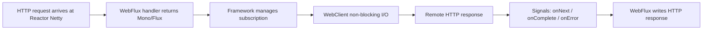
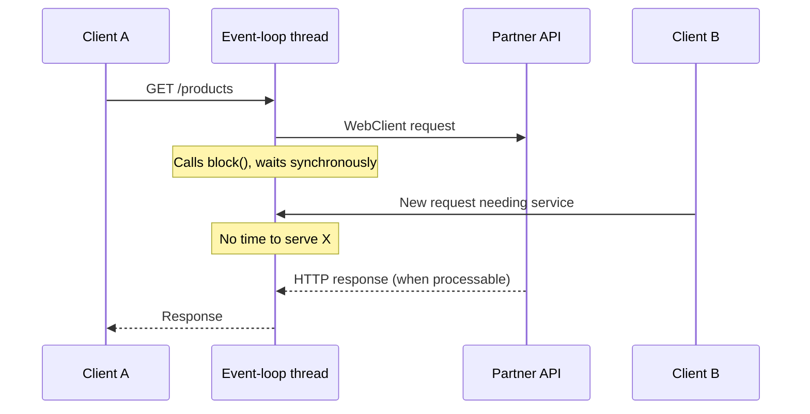
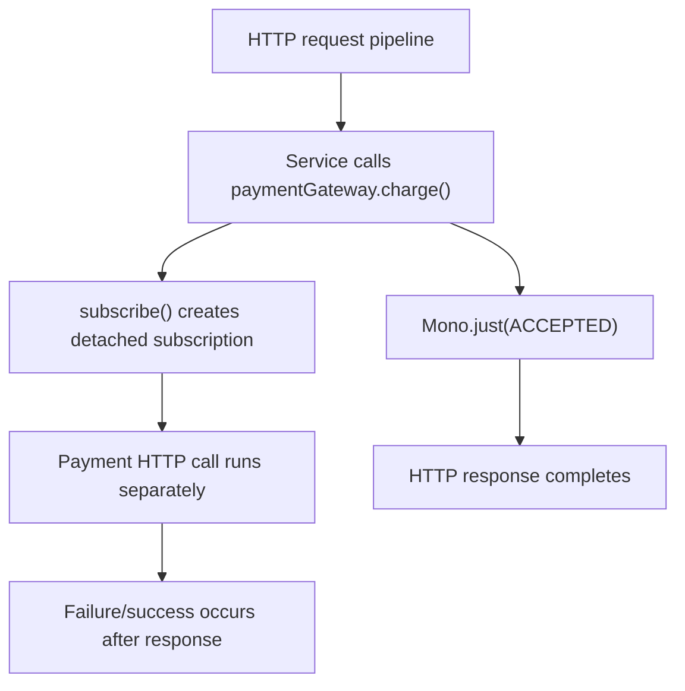
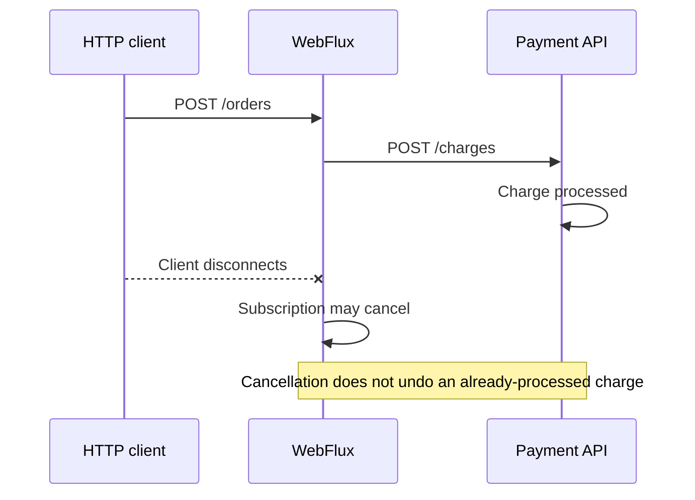
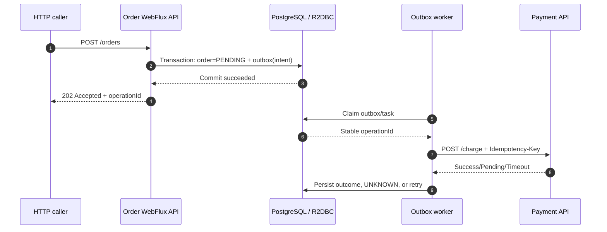

# Avoiding `block()` on the Event Loop and `subscribe()` Outside the Business Chain

Spring `WebClient` enables HTTP calls through a Project Reactor pipeline, typically returning `Mono<T>` or `Flux<T>`. In a Spring WebFlux application, a small number of event-loop threads can serve many concurrent connections because they are **not designed to wait synchronously** for each request. Placing `block()` in the wrong spot or calling `subscribe()` directly inside a service breaks that model: requests stall, throughput drops, errors get swallowed, transactions finish early, or external operations run after the HTTP response already reported success.

For example, `order-service` receives an order request, checks stock from the Catalog API, persists a payment intent in the database, and publishes a message to a broker. When a `WebClient` call runs detached from the reactive chain, the outer flow can complete before downstream work finishes. That directly affects data contracts, idempotency, commit timing, retries, and error observability—not merely performance.

This lesson belongs to the **WebClient** chapter of the **SPRING_BOOT_INTEGRATION** module. Its scope covers Spring Boot integration flows across HTTP clients, SQL, caches, Kafka/RabbitMQ, and Spring Integration adapters. Examples primarily use Spring Boot 3.x, Spring Framework 6.x, and Reactor 3.x; verify exact APIs, instrumentation, and configuration for your project's versions.

## 1. Learning Objectives

After this lesson, you will be able to:

1. Explain event loops, non-blocking I/O, subscriptions, signals, and the laziness of `Mono`/`Flux`.
2. Show why `block()` on a Reactor Netty event loop throws an error or starves the thread pool.
3. Explain why calling `subscribe()` inside a controller/service usually creates **detached work** disconnected from business outcomes.
4. Use `map`, `flatMap`, `then`, `zip`, `onErrorResume`, and `timeout` to keep steps within a single pipeline.
5. Distinguish "offloading blocking work to `boundedElastic`" from making I/O genuinely non-blocking.
6. Place transactions, retries, idempotency, acknowledgments, and outboxes at the right boundaries across HTTP, SQL, and brokers.
7. Control cancellation, context propagation, timeouts, resource cleanup, and concurrency limits.
8. Test that downstream errors and completion propagate to callers instead of getting lost in fire-and-forget execution.

## 2. Foundational Model: An Event Loop Is Not a Thread per Request

In the traditional servlet model, a request is usually handled by a worker thread that can block on JDBC or synchronous HTTP calls. In WebFlux with Reactor Netty, event-loop threads handle reading data, dispatching I/O events, and resuming pipelines upon signals. The system does not dedicate a thread to wait on each network call.



A `Mono<T>` represents **zero or one value** plus a completion or error signal. A `Flux<T>` represents zero to many values. Both are **Publisher** types; most Reactor pipelines are *lazy* (*cold*) and start work only when subscribed to.

Key terms:

| Term | Practical Meaning |
|---|---|
| Event loop | A thread multiplexing many I/O events; must not be stalled by long waits |
| Non-blocking I/O | While waiting on the network, the thread serves other work |
| `Publisher` | Describes a source of data/signals that a subscriber can subscribe to |
| `Subscription` | The link between publisher and subscriber, initiating demand and supporting cancel |
| `onNext` | Signal carrying one value |
| `onComplete` | Completion signal; no further values |
| `onError` | Error signal terminating the sequence |
| Cancellation | Subscriber stops expressing interest/demand for further items |
| `Scheduler` | Controls where selected Reactor tasks or signals execute |

An event loop handles short transformations smoothly, yet whenever it must **wait** on networks, databases, locks, or `Thread.sleep`, it can no longer serve other connections well. Thread names like `reactor-http-nio-*` are typical signs in Reactor Netty, not a guaranteed naming contract across all runtimes.

### 2.1. Reactive Does Not Mean Everything Runs in Parallel

`flatMap` chains asynchronous Publishers; it does not automatically spawn a new Java thread per item. `map` typically executes on whichever thread emits the signal unless an upstream scheduler boundary intervened. A pipeline routinely executes callbacks on event-loop threads.

**Non-blocking** describes how I/O waiting and threads interact; **concurrent** describes overlapping progress across tasks; **parallel** describes simultaneous execution across multiple processing cores. The three concepts are related, not interchangeable.

## 3. Mono/Flux Is a Work Description, Not a Computed Result

Consider:

```java
Mono<ProductView> product = webClient.get()
    .uri("/v1/products/{sku}", "SKU-42")
    .retrieve()
    .bodyToMono(ProductView.class);
```

Creating the `Mono` **does not send the request yet**. It describes how to make the HTTP call upon subscription. A WebFlux controller returns the `Publisher` directly to the framework; the framework subscribes in order to write the HTTP response.

```java
@RestController
class ProductController {

    private final ProductGateway gateway;

    ProductController(ProductGateway gateway) {
        this.gateway = gateway;
    }

    @GetMapping("/products/{sku}")
    Mono<ProductView> find(@PathVariable String sku) {
        return gateway.getProduct(sku);
    }
}
```

Here `ProductGateway.getProduct(...)` returns `Mono<ProductView>`. The controller **need not** and **must not** call `subscribe()`; WebFlux owns the terminal subscription, writes the body, handles errors/cancellation, and manages response lifecycle.

### 3.1. A Single Publisher Can Be Subscribed to Multiple Times

Example:

```java
Mono<ProductView> request = gateway.getProduct("SKU-42");

Mono<ProductView> first = request;
Mono<ProductView> second = request;
```

Two references to the same `Publisher` do not mean remote data is cached. With a cold `Publisher` such as a typical `WebClient` call, **each subscription** triggers a new HTTP request. To share results across subscribers, explicitly design caching/`cache()`/`share()` while accounting for errors, TTL, size, versioning, and sensitive data. Never slap `cache()` onto payment calls, as it can retain state past the intended lifecycle.

## 4. Why Is `block()` on an Event Loop Wrong?

`Mono.block()` is a terminal operation that waits synchronously until the `Publisher` finishes, returning the value or throwing an exception. It occupies the current thread while waiting.

```java
// Anti-pattern inside a WebFlux handler or event-loop callback.
@GetMapping("/products/{sku}")
ProductView bad(@PathVariable String sku) {
    return webClient.get()
        .uri("/v1/products/{sku}", sku)
        .retrieve()
        .bodyToMono(ProductView.class)
        .block(); // Blocks the executing thread.
}
```

In Reactor, calling a blocking terminal method like `block()` on a thread marked non-blocking (such as many Reactor Netty event-loop threads) fails with an `IllegalStateException` similar to:

```text
block()/blockFirst()/blockLast() are blocking,
which is not supported in thread reactor-http-nio-...
```

Do not assume "it's only wrong if it throws an exception"; blocking a thread not marked non-blocking that still serves latency-sensitive work stalls the system silently. The root mistake is **introducing synchronous waiting into a path meant never to block**.

### 4.1. What Happens When an Event Loop Is Held?



Under load, the consequences are latency spikes, timeouts, connection-pool exhaustion, and collapsed throughput. If an event loop blocks waiting for a signal that the very same event loop must dispatch, deadlock or starvation can occur.

### 4.2. The Right Approach: Return the Publisher

```java
@GetMapping("/products/{sku}")
Mono<ProductView> good(@PathVariable String sku) {
    return webClient.get()
        .uri("/v1/products/{sku}", sku)
        .retrieve()
        .bodyToMono(ProductView.class);
}
```

WebFlux subscribes and manages completion and errors for the response. There is no terminal blocking call in the controller.

## 5. `block()` Is Not Forbidden Everywhere in Java

What matters is **where it sits and the execution contract**:

| Context | Assessment |
|---|---|
| WebFlux controller / reactive filter on event loop | Avoid `block()`; return the `Publisher` |
| `map`/`flatMap` callback running on an event-loop thread | Avoid `block()`; compose instead |
| Reactor Netty I/O callback | Never wait synchronously |
| Service participating in a reactive chain | Keep the chain non-blocking; never call `block()` inside |
| CLI tool or synchronous test controlling its thread | `block(Duration)` is acceptable at the **outer boundary** |
| Blocking Spring MVC/Servlet service calling `WebClient` | Controlled blocking on servlet worker threads can work with strict timeout/concurrency caps; consider `RestClient` |
| Background job with dedicated blocking threads | Can wait within thread-pool budgets with explicit timeouts and lifecycle management |

Example in a synchronous integration test:

```java
ProductView product = gateway.getProduct("SKU-42")
    .block(Duration.ofSeconds(3));
assertThat(product.sku()).isEqualTo("SKU-42");
```

This is valid only when the test runs on a thread permitted to wait and specifies a timeout. In traditional Servlet applications, if synchronous HTTP calls are what you want, Spring `RestClient` usually expresses the model more cleanly than calling `WebClient.block()` across services.

**Rule:** if callers already operate on `Mono`/`Flux`, return and compose Publishers; if the caller is genuinely a blocking boundary API, decide explicitly where waiting occurs and bound thread budgets.

## 6. Why Is Calling `subscribe()` Inside a Service Dangerous?

`subscribe()` is a terminal operation that **starts an independent subscription**. It usually returns a `Disposable` immediately without waiting for downstream completion:

```java
// Anti-pattern: detaches work from the business call.
public Mono<OrderResult> createOrder(CreateOrderCommand command) {
    paymentGateway.charge(command)
        .subscribe(); // Work is detached from the returned Mono.

    return Mono.just(OrderResult.accepted(command.orderId()));
}
```

The caller awaits only `Mono.just(...)` and receives a success response even if:

- The charge HTTP request has not been sent or finished yet;
- Downstream returned 401/503 or timed out;
- The application crashed before payment completed;
- The client cancelled the HTTP request while the charge kept running;
- Errors never reach `createOrder`'s result pipeline;
- Tracing, correlation, and transaction context are no longer properly attached.

Especially for payments, fire-and-forget `subscribe()` can report "confirmed" before any obligation is durably recorded.

### 6.1. `subscribe()` Alters Lifecycle Ownership



The detached subscription is no longer coordinated by the HTTP response `Publisher`. Without an owner holding the `Disposable` and handling terminal signals, external work proceeds unobserved or aborts at the wrong time.

### 6.2. A `subscribe()` Without an Error Consumer Can Make Errors "Vanish"

```java
gateway.updateRemote()
    .subscribe();  // No clear owner handling onError.
```

Errors in this subscription cannot be thrown back into the caller method that already returned. Reactor provides default/hook error handlers depending on setup, yet business correctness must never rely on global error logs. Keep error signals in the main chain, or at explicit consumer boundaries provide proper handlers and lifecycle management.

## 7. Better: Compose Instead of Manual `subscribe()`

Suppose you want to check Catalog and then record a request. Keep everything inside the returned `Publisher`:

```java
public Mono<OrderResult> submit(CreateOrderCommand command) {
    return catalogGateway.getProduct(command.sku())
        .flatMap(product ->
            orderWorkflow.acceptAndPersist(command, product)
        );
}
```

Here `orderWorkflow.acceptAndPersist(...)` must return `Mono<OrderResult>` and **never subscribe internally**. If upstream fails, `onError` flows back to the controller; if the caller cancels, cancellation propagates to supporting sources. To return HTTP 202, `acceptAndPersist` must **durably persist the processing intent** in the DB/outbox before emitting `OrderResult.accepted`.

### 7.1. Controller Keeps Business Completion Inside the Response

```java
@RestController
@RequestMapping("/orders")
class OrderController {

    private final OrderWorkflow workflow;

    OrderController(OrderWorkflow workflow) {
        this.workflow = workflow;
    }

    @PostMapping
    Mono<ResponseEntity<OrderResult>> create(
            @RequestBody Mono<CreateOrderCommand> request) {
        return request
            .flatMap(workflow::submit)
            .map(result -> ResponseEntity.accepted().body(result));
    }
}
```

This example **returns 202 only after `submit` finishes** (meaning durably accepted per contract), without implying payment was captured or shipment booked. `OrderWorkflow`, `OrderResult`, and `CreateOrderCommand` are project-defined domain types.

### 7.2. When Immediate Acceptance and Deferred Execution Are Required

If the API specifies asynchronous acceptance:

1. Validate the request.
2. Persist an operation ID, `PENDING` state, and outbox/task record in **one durable transaction**.
3. Return `202 Accepted` with the `operationId` and a way to query status.
4. Have a lifecycle-managed worker poll the queue/task table and execute the work.

Never turn `subscribe()` in an HTTP controller into an in-memory job queue. If the process is killed, fire-and-forget work in RAM vanishes permanently.

## 8. `map`, `flatMap`, `then`: Ordering and Types

### 8.1. `map`: Synchronous, Short, Non-Waiting Transformation

```java
Mono<ProductSummary> summary = catalogGateway.getProduct("SKU-42")
    .map(product -> new ProductSummary(
        product.sku(), product.name()));
```

`map` transforms in-memory values. Never put `Thread.sleep`, blocking JDBC queries, or `block()` inside a `map` lambda on an event loop.

### 8.2. `flatMap`: Next Step Returns a `Publisher`

```java
Mono<QuoteResponse> quote = catalogGateway.getProduct("SKU-42")
    .flatMap(product ->
        pricingGateway.getDiscount(product.sku())
            .map(discount -> new QuoteResponse(
                product.sku(),
                product.price().subtract(discount.amount()),
                product.currency()))
    );
```

`pricingGateway.getDiscount(...)` is asynchronous, so `flatMap` flattens the inner `Publisher` into the main chain. If pricing fails, the whole chain receives `onError` unless explicitly handled per contract.

### 8.3. `then`: Wait for Completion, Discard Previous Value

```java
Mono<Void> workflow = auditGateway.recordRequest(command)
    .then(notificationGateway.sendIfAllowed(command));
```

`then` waits for the first publisher to complete successfully before subscribing to the next; if auditing fails, notification does not run. Note: use this only when "audit first, notify second" matches the contract and the audit record is durable when notifications have hard-to-compensate side effects.

### 8.4. `thenReturn`: Produce Result Only After Previous Step Completes

```java
Mono<Acceptance> result = taskRepository.persistIntent(command)
    .thenReturn(new Acceptance(command.operationId(), "PENDING"));
```

Assumes `persistIntent` returns a `Mono<Void>` whose **completion reflects a committed DB transaction**. `thenReturn` emits `Acceptance` only once the prior publisher completes cleanly, never earlier. If `persistIntent` secretly called `subscribe()` and returned `Mono.empty()`, that guarantee disappears.

### 8.5. `zip`: Coordinating Independent Calls

```java
Mono<QuoteResponse> quote =
    Mono.zip(
        catalogGateway.getProduct("SKU-42"),
        pricingGateway.getDiscount("SKU-42")
    ).map(tuple -> new QuoteResponse(
        tuple.getT1().sku(),
        tuple.getT1().price().subtract(tuple.getT2().amount()),
        tuple.getT1().currency()
    ));
```

`zip` suits independent reads that can be subscribed concurrently. Never `zip` two operations that **must run sequentially**—such as "commit order before charging"—if doing so breaks invariants. On `Mono.empty()`, `zip` completes empty without emitting a tuple; define policies explicitly for empty responses.

## 9. Side Effects and the Proper Role of `doOnNext`/`doOnSuccess`

Another anti-pattern hides business work inside observation callbacks:

```java
// Wrong: performs business writes via a detached subscription.
return catalogGateway.getProduct(sku)
    .doOnNext(product ->
        invoiceGateway.createInvoice(product).subscribe()
    );
```

`doOnNext` and `doOnSuccess` belong to instrumentation, logging, or **short, synchronous side effects without a `Publisher` to await**. Reactor never waits on subscriptions spawned inside them. If creating an invoice is mandatory, use `flatMap`:

```java
return catalogGateway.getProduct(sku)
    .flatMap(product ->
        invoiceGateway.createInvoice(product)
            .thenReturn(product)
    );
```

If issuing an invoice is a follow-up after acceptance that may run asynchronously, persist a durable intent/outbox record before returning success.

### 9.1. `doOnError` Does Not Replace `onErrorResume`

`doOnError` observes an error passing through without handling or converting it into a valid response:

```java
return gateway.fetch(id)
    .doOnError(ex -> metrics.recordGatewayFailure(ex));
```

If a fallback is intended:

```java
return gateway.fetch(id)
    .onErrorResume(TransientCatalogException.class,
        ex -> cachedCatalog.fetchFreshEnough(id));
```

Fallbacks are valid only when cached data meets freshness contracts. For authoritative amounts or checkout prices, never treat stale cached prices as live truth just to mask an HTTP error.

## 10. Subtle Composition Mistakes

### 10.1. Creating a `Publisher` Without Returning or Chaining It

```java
public Mono<Void> update(String id) {
    gateway.sendUpdate(id); // Returns Mono<Void>, but it is discarded.
    return Mono.empty();
}
```

Here the request may **never even be sent**, because nothing subscribes to the `Publisher`. Correct version:

```java
public Mono<Void> update(String id) {
    return gateway.sendUpdate(id);
}
```

### 10.2. Calling `subscribe()` and Returning `Mono.empty()`

```java
public Mono<Void> update(String id) {
    gateway.sendUpdate(id).subscribe();
    return Mono.empty();
}
```

Now the HTTP call triggers, yet completion and errors are detached from the caller. Never treat this as "fixing a publisher that didn't run."

### 10.3. Using `map` and Producing `Mono<Mono<T>>`

```java
Mono<Mono<PaymentStatus>> nested = orderGateway.getOrder(orderId)
    .map(order -> paymentGateway.getStatus(order.paymentId()));
```

`map` produces a nested `Publisher` value without subscribing to the inner `Publisher`. When you want the Payment result:

```java
Mono<PaymentStatus> status = orderGateway.getOrder(orderId)
    .flatMap(order -> paymentGateway.getStatus(order.paymentId()));
```

### 10.4. Subscribing Twice Does Not Cache by Default

```java
Mono<PaymentStatus> status = paymentGateway.getStatus(paymentId);
status.subscribe(this::auditStatus);
return status;
```

When the caller subscribes to `status`, the Payment API gets called a second time. Besides extra cost and races, the two calls can return different results. If auditing is required, attach `flatMap` or appropriate synchronous `doOnNext` inside **one** pipeline rather than subscribing separately.

## 11. HTTP Error Mapping Must Stay Inside the Reactive Chain

`WebClient.retrieve()` provides default error handling on HTTP error statuses. For APIs with specific contracts, map statuses into business exceptions at the gateway:

```java
public Mono<ProductView> getProduct(String sku) {
    return catalogWebClient.get()
        .uri("/v1/products/{sku}", sku)
        .retrieve()
        .onStatus(
            status -> status.value() == 404,
            response -> Mono.just(
                new ProductNotFoundException(sku)
            )
        )
        .bodyToMono(ProductView.class);
}
```

`ProductNotFoundException` is application-defined and assumed here to extend `RuntimeException`. The `onStatus` function returns a `Publisher` emitting a `Throwable` to the framework without calling `subscribe()`. When the gateway errors, the error signal flows to the service/controller or a designed `onErrorResume`.

Error classification guide:

| Failure | Typical Meaning | Action |
|---|---|---|
| 400 | Bad payload or input | Do not retry indefinitely |
| 401/403 | Bad credentials or permissions | Fix auth/config; do not treat as transient |
| 404 | Absent per API contract | Domain not-found or route misconfiguration |
| 409 | Conflict / idempotency state | Read body/code; do not blindly assume retryable |
| 429 | Rate limit | Backoff per `Retry-After`/contract |
| 503/504 | Temporary gateway/upstream outage | Retry if operation is safe |
| DNS/connect timeout | Network error | Classify and apply bounded retries |
| Read timeout after POST | Remote outcome uncertain | Preserve operation ID and reconcile |
| Undecodable response body | Schema/format mismatch | Report contract error; avoid uncontrolled retries |

Never install a global `onErrorResume(ex -> Mono.empty())` to make the app "always succeed"; empty Publishers carry meaning, can cause controllers to return misleading responses, and hide unfinished work.

## 12. Timeouts Are Signals That Must Be Handled

`Mono.timeout(Duration)` emits an error signal when the `Publisher` fails to complete within the deadline:

```java
return catalogGateway.getProduct(sku)
    .timeout(Duration.ofSeconds(3))
    .onErrorMap(
        java.util.concurrent.TimeoutException.class,
        ex -> new CatalogTimeoutException("Catalog request timed out", ex)
    );
```

`CatalogTimeoutException` is an application exception. A timeout **is not** a definitive partner rejection; if the request reached the server, the server can still complete side effects after the caller cancels/times out.

### 12.1. Distinct Timeout Layers

| Timeout | Target | What It Does Not Guarantee |
|---|---|---|
| Connect timeout | Opening TCP connection | Whole request finishing on time |
| TLS handshake timeout | TLS negotiation | Server business processing succeeding |
| Connection-pool acquire timeout | Waiting for a pooled connection | Remote response latency |
| HTTP response/read timeout | Waiting for response/reads per transport | Overall deadline across multiple retries |
| Reactor `timeout` | Signal wait inside reactive chain | Remote side effects did not happen |
| Business deadline | Time budget for a request/workflow | Atomic rollback across broker/DB/partner |

Depending on Reactor Netty/`WebClient` version and request factory, configure connect, response, read, pool acquisition, and TLS timeouts at their respective layers. An outer `timeout(3s)` cancels the subscription after 3 seconds without refunding money already charged at a partner.

## 13. `retryWhen`: Retry Only the Right Errors and Right Operations

Reactor provides `retryWhen`:

```java
import java.time.Duration;
import reactor.util.retry.Retry;

Mono<ProductView> product = catalogGateway.getProduct(sku)
    .timeout(Duration.ofSeconds(2))
    .retryWhen(
        Retry.backoff(2, Duration.ofMillis(250))
            .maxBackoff(Duration.ofSeconds(2))
            .jitter(0.3)
            .filter(CatalogErrorPolicy::isTransient)
    );
```

`CatalogErrorPolicy.isTransient(Throwable)` is an application predicate allowing only transient network failures, 429/503 per contract, and appropriate timeouts. `Retry.backoff(2, ...)` allows **at most two retries** after the initial call—up to three attempts total unless cancelled or deadline-expired. With cold `WebClient` publishers, each retry issues **a new HTTP request**.

Never use `retryWhen(Retry.indefinitely())` for payment POSTs or operations lacking an idempotency contract. A timed-out `POST` may already have succeeded on the server; retrying the logical operation requires a durable key, status lookup, or reconciliation.

### 13.1. Retry Policies Are More Than Annotations

| Operation | Might Retrying Fit? | Conditions |
|---|---|---|
| GET product | Possibly | Side-effect-free GET, transient error, within budget |
| GET payment status | Possibly | Query by operation ID, respects rate limits |
| POST charge | Only if contract guarantees idempotency | Stable key, never regenerated on resubscription |
| POST refund | Only if dedicated contract supports it | Refund key distinct from charge key; reconciliation |
| PUT update resource | Must verify semantics | May require ETag/version checks |
| Sending email | Never assume safe | Notification intent, deduplication/monitoring |

### 13.2. Eager Key Generation on Retries

If a pipeline wraps `Mono.defer(() -> createKeyAndCharge())`, each resubscription from `retryWhen` generates a **new key**. That is a critical bug for side effects. Create and persist the operation ID **before** any retry boundary, and reuse it downstream:

```java
String operationId = durableCommand.operationId();

Mono<ChargeStatus> call = paymentGateway.queryByOperationId(operationId);

return call.retryWhen(
    Retry.backoff(2, Duration.ofMillis(300))
        .filter(PaymentErrorPolicy::isTransient)
);
```

In real code, `durableCommand` comes from persisted task/state. When time runs out or the outcome remains unclear, transition to `UNKNOWN`/reconciliation rather than firing a fresh POST with a random key.

## 14. `onErrorResume`, `onErrorMap`, `doFinally`, and Error Ownership

A reactive chain propagates error signals straight to the caller:

```java
return catalogGateway.getProduct(sku)
    .timeout(Duration.ofSeconds(3))
    .onErrorMap(
        java.util.concurrent.TimeoutException.class,
        ex -> new CatalogTimeoutException("Timeout", ex)
    )
    .doOnError(ex -> metrics.recordFailure("catalog", ex))
    .doFinally(signalType -> metrics.recordTermination(
        "catalog", signalType.name()));
```

Operator responsibilities differ:

- `onErrorMap`: translates an error into a more appropriate error.
- `onErrorResume`: switches to an alternative `Publisher` per contract.
- `doOnError`: observes errors **without swallowing them**.
- `doFinally`: runs when the sequence terminates via complete, error, **or cancellation**.
- `onErrorReturn`: returns a fallback value, though easily hides failures if misused.
- `retryWhen`: conditionally resubscribes; does not establish idempotency.

Example of what not to do:

```java
return paymentGateway.charge(order)
    .onErrorResume(ex -> Mono.just(ChargeResult.success()));
```

A payment timeout or failure **does not** mean money was captured. You may return `PENDING_VERIFICATION` after persisting the operation so callers are never misled.

## 15. Cancellation: Caller Stops Waiting, Yet Side Effects May Continue

In WebFlux, if a client closes its socket, cancels the response, or hits a `timeout`, the subscription can cancel. Reactor propagates cancellation upstream wherever supported. Yet cancellation never guarantees that:

- a remote HTTP server aborts processing a received request;
- an external SQL transaction rolls back;
- a sent Kafka producer record is retracted;
- a captured charge is refunded.



For read-only work, cancellation saves I/O. For money or order mutations, require **durable intent + idempotency + reconciliation** rather than tying correctness solely to one HTTP request's lifecycle.

### 15.1. `doFinally(CANCEL)` Is Not Compensation

```java
.doFinally(signal -> {
    if (signal == SignalType.CANCEL) {
        log.debug("Caller no longer waiting");
    }
})
```

Never fire off `voidPayment()` inside `doFinally(CANCEL)` and assume a refund occurred. Compensation is an explicit business workflow requiring target operation IDs, persisted states, and verified outcomes.

## 16. Reactor Schedulers: `subscribeOn` vs. `publishOn`

When execution threads must change, Reactor offers two primary operators:

| Operator | Primary Effect | Do Not Assume |
|---|---|---|
| `subscribeOn(scheduler)` | Shifts subscription and upstream source execution onto that scheduler | Does not make blocking JDBC into non-blocking I/O |
| `publishOn(scheduler)` | Shifts downstream signals from that operator onward onto that scheduler | Does not handle timeouts, transactions, or side effects |

Running light `map` transforms on the event loop is completely normal:

```java
Mono<String> productName = webClient.get()
    .uri("/v1/products/{sku}", sku)
    .retrieve()
    .bodyToMono(ProductView.class)
    .map(ProductView::name);
```

There is no reason to sprinkle `publishOn(Schedulers.parallel())` just to "feel more reactive." Every scheduler hop adds context-switching overhead; CPU-heavy work can move to an appropriate worker pool, bounded by concurrency limits.

### 16.1. `subscribeOn` for Blocking Sources During System Migration

When JDBC cannot yet be replaced with R2DBC and a blocking repository must be called from a reactive chain, isolate it:

```java
import reactor.core.publisher.Mono;
import reactor.core.scheduler.Schedulers;

Mono<OrderEntity> loadOrder(String orderId) {
    return Mono.fromCallable(() -> jdbcOrderRepository.find(orderId))
        .subscribeOn(Schedulers.boundedElastic());
}
```

`boundedElastic` provides a bounded worker pool, far better than stalling Netty event loops. Still:

- JDBC remains **blocking** and pins a worker thread while waiting on the DB.
- Its pool and queue are finite; slow queries can saturate `boundedElastic`.
- JDBC transaction contexts are typically thread-bound; never open a transaction on a WebFlux event-loop thread expecting it to follow tasks onto `boundedElastic`.
- There is no automatic database backpressure/timeout; configure JDBC statement timeouts, pools, and resource cleanup.
- Revisit architecture: if most of a service uses blocking JDBC, Spring MVC + `RestClient` may be simpler than wrapping every query in `boundedElastic`.

### 16.2. Do Not Move All WebClient Calls to `boundedElastic` to Dodge `block()` Errors

`webClient.get()...bodyToMono()` is already non-blocking on reactive transports. Do not wrap every request in `subscribeOn(boundedElastic())`. When `block()` appears inside a reactive chain, the proper fix is **removing the blocking call and composing**, not hiding it on another thread pool across the codebase.

## 17. JDBC, JPA, and R2DBC: Reactive Chains Do Not Change the Driver

Wrapping a repository call in a `Mono` does not make database queries non-blocking. Compare:

```java
// Blocking JDBC runs immediately on the thread building the Mono:
public Mono<OrderEntity> wrong(String id) {
    OrderEntity entity = jdbcRepository.find(id);
    return Mono.just(entity);
}
```

```java
// JDBC stays blocking, but waiting is isolated off the event loop:
public Mono<OrderEntity> transitional(String id) {
    return Mono.fromCallable(() -> jdbcRepository.find(id))
        .subscribeOn(Schedulers.boundedElastic());
}
```

`Mono.just(jdbcRepository.find(id))` **evaluates its argument eagerly** when constructing the `Mono`, blocking the caller thread. `Mono.fromCallable` defers execution until subscription. `subscribeOn(boundedElastic())` is a transitional bridge when reactive drivers are unavailable; it does not eliminate DB pool exhaustion, long locks, or query timeouts.

### 17.1. R2DBC Enables Reactive Database I/O

With compatible R2DBC drivers/repositories, services compose SQL I/O and `WebClient` without blocking wrappers:

```java
public Mono<OrderView> findOrderWithShipping(String orderId) {
    return orderRepository.findByOrderId(orderId)
        .flatMap(order ->
            shippingGateway.getStatus(order.shippingId())
                .map(status -> OrderView.from(order, status))
        );
}
```

Assumes `orderRepository` is a reactive repository returning `Mono<Order>` and `shippingGateway` returns `Mono<ShippingStatus>`. Note that read models can be eventually consistent; responses should match freshness contracts.

### 17.2. Reactive Transactions Use Reactor Context

With R2DBC and `ReactiveTransactionManager`, Spring binds transactions to **Reactor Context** during subscription. Example persisting two SQL writes under one commit obligation:

```java
import org.springframework.transaction.reactive.TransactionalOperator;
import reactor.core.publisher.Mono;

class OrderAcceptanceStore {

    private final TransactionalOperator transactionalOperator;
    private final ReactiveOrderRepository orders;
    private final ReactiveOutboxRepository outbox;

    OrderAcceptanceStore(
            TransactionalOperator transactionalOperator,
            ReactiveOrderRepository orders,
            ReactiveOutboxRepository outbox) {
        this.transactionalOperator = transactionalOperator;
        this.orders = orders;
        this.outbox = outbox;
    }

    Mono<Void> persistIntent(CreateOrderCommand command) {
        return transactionalOperator.transactional(
            orders.insertPending(command)
                .then(outbox.insertOrderAccepted(command))
        ).then();
    }
}
```

`ReactiveOrderRepository` and `ReactiveOutboxRepository` are project-defined adapters returning Publishers. Both must share the same configured database and transaction manager. Using blocking JDBC repositories here offers no guarantee of participating in the reactive transaction.

### 17.3. Never Hold a SQL Transaction Open Across a Long HTTP Call

```java
// Avoid holding a DB transaction open while calling a slow Payment API.
return transactionalOperator.transactional(
    orders.insertPending(command)
        .then(paymentGateway.charge(command))
        .then(orders.markPaid(command.orderId()))
);
```

Even with reactive transactions, remote HTTP calls **do not participate** in SQL transactions; a SQL rollback cannot undo the charge, and meanwhile the transaction pins DB resources until the remote call finishes or times out. Instead:

1. Short SQL transaction: persist the order and outbox/operation intent.
2. Commit SQL.
3. Worker reads the intent and calls the Payment API with a stable idempotency key.
4. Persist the outcome or `UNKNOWN` state and run reconciliation.

Reactive programming never replaces distributed consistency architecture.

## 18. Transactional Outbox: The Right Way to Run Work After the HTTP Response

A common broken attempt:

```java
@PostMapping("/orders")
Mono<ResponseEntity<Void>> create(@RequestBody CreateOrderCommand cmd) {
    paymentGateway.charge(cmd).subscribe();
    return Mono.just(ResponseEntity.accepted().build());
}
```

This is not a durable job queue. If the service restarts after returning `202` and before the request goes out, the payment intent vanishes. If the Payment API charged and the response dropped, no persisted operation ID exists for reconciliation.

### 18.1. Proper Alternative Flow



This flow makes `202` honest: **accepted and durably saved**, not yet guaranteed paid. The worker may be a scheduled poller, Kafka consumer, or managed workflow engine with its own idempotency, retries, deadlines, and monitoring.

### 18.2. A Contract-Compliant Endpoint

```java
@PostMapping("/orders")
public Mono<ResponseEntity<AcceptanceResponse>> create(
        @RequestBody Mono<CreateOrderCommand> request) {
    return request
        .flatMap(command ->
            acceptanceService.persistOrderAndOutbox(command)
                .map(saved ->
                    ResponseEntity.accepted()
                        .body(new AcceptanceResponse(
                            saved.operationId(), "PENDING")))
        );
}
```

`persistOrderAndOutbox` must be a reactive method emitting `saved` only after the local transaction commits. If the service subscribes internally and immediately emits `Mono.just(saved)`, the endpoint's contract breaks. If the caller disconnects **during commit**, DB outcome may be uncertain; a unique business operation ID lets callers retry or query status without creating duplicate orders.

### 18.3. No Automatic Exactly-Once Across DB, Kafka, and HTTP

An outbox worker can publish to Kafka and crash before marking `PUBLISHED`. Consumers can receive redelivered records after rebalances. Combine event IDs with an inbox unique constraint:

```sql
CREATE TABLE processed_events (
    consumer_name VARCHAR(100) NOT NULL,
    event_id VARCHAR(160) NOT NULL,
    processed_at TIMESTAMPTZ NOT NULL DEFAULT now(),
    PRIMARY KEY (consumer_name, event_id)
);
```

Inside one local SQL transaction, insert the inbox key and apply the business update. If Kafka replays a record after DB commit but before offset commit, the duplicate key prevents repeating local side effects. For third-party HTTP side effects, combine with **operation ID** idempotency at the third party or reconciliation; a SQL inbox alone cannot make remote HTTP atomic.

## 19. Never `subscribe()` and Acknowledge Kafka/RabbitMQ Too Early

A critical integration bug:

```java
// Anti-pattern: illustrative Spring Kafka listener.
@KafkaListener(topics = "orders.requested")
public void handle(OrderRequested event, Acknowledgment ack) {
    paymentGateway.process(event).subscribe();
    ack.acknowledge(); // Does not wait for business outcome.
}
```

When `subscribe()` returns, the HTTP request has likely not completed. Acknowledging immediately can commit the Kafka offset even when payment later fails. If the app dies, the message is never redelivered to the consumer group. In RabbitMQ, acknowledging delivery right after fire-and-forget side effects causes the same loss.

### 19.1. Safe Patterns for Message-Driven Systems

Two common models:

**Model A — Listener completes durable intake:** the listener validates and saves a task/inbox/outbox inside a DB transaction, acks only after commit, and a separate worker calls the Payment API.

**Model B — Listener awaits the remote outcome per contract:** use listener container/framework support for asynchronous return types/acknowledgments, or a synchronous handler with bounded timeouts and retry policies. Account carefully for Kafka's `max.poll.interval.ms`, consumer thread ownership, rebalances, and `UNKNOWN` outcomes. Never call `block()` on a Reactor event loop to wait.

In Spring Kafka, certain versions support asynchronous listener return types like `CompletableFuture`/`Mono` paired with matching container acknowledgment modes. Verify your exact version and listener container semantics; **never** simply change `void` to `Mono<Void>` and assume offsets commit properly without configuration and testing.

### 19.2. When Operations Take Several Minutes

Do not hang Kafka poll threads or AMQP consumer deliveries waiting minutes on HTTP when you can persist a task and ack per contract. Model `PENDING/IN_FLIGHT/UNKNOWN/DONE` states, bounded backoff retries, and DLT/manual review. The goal is guaranteeing **the obligation was durably accepted**, not completing every remote side effect inside the broker listener timeout.

## 20. Spring Integration: Reactive Flows Still Require Explicit Channel Boundaries

Spring Integration connects HTTP outbound gateways, message channels, and adapters. Gateways returning `Mono`/`Flux` or bridging message flows into Reactor must still clarify:

- Which caller/channel owns the terminal subscription?
- At what moment does the adapter complete or acknowledge the inbound message?
- Does the message cross an `ExecutorChannel` or scheduler boundary?
- How do error signals route to `errorChannel`, reply channels, or reactive streams?
- Do trace/correlation headers survive bridges, retry topics, and DLTs?
- When the caller cancels, has remote work already been durably persisted as an intent?

Never equate "sent to a `MessageChannel`" with "HTTP partner finished processing," especially across async channels. An adapter calling `subscribe()` and returning success upstream causes the exact same silent error loss and premature acks seen in controllers.

When an inbound API expects a reply after an HTTP+SQL chain, design the gateway to **return a `Publisher`/async result whose completion reflects the real work**. For true fire-and-forget, route through queues/outboxes with clear ownership, error handling, and durable state.

## 21. Context Propagation, Correlation IDs, and Tracing

In servlet apps, developers often place correlation IDs in thread-bound SLF4J MDC. In WebFlux, a request can hop threads across operators; **`ThreadLocal` is not a reliable context carrier inside reactive chains**.

Reactor provides `Context` bound to each subscription:

```java
import reactor.core.publisher.Mono;
import reactor.util.context.Context;

Mono<ProductView> tracked = Mono.deferContextual(ctx -> {
    String correlationId = ctx.getOrDefault(
        "correlationId", "unknown");

    return catalogWebClient.get()
        .uri("/v1/products/{sku}", "SKU-42")
        .header("X-Correlation-Id", correlationId)
        .retrieve()
        .bodyToMono(ProductView.class);
}).contextWrite(Context.of("correlationId", "corr-81"));
```

`Mono.deferContextual` reads context **at subscription time**, regardless of which thread assembled the pipeline. `contextWrite` supplies values to upstream operators per Reactor semantics. The example uses a fixed ID for clarity; in production, derive it from validated request identity/correlation policies with length and character constraints.

### 21.1. Automatic Tracing with Micrometer

When Spring Boot/`WebClient` is configured with Micrometer Observation/Tracing and matching instrumentation, spans are created and `traceparent` is injected/extracted automatically. Never manually overwrite tracing headers just to force a trace ID to equal a business correlation ID.

Distinguish:

| ID | Purpose |
|---|---|
| Business correlation ID | Links multiple HTTP/message operations in one workflow |
| W3C trace ID | Identifies one distributed trace across instrumentation |
| Span ID | Identifies a single operation within a trace |
| Event ID | Uniquely identifies a logical event for deduplication |
| Idempotency key | Prevents duplicate side effects for a single operation |

An HTTP request may finish hours before an outbox worker runs; connect them using business correlation IDs and span links instead of forcing an entire multi-hour workflow into one long-lived span.

### 21.2. Detached `subscribe()` Can Drop Context

Calling `subscribe()` inside a callback creates a brand-new subscription that does not automatically inherit every `Context`, cancellation link, trace span, and transaction scope of the parent pipeline. Some instrumentation bridges context automatically, yet you should never rely on hidden side effects to excuse detached work. Composing via `flatMap`/`then` preserves ownership and context propagation per Reactor contract.

### 21.3. Securing Metadata

Never place access tokens, cookies, PII, card numbers, or credential-bearing URLs into Reactor Context and log them across operators. Context carries metadata—it is not a secret vault. Never trust a client-supplied `X-Correlation-Id` to authorize tenant access.

## 22. `WebClient.Builder`, Connection Pools, and HTTP Timeouts

A syntactically clean pipeline still stalls if the HTTP client lacks resource bounds. In Spring Boot WebFlux applications, inject the Boot-customized `WebClient.Builder` rather than building bare clients everywhere:

```java
@Configuration(proxyBeanMethods = false)
class PartnerClientsConfiguration {

    @Bean("catalogWebClient")
    WebClient catalogWebClient(WebClient.Builder builder) {
        return builder.clone()
            .baseUrl("https://catalog.internal.example")
            .build();
    }

    @Bean("paymentWebClient")
    WebClient paymentWebClient(WebClient.Builder builder) {
        return builder.clone()
            .baseUrl("https://payments.internal.example")
            .build();
    }
}
```

This is an illustrative config; production systems externalize URLs, auth, TLS, proxies, timeouts, and limits. `builder.clone()` isolates mutable settings between the two upstreams while retaining customizations from the Boot builder.

### 22.1. Reactor Netty Connector with Timeouts

Example transport `HttpClient` with connect and response timeouts:

```java
import io.netty.channel.ChannelOption;
import java.time.Duration;
import org.springframework.http.client.reactive.ReactorClientHttpConnector;
import org.springframework.web.reactive.function.client.WebClient;
import reactor.netty.http.client.HttpClient;

HttpClient httpClient = HttpClient.create()
    .option(ChannelOption.CONNECT_TIMEOUT_MILLIS, 1_000)
    .responseTimeout(Duration.ofSeconds(3));

WebClient catalogClient = WebClient.builder()
    .baseUrl("https://catalog.internal.example")
    .clientConnector(new ReactorClientHttpConnector(httpClient))
    .build();
```

This creates `HttpClient` directly for illustration. In real Spring Boot apps, verify you do not accidentally bypass SSL bundles, resource factories, observation filters, proxies, or configured connection providers. Attach custom connectors onto the injected `WebClient.Builder`:

```java
WebClient catalogClient = bootBuilder.clone()
    .baseUrl(catalogUrl)
    .clientConnector(new ReactorClientHttpConnector(httpClient))
    .build();
```

`bootBuilder` and `catalogUrl` come from application configuration. Replacing the connector can alter Boot-provided transport policies; verify TLS, tracing, pooling, redirects, and network failures via integration tests.

### 22.2. Connection Pools and Per-Upstream Limits

If Catalog slows down, requests queue up waiting for pooled connections. Reusing one `WebClient` is far better than creating new clients/connectors per request, since connectors own pools and I/O resources. For isolation:

- Dedicated connection providers/pools for Catalog and Payment with tailored caps.
- Pending acquire timeouts, max connections, and idle/lifetime limits matched to load.
- Rate limiters and bulkheads per logical upstream.
- Timeouts, retries, and circuit breakers that do not amplify across layers.

**Never** raise max connections indefinitely to "fix" timeouts; the upstream may rate-limit, the DB may be choked, or the network may be down. Monitor pool metrics, response latency, `429`s, `503`s, and throughput together.

## 23. Backpressure and Concurrency Limits in `Flux`

A multi-item stream can fire an overwhelming burst of HTTP calls if unbounded:

```java
Flux<OrderStatus> statuses = Flux.fromIterable(orderIds)
    .flatMap(paymentGateway::getStatus);
```

With a large `orderIds` list, `flatMap` without a domain-appropriate concurrency cap can open too many active calls and overload downstream. Cap it:

```java
Flux<OrderStatus> statuses = Flux.fromIterable(orderIds)
    .flatMap(paymentGateway::getStatus, 8);
```

The argument `8` bounds concurrent inner subscriptions for this operator—**it is not a requests-per-second quota**. Rate limiting and concurrency limiting are distinct concepts. Pick bounds using downstream SLAs, pools, quotas, and capacity.

### 23.1. `flatMap`, `concatMap`, and `flatMapSequential`

| Operator | Concurrency | Output Ordering |
|---|---|---|
| `concatMap` | Subscribes inner publishers sequentially in source order | Preserves source order |
| `flatMap` | Subscribes multiple inner publishers concurrently | Interleaved / completion order |
| `flatMapSequential` | Subscribes inner publishers concurrently | Reorders output to match source order |

If updates for a given order ID must execute **in sequence**, never use unbounded `flatMap` and hope business ordering holds. With Kafka, partition ordering and commit/ack strategies must also align.

### 23.2. Backpressure Does Not Make Remote Side Effects Reversible

Reactive Streams backpressure regulates subscriber demand toward cooperative publishers, preventing uncontrolled producer floods. It does not magically provide exactly-once HTTP effects or guarantee a remote POST is cancelled before execution.

### 23.3. Bounded Work from SQL/Kafka

If a scheduled job loads a million rows via blocking JDBC into a `Flux` and feeds them to `flatMap` HTTP calls, bound memory ingestion, batch sizes, fetch strategies, and boundary backpressure. Never treat `Flux.fromIterable(listOfMillionRows)` as "automatic reactive SQL streaming."

## 24. Errors and Cancellation When Streaming `Flux` Responses

For streaming endpoints:

```java
@GetMapping(value = "/events", produces = MediaType.TEXT_EVENT_STREAM_VALUE)
Flux<EventDto> stream() {
    return eventGateway.streamEvents();
}
```

WebFlux manages the subscription lifecycle; when the client disconnects, upstream resources (network streams, broker subscriptions, DB cursors) are released. Never manually `subscribe()` and write responses piecemeal, which breaks backpressure, cancellation, and cleanup wiring.

### 24.1. `usingWhen` for Asynchronous Resources

When resources require async acquisition and release via `Publisher`s, use `Mono.usingWhen`/`Flux.usingWhen`:

```java
Mono<Result> result = Mono.usingWhen(
    resourceProvider.acquire(),
    resource -> processWith(resource),
    resource -> resourceProvider.release(resource)
);
```

`resourceProvider`/`processWith` are illustrative adapters. `usingWhen` offers overloads with distinct handlers for completion, error, and cancellation; define cleanup policies for all three on critical resources. Never start an async cleanup via `subscribe()` inside `doFinally` and assume cleanup already completed.

### 24.2. Body and `DataBuffer`

With `retrieve().bodyToMono(Foo.class)` or `bodyToFlux(Foo.class)`, Spring codecs handle body consumption and resource management. When working directly with `DataBuffer`, obey codec/transport release and reference-counting rules; leaking buffers inflates off-heap direct memory. Avoid low-level buffer APIs unless custom streaming demands them.

### 24.3. Errors After the HTTP Response Has Started

If an SSE/streaming response already flushed headers and initial chunks before upstream emits `onError`, the server generally cannot switch the status to HTTP 500 with a JSON error body. Design client protocols for mid-stream failures, reconnects, checkpoints, and resume positions; never call `subscribe()` manually trying to "push" a second response.

## 25. Enforcing Business Step Ordering in a Single Chain

A hypothetical flow must:

1. Authenticate and validate input.
2. Fetch product from Catalog.
3. Calculate pricing with current data.
4. Persist order and outbox in one transaction.
5. Return `202` only after local commit succeeds.

Composition example:

```java
public Mono<AcceptanceResponse> accept(CreateOrderCommand command) {
    return identityGateway.authorize(command.actorId())
        .then(catalogGateway.getProduct(command.sku()))
        .flatMap(product ->
            pricingService.validateAndPrice(command, product)
        )
        .flatMap(quote ->
            acceptanceStore.persistOrderAndOutbox(
                command, quote
            )
        )
        .map(saved ->
            new AcceptanceResponse(saved.operationId(), "PENDING")
        );
}
```

These services/gateways return reactive Publishers, with `validateAndPrice` assumed to return `Mono<PriceQuote>`. There is no `subscribe()` or `block()`. If any step fails, no acceptance succeeds unless an explicit fallback exists. Keep Payment API calls out of the SQL transaction; let the outbox worker handle remote calls post-commit.

### 25.1. Watch Out for `then` Dropping Values

`then(...)` discards the preceding `Publisher`'s emitted item and waits only for completion. When Catalog data is still needed after an audit step, keep it in scope inside `flatMap`:

```java
return catalogGateway.getProduct(sku)
    .flatMap(product ->
        auditGateway.recordLookup(product.sku())
            .thenReturn(product)
    );
```

Never place `thenReturn(product)` outside `product`'s scope or drop data only to re-query it needlessly.

### 25.2. Business Fallbacks vs. Technical Fallbacks

When Catalog temporarily fails, a product-browsing page might show "details temporarily unavailable"; yet when placing an order requiring live prices, never substitute an expired cached price to bill a customer. `onErrorResume` must reflect the **business contract** of each endpoint.

## 26. When Is Direct `subscribe()` Still Intentional and Valid?

`subscribe()` is Reactor's foundational terminal operator, not a banned API everywhere. Every reactive flow needs **one ultimate consumer boundary**. WebFlux, `WebClient` internals, reactive messaging infrastructure, and test harnesses normally own that boundary.

Cases where application code legitimately acts as subscriber:

- A standalone `main`/CLI program owning its execution lifecycle.
- A dedicated managed daemon/worker initialized with lifecycle hooks, monitoring, error handling, and clean stop/cancel support.
- A specialized integration adapter bridging a `Publisher` into a callback-based system with explicit ownership and resource cleanup.
- Tests demonstrating subscription mechanics (though `StepVerifier` is usually preferred).

Whenever you subscribe explicitly, answer all six questions:

1. Who retains and disposes the `Disposable`?
2. How is `onError` handled, persisted, and alerted?
3. How does the worker stop cleanly on app shutdown or source cancellation?
4. Is there a durable queue/task record surviving crashes?
5. Are concurrency and backpressure bounded?
6. Do side effects enforce idempotency, retries, reconciliation, and completion contracts?

For instance, a CLI owning its lifecycle can call `block(Duration)` at the **final edge** instead of calling `subscribe()` and exiting immediately. For long-lived workers, integrate with the framework's lifecycle hooks and test shutdown rather than calling unmonitored `subscribe()` in constructors or `@PostConstruct`.

## 27. A More Complete WebFlux Example: Reading Data via WebClient

A read-only Catalog lookup is ideal for illustrating a purely non-blocking pipeline before introducing multi-side-effect workflows.

### 27.1. Dependencies

Gradle example:

```groovy
dependencies {
    implementation("org.springframework.boot:spring-boot-starter-webflux")
    implementation("org.springframework.boot:spring-boot-starter-actuator")

    testImplementation("org.springframework.boot:spring-boot-starter-test")
    testImplementation("io.projectreactor:reactor-test")
}
```

In a Spring Boot project containing both WebFlux and Spring MVC starters, the auto-configured web application type may not choose the WebFlux server automatically. Inspect the dependency graph and set `spring.main.web-application-type` when needed; using `WebClient` **does not require** the whole application to run as a reactive web server.

### 27.2. Gateway Configuration and Return DTO

```java
package example.catalog;

import java.math.BigDecimal;

public record ProductView(
    String sku, String name, BigDecimal price, String currency
) {}
```

```java
package example.catalog;

import java.time.Duration;
import org.springframework.beans.factory.annotation.Qualifier;
import org.springframework.stereotype.Component;
import org.springframework.web.reactive.function.client.WebClient;
import reactor.core.publisher.Mono;

@Component
public class CatalogGateway {

    private final WebClient client;

    public CatalogGateway(
            @Qualifier("catalogWebClient") WebClient client) {
        this.client = client;
    }

    public Mono<ProductView> getProduct(String sku) {
        return client.get()
            .uri("/v1/products/{sku}", sku)
            .retrieve()
            .bodyToMono(ProductView.class)
            .timeout(Duration.ofSeconds(3));
    }
}
```

`catalogWebClient` is a `WebClient` bean configured with base URL, TLS, auth, timeouts, and observations as in section 22. The gateway returns the `Publisher` and **never subscribes**.

### 27.3. Non-Blocking Controller

```java
package example.catalog;

import org.springframework.http.ResponseEntity;
import org.springframework.web.bind.annotation.GetMapping;
import org.springframework.web.bind.annotation.PathVariable;
import org.springframework.web.bind.annotation.RequestMapping;
import org.springframework.web.bind.annotation.RestController;
import reactor.core.publisher.Mono;

@RestController
@RequestMapping("/api/products")
public class ProductController {

    private final CatalogGateway gateway;

    public ProductController(CatalogGateway gateway) {
        this.gateway = gateway;
    }

    @GetMapping("/{sku}")
    public Mono<ResponseEntity<ProductView>> get(
            @PathVariable("sku") String sku) {
        return gateway.getProduct(sku)
            .map(ResponseEntity::ok)
            .defaultIfEmpty(ResponseEntity.notFound().build());
    }
}
```

Here `Mono.empty()` represents "not found." In practice, `WebClient.retrieve()` emits an error signal on HTTP 404 rather than `Mono.empty()`; to return `404` cleanly, the gateway or controller must map `WebClientResponseException.NotFound` to a not-found result per contract—for example using `onErrorResume` or a custom `@ControllerAdvice`/`ErrorWebExceptionHandler`. Never assume `defaultIfEmpty` automatically handles upstream HTTP 404s.

Explicit 404 handling:

```java
return gateway.getProduct(sku)
    .map(ResponseEntity::ok)
    .onErrorResume(
        org.springframework.web.reactive.function.client
            .WebClientResponseException.NotFound.class,
        ex -> Mono.just(ResponseEntity.notFound().build())
    );
```

This snippet **replaces the method body** of the controller; do not leave both return statements active at once. For 503/timeout failures, the API should return an appropriate error status and metrics rather than treating every failure as "product missing."

### 27.4. Isolate Base URLs to Prevent Token Leakage

When an app talks to both Catalog and Payment APIs, create two `WebClient` beans from cloned builders, each with its own auth, trust settings, and timeouts. Never attach a Payment token to a global `WebClient.Builder` unless all downstreams share the same trust boundary. In tests, verify Catalog requests **never contain** Payment's `Authorization` header.

## 28. Unit Testing Reactive Chains with `StepVerifier`

`StepVerifier` from Reactor Test subscribes to a `Publisher` and asserts signals. It is ideal for verifying: *do downstream errors actually reach the caller?*

### 28.1. Asserting Success and Error Propagation

```java
import static org.assertj.core.api.Assertions.assertThat;

import org.junit.jupiter.api.Test;
import reactor.core.publisher.Mono;
import reactor.test.StepVerifier;

class QuoteServiceTest {

    @Test
    void forwardsSuccessfulProduct() {
        Mono<String> result = Mono.just("SKU-42")
            .flatMap(sku -> Mono.just("FOUND:" + sku));

        StepVerifier.create(result)
            .expectNext("FOUND:SKU-42")
            .verifyComplete();
    }

    @Test
    void propagatesPartnerFailureInsteadOfFakeSuccess() {
        Mono<String> result = Mono.<String>error(
            new CatalogUnavailableException("Catalog offline")
        ).map(value -> "SUCCESS:" + value);

        StepVerifier.create(result)
            .expectError(CatalogUnavailableException.class)
            .verify();
    }
}
```

`CatalogUnavailableException` is a test/project-defined exception. These checks illustrate signal verification; in real integration tests, use a fake gateway or HTTP stub returning 503/timeouts and assert the service/controller never emits a fake success response.

### 28.2. Verifying No HTTP Request Runs Before Subscription

Simple way to verify laziness via `Mono.defer`:

```java
import java.util.concurrent.atomic.AtomicInteger;

AtomicInteger calls = new AtomicInteger();

Mono<Integer> lazy = Mono.defer(() -> {
    calls.incrementAndGet();
    return Mono.just(42);
});

assertThat(calls.get()).isZero();

StepVerifier.create(lazy)
    .expectNext(42)
    .verifyComplete();

assertThat(calls.get()).isEqualTo(1);
```

Uses AssertJ's `assertThat` as imported previously. With `WebClient`, use a fake `ExchangeFunction` or mock HTTP server to count actual requests; never assume every `Publisher` is automatically cold like `Mono.defer`.

### 28.3. Catching Detached `subscribe()` in Tests

Suppose a broken service does:

```java
public Mono<Acceptance> badSubmit() {
    remoteGateway.failCharge()
        .subscribe();
    return Mono.just(new Acceptance("PENDING"));
}
```

`StepVerifier.create(service.badSubmit()).expectNext(...).verifyComplete()` still passes even when the remote call fails, because that call **is outside** the returned `Publisher`. Testing only the return value is insufficient. Have a fake gateway track subscriptions/completions and assert the service **does not emit success before durable acceptance**; never write tests approving immediate `PENDING` returns before persistence finishes.

Fix the design first:

```java
public Mono<Acceptance> submit() {
    return durableTaskStore.persist()
        .thenReturn(new Acceptance("PENDING"));
}
```

Then assert that when `persist()` emits an error, the service also emits an error, and success appears only after persistence completes.

## 29. Testing Real HTTP with `WebTestClient` and Mock Upstreams

Pure `StepVerifier` tests cannot validate HTTP routes, status codes, headers, or JSON mapping. Combine layers:

- **Unit tests** of services with fake `Mono`/`Flux`.
- **WebFlux controller tests** using `WebTestClient`.
- **Gateway integration tests** using WireMock/MockWebServer to check request URLs, auth, timeouts, and response bodies.
- **Fault-injection tests** where remote servers stall or drop connections.

Example `WebTestClient` with the controller wired into a test context:

```java
@Test
void productEndpointReturnsMappedBody() {
    webTestClient.get()
        .uri("/api/products/SKU-42")
        .exchange()
        .expectStatus().isOk()
        .expectBody()
        .jsonPath("$.sku").isEqualTo("SKU-42");
}
```

`webTestClient` must bind to the application/controller with a fake/mock `CatalogGateway` returning a valid `ProductView`. For full backend tests, point a mock HTTP server at the configured base URL and verify outbound headers using appropriate test dependencies.

### 29.1. Verifying 503 Does Not Turn into 200/202

Test scenario simulating upstream 503:

```text
Given:
  Catalog mock returns HTTP 503.

When:
  GET /api/products/SKU-42.

Then:
  WebFlux pipeline propagates mapped CatalogUnavailable error.
  Controller/error handler emits HTTP status defined by API contract.
  No unrelated fallback data is presented as authoritative product.
  Failure metric/trace identifies dependency=catalog.
```

If a method calls `subscribe()` and returns `Mono.just(ok)`, HTTP-level tests reveal a bogus 200. If a method calls `block()` on an event loop, WebFlux/Netty tests catch the blocking error or timeout. These complement unit tests.

### 29.2. Testing Caller-Cancellation Races

Simulate a client cancelling or timing out **after** sending a POST to an external API. Verify:

- Remote side effects may still occur.
- Recovery never invents a different operation ID.
- Durable state preserves enough data to query/reconcile.
- HTTP responses never claim `PAID` without confirmation.

Never expect cancellation to undo remote work; write tests reflecting the partner's real contract.

## 30. Testing with Virtual Time and Scheduler Boundaries

Reactor Test's `StepVerifier.withVirtualTime` tests Reactor-managed timers without sleeping real seconds:

```java
import java.time.Duration;
import reactor.core.publisher.Mono;
import reactor.test.StepVerifier;

StepVerifier.withVirtualTime(() ->
        Mono.delay(Duration.ofSeconds(10))
            .map(ignore -> "DONE"))
    .expectSubscription()
    .thenAwait(Duration.ofSeconds(10))
    .expectNext("DONE")
    .verifyComplete();
```

Construct the `Publisher` **inside the `withVirtualTime` supplier** so scheduled operators pick up the virtual scheduler. This tests Reactor timers, not real network latency in `WebClient`/Netty or databases.

### 30.1. Virtual-Time Retry/Backoff Test

Test simulating two failures before success:

```java
import java.time.Duration;
import java.util.concurrent.atomic.AtomicInteger;
import reactor.core.publisher.Mono;
import reactor.test.StepVerifier;
import reactor.util.retry.Retry;

AtomicInteger attempts = new AtomicInteger();

StepVerifier.withVirtualTime(() ->
        Mono.defer(() -> {
            int attempt = attempts.incrementAndGet();
            if (attempt < 3) {
                return Mono.<String>error(
                    new IllegalStateException("transient"));
            }
            return Mono.just("OK");
        }).retryWhen(
            Retry.fixedDelay(2, Duration.ofSeconds(5))
        ))
    .expectSubscription()
    .thenAwait(Duration.ofSeconds(10))
    .expectNext("OK")
    .verifyComplete();
```

This verifies retry logic and timers within that scope; it does not prove a remote POST is safe to retry. Production policies still require retryable-error filters, idempotency, deadlines, and rate limits.

### 30.2. BlockHound to Detect Certain Blocking Calls

In compatible test setups, BlockHound can detect blocking APIs (like `Thread.sleep`) invoked on non-blocking threads. However, it has JDK/agent/version compatibility constraints and does not catch all waits, slow SQL queries, or side-effect bugs. Never treat "BlockHound passed" as proof an entire application is non-blocking.

Another high-value test runs concurrent load on real WebFlux/Netty while monitoring event-loop responsiveness and thread dumps under slow upstreams. Never watch total CPU alone; thread starvation occurs even when CPU looks idle.

## 31. Diagnostics and Anti-Pattern Reference Table

| Symptom | Likely Cause | Resolution |
|---|---|---|
| `IllegalStateException: block() ...` on `reactor-http-nio-*` | `block()` inside an event-loop callback/controller | Return/compose `Mono`/`Flux` |
| HTTP 202 returned yet payment intent missing | Fire-and-forget `subscribe()` before returning success | Persist durable task/outbox before responding |
| Gateway errors appear only in global logs | Detached subscription drops `onError` | Keep errors in the chain; use error mapping |
| Controller succeeds despite partner HTTP 503 | `onErrorResume` swallows errors or detached `subscribe()` | Classify errors; follow status/fallback contract |
| Two HTTP requests sent for one logical call | Cold `Publisher` subscribed twice | Use one pipeline; avoid extra subscribes; cache deliberately if needed |
| API never called though service builds `Mono` | `Publisher` constructed and discarded unsubscribed | Return/`flatMap`/`then` |
| High latency under WebFlux | JDBC/JPA/`Thread.sleep` on event loop | Switch to R2DBC or isolate blocking on `boundedElastic` |
| `WebClient` still stalls on `boundedElastic` | Blocking DB/API pins too many worker threads | Bound concurrency, timeouts, or revisit architecture |
| Retrying POST creates duplicate charges | `retryWhen` resubscription generates a new key | Use durable operation IDs, remote idempotency/reconciliation |
| Timeout after remote success | Cancellation cannot undo side effects | Persist `UNKNOWN` state and query outcome |
| Kafka offset committed before HTTP completion | Listener calls `subscribe()` then `ack` | Use durable intake or framework-supported async ack semantics |
| Request logs lose correlation | `ThreadLocal` MDC does not cross Reactor hops | Use Reactor Context / Micrometer tracing |
| `Flux.flatMap` launches 1,000 HTTP calls at once | Missing concurrency/rate cap | Use `flatMap(mapper, limit)` + rate limiter |
| SSE response fails after flushing chunks | Cannot change status after commit | Use protocol-level errors, reconnects, and checkpoints |
| Connection pool exhausted | Per-request clients, missing limits, slow downstreams | Reuse `WebClient`, tune pools/timeouts/bulkheads |
| Thread pool overloaded after `@Async` | Trigger returns early, unpersisted work queues up | Use managed queues/workers and cap in-flight work |

## 32. Observability and Runbook for Stalled Event Loops

When production WebFlux requests suffer widespread timeouts:

1. Identify affected services/endpoints, onset time, and p95/p99 latency shifts.
2. Inspect Reactor Netty event-loop threads and thread dumps for blocking frames (`Mono.block`, `Thread.sleep`, JDBC drivers, filesystem I/O, or locks).
3. Check for detached `subscribe()` outbound calls; compare ingress request counts against outbound HTTP call counts.
4. Inspect `WebClient` metrics by logical dependency, status, timeout, connection acquire latency, active/pending pool gauges, and retry counts.
5. Verify error signals are not being converted into fake success/empty results via `onErrorResume`.
6. Audit jobs and message consumers for acking before async HTTP work is persisted or contractually completed.
7. When blocking operations are found, prioritize **composing Publishers** or moving blocking adapters onto bounded executors—never hide the bug by raising event-loop thread counts.
8. Inspect backlogs, outboxes, and `UNKNOWN` payment records after incidents so completed remote side effects are reconciled.
9. Add regression tests reproducing the stall and verify recovery beyond latency returning to normal.

### 32.1. Useful Telemetry

| Signal | What It Detects |
|---|---|
| HTTP request latency/status and active requests | API response degradation |
| Reactor Netty event-loop delay/responsiveness | Threads failing to respond promptly |
| Connection pool pending acquire, active, idle | Congestion from slow upstreams |
| `WebClient` timeouts/errors per dependency | Isolated Catalog vs. Payment failures |
| Retry attempts / circuit breakers / rate limits | Request amplification and partner overload |
| Detached/background task counts (where tracked) | Work running outside HTTP chains |
| Kafka consumer lag/DLT, AMQP nacks/redeliveries | Broken message flows or bad ack timing |
| Outbox oldest unpublished, inbox duplicates | Side-effect and delivery consistency |
| Pending `UNKNOWN`/reconciliation payment age | Uncertain remote outcomes |
| Trace spans and correlation IDs | Tracing across HTTP → SQL → broker |

Never attach raw user-supplied URLs, order IDs, tokens, emails, or idempotency keys as high-cardinality metric tags. Use bounded labels like `dependency=catalog`, `operation=getProduct`, `error=timeout`. Apply strict security and redaction policies to logs and traces.

### 32.2. A Suspicious Trace

```text
POST /orders             traceId=t-91
  Catalog GET            65 ms OK
  Payment POST scheduled? (no child span visible)
HTTP response 202        70 ms

2 seconds later:
Payment POST 503         error logged elsewhere, correlation missing
```

This pattern suggests a detached subscription or broken context propagation, **not conclusive proof by itself**. Inspect the code, subscription ownership, trace sampling, async infrastructure, and durable records to confirm.

## 33. Scenario Exercises

### A. `block()` Inside a WebFlux Endpoint

```java
@GetMapping("/inventory/{sku}")
public Inventory get(@PathVariable String sku) {
    return inventoryGateway.get(sku).block();
}
```

**Question:** What can go wrong, and how should it be fixed?

**Guidance:** Change the controller to return `Mono<Inventory>` and return `inventoryGateway.get(sku)` directly. If the gateway performs blocking JDBC, offload it to `boundedElastic` or migrate to a reactive driver; never remove `block()` only to leave JDBC running on the event loop.

### B. `subscribe()` Inside a Payment Service

```java
public Mono<OrderState> pay(Order order) {
    paymentGateway.charge(order).subscribe();
    return Mono.just(OrderState.PAID);
}
```

**Guidance:** Never return `PAID` before the payment outcome is verified. Chain the `Publisher` via `flatMap` when handling synchronously, or persist `PENDING_PAYMENT`/outbox and return a pending status for a worker to process later.

### C. `doOnNext` Performing Async Work

```java
return catalogGateway.getProduct(sku)
    .doOnNext(p -> auditGateway.sendEvent(p).subscribe());
```

**Guidance:** If auditing is mandatory, use `flatMap(p -> auditGateway.sendEvent(p).thenReturn(p))`. If it is purely telemetry, use appropriate instrumentation rather than spawning detached business work in `doOnNext`.

### D. Timeout After Sending POST

`Payment API` processes the charge and the response drops. `timeout(3s)` errors and `retryWhen` resends the POST with a brand-new UUID.

**Guidance:** Deadlines and cancellations do not abort remote charges. Persist a durable operation ID and `Idempotency-Key`; query/reconcile `UNKNOWN` states, and retry POSTs only per partner idempotency contract.

### E. Kafka Listener Acknowledging Early

A listener calls `webClient.post()...subscribe()` then `ack.acknowledge()`. On the next call, the worker hits 503.

**Guidance:** Never ack upon launching a detached subscription. Ack only after completion per consumer contract or after durably persisting a task/inbox/outbox record; configure async listener containers if returning a framework-supported `Publisher`.

### F. Using `Mono.just` with JDBC

```java
Mono<Order> load() {
    return Mono.just(repository.findById("O-101"));
}
```

**Guidance:** The blocking `repository.findById` call runs **immediately when constructing the `Mono`**. Wrap in `Mono.fromCallable(...).subscribeOn(boundedElastic())` as a transitional measure or use a genuine R2DBC repository; if the repository returns `Optional<Order>`, unwrap/handle empty properly.

### G. Two Subscriptions Causing Two HTTP Calls

A developer saves `Mono<Price> price = gateway.getPrice()` and calls `price.subscribe(log)` before returning `price` from the controller. Metrics show two GETs.

**Guidance:** Cold `Publisher`s re-execute per subscriber. Move logging into `doOnNext` on the single returned pipeline instead of subscribing twice; if multiple consumers genuinely need one result, design bounded caching/sharing with data-freshness controls.

### H. `flatMap` Reordering Updates

A `Flux` of 500 update commands for the same aggregate is `flatMap`ped to a Partner API, arriving out of order.

**Guidance:** When each command depends on the prior one, use `concatMap` or per-key partitioning/ordering with bounded concurrency. For high throughput across independent aggregates, parallelize per key while controlling backpressure.

### I. Multiple Replicas Running Detached Cron Jobs

A cron across three replicas calls `service.reconcile().subscribe()`. The job runs three times and nobody knows when it finishes.

**Guidance:** Schedulers must own job lifecycles or trigger durable work only. Use DB claims/leases, stable IDs, bounded workers, persisted outcomes, and metrics instead of relying on `subscribe()` for distributed jobs.

### J. Lost Trace After Publishing

An HTTP request carries a trace ID, yet an event published inside a separate `subscribe()` lacks correlation/trace metadata. The producer still logs send success.

**Guidance:** Keep steps in one pipeline or persist correlation IDs inside durable envelopes/outboxes. Propagate context via Reactor/Micrometer/tracing integrations, and never equate broker send success with completed business work.

## 34. WebClient Code Review Checklist

- [ ] WebFlux controllers/filters return `Mono`/`Flux` without calling `block()` on event loops.
- [ ] Reactive services/gateways return Publishers so callers/frameworks own terminal subscriptions.
- [ ] No `subscribe()` inside `map`, `flatMap`, `doOnNext`, controllers, or listeners merely to "trigger" work.
- [ ] Where explicit subscription exists at a valid boundary, an owner tracks `Disposable`, errors, cancellation, lifecycle, and durable recovery.
- [ ] No Publishers created and discarded; every required step is chained via `flatMap`/`then` or appropriate operators.
- [ ] `map` (synchronous transform) is clearly separated from `flatMap` (async `Publisher`).
- [ ] Cold `Publisher` semantics and subscription counts are audited to avoid duplicate HTTP side effects.
- [ ] Blocking JDBC/JPA never runs on event loops; offloaded via `boundedElastic` or replaced with R2DBC.
- [ ] SQL transactions are never held open across slow HTTP side effects; outbox/state machines used when needed.
- [ ] HTTP statuses, timeouts, and deserialization errors map cleanly per contract and propagate through the chain.
- [ ] Retries apply backoff, bounded attempts, error filtering, and overall deadlines.
- [ ] Side-effecting POSTs never retry with new operation IDs/keys; idempotency and reconciliation are implemented.
- [ ] Cancellation is never mistaken for rolling back external transactions.
- [ ] Kafka/RabbitMQ acks occur only after processing or durable intake, never after detached `subscribe()`.
- [ ] Concurrency via `flatMap`, pools, and rate limits is bounded against downstreams.
- [ ] Reactor Context / Micrometer tracing propagates metadata reliably without relying on default `ThreadLocal`.
- [ ] `WebClient` config is isolated per upstream: base URL, auth, TLS, timeouts, pools, and error policies.
- [ ] Streaming Publishers and `DataBuffer`s clean up resources across complete, error, and cancel paths.
- [ ] `StepVerifier` tests cover completion/errors; HTTP integration tests cover status, headers, and timeouts.
- [ ] Crash/restart and multi-replica behavior is tested with durable work, outbox/inbox, and external side effects.
- [ ] Metrics cover response latency, event-loop responsiveness, pending pools, retries, and business backlogs.

## 35. Summary

Both `block()` and `subscribe()` have legitimate roles in Reactor, yet using either across the wrong boundary causes severe failures. **`block()` on an event loop** turns non-blocking execution into synchronous waiting, starving concurrent request handling and often triggering Reactor exceptions. **`subscribe()` inside controllers or services** detaches work from the caller's `Publisher`, severing errors, completion, cancellation, tracing, and transaction boundaries from actual business outcomes.

In Spring Boot WebFlux, return Publishers and use `map`, `flatMap`, `then`, `zip`, error operators, and timeouts to model **every mandatory step as one cohesive chain**. Across SQL and brokers, commit/ack boundaries must align with completed or durably accepted obligations. For irreversible HTTP side effects, rely on stable operation IDs, idempotency, outboxes, and reconciliation—cancellation and retries alone are not enough.

A dependable `WebClient` integration is more than "non-blocking." It enforces subscription ownership, resource lifecycles, backpressure and concurrency caps, transport tuning, observability, error/cancellation testing, and crash recovery. That is how you preserve both **reactive performance** and **business correctness** in **SPRING_BOOT_INTEGRATION**.
