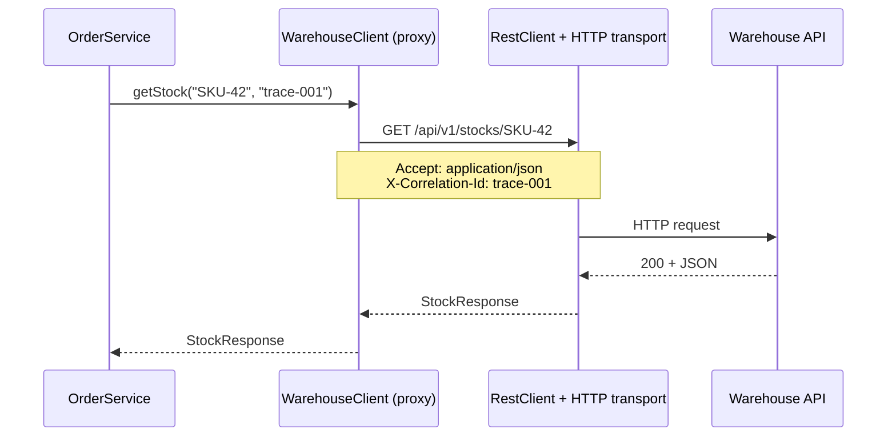

# Declaring Client Contracts with `@HttpExchange` and HTTP Annotations

## 1. Goal and Context

When a Spring Boot application calls another service over HTTP, the outbound calling code needs to describe the **integration contract**: which endpoint is called, which HTTP method is used, where parameters are placed, what structure the request/response payload has, and how errors are handled. Scattering calls like `RestClient.get().uri(...)` or `WebClient.post().bodyValue(...)` across business services easily leads to inconsistencies in paths, headers, and data formats.

Spring Framework's **HTTP Interface** allows declaring that contract as a Java interface. The annotations `@HttpExchange`, `@GetExchange`, `@PostExchange`, `@PutExchange`, `@PatchExchange`, and `@DeleteExchange` specify how each Java method invocation is translated into an HTTP request. `HttpServiceProxyFactory` creates a proxy that executes the interface using an underlying HTTP client.

Running example throughout this lesson: `order-service` needs to check stock availability and create a stock reservation in `warehouse-service`. `order-service` must propagate a correlation ID, use an idempotency key to prevent duplicate execution when creating a reservation, configure timeouts, receive typed results, and interpret errors from the external system. This is one slice of Spring Boot integration over HTTP, alongside database, cache, message broker, and Spring Integration integrations.

After this lesson, you will be able to:

1. Distinguish a declarative HTTP contract from the runtime request transport layer.
2. Use interface-level, method-level, and parameter-level annotations to describe requests accurately.
3. Create a Spring bean from an interface via `RestClientAdapter` or `WebClientAdapter`.
4. Design DTOs, timeouts, authentication, error handling, and idempotency at the boundary between two services.
5. Test URLs, HTTP methods, headers, and payloads without calling a real remote service.

> **Version Scope:** The code examples use Java 17+, Spring Boot 3.2+ with Spring Framework 6.1+, and manual proxy registration, which also works in newer Spring generations where the API is compatible. Attributes/features introduced in Spring Framework 6.2 or automatic registration support in the 7.x generation are noted separately. Always check the actual framework version of your project.

## 2. How Does an HTTP Interface Work?

A Java interface only describes the call. When Spring creates a proxy, each time a method is invoked, the proxy will:

1. Read the annotations to determine the HTTP method, URL, headers, query parameters, and body.
2. Combine the URL with `baseUrl`, expand path variables, and encode data via HTTP message converters/codecs.
3. Forward the request to the corresponding adapter for `RestClient` or `WebClient`.
4. Convert the HTTP response into the declared return type, or throw an exception on error.



This contract **does not create an HTTP server, does not automatically register itself as a Spring bean, does not automatically provide retry/circuit breaker**, and does not replace authentication configuration or transaction control. Those responsibilities belong to the client configuration layer, the integration layer, and the business layer.

### 2.1. Components

| Component | Responsibility |
| --- | --- |
| Java interface with `@HttpExchange` | Defines the HTTP operations that the application needs to call. |
| HTTP and parameter annotations | Declare the request line, query, header, body, cookie, etc. |
| `HttpServiceProxyFactory` | Generates a proxy implementing the interface and translates calls into requests. |
| `RestClientAdapter` | Connects the proxy to synchronous `RestClient`, suitable for imperative flows. |
| `WebClientAdapter` | Connects the proxy to reactive `WebClient`, supporting `Mono`/`Flux`. |
| HTTP request factory/connector | Handles network connections, TLS, connection pooling, and timeouts. |
| DTO | Represents the wire data contract, independent of internal persistence entities. |

### 2.2. Minimal Dependencies

For a Spring MVC-style Spring Boot 3.2+ project, `spring-boot-starter-web` provides `RestClient`, `@HttpExchange`, and the necessary web components. Add `spring-boot-starter-test` for testing. If you want to use `WebClient`, `spring-webflux` is required (typically via `spring-boot-starter-webflux`); check the active stack before adding it.

```xml
<!-- pom.xml: choice for a synchronous client -->
<dependency>
    <groupId>org.springframework.boot</groupId>
    <artifactId>spring-boot-starter-web</artifactId>
</dependency>

<dependency>
    <groupId>org.springframework.boot</groupId>
    <artifactId>spring-boot-starter-test</artifactId>
    <scope>test</scope>
</dependency>
```

The examples will use `RestClient` to keep the flow simple, and then compare with `WebClient`.

## 3. Declaring HTTP Method, URL, and Media Type

### 3.1. `@HttpExchange` at the Interface Level

`@HttpExchange` can be placed on an interface to declare common settings across methods, such as a URL prefix and expected content types:

```java
import org.springframework.http.MediaType;
import org.springframework.web.service.annotation.HttpExchange;

@HttpExchange(
    url = "/api/v1",
    accept = MediaType.APPLICATION_JSON_VALUE
)
public interface WarehouseClient {
    // Operations will share the /api/v1 prefix and Accept: application/json
}
```

- `url`: a relative path or full URL. A relative URL is combined with the client's `baseUrl` and the method-level path segment.
- `accept`: the `Accept` header value, telling the server which representation the client accepts; can contain multiple media types.
- `contentType`: the `Content-Type` header, indicating the format of the **request body**. Usually set on operations that have a body, rather than applied uniformly to every GET.
- `method`: the HTTP method used for a general `@HttpExchange`, for example `@HttpExchange(method = "HEAD", url = "/health")`.
- `headers`: declares static headers in the form `"X-Client=order-service"` starting from **Spring Framework 6.2**; on 6.1, use `@RequestHeader` or client configuration instead.

Method-level values can override the corresponding interface-level configuration according to annotation rules. For headers that vary per request (correlation ID, Bearer token, idempotency key), use a `@RequestHeader` parameter or an interceptor instead of a fixed value.

### 3.2. Specialized HTTP Annotations

| Annotation | HTTP Method | Common Use Case |
| --- | --- | --- |
| `@GetExchange` | GET | Retrieve an item or list. |
| `@PostExchange` | POST | Create a resource or send a business command. |
| `@PutExchange` | PUT | Replace/update a resource per PUT contract. |
| `@PatchExchange` | PATCH | Partially update a resource. |
| `@DeleteExchange` | DELETE | Delete/cancel a resource. |
| `@HttpExchange(method = "...")` | Custom | HEAD, OPTIONS, or specialized HTTP methods. |

The specialized annotations are shortcuts for `@HttpExchange`; typically **a Java method uses only one exchange annotation**. For example:

```java
@GetExchange("/stocks/{sku}")
StockResponse getStock(@PathVariable("sku") String sku);

@PostExchange(url = "/reservations", contentType = MediaType.APPLICATION_JSON_VALUE)
ReservationResponse reserve(@RequestBody ReservationRequest request);

@HttpExchange(method = "HEAD", url = "/stocks/{sku}")
ResponseEntity<Void> checkStockEndpoint(@PathVariable("sku") String sku);
```

In a client contract, `@GetExchange("/stocks/{sku}")` describes an **outbound** call. Do not confuse it with declaring a controller using `@GetMapping`, nor assume that adding `@HttpExchange` will make Spring automatically discover and create a bean.

## 4. Passing Parameters into an HTTP Request

Parameter annotations applicable to HTTP Interface methods:

| Java Parameter | Request Meaning | Example |
| --- | --- | --- |
| `@PathVariable("sku")` | Expands a placeholder in the URL. | `/stocks/{sku}` → `/stocks/SKU-42` |
| `@RequestParam("page")` | Adds a query parameter; with form URL-encoded, can become form data. | `?page=2` |
| `@RequestHeader("X-Correlation-Id")` | Adds a dynamic HTTP header. | `X-Correlation-Id: trace-001` |
| `@RequestBody` | Serializes an object into the request body. | JSON of `ReservationRequest` |
| `@RequestPart("file")` | Adds a part in a multipart request. | File upload |
| `@CookieValue("locale")` | Adds a cookie to the request. | `Cookie: locale=vi` |
| Parameter of type `URI` | Passes a dynamic URL into the request; can override annotation URL. | URL from a trusted config source |
| Parameter of type `HttpMethod` | Selects the HTTP method at runtime. | Special generic operation |

**Some design rules:**

- Explicitly specify names in `@PathVariable("sku")` and `@RequestParam("warehouseId")` so the contract does not depend on how parameter names are preserved in bytecode.
- Use `@RequestParam(name = "page", required = false)` for truly optional parameters; do not pass `null` for required parameters.
- `@RequestParam` only becomes form body when `Content-Type: application/x-www-form-urlencoded` is set; in most other requests, it is a query parameter. Do not treat `@RequestParam` as equivalent to a JSON `@RequestBody`.
- For multipart, use `@PostExchange(contentType = MediaType.MULTIPART_FORM_DATA_VALUE)` combined with `@RequestPart`. Files can use `Resource`, and you should choose an appropriate client/codec to stream large content.
- Only allow dynamic URLs from a trusted allowlist of destinations; passing arbitrary user-supplied `URI` values can lead to server-side request forgery (SSRF).
- Special parameters such as `@RequestAttribute` depend on the version and adapter; starting with Spring Framework 6.2, `@RequestAttribute` is supported with `RestClient` and `WebClient`.

## 5. Complete Example: Warehouse Client Contract

Suppose the partner API provides:

| Operation | HTTP Request | Payload |
| --- | --- | --- |
| Check stock by SKU | `GET /api/v1/stocks/{sku}` | `StockResponse` |
| Search stock by warehouse | `GET /api/v1/stocks?warehouseId=HCM-01&page=0` | `StockSearchResponse` |
| Reserve stock for an order | `POST /api/v1/reservations` | `ReservationRequest` → `ReservationResponse` |
| Update reservation status | `PATCH /api/v1/reservations/{id}` | `ReservationStatusPatch` |
| Cancel reservation | `DELETE /api/v1/reservations/{id}` | HTTP status and headers |

### 5.1. DTOs as the Data Contract

The Java records below represent the external API's JSON. Each `public record` is stored in a **separate Java file** with the matching name; they are grouped here for readability.

```java
// StockResponse.java
public record StockResponse(
    String sku,
    String warehouseId,
    int available
) {}

// StockSearchResponse.java
import java.util.List;
public record StockSearchResponse(
    List<StockResponse> items,
    int page,
    int size
) {}

// ReservationRequest.java
public record ReservationRequest(
    String orderId,
    String sku,
    int quantity
) {}

// ReservationResponse.java
public record ReservationResponse(
    String reservationId,
    String status
) {}

// ReservationStatusPatch.java
public record ReservationStatusPatch(
    String status
) {}
```

Do not use JPA entities directly as HTTP DTOs: entities may contain internal fields, lazy relationships, or circular references, and database schema changes should not equate to public API changes. When external JSON uses different field names, declare Jackson mappings like `@JsonProperty` on the DTO; when the API structure differs significantly, consider an adapter that converts to the internal domain model.

### 5.2. Interface with HTTP Annotations

```java
import org.springframework.http.MediaType;
import org.springframework.http.ResponseEntity;
import org.springframework.web.bind.annotation.PathVariable;
import org.springframework.web.bind.annotation.RequestBody;
import org.springframework.web.bind.annotation.RequestHeader;
import org.springframework.web.bind.annotation.RequestParam;
import org.springframework.web.service.annotation.DeleteExchange;
import org.springframework.web.service.annotation.GetExchange;
import org.springframework.web.service.annotation.HttpExchange;
import org.springframework.web.service.annotation.PatchExchange;
import org.springframework.web.service.annotation.PostExchange;

@HttpExchange(
    url = "/api/v1",
    accept = MediaType.APPLICATION_JSON_VALUE
)
public interface WarehouseClient {

    @GetExchange("/stocks/{sku}")
    StockResponse getStock(
        @PathVariable("sku") String sku,
        @RequestHeader("X-Correlation-Id") String correlationId
    );

    @GetExchange("/stocks")
    StockSearchResponse findStocks(
        @RequestParam("warehouseId") String warehouseId,
        @RequestParam(name = "page", required = false) Integer page
    );

    @PostExchange(
        url = "/reservations",
        contentType = MediaType.APPLICATION_JSON_VALUE
    )
    ResponseEntity<ReservationResponse> createReservation(
        @RequestHeader("Idempotency-Key") String idempotencyKey,
        @RequestBody ReservationRequest request
    );

    @PatchExchange(
        url = "/reservations/{id}",
        contentType = MediaType.APPLICATION_JSON_VALUE
    )
    ReservationResponse updateReservation(
        @PathVariable("id") String reservationId,
        @RequestBody ReservationStatusPatch patch
    );

    @DeleteExchange("/reservations/{id}")
    ResponseEntity<Void> deleteReservation(
        @PathVariable("id") String reservationId
    );
}
```

For example, `getStock("SKU-42", "trace-001")` translates to:

```http
GET /api/v1/stocks/SKU-42 HTTP/1.1
Host: warehouse.example.internal
Accept: application/json
X-Correlation-Id: trace-001
```

Successful response:

```http
HTTP/1.1 200 OK
Content-Type: application/json

{"sku":"SKU-42","warehouseId":"HCM-01","available":12}
```

Calling `createReservation("order-731", new ReservationRequest("ORDER-731", "SKU-42", 2))` sends:

```http
POST /api/v1/reservations HTTP/1.1
Host: warehouse.example.internal
Accept: application/json
Content-Type: application/json
Idempotency-Key: order-731

{"orderId":"ORDER-731","sku":"SKU-42","quantity":2}
```

Returning `ResponseEntity<ReservationResponse>` allows reading the status code, headers, and body. The body may be empty if upstream does not return JSON: the business service must verify whether that constitutes a valid response under the contract.

> **Distinction:** An idempotency key only prevents duplicate creation if the warehouse side actually stores and checks the key within the agreed time window and rules. Adding the header on the client alone does not create idempotency. When retrying a reservation creation request, reuse the **same key** for the same logical operation.

## 6. Creating the Client Proxy and Registering a Spring Bean

The interface does not yet have an implementation object. To inject `WarehouseClient` into a service, create a `RestClient`, wrap it with `RestClientAdapter`, and generate the proxy.

### 6.1. Configuration from the Environment

Sample `application.yml`:

```yaml
clients:
  warehouse:
    base-url: https://warehouse.example.internal
    connect-timeout: 2s
    read-timeout: 5s
```

Bind configuration to a record:

```java
import java.net.URI;
import java.time.Duration;
import org.springframework.boot.context.properties.ConfigurationProperties;

@ConfigurationProperties(prefix = "clients.warehouse")
public record WarehouseClientProperties(
    URI baseUrl,
    Duration connectTimeout,
    Duration readTimeout
) {}
```

### 6.2. Creating `RestClient` with Timeouts and Proxy

```java
import java.net.http.HttpClient;

import org.springframework.boot.context.properties.EnableConfigurationProperties;
import org.springframework.context.annotation.Bean;
import org.springframework.context.annotation.Configuration;
import org.springframework.http.client.JdkClientHttpRequestFactory;
import org.springframework.web.client.RestClient;
import org.springframework.web.client.support.RestClientAdapter;
import org.springframework.web.service.invoker.HttpServiceProxyFactory;

@Configuration(proxyBeanMethods = false)
@EnableConfigurationProperties(WarehouseClientProperties.class)
public class WarehouseClientConfiguration {

    @Bean
    WarehouseClient warehouseClient(
        RestClient.Builder restClientBuilder,
        WarehouseClientProperties properties
    ) {
        HttpClient nativeClient = HttpClient.newBuilder()
            .connectTimeout(properties.connectTimeout())
            .build();

        JdkClientHttpRequestFactory requestFactory =
            new JdkClientHttpRequestFactory(nativeClient);
        requestFactory.setReadTimeout(properties.readTimeout());

        RestClient restClient = restClientBuilder
            .baseUrl(properties.baseUrl().toString())
            .requestFactory(requestFactory)
            .build();

        RestClientAdapter adapter = RestClientAdapter.create(restClient);
        HttpServiceProxyFactory proxyFactory =
            HttpServiceProxyFactory.builderFor(adapter).build();

        return proxyFactory.createClient(WarehouseClient.class);
    }
}
```

This is the **manual and explicit** registration approach: creating a `WarehouseClient` bean dedicated to the warehouse API. Injecting Boot-provided `RestClient.Builder` preserves the application's HTTP message converter/customizer configuration. Choosing `JdkClientHttpRequestFactory` in the example makes connect timeout and read timeout explicit; if your organization has standardized an HTTP transport, configure the corresponding factory/connector in one place rather than having each client create its own.

Meaning of timeouts:

- **Connect timeout** limits the time to establish the connection; it is not a timeout for the entire business operation.
- **Read/request timeout** limits the time waiting for execution/reading the response depending on the HTTP transport and configuration API; measure actual behavior of the transport used in production.
- Never leave timeouts unbounded in synchronous call chains, especially if a user request traverses multiple sequential services.

With Spring Framework 7.x/Spring Boot 4.x, the framework also offers HTTP Service groups and `@ImportHttpServices` to register multiple interfaces automatically, along with per-group configuration. That mechanism is version-dependent; the proxy creation approach above keeps this lesson applicable to Spring Boot 3.x.

### 6.3. Using the Bean in Business Logic

```java
import java.util.Objects;
import org.springframework.http.ResponseEntity;
import org.springframework.stereotype.Service;

@Service
public class OrderReservationService {
    private final WarehouseClient warehouseClient;

    public OrderReservationService(WarehouseClient warehouseClient) {
        this.warehouseClient = warehouseClient;
    }

    public ReservationResponse reserveForOrder(
        String orderId,
        String sku,
        int quantity
    ) {
        // Stable key for a single order reservation operation.
        String idempotencyKey = "reserve:" + orderId;

        ResponseEntity<ReservationResponse> response =
            warehouseClient.createReservation(
                idempotencyKey,
                new ReservationRequest(orderId, sku, quantity)
            );

        return Objects.requireNonNull(
            response.getBody(),
            "Warehouse returned reservation response without body"
        );
    }
}
```

This is a minimal example for one reservation per order. If an order has multiple reservation batches or multiple line items, you must include the **operation** identifier in the key to distinguish legitimate requests. In a real system, the key must persist reliably across restarts and retries; do not use `UUID.randomUUID()` on every retry.

If the reservation step interacts with database writes or message publishing:

- Do not assume an HTTP call from `@HttpExchange` participates in the same ACID transaction as `order-service`'s database.
- Distinguish definite rejections from unknown outcomes (connection lost after upstream already processed the request).
- For multi-system workflows, consider business state tracking, outbox, saga/compensation, or reconciliation to prevent inconsistent records.

## 7. Choosing Return Types and Synchronous/Reactive Runtime

The return type determines how the response is read:

| Return Type | Meaning |
| --- | --- |
| `void` | Executes the request without reading the body. |
| `T`, e.g. `StockResponse` | Deserializes the body into an object; HTTP errors follow the error handler policy. |
| `HttpHeaders` | Retrieves response headers. |
| `ResponseEntity<Void>` | Retrieves status and headers without requiring a body. |
| `ResponseEntity<T>` | Retrieves status, headers, and typed body. |
| `Mono<T>`, `Flux<T>` | Returns reactive results when the adapter supports Reactor, typically `WebClientAdapter`. |

`RestClient` is synchronous: the calling thread typically blocks waiting for the response. `WebClient` supports asynchronous I/O in a reactive model and should use reactive return types in non-blocking flows. Do not declare `Mono<T>` on an HTTP Interface backed by `RestClientAdapter` and expect it to execute reactively.

Example replacing with `WebClient`:

```java
import reactor.core.publisher.Mono;
import org.springframework.web.bind.annotation.PathVariable;
import org.springframework.web.service.annotation.GetExchange;
import org.springframework.web.service.annotation.HttpExchange;

@HttpExchange(url = "/api/v1")
public interface ReactiveWarehouseClient {
    @GetExchange("/stocks/{sku}")
    Mono<StockResponse> getStock(@PathVariable("sku") String sku);
}
```

```java
import org.springframework.web.reactive.function.client.WebClient;
import org.springframework.web.reactive.function.client.support.WebClientAdapter;
import org.springframework.web.service.invoker.HttpServiceProxyFactory;

WebClient webClient = WebClient.builder()
    .baseUrl("https://warehouse.example.internal")
    .build();

ReactiveWarehouseClient client = HttpServiceProxyFactory
    .builderFor(WebClientAdapter.create(webClient))
    .build()
    .createClient(ReactiveWarehouseClient.class);

Mono<StockResponse> stock = client.getStock("SKU-42");
```

The `WebClient` snippet above illustrates the adapter mechanism; in a Boot application, inject Boot-configured `WebClient.Builder` and declare it as a bean similar to the `RestClient` example. To ensure timeouts and pools work as intended, configure the underlying Reactor Netty/Jetty/JDK connector rather than only adjusting the interface signature.

## 8. HTTP Errors, Retries, and Integration Consistency

Annotations describe the route and payload; error classification remains part of the integration contract.

### 8.1. Distinguishing Errors by Status

| Situation | Interpretation | Handling Approach |
| --- | --- | --- |
| `400 Bad Request` | Client sent invalid schema/validation. | Fix DTO or mapping; do not retry the same request. |
| `401/403` | Missing/expired credentials or insufficient permissions. | Handle auth, permissions, and token rotation; do not retry indefinitely. |
| `404` | Resource/route not found. | Map to "not found" when semantically valid; check for wrong path/version. |
| `409 Conflict` | Contention or state violation. | Use business error codes; decide whether to re-read state. |
| `429 Too Many Requests` | Rate-limited. | Bounded backoff, honoring `Retry-After` if upstream supports it. |
| `5xx` | Upstream failure. | Conditional retry, circuit breaker, fallback, or queuing depending on criticality. |
| Timeout/network error | Unclear whether the request arrived or succeeded. | Use idempotency key, check status, and reconcile before replaying side-effecting operations. |
| Missing body/schema mismatch | Response contract violated. | Log safely, track mapping errors, handle per integration policy. |

When using `RestClient`, 4xx/5xx responses by default trigger exceptions in the `RestClientException` hierarchy (HTTP status exceptions are typically `RestClientResponseException` or subclasses such as `HttpClientErrorException`). `WebClient` has the `WebClientResponseException` hierarchy. I/O errors in `RestClient` are typically represented by `ResourceAccessException`. Do not collapse all exceptions into a single outcome like "out of stock".

If you want to map HTTP errors to application exceptions, handle it in the adapter/service or configure `RestClient.Builder.defaultStatusHandler(...)`:

```java
RestClient restClient = restClientBuilder
    .baseUrl(properties.baseUrl().toString())
    .defaultStatusHandler(
        status -> status.value() == 503,
        (request, response) -> {
            throw new WarehouseUnavailableException("Warehouse is temporarily unavailable");
        }
    )
    .build();
```

Here `WarehouseUnavailableException` is a **custom application-defined** business exception; you must add that exception class if applying the code above. Note that `defaultStatusHandler` on `RestClient` handles status codes at the HTTP client layer; there is no equivalent attribute directly on `@GetExchange`. For APIs returning structured JSON errors, define an error DTO and map based on body/status rather than relying solely on text messages.

### 8.2. Retries and Idempotency

Not every request should be retried:

- Pure read-only GETs can typically be retried with limits on timeouts, `429`, or certain `5xx` statuses, depending on the partner's SLO and load capacity.
- Reservation-creating POSTs are only safe to replay if the receiver guarantees idempotency by key and handles same-key/same-payload scenarios.
- PATCH and DELETE must follow the receiving API's contract; the HTTP method itself does not guarantee that a partial update is safe to replay.
- Use exponential backoff, jitter, total time budgets, and concurrency limits; avoid multiplicative retries across layers in a call chain.

**Critical scenario:** `order-service` sends a POST, warehouse creates the reservation, but the connection drops before returning the response. The client does not know the outcome. If it generates a new key and POSTs again, it could reserve stock twice. If it reuses the valid key, re-checks the reservation status, and upstream implements deduplication properly, the system can recover safely.

### 8.3. Authentication, Sensitive Data, and Observability

- OAuth2/JWT credentials or API keys should come from a security provider and be attached via a client interceptor/filter when shared across multiple operations; avoid hardcoding tokens in annotations or source files.
- Log only URL templates, statuses, latencies, and necessary correlation/trace IDs. Do not log Bearer tokens, cookies, personal data, or entire request bodies by default.
- Use metrics/tracing via Micrometer/Actuator and HTTP client observation; choose low-cardinality tags (HTTP method, route template, upstream name, status), avoiding full SKU/orderId values as metric tags.
- Configure timeouts, pools, and concurrency limits at the HTTP transport layer; monitor p95/p99 latency, timeout rate, error rate, and retry rate.
- When integrating multiple partner APIs, separate clients by upstream/configuration group to avoid accidentally sharing tokens, timeouts, TLS settings, and error policies.

## 9. Testing Client Contracts

An HTTP Interface can be syntactically valid Java while still having the wrong URL, media type, or body serialization. Tests should verify the **actual HTTP traffic emitted by the proxy**, rather than just mocking the interface and checking that a service calls a method.

### 9.1. Lightweight Unit/Integration Testing with `MockRestServiceServer`

Spring Test allows binding a mock server to `RestClient.Builder`. The following example verifies that a GET request produces the expected path, HTTP method, headers, and JSON mapping:

```java
import static org.junit.jupiter.api.Assertions.assertEquals;
import static org.springframework.test.web.client.match.MockRestRequestMatchers.header;
import static org.springframework.test.web.client.match.MockRestRequestMatchers.method;
import static org.springframework.test.web.client.match.MockRestRequestMatchers.requestTo;
import static org.springframework.test.web.client.response.MockRestResponseCreators.withSuccess;

import org.junit.jupiter.api.Test;
import org.springframework.http.HttpMethod;
import org.springframework.http.MediaType;
import org.springframework.test.web.client.MockRestServiceServer;
import org.springframework.web.client.RestClient;
import org.springframework.web.client.support.RestClientAdapter;
import org.springframework.web.service.invoker.HttpServiceProxyFactory;

class WarehouseClientContractTest {

    @Test
    void getStockSendsExpectedRequestAndDecodesResponse() {
        RestClient.Builder builder = RestClient.builder()
            .baseUrl("https://warehouse.test");
        MockRestServiceServer server =
            MockRestServiceServer.bindTo(builder).build();

        WarehouseClient client = HttpServiceProxyFactory
            .builderFor(RestClientAdapter.create(builder.build()))
            .build()
            .createClient(WarehouseClient.class);

        server.expect(requestTo(
                "https://warehouse.test/api/v1/stocks/SKU-42"))
            .andExpect(method(HttpMethod.GET))
            .andExpect(header("Accept", "application/json"))
            .andExpect(header("X-Correlation-Id", "trace-001"))
            .andRespond(withSuccess(
                """
                {"sku":"SKU-42","warehouseId":"HCM-01","available":12}
                """,
                MediaType.APPLICATION_JSON
            ));

        StockResponse result = client.getStock("SKU-42", "trace-001");

        assertEquals("SKU-42", result.sku());
        assertEquals(12, result.available());
        server.verify();
    }
}
```

The mock server must be bound to the **same builder before calling `build()`**. If the test connects to a different `RestClient`, expectations will not observe any requests.

### 9.2. Recommended Test Suite Coverage

1. **Positive:** GET/POST/PATCH/DELETE with accurate URLs, HTTP methods, query params, path variables, headers, and content types; body decodes cleanly into records.
2. **Optional/encoding:** optional query parameters, spaces/Unicode characters in path/query, multi-valued query parameters, optional JSON fields.
3. **Negative:** `400`, `404`, `409`, `429`, `5xx`, timeouts, malformed JSON, invalid empty bodies.
4. **Retry/dedup:** the same idempotency key is preserved across retries of a single operation; no accidental duplicate write requests.
5. **Real contract:** cross-check against OpenAPI/provider contracts or a partner test environment, especially after API version upgrades.
6. **Observability:** verify logs do not expose tokens, metrics/traces use reasonable labels, and timeouts are applied at the transport layer.

`MockRestServiceServer` is suited for verifying how the proxy builds requests. When you need to test TLS, proxies, connection pooling, or compatibility with a real HTTP server, use a local mock HTTP server listening on a port (such as WireMock/MockWebServer) or an appropriate integration test environment.

## 10. Common Design Mistakes

| Mistake | Consequence | Fix |
| --- | --- | --- |
| Declaring an interface and immediately using `@Autowired` | No proxy bean exists if not registered. | Create a bean with `HttpServiceProxyFactory` or a version-supported HTTP Service registration mechanism. |
| Using `@GetMapping` on a client interface | Server mapping annotations are not HTTP Interface proxy contracts. | Use `@GetExchange`/`@HttpExchange`. |
| Confusing `Accept` and `Content-Type` | Server sends/returns unexpected representations. | `accept` describes the desired response; `contentType` describes the request body. |
| Passing `@RequestParam` while expecting a JSON body | Request is encoded as query/form instead of expected JSON. | Use `@RequestBody` and specify JSON content type. |
| Assuming `ResponseEntity<T>` catches all 4xx/5xx errors | Exception is thrown before business code inspects the status. | Configure an HTTP error handler or catch appropriate exceptions. |
| Using `Mono<T>` on `RestClientAdapter` | Incompatible with reactive execution semantics. | Use `WebClientAdapter` and reactive return types. |
| Hardcoding timeouts/URLs in source code | Hard to vary per environment; increases production risk. | Externalize configuration and apply per-upstream policies. |
| Retrying POST with a new key | May create duplicate reservations/charges. | Use a stable idempotency key, receiver deduplication, and state reconciliation. |
| Using domain/JPA entities as HTTP DTOs | Leaks internal fields and couples database schema. | Use dedicated DTOs and map at the integration boundary. |
| Treating every upstream error as a user error | Breaks internal API semantics and hinders diagnosis. | Separate business, network, authentication, and upstream outage errors. |

## 11. Applying to a Production System

When adding a new HTTP Interface, follow this sequence:

1. **Read the upstream contract:** endpoints, API version, body schemas, responses/statuses, auth, rate limits, idempotency, timeout behavior.
2. **Create DTOs matching the wire contract:** separate inbound/outbound JSON from entities and business models; identify required/optional fields.
3. **Write the interface:** shared prefix via `@HttpExchange`, individual methods via `@GetExchange`/`@PostExchange`..., parameters with explicit names.
4. **Register the proxy:** choose `RestClient` or `WebClient` per architecture; bind `baseUrl`, TLS, timeouts, auth, and error handling.
5. **Call through an integration layer:** do not let controllers or domain services depend directly on low-level HTTP error details; translate data and errors at the boundary.
6. **Test generated requests:** verify happy paths, errors, encoding, and recovery after timeouts.
7. **Observe in operations:** monitor latency/error/retry metrics, correlation IDs, control sensitive payloads, and test API version upgrades.

**Self-Check Questions:**

- If `@HttpExchange(url = "/api/v1")` is placed on the interface and `@GetExchange("/stocks/{sku}")` on the method, where does the final full URL come from?
- Why doesn't `@RequestParam` replace `@RequestBody` in a JSON POST?
- When a POST times out but the receiver may have succeeded, what must remain unchanged on retry?
- What does `ResponseEntity<ReservationResponse>` provide that `ReservationResponse` alone does not?
- If an application uses thread-per-request with Spring MVC, when is `RestClient` a simpler choice than `WebClient`? When should end-to-end reactive be evaluated?

## 12. References

- [Spring Framework — REST Clients and HTTP Interface (6.2)](https://docs.spring.io/spring-framework/reference/6.2/integration/rest-clients.html): creating proxies, parameter annotations, return types, and error handling.
- [Spring Framework — HTTP Service Clients (current documentation)](https://docs.spring.io/spring-framework/reference/integration/rest-clients.html): HTTP Service Groups, registration capabilities, and current-version APIs.
- [Spring Framework — `@HttpExchange` Javadoc (6.2)](https://docs.spring.io/spring-framework/docs/6.2.16/javadoc-api/org/springframework/web/service/annotation/HttpExchange.html): `url`, `method`, `accept`, `contentType`, and `headers` attributes.
- [Spring Boot — Calling REST Services](https://docs.spring.io/spring-boot/reference/io/rest-client.html): `RestClient.Builder`, `WebClient.Builder`, and Boot's HTTP client configuration.
- [Spring Framework — `MockRestServiceServer` Javadoc](https://docs.spring.io/spring-framework/docs/6.2.18/javadoc-api/org/springframework/test/web/client/MockRestServiceServer.html): binding a mock server to `RestClient.Builder` to test requests.
